# Lime 全局架构图

状态：current

## 1. 目的与裁决顺序

本文件是 Lime 的唯一全局架构地图。它回答目录归属、跨层数据流、依赖方向、协议边界和验证证据应该落在哪里。新增能力、重大重构、目录调整和架构评审都先以本文件判断 owner；领域文档只能补充具体契约，不能建立第二套运行时或改写这里的边界。

裁决顺序：

1. 当前构建图、协议 schema、运行代码和稳定测试。
2. 本架构图与根 `AGENTS.md`。
3. `internal/aiprompts/` 的领域边界与质量规则。
4. `internal/exec-plans/` 的已确认执行计划。
5. 路线图、研究、历史 evidence 和 Git history。

Codex 是唯一主对标。Agent loop、Thread/Turn/Item、App Server、状态机、工具生命周期、MCP、Skills、Multi-Agent、历史恢复、projection、CLI/TUI 和交付门禁直接读 `/Users/coso/Documents/dev/rust/codex` 的 current 源码；Desktop 行为使用 REA 安装包证据。保留 Lime 多模型、多协议；catalog、model switch、capability/readiness、retry/circuit breaker 与多模态 sampling 仅参考 `/Users/coso/Documents/dev/rust/grok-build` 的适用机制，不能替代 Codex 的 runtime、harness 或产品语义。provider wire 的 endpoint union、canonical content、媒体 lowering 和多协议 stream 可辅助参考 `/Users/coso/Documents/dev/js/opencode`，由 Lime `model-provider` 统一承接。参考项目不成为平行 owner，也不替代 App Server、ThreadStore 或产品 surface owner。

## 2. 仓库目录地图

2026-10-25 用户确认以整目录复制提高取样效率，同时保留 Lime 品牌与产品边界。整树只作为
一次性迁移输入，临时复制目录已经移除，不进入 Lime workspace、构建图或产品导航。Rust
迁移代码必须按许可证和真实消费者的最小依赖闭包直接落在 `lime-rs/crates/**` 的唯一
领域 owner；能力接入后删除重复实现，不启动第二 runtime，也不再向中转目录逐文件搬运。
产品根、对外入口、主题、多模型/多协议、服务端协议与发布产物继续由 Lime current owner
负责，Codex 登录、Cloud、账号、遥测、计费和发布服务不纳入。
Architecture impact: major / migration in progress；用户已明确上述顺序，责任 root。
第一条已收敛的消费者为 `lime execpolicy check -> execpolicy::ExecPolicyCheckCommand ->
lime-rs/crates/execpolicy`；其余 Agent 主链切换单独验收。逐项收据、切换和退出条件见
[整树迁入计划](../exec-plans/codex-source-baseline-migration-20261025.md)。

| 目录                                  | 类型                      | Owner / 职责                                                             | 禁止放入                                                             |
| ------------------------------------- | ------------------------- | ------------------------------------------------------------------------ | -------------------------------------------------------------------- |
| `src/`                                | Renderer                  | React 产品 UI、view model、renderer gateway、i18n、局部显示状态          | Rust 业务实现、Electron main 逻辑、provider wire、生产 mock fallback |
| `electron/`                           | Desktop Host              | main、preload、IPC 白名单、窗口/托盘/系统能力、sidecar 生命周期、updater | Agent 状态机、Thread/Turn/Item、模型调用、业务 read model            |
| `lime-rs/crates/`                     | Rust workspace            | App Server、runtime、协议、provider、工具、持久化、CLI/TUI、领域服务     | 已删除的旧 Rust root 或 Tauri wrapper 的替代品                       |
| `packages/`                           | 可复用 TypeScript package | 跨 Renderer/Host 的 typed client、schema、projection、UI contract        | 仅单个页面使用的产品状态机、Electron main 实现                       |
| `scripts/`                            | 校验与自动化              | 可复用质量入口、fixture smoke、发布/治理脚本                             | 产品业务逻辑、未登记的根级临时脚本                                   |
| `resources/`、`lime-rs/resources/`    | 受版本控制资源            | 内置 skill、模板、静态运行时资源                                         | 运行时生成物、用户数据、机密                                         |
| `internal/aiprompts/`                 | current 工程事实源        | 架构、命令、质量、治理、GUI、目录准入                                    | 历史迁移日记和实现副本                                               |
| `internal/exec-plans/`                | 执行记录                  | 多轮计划、确认记录、进度、证据索引、blocker                              | 未经确认的长期架构规则                                               |
| `internal/roadmap/`                   | 未来规划                  | 阶段目标、优先级、产品路线                                               | current API 或 runtime owner 的唯一说明                              |
| `internal/research/`                  | 研究证据                  | 对照、审计、外部实现分析                                                 | 生产代码或 current 架构定义                                          |
| `internal/test/`、`internal/testing/` | 测试设计                  | 场景、质量矩阵、测试规范                                                 | 产品实现                                                             |
| `docs/`                               | 对外文档站                | 站点内容、配置、静态资源                                                 | 内部工程规则、执行计划、私有 evidence                                |
| `.codex/`                             | Lime 项目配置             | 可复用 skill、项目级 agent 配置                                          | 产品业务实现或第二套架构事实源                                       |
| `extensions/`                         | 独立扩展                  | Chrome extension 等独立宿主实现                                          | Renderer/Agent runtime 的共享业务 owner                              |

根目录的 `package.json`、`forge.config.mjs`、`vite.config.*`、`tsconfig*.json`、`eslint.config.*` 和 `lime-rs/Cargo.toml` 是构建与发布边界。变更它们必须同步锁文件、相关验证和架构图中受影响的边界。

### Files 预览与目录职责

Files 的预览投影与模式归 `agent/chat/workspace/filePreviewTarget.ts`、
`filePreviewModel.ts`，目录缓存与宽度交互归 `right-surface/useFileTreeState.ts`、
`useFileTreeResize.ts`；路径归一复用 `workspacePath.ts`。依赖方向为：

```text
Timeline professional / saved-site / initial project / service result files
  -> existing openWorkspaceFile -> Files tabs/lifecycle
Files / FilePreviewPanel -> filePreviewTarget + filePreviewModel -> existing ArtifactRenderer
Files tree / FileSourceBreadcrumb -> useFileTreeState -> current file API
remaining Canvas consumers -> Files preview projection
```

Files 不依赖 Canvas selection 或旧工作台 ViewModel；旧 Canvas 只能消费上述共享投影。
时间线专业文件直接交给 Files，不先读取内容或创建临时 Artifact；其他尚存 Canvas
入口仍由执行计划列明，不能将本片迁移解释为整条旧链已删除。
同项目已保存站点、初始项目文件和服务结果文件复用该入口；跨项目保留路由，初始
内容恢复完成后才激活文件。Composer 批注重开也直接进入 Files；现有草稿 Store 的
pending focus 绑定 Files 标签 ID，`ArtifactNavigationContext` 仅传递标签身份与激活状态，
源文件 SHA 就绪且标签激活后由原格式适配器定位，不新建 Artifact 或重挂编辑器。
文件标签实例与关闭/保存仍归既有 FileTabLifecycle、格式 Controller 和 public file action，
不建立第二套业务状态、协议或持久化 owner。旧 Canvas 预览模式、目录 hook、resize、
文件投影与无人消费的 display helper 已直接删除，不保留 alias。结构依据同摘要 REA
统一文件 opener/contentInstance/onBeforeClose 合同；新本地职责名不代表 Codex 原始名称。
Architecture impact: minor；责任 root，2026-10-22，确认主链不变。
本次迁移的产品验收与完整 Canvas/Artifact 清退状态由执行计划持有。

### 2.1 多 Surface 主链

```text
Desktop Renderer -> Electron Desktop Host --\
                                            \
CLI / TUI -> app-server-client --------------> App Server JSON-RPC
                                             -> RuntimeCore
Future Cloud -> authenticated transport ----> LimeCore gateway
                                                -> control-plane tenant runtime registry
                                                -> tenant App Server JSON-RPC
                                             -> agent-runtime / model-provider / tool-runtime
                                                -> ThreadStore + Thread/Turn/Item projection
```

远程 workspace 仍由这条主链拥有：CLI `ConnectionArgs::workspace_cwd` / TUI
`runtime/connection` 只表达用户是否显式选择目录，远端缺省不发送本机路径；
App Server `session_operations/working_directory` 负责服务端 cwd/roots 解析及已发布
metadata 归一，复用原 session actor 与 durable metadata writer。start/resume/fork
返回同一 canonical cwd，Turn 的权限计算消费实际 Thread/覆盖目录，不建立 workspace registry。
`turn/start` 的 cwd/roots 覆盖经同一 session metadata actor 原子提交，影响当前及后续
回合；roots-only 与空数组清除仍使用原持久化字段。写入失败时不先改内存或接纳 Turn，
成功后替换 Thread Skills 注册。Surface 不持有临时 workspace 业务副本。
TUI Host 初始化、连接、搜索、历史、动作与 resume 分别归
`runtime/{startup,connection,file_search,history,actions,resume}`，主 runtime 只负责事件循环接线；
Thread start/resume 的客户端接线归 `app_server_session/thread`。拆分直接迁移调用者，
无旧 helper 包装或第二业务后端。Architecture impact: minor；责任 root，2026-10-17，
确认目录解析、恢复写入与工具执行继续归 App Server/runtime，Surface 只消费其投影。

Skills 文件监听仍由 App Server `skills_watcher` 唯一拥有。默认根、runtime extra
roots 和 Thread project roots 共用同一 OS watcher；`registration` 只管理路径资源，
不复制 catalog、配置或 snapshot。extra roots 替换立即释放旧注册；Thread 注册由
`ThreadStateManager` 持有，在替换、卸载、删除或 shutdown 时释放，共享根保留到最后
一个 owner 释放。Thread project roots 直接消费 `session_runtime_defaults` 的同一有效目录
与项目根，只读取 canonical 顶层 `workingDir` / `runtimeWorkspaceRoots`；settings 成功持久化后
替换注册，删除 watcher 专用 metadata 解析与导出；
已选择 remote environment 的目录不交给本机文件监听。文件变化立即失效既有 snapshot
cache，typed `skills/changed` 经现有 event bridge 节流广播；成功的配置/目录变更经
processor 的同一 catalog mutation 通道广播。App Server 初始化归 `initialization`，
原内联测试迁到 `tests/{lifecycle,events,streaming,transport}`；无旧 helper 包装。
Architecture impact: minor；责任 root，2026-10-17，确认资源注册不持有业务状态或
新增持久化 owner，仍走原 App Server/runtime/Skills 主链；运行验收另见执行计划。

mutable workspace 归 canonical Thread。`projection_store/session_settings` 在初始化恢复
rollout 后归一现役根字段别名，复用原 metadata transaction/durable writer；reviewer 和
workspace 在同一 Thread 事务归一。`migration`、`restore`、`reviewer`、`workspace` 分别
负责事务、事件重建投影和字段规则，不复制持久化实现。`runtimeWorkspaceRoots: []`
显式清除项目根；runtime defaults 和 watcher 只读取 canonical 顶层设置。事件投影 repair
从 canonical settings 恢复目录/roots，避免旧 SessionStarted 事件复活过期目录。
跨产品导入、nested continuation/settings 与来源优先级已删除，不参与归一或恢复。
Architecture impact: minor；责任 root，2026-10-20 确认：
Surface -> App Server -> RuntimeCore -> canonical Thread 的依赖方向不变。

Plugin Skills 的来源为既有 `PluginDataSource::list_enabled_plugin_turn_snapshots`。
catalog、Turn snapshot 和文件监听共用 `PluginTurnSnapshot::skill_root`，不分别猜测包目录。
processor 在 initialize 时恢复已安装插件监听，在成功的 install/enable/uninstall 后替换
同一 process registration，并经 Skills catalog mutation hook 向所有连接广播；失败不广播。
`WatchRegistration` 只持 OS 路径资源，Thread 与 process plugin 注册共用同一 watcher，
不复制 plugin 状态或 Skill 配置。`local_data_source/plugin_catalog` 的包安装、库存、manifest、
发现、Apps、runtime components、catalog metadata 和资源路径分别归对应子模块；根模块
只聚合真实 owner，不保留旧实现包装。Architecture impact: minor；责任 root，2026-10-17
确认主链和持久化 owner 不变。运行证据归 S09-E，namespace/同名身份单列 S09-G。

`Product Surface`、`Host/Transport` 与业务 runtime 是三层边界。Desktop、TUI、CLI 可以拥有各自的窗口/终端生命周期、输入法、快捷键和展示投影，但不能拥有 provider loop、工具 registry、approval authority、Thread/Turn/Item 状态机或持久化副本。`app-server-protocol` 是跨 surface 合同，`app-server-client` 是 Rust surface 的连接/session owner；本地 stdio 是当前实现，未来 Cloud 通过同一 session facade 接入认证后的远端 transport。TUI 的 `resume` picker 与 Codex-shaped `Agents Overview` 只读取 App Server `thread/list`，选中后进入标准 `thread/resume`；Overview 的状态分组、子线程状态冒泡与刷新仅投影 canonical Thread/notification，不访问私有 daemon/state DB。Overview 的新任务、改名和停止操作分别 lowering 到现有 `thread/start` + `turn/start`、`thread/name/set` 与 `turn/interrupt`，不复制 Codex agents daemon；刷新请求使用单一 request identity，合并 pending 请求并重放刷新期间到达的最新 thread notification。TUI 在 `app/app_server_event_targets.rs` 复用 Codex 同名 `server_notification_thread_target`、`server_request_thread_id` 与 `ServerNotificationThreadTarget`：Thread-scoped notification 可以更新 Overview/导航，但只有当前 Thread 能写入当前 `ConversationProjection`；foreign Thread 的可交互 server request 进入对应 `ThreadEventStore` 的 bounded replay channel，`pending_interactive_replay` 只允许仍未解决的 request 在 `thread/resume` 后重放；Dynamic Tool 和不受支持的 MCP elicitation schema 没有 TUI consumer，立即 fail closed；受支持的 MCP form/approval 由 BottomPane 消费，buffer 满时也直接 reject，不得落入当前 Thread 的 BottomPane。连接中断只由 TUI `app/reconnect.rs` session owner 做 bounded reconnect，并以原 Thread id hydrate canonical history，composer draft 保持在 surface 内存中，旧 connection 的 pending approval 丢弃且不得跨连接回放。TUI 的 `app/app_server_events.rs` 只负责 transport event 分流和 notification dispatch；`app/app_server_requests.rs` 负责 reverse server request routing 与 reject/queue 语义；`app/thread_events.rs` 负责 canonical Thread/Turn/Item notification projection 和 agent liveness；`app/pending_interactive_replay.rs` 负责 Codex 对齐的 pending request identity；`chatwidget/settings.rs` 负责 ChatWidget 的 model/provider、effort、permission profile 与 collaboration mode surface projection；`app/event_dispatch.rs` 的 `App::handle_event` 负责 App Server-backed settings、协作模式、权限和 Agents Overview action。用户可见 locale 与 copy 同样由 ChatWidget 持有，App 只通过 `set_locale` 做 host 配置委托。TUI 的 effort/permission 快捷键只 lowering 到 `thread/settings/update`；`/model` picker 只消费 typed `model/list` 的可见 catalog，并在选择后 lowering 到同一 settings method，不复制 Codex 配置或 provider catalog。

TUI 的终端输入与绘制调度 owner 对齐 Codex `tui`：`tui::EventBroker` 统一持有可暂停/恢复的 crossterm 输入源，`tui::TuiEventStream` 将 key、paste、resize、focus 和 draw 归一化后交给 runtime；`tui::FrameRequester` 与 `frame_rate_limiter` 合并异步重绘并限制频率。workspace 级 crossterm 固定使用 Codex 同源的 `openai-oss-forks/crossterm` revision `45fecb9508105988f42fe6ff0441783ed3717f92`，其 terminal readiness 和外部消费输入修复是 external editor 交接的唯一依赖事实源。`tui::Tui` 只负责 terminal mode 生命周期，并在外部编辑器或恢复流程中暂停 broker，确保 stdin 不被后台 reader 占用。该层不得承接 App Server 请求、Thread 状态或第二套业务事件总线。真实 TUI Gate B 使用 PTY 驱动键盘和 alternate screen，并按 Codex 测试依赖使用 `vt100::Parser` 还原关闭前的实际屏幕；不能用删除 ANSI 后的字节拼接冒充用户可见状态。

外部编辑器的terminal surface入口为`app/input.rs::App::launch_external_editor`，
`ChatWidget`持有Requested/Active/Closed状态，`external_editor::resolve_editor_command`
在交接终端前解析VISUAL/EDITOR。Unix只用shlex，Windows只用Codex同源winsplit并通过
resolve_windows_program处理PATH/PATHEXT shim；`run_editor`继承stdio、关闭tempfile句柄
后启动进程，返回完整文本。App将成功内容trim_end后交给同一BottomPane external-edit
owner，包括清空；失败保留rich draft并增加五语言可见错误。旧edit_draft/command_parts/
optional-draft及空正文拒绝已删除，不保留兼容入口。当前workspace/system temp位置仍是
未对齐项：Codex policy-aware editor_directory需共享文件系统policy事实源，不能在TUI
复制权限策略。现有App Server公开start/resume/settings只投影profile id与sandbox标签，
完整named filesystem/grantedPermissions仍在server metadata；共享策略查询/投影合同是
目录保护的前置条件。编辑器只消费当前`App.cwd`（startup/thread handoff/reconnect从
server同步），runtime不再传入启动时options.cwd，防止跨目录resume后仍使用旧目录。
`Tui::with_restored(TerminalHandoff::KeepScreen, ...)`恢复两屏输入模式，
重绘可见帧后交出输入，editor返回时强制回主屏，再恢复模式并重新进入alternate screen。
Ratatui没有公开previous_buffer，`draw_for_handoff`经同一draw/view入口在交接前捕获一次
Buffer，随后take并释放；普通draw零复制，不建立长期第二帧或第二renderer/projection owner。
几何策略归同名 `tui/screen_size::ScreenSizePolicy`，主runtime与独立resume picker都先
消费 `Tui::screen_size_for_event`：普通键/帧复用缓存，Resize使用事件尺寸并在75ms后
采样settled尺寸，Resume与外部editor归还时刷新。`Tui::draw` 消费一次预留尺寸，使用
Ratatui官方Fixed viewport；布局与帧同宽，无每draw双重查询或自定义renderer。
同名 `tui/size_monitor::SizeMonitor` 只在Unix tmux由EventBroker持有，后台window_size
采样不持共享锁；pause/observe/drop以generation使旧采样失效，恢复事件仍进入同一
TuiEvent链。旧sync_viewport/terminal_mut查询入口已删除。root确认此架构，2026-10-11；
Codex在paste门禁延期时保留deferred_size；Lime的pending_draw_size已跨延期保存，并允许
新的Resize/settled事件替换，复用现有事实源，不预建同义状态。
该收敛减少host输入路径的同步IO，不改变PasteBurst阈值，不作为历史分段的已证实唯一根因。
共享composer的handle_paste_tab按Codex在短IME前缀后使用已有burst窗口接入literal Tab，
防止notes把raw Tab当焦点shortcut清空正文；旧handle_paste_burst_tab已直接迁移，无alias。
真实PTY夹具阻塞等待stdin，观察编辑期间alternate screen与草稿可见，再释放editor；editor
主动退出alternate screen后检查TUI重新进入。Windows实机与历史首Left稳定性仍未验收。
架构图确认：ChatWidget -> App editor launch -> Tui terminal handoff -> external editor ->
BottomPane draft，业务链仍Product Surface -> App Server -> shared runtime -> canonical
Thread/Turn/Item；责任root，2026-10-10。

Windows Terminal的显式Shift+Enter `sendInput`映射由同名`tui::windows_key_sequence`在
`CrosstermEventSource`内解码；仅完整`ESC[13;2u`无修饰Press及配对Release合并为
Shift+Enter，其余文字、Paste和失败前缀按原事件顺序转发。单次50ms候选deadline不续期，
已就绪后缀优先消费，partial状态随event source在pause/handoff时销毁。非Windows生产源
直接消费crossterm；不新增reader、composer特判、业务协议或GUI输入分支。
同名`tui::windows_console`是Windows Console VT输入位的唯一owner：进入TUI和editor
返回时清除VT输入位，event source在poll前与Pending后重申Win32 input-record mode，
external editor keep-raw、正常退出、panic和失败初始化按保存的原VT位恢复。只保存该位，
其它console flags以当前系统状态为准；恢复API失败保留snapshot，无console时no-op。
终端构造成功但size查询失败也进入同一cleanup。Windows/MSVC及Windows Terminal实际
交互仍需对应平台证据，不由纯解码/模式位测试或macOS PTY替代。

终端历史回放继续以 Codex `insert_history` 为唯一算法基线：`tui::insert_history` 负责 scroll region、full-screen raw replay、软换行、OSC 8 和 viewport 上方 history rows；`HistoryTerminal` 只抽象终端写入与 viewport bookkeeping，具体宿主仍是 `tui::Tui`，测试宿主使用真实 `vt100::Parser`。`ViewportState` 只记录几何、cursor anchor、alternate-screen round trip 和 visible history rows，不复制 Thread/Turn/Item 或 history DB。任何需要恢复 transcript 的能力必须从 App Server canonical projection 生成 `Line`，再进入该 owner；不得在 TUI 另建 Codex `custom_terminal` 或持久化滚动缓冲。

光标形态也只归 current terminal presentation/host：`TextArea::uses_vim_insert_cursor` 是
唯一 mode 判定，ChatComposer 与 CustomPromptView 将 Insert lowering 为 SteadyBar，Normal/
Replace 为 DefaultUserShape。`view::cursor_style` 选择当前可见 input owner，BottomPane 的
active notes 使用自身 composer，picker/pager/approval 不读取隐藏主 editor 的形状。
常规runtime绘制只消费`FrameRequester -> TuiEvent::Draw`，键盘及异步投影变化仅请求帧，
不在每个输入事件后直接draw。workspace Ratatui启用与Codex一致的`layout-cache`，复用库内
有界布局缓存，不建立自有缓存或修改布局结果；暂停/恢复与disconnect-before-shutdown的
显式绘制保持同一terminal owner。`Tui::draw` 统一绘制并向同一 backend 发送 SetCursorStyle；runtime 的常规/断线重绘和
Resume 独立 host 都直接消费它，不绕过为 `terminal_mut().draw`。Ratatui Frame 无 Codex
custom Frame 的 style 字段，因此只在当前 Tui host 注入 presentation 参数，不复制终端库。
普通退出、panic、失败初始化与 external editor handoff 均恢复 DefaultUserShape。

scheduled frame准备归`runtime/render::prepare_draw`：先消费ChatWidget的paste门禁，
capturing或刚flush均请求下一帧并保留预留几何，再执行App pre_draw的view timers与
canonical response动作；通过门禁后才允许同一Tui绘制。Draw reducer不再重复执行tick，
BottomPane/notes pre_draw不再flush，键盘/handoff的settle仍归已有composer输入路径。
main composer、UserInput notes、MCP fields共用同一门禁；断线可flush草稿，不处理交互
timer。transcript_reflow仅保留真正消费的TranscriptViewport与settled采样常量，零消费
的旧reflow状态机已删除，不能用同名占位类型宣称Codex reflow完成。
`tui/input_clock::InputClock`只为paste提供source-idle时间：crossterm连续Ready期间冻结，
首次Pending开始记录等待，重复Pending不重置等待窗口。runtime在事件交接后读取同一
input_time，App普通输入、active notes/MCP与scheduled paste tick直接消费；队列消费、
绘制和host调度延迟不再成为粘贴分段信号。此时钟不提供逐键真实到达时间：来源已排队
但实际到达间隔未知的按键按一个ready batch处理。图片250ms重复抑制、请求倒计时、
动画与terminal title继续使用wall clock。断线restricted edit没有idle计时器，每键先
materialize原草稿再编辑，Enter/Tab保留不提交，不另建输入时钟或业务状态机。
诊断探针仅用于第109取证，必须从最终生产构建移除；EventStream round-robin和现有
8ms阈值保持原合同。架构图确认：EventBroker readiness -> InputClock -> runtime input
handoff -> App/BottomPane paste -> scheduled paste gate -> Tui，普通timer仍wall clock，
业务共享App Server/RuntimeCore/canonical投影；root，2026-10-11。第109最终无探针CLI
原四场景真实stdio/PTY验收通过；历史未取得相同时序的自然失败仍保持开放。
架构确认：EventBroker -> ScreenSizePolicy -> scheduled paste gate -> App view tick/action
dispatch -> Tui/Ratatui；业务仍Product Surface -> App Server -> shared runtime -> canonical
Thread/Turn/Item，无新后端/协议/持久化owner。root，2026-10-11。

剪贴板动作与异步完成反馈归Codex同名`app/clipboard`：App持有当前请求id/thread/selection
上下文，runtime只分发动作，在scheduled draw的paste gate通过后调用`finish_clipboard`。
`Tui.clipboard`统一消费`clipboard_copy/worker`，同一请求号/in_flight串行化native copy与
text read；旧`clipboard_paste/worker`及Tui第二worker字段已删除。App不复制平台API、协议或
canonical投影。完成只消费匹配请求一次，晚到结果不改变新thread或已关闭surface的反馈/
selection。原选区内持有复制票据，记录端点及请求时阅读位置；替换选区（包括同文本）、
移动端点/阅读位置或隐藏composer后不能结束新选区。输入框鼠标/键盘复制均在确认成功
后由textarea清除原选区，旧clear*selection动作参数与直接清除包装已删除。
页面反馈票据独立于选区：原main/pager页面在选区替换后仍显示该次复制结果；重开
pager/picker后新页面没有旧票据，不能接收反馈。独立resume picker host也消费同一
PagerOverlay完成路径，不持有第二套选区清除算法。
同thread原页面隐藏时仍完成自身反馈，选区/阅读位置和前台状态只由当前可见且拥有
输入的surface消费；旧thread结果不作用于新页面。原生CLIPBOARD/PRIMARY两个lease归
同一session-lived worker线程，CopyOutcome.store是唯一保留/替换规则；UI只接收
`CopyResult = Result<CopyStatus, String>`。忽略完成、页面关闭与thread切换不会释放系统
所有权；unconfirmed/error保留原lease，下次confirmed native owner独立替换对应lease。
ChatWidget及独立resume host的旧lease字段/释放路径、带平台资源的CopyCompletion包装
均已删除。worker退出在完成channel断开前释放native owners；UI Drop关闭请求后最多
等待250ms channel断开，不join OS调用。队列中的完成只会被排空，不能提前结束交接
等待；超预算返回后worker仍负责完成受阻native调用及清理，不在退出阶段发送OSC 52。
图片读取先检查同一worker
忙态；取消或超时后必须等待native响应被排空才解除busy，不能重叠第二平台操作。
copy setup使用Codex同名`CopySetup/Setup`，UI deadline与worker的begin_delivery在同一
短Mutex临界区选择Pending/Delivering/Abandoned。平台先初始化native broker，再在任何
native写入或WSL/tmux/OSC 52 fallback前检查交付门；过期的成功/失败初始化都不得开始
写入，已Delivering则必须完成，不能因后续draw超过setup预算误报失败。PRIMARY同样
消费交付门。worker只返回经大小验证的terminal_text，OSC 52仅由UI draw的poll发送；
晚到/重复完成不发送，native确认不因可选终端写入错误丢失。external editor交接期间
host await且停止poll，故后台完成不写外部程序的屏幕。无第二调度器或业务状态机；
鼠标release独立发出静默PRIMARY publication；显式copy只写CLIPBOARD。Selection保留Arc
scope，CopySetup与latest-only publication只持Weak；替换/移动/clear/reset、FocusLost/Resume
和隐藏surface取消未交付工作。已Delivering和worker内native lease不受scope释放影响。
poll不启动排队发布，App在idle draw验证页面owner后调用advance；独立resume host同样
消费PagerOverlay的publish_primary与idle advance，不建立第二剪贴板实现。
读取source归worker的Codex同名PasteSource；App PendingPaste持Arc scope，worker只持Weak。
CLIPBOARD忙时拒绝，PRIMARY最多排队一次，advance在最新publication之后开始读取，
保留原请求deadline且等待计入五秒预算。操作类型随in_flight保留，取消/超时不能误把
仍在执行的native read当copy而接受另一个read。App在draw验证thread/draft/target后
释放失效scope；普通input也直接释放scope，旧request_read/cancel_read与ClipboardTextSource
入口已删除。read完成仍匹配id/thread/draft，native结果晚到必须drain且不能进入新草稿。
HTML/Markdown格式和text/primary平台读取owner仍待迁移，不能据此宣称全部worker
合同完成。架构图确认：native setup -> shared delivery gate -> worker response -> owned UI
poll -> terminal send/原view反馈，业务仍同一App Server/runtime/canonical投影。root，2026-10-11。
`chatwidget/clipboard`持有250ms图片粘贴抑制窗口：重复Press滑动延长，其它普通Press/
Release重置，Repeat不读取新图片；成功和失败均从完成时钟延长窗口。无新增业务状态机。
全屏归属由`app/interaction::fullscreen_surface`计算，`FullscreenSurface`仅是即时只读
投影，没有第二份状态：pager先接收输入；inline审批/导出/设置/启动保护优先于保留的
resume picker和agents overview。view绘制、cursor style、App键盘路由和复制完成共享
同一选择，删除view的独立resume-first优先级及clipboard的第二套字段判断。暂时隐藏
的view仍保留自身反馈与草稿，只有当前owner可结束选区或更新前台状态。root确认
架构图仍为terminal event -> current surface -> App/ChatWidget -> 单Tui worker，业务
继续共用App Server/RuntimeCore/canonical Thread/Turn/Item。2026-10-11。
worker内native clipboard lease保留系统所有权，PRIMARY独立且不影响CLIPBOARD确认状态。
PRIMARY独立完成只用于排空worker；没有CLIPBOARD反馈票据，不显示复制成功或结束选区。
只有显式CLIPBOARD确认决定页面复制反馈。生产
callback直接调用同一平台边界，测试夹具才注入可观测资源，不新增fallback或业务后端。
架构图确认：native delivery -> worker-owned leases -> status/terminal_text -> UI poll ->
原surface反馈，业务仍同一App Server/runtime/canonical；root，2026-10-11。第110最终
原四场景真实stdio/PTY与verify:local smart已通过；Linux真实X11/Wayland生命周期
尚未由macOS测试证明。第111鼠标PRIMARY publication/选区scope/latest-only队列已接入，
第112 PRIMARY read scope/排队及timeout drain frame已通过全TUI/严格Clippy/verify:local
smart与冻结CLI原四场景真实stdio/PTY；第111全TUI/严格Clippy/verify:local smart及冻结CLI原
四场景真实stdio/PTY已通过，仍未证明真实Linux PRIMARY、GUI或live provider。
架构图确认：mouse release -> current Selection Arc scope -> App/pager action -> session worker
Weak setup/最新PRIMARY -> native delivery/worker lease；idle draw -> surface owner校验 -> poll
-> advance。显式copy直接CLIPBOARD，GUI/TUI业务仍共享App Server/runtime/canonical。
root，2026-10-11；无新协议、业务后端或compat包装。
第112架构图确认：mouse PRIMARY read -> App PendingPaste Arc scope -> worker Weak/原deadline
-> idle owner校验 -> 最新PRIMARY publication -> 一次queued read -> matching id/thread/draft
-> composer paste；失效scope只取消交付/插入，native忙态直到drain。过期Pending保留原
操作类型直到drain，不新增分类副本或业务状态机；业务仍同一App Server/runtime/canonical。
root，2026-10-11；第112限定macOS验收通过，Linux真实PRIMARY另验。
第113架构图确认：TUI session退出 -> worker请求channel关闭 -> worker native lease清理
-> response channel断开 -> UI Drop返回；250ms先到则UI返回，后台仍收尾，永不join。
业务继续共享App Server/runtime/canonical，无新后端或退出状态机；root，2026-10-11。
第113全TUI/严格Clippy/verify:local smart及冻结CLI原四场景真实stdio/PTY通过；macOS
资源夹具不能替代Linux clipboard-manager真实交接证据。
第114平台读取owner收敛为Codex同名`clipboard_paste/text`与`clipboard_copy/primary`。
架构图确认：App scoped paste -> session worker/排队原deadline -> text或PRIMARY平台读取
-> 共享native_result（空内容、Unicode字符上限、deadline）-> matching id/thread/draft
-> composer；WSL只读固定Windows系统位置的PowerShell宿主剪贴板，输出受限且超时回收。
已知错误由`locale/clipboard`覆盖五语言，未知平台诊断保留。旧根层读取/PRIMARY复制
入口直接删除，无compat或第二worker。业务继续共享App Server/runtime/canonical；
root，2026-10-11；真实WSL/Windows与Linux PRIMARY尚未验证。
第114全TUI/严格Clippy/verify:local smart与冻结CLI原四场景真实stdio/PTY通过；
Unix命令fixture只证明预算、输出与回收，不能替代WSL宿主实机证据。
第115架构图确认：current copy action -> worker.copy -> CopyStatus Pending(id)/Busy
-> 原surface ticket -> native delivery -> Confirmed/Unconfirmed -> matching completion。
提交和交付共用Codex同名CopyStatus；Pending/Busy不能被surface当成交付完成，也不消耗
选区ticket。App反馈重复分支合并，locale/clipboard负责五语言对象与进度消息；独立
resume host同样消费此合同，busy不显示复制失败。旧request_copy/Option<id>复制合同与
私有request包装直接删除；scope/read队列继续原owner，无新业务协议或兼容层。
业务仍同一App Server/runtime/canonical；root，2026-10-11。
第115全TUI/严格Clippy/verify:local smart与冻结CLI原四场景真实stdio/PTY通过；
复制进度/忙态合同已收敛，Markdown/HTML双表示及semantic selection仍未对齐。
第116架构图确认：canonical response/export Markdown -> App CopyFormat -> session worker
immutable format/text -> clipboard_html -> native HTML+original text -> 原CopyStatus完成链。
composer与暂缺semantic mapping的visible selection继续明确PlainText；PRIMARY始终文字。
HTML renderer将raw HTML作为literal text，仅现有web_destination可产生链接，image仅alt。
共享markdown/fences复用既有table_detect规范化md/markdown表格围栏；无新增table parser。
native HTML失败回退原文，tmux/OSC52/WSL继续原文；native lease/scope/原deadline不迁出worker。
仅tui开启既有pulldown-cmark的html feature，锁文件新增escape；业务继续同一App Server/
RuntimeCore/canonical，root，2026-10-11。semantic selection与native平台实机仍未验收。
第116全TUI/严格检查与workspace verify:local通过（真实code-mode-host前置产物补齐后，
39 crate/6833通过、5 ignored）；冻结CLI原四场景真实stdio/PTY exit0。本批macOS验收
通过不代表semantic selection或系统富文本接收应用已对齐，整体仍partial/active。
第117架构图确认：canonical projection -> Markdown renderer CopyLine -> HyperlinkLine
LogicalLineSource -> authoritative wrapping ranges -> frozen selection SelectedLine ->
literal text + MarkdownSelection -> 原session worker/native HTML -> 原CopyStatus ticket。
PRIMARY只取literal text，主transcript/pager/resume预览共享selection；引用前缀从renderer
标注读取，不由颜色反推；表格行只投影选中cell来源。业务仍同一App Server/RuntimeCore/
Thread/Turn/Item，没有协议或GUI后端变化。root，2026-10-11；本批macOS验收通过：
全TUI1849、147守卫、严格检查、workspace verify:local 39 crate/6849项与新冻结CLI
原四场景真实stdio/PTY通过。copy mode/source blocks、系统富文本接收应用与跨平台/
GUI/live/full仍开放，不以本批证据关闭整体partial状态。
第118架构图确认：canonical entries -> history_ui/TranscriptContent copy payload/range ->
materialized transcript -> transcript_view/copy_mode + 同一frozen selection -> 原App clipboard
action/worker/ticket完成链。renderer/fences SourceBlock只为真实copy mode消费者提供表格
围栏原payload，CopyLine code_source/quote_source身份贯通wrapping，区分相邻等值块；
Ctrl+O仍为直接复制最近回复，/copy进入目标导航。mode/布局/高亮均为terminal presentation，
协议/runtime/持久化/GUI后端owner不变。root，2026-10-11；本批macOS验收通过：
全TUI1865、严格检查、workspace local 39 crate/6865与冻结CLI真实stdio/PTY（原四场景
追加copy-mode）通过。首轮fixture顺序导致complete共享ledger零回合断言失败，保持
原断言后同产物按原顺序复验通过。未加载历史导航、owned inline与status copy picker
仍开放；原生系统富文本接收应用、GUI/live/跨平台/full未由该终端证据关闭。
第119架构图确认：copy_mode target -> locale title/navigation -> transcript_view/footer ->
同一pager两行footer；navigation_line消费共享key_hint_style与first_fitting_line，窄屏
仅选择完整可执行提示，不截断快捷键。反馈占title行，导航仍可见；不增加projection/
clipboard/runtime事实源。root，2026-10-11；本批macOS限定验收通过：全TUI1869、
147守卫、严格检查、workspace local 39 crate/6869及新冻结CLI原四场景加copy-mode
真实stdio/PTY通过。旧combined hint已删除并负向守卫；未加载历史、owned inline、
status copy picker、原生富文本接收应用及GUI/live/跨平台/full仍开放。
第120架构图确认：canonical status facts -> 一份StatusSnapshot -> status pager +
ChatWidget StatusCopySource -> chatwidget/copy_picker -> shared ListSelectionView/ListKeymap
-> App CopySelection -> 原clipboard worker/ticket。preview只截断展示，不改原payload；
状态快照在线程重置/新提交/其它slash命令清理，活动picker持有自己的冻结选择数据。
GUI/TUI共享协议、RuntimeCore、Thread/Turn/Item不变；root，2026-10-11。本批macOS限定
验收通过：全TUI1884、148守卫、严格检查、workspace local 39 crate/6884与同冻结CLI
真实stdio/PTY通过，两个copy marker由真实screen确认。首轮夹具误用未绑定Esc的失败
保留，修正为配置ctrl-x q后同产物复验；没有修改production取消规则或放宽断言。
未加载历史复制导航、owned inline、系统富文本接收应用及GUI/live/跨平台/full继续开放。
第121架构图确认：App Server接受的旧页 -> 当前projection新增entry身份差集 -> 既有
history_ui renderer -> frozen TranscriptContent::prepend_snapshot_history -> 原选区/source
targets/reading position/copy ticket重映射 -> 同一clipboard worker。边界Up/PageUp按一页
加载，Home按All；current分页cursor/线程/重连拒绝规则不变。冻结副本保持旧header与原
回复，只插入明确接受的新页，live tail和replacement不进入原copy revision。copy helper
原copy helper已由第122迁到pager_overlay/history；runtime仅选择既有load mode与接收
完成，不添加复制业务。
GUI/TUI共用protocol、runtime、存储不变，无新compat/deprecated；root，2026-10-11。
第121初轮全TUI1893、149守卫和严格Clippy通过；后续真实stdio/PTY与最终local已完成
macOS限定验收，最终计数和范围见下，整体partial。
第121真实Find重试暴露render内新scan的后续frame丢失，新增runtime/render::finish_draw
只查询统一search continuation（bounded scan或待消费history request）并调度下一帧；
pre_draw_tick保留唯一输入timer/flush和history动作消费。main/pager/resume共享predicate，
不执行第二次tick/flush，不增业务状态机。root，2026-10-12；旧产物稳定红灯保留，
新冻结产物的完整历史领域Gate已通过：3页/207 items、同canonical Thread的Copy历史
导航/冻结最新回复/resize/cancel/无新turn及terminal恢复；既有Find/pager失败重试与
线程切换/重连均实跑。原四场景加copy-mode同冻结CLI完整Gate exit0，fixture
tui-gate-b-H9j7im，真实copy/status marker与终端恢复均确认；最终local 39 crate/
6893 passed/5 ignored、全TUI1894与149守卫通过，本批macOS限定4/4。普通冻结阅读/
选区吸收历史、owned inline与原生/跨平台/GUI/live/full仍开放，整体partial/active。
第122架构图确认：普通mouse/keyboard选区与copy_mode -> 同一PagerOverlay冻结已显示
TranscriptContent -> accepted page身份差集 -> pager_overlay/history ->
transcript_view/mutations::prepend_snapshot_history -> 端点/origin/scroll/clipboard ticket。
copy_mode只重建语义targets，不再拥有通用selection插入；旧pager_overlay/copy_mode入口
直接删除，无compat。快照在未选中frame记录，gesture后的首帧不捕获live replacement/
tail；重复页按原content key拒绝。普通PageUp顶部一次请求，in-flight拒绝/失败重试复用
原App Server cursor。选中状态阻止完成路径重置阅读锚点；只有尺寸改变才进行冻结锚点
重排，普通滚动/edge drag仍由原pager拥有。GUI/TUI共享协议、runtime、存储不变；root，
2026-10-12，本批macOS限定验收已完成，owned inline与整产品仍partial/active。
第122真实OnePage Gate暴露宿主只为copy_mode释放Loading门禁；完成接线改为所有current
transcript pager，仍只接受App Server已校验的thread/cursor页，没有新分页owner/状态链。
第122同冻结CLI完整历史领域Gate已通过：同canonical Thread的copy与ordinary selection
两个marker、3页/207 items、真实mouse高亮/分页保留/resize恢复/Esc清除/无新turn/终端
恢复；legacy与既有Find/重试/切换/重连/top-up通过。原五场景同冻结CLI完整Gate exit0，
fixture tui-gate-b-Dcm2J1；最终local 39 crate/6896 passed/5 ignored、全TUI1898、149守卫
及严格检查通过。root，2026-10-12，本批macOS限定4/4；ordinary held reading/owned inline、
dispatcher与原生/跨平台/GUI/live/full仍开放，整体partial/active。
仅测试`copy*\*\_with`反馈实现已删除，回归直接消费生产完成路径。架构确认：terminal event
-> App clipboard action -> Tui worker -> matching App completion -> current selection反馈，业务
仍Product Surface -> App Server -> shared runtime -> canonical Thread/Turn/Item。root，2026-10-11。

终端标题由 `app/terminal_title` 读取同一 `status_surface_data`、canonical active turn
clock 与 BottomPane request queue。activity/thread-name/cwd basename fallback 只是展示投影，
spinner/blink 复用既有 active-turn redraw，不增加定时器、业务状态机或存储。
`terminal_title::ManagedTerminalTitle` 只持有最后成功写入的 sanitised OSC 0 title，去掉
control/不可见格式字符、折叠空白、限制 240 字符并去重。`Tui::draw` 注入该 optional
presentation，host 负责写入与 normal restore/external editor handoff 清理；panic hook
只保留 managed ownership flag。没有写过标题时不清 shell 标题，清理后下次 frame 可重新
写入同一值，失败不确认 cache；不尝试查询/恢复不可移植的 previous title。

```text
canonical status facts + current turn clock + pending request queue
  -> App terminal-title projection -> Tui::draw -> ManagedTerminalTitle -> OSC 0
  -> normal restore / panic / external editor handoff -> clear managed title
```

架构确认：root，2026-10-06；确认 terminal presentation/host owner、依赖方向与生命周期，
GUI/TUI 共享业务后端不变。`/title` 的临时 selection 由 TerminalTitleSetupView 持有，
`title_setup::title_text_for_items` 同时渲染真实 OSC 与 popup preview；取消/断线/hydrate
移除临时选择，自然恢复共享 saved preferences，不复制原配置或 canonical 业务状态。

```text
TextArea Vim mode -> ChatComposer / CustomPromptView.cursor_style
  -> focused BottomPane / view::cursor_style -> Tui::draw -> current terminal backend
  -> restore / panic / failed enter / external editor -> DefaultUserShape
```

架构确认：root，2026-10-06；仅 terminal presentation 与 host 合同收敛，共享业务边界不变。

状态栏偏好由共享 `core::TuiConfig` 唯一持久化。`app_server_session/config` 经现有
`config/read(includeLayers=true)` 获取用户层与版本，`LocalSettings` 分离 immutable keymap
和可更新的 presentation preferences；`/statusline` 消费 Codex 同名 `StatusLineSetupView`、
`MultiSelectPicker` 与 current `ListSelectionView`。搜索/勾选/排序均为 TUI 临时输入状态，
确认返回 AppAction，`app/status_line` 与 `app/terminal_title` 委托唯一
`app/status_controls::write_tui_preferences`，经既有 `config/batchWrite` 带 expectedVersion
写入各自字段。状态栏两项原子写入，标题写 terminal_title；成功才更新 ChatWidget 投影，
取消零写入，冲突不自动重试。MultiSelectPicker 唯一拥有两种 setup 的 checkbox、控制提示、
preview 布局与 viewport/page rows；旧 status setup 独立布局已直接迁移删除。
不新增 method、Electron IPC、私有配置文件、数据库或 GUI/runtime backend。

`status_surface_preview::StatusSurfacePreviewData` 同时渲染配置预览和 passive FooterProps。
model/effort/permissions 来自 canonical settings，cwd 来自 server cwd，thread-name 来自相同
Thread 的 hydrate/name notification，raw-output 来自 current render mode；未知/缺失项直接省略。
线程名称按 Thread ID 保存为只读投影，不猜测 transcript 摘要。主动交互、history/Vim/transcript
search 与 queue hint 优先；状态栏不并入 Busy indicator，也不生成 runtime 业务事件。

```text
shared core TuiConfig / config.yaml
  <-> existing App Server config/read|config/batchWrite <-> app_server_session/config
  -> LocalSettings -> ChatWidget preferences -> StatusLineSetupView / TerminalTitleSetupView
  -> shared MultiSelectPicker -> AppAction -> App status_controls writer -> acknowledged preferences
canonical settings / cwd / Thread metadata -> StatusSurfacePreviewData
  -> status preview + passive FooterProps / title preview + managed OSC -> current terminal host
```

架构确认：root，2026-10-06；确认配置 owner、版本并发合同、临时选择状态与 canonical facts
依赖方向及共享 multi-select 布局/写入 owner。GUI/TUI 共用原配置控制面，无平行业务后端；
真实 PTY 与定向验证记录在执行计划第五十六阶段。

`projection/plans` 唯一消费 typed `TurnPlanUpdated` 更新计划 transcript 和 completed/total。
`last_plan_progress` 是 current Thread 的只读展示快照，经 Thread ID 检查后进入同一
StatusSurfacePreviewData，status/title 的 `task-progress` 复用五语言 formatter。空 checklist
清除计数，closed turn 迟到通知拒绝，foreign Thread 使用原 event buffer/replay。hydrate
清空计数，text-only ThreadItem::Plan 不解析为 structured checklist；不建第二计划存储或
runtime 状态机。projection root 只保留 field/reset/dispatch，计划文本/marker 实现已迁出。

```text
App Server TurnPlanUpdated -> current Thread event routing / foreign buffer + replay
  -> projection/plans -> plan transcript + typed completed/total
  -> StatusSurfacePreviewData -> shared locale formatter -> footer/title/setup preview
```

架构确认：root，2026-10-07；计划投影与 status facts 依赖方向保持 App Server 主链，
无 protocol/runtime/persistence/GUI backend 改动。历史 typed checklist 缺失时显式省略进度。

`projection/token_usage::TokenUsageState` 保存 App Server typed ThreadTokenUsage 的只读快照，
累计仍由服务端拥有，不在 TUI 加和事件。当前 Thread/最后 Turn 身份限制旧通知；最后 Turn
的最终 usage 可在 terminal 后到达，新 Turn 开始后旧 Turn 不能覆盖。hydrate 清空 usage，
不会从历史文本或本地日志补出 token。现有 ThreadEventStore 在 session refresh 时保留最后
一份已观察 typed usage，因为当前 thread/read 不含 durable token snapshot；它仍受原容量
和当前 projection identity 校验，断线清理遵守原 owner，不新增缓存持久化或业务后端。

```text
RuntimeCore provider usage -> App Server ThreadTokenUsageUpdated -> current Thread routing
  / existing bounded foreign buffer (latest usage retained on refresh)
  -> projection/token_usage -> same ThreadTokenUsage facts
  -> status/helpers -> footer + title/setup preview + status pager/copy
```

`status/helpers` 对齐 Codex 目录，是显示算法的唯一 owner。used-tokens 为 non-cached input + output；
input/output 取 total，context 取 last.total_tokens 与 server model_context_window，使用
Codex 12000 baseline、四舍五入和 0..100 边界。未知/非正 window 不输出默认 100%；已观察
input/output 零值可显示，used-tokens 零值省略。负值与溢出在纯显示层安全处理。五语言
labels/value 为 locale/token_usage，title 委托同一 status item。status 的渲染与复制字段
直接收敛为一个 fields owner。架构确认：root，2026-10-07；GUI/TUI 继续共用同一已有
notification/protocol/runtime/persistence，无新增公开字段、method 或兼容后端。

普通 composer footer 也消费同一 StatusSurfacePreviewData.token_usage，由 view 一次派生
immutable FooterProps 的 context_window_percent/context_window_used_tokens；bottom_pane
不保存或累计用量。百分比复用 status/helpers，无有效 window 时展示 server total.total_tokens
（包括 cached input；不混用 blended 计费统计），unknown 为空。bottom_pane/footer 是完整
左右布局的唯一 owner，先测量完整操作提示再决定 context 是否可见；idle Plan cycle 与
queue 提示优先，搜索/interactive overlays 使用自身 footer，不泄漏统计。passive status
layout 右侧只放模式/Vim，普通 layout 右侧放 context/Vim，保留一列边距和最小间隔。
原 inline tests 直接迁到 footer_tests；没有新 composer、runtime 或配置存储。
架构确认：root，2026-10-07；现有 canonical facts -> immutable FooterProps -> pure footer
数据流和 GUI/TUI 共享底层保持，run-state/thread-id 仅统一既有配置项目的 canonical 名称。

TUI 历史回退交互由 Codex 同名 `app_backtrack` 持有：空输入两次 Esc 在已有 transcript
pager 中选择用户 prompt，左右/h/l 不循环，Enter 请求现有 `thread/revert`。新建 CLI/TUI
Thread 显式使用 Paginated，fresh/resume 都 hydrate 服务端 Thread，不从本地默认值猜模式；
Legacy Thread 的独立回退继续 fail closed。目标来自 `thread/turns/list` 的 Full Turn，
只允许已结束 Turn 的第一条 UserMessage，跨页 review 使用相邻较旧 Turn metadata，
不把 steer、局部历史或未知输入当可独立编辑的目标。canonical UserInput 通过
`chat_composer_history/user_input -> BottomPane::restore_user_inputs` 恢复，recall、queue edit
和 backtrack 共用同一 typed conversion/editor，不复制图片 detail 或 mention lowering。

```text
Esc / existing transcript pager -> app_backtrack (Thread + generation + cursor)
  -> app-server-client RequestHandle -> thread/turns/list Full -> selectable prompt
Enter -> thread/revert -> same canonical Thread history prefix
  -> history_replacement -> thread/read metadata + bounded thread/items/list / required Turn facts
  -> same projection + existing bounded ThreadEventStore replay
selected canonical UserInput -> shared HistoryEntry restoration -> private ChatComposer
```

`app/history_replacement` 同时承接回退响应与 `thread/reverted`，清除旧历史、usage、queue
与 replay seed，保留 draft；读取期间的新通知/请求复用原 ThreadEventStore，exact-id 过滤
与容量不变。notification 先于 response 时等待 prompt 恢复再启动 hydrate；失败禁止提交、
Esc 重试，重试不丢新事件。读任务取消/旧 generation/Thread/cursor 的回包 fail closed，
mutation 不因退出浏览取消。pager 分为 state/render/browsing 与独立 tests，复用同一
bookmark/disclosure，不另建回退窗口或 backend。root 架构确认：2026-10-07；本阶段
没有新增 method/schema/runtime/persistence/GUI owner，文件系统回滚不属于此操作。

TUI 的唯一输入 surface owner 为 Codex 对齐的 `ChatWidget`；其嵌入式 `bottom_pane` 持有私有主
`ChatComposer` 与交互 views。App 只负责 host/global navigation、Thread/transport action 与
canonical transcript。领域 API
通过 `bottom_pane/composer` 注入 config/history/file-search 回包和完整附件/mentions，不公开
editor 字段、Deref 或旧 App composer getter。独立问答 notes composer 使用同名
`ChatComposerConfig::plain_text()`，禁用补全、slash转换和图片粘贴，复用相同Markdown/长粘贴
管线。每题只保存统一 `ComposerDraft`（游标、atomic elements、pending payload），切题开启
新编辑生命周期，不能flatten为字符串或保留跨题undo。locale随host配置注入新建、排队和
恢复后的notes；配置不进入per-thread draft。`pending_submission_draft`仅保存composer消费
提交前的临时快照，接受后恢复到同一每题draft；query/rejected不消费，返回已接受问题可以
继续编辑。逐题`AnswerState`统一draft、ScrollState、focus和answer_committed，删除镜像数组与
预生成答案map。正文/option变化撤销接受，cursor/query导航保留；末题有未接受项时由
confirm_unanswered使用同一list keymap确认提交或返回首个未回答项。仅显式接受的draft
通过共享pending-paste展开生成最终答案；未接受项为空数组，取消仍为空map。确认布局复用
同一SelectionRow/viewport，五语言标题与说明按宽度换行，确认态不显示notes cursor。
最终response统一将已接受的option/freeform/secret备注编码为user_note，合成选项使用
Codex OTHER_OPTION_LABEL（None of the above）；作者提供的label与输入原文不做别名替换。
五语言合成选项name/description独立进入SelectionRow，删除旧混合文案与自由文本裸值分支。
这是TUI response投影，App Server继续透明消费同一typed answers合同，GUI后端不分叉。
notes的普通快速粘贴也消费同一ChatComposer/PasteBurst计时输入；共享prepare_key_event先
处理burst中的Enter/Tab，再允许surface导航。active-view next_frame_delay/pre_draw_tick通过
同一FrameRequester落入草稿，尚未落入的输入也撤销acceptance；question handoff先flush再保存
ComposerDraft，不新增检测器、timer线程或输入后端。
ASCII/IME交接也在同一paste_input：未形成burst时先落入held ASCII，再立即插入IME字符，
保证混合输入顺序；既有burst由同名try_append_char_if_active续写并刷新idle时间。
主输入、notes与MCP文本字段共用该规则，不新增surface或平台专用检测器。
ChatWidget同名handle_paste_burst_tick聚合主输入与active notes的idle flush；捕获期间runtime
暂缓本帧draw，flush完成后请求下一帧。每个surface仍消费同一FrameRequester，不在每个
暂存字符后反复渲染；计时输入从BottomPane贯通notes owner，协议与业务状态不参与计时。
最终答案仍经原App Server request响应一次。root确认该输入投影调整，2026-10-09；GUI/TUI
共享App Server/runtime/持久化方向不变。
MCP form文本字段也直接使用同一plain_text ChatComposer、ComposerDraft与active-view
PasteBurst/FrameRequester，逐字段保留cursor与atomic payload，提交消费后恢复rich draft供回访。
正文变化撤销接受，cursor/query导航不撤销；expanded limit拒绝保留草稿与五语言消息。
mcp_server_elicitation/input只拥有surface输入路由，render使用共享textarea viewport与cursor
布局；旧独立TextArea/String草稿、insert旁路、手算cursor和通用边框入口已删除，无compat。
MCP schema/typed response/router仍归App Server，GUI/TUI共用同一业务owner。显式
mcpServer/tool/call沿既有线程所属McpClientManager建立turn_id=None的McpCallScope，复用
McpBridgeClient的connection-local lease；无runtime_owner的管理连接仍无scope，表单fail closed。
router唯一request_with_scope直接消费完整McpCallScope，不再拆散provenance后调用另一入口；
旧request与request_with_provenance已删除，测试也通过同一scope入口验证线程与取消隔离。
不从请求meta猜测owner，不创建额外Turn或平行工具执行器。真实stdio MCP fixture记录为
integration，另以真实PTY/stdio relay证明键盘与终端恢复，不冒充Desktop Gate B。
root确认架构图仍为Product Surface -> App Server -> shared runtime，2026-10-10。
`bottom_pane/input` 统一 modal、Vim/history query、popup、paste/mouse 与 chord
优先级；命令执行返回 host action，权限/turn authority 仍归 App Server。主 paste burst 与交互
倒计时由同一 pre_draw_tick/next_frame_delay 调度，隐藏主 editor 的 held typing 仍会 flush；
断线状态也继续调度草稿，不依赖 session 连接。高度、主输入及 popup 绘制归
`bottom_pane/render`，footer/shortcut presentation 在同一边界内读取私有 editor。
`TextArea` 只拥有文本、UTF-8 安全原子范围、
游标/选区与 wrap/render cache；`chat_composer::pending_paste` 保存长粘贴原文，提交/排队前仅按
已登记范围展开，不能全局替换同名文字。同名 `current_text_with_pending` 与
`expand_pending_pastes(text, elements, pending_pastes)` 共用纯转换 owner，有序扫描元素并按
placeholder FIFO 消费 payload；不留旧 `expanded_text*` API 或另一套展开器。
`chat_composer/submission` 是唯一提交准备 owner，`prepare_submission_text ->
expand_pending_pastes -> trim_text_elements -> validate_user_input_text_length` 先准备完整正文与
byte ranges，成功后再消费 draft/mentions 并记录 rich history。拒绝不清空或重建编辑器，
主 composer 显示 local Error transcript，notes overlay 在自身 footer 显示五语言错误。
共享长度策略只归 `agent-protocol::input`：`MAX_USER_INPUT_TEXT_CHARS` 与 validator 被
TUI、App Server public `turn/start|steer` / `thread/queue/add|update` 和 RuntimeCore admission
消费；所有 Text parts 汇总 Unicode scalar count，媒体/Skill/Mention 不计正文长度。
服务端错误使用 Codex structured INVALID_PARAMS/input_too_large，且不能替 GUI trim 文本、
flatten rich input 或改附件 owner。start 在环境/设置副作用前拒绝，queue update 拒绝保持
原 canonical entry。`processor/turn/input` 拥有 wire 错误映射，独立 `turn/tests` 保持实现文件
小于 800 行；无第二 backend/私有限制配置/compat。root 确认此边界，2026-10-01。
`ComposerDraft` 是历史搜索、未提交草稿与 Vim 撤销/重做
共享的内存快照，包含文本、原子范围、pending paste、mention binding 和附件；offline editing 保留该 owner。
断线编辑统一进入 `chat_composer/reconnect::handle_restricted_key`：先物化 PasteBurst 已接收
但未 flush 的正文，再逆序展开已登记的 pending paste 范围，之后才执行普通 TextArea/Vim
编辑。图像/mention 身份与其余原子范围保持，Enter/Tab 不提交或排队；恢复连接继续同一
normal 输入路径。旧 `handle_disconnected_key` 已删除，无 alias/compat、UnavailableThread
预留状态或第二 backend。责任开发者 root 确认此图，2026-10-10。
编辑配置沿 `core::TuiEditorKeymap -> App Server config/read -> LocalSettings ->
RuntimeKeymap.editor (Arc<EditorKeymap>) -> ChatWidget.bottom_pane -> ChatComposer ->
TextArea::set_keymap_bindings` 进入。
`textarea/input::input_with_keymap` 解析唯一 matcher 的 resolved `EditorAction`，同一 semantic
`VimAction` 承接普通/Insert/Replace 编辑与 repeat；不保留硬编码 editor-key detector。
pending chord 由 TextArea 持有并先于 host/global 消费完成/取消，buffer replacement 与新 snapshot
清 pending，不改文本、附件、kill buffer 或已录制 change。global/editor 同输入路径冲突和
保留 host 键启动期 fail closed；普通 Enter 提交、附件选择和有绑定的历史 Up/Down 仍归 composer。
架构确认：root，2026-10-01；客户端编辑边界收敛，App Server/canonical 业务主链不变。
四个 `TuiVim*Keymap` schema 与 `RuntimeKeymap` Arc snapshot 分别承接 Normal、operator、
text-object、search 的 69 个同义动作；`TextArea::keymap_context -> VimKeymap::dispatch`
借用 snapshot，复用同一个 `KeyChordMatcher`，modal 输入 owner 只消费 resolved action。
find/replace 捕获 literal，不维护第二份快捷键清单。composer undo/redo、编辑事务启动与
Normal history movement 使用同一 action；buffer replacement/snapshot 更新清 pending。
`textarea/vim_register` 持有 `KillBufferKind::{Characterwise,Linewise}`，linewise operator、
yank 与 paste 共用同一 register，不把多行文本冒充 linewise。
snapshot 传播为 `App::set_runtime_keymap -> ChatWidget.bottom_pane -> main ChatComposer + queued/new
RequestUserInput.composer | McpServerElicitation.text_area -> TextArea`；Vim query editor
也消费相同 editor snapshot。pending completion/cancellation 先于 host/global/submit，idle
Normal Esc 仍属于 host interrupt。MCP elicitation 拆成 control/render/schema/tests；渲染直接
访问 render owner，不保留旧 reexport wrapper。责任开发者 root 确认此图，2026-10-01。
线程切换由 App 按 Thread 暂存 `BottomPaneInputState { ComposerDraft, interaction queue }`，
由 `ChatWidget.bottom_pane` 原子捕获/恢复，不保留 App 的平行 draft 字段或 ThreadInputState
包装。
成功 resume 后才捕获，目标恢复消费休眠快照，active editor/view
继续唯一持有。Agent Center 打开时不提前捕获或搬走输入，不另存字符串镜像或 fallback。
输入投影的生命周期为：

```text
App successful thread/resume
  -> ChatWidget.bottom_pane.take_input_state { ComposerDraft, interaction views }
  -> ChatWidget.bottom_pane.restore_input_state consumes snapshot -> private composer + interaction views
canonical thread notification
  -> matching active/dormant views -> resolved / turn terminal / item started / thread closed
transport disconnected
  -> invalidate all old-connection interactions + replay -> retain rich thread drafts
```

BottomPane 交互队列通过 take/restore 移动已有审批选择、问答/每题备注/focus、MCP field/cursor
和计时状态，不按 request/text 重建已编辑 view；当前 keymap 重新注入所有恢复请求。
生命周期 invalidation 只消费同 Thread 的 canonical notification，不回答 waiter、不合成
Turn terminal。MCP elicitation 按独立 resolved/ThreadClosed 清理，不把 turn completion
冒充其解决事件。foreign 新请求仍复用既有 bounded ThreadEventStore；断线时它和休眠 view
都丢弃旧 connection request id，草稿保持。该 snapshot 不进入 GUI、schema 或持久化。
`pending_interactive_replay` 的唯一未决事实是 `pending_requests_by_request_id`；snapshot/rebase
按 exact request id 与 typed lifecycle identity 过滤，ItemStarted 同时匹配 turn/item。
不保留 category HashSet、by-turn 镜像索引或无生产 consumer 的 pending 查询；Lime typed
JSON-RPC response 已有精确 id，不复制 Codex native Op 的 FIFO/按 call-id 回答适配逻辑。
已解决/淘汰的旧请求不能被同 item 的新请求复活，旧 buffered event 淘汰不清 replacement。
架构图确认：root，2026-10-02；GUI/TUI共享业务主链和 canonical authority 不变，主输入/交互
以及 pager、transcript scroll/viewport/follow/search/selection/footer、外部编辑器生命周期与 startup
protected-request pending 等
session-local presentation 状态原由 `ChatWidget` 持有；第123将主阅读的scroll/viewport/
follow/search/selection/footer/prompt header/composer gap直接迁到`App::transcript_view`，
`ChatWidget`只保留BottomPane与dialog presentation，不保留主阅读字段或委托入口。
完整 ChatWidget lifecycle（collaboration scope、replay seed
和其它 Codex session state）迁移继续 partial，不增加空壳、Deref 或第二 backend。
capture 前由同一 paste-burst owner 物化 held typing，不能丢失或在新 Thread 上迟到 flush。
`ChatComposer::restore_thread_input_state` 创建 fresh `DraftState/TextArea`，恢复完整 rich draft
与 cursor；bindings 从当前 RuntimeKeymap 重新注入，catalog/event sender/locale 等宿主配置
仍归同一 composer shell。旧 undo/redo、录制/search、matcher、paste-burst、鼠标/viewport 缓存
和 popup dismissal 不跨线程。`KillBufferSnapshot` 用同名 take/restore 移交 session register，
既保留 linewise/characterwise，也不纳入 ComposerDraft 或 App Server 持久化；active editor
是唯一 live owner。相同 Thread 的 reconnect 继续保留原编辑状态，不走该 successful handoff
重建；失败 resume 不动现有状态。root 确认此边界，2026-10-02；ChatWidget 的 collaboration
scope、replay seed 和其它 Codex session state 仍 partial。
Agent Center 的 `ChatWidget.agents_overview -> AgentsOverviewState::view` 是唯一交互 owner，输入
直接更新它；App 只负责 App Server 请求、canonical Thread notification 和 refresh 接线，均投影
回同一 view；分页只同步标量。不存在锁内 view 镜像、可见 id 副本或
无消费者的 daemon task 字段。Codex 的 `Arc<Mutex<ViewState>>` 有真实 SelectionView 消费者；
Lime 当前直接渲染拥有的 view，因此不复制该共享宿主机制来伪装同构。
model、agent、resume 与 export picker 也由 `ChatWidget` 持有 transient state；App 只负责打开
动作、App Server 提交与 Thread/turn projection。`view`、input routing、footer/shortcut visibility
和 picker lifecycle 必须读取同一 ChatWidget 实例，不允许恢复 App 级平行 picker 字段或第二个
render owner。picker 的 catalog、session settings 和 canonical request 仍由既有 App Server
边界提供，不把 UI owner 迁成 TUI 私有后端。
第123架构图确认：App canonical projection -> app/owned_transcript::render_owned_transcript
-> App::TranscriptView { viewport/scroll, selection/search, follow/footer/header/gap }；terminal
input -> 同一TranscriptView input owner -> AppAction -> 原App Server/shared runtime。
Thread reset/hydrate由App组合TranscriptView::reset与ChatWidget surface reset，删除旧ChatWidget
重复清空/滚动/selection/search方法；view只安排屏幕区域并调用App-owned主绘制，无alias/
compat或第二canonical store。责任root，2026-10-12；架构图已确认。第123全TUI1898、
149守卫、strict Clippy/fmt、local 39 crate/6896 passed/5 ignored与同冻结CLI真实历史/
原五场景Gate通过，本批macOS限定4/4；完整owned inline/held reading仍partial/active。
第124架构图确认：同一App Server session接受canonical旧页 -> projection新增entry差集
-> history_ui主界面既有Rich/Raw composition -> TranscriptView::prepend_snapshot_history
-> selection统一mutation与配对PromptHeaderSource。旧冻结文字/metadata/阅读锚点/复制票据
保留，live tail/replacement不进入snapshot；CopyPosition区分主阅读DistanceFromBottom与
pager Row，不把终端坐标当业务事实。主阅读PageUp/wheel到顶部 -> AppAction -> App的
history_load_mode OnePage -> 原stdio/App Server分页游标；不存在第二历史store或后端。
责任root，2026-10-12；架构图已确认。第124全TUI1903、149守卫、strict Clippy/fmt、
local 39 crate/6900 passed/5 ignored与同冻结CLI完整历史领域/原五场景Gate通过；新增
主阅读mouse分页marker绑定canonical Thread，证明原高亮/草稿/resize/Esc/零新turn/
无overlay与终端恢复。macOS限定条件4/4，ordinary held reading/group pins与完整owned
inline、dispatcher和原生/跨平台/GUI/live/full继续partial/active。
第125架构图确认：canonical entry/group composition -> 配对cell identities/mutable metadata
-> TranscriptView::hold_live_reading -> ViewSnapshot { layout/source, initial visible pins }。
page接受 -> 同一TextLayout插入mutation -> snapshot新增页差集；未显示且未pin的group可
按canonical identities合并，已显示或pin的revision保留。terminal scroll -> App-owned
composition -> surviving stable cell检测 -> 释放snapshot/失效旧layout -> 接回current显示。
选区结束保留retired reading；explicit latest/top/raw/thread reset释放旧presentation。
所有snapshot/cell metadata只属于terminal surface，不成为canonical store或新backend；
App Server/shared runtime/GUI协议不变。责任root，2026-10-12；架构图已确认，本批验收通过。
第125领域验收：1909 TUI/150守卫/strict Clippy与同冻结CLI完整历史领域通过；普通reader
与mouse selection都经透明ws relay到真实stdio App Server，接受100/22两页canonical
items，99条旧group保留并在导航到稳定cell后显示120条merged group。新完整composer布局
回归覆盖page-before-resize；PTY resize先排空旧帧，避免按新尺寸解析未读旧帧。relay和
排空均为test-only，不新增server事实或改变产品transport。最终原五场景同冻结CLI Gate通过，
verify:local 39 crate/6905 passed/5 ignored与冻结SHA复核通过；本批macOS限定4/4（100%）。
owned inline/group/search完整语义、dispatcher、durable command actions与原生/跨平台/GUI/
live/full继续partial/active。

第126架构图确认：canonical Command { command,cwd,metadata } -> 共享 App Server
thread/projection/item -> tool-runtime::parse_command（Bash AST / argv PowerShell 展示解析）
-> agent-protocol::parse_command::ParsedCommand -> v2 CommandAction::from_core_with_cwd
-> 同一 CommandExecution { commandActions,source } -> live notification / read-resume /
items page -> GUI/TUI。解析器按 operand/shell/summary/test 职责拆分，新增依赖只为实际使用
的 shlex/tree-sitter/tree-sitter-bash；所有 crate 保留 workspace Rust edition 2021，
Codex let-chain 改写为等价 filter/nested condition，保留原回归。App Server 大投影模块
拆成 item、command、metadata；v2 command
类型迁到 item/command，公共 type/字段/method 和 schema 形状保持一致。
不建立 renderer/TUI 私有 parser、第二 runtime、状态 store 或 compat/deprecated 包装。
展示解析不授予工具权限；原 shell_analysis/execution_policy owner 不变。责任 root，
2026-10-12；架构图已确认。新完整冻结 App Server/CLI 真实 stdio 的 command live/read/
page 对象相等、冷恢复 PTY 探索分组/Unknown/userShell/resize/终端恢复与原历史/五场景
Gate 通过；CLI Gate B、Electron current fixture 和 GUI smoke 通过，GUI canonical reader
52项回归通过。普通共享 Clippy 通过，strict 仍受既有告警影响；两项 test-only deny 已
清除，未加 allow。最终 local 39 crate/7017 passed/5 ignored通过；本批退出条件3/4
（75%），共享 strict 基线未清，整体仍 partial/active。Windows 原生 script/宿主
argv 持久化、GUI 探索分组布局与跨平台实机需独立验收，不以 macOS 静态 PowerShell
回归或 GUI regression 宣称完整覆盖。旧恒空 commandActions 路径已直接替换，未新增
compat/deprecated；详见第126执行计划与限定证据。
session settings 的 surface projection 也归 `ChatWidget`：`model_catalog`、`model`、
`model_provider`、`reasoning_effort`、`permissions`、`permission_profiles` 与
`collaboration_mode` 由该 owner 同步并供 picker、status、快捷键和历史展示读取；
`App::handle_event` 只负责把选择/循环动作 lowering 到既有 `thread/settings/update` 与
`collaborationMode` JSON-RPC，不能在 App 再保留平行 settings/catalog 字段。catalog 与
权限事实仍来自 App Server/session，不在 TUI 建第二份 provider 或持久化 owner。
协作模式默认推导、catalog 快照归一化与 picker 构造位于 `chatwidget/settings.rs`；旧的
`app/thread_settings.rs` 委托入口已删除，App Server/session 快照由启动与重连调用直接交给
ChatWidget。不得把这些 ChatWidget 业务规则重新堆回 App 或新增平行 settings owner。
runtime 不再保留可变的 `model/model_provider/effort/permissions` 副本；重连所需的
`ThreadSettingsPatch`、快捷键更新和 picker/协作模式变更均通过 `ChatWidget` 的 settings
owner 方法完成。审批策略、sandbox 与 reviewer 仍是 terminal host policy，不能混入该 UI
snapshot。
raw/rich transcript presentation mode (`HistoryRenderMode`) 同样属于 `ChatWidget`，App 只保留
切换动作和状态反馈，不再保存第二份 presentation flag。
Agent navigation ordering/liveness/parent-owned facts 与 scrollback older-history availability
也属于 `ChatWidget` session surface；App 只负责 Thread/notification transport 和历史请求，
不能重新在宿主层保存 Agent picker/navigation 或 transcript pagination flags。
本地图片由 `chat_composer::AttachmentState` 保存同一 `LocalImageAttachment` 的路径、占位符与
typed `ImageDetail`，不再用重复的内部 AttachedImage 或 paths-only history 重建。远程图片由
`RemoteImageAttachment { url, detail }` 保存完整 canonical 元数据；不存在按 URL 关联 detail
的平行 map，相同 URL 的不同 detail 仍各自独立。图片在 `TextArea` 游标处插入原子
`[Image #n]`；远程图片仍为独立可选择行，并占据编号前缀。删除与重编号仅作用于登记范围，
不能按字符串猜测附件。external editor 使用展开原文，通过同名 `apply_external_edit` 重建已知
附件关系，重复的普通占位符文本仍为 literal。`ChatComposerHistory` 是同名唯一 recall owner，
`HistoryEntry` 保存本地元素范围、图片、pending paste 与选定 mention 路径；Ctrl-C、Up/Down 和 Ctrl-R 消费同一
条目，其中 `local_images/remote_images` 保存完整 typed attachments，persistent history 仍由
现有 App Server `promptHistory/*` 供给，不把完整图片冒充已持久化的 text-only prompt history。
`TextArea` 登记范围和 `TextElementSnapshot` 保留原始 optional placeholder：canonical None
在 UTF-8 编辑、trim、mixed-paste expansion、snapshot、undo、thread restore 中保持 None；
本地生成的原子标签仍显式 Some。重编号只改注册范围，外部编辑器只重建已知附件，不把
重复 literal 当附件。queue edit 在范围有效/不重叠时允许 None 和各档 detail，不恢复未知
Mention 产品能力或跳过原子范围校验。
`ChatComposerHistory::search/reset_search` 持有同名 `HistorySearchDirection/HistorySearchResult`、
exact-text unique match cache 与 Older/Newer 遍历；`chat_composer/history_search.rs` 的
`HistorySearchSession` 持有 query、original draft、original Vim history/persistent state、
按需冻结的 fallback preview 与 preview status。`history_search_draft::edit_stored_draft`
暂存可见 preview，在原草稿上处理后台文本/附件更新，再恢复 query/preview；cancel 保留更新，
accept 丢弃。host 用 `draft_snapshot` 捕获 original，Vim 内部用 `snapshot_draft` 捕获可见编辑。
边界保留当前预览，查询变更重新扫描，取消恢复原草稿/undo/redo/语义命令。启动只记录
`set_history_metadata(thread_id, log_id, entry_count)`，不再截取一页或裁剪到 200 条。
`ChatComposerHistory` 统一持有 `local_history/fetched_history/history_cursor`；正常 recall
按需请求单条，搜索在 newest probe miss 后切换到 `search_batch` 的 query-independent 批量缓存。
同一 owner 还持有 `replay_seeded_history`：所有存量 Thread 都通过 canonical item page 与
完整 Turn 元数据先 lowering 为 rich `HistoryEntry`，再进入同一
Up/Down/Ctrl-R 状态机；旧页以 prepend 保持时间顺序，persistent prompt history 与 replay
entry 按 text/mention identity 去重。review prompt 与 nested-review duplicate 只在
`history_filter::hidden_user_message_ids` 证明可见后 seed；Turn 读取失败即整个页面失败，
成功页面接口不允许缺失元数据，不保留 flat page 降级。该 seed 只在 ChatComposerHistory
内存中存在，不新增协议、schema、持久化表或 App 级 history store。
`app_event/AppEventSender` 传递同名 `LookupMessageHistoryEntry/Batch`，
`app/message_history` 通过 cloned RequestHandle 异步访问既有 `promptHistory/read`，
再由 `on_entry_response/on_batch_response/on_batch_error` 继续唯一状态机。线程/log/cursor
不匹配的回包不得恢复预览；取消/编辑后的有效回包只填缓存。坏行记录为 `None` offset，
batch 失败最多重试 2 次，`Unavailable` 与 `NoMatch` 分开，未连接 consumer 不无限 Pending。
host lookup tasks 随 owner 释放中止，terminal event loop 不等待历史 IO。
`textarea/vim_commands` 是 `VimCommandState/VimEdit/VimAction/VimEditTarget` 的唯一 owner，
录制 resolved editor actions 和文本，完整 change 才成为 `last_change`；`.` 重放同一语义事务，
不重放原始按键。`VimPersistentState` 交换 commands/last search，供搜索和 undo 同草稿恢复。
Replace recovery 属于该状态，跳过附件，粘贴前缀回收和 Backspace 共用同一 recovery；普通 buffer
replacement 清除命令，取消搜索则恢复完整录制状态。Normal 模式禁止 paste burst 抢占命令。
小模块拆分为仓库行数约束差异，不建立第二个 state owner；完整 Vim keymap consumer 已接入，
thread handoff 已清理 Vim edit lifetime 并传递 session register；ChatWidget collaboration
scope 和其它 session state 恢复仍未完成，replay-seeded composer history 已由上述 owner
承接并受 Turn identity/review guard 约束。
数据流为 `paste -> ChatComposer draft/TextArea -> Text + TextElement / remote images / local images
-> App Server -> canonical Thread/Turn/Item`；App/Runtime 只 lowering 为现有结构化 `UserInput`，
顺序为 remote images、local images、text、skills。传输失败与 queue edit 回到同一草稿 owner。
`TextArea` 的单调元素 ID 是选定 mention 的身份，`DraftState::mention_bindings` 保存
`ComposerMentionBinding`；`snapshot_mention_bindings` / `take_recent_submission_mention_bindings`
以同名有序 `MentionBinding` 快照传递。选定技能先按 path 匹配 enabled catalog，再解析未绑定的
typed/linked mention；catalog 更新不能把已选技能替换成同名另一条路径。路径消失时 fail closed。
`app/input_submission` 与同名 `app/skills` 负责 lowering/解析，`runtime/input_submission`
负责单一 start/steer/queue transport acknowledgement 与失败草稿恢复，不在巨型 host loop
复制提交策略。三条失败路径复用同一完整 typed attachment/input，不清空 image detail；
只有服务端 acknowledgement 成功才写 prompt history。canonical
queue edit 使用 Skill path 恢复绑定并复用已有元素，不重复添加 token。`mention_codec` 把登记的
技能元素编码为 path link，通过既有 `promptHistory/*` 持久化，读取时恢复同一文本和原子范围。
prompt-history public append 与 entry 的 identity 统一为 `threadId`；TUI 不再保存仅为该调用
存在的 session-id 镜像。v2 ingress 继续拒绝 `sessionId`，不添加 endpoint 例外；内部 Codex
JSONL `session_id` 字段由同一 canonical Thread ID lowering，不新增存储或兼容公开字段。
此处复用同名 Codex owner/方法；小模块拆分、canonical queue 和严格 literal 保留为 merge。
不增加第二套 composer、history DB、协议、turn/queue authority 或持久化；app/plugin/task mentions、
ChatWidget collaboration scope 与其它 session state 恢复仍为 partial，BottomPane 主输入
与 transcript presentation 生命周期已收敛。本轮架构图确认：
上面的 owner/data-flow 为 current，责任开发者 root，2026-10-01；无外部兼容或平行后端。

终端 diff 由 `diff_render` 的唯一 parser/wrap owner 与 `diff_render/style` 的单次终端样式快照绘制，
增删行底色、sign、gutter 与 syntax foreground 分别 lowering。`terminal_hyperlinks/paragraph`
复用同一 wrap/scroll 几何先铺满可见行背景，再由 span 覆盖 gutter，OSC 8 仍独立装饰终端 cell；
不得给正文补空格、复制 renderer 或把颜色布局写入 canonical projection。固定 ANSI syntax theme
暂不承接 Codex 可配置 diff scope background；Windows Terminal promotion 尚未迁入。责任开发者 root，2026-10-01。

TUI transcript presentation 继续按 Codex 的 `history_cell/` 与 `exec_cell/` 目录收敛：
`history_cell::HistoryCell` 是单个 canonical `TranscriptEntry` 的终端 presentation owner，
`TranscriptHistoryCell` 只做 Lime projection adapter；`exec_cell::{CommandOutput,
OutputLines,OutputLinesParams,LiveCommandOutput}` 负责 command output 的 bounded preview、
head/tail 保留、UTF-8 行截断和 omission marker。`entry.rs` 只能负责 canonical entry 到
history-cell 输入的兼容投影，不得重新实现 command output 限制。两组 owner 均不持有
provider、runtime loop、ThreadStore 或第二份 transcript/read model；未来 Cloud 只在
`app-server-client` transport 边界接入同一 canonical projection。

`projection/items` 是 typed canonical item lowering 的唯一 owner，`projection/streaming`
负责 provisional delta 接线；`projection/reasoning` 保留 canonical/streamed indexed summary
parts 与状态标题；projection root 只负责 canonical 事件路由与
Thread/Turn 生命周期。原宿主内的重复位置直接迁出，根文件回到 1000 行以内。
推理摘要只来自 `Reasoning.summary` 和 `ReasoningSummaryTextDelta`；默认隐藏
`Reasoning.content` 与 `ReasoningTextDelta`，不把原文补成缺失摘要或混入 status。
raw-only canonical item 保留身份事实，但 entry renderer 不显示空 bullet，export 不输出
空内容。rich/raw 是终端排版方式，不能借此开启 raw reasoning。显式 raw reasoning 配置
由共享core Config的show_raw_agent_reasoning接入，默认false；TUI启动时经公共config/read
冻结snapshot，summary/raw保留独立索引，显式开启时summary后接content；GUI仅将同一策略
施加于既有canonical projection，读取失败隐藏，不新增流缓冲或私有存储。

非交互exec属于CLI owner，已从TUI runtime直接迁入`cli/src/exec`：

```text
CLI exec -> app-server-client (stdio / remote) -> App Server -> RuntimeCore
         <- canonical Thread / Turn / Item notifications
         -> EventProcessor (Thread/Turn scope)
                           -> EventProcessorWithHumanOutput -> lifecycle / diagnostics stderr + final stdout
                           -> EventProcessorWithJsonOutput -> typed exec_events JSONL stdout (flush per event)
```

exec只保留当前Turn的临时输出状态，按完整Thread/Turn identity处理通知，canonical
completion替换增量；不依赖TUI ConversationProjection、BottomPane或终端绘制。共享配置
hide_agent_reasoning默认false且仅在exec human output消费；隐藏优先于raw，raw允许且
content非空时选content，否则summary，与TUI全文展示规则分别由各surface承接。
业务执行、权限决策与持久化仍归App Server/shared runtime；无新后端、crate或public method。
旧tui::run_exec、ExecOptions/ExecResult exports与main大文件实现为dead/deleted，不留包装。
参数直接迁至同名exec/cli；旧exec/human_output路径为dead/deleted/forbidden-to-restore，
current为exec/event_processor_with_human_output。它按同Thread/Turn消费typed工具、
plan/diff、warning/error、hook/model-reroute与usage，只持有临时Item去重与最后usage
快照。canonical terminal可修复漏通知，stderr呈现生命周期/最终回答和cached-excluded
用量；管道stdout只成功最终回答，双TTY不重复显示，JSON路径不创建human renderer。
locale与ANSI是CLI presentation状态；不读取配置文件、推测工具类型或直接调用provider。
责任开发者root已确认上述架构图与owner，2026-10-09；第75真实stdio/cold canonical和
macOS双流PTY专项已验收，Windows/live provider与完整exec feature仍为未验收/partial。
第76机器输出直接替换旧single envelope，typed exec_events是CLI presentation合同，
schema按serialize方向生成并随npm分发；temporary Item编号只在CLI owner内映射，不修改
App Server canonical身份。两个renderer由enum互斥选择，同一EventProcessor统一过滤scope；
JSON只消费摘要、plan与最后usage.total，terminal补漏并修复正文，无第二后端或持久化。
Lime v2 WebSearch没有typed results，JSON不从raw metadata猜结果；flatten Item只输出一个id。
责任开发者root核对上述输出owner与架构图，2026-10-09。
第77exec/thread只通过App Server thread/list/resume/start选择或恢复会话；同名
ResumeArgs与ExecSharedCliOptions只投影参数，不持有第二历史/配置库。prompt owner
统一stdin解码，旧main variadic reader删除；EventProcessor按canonical最终答案写
output-last-message，两个renderer共享同一文件行为，失败/中断不覆盖旧文件。
权限参数声明仍唯一，子级显式权限组覆盖父级；不能把全部permission bool global化
而破坏root/exec覆盖语义。root已核对上述输入/恢复/输出方向，2026-10-09。
第79在相同exec/thread owner统一start/resume/fork。ForkArgs只投影参数；查源复用
resolve_resume_thread_id的UUID/精确名称逻辑且取消cwd筛选，随后只请求public thread/fork，
不复制canonical历史或重建业务状态。InitialOperation::ForkOnly不启动Turn或合成终态，
UserTurn沿用turn/start与现有EventProcessor。root/resume/fork图片先于Text传递typed
LocalImage；媒体读取/处理仍归共享runtime，同一合同同时服务GUI/TUI。root确认上述
架构图依赖方向与owner不变，2026-10-09；review/worktree仍为后续缺口。
App Server transport沿既有SubscribeAndSend为start/resume/fork成功响应中的target Thread
注册连接订阅，并在同一listener FIFO先送response、再送thread/started；fork后的Turn通知
走同一canonical event bridge。fork请求的source threadId不用于新Thread订阅，不添加CLI
私有resume或第二transport路由。公共fork保留历史Turn/Item ID，只改thread/session scope。
`thread_fork/hydration::hydrate_thread_session`是resume与fork source共同的恢复选择owner：
带forkSequence的public fork直接由完整canonical Thread恢复fork seed与event log；普通及
AgentControl Thread沿用generic session hydration。fork seed不得送入全局Turn projection
repair以重建历史身份，cold nested fork同样保留原历史ID。此职责从fork大文件迁出，
不改变GUI/TUI共享App Server/runtime/存储边界；root确认依赖方向，2026-10-09。
2026-10-21 fork 补齐继续复用上述 owner：`thread_fork/source` 选择 threadId 或优先的
rollout path；`canonical_rollout/read` 复用既有记录/digest 校验与
`thread-store::ThreadHistoryBuilder`，从实际文件构造历史，不将 SQLite 路径索引视为文件存在证明。
显式路径可指向 agent home 外的有效副本；分页源拒绝 stale path。已加载源的附加模型记录
限制在文件 history sequence 内，避免旧副本混入后来 checkpoint。归档源与分页 ephemeral
加载 turns 的请求在创建分支前拒绝。
显式旧副本仍按 Codex 读取索引中的当前 model/effort；Lime 的 provider route、model-bound
collaboration 设置与 service tier 一并覆盖，避免新 provider 搭配旧模型。没有本地索引的
standalone source 使用文件自身设置，不从目标实例的默认模型猜测来源。
同一显式 reader 按 Codex 的 plain-first 顺序选择 `.jsonl` 或 `.jsonl.zst`，保留已打开的
物理文件并流式解码，压缩/普通表示不建立第二历史 owner，也不将展开结果写回源目录。
同一 fork seed 按持久性分流：durable 进入既有 projection/rollout/EventLog；ephemeral
只进入现有内存 session，返回 turns 也经同一 canonical builder 组装。
`thread_fork/media` 将 canonical 输入、fork seed 与会话输入中的源 sidecar 图片内联为
data URL，目标不建 sidecar；源文件不变。`forkedFromId` 随原 session metadata 投影，
临时 metadata-only read 保留来源，不增身份表。独立 rollout 当前只能重放其已包含的
canonical 记录；缺失的 opaque model receipt、session checkpoint 或媒体文件不得伪造。
当前 `ModelHistoryRecord` 的 user 记录只允许文本；fork 校验并复制既有权威记录，
不新增虚构的图片记录变体。临时 Turn 的执行来源查询使用同一内存 canonical Thread，
保留 fork origin 和 root-agent 标记，不以“没有数据库行”推断身份。
root 于 2026-10-21 确认本片无新 crate、RPC、后端或存储 owner，属于现有边界内的实现补齐；
验证和剩余范围见 `internal/exec-plans/codex-thread-fork-alignment.md`，不是完整复刻验收。
第80复用同一InitialOperation::UserTurn.output_schema，exec/prompt::load_output_schema
读取JSON文件后由typed turn/start.outputSchema交给共享runtime/provider owner；不建立
CLI schema解释器或配置副本，fork-only输出选项在连接前拒绝。root确认同一依赖方向，
2026-10-09；worktree与其它结构/UI差异仍为后续缺口。
第81的exec ReviewArgs通过build_review_request选择typed ReviewTarget，InitialOperation::Review
只请求review/start；共享RuntimeCore构造provider prompt、canonical EnteredReviewMode/
ExitedReviewMode，CLI沿同一EventProcessor消费结果与最终文件。没有CLI git读取、review
业务后端或平行Loop；root确认Product Surface -> App Server -> RuntimeCore -> canonical
projection依赖方向，2026-10-09。第83顶层ReviewCommand直接委托同一ExecCli Review，
root只注册/路由，连接与locale复用既有继承，provider/review loop/投影owner不变。
worktree与其余结构/UI差异仍未完成，顶层入口真实验收见执行计划。

`history_cell/reasoning::split_reasoning_summary_parts` 是摘要正文转换的唯一 owner：
以空行连接有效 parts，只去除独立 `<!-- -->` 占位；首个带换行的 bold 标题留给状态，
bold-only、行内强调和正文中的 literal comment 保留。`ActivityDetail::Reasoning` 保存
原始 indexed parts，`TranscriptEntry.text` 保存转换后的正文；status 从 parts 读取，
不从剥掉标题的正文反推。重复 part-added 不清空已收 delta，负 index 拒绝，稀疏 index
不扩张空 Vec。canonical completion 替换同 id facts，关闭 Turn/已完成 item 不接迟到
delta。InProgress Turn 的 full snapshot 尾部 Reasoning 仅恢复为 terminal host 的
provisional 状态，不推断 canonical 完成事实；非尾部和已关闭 Turn 的 item 保持 settled。
`projection/history` 统一 full hydrate、分页 lifecycle 与 Codex-shaped
`restore_active_reasoning_item/recover_resumed_reasoning`；原 root hydrate 位置直接迁出。
分页先插入 canonical items，再恢复尾部 indexed parts/status；旧页不能覆盖已有 live
进度。首次 summary/part/completion 无 item/started 仍可继续；同 id start 保留 snapshot，
新 non-user item 则收尾旧 provisional，terminal/切 Thread 清恢复意图。
此恢复状态不跨 App Server wire、持久化或 GUI 边界，不能成为第二 read model。
root 已确认上述数据流与共享 canonical 边界，2026-10-08。

App Server `processor/v2_notifications/reasoning` 独占 typed 推理通知 lowering，
identity 与 content 解析分离：identity 校验继续 trim，summary/raw delta 和正文片段
原样保留空白。通用 `text_from_payload` 同样保留 assistant batch/final reasoning 的
片段边界，不能把身份规范化规则用于正文。原大文件中的 reasoning implementation 与
inline tests 按领域迁出并直接删除；GUI/TUI 仍消费同一个 notification owner。
root 已确认这项共享数据修复，没有 protocol/schema 或第二业务后端，2026-10-08。

`ReasoningSummaryCell` 现在由实际 entry adapter 消费，只在 expanded/transcript 绘制
正文；compact/raw 留空。它快照 cwd，复用 markdown/local-link 和 hyperlink wrap owner，
每个续行保留两列缩进，全部正文 dim/italic；无用 generic reasoning adapter 已直接删除。
同一正文供 pager、搜索、导出和 canonical 恢复消费，不建立第二存储或 GUI/runtime 分支。

```text
canonical ThreadItem -> projection/items -> indexed summary facts -> normalized body
typed summary delta/index -> projection/streaming -> same summary facts -> body + status
normalized body -> TranscriptEntry -> ReasoningSummaryCell (details only) / export
raw reasoning delta/content -> default hidden terminal policy
```

架构图确认：root，2026-10-07；迁出的是 TUI 投影职责，App Server/RuntimeCore/GUI 的
canonical summary/content 合同不变，没有平行模型、持久化或 provider 处理；第63阶段的
indexed parts -> 同源 body/status -> 实际 transcript-only cell 数据流已由 root 确认。

App Server `thread_item_projection/materializer` 在 typed canonical reasoning 生命周期入口
以真实事件 envelope 固定 `source_event_id/type`，保留其余 nested metadata；两处既有
history merge 因此按 snapshot 替换 parts，而不是把 started/completed 全量内容追加两次。
fork canonical seed 仍保留原事实来源。没有 UI 文本去重或协议扩张；同一修复同时服务
GUI/TUI 的 notification、分页 read model 与冷恢复。root 已确认此共享数据流，2026-10-07。

`app/history_ui.rs` 是主 transcript、Ctrl+T pager 和 resume transcript 的统一投影入口；
`chatwidget/transcript_export.rs` 是 `/export` destination/filename 的唯一 terminal surface owner：
`ChatWidget::show_transcript_export_popup` 注入启动 RuntimeKeymap，destination 复用 current
`ListSelectionView` 的排布、实际 viewport 与 ListKeymap；filename 直接消费 Codex 同名
`bottom_pane/custom_prompt_view.rs` 与 `custom_prompt_view/picker.rs`。CustomPromptView 是
terminal text prompt 的唯一输入和显示 owner，复用 TextArea editor/Vim snapshot、PasteBurst
防误提交与 stateful scroll；pending editor chord/Vim operator/search 先于 prompt Enter/Esc。
picker 的 wrapped header、1..8 行输入高度、render/cursor rectangle 与完整 footer hints
同源。ChatWidget 持有 export destination/submit/back；prompt 只返回 action，不持有文件写入、
canonical projection 或平行 callback/event 后端。两种 view 替换 bottom input 区域，
保留同一 canonical transcript，不另建居中 fullscreen picker 或独立 row/footer 算法。

```text
ChatWidget.export_picker
  -> destination: bottom_pane/ListSelectionView + RuntimeKeymap.list
  -> filename: bottom_pane/CustomPromptView
                 -> TextArea(editor/Vim + viewport state) + PasteBurst
                 -> custom_prompt_view/picker(header/input/footer/cursor)
  -> ExportPickerEvent -> AppAction::ExportTranscript
       -> app/transcript_export <- canonical ConversationProjection
```

`app/transcript_export.rs` 只负责 Markdown/file 导出，消费当前
`ConversationProjection` 的 canonical entries，支持剪贴板复制和显式路径写入，并通过
noclobber 保护拒绝覆盖已有文件。该 owner 不读取本地 rollout/history DB，也不在导出边界
重新拼装 Thread/Turn/Item。
架构图确认：root，2026-10-06；界面 owner 直接迁移，旧 App picker/render、固定提示与
专用 filename renderer 删除；
GUI/TUI 的 App Server、runtime、protocol 与持久化边界不变。

`app/history_pagination.rs` 是 TUI 历史分页状态机 owner。它只保存 App Server 返回的
opaque `thread/items/list` cursor、loading 状态和去重集合；PageUp 触发的 older-history
请求必须经克隆的 `AppServerSession::RequestHandle` 在后台发送，并通过
`AppEvent::OlderThreadHistoryLoaded` 回到 TUI 主循环；主循环先校验 Thread/cursor ownership，
再把返回的 `ThreadItemEntry` 和必须成功读取的 Turn facts lowering 为 `TranscriptEntry` 并 prepend
到 `ConversationProjection`。单页滚动、Pager 全量加载和启动/resize/reconnect 可视区补齐
共享同一异步 completion flow，不能在 event loop 内同步 await，确保键盘、重绘、退出和
App Server notification 在历史 IO 期间继续处理。`OlderHistoryLoadStart` 明确区分
`Started`、`Pending` 与 `Unavailable`；Pager/Search 的全量加载意图在单页 completion 后
继续消费，不能因 cursor 正在使用而把 Loading 误重置为 Idle。分页不能在 TUI 创建本地
history store；Legacy 与 Paginated Thread 统一使用 `thread/resume(excludeTurns=true)` 加
`thread/items/list` 和 `thread/turns/list`，直到 `nextCursor` 为 null。旧全量读取分支、
session/handle 重复包装与 item-only 降级已删除；historyMode 只保留服务端事实及原
thread/revert 的 Paginated 限制，不在 TUI 转换存量 Thread。
paginated metadata-only resume 的 head cursor 由
`RuntimeCore::paginated_resume_backwards_cursors` 通过 canonical ThreadStore 的
`list_turns/list_items(sort=desc, limit=1)` 生成；store 从页首行编码 inclusive
`backwardsCursor`，cursor 内容不离开 store 解析边界。`thread/resume` 返回稳定的 turn/item
head cursor，TUI 从 item cursor 开始 bounded hydration；重复或不前进的分页 cursor 按
Codex `advancing_cursor` 语义终止，不转成第二套错误协议或本地 cursor。
当前 overlay 的 bounded reflow 和 Codex 专用 MCP/file-activity 过滤仍属于
`defer`。Resume picker preview 最多扫描 400 items，先读取 canonical Turn facts 并通过
`hidden_user_message_ids` 过滤，再判断是否已有六行，隐藏 prompt 不消耗可见行预算。
重复 cursor 或元数据失败显式失败；完整 transcript/导出同样只用 metadata + canonical
turn/item paging，并拒绝没有对应 Turn 的 item。preview 不建立 history store。
`InitialHistoryPage` 与异步 older completion 都要求 Turn Vec；空页面为两份空 Vec。
`projection/history` 恢复 active/closed Turn identity，保留新 live Turn、拒绝已结束回合的
迟到 delta，不从历史文本制造 usage。turn_lifecycle 同步投影事实，transport 与 GUI/runtime
owner 不变。

```text
startup / resume / reconnect / history replacement
  -> app-server-client -> metadata + canonical items/list + turns/list
  -> required item/Turn page -> history_pagination (Thread/cursor ownership)
  -> projection/history lifecycle + completion/review lowering + composer recall
picker preview / complete transcript -> same canonical paging and review facts
```

架构图确认：root，2026-10-07；唯一 history paging、required facts 与 projection 生命周期
依赖方向如上，GUI/TUI 继续共享 App Server/RuntimeCore/ThreadStore；无新公开协议或后端。

CLI 的 npm 分发边界对齐 `/Users/coso/Documents/dev/rust/codex/codex-cli`：`@limecloud/lime` 根包只发布 ESM launcher，并通过 optional dependency alias 选择平台包；平台包在 `vendor/<target-triple>/bin` 原子携带 `lime`、`app-server`、`code-mode-host`、Windows sandbox helpers 与 App Server 所需动态运行库。launcher 只负责平台解析、包管理器归属、参数/stdin/stdout 转发、signal forwarding 和退出原因镜像，不下载 release asset、不回退 `cargo run`，也不承接 App Server 业务。平台包必须先于根包串行发布，避免根包引用尚不存在的载荷版本；尚无真实构建/运行证据的平台不进入 optional dependency catalog。

Cloud 当前落地 `app-server-client` 的 authenticated transport foundation，以及 LimeCore gateway 到 control-plane 租户 runtime registry 的受管 endpoint 解析；默认仍不启用 production endpoint，不创建认证 fallback、共享租户默认值或第二套 schema。foundation 在发送 `initialized` 前校验 `app-server` 服务端身份和 `appserver.v0` 协议版本；Bearer token 只进入 `Authorization` 请求头，配置 Debug 和 remote URL 均不得暴露凭证。gateway 只消费 control-plane 返回的已激活租户 `ws/wss` endpoint，静态模板不能作为生产隔离事实源。这些检查仍不等价于 Cloud 租户实例/数据根隔离；进入 production Cloud 前必须补齐 tenant-owned runtime 编排、凭证轮换、协议恢复、限流和审计，并继续让 App Server/RuntimeCore 成为唯一业务 owner。

Architecture impact: major; Desktop-only product chain expanded to shared Desktop + CLI/TUI surfaces with a controlled Cloud transport boundary and tenant runtime endpoint registry. Responsible developer confirmation: root, 2026-09-05.

### 2.2 Desktop Main 退出生命周期

`electron/appQuitLifecycle` 是 Electron 退出事件的唯一协调入口；`main` 只注入
原有同步资源清理、`appServerHost.stop` 与错误记录。`before-quit` 仅准备一次，
`will-quit` 阻止退出并等待同一异步清理，完成或拒绝后再调用 `app.quit()`；恢复的
退出事件不重复清理。它不接管 sidecar 连接、终止策略或业务状态。

```text
Electron before-quit -> Main 同步资源清理（once）
Electron will-quit -> preventDefault -> AppServerHost.stop
  -> existing SidecarLifecycle.stop -> existing sidecar.close
  -> fulfilled / rejected -> app.quit -> resumed will-quit
```

此顺序依据同版本安装包的 REA `eZe` / `u7` 静态证据；上游完整 flush 集合、
context 资源树与五秒 dispose 界限不等同于 Lime 的资源合同。Lime 复用既有 sidecar
SIGTERM/等待及超时 SIGKILL/等待边界，不新增退出计时器。连接中或恢复中竞态仍需
独立证明；本改动不证明历史偶发超时的根因，真实 Main 仍须通过原十五秒正常退出门禁。
Architecture impact: minor；Responsible developer confirmation: root, 2026-10-18，
确认只调整 Host 生命周期等待关系，App Server/runtime/canonical 投影 owner 不变。

## 3. 前端目录规范

### 3.1 Renderer 启动与页面

```text
src/main.tsx
  -> RootRouter.tsx
  -> App.tsx
  -> components / features / pages
```

| 路径                       | 准入规则                                                                                                                      |
| -------------------------- | ----------------------------------------------------------------------------------------------------------------------------- |
| `src/components/<domain>/` | 用户可见组件、组件专属 view model 和渲染/交互测试；不直接执行 App Server 业务逻辑。                                           |
| `src/features/<domain>/`   | 可独立演进的产品域；包含该域 UI、状态投影、domain test 和入口适配。                                                           |
| `src/pages/`               | 独立窗口或路由页面；只做页面组装和路由级边界，不堆领域状态机。                                                                |
| `src/hooks/`               | 跨产品域的 React composition；领域私有 hook 先留在 `components/<domain>/` 或 `features/<domain>/`。                           |
| `src/lib/api/`             | typed App Server / Desktop Host gateway、请求构造和响应 normalization；不得创建平行业务 runtime。                             |
| `src/lib/desktop-host/`    | renderer 对 Desktop Host 的能力探测与受控 test fixture；生产必须走真实 bridge。                                               |
| `src/lib/dev-bridge/`      | `safeInvoke`、HTTP transport、`app_server_handle_json_lines`、可用性和事件监听；旧命令 policy / mock 只能作为治理或测试辅助。 |
| `src/lib/<domain>/`        | 无 React 生命周期的领域 helper、纯 projection、formatter、schema adapter；不得变成无 owner 的杂物层。                         |
| `src/contexts/`            | 跨组件树的 UI context；不持有后端事实状态。                                                                                   |
| `src/stores/`              | renderer 局部交互状态；不能替代 App Server read model。                                                                       |
| `src/i18n/`                | resource key、locale 配置与语言边界；所有用户可见文案从这里消费。                                                             |
| `src/types/`               | renderer 专用稳定类型；跨边界类型优先放 protocol 或 `packages/`。                                                             |
| `src/test/`                | 测试共用 harness、fixture 和 matcher；不放产品实现。                                                                          |

组件测试只覆盖渲染、DOM 交互、hook 生命周期和关键接线。可纯化的筛选、分组、request builder、状态转移、formatter 和 projection 应拆为 `*.unit.test.ts` 覆盖。

### 3.1.1 Desktop 导航与首页布局（2026-10-18）

同包 REA 确认 App Shell 在 `app-initial`，原 `sidebar-*.js` 是 ScheduledSidebar，不能继续作为全局导航 owner。用户最新图一指定 feature navigation：Lime 当前采用已证 `rail-with-contextual-sidebar`，移除上一轮误选的 legacy 单侧栏。参考实例内部 feature flags 仍 unknown；用户指定的可见布局是实施目标。

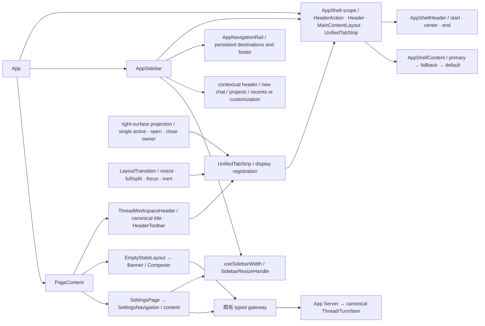

`sidebar-width` 仅存用户的显示偏好，默认340；Shell 包含52px图标栏，展开最小290、最大520，折叠只收起上下文列。PageSurface44px标题栏与52px上下文页头来自同包分支；图标控件36px及两侧8px形成固有宽度。设置范围240..520，两者都受主区空间约束；不存业务状态。设置用同一宽度owner，返回委托既有navigation guard，不再持有全局rail或独立窄窗口浮层。首页 Banner 由 EmptyStateHero presentation 持有；Composer 在 EmptyStateLayout 独立下部区域，单侧24px留白、最大48rem。删除旧13任务入口、Guide/Drawer/Manager及专用状态和Workspace接线；没有真实 ambient 投影时不渲染伪建议。后台会话只由 useWorkspaceBackgroundSessionRuntime 投影 canonical identity/status 给既有侧栏。首页不再计算无人消费的任务卡或注入 Memory/Channels 回调，ConversationScene 直接消费唯一 landingSurface；删除无效 creation selector，主题装饰不预留Composer内部宽度。主题、多模型、Banner仍归既有owner。架构图由责任root确认；无业务后端/协议owner迁移。

共享页头采用同包已证 `HeaderAction` 的当前 scope、首次注册顺序、order 排序及实例身份清理。侧栏开关注册 left/order=1，由唯一窗口 renderer 呈现。`Header` 将页面 children/metadata 注册到同一 renderer，`MainContentLayout` 为 primary → fallback → default 两级选择，无旧页面恢复栈。`AppShellContent` 测量实际主区，页头避让共享左右动作；会话页头不再在工作区内占一行，不再保留46px宿主/inset或侧栏折叠专用补位变量。页头仅消费当前线程身份和操作，不再派生独立状态、工作目录或重复Home/设置导航；普通线程标题与无标题分支以实际安装包合同区分，不能从rail布局推断。AppShell/AppShellHeader/AppShellContent 是本地owner名称；当前没有过渡context，按已证立即清理分支实现。统一工作区其他槽、完整fade分支及原线程开发名称仍待证，不声明全壳等价。实现与产品验证分别由[共享页头计划](../exec-plans/codex-shared-page-header-20261018.md)持有。责任root确认依赖方向与业务owner未变；未新增backend/read model或兼容层。

Unified后继直接迁移：`UnifiedTabStrip`与Header/HeaderAction共用同一scope，展示快照由`shellRegistry`持有；注册替换/卸载按实例身份清理，不建立恢复栈或业务tab store。`HeaderToolbar`/`Actions`使用安装包可确认名称，ThreadWorkspaceHeader提供canonical标题和重命名，动作注册到右侧`unified-workspace-controls`。right-surface既有coordinator/action/local-state继续是active/open/close/pending唯一owner，host只渲染pane，同一projection的tab strip经chrome显式传给LayoutTransition，再进入共享标题栏。删除TaskCenterTabStrip/useTaskCenterTabChrome/专用projection及旧42/84px split/detached/auto-hide栏；有效title清洗归threadTitle、fallback导航语义继续保留。

真实Electron后继发现window动作挤压tab strip后，ThreadWorkspaceHeader把既有thread/summary容器按REA已证window/chat/tab-strip规则移动到同一renderer；`HeaderToolbarActionMount`只挂载原DOM容器，保持工具组件实例，不持业务状态。More保持窗口右槽。UnifiedToolbarContext仅投影mode/isVisible和DOM目标，side-panel context仅投影可见性。LayoutTransition从同一pane几何投影派生`mainPaneEnd`并对齐标题栏，不再把内容百分比套到被窗口动作缩短的标题栏。分隔条的10px键盘步进、Home/End、尺寸aria、指针身份和双击恢复默认宽度复用同一尺寸owner，普通左右pane保留320px下限，CSS上限同时为内容pane留出空间。双击full/split继续由同一layout owner持有，不新增持久化、协议、业务tab store或runtime。责任root确认依赖方向；完整参考route transition、divider动作插槽和content/new-tab合同仍须后继补齐。

既有LayoutTransition负责实际容器宽度、resize和动画，驱动full/split/chat及tabpanel/aria/inert、编辑焦点恢复；统一壳只消费展示注册，不读取业务协议。当前mainPaneWidth和sidePanelActive是Lime本地展示适配字段，不冒称上游原类型。当前没有参考实现的共享route transition context和全部content/divider/context-menu action destination，不宣称该部分等价。责任root确认上述内部依赖方向与架构图，2026-10-18；业务runtime/protocol/持久化owner没有迁移。产品证据和退出条件由[unified计划](../exec-plans/codex-unified-workspace-20261018.md)持有，未通过真实场景前保持active。

侧栏读取由 `loadSidebarSessions` 统一调用既有 session gateway 的 canonical `thread/list` page，保留真实 `nextCursor`，各 scope 独立推进至显示预算或来源结束；项目归属复用 `sessionBelongsToProject`，Pinned/custom 不消耗 Recents 预算。旧通用列表仍保持合并总量限制，不能用于独立分组的分页来源。`hasMore` 从服务端游标派生，不按数组长度猜测。此为 Lime 现有 sectionId 协议的适配；Codex 参考使用 catalog pageScope/host source，不能把本地拆分请求说成其原始 RPC 形状。删除 hook 内旧平面请求 helper；没有新业务 store、runtime 或持久化 owner。责任 root 确认此依赖方向，2026-10-20。

### 3.2 Renderer 数据流

```text
UI event
  -> feature/component view model
  -> src/lib/api typed gateway
  -> Desktop Host bridge or app-server client
  -> App Server JSON-RPC
  -> v2 notification / thread/read
  -> pure projection
  -> UI state
```

Renderer 可以临时保存输入框、选择态、展开态和 optimistic UI；不能生成、修补或持久化 Thread/Turn/Item 真相。流完成、取消和失败必须消费 App Server terminal event/read model，禁止通过固定 timeout 或本地合成事件断言完成。

### 3.2.1 同步问答与 pending identity

共享 `AppServerEventBus` 继续作为 Renderer 的唯一 drain/fanout owner。drain 在途期间
订阅可能卸载或替换，因此返回批次通过 connection generation 检查后，必须重新读取当前
活动订阅，再投递 notification 与 reverse request；不得向发起 drain 时的已卸载快照投递。
recent replay 的完成登记仍属于请求该 replay 的订阅，不转移给后继订阅，也不清除序列门禁。
这只是现有 transport 消费合同的修正，不增加业务状态或第二份事件总线；root 于
2026-10-20 确认。对应确定性红绿回归与真实桌面结果见问答执行计划。

活动 Turn 的恢复监听由 thread/turn scope 与既有 stream controller 持有。
文件展示回调、read model 刷新回调和展示文案的引用更新不得拆除该监听；回调通过稳定入口
读取最新 presentation 引用，不改变 canonical projection 或 listener identity。真实终态仍经
原事件处理器清理 stream 与监听，线程切换/卸载仍走原 scope 清理。root 于 2026-10-20 确认
本段为现有恢复 owner 的生命周期修正，非新的订阅或 runtime。

本地发送/Stop 绑定记录只接受真实 canonical Turn ID，并按 session/turn 精确匹配。
前一 Turn 的记录不得阻止同线程后续 Turn 订阅，也不得在历史恢复时被后续 Turn 消费。
缺少 Turn ID 或只有 optimistic ID 时不生成线程级通配记录；当前 active stream/listener
继续由同一个 controller 持有。root 于 2026-10-20 确认：删除线程通配阻断与消费路径，
不添加回答前刷新、宽限时间或第二个恢复入口。红绿回归及新产物结果见问答执行计划。

`waitingAction/blocked` 只表示当前活动 Turn 正在等待用户输入或审批；恢复判断仍检查
canonical `active_turn_id` 及同一 Turn 的 running 状态，不得仅凭线程等待标签将其判为
空闲并卸载事件路由。缺失、终态或不匹配的 active Turn 仍不恢复。该规则对应 Codex
`ThreadStatus::Active` 的 waiting flags；root 于 2026-10-20 确认继续使用原恢复 owner。
活动判断 `hasActiveRuntimeTurn` 直接归现有 `projection/threadReadActivity.ts`，复用该模块的
canonical Turn 与终态判断；`useAgentChat` 直接消费 projection，不经过会话状态 hook 转导出。
旧 `agentSessionState.ts` 定义与重复终态 helper 已删除，相关行为测试迁至 projection 的
既有 unit suite。root 于 2026-10-20 确认该迁移沿现有依赖方向，不增加新的状态 owner。

`thread/status/changed` 与 `thread/queue/changed` 共用 `useAgentThreadReadSync` 现有的
串行 canonical 读取订阅；通知只使匹配线程失效，不直接用通知字段合成业务状态。
已有 session/workspace generation 检查、在途合并和末次读取继续生效；旧 queue-only
hook 与测试直接迁移，无第二 drain、订阅或状态 store。合法状态通知不进入通用告警。
root 于 2026-10-20 确认该接线属于原 App Server read model 消费边界。

`PendingInteractionController` 是 reverse request 的唯一前端 pending owner；
`PendingInteractionLayer` 选择当前线程的 canonical 请求，`DecisionPanel` 只把
`ask_user` 委托 `RequestUserInputPanel`。问答面板只拥有逐题选择、草稿、焦点和提交锁，
使用独立的 `ComposerController/ComposerEditor`，不替换或恢复主 Composer 草稿。
`RequestUserInputDraftStore` 由既有 Jotai Store 按应用独立初始化，只保存共享 UI 稿；
它不承担 pending、业务投影或持久化 authority，不使用模块全局 Map。

待回答的 `ask_user` 不在时间线或 Message 流再挂载可提交面板；历史、submitted 与 queued
投影仅只读回显。工具请求到 A2UI 的 promotion、第二套提交载荷构造和消息抑制参数均已删除，
Workspace 的普通正文 A2UI 只消费 `assistant_message`，不响应工具问题。唯一可回答入口仍为
上述 PendingInteractionLayer，不新增协议、pending store 或 runtime。责任开发者 root 已于
2026-10-20 确认本段与下图的 owner/依赖方向；真实桌面结果由问答执行计划单独结算。

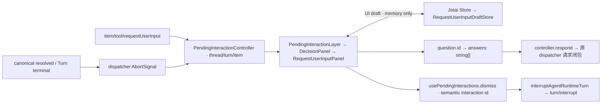

wire 的 `question.id/isOther/isSecret` 原样投影；答案按真实 ID 返回
`{answers:{[id]:{answers:[text]}}}`，不以题文、header 或索引猜 key，也不拆逗号。
合法跳题省略当前 ID；`accepted=false`、异常和校验失败均保留同一编辑器与草稿。
identity 包含 thread、turn、item/request 和 question IDs；切换后清理旧选择推进任务，
迟到结果不能改新请求。共享 Map 按 host/thread/request 保存 `{answers,questionIndex}`，
读取核对 turn/题目 ID 序列，缺失 scope 不共享保存；当前单 Desktop host 使用受控 `local`
UI scope，不新增远端 host authority。Map 更新和答案读写均复制，同 Store 跨线程与 remount
可恢复；不同应用 Store 隔离。提交/dismiss 在原回调前按 requestId 条件清稿；失败只保留
仍挂载的内部稿，不经 render/effect 复活共享 Map，下一次编辑/导航可再保存。
secret 草稿仅应用内存，不持久化、不写日志或已提交答案回显；独立输入无听写入口。

普通 Escape/关闭委托 `usePendingInteractions.dismiss`，从唯一 pending owner 读取
精确 thread/turn，再调用现有 typed interrupt gateway；缺失或失效 identity fail closed。
中断成功仅锁住当前操作，等待 dispatcher 消费 canonical resolved/terminal 后移除请求，
不发伪空答案、不合成本地终态、不调用会恢复主草稿的通用停止流程。失败显示固定反馈且可重试。
参考 onboarding/scheduled 的空响应例外仍缺 Lime canonical producer，不能从计时字段推测。
异步 `AgentMessage.questions` 与普通 follow-up 回答链仍是独立 gap，不由同步请求替代。

参考为 Codex Desktop `26.1007.30912` 的 REA
`ev_a908f380896c707334ef1867c231f191790e0fbe29708ec243c6a7cb5306f437`，
共享草稿补充 `ev_5734ec041f1dd5e183fcd1f5a15c97b1e71e7efb9b79694d4069dd1ea7bf21c4`。
静态证据不代表目标 App 已运行；TTL、外部取消或线程删除的额外草稿清理仍 unknown。
Architecture impact: minor；既有 App Server/runtime/
projection/transport authority 不变；责任 root 已核对并确认共享 UI 草稿节点和上述依赖方向，验证范围见
[同步问答计划](../exec-plans/codex-request-user-input-alignment-20261020.md)。

### 3.3 Composer 运行位置与 Worktree 首发

Composer 的 `composerMode/setComposerMode` 是 Renderer 提交意图，归
`workspace/useComposerWorktree`。`ComposerModeContext` 仅向 Utility 提供同一选择；
菜单选择不创建 checkout。`useWorkspaceSendActions` 先完成原发送计划解析，只有
ready/start 分支委托 `ComposerWorktreeSubmission`，本地命令、空输入和本地确认均
沿用原 owner。Git/Workspace 继续由现有 current gateway 和 App Server service 执行。

```text
ComposerUtilityBar -> staged composerMode
 -> Workspace send plan (ready/start)
 -> ComposerWorktreeSubmission (request -> confirmed path/workspace identity)
 -> projectGit/worktree/create + workspace/ensure (existing App Server owners)
 -> typed ExecutionScope handoff
 -> useAgentChat -> useAgentContext/useAgentSession/useAgentStream commit target
 -> canonical Thread hydration + cwd/workspace/session/thread validation
 -> permissionProfile/list(target cwd) -> turn/start
 -> accepted receipt -> same ComposerDraftCoordinator capture promotion
 -> existing project selection / TaskCenter navigation
```

`ExecutionScopeHandoff` 只保存单次冻结 payload、request/scope 去重和交接 epoch，不持有
Thread/Turn/Item、权限或持久化的第二事实源。session create/restore/persistence 仍归
`useAgentSession`，按目标 Workspace/cwd/request 去重，创建后 canonical hydrate 失败
重用已确认 session；源 Workspace snapshot 不接收目标 session。异步提交准备及实际
Turn 发送前检查同一 scope authority，ABA 或取消使旧请求失效。真正接受后仍用原 capture
promote 到目标 Workspace，旧 receipt 不能清除新 revision 或抢占新导航目标。

current Git create 是 detached checkout，不等同 Desktop pending-worktree Host 消息或新分支。
已确认 path/session 保留供失败重试；创建响应或 Turn 接受未知时不自动重复，不自动删除。
不新增 delete/remote producer、持久化 owner 或 runtime fallback。旧 Utility 即时 create
mutation 和相应正向测试已替换。详细退出条件和证据见
`internal/exec-plans/codex-composer-worktree-alignment.md`。

Architecture impact: major（Renderer owner/data flow 接线）；责任开发者
`presentation_package_editing`，2026-10-18，确认目录归属、数据流、依赖方向、协议边界
和验证门禁。root 于 2026-10-18 核对依赖方向、同 scope identity 与现有 owner 后进行窄段集成；真实 Electron Gate B 和最终类型检查通过前不进入 release evidence。

## 4. Electron Desktop Host 规范

| 路径/模块                              | 职责                                                                                                   |
| -------------------------------------- | ------------------------------------------------------------------------------------------------------ |
| `electron/main.ts`                     | Electron 生命周期与 host 组装入口。                                                                    |
| `electron/preload.ts`                  | `contextBridge`、最小暴露面和 IPC 调用入口。                                                           |
| `electron/ipcChannels.ts`              | IPC channel 常量与协议白名单。                                                                         |
| `electron/*Host.ts`                    | 一个桌面能力一个 owner，例如 App Server sidecar、文件/项目壳、窗口、通知、更新、浏览器、语音。         |
| `electron/secureCredentialStore.ts`    | 使用 Electron `safeStorage` 保存受管 Cloud session credential；只向 IPC 投影存在性和 metadata。        |
| `electron/appServerHost.ts`            | sidecar 生命周期与 `app_server_handle_json_lines` 的宿主边界。                                         |
| `electron/forge/`、`forge.config.mjs`  | Forge 打包、maker、签名和 release 事实源。                                                             |

Electron 负责窗口、托盘、Dock、系统文件选择、权限、外部链接、自动更新和 sidecar 生命周期。它不得保存业务 session、解释 provider response、执行模型工具、拼 Thread/Turn/Item 或提供业务 mock fallback。

任务防休眠沿 `App Server canonical Thread/Turn -> DesktopPreferencesHost -> PowerSaveHost -> Electron powerSaveBlocker` 投影。`desktop.preventSleepWhileRunning` 仍由唯一 ConfigManager 保存，缺省 false；非 Windows 的 General 与搜索消费同一偏好。Main 只持有原生资源 ID 和活动 identity：多个活动线程共用一个 `prevent-app-suspension` 资源，最后活动结束、偏好关闭、连接断开或退出时释放。投影消费 `thread/status/changed`、Thread 读取、`turn/start` 成功回执和 `turn/started`、`turn/completed` 通知；终态只接受 canonical completed/failed/interrupted，不由计时器或 legacy event 合成。同线程旧 Turn 完成不释放较新活动，终态后迟到的开始回执和读取不复活资源；连接代际阻止旧连接回写。真实连接缺少 started/status 通知的共享 runtime 缺口独立登记，资源投影不替代通知 owner。不新增 RPC、IPC、持久化或 runtime authority。REA 方法名 `updatePowerSaveBlocker` / `syncPowerSaveBlocker` 及必要宿主适配见[执行计划](../exec-plans/settings-prevent-sleep-20261025.md)。架构影响 minor，root 于 2026-10-25 确认 owner、依赖方向与资源生命周期；原生平台和整页验收按计划独立记录。

主窗口尺寸由 `electron/main.ts#createMainWindow` 唯一持有：按指定 Codex 安装包完整 `createWindow/getPrimaryMinimumSize` 与常量声明证据，primary 初始1280×820、最小480×600；屏幕workArea仍约束实际尺寸。真实Electron fixture读取生产minimum并测量contentSize，不通过修改minimum或仅模拟viewport绕过产品限制。证据与退出条件见[侧栏计划](../exec-plans/codex-sidebar-cleanup-20261020.md)。本次仅调整既有Host presentation选项，root确认不改变业务owner、协议或架构依赖方向。

关闭窗口确认沿 `General -> ConfigManager -> DesktopPreferencesHost -> WindowCloseConfirmation -> 现役 window IPC -> AppShell WindowCloseConfirmationDialog` 接线。`desktop.confirm-before-close` 缺省 `keyboardOnly`，`never`/`keyboardOnly`/`always` 共用现有用户配置；Host 只持有可丢弃偏好、原窗口身份和单次响应令牌。确认前保留窗口，取消/重载/销毁/退出撤销请求；“不再询问”先成功写入配置再关闭。Main 继续拥有窗口原有隐藏行为，应用退出不经过该偏好。共享命令优先委托 `closeTab` 的既有未保存内容确认路径，再申请关闭窗口；右侧标签注册缺口明确留在[执行计划](../exec-plans/settings-close-confirmation-20261025.md)，不新增旁路关闭或第二份存储。架构影响 minor；root 于 2026-10-25 确认上述 owner、依赖方向和生命周期。当前证据只覆盖 macOS 窗口/配置切片，不等于完整标签页或 General 整页验收。

新增 Electron 命令前先判断是否只是已有 `app_server_handle_json_lines` 的转发。只有系统宿主能力才新增 IPC；业务能力一律优先新增 App Server JSON-RPC。

Cloud session credential 是 Desktop Host 的平台能力，不是 Renderer 或 App Server 的第二份
业务状态。`secureCredentialStore` 只接受经过校验的 `ws/wss` endpoint 和非空 token，使用
`safeStorage` 加密写入 `AppDataRoot/credentials`；Renderer 只能写入、读取 metadata 或删除，
不能通过 IPC 读取 token。safeStorage 不可用时 fail closed，且本能力不会改变 Cloud endpoint
默认关闭的裁决。

App Server 发起的 reverse JSON-RPC request 仍复用同一 JSONL/stdio、`app_server_drain_events` 与 `app_server_handle_json_lines` 通道。Electron 只负责从 typed connection drain notification/request，并把 Renderer 的 Response/Error 原样写回 sidecar；不得解释 server request method、生成业务 decision、持有 pending waiter 或把 request 降级成 Electron IPC 业务命令。

Desktop Host 的 sidecar 启动/恢复诊断属于宿主旁路，不是 App Server 业务 read model。`app_server_host_diagnostics` 是只读 Electron IPC 命令，由 `ElectronAppServerHost` 返回有界、脱敏的启动阶段、连接代际、sidecar 运行状态和最近失败上下文；Renderer 只能通过 `src/lib/api/desktopHostDiagnostics.ts` 做 schema 校验后把它并入现有 crash diagnostic bundle。该命令不得承载 Thread/Turn/Item、provider、工具或 session 状态，也不得替代 `app_server_handle_json_lines`。

Architecture impact: major; Desktop Host diagnostic side-channel added without changing the App Server business chain. Responsible developer confirmation: root, 2026-09-03.

### 4.2 Code Mode crate boundary

Code Mode 对齐 `/Users/coso/Documents/dev/rust/codex/codex-rs` 的四层 crate 结构：

```text
agent-runtime / App Server
        -> code-mode (session facade: process-owned / remote provider)
        -> code-mode-host (stdio / gRPC host transport)
        -> code-mode-runtime (V8 cell/session runtime)
        -> code-mode-protocol (session/runtime/host wire contract)
```

`code-mode-protocol` 是协议和稳定类型的唯一 owner；`code-mode-runtime` 只拥有 V8
cell actor、session runtime 和资源限制；`code-mode-host` 只拥有 host transport、握手、
请求路由和 delegate 回调；`code-mode` 只拥有进程生命周期、连接复用、重连和 session
provider facade。Agent Runtime 的 `provider_turn` 只负责 execute/wait handler、工具
delegate 和 Thread/Turn/Item projection，不直接依赖 host 私有实现。

gRPC host/client 的 session、execution、wait、invocation 和 notification identity 使用 UUID，
并在 host 边界统一执行 256-byte identifier、tool filter、schema 和 tool-kind 校验；关闭会话
必须先失败 pending delegate callback/notification、取消 active wait，再 shutdown runtime。
执行、等待和终止的 `code_mode_host_duration_ns` 从 RPC 接收时开始计时，并对 `u64` wire 上限
饱和。任一 gRPC stream 断开会取消 binding 上的 pending callbacks；reconnect coordinator 在
发布新 generation 前 best-effort 退休旧 binding，generation-scoped cell ID 拒绝迟到的旧 cell。

迁移期间 `tool-runtime::code_mode` 只作为显式兼容导出，生产调用必须向四个 current
crate 收敛；完成迁移并取得删除确认后，旧嵌入式路径标记为 `dead / deleted / forbidden-to-restore`。

Architecture impact: major; Code Mode ownership split into protocol/runtime/host/facade crates while preserving the App Server JSON-RPC runtime chain. Responsible developer confirmation: root, 2026-09-04.

### 4.1 跨平台 Desktop capability/readiness contract

旧环境变量设置的 `get_environment_preview`、专用 DTO 和 `electron/platformCapabilities.ts`
诊断聚合已删除；不再通过独立预览命令发布平台能力。现役权限查询和原生操作分别由
macOS/Windows native host 与对应功能 owner 承接，实际资源由构建和打包 verifier 校验。
这些 Host 能力不承接 Thread/Turn/Item、provider、工具执行或沙箱策略。

macOS 的 Application Group、Input Monitoring、HID、Computer Use、PIP 等能力只有在 Lime 自己的
签名 helper/extension、entitlement、资源 manifest 和 Gate B 证据同时存在时才能报告 `ready`。
当前已具备最小 Swift `macos-native-host`，由 `scripts/lib/electron-desktop-resources.mjs`
编译并写入 `desktop-resources.manifest.json`，通过 `macos_native_host_invoke` 提供
Accessibility/Input Monitoring、Apple Events 授权查询/consent request、Screen Recording、Launch Services、security-scoped bookmark、CGWindow/NSScreen、IOHID
（含拓扑变化事件）、bare modifier、LocalAuthentication 和 Secure Enclave device-key 的结构化结果；
Screen Recording 还支持在 helper 内生成受权限保护的全屏、显示器或窗口 PNG 快照；Chronicle/ScreenCaptureKit
媒体管线、PIP 以及 Computer Use 控制注入仍保持 `not_configured`。helper 已提供受 Accessibility 授权保护的只读
`accessibilityTree.read` 观察结果（有界深度、节点数和文本长度），以及 CoreGraphics `display.watch.start/stop` 拓扑事件，但不注入鼠标/键盘事件。窗口控制还支持 Accessibility AX raise、窗口所属应用
hide/unhide、按锚点定位、显式堆叠顺序和带原始可见性恢复的 hide-for-task lease（通过 AX
`kAXHiddenAttribute` 设置目标应用可见性）；这组接口不冒充私有 overlay
或 Remote Hosted PIP。Application Group 仍不申请或复制 OpenAI Team ID，
无 consumer 时返回 `not_configured`。Windows sandbox readiness 继续由 `tool-runtime` 和 packaged
resource verifier 负责，Desktop Host 只返回 `unverified`，不得从平台名称推断安全后端已就绪。
媒体权限由同一 Swift helper 的 `mediaPermissions.read/request` 负责，分别查询或请求
摄像头、麦克风 TCC 状态；helper 和主包均声明对应 usage description，主包 entitlement
同时声明 camera/audio-input。能力合同只报告
`mediaPermissions.microphone/camera` 的平台与原生资源 readiness，不把未授权状态伪造成
`ready`，也不在 Electron 或 App Server 中保存媒体流。Windows 复用主窗口 Electron
permission handler，合同保持 `unverified`，等待安装后系统授权证据。
Apple Events 由同一 helper 的 `appleEvents.targets`、`appleEvents.read/request`、`appleEvents.openSettings` 负责。调用方可先
从当前运行应用列表选择目标，再提供目标应用 bundle
identifier；helper 仅调用 `AEDeterminePermissionToAutomateTarget` 查询或显式触发系统 consent，
不发送实际控制事件。目标未运行、授权未授予、需要用户 consent 和系统异常均返回结构化状态，
设置跳转使用 macOS Automation 隐私面板。主 App 与 helper 签名资源声明
`com.apple.security.automation.apple-events`，资源 manifest 同步登记 `automationAppleEvents=true`。
`desktopCapabilities.appleEvents` 只表示 helper
调用面存在；缺少签名、目标授权和 Gate B 证据时保持 `unverified`，不得作为无边界 Computer Use
注入通道。
打包 manifest 的 macOS helper metadata 固定声明 `protocolVersion=1`；Electron
`MacOSNativeHostClient` 在首次业务调用前必须完成 `capabilities.read` 握手，并校验协议版本、平台和
`com.limecloud.lime.native-host` bundle identity。握手失败会终止 helper、拒绝 pending request，并返回
`protocol_mismatch`，不能把“可执行文件存在”升级为 runtime ready。已安装签名包的
`scripts/electron/macos-native-host-gate-b.mjs` 复核同一 helper 的 resources 路径、digest/签名和握手，
再观察窗口/显示、临时 Cocoa fixture 上的 window anchor/stack/hide-for-task lease、security-scoped bookmark create/resolve/start/stop、权限查询、Launch Services 与 display watcher；默认 `observe` 只记录 TCC 状态，
`--strict-permissions` 才要求 Accessibility、Input Monitoring、Screen Recording 和选定 Apple Events target 全部 `ready`。
Windows 原生能力沿同一 Desktop Host 资源边界实现：`electron/native/windows/windows-native-host.cpp`
使用系统 UI Automation COM API 提供有界、只读的 `windows.uiAutomation.read` 控件树观察，并使用
`RegisterRawInputDevices` 仅监听修饰键按下/释放事件（`windows.bareModifierMonitor.start/stop`），不提供
鼠标/键盘注入、ValuePattern 写入或窗口控制。`windows_native_host_invoke` 通过 Electron Host JSONL
边界转发，helper 的路径、SHA-256、API 元数据和 `readOnly=true` 由资源 manifest/verifier 校验；缺少
helper 或 digest 漂移时返回 `unavailable`。`desktopCapabilities.uiAutomation/rawInput` 仅在 helper
资源存在时报告 `unverified`，Windows UIA/Raw Input 权限、签名、Squirrel 安装后 sidecar 和真实 Gate B
仍需 Windows runner 证据，不能从源码或 manifest 存在推断为 `ready`。同一 helper 还提供
`windows.window.read` 和 `windows.display.read` 的只读窗口/显示枚举（HWND、进程、标题、类名、边界、
工作区和主显示标记），用于 `desktopCapabilities.windowHandles/displays`；不提供窗口移动、激活、隐藏或
覆盖层控制。`windows.displayWatcher.start/stop` 使用隐藏顶层窗口接收 `WM_DISPLAYCHANGE`，以
`display.changed` 事件转发位深、分辨率和最新显示器快照；该观察接口同样不声明 display link、屏幕捕获或
任何窗口控制能力，`desktopCapabilities.displayWatcher` 在资源存在时保持 `unverified`。
security-scoped bookmark 的编码数据由 `SystemUtilityHost` 按稳定 ID 写入受管的
`appDataRoot/macos/security-scoped-bookmarks`，支持冷启动 resolve/start、活动 token stop 和显式
revoke；当前进程内 revoke 会先停止同一稳定 ID 的 helper 访问，再删除受管记录。Renderer
不得自行持有 bookmark 事实源或绕过 helper 生命周期。
HID/bare modifier 的 unsolicited JSONL event 由 `MacOSNativeHostClient.onEvent` 接收，再经
`SystemUtilityHost` 注入 Electron Host emitter 广播到 `evt:*`；订阅者异常不会破坏 response framing，
`before-quit` 会先解除订阅并停止 helper。

Architecture impact: major; cross-platform Host capability contract and native helper handshake added.
Responsible developer confirmation: root, 2026-09-01. Window orchestration owner/data flow updated: root,
2026-09-01. Native helper protocol/readiness owner/data flow updated: root, 2026-09-02.
Apple Events authorization owner/data flow updated: root, 2026-09-01.

### 4.3 Desktop persisted atom

未发送的桌面 UI 草稿与 Summary 固定偏好保存归 `PersistedAtomHost` / `PersistedAtomStore` / `PersistedAtomFile`，固定使用统一 `AppDataRoot/host-state.json`。它不保存 canonical transcript、Thread/Turn/Item、队列或 runtime 状态；业务持久化仍由 App Server 与 thread-store 承接。

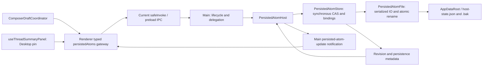

`persisted_atom_read` / `persisted_atom_update` 只经 `src/lib/api/persistedAtoms.ts` 的唯一 typed gateway。types、JSON transport parser 与预算归 `src/lib/api/persistedAtomTypes.ts` / `persistedAtomProtocol.ts`；Main 不引入 PM/React。Host 方法名对齐可确认的 `sendPersistedAtomState`、`updatePersistedAtomState` 与 `broadcastPersistedAtomUpdate`，新增类名是 Lime 的领域命名，不冒充安装包原开发源码名称。

现有 atom 为 `composer-drafts-v1` 与 `app-shell-summary-panel-pinned`。草稿 put/promote/consume/clear 在同一 Store 中执行 draftId + opaque scopeVersion CAS；promotion 不改变版本，consume/clear 保留无正文 tombstone，拒绝迟到 put。record/binding 预算各为10,000，单 draft128MiB、完整UTF8 JSON256MiB，整次拒绝保旧，不截断或自动驱逐。Summary atom 只接受 boolean value/read 和 set/update，默认 true，缺失字段可按默认加载，错误类型不得强转。两个 atom 共用应用 revision 与 savedRevision，500ms 合并进入串行落盘；主文件原子替换后再更新 backup，primary 成功而 backup 失败时可能是新 primary / 旧 backup。无效文件恢复失败保持 unavailable，不覆盖为空。

`rendererEventPolicy` 是 Main handler 与 preload 的同一事件策略，禁止 Renderer 伪造 `persisted-atom-update`。current safeInvoke/HTTP 诊断复用 `invokeDiagnostics`，草稿命令只记录固定 key/op/error 分类，不回显正文、media、scope 或原始错误。原始 transport 错误仍向调用者传播；native notification 订阅失败显式失败。

Main 只负责组装、命令委托与 dispose；不在大文件添加保存、CAS 或 schema 业务。退出 best effort，不建立 Quit 握手或发送 checkpoint。当前 read 使用唯一 key/query/data 判别合同：草稿 scope/workspace-index 查询，或 Summary value 查询。索引仅投影当前 live binding 的 identity/scope/updatedAt/sessionId?/threadId?，workspace 精确匹配（含null）、updatedAt降序与canonical scope codepoint升序，不返回正文或media，不推进revision，不截断10,000预算内结果。实际编辑目标按scope重读并继续同一CAS。旧scope-only/top-level view已删除，gateway/fixture/preload/tests/guard成套迁移。广播只有 metadata，草稿协调器忽略非草稿 key；Summary 只接受当前 generation 且不低于已接受 revision 的回读。公开 IPC 的正常重启证据只证明原生边界；GUI 富草稿恢复、Summary pin 恢复与 acceptance 在 current 执行计划独立验收。

Summary 的 renderer 展示由 `useThreadSummaryPanel` / `ThreadSummaryLayout` / `ThreadSummaryPanel` 单一负责，直接消费现有 canonical thread items/children 与已有打开动作。它独立于 Right Surface registry；旧 Activity 面板、tab 与 toggle 已删除。主 pane 的 ResizeObserver 驱动 300px 面板的 overlay/shift/gutter，shift 同步作用于既有 Composer，不重建编辑 owner。REA 对齐仅覆盖已确认布局和当前存在的数据 sections；其余 sections/身份分支仍在专项计划开放。

Summary 后继架构图确认：root，2026-10-18；已复核 UI pin 复用同一 gateway/IPC/Host/Store/File，canonical 数据仍只读消费，无新增 JSON-RPC、runtime、业务 store 或兼容入口。实际验证见 `codex-unified-workspace-20261018.md`，不据此声明全 GUI 完成。

Thread side panel 的后继局部展示 owner 与依赖如下：

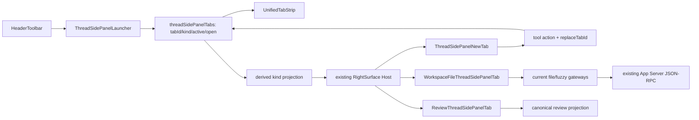

旧 manualRightSurface/openedRightSurfaces 不再单独存储，仅从 tabs 派生供既有 coordinator 消费；New tab 多实例按 tabId 替换，迟到动作先校验仍存活身份，关闭、隐藏和 Chat 保留同一 Composer owner。Files 与 Changes 分工，文件树尺寸统一到 useFileTreeResize。旧独立工具按钮、Scene 底部 Shell 与无人消费的 bottom variant/height/maximize 常量直接删除，不留 compat props。主题、多模型与首页 Banner 边界不变。完整 Files 路径 tabs、外层 Browser/Terminal 多实例和扩展工具仍 gap。Architecture impact: minor；责任 root 于 2026-10-19 确认此图与唯一业务链依赖方向；后继产品验证按执行计划独立结算。

Architecture impact: major; Desktop UI persistence owner and IPC boundary added. Architecture diagram confirmation: root, 2026-10-14; Host/gateway/parser/file/event/diagnostic ownership and separation from the canonical App Server chain checked. Product verification remains recorded in the current execution plan.

Renderer 未发正文的唯一 owner 是 `ComposerController`；`ComposerDraftCoordinator` 只协调 scope、250ms 发布队列、CAS 与接受后消费，codec 复用原 schema/selection/resources。唯一 React owner `useWorkspaceComposerDraftRuntime` 创建/解绑 coordinator，并在目标实际提交后调用 `bindCommitted`。公开编辑目标只有稳定 home/new-conversation 与 canonical local/session，workspace 精确匹配（含 null）；原生 metadata index 没有第二个 renderer 草稿发现或标签 owner。编辑门禁同时要求真实 binding ready 和可见目标与绑定 scope 完全一致；首次读取被替代、失败或模式不匹配不能靠 await/finally 开放旧正文。

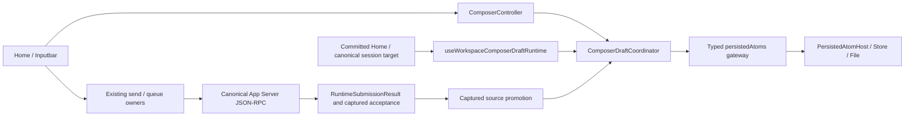

发送捕获原 receipt、draftId/version 与 scope，业务请求不等待保存。仅 `runtime-accepted` / `queue-accepted` 触发 promotion 后消费；`local-handled` / `rejected` / `unknown` 保留草稿。旧接受可消费旧存储，但可见 Controller 清理必须仍匹配 generation、scope 和 revision。导航前仅发布旧 scope；成功并匹配启动时 UI epoch 与真实 session/workspace 后提交新目标。同次 topic hydration 的私有 onHydrated 生命周期在 source-current 检查后、自身 scope 提交前更新 presentation，不用 epoch 加一豁免。opaque restore token 只在 renderer 进程内透传，不进入协议、日志、metric 或 transcript。

责任 root 于 2026-10-15 确认上述更新：Desktop 保存仅管理 UI 草稿，App Server 仍唯一拥有 Thread/Turn/Item 与业务接受事实。随机草稿索引、预热与 materialized 首发路径已删除；binding.ready 是唯一就绪事实，不建立第二个 ready authority。正式组合回归、真实 Electron 富草稿冷恢复及默认门禁按 current 执行计划记录，基础 Host receipt 不能替代它们。

程序化初始输入（含 Skills 工作台试用）没有 Composer 草稿 settlement；CommandWiring 在既有 sendMessage 收到真实 accepted 后，以捕获的 navigation epoch 提交同一可见 workspace 的 topic，仍由现有 navigation owner 等待真实 session 再绑定。该路径不 consume Home 草稿；Composer 自身发送继续走原 captured identity promotion/consume。非接受、迟到或不可见回执不能越过 ready/scope 门禁。此为既有4.3链路的接线修复，非新增 authority；root，2026-10-15确认。

已有线程的目标编辑由 `useThreadGoalComposer` 在同一主 Controller 内持有 pending mode 和替换确认，ThreadGoalPanel 只展示 canonical 目标与操作。目标提交在普通 start/steer settlement 之前进入既有 `threadGoalClient -> thread/goal/set -> RuntimeCore thread_goal`，不伪造 Turn acceptance。成功只清匹配 surface、binding、generation 和 revision 的草稿；取消、失败、线程切换与在途编辑保留输入。旧独立目标 Textarea/Modal 删除。

目标草稿经 `threadGoalDraft -> threadGoalAttachments` 物化粘贴文本、本地/data 图片与超长 objective。Desktop Main 只把统一 storage roots 的真实 AgentRoot 作为只读启动元数据传给 preload；Renderer 不猜 home/default/config 根、不新增存储 IPC。附件只写入该根下本次 UUIDv4 所有的目录，失败仅清本次目录，成功移交后保留，不删除原附件。goal 提交引用在 4000 Unicode codepoint 内，路径/能力资源无法表达时拒绝并保稿；prepare 完成还须匹配捕获的 generation/scope/draft identity。模型读取目标文件的引用句沿参考合同保留，不作为 UI 品牌文案改写。

Home 与无 threadId 的 Inputbar 共用 `submitNewThreadGoal`，只有该 owner 将物化后的目标序列化为 `/goal <objective>`，再经同一 payload lowering 提交首轮。Workspace 不为目标附加普通任务上下文或提前创建会话。`onSessionReady` 仅观察真实 ensureSession 的结果以移交本次素材；首轮 accepted 后才调用 canonical `thread/goal/set`，set 失败显示反馈而不改写已接受的 Turn。创建前失败回收本次素材，创建后首轮拒绝、accepted 或 unknown 均保留恢复所需文件；没有第二套线程或文件存储。

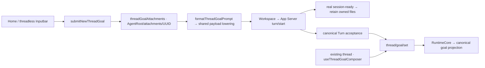

责任 root 已核对并确认该 Renderer 分工和已有业务 owner；真实桌面结果由目标专项计划结算。canonical transcript 仍由 App Server/RuntimeCore 投影，不把本地 completed/null-turn 提示行补成业务历史；公开 Codex 的 user origin/retained context 是独立协议/runtime 后继。

责任 root 于 2026-10-20 确认复用上图的 Controller/coordinator、统一 Desktop storage roots 与既有 canonical 业务链，没有新增后端或持久化 authority；限定目标切片的验证与剩余范围见 Composer auto-layout 计划。

### 4.3.1 Desktop UI 命令与快捷键

`src/lib/commands/registry.ts` 是当前已迁移 UI 命令的唯一注册 owner；`useCommand` 随真实消费者挂载处理器、平台键位、可用性和说明，卸载一起移除。`KeyboardShortcutsDialog` 直接消费同一注册快照，Help 菜单与 `showKeyboardShortcuts` 命令打开同一独立 Dialog。禁止维护仅展示而没有处理器的快捷键清单。

`AppShell` 在普通页面与 Settings 共用的根作用域内唯一挂载 `KeyboardShortcutsDialogHost`。Host 持有 `showKeyboardShortcuts` 注册、lazy Dialog 和显示/返回焦点状态；Footer 只派发同一命令，不再拥有弹窗生命周期。切离 Sidebar 或卸载 Footer 不撤销 Mod+/，AppShell 卸载才撤销。关闭优先返回仍连接的原控件；导航已卸载原控件时，返回当前可程序聚焦的 `AppShellContent`。旧 Menu/Dialog 的延迟 autofocus 不得夺取新显示层焦点。这是 Renderer 局部显示与输入 owner 的迁移，不增加业务 authority；Host 为 Lime 职责名，不声称恢复了 Codex 压缩符号的原名。

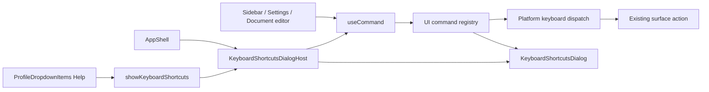

注册表只管理 Renderer 交互与展示，不执行工具、持久化业务状态或建立第二套 App Server 命令。文档保存、取消、撤销/重做与设置导航仍委托既有 owner。原 `documentCanvasHotkeys` / `documentEditorHotkeys` 静态副本及测试删除；有效输入法、只读、焦点、在途与卸载回归迁到实际消费者。CommandOrControl 的显示与执行共用平台判定：macOS 为 Meta，其他平台为 Ctrl。责任 root 于 2026-10-20 核对上述架构图与依赖方向；安装包静态证据与 Lime 实际桌面验证分别记录，完整命令清单仍需继续迁移。

### 4.4 Desktop 设置章节

`src/components/settings-v2/sections.tsx` 是 current 设置章节的唯一登记 owner，派生导航、可用性、预加载与内容渲染。公开入口直接导出已确认的 `SettingsPage`；category hook 只做翻译分组，layout 只组装容器和 Suspense。Home 保持同步入口，由 layout 注入 render factory，避免 Home/category/sections 循环依赖。业务页继续拥有各自的编辑与保存逻辑。

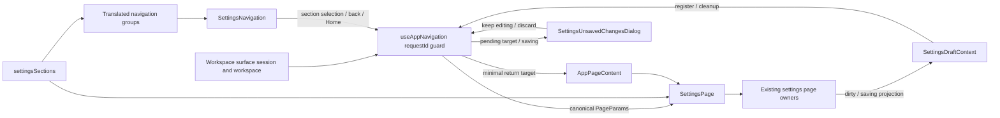

`SettingsPageV2` / `SettingsLayoutV2`、重复章节名单及无消费者 `SETTINGS_GROUPS` / `ExecutionTracker` 已删除。第二切片由既有 useAppNavigation 持有一个设置来处快照，SettingsPage 直接消费/回写 canonical 参数，删除 initial props 到局部章节/provider/developer 状态的复制。可见 session/workspace 沿原 surface 回调上报，由捕获的 requestId 拒绝迟到投影；它仅是导航显示位置，不是业务 read model。页头返回使用剔除首发、新建和技能启动 intent 的最小会话参数，rail Home 始终走已有首页动作。非 Agent 来处保留原页面参数。未实际离开的连续请求保留原来处，真正离开时清理快照；不建立第二 history。

既有 Experimental 只委托 Developer；providerView/focus 与 executionPolicyFocus 由同一参数消费，切离章节时清理，点击当前章节不重放。仅供测试选择器使用的隐藏 Home 按钮删除，fixture 点击可见入口。内容搜索与未接入表单继续后置。责任 root 于 2026-10-15 确认目录归属、显示数据流与依赖方向；业务 runtime/protocol/持久化 owner 不变，正式回归和 GUI 状态见 current 执行计划。

未保存保护继续使用 `useAppNavigation` 的唯一请求/提交状态：表单经 `useSettingsDraft -> SettingsDraftContext` 注册自身 dirty/saving 投影；pending target 不改变 canonical 参数、requestId、来处或恢复存储。所有设置与根导航动作均进入该入口。确认只提供继续编辑和放弃；关闭清除 pending，放弃提交最后一次目标且不隐式保存；saving 时拒绝放弃，取消后迟到保存不会发起导航。注册按独立 token 清理，不让旧表单的 cleanup 清除另一表单的报告。

首批只有 Memory 接入。`general/memory/useMemorySettingsDraft.ts` 唯一拥有其加载、draft/snapshot、保存和取消；`memoryConfig.ts` 承接原纯规范化函数，删除页面内联副本。成功保存只确认已提交 snapshot，若用户在途编辑则保留新 draft；失败保留输入，卸载后结果不通知新表单。SOUL 未应用文本仍属页面局部输入，导航保护覆盖它；Apply 消费该输入，Cancel 清理它，Save 不代为应用。持久化继续调用既有 getConfig 与串行 updateConfig -> saveConfig，只合并 Memory 到最新配置，避免旧整份快照覆盖其他修改；不增加协议、后端 store 或 dirty 业务副本。参考外部 dirty registry 尚未恢复，当前实现不宣称是原始内部类型。架构影响为既有 renderer 导航的表单状态接线；图已同步，责任 root 于 2026-10-15 确认目录、数据流、依赖与验证边界。其他表单不因共享 gateway 自动获得保护。

页内修正笔记由 `general/memory/MemoryNoteEditor.tsx` 独立拥有输入版本、保存锁和 dirty/saving 投影，仍向同一 SettingsDraftContext 注册；原 MemoryStoreStatusPanel 内联表单与保存逻辑删除。持久化只走既有 memoryStore/addNote；成功仅消费提交版本，失败与在途新编辑保留，卸载后不刷新/通知新 owner。配置保存/取消与笔记登记互不代替。Memory 的局部页签仅隐藏日常面板，保留唯一实例及其草稿，避免切页签绕过保护；真正离开设置仍由根导航决定。保存后的健康刷新在卸载后忽略结果；其他维护操作不因此宣称已取得在途/迟到验收。此为上图 Existing settings page owners 的职责拆分与生命周期修复，非重大架构；root 于 2026-10-15 确认 owner、依赖、数据流与验证边界，无新协议、runtime 或业务 authority。

Web Search 的 `system/web-search/useWebSearchDraft.ts` 独立拥有原始输入、已保存投影、字段版本、加载和保存锁；页面仅组装四个页签与同一 `useSettingsDraft` 接线。`webSearchConfig.ts` 从 current Config 投影可编辑字段，并在既有串行 updateConfig 中仅合并实际改动字段；保留其他配置、未编辑的搜索/图片字段、内建引擎覆盖与其余自定义引擎，不再持有或回写加载时整份 Config。保存响应更新 baseline，逐字段版本只接纳本次提交后未再编辑的值；失败/卸载不消费新输入，语言切换只翻译当前显示，不能重载草稿。非法自定义模板留稿，初始加载失败禁用编辑/保存，reload只重试未成功的加载。原内联生命周期、重复 current-field useMemo 和定时成功消息清除路径删除；秘密显示状态只归各输入组件并在重新挂载时回到掩码。现有上图可直接表达此 owner，无新增依赖方向/协议/业务authority；root于2026-10-16确认非重大架构，正式验收进度见current计划。命名为职责名，不声称恢复了参考端未知表单符号。

`coding/local-environments/LocalEnvironmentsSettings` 替换原 `system/environment` 进程变量设置。
项目列表沿现役 workspace owner；项目环境和继承环境经唯一 App Server `local_environments`
发现 `.codex/environments/*.toml`。详情只读展示 setup/cleanup 的默认与平台脚本及 actions；
`LocalEnvironmentEditor` 拥有草稿、revision、保存锁和冲突状态，经同一 `useSettingsDraft`
保护外部导航，内部返回/重载也确认丢弃。配置读写仅走 typed `localEnvironments/list|readConfig|saveConfig`，
不通过 Electron 文件业务命令或 renderer 直接写盘。App Server 归一化路径、拒绝 symlink、限制文件大小、
串行 CAS 与原子替换；旧环境预览 API/DTO/Host 实现一并删除。真实进程环境仍归现役工具执行 owner。
公开 worktree 请求显式携带 localEnvironmentConfigPath 时，RuntimeCore 已通过共享 CommandExecServer
执行 setup/cleanup，复用当前 permission profile、requirements、进程与取消。设置失败返回已建目录的恢复身份；
清理失败/取消在归档与删除前终止。工作树选择只写 Git 返回的 config.worktree 文件，不改源仓共享 config。
workspace selection 已由唯一 Host persisted atom 持久化，并接入三个现役工作树创建入口。
会话 Actions 通过 `useLocalConversationEnvironment` 读取现役配置：linked worktree 使用 Git status 返回的
config.worktree selection，源 checkout 使用 Host preference，None 不跨 scope 回落。
`projectGit/status` 的 `isWorktree/localEnvironmentConfigPath` 经 schema 生成同一 TS 合同。
按平台筛选后的 action 由当前 Git root 加配置相对目录确定 cwd，再委托现役 right-surface
coordinator/local-state 创建独立 `TerminalTab -> TerminalPanel`，继续走同一 `command/exec`。
窄窗的可见主面板仍归 `LayoutTransition`。`RightSurfaceTabStrip` 仅在 canonical activeTabId
改变时，经标题栏节点内的 `SidePanelActivationContext` 请求显示侧面板；返回聊天后的普通重绘
不重新抢占面板，不复制 tab store 或终端进程。该 context 是 Lime 共享壳的必要接线适配，
不冒称安装包中的原始符号。xterm viewport 使用现役 surface token，整行渲染后的余高不露出默认黑底。
最近动作排序、会话菜单环境切换及 setup 环境差异继承仍未接线；配置保存不等于完整产品验收。

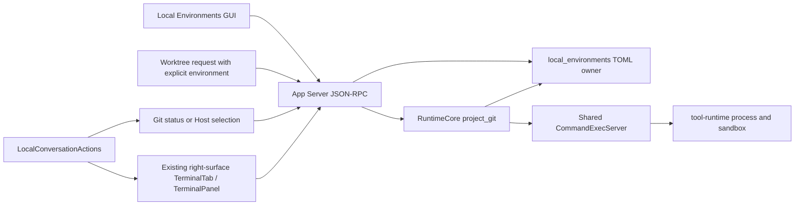

root 于 2026-10-25 确认目录、数据流、权限与取消依赖继续遵守唯一 App Server/runtime/工具 owner，
未增加平行业务后端；领域和公开请求证据不代替 GUI 选择、Actions真实执行与完整产品验收，进度见设置对齐执行计划。

返回会话时，既有 `useWorkspaceTaskCenterNavigationRuntime.resolveInitialSessionSwitch` 使用 `waitForResolution` 等待本次挂载的 Composer owner 建立，再捕获导航 source 并解析工作区；不等待尚需会话水合才能获得的草稿 scope ready。原 generation/scope/navigation epoch 和过期请求守卫继续生效，避免 owner 初始化取消恢复后留在不可编辑的空壳。该接线复用既有 owner，不新增 authority。

初始服务技能请求继续由既有 handled/dismissed signature refs 管理。新建 route reset 清理旧 surface 时保留随本次路由传入的 initial launch；已匹配本次 signature 的表单也保留。普通 topic reset 仍取消旧请求，新空任务的 canonical 路由不携带旧启动参数，迟到目录不能复活旧表单。此为既有 reset / pending-input owner 的接线校正，不新增请求或业务 authority；root，2026-10-15确认。

Execution Policy 的 `system/execution-policy/useExecutionPolicyDraft.ts` 仅持有七个可编辑字段、基线、字段版本和加载/保存锁；`executionPolicyConfig.ts` 在既有串行updateConfig内合并latest。沙箱三个开关独立，plan/bash策略各自独立，命令/网络列表分别作为原子字段；仅编辑bash时归一化latest工具覆盖，保留其他工具、未编辑规则及agent模型参数。页面经同一useSettingsDraft接导航，规则编辑/来源展示分离，错误只显示五语言消息；pristine保存及dirty/saving reload禁用。保存响应逐字段接受，失败、在途编辑、语言切换和卸载迟到不覆盖输入。原fullConfig/完整agent副本、内联保存/重载及固定浅色样式删除。仍由上图Existing settings page owners表达，未改变配置authority、协议、runtime或依赖方向；root于2026-10-16确认非重大架构。参考表单原始符号unknown，正式验收见current计划。

ProfileSettings 是薄设置入口，委托 ProfileContent → ProfileLayout / ProfileFieldEditor；内部职责名不冒充上游原符号。ProfileLayout 最大732px，复用 Settings 壳的唯一滚动 owner。useProfileDraft 只持有 displayName/bio 草稿、revision、加载/保存锁与安全错误；profileConfig 显式映射 displayName→本地 nickname，归一化 bio 换行，保存 trim，名称非空与64/140限制由 DOM 和保存入口共同防守。所有写入复用既有串行 updateConfig，只合并提交字段到 latest；失败保稿、同 revision 成功才关闭编辑，dirty/saving 经 useSettingsDraft 进入现有导航 authority。Tag/完成度/用途/头像/email卡片、旧 ProfileFieldCard/ProfileSummary/profilePresentation 与无消费者的 TS/Rust avatar_url/email/tags 配置字段已删除，不保留双轨。主题仍走原 token/skin。

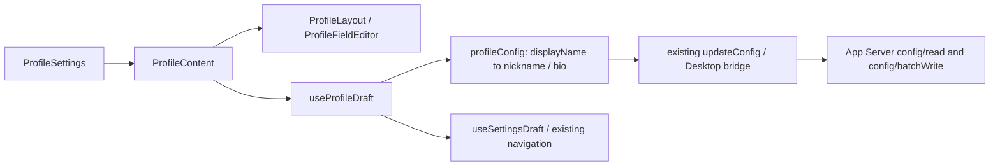

此链仅为本地配置资料编辑，不是远端公共身份接口。REA 已确认的公共 profile query/PATCH、eligibility、is_self/can_edit、preview、username/pins/上传仍为 gap；现有账号卡继续由独立 session owner 展示，不新建账号后端、假 flag 或本地公共 Profile fallback。非重大架构：既有 presentation 重组和未消费字段收缩，owner、协议方法、read model 与依赖方向不变；验证进度见 current 计划。

MCP 的 `useMcpPageEditorState` 继续是唯一表单草稿 owner，按 server identity 持有原始 JSON、字段基线、dirty 与同步保存锁，向同一 `useSettingsDraft` 报告；内部 server/new/cancel 与外部导航共用确认语义。`McpPanel` 首次访问配置后隐藏并保留同实例，隐藏焦点离开，保存失败、刷新与卸载迟到不清稿。Media 的 `useMediaServicesDraft` 同样只持有字段级 raw prompt/image-count 与提交基线/在途计数，既有串行 `updateConfig` 合并实际 owned 字段；blur 保存、即时 toggle 和导航确认不夹带其他未提交文本，在途新输入与失败原值保持。两者未新增配置 store、协议或后端 authority，旧页面重复草稿与 revision-only 保存路径直接替换。以上属于上图 Existing settings page owners 的生命周期接线；root 于 2026-10-18 确认 owner、依赖和数据流，局部回归与真实桌面验收分开结算。

Experimental 的 `useExperimentalSettingsState` 唯一拥有页面加载、crash 原始手动字段/基线、同步mutation锁与提示timer；手动保存只合并dirty字段，即时enabled只提交该字段，其他开关不夹带未保存的crash文本。DeveloperLab初访Experimental后保持同一隐藏实例并处理initialTab焦点。失败/在途新编辑/StrictMode和卸载迟到保持原导航与草稿合同，未引入第二配置owner；原953行页面内联状态与不受控timer直接替换。root于2026-10-18确认现有设置架构图适用；35项局部回归与真实桌面证据分开。

### 4.5 Desktop 公开新建会话

`useAppNavigation.startNewConversation` 是唯一公开动作，typed intent 明确保留 null/project identity 与 Home 恢复或 New fresh 意图。AppPageContent 只在真实 route/request 提交后交付请求；requested preview 不能清稿。root draft runtime 提交稳定 Home scope 与单调 epoch，同一 Coordinator 在有效 hydration 后执行受保护的 identity CAS，只有 applied 才清空 Controller。冲突、不可用、再次导航或新编辑均保稿；fresh 请求不进入 reload restore，避免冷启动重放。

```mermaid
flowchart LR
  Public[Home / Search New / Project New] --> Action[startNewConversation]
  Action --> Route[Existing App navigation commit]
  Route --> Root[Root draft runtime and exact scope]
  Root --> Coordinator[ComposerDraftCoordinator]
  Coordinator --> CAS[Existing persisted atom clear CAS]
  CAS -->|applied and unchanged| Controller[Controller clear]
  Controller --> Send[Existing typed first submission]
  Send --> Receipt[App Server canonical acceptance]
  Receipt --> Local[Canonical local scope and source consume]
```

cancelable 新建事件、随机 draftTabs/discovery、新页 owner、1ms 输入预热、materialized 首发和 general 第二层 strip 已直接删除；canonical session、Canvas、image workbench 与后台 queue 继续走既有 owner。Home `freshDraft=false`、New `true` 是 Lime 的明确决策；REA 确认公开导出名与静态职责，普通 Codex sidebar 的运行时 fresh 行为仍 unknown。责任 root 于 2026-10-15 确认此图，正式回归和真实 Gate 状态见 current 执行计划。

## 5. TypeScript Package 规范

| Package                             | 职责                                                                             |
| ----------------------------------- | -------------------------------------------------------------------------------- |
| `packages/app-server-client`        | App Server JSON-RPC typed client 与生成协议工件。                                |
| `packages/agent-runtime-client`     | 可复用的 Agent runtime client facade，不拥有 Renderer 状态。                     |
| `packages/agent-runtime-projection` | 纯事件/read model projection、tool/display schema 等可测试逻辑。                 |
| `packages/agent-runtime-ui`         | 可复用的 runtime UI primitives，不拥有 App Server transport。                    |
| `packages/agent-ui-contracts`       | 跨 UI 的 schema、contract 和 generated/validated 类型。                          |
| `packages/agent-workbench-adapter`  | 工作台与 runtime 的明确 adapter 边界。                                           |
| `packages/agent-capability-catalog` | capability catalog 的稳定消费面。                                                |
| `packages/cli`                      | Codex 风格 Node launcher、平台 npm 载荷 staging 与发布测试；不拥有业务 runtime。 |

package 只在至少两个独立 consumer 需要稳定边界时创建。单一 Renderer feature、单个 Electron host 或单个 Rust domain 不得先抽 package。`dist/`、`node_modules/` 不是事实源。

## 6. Rust Workspace 规范

### 6.1 App Server 与协议组

| Crate                    | 职责                                                                                                   |
| ------------------------ | ------------------------------------------------------------------------------------------------------ |
| `app-server-protocol`    | JSON-RPC method、params、result、notification、schema export。                                         |
| `app-server-transport`   | JSONL/transport framing、连接与传输错误。                                                              |
| `app-server-client`      | Rust client。                                                                                          |
| `app-server-test-client` | 测试专用 protocol client。                                                                             |
| `app-server-daemon`      | sidecar/daemon 生命周期。                                                                              |
| `app-server`             | request dispatch、RuntimeCore、host context、ProjectionStore、canonical read model、领域 data source。 |

App Server 是 Renderer、Electron、CLI、Plugin 与 runtime 的唯一跨应用业务协议入口。它可以做 transport、鉴权/初始化、请求编排、host context、projection 和 repository 接线；不能持有 provider-specific wire payload 或把工具实现复制进 handler。

App Server 的 request dispatcher 必须先把各 method handler future 装箱再执行；禁止让大型 async `match` 把所有分支 future 内联进同一个 poll 栈。`processor/dispatch.rs` 组合分发表，并保留 queue/add、media/read、turn/start、turn/steer 四个 event callback 分支的原借用合同；其余分支由同步 `dispatch/requests.rs` 构造并返回 boxed future，构造临时值的栈帧必须在 await handler 之前释放，禁止内联回 async poll。model、skill 与 project_git command group 由各自既有领域模块构造 boxed future，未知 method 不消费 params。该拆分不改变公开方法、协议、owner 或业务调用流；root 确认 minor 架构影响（2026-10-23）。stdio transport 在 `initialize` 完成前保持顺序执行；初始化后每个 client request 由独立 transport task 调度，notification/response 继续内联，并由 request id 关联响应、由 serialization scope 保证同一资源的共享/独占顺序。长 turn、MCP 或宿主 I/O 不得阻塞无冲突的 list/read request。

Desktop command/exec 与 Git 等宿主子进程必须有确定性测试注入和生产 deadline。测试不得读取真实用户 shell rc；
plain directory 的 Git status 先通过 `.git` ancestor preflight 返回，仓库内 Git 命令使用异步 process、`kill_on_drop`
和 5 秒上限，不得在 async handler 中调用无界 `std::process::Command::output`。交互终端必须复用 App Server
`CommandExecServer`，Electron 不得持有第二套 session 状态。

Server-originated request 使用与 client request 分离的 `serverRequest` catalog kind，并按以下方向流动：

```text
runtime/domain producer（私有 domain token）
  -> App Server server-request broker（独立 outer JSON-RPC id）
  -> Electron Desktop Host JSONL forward/drain
  -> Renderer typed server-request dispatcher
  -> JSON-RPC Response/Error（同一 outer id）
  -> App Server exact remove-once waiter
  -> runtime/domain exact resolver（私有 domain token）
```

outer JSON-RPC id 只负责 App Server 到客户端的响应关联，domain token 只负责领域内部 continuation；二者不得互相暴露或从 server/turn/tool/最近活动状态猜测。outer id 必须包含 App Server boot scope，不能只用进程内重置的 counter；pending registration 必须在 wait future 被 abort/drop 时 remove-on-drop。未知、重复、迟到或断连响应只能精确失败或取消原 waiter，不得扫描 pending 表命中其他请求。Renderer 对同一连接的 in-flight 与 settled outer id 都必须 at-most-once，只有 connection reset 才清 tombstone；未注册 method 必须返回 `METHOD_NOT_FOUND`，handler 失败返回 typed JSON-RPC error；生产路径禁止 mock fallback。

每个进入 Renderer 的 server request 还必须有显式 terminal 撤销信号。App Server 在 client Response/Error、domain cancellation 或连接级清理后，向创建 outer request 的同一 connection 有序发送 `serverRequest/resolved { requestId }`；不得广播给其他 client，也不得用新的 pending 表猜 owner。Renderer 必须先记录 resolved tombstone，再决定是否打开 UI，从而覆盖“resolved 早于 request”与同批 notification/request；每个 handler 使用独立 `AbortSignal`，远端 resolved 后静默关闭交互面并禁止迟到的 Response/Error。

### 6.2 Agent Runtime 组

| Crate            | 职责                                                                                                                              |
| ---------------- | --------------------------------------------------------------------------------------------------------------------------------- |
| `agent-protocol` | Thread/Turn/Item、RuntimeEvent、稳定 runtime DTO。                                                                                |
| `agent-runtime`  | 回合生命周期、action-required、队列、取消、stream 和 runtime scope。                                                              |
| `agent`          | current provider turn、session/store adapter、runtime facade、业务级 agent 编排。                                                 |
| `runtime-core`   | 模型路由、上下文 fragment、message/media part、跨 provider 的运行时模型。                                                         |
| `thread-store`   | Codex raw canonical rollout item append、独立 metadata patch、Thread/Turn/Item 的存储、检索、分页、历史、graph/identity/mailbox。 |

会话提交的唯一执行 owner 是 `agent-runtime::session_loop`：每个 session 只有一个串行 actor，FIFO task、regular/review/compact kind、replace/interrupt/shutdown、迟到 completion 防护和 steer/mailbox 分流均在此收口。所有 actor 命令先进入统一 operation envelope；envelope 使用 UUIDv7 identity，并携带可选 client user message identity 与 W3C trace carrier，首次启动和 FIFO promote 必须把同一份不可变 metadata 交给 task context。普通用户输入只通过 typed `UserInput` operation 进入该队列：active regular task 存在时原子 steer，否则启动或排队 candidate task，同一份输入必须成为新 task 的 initial input；App Server 只能消费 actor 返回的 `Submitted/Steered` receipt，不能把 read model 的预判当成调度事实。Review、Compact、ThreadSettings、SetMemoryMode、RefreshMcp、ReloadConfig 与 RunShell 使用各自的 typed task operation，并校验 operation 与 task kind 一致；Approval、UserInput、Permission、DynamicTool 与 MCP elicitation response 使用五类独立 response operation，禁止恢复通用 response operation。durable inter-agent append 成功后，App Server 只向已经存在的 recipient actor 提交 typed `InterAgentCommunication` envelope，保留 message/root/sender/recipient/source-turn identity、kind、result status 与 delivery mode；actor 只发布 durable activity，不复制 store payload，也不得为了通知创建空 actor。child terminal result 必须先完成 canonical Turn 与 durable result mailbox append，再由正常 append、durable replay、restart recovery 三条路径统一发布同一 typed activity；通知失败不能回滚 durable record，也不能创建空 actor。provider boundary 只能由 durable loader 把同一记录转换为 typed runtime input，禁止重新解析自由 JSON。steer 与 mailbox activity 通过 typed watch 发布；mailbox pending 使用单调 generation，loader 成功只确认调用前捕获的 generation，失败或并发新 append 必须继续保持 pending。sampling step snapshot 单调增加 step index；pending context rollover 只由下一次 snapshot 原子消费并推进一次 context epoch，显式推进 epoch 也必须清除 pending rollover，禁止在后续 step 重复滚动。RuntimeCore 只负责把 provider/tool 执行、canonical event 持久化和 durable mailbox loader 接到该 actor；QueueOnly mailbox 只有在 provider step 明确打开 mailbox boundary 后才 append + ack，不能由 AgentControl 或 GUI 另起活动回合旁路。AgentControl wait 必须先向既有 actor 注册 activity receiver，再读取 pending snapshot；steer、mailbox 和 queued admission 由 actor 的 typed watch 唤醒，不能通过固定间隔扫描 RuntimeCore turns。

Composer 的唯一 Renderer 文档 owner 是 `input-kit::ComposerController`，持有 ProseMirror `EditorState` 与附件/路径/能力资源。`ComposerEditor` 只持有 `EditorView`，引用该 state 并把 Transaction 交回 Controller；`applyTransaction` 消费 appended transactions 后原子发布 revision/snapshot。严格 JSON schema 接收 doc/paragraph/code_block/text/hard_break/mention/paste/text_element 与 link mark；code_block 仅容纳无 mark 的 text，保留 language 与 autoDetectLanguage。link 保存 href/title/sourceAppId、literal source、flags 与有限数值 occurrence；普通链接仅接受 HTTP/HTTPS/mailto，能力提及协议由独立 owner 处理。文本、选择区、mention 与 pending paste 由同一文档派生，不建第二份 React/TipTap document store。主输入 DOM 为 `[data-testid="composer-editor"][role="textbox"]`，file/skill/plugin/paste/element 均为不可编辑 atom；普通表单 textarea 不受影响。提及检测与选择动作统一通过同一PM投影的atom-aware候选解析；不可编辑标签和跨atom的查询不能打开菜单或拦截历史方向键，可编辑正文中的新触发字符仍有效。

Composer 路径附件只消费既有上下文资源与移除/发送动作；独立 KnowledgePack 页面、选择/导入/编译、专用 Skill executor、knowledge crate 与八条知识 RPC 已删除。普通文件打开/预览继续消费 canonical identity；专家广场的资料整理专家使用实际 bundled personal-ip Skill，交付工作区 Markdown，并沿现役工具权限执行。历史用户文档不删除。不存在知识平台兼容 owner、后台编译或第二套上下文状态；图片任务的通用 persona metadata 与全局 Soul owner 继续保留，专用 persona-pack 提示注入已删除。

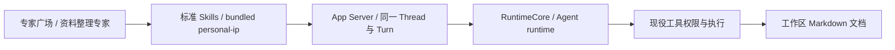

2026-10-24 责任开发者 root 确认：上述删除收敛既有 runtime 与工具 owner，不新增后端。公开方法退役、真实资源加载及 Desktop 证据分别记录于设置对齐计划第三十三阶段，静态结构不代表真实桌面已验证。

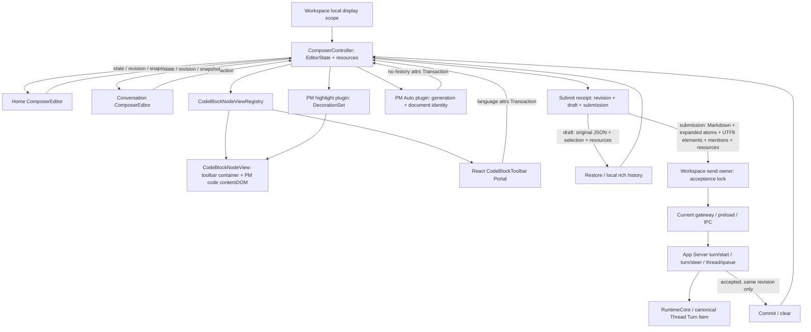

Workspace 的 `useAgentChatWorkspaceLocalDisplayState` 持有同一个 Controller，原 `input` string store 被 snapshot 派生值替换；`setInput` 仅为 text adapter。首页 materialization 保留该 owner 与 revision，显式换会话/new-chat/back-home 使用 clear 重置完整草稿并推进 revision；clear/restore 即使内容相同也强制新生命周期，普通同值 text update 保持无更新。附件 adapter 直接消费 Controller resources，能力选择仅把 UI 候选详情映射到 Controller 的 canonical route，禁止新 surface 的空镜像覆盖原资源。路径侧栏的 `usePathReferences` 同步读写同一 Controller 并从 snapshot 派生，不保留 path useState 或 passive effect 镜像。资源恢复由原始 draft 一次更新；历史回放不再 clear/add 资源导致导航游标失效。

真实接受沿 `turn/start|turn/steer response -> runtimeAcceptance -> raw send -> typed observer / RuntimeSubmissionResult -> surface settlement` 传播。`RuntimeAcceptanceReceipt` 的 session/thread 在异步前捕获，turn取真实响应；接受observer先于UI发布/统计/refresh结算，后处理失败不能撤销已接受事实。外层只接受 `runtime-accepted` 或真实 `queue-accepted`，`local-handled`、`rejected`、`unknown` 不消费草稿。queue receipt是实际QueuedSubmission与请求前canonical context，不伪造成turn/start或由boolean/void猜测接受。该类型合同属于Renderer既有send owner，未新增AppServer wire字段。Architecture diagram confirmation: root, 2026-10-14; acceptance receipt flow and canonical ownership checked.

`draft` 保留折叠 paste、原始 JSON、link/code 属性、UTF16 选择区、图片、路径和能力供恢复；`submission` 将链接与代码块序列化为 Markdown、展开 paste 并携带 typed TextElement/inputMentions，唯一决定发送内容。代码 fence 长度为正文最长连续反引号数加一且至少三个，正文空白原样保留。literal link 只有在完整安全链接的 label/href/title 均匹配时用于草稿重放；编辑清除旧 literal/occurrence/autolink 元数据。ProseMirror position、显示文本 UTF16 offset 与最终 Markdown 发送文本 UTF8 byteRange 分别映射，不混用。annotation 更新通过 PM Transaction 保留富文档与资源；HTML/Markdown paste 进入同一 Controller，code 中 Enter/ShiftEnter 插入文本换行。`composerDraft`/`composerSubmission` 显式贯通 start/steer/queue；无法映射的 textElements 在 IPC 前拒绝，不能猜 range 或退回纯文本。Controller 不拥有 Thread/Turn/Queue 事实；workspace 依据 canonical read model 解析 intent 并在真实接受结果结束前持有发送锁。失败保留完整 draft；成功只在 receipt revision 未变化时 commit，迟到结果不清新草稿。提交瞬间直接捕获当前 canonical 文档，不把旧 React 闭包的资源回灌；能力初始化与恢复请求按同 Controller identity 去重，跨 surface 重挂载不重放旧请求。

Queue mutation 进入 Codex v2 `thread/queue/*`，`thread/queue/changed` 或显式 refresh 只触发 canonical queue 重读；Renderer 不建第二 queue facade、乐观删除或 runtime。现有 `@tiptap/pm` 提供 schema/state/view/history/keymap；代码块增加直接依赖 `lowlight 3.3.0`、`highlight.js 11.11.1`、`jsonc-parser 3.3.1`，不新增 public JSON-RPC 字段。Architecture impact: major; Renderer document/transaction and cross-surface draft owner converged. Architecture diagram updated: Composer flow above. Responsible developer confirmation: root, 2026-10-14; directory, ownership, transaction/submission/restoration flow and protocol boundary checked. Runtime verification remains tracked in the current execution plan.

代码块的唯一视图工厂归 Controller 持有的 `CodeBlockNodeViewRegistry`；Editor 创建 NodeView，React 仅向不可编辑 toolbar container 建 Portal。正文和高亮 span 均由 PM contentDOM/Decoration 管理，不用 `innerHTML` 或第二份 React document 替换正文。`composerState` 只装配 EditorState/plugins 和投影资源，不持有另一个状态 store；文档输入/配置类型统一归 `types`，旧 Controller type export 已直接迁净。有效 rich/code/plain 配置决定 NodeView 与两个独立 plugin 的装配，外部注入 Controller 不被 hook 强加 defaults。

高亮按位置和 `Node.eq` 缓存、映射移动块，顶层 HAST scope 转为 UTF16 inline Decoration。raw parser 的 53 grammar/5 alias 与 GUI 41 项目录/21 alias 分开，Auto subset 为 39 项。Auto 延迟150ms、按 Node identity缓存，并在异步结果前复核 generation/同 doc/未销毁；结果写 attrs但不进入 undo history。纯 Decoration/meta 更新 state/View，保留同一 draft snapshot/revision与receipt；真实 attrs/selection/正文改变才更新草稿。clear/restore 同值也创建 fresh plugins，旧 View 异步结果失效；View 卸载注销 entries，但不永久销毁可重挂载的 Controller registry。旧 schema `toDOM` 仅保留 serialization/clipboard 责任；主 GUI 及 fixture 已直接迁到 NodeView DOM，无 compat 视图。Architecture diagram confirmation: root, 2026-10-14; registry、插件、Portal、资源、receipt、生命周期与既有 App Server 边界逐项确认。正式产品验证在 current 计划独立记录。

Composer 纯文本历史只允许沿 `Composer -> typed AppServerClient -> app_server_handle_json_lines -> App Server promptHistory/read|append -> RuntimeCore PromptHistoryStore` 流动；Electron 仅转发 JSON-RPC，Renderer 不得以 `localStorage`、SQLite 或旧 Desktop facade 建立第二事实源。`PromptHistoryStore` 使用受控数据根下的 append-only `prompt_history.jsonl`、文件锁和 4 MiB 保留上限，坏行跳过但保留 offset；macOS/Linux 的 `logId` 使用 inode，Windows 使用文件 creation time，用于分页 cursor 的快照一致性。读取返回 newest-first bounded pages，客户端在 Composer 内按 oldest-first 合并；异步读取完成时只合并服务端快照与本地新提交的边界重叠，不覆盖已产生的 draft/history。只追加成功提交的正文和 canonical Thread identity：公开 append 为 `{threadId,text}`，entry 返回 `threadId`，内部 JSONL 的 `session_id` 字段记录同一个 Thread ID。TUI 选定 Skill 元素可经 `mention_codec` 编码为 path link，再从同一 history owner 恢复；附件、普通路径引用与大粘贴 payload 仍为会话内 rich state，不把正文 codec 冒充完整附件持久化。`promptHistory/read|append` 是稳定 v2 方法，不要求 `initialize.capabilities.experimentalApi`。Architecture impact: major; persistent history owner and cross-platform identity semantics fixed. Responsible developer confirmation: root, 2026-09-01.

Composer 输入生命周期由 `ComposerEditor` / keymap / `BaseComposer` 协作：compositionstart/end 只更新编辑状态，
native composing/Process/229 不产生 submit，显式 Enter/button 走原 intent 主链；旧 IME 自动发送路径已删除。
首页/会话附件 adapter 复用 `useAttachmentGeneration`，读取前捕获 generation，clear/replace/layout unmount cleanup
同步失效，迟到 success/error 不改变新草稿或发旧 toast。该 helper 只持有生命周期 ref，不持有附件、Thread/Turn 或 intent。
IME 与附件 generation 的边界沿用既有 owner；结构化编辑器及跨 surface 草稿归属见上图。基础 link/code 已实施，实际 Electron 提交/恢复门禁在当前计划跟踪；完整 rich PMU、主动链接导航/编辑、跨重启 rich draft 与系统 voice 继续独立验收。

听写的唯一Renderer生命周期owner为 `InputbarDictationSessionOwner`，scope包含同Controller、sessionId与单调generation，starting同步占位后才请求麦克风。录音stream、sampler、timer与音频解码context随session释放；permission/live/final/polish/decode晚到结果先校验owner。明确cancel仅在仍持有最后provisional revision时恢复原始完整draft；compositionstart或结果应用时检测到composing则无回滚结束整个session，保留当前正文与资源。Core的compositionend不自动插入或发送；候选pending/手动flush/drop轨道已删除。已经发出的ASR/polish RPC通过结果隔离失效，当前API不声明网络请求可撤销。结束听写只更新草稿，用户显式发送仍走上图receipt/acceptance主链。

World state 的 typed DTO owner 固定为 `agent-protocol::world_state::RuntimeWorldState`。当前链路为：

```text
typed RuntimeRequest + session scope + resolved model selection
  -> App Server request_context::turn_context
  -> AgentTurnContext.metadata["world_state"]
  -> agent-runtime::provider_turn typed resolver + renderer
  -> provider-visible contextual user message
```

App Server 当前只投影有明确事实源的 environment（cwd/project root/workspace/thread/turn、
provider/model/reasoning）、selected environments（id/cwd/workspace roots/primary/status/shell）、permissions（approval/sandbox/web search）、collaboration mode 与 effective
multi-agent mode。`agent-protocol::MultiAgentMode` 复制 Codex exact typed union；effective mode 只从 resolved
reasoning effort 推导：`ultra -> proactive`，其余为 `explicitRequestOnly`。deprecated
`thread/start.multiAgentMode` / `turn/start.multiAgentMode` 只保留 typed wire 形状并被 runtime 忽略，不进入
durable metadata，也不能覆盖 effective mode。没有 typed 来源的 AGENTS/apps/plugins/environment
instructions 和 realtime 必须保持缺失，不得从 prompt 文案、进程环境或 provider 名称猜测。Agent Runtime
必须优先反序列化该 snapshot，并在当前 user input 前只渲染一次；metadata 存在但损坏时 fail closed，只有
非 App Server 调用者缺少 snapshot 时才通过同一 DTO 的 `from_cwd` 生成最小状态。旧的 runtime cwd XML
拼接与 arbitrary-JSON multi-agent 控制面已删除。provider-visible consumption、effective multi-agent producer 与
Environment typed producer 已落地：Environment selection 一方面由 App Server 在 RuntimeCore canonical event log
中追加 `world_state` full/patch durable history，另一方面在每次 `turn/start` 从 registry 捕获请求级状态/shell
快照并注入同一 typed DTO；两者分别服务恢复与当前 provider step，不是两套事实源。provider renderer 对单环境
保持 legacy `<cwd>`，对多环境按稳定 ID 顺序输出 `<environments>` 并保留第一选择的 primary 语义。其余 typed
producer 仍需沿同一 DTO owner 补齐，禁止在 App Server、Agent prompt 与 provider lowering 分别拼接第二套
environment context。

Environment registry 的 current owner 是 App Server `processor::environment::EnvironmentRegistry`。远端注册信息
持久化到 App Server 配置根下的 `environments.json`，启动时只恢复经过 URL/ID 校验的条目并保持 Pending，连接
必须完成 `initialize -> initialized -> environment/info -> environment/status` 才能进入 Ready。状态转换通过
registry event bus 投影给当前选中该 Environment 的 Thread；archive/delete/unsubscribe 会撤销索引。该 owner 只负责
transport、生命周期与选择 lowering。执行 Environment identity 必须沿 `ToolCall -> RuntimeToolExecutionContext ->
RuntimeUnifiedExecToolRequest -> LiveExecutionRequest` 传到 App Server process owner；当前本机
`ExecutionProcessServer` 对任何非 `local` identity 返回 `UnsupportedEnvironment`。exec-server `process/*` 与
`fs/*` transport 注入完成前，远端 turn 仍不得静默降级到 local。

状态模型与 Codex 对齐：Thread 是会话上下文，Turn 是一次执行，Item 是可恢复的输入、输出、工具或审批活动。`ThreadStore` 的 raw canonical append 与独立 metadata patch 是持久化 contract；App Server `ProjectionStore` 只能是该 contract 的实现，queue payload、stream buffer 与 renderer cache 不得反向成为事实源。

运行中状态必须由 durable history 与当前进程 live execution owner 联合投影。唯一 live owner 是 App Server
`session_loops.active_turn_id`；`thread/read`、`thread/list` 与 `thread/turns/list` 必须用同一 owner 判断
`InProgress` 是否仍可执行。Renderer reload 不销毁 owner，可以通过 `thread/resume` 续接同一 Thread 的通知；
Electron/App Server restart 后 owner 已不存在，cold read 只能把 durable `InProgress` response 投影为
`Interrupted`，Thread 投影为 `NotLoaded`，已加载且空闲时投影为 `Idle`。该归一化只作用于 response snapshot：
ProjectionStore 与 `SessionLoadContext.stored` 保留原始 durable/operational 状态，不写 synthetic
`turn.completed`/`turn.canceled`，不发送伪 `turn/interrupt`，也不按时间戳猜测 stale running。首页、侧栏、详情、
输入框、evidence 与 export 只能消费该 owner-based projection，不得恢复 30 分钟启发式或 Renderer running truth。
Architecture impact: major; App Server restart/read projection owner and durable/read boundary changed while preserving the
existing ThreadStore and session-loop ownership. Architecture diagram updated: this Agent Runtime state-flow block.
Responsible developer confirmation: root, 2026-08-20. Confirmation content: 已对照 Codex thread lifecycle/history
projection，确认 cold read 只做 `InProgress -> Interrupted` 展示归一化，live resume 仍以当前 session loop owner 为准，
且 durable history、mailbox、workflow 与 AgentControl 不被 response normalization 改写。

#### 6.2.1 Storage alignment target（P1 `in_progress`）

2026-07-19 存储计划选定的目标合同是 `AgentRoot/sessions/YYYY/MM/DD/rollout-*.jsonl` 承载唯一 Thread/Turn/Item durable truth，`archived_sessions` 通过原子 move 表达 archive，SQLite 只保存定位、语义状态或经验证可重建的 read model。production 物理 owner 固定为：`sqlite/state.sqlite` 保存 `canonical_threads` 与 `canonical_thread_spawn_edges`；`sqlite/thread_history.sqlite` 保存 `canonical_turns`、`canonical_items` 与 `canonical_history_applies`；`runtime/projection_1.sqlite` 只保存 `projected_sessions/turns/items` 与 `projection_watermarks`，分类为 `deprecated / rebuildable`。组合事务始终以 state 为 main，按顺序 attach history 和 projection；单文件 constructor 仅供隔离测试，不是 production 路径。跨库不能建立 SQLite FK，因此 thread delete 显式按 item、turn、apply、metadata 顺序清理；history 内部 item -> turn 使用同库 FK。

production `ProjectionStore` 通过显式 `AgentRoot` 注入 `RolloutStore`：新 Thread 按创建时本地日期生成唯一相对 `rollout_path`，metadata 保留 UTC 创建时间，typed `ThreadHistoryChangeSet` 在 SQLite commit 前同步写入 JSONL；跨日续写与 restart 重试沿用原路径，同 sequence 同 fingerprint 幂等、不同 fingerprint fail closed。state/history 为空时，constructor 从 active/archived rollout 单事务重建 Thread/Turn/Item；canonical 已存在而 projection 四表全空时，也会独立从 canonical snapshot 重建 projection。已有非空 projected row 时 no-clobber，不清表、不隐式迁移；history `content_digest` 不匹配时启动 fail closed。用户消息全文只在 rollout，重建 SQLite 只保留现有 summary 上限内的单份摘要。`canonical_threads.last_sequence` 当前只作为跨库 commit watermark 暂留 state；迁入 history projection state 后才允许关闭这项 P1 债务。

flat EventLog 仍是 `deprecated / bounded diagnostics`，旧 `runtime/projection_1.sqlite` 是 `deprecated / frozen-for-removal` read model；二者不得新增 transcript payload、第二 canonical writer或长期兼容读取。启动期 queued recovery 禁止扫描 raw EventLog；projection 中的 queued row 只有在 `(session_id, thread_id)` 能 join current `canonical_threads`，且 production Thread 有非空 `rollout_path` 时才可恢复。启用 rollout 的生产实例不再允许 raw EventLog 重写 canonical ThreadStore；旧 `canonical_threads.rollout_path IS NULL` 行也拒绝继续 append，不导入旧 session/event/DB。Codex v2 `thread/archive` / `thread/unarchive`、macOS JSON-RPC/Gate B 和三库物理 inventory 已完成；P1 仍受 projection reader 退役、`last_sequence` owner 收口、旧 source exact-path cleanup guard 与 Windows Gate B 阻塞，不得标成完成。`sessionFile/*` 生成文件归 `AgentRoot/artifacts/sessions/<session-id>`；bounded text diagnostics 固定为 `AgentRoot/observability/log/lime.log`。其他旧数据只进入 exact-path cleanup manifest；允许迁移的只有模型控制面小型语义状态（provider、加密 key ciphertext、UI state、model preference、active tab）与已下载模型文件。模型控制面 source 只读并按 WAL 事务选取，不复制整库；`HostUserData / HostSessionData / AppDataRoot / AgentRoot / UserHome / Workspace` 的逐路径决策以 `internal/exec-plans/codex-lime-storage-alignment-plan.md` 与 `internal/refactor/data/03-one-to-one-storage-alignment-plan.md` 为准，责任开发者架构确认仍为 `pending`。

P0 的 current 组合根链固定为 `Electron appDataPaths -> APP_SERVER_APP_DATA_DIR + AgentRoot -> App Server StorageRoots/LocalAppDataSource -> domain root`。Windows `HostUserData` 保持 roaming，`HostSessionData` 固定到 `<AppDataRoot>/host-session`；portable/E2E override 必须同时显式注入 AppDataRoot 与 AgentRoot，禁止从 `AgentRoot.parent()` 反推。Product DB 只写 `AgentRoot/lime.db`；diagnostics、support bundle、Soul style-pack 与 MCP OAuth 不得自行解析平台默认根。旧 Product DB 整库复制、通用 migration manifest、启动 cleanup，以及 managed project/workspace/session path 启动迁移均为 `dead / deleted / forbidden-to-restore`；Windows 真机证据与责任开发者确认完成前，P0 继续保持 `in_progress`。

Message、Reasoning 与 Plan 必须遵循 Codex 的 canonical Item lifecycle。用户输入在 `message.created` 时直接形成带 `completed_at_ms` 的 completed UserMessage；provider text/reasoning 的 Start/Delta/End 必须以 canonical Turn + sampling attempt scoped Item identity 贯穿 `model-provider -> agent-runtime -> agent -> App Server`，同一 Turn 的后续 sampling 或同一 Thread 的后续 Turn 均不得复用前一 Item。assistant 的流式展示在出现真实正文时启动 AgentMessage；已提交模型历史的原生 message 完成快照可独立建立同一 canonical Item（包括显式空正文），并由对应 End/`message.completed` 进入 completed，取消或中断映射为 `Interrupted`；terminal Item 拒绝 late delta。Plan 是独立的 `ThreadItemPayload::Plan`，`plan.delta` 与 `plan.final` 必须按 `(turn_id, revision_id)` 共享稳定 Item identity；delta 只表达流式过程，completed `plan.final` snapshot 是恢复和 GUI 决策绑定的权威内容。Plan parser 按 source Message Item 隔离 buffer，Plan 只记录 `sourceItemId` 而不复用 Message identity。Plan 前的纯空白按 Codex `leading_whitespace_by_item` 语义暂存：后续出现正文时随正文发出，Plan-only 输出则丢弃，因此不得创建空白 AgentMessage 或伪造 `message.completed`。历史恢复、live notification 与 read model 必须保留同一 revision identity、Plan steps/status 与 terminal timestamp，禁止用 `update_plan` Tool Item 或 Renderer 本地状态替代。

AgentMessage 的 canonical 正文只由 `ThreadItemPayload::AgentMessage { text, phase, content_parts }` 持有。`content_parts` 只允许 typed Text 与 Media reference；Media 必须引用 sidecar/artifact URI 并携带 MIME 等可验证元数据，禁止保存 provider raw payload、inline `data:` URI 或 presentation metadata escape hatch。`ThreadStore` 持久化、Codex v2 `thread/read` 与 live canonical event 必须保留相同 part 顺序和 reference；presentation 可以映射为 `contentParts`，但不得在读取或 Renderer 边界从 raw event、metadata、正文文案或第二 read model 补造。

用户输入中的 inline 图片必须在 App Server turn 输入边界先写入 `SidecarStore`，再以 `sidecar://` URI、MIME、bytes、sha256 和 typed sidecar reference 进入 EventLog、Thread/Turn/Item 与 read model；持久化事实源不得保留 base64。provider sampling 只克隆 canonical input/history，并在网络请求前通过 sha256 和大小上限读取 sidecar，瞬时 hydrate 为 provider 所需 data URL，不得把 hydrate 结果写回 session。当前回合的新图片遇到 text-only capability 必须在联网前拒绝；历史图片遇到 text-only capability 按 Codex 语义降为明确占位文本，使后续文本回合可继续。字段名统一复用 `output_refs` owner，禁止在 input writer/resolver 散落新的 sidecar truth key。

canonical 持久化的当前 P1 切片是 App Server `RolloutStore` 承接新 Thread 的 dated JSONL，`ProjectionStore` 暂时同时实现 `thread_store::ThreadStore` 的 state/history repository 与 deprecated read model。`state.sqlite` 只持有 Thread metadata/graph，`thread_history.sqlite` 只持有可由 rollout 重建的 Turn/Item/history apply snapshot；任何 history 表落回 state 或 projection 都是回流违规。`ThreadStore::append_items` 只追加已经 canonical 的 typed item；`update_thread_metadata` 是独立 patch API，append 不从 item 内容推断 metadata。typed `ThreadHistoryChangeSet`、sequence collision、rollback/remove、opaque cursor 和 metadata patch 在过渡期仍必须保持确定性；不得增加 `RuntimeStore` 适配层、第二个 transcript 数据库或 renderer 持久化副本。ThreadStore archive/unarchive 已在同一 AgentRoot 内原子移动 rollout 并更新 state `rollout_path`，重复 move 按 identity 幂等；旧 `agentSession/update` 与 `archive_many` 已删除，公共 owner 是 Codex v2 `thread/archive` / `thread/unarchive`。`thread/delete` 也只允许走 v2 App Server current 链：RuntimeCore 先冻结包含 persisted 与 pending-only descendants 的 deepest-first 子树快照，停止全部 session loop/backend owner，并幂等清理 rollout、event log、sidecar、trace 与 telemetry；随后 `ProjectionStore` 以 `BEGIN IMMEDIATE` 重读并校验快照，在一次 ATTACH transaction 中删除 goal/accounting/outbox、canonical history、projection、spawn graph、Agent identity/mailbox 与 canonical Thread。App Server 在 `{}` 响应后通过 per-thread listener 将 child-to-root `thread/deleted` 广播给发起连接和全部订阅连接，再取消 listener、resume barrier 与双向 connection index；同一子树的 pending server requests 先收到 `serverRequest/resolved` 并以 `REQUEST_CANCELLED` 终止。旧 `agentSession/delete` production method/DTO/helper 为 `dead / deleted / forbidden-to-restore`。每个 Item 的 canonical ordinal 只取该 Item 首次出现时的 Lime outer `AgentEvent.sequence`，后续 lifecycle merge 必须保留首次 ordinal；Tool、Message、Reasoning、Plan 和 import producer 自有 ordinal 均不得进入持久化 ordering，Codex `sourceEventSeq` 只能作为 provenance/metadata，ThreadStore 不得通过 `MAX+1` 或其他 store-side renumbering 生成 ordinal。旧 `thread-store::runtime_store`、`session_repository` 以及 production AgentSession read/list/history fallback 已是 `dead / deleted`；event/app-data fallback 与 Renderer detail synthesis 只允许历史测试 evidence，不得成为 production read path。production App Server 构造必须显式注入 projection/state/history/AgentRoot 四路径；`ProjectionStore::initialize*` 单文件构造只允许隔离测试，`AppServer::new()` 只存在于 unit-test build。

Codex v2 `thread/searchOccurrences` 的唯一读取链是：

```text
App Server thread/searchOccurrences
  -> RuntimeCore read boundary
  -> ThreadStore::search_thread_occurrences
  -> ProjectionStore
  -> history.canonical_turns + history.canonical_items
  -> typed Rust / TypeScript response client
```

搜索只读取已持久化的 canonical history，因此 cold、archived 与 fork 后已物化的 child Thread 使用同一 owner，active 但尚未持久化的内存 snapshot 不参与结果。正文必须从 typed `ThreadItemPayload` 提取，禁止对 `item_json` 做 `LIKE` 或回读 deprecated projection：UserMessage 按原 part 顺序拼接 Text，assistant 只搜索每个 Turn 最后一个 `final/final_answer` AgentMessage；Lime 在 Turn 尚无 `final_agent_item_id` 时以 canonical Item ordinal 选择该末项。匹配为大小写不敏感的 literal substring，assistant Markdown 先投影成纯文本；snippet range 使用 UTF-16 code unit。分页 cursor 必须同时绑定 Thread identity、原始 search term 与 occurrence 位置，`turnCursor` 是可直接交给 `thread/turns/list` 的 inclusive opaque cursor；非法 cursor、空 search term、未知 Thread 与 store unsupported 都按结构化错误 fail closed。Renderer 当前没有 Thread 内查找产品面，本切片不新增侧栏标题搜索复用或无交互闭环的 GUI 空壳。

Codex v2 `thread/search` 的唯一跨 Thread 内容搜索链是：

```text
App Server thread/search
  -> RequestProcessor v2 lowering
  -> RuntimeCore read boundary
  -> ThreadStore::search_threads
  -> ProjectionStore
  -> state.canonical_threads + history.canonical_items
  -> current Thread status projection + first content snippet
  -> typed Rust / TypeScript response client
```

该方法与 `thread/list.searchTerm`、Renderer 侧栏本地标题过滤不是同一能力：它只按已持久化的 UserMessage
与 AgentMessage conversation text 匹配，并返回每个 Thread 的首个正文 snippet，不搜索 name/preview。默认及空
`sourceKinds` 只包含 Codex interactive source `cli + vscode`；显式 source filter、active/archived 二选一、
`created_at/updated_at/recency_at` 排序和前后翻页全部由 store-owned opaque cursor 收口。cursor 绑定 trim 后的
search term、archive scope、sort key 与 source kinds；反向翻页只切换 `sortDirection`，不得由 handler 或 GUI
解析 cursor。默认 limit 为 `25`、范围为 `1..100`，空 term、损坏或跨查询 cursor 必须 fail closed。搜索结果
Thread 继续经过同一个 v2 projection，不建立第二套 session DTO；active 但尚未持久化的内存正文不参与结果。
当前 Renderer 尚未接入 snippet 搜索产品面，本切片不把现有标题 Dialog 冒充 `thread/search` consumer。

canonical 写入必须先在 SQLite 事务内完成 normalization 与约束校验，再同步 append rollout，最后提交 projection；这样无效 change set 不污染文件，而文件成功、DB commit 失败可由 `(thread_id, sequence, fingerprint)` 幂等重试。metadata patch 不得隐藏在 append。ThreadStore apply 失败必须显式 fail closed；P1 完成后未完成的 projection tail 只能由 rollout rebuild，不能再由 raw EventLog 重写 canonical history，也不能 warning-and-continue 造成 GUI 可见而 rollout 丢失。

`thread/settings/update` 与 `thread/memoryMode/set` 的生产写入沿同一个 session actor 串行执行，不创建 Turn/Item，也不修改 active Turn 已捕获的 runtime request；更新只进入后续 Turn 的 session defaults。持久化顺序固定为：

```text
App Server typed method
  -> RuntimeCore session operation
  -> session actor 读取并合并当前 metadata
  -> ProjectionStore 以 state.sqlite 为 main，attach history/projection
  -> 开启 IMMEDIATE transaction 并校验 canonical identity
  -> RolloutStore append/verify thread_metadata digest chain
  -> 同一 attached SQLite transaction 更新 state.canonical_threads + projection projected_sessions
  -> commit
  -> RuntimeCore 内存 session state
  -> typed response / settings notification
```

`thread_metadata` 可以与 history record 交错，但必须携带 `previous_content_digest`、`content_digest`、`updated_at_ms` 和完整 metadata；scan 按文件顺序验证 identity、摘要链与时间单调性，并把最后一条 metadata 应用到 rebuild initial Thread。rollout append 成功而 SQLite commit 失败时，同 metadata 重试复用 rollout 中已同步的时间戳并补齐 projection；不同 metadata 必须因 expected-old/next-new 冲突 fail closed，不得覆盖尚未投影的 durable record。启用 AgentRoot 的实例若 canonical row 缺少 `rollout_path`，session metadata mutation 必须拒绝继续写入。memory mode 为 `disabled` 时，后续 Turn 不注入 memory prompt；该配置必须能从纯 rollout 重建后的 read model 恢复。

`thread/shellCommand` 是显式用户 shell submission，只允许进入 `RuntimeCore -> RuntimeSessionOperation::RunShell -> ExecutionProcessServer`。active session 必须复用当前 Turn，并共享该 Turn 的 cancellation token；idle session 必须由 actor 启动并持有一次性 task，创建独立 Turn，期间保持 session busy。命令执行不进入 provider sampling、普通工具 approval 或第二套 shell runtime。durable 与通知顺序固定为：

```text
thread/shellCommand
  -> session actor RunShell
  -> active Turn auxiliary | idle standalone Turn
  -> local process start
  -> command.started durable Item + item/started
  -> process poll / active cancellation
  -> command.exited durable Item + item/completed
  -> idle Turn terminal
```

Command Item 必须持久化 `UserShell` source、process id、canonical cwd、聚合输出、exit code 与 duration；live notification、thread read、rollout/SQLite projection 和 restart read 使用同一 canonical Item。内部终态只使用 current `command.exited`，不得新增平行的 completed/failed/canceled command event family；失败与取消通过 exit code、Item status 和 Turn terminal 表达。空命令、未知或 archived Thread、缺少本地执行环境、session/thread identity 漂移均 fail closed。

Renderer 的显式用户 shell 入口固定为输入首字符 `!`。输入 owner 只负责识别和清空命令文本；提交必须依次经过 Agent Chat shell controller、runtime adapter、typed App Server client 和 `thread/shellCommand`，不得调用裸 bridge、ExecutionProcess API 或 Electron 业务命令。controller 在请求前确保 session 并解析 canonical thread identity，订阅同一 session event route；Item started/completed 只触发 current read model/detail 刷新，ack 不得在前端合成 terminal。空命令不发请求，请求错误必须进入本地化可见错误通道。

Codex v2 background terminal control 只允许走 thread-scoped current 链：

```text
thread/backgroundTerminals/{list,terminate,clean}
  -> RequestProcessor v2 thread serialization
  -> RuntimeCore background-terminal boundary
  -> ExecutionProcessServer authoritative thread index
  -> tool-runtime local process supervisor
```

Thread identity 必须由 `CurrentTurnToolExecutor` 或 `thread/shellCommand` 的 canonical context 显式下传，
禁止从 provider 可写 metadata、cwd、session id 或命令文本反解。对外 `processId` 是单调数字字符串，作为
稳定排序和 cursor；list 只返回当前 Thread 尚未隐藏的 running process，cursor anchor 已消失时继续返回更大
process id，默认返回全部且 `limit=0` 提升为 `1`。terminate 必须在同一 registry 临界区校验
`threadId + processId`，跨 Thread 返回 `terminated=false`；命中后立即从 list 隐藏、释放 registry 锁，再向
真实 supervisor 发终止信号，并清理 `unified_exec` session mapping。clean 对当前 Thread 的已登记后台进程
执行同一隐藏与终止语义，响应固定为空对象。`write_stdin` 也必须校验 canonical Thread ownership，不能借
内部 session id 跨 Thread 控制进程。旧全局 `executionProcess/*` wire 不参与 Codex parity，不得为这三个
method 新建 adapter、mock fallback 或第二套进程 owner。

Codex out-of-band elicitation accounting 使用独立的 Thread-local current 控制链：

```text
thread/{increment,decrement}_elicitation
  -> RequestProcessor v2 Thread serialization / exclusive access
  -> RuntimeCore loaded Thread registry
  -> thread-local volatile reference count
```

两个方法只接受 loaded canonical Thread，并使用 checked `i64` 计数。increment overflow、count 为零时
decrement、非法 Thread id、cold/unknown Thread 都 fail closed；`paused` 严格等于 `count > 0`，归零后删除
registry entry。archive、delete 与 idle unload 都清理该 entry，因此 resume 不会继承过期的 process-local
registration。该状态表达外部 helper 的 live registration，不写入 rollout 或 Thread/Turn/Item projection。

当前切片只完成 exact public control plane，尚未把 Thread-level state 接入 `agent-runtime` provider
active-time budget。现有 MCP `ElicitationPauseState` 是 connection-local owner，不能代替 Thread registry。
统一 active-time consumer 接入前，`paused: true` 只证明 registration state，不代表已经实现 Codex 的完整
timeout-pause parity。

Codex Guardian denial 的人工放行使用独立的 provider continuation current 链：

```text
thread/approveGuardianDeniedAction
  -> typed v2 RequestProcessor + Thread serialization
  -> RuntimeCore loaded canonical Thread lookup
  -> typed Guardian denial/action validation
  -> provider-only developer continuation
       -> active regular Turn: agent-runtime session pending input
       -> idle/racing Turn: durable canonical runtime event
  -> provider history Developer message
```

wire 上的 `event` 保持 Codex opaque JSON shape，RuntimeCore 必须在副作用前解析 `status` 和完整 action tag，
并拒绝缺字段、unknown variant 与非绝对本地路径。只有 `status=denied` 生成 continuation；其他合法终态按
Codex 语义无副作用返回空对象。developer text 使用 Codex 的 exact-action marker，只授权原 event 中的单个
action，不得转成 session-wide approval、通用 permission cache 或旧 `agentSession/action/respond` waiter。
活动回合交给既有 session actor 在下一 sampling boundary 消费；同时写入 canonical event，使 idle、finishing
race、restart 与后续 Turn 都从同一 provider-history owner 恢复。该 provider-only event 不投影为用户可见
Thread Item，也不引入 v0/compat/mock。Guardian assessment/review lifecycle 由第 38 节的 current owner 产生；
本 method 只承接手工放行 continuation boundary，其验证不能替代 reviewer 运行与 GUI 交互验收。

Codex v2 raw response item injection 使用独立的 provider-history current 链：

```text
thread/inject_items
  -> typed v2 RequestProcessor + Thread serialization
  -> RuntimeCore canonical Thread lookup / cold resume
  -> durable response_item.injected provider-only event
       + active regular Turn: agent-runtime session pending raw input
  -> provider history RawResponseItem
  -> model-provider protocol lowering
       -> Responses: preserve exact item JSON
       -> non-Responses: fail closed
```

wire 上的 `items` 保持 Codex opaque JSON shape，但 RuntimeCore 必须在写入前按 current `ResponseItem` union
完整校验，并拒绝远程图片 URL。cold Thread 先从 canonical store hydrate/resume；archived、unknown、空数组或
非法 item 均 fail closed。durable event 是 restart、idle 和 active/finishing race 的事实源；active regular Turn
同时通过既有 session actor 在下一 sampling boundary 消费 raw item。该 event 只进入 provider history，不生成
用户可见 Thread Item，也不得经 `ThreadItemPayload::Extension` 建立第二套 rollout 表示。

`model-provider` 是唯一 lowering owner：Responses route 原样保留 item JSON，包括通过 validation 后的 provider
扩展字段；Chat Completions、Anthropic 与其他不支持 raw Responses item 的 route 在发网前拒绝。当前 method
boundary 不关闭 P0-03 的全局 canonical history/rollout、rollback/fork/replay 与未知记录一致性缺口。

session start 返回成功前必须先同步写入 rollout metadata 首行并提交 Thread metadata row，再把 session 暴露到 RuntimeCore 内存状态；文件或 SQLite 失败都不得留下 memory-only session，DB commit 失败后的 metadata 文件由同 identity 重试接管而不是覆盖。canonical `session_id`、`thread_id` 与非空 `rollout_path` 均为唯一 identity，跨 RuntimeCore 重启也不得一对多。显式 session delete 与 import replace 的文件/metadata 原子协议尚未完成，当前入口不得被描述为安全清理能力；GUI、AgentSession adapter 和首事件 lazy create 都不能充当 empty Thread fallback。首事件 ensure 只保留为防御式幂等边界，不再拥有 Thread 创建时点。

action-required/approval 与 ask-user 的 live continuation 归 `agent-runtime` session/turn scoped pending state；可持久化恢复事实归 RuntimeCore canonical events。Codex v2 typed server request 必须先从 canonical descriptor 恢复 scope，再校验 caller 参数；不得信任 caller type、从 presentation/read-model JSON 二次解析、或让 RuntimeBackend 回读 AppDataSource。重启后只能恢复 typed descriptor，不能伪造原 oneshot；无 continuation 时返回结构化 `action_not_resumable` 且不得写 resolved。ask-user 的否定响应必须消费 waiter 并投影 canceled。MCP server-originated elicitation 不属于 approval 链，不能写入这些 runtime event 或 canonical Item。

### 6.3 Provider 与工具组

| Crate                                            | 职责                                                                                                                                     |
| ------------------------------------------------ | ---------------------------------------------------------------------------------------------------------------------------------------- |
| `model-provider`                                 | provider route、canonical message/content、capability、protocol lowering、HTTP/Responses WebSocket stream 与 normalized provider event。 |
| `lime-providers`                                 | `dead / deleted / forbidden-to-restore`；只允许历史 evidence 与负向守卫，不得恢复 crate、依赖或兼容调用。                                |
| `tool-runtime`                                   | tool definition、参数解析、approval/sandbox、执行 dispatch、MCP connection、tool result normalization。                                  |
| `mcp`                                            | MCP server/client 的领域集成。                                                                                                           |
| `skills`                                         | skill discovery、读取与运行时集成。                                                                                                      |
| `patch-apply`                                    | 受控 patch 应用领域能力。                                                                                                                |
| `browser-runtime`、`media-runtime`、`voice-core` | 浏览器、媒体、语音等独立 runtime domain。                                                                                                |

Codex `thread/realtime/*` 的WebRTC/session control与通知已纳入planned，必须在同一App Server
Thread/Turn生命周期中重建；当前没有该exact接线，不据此声明已交付。旧录音、麦克风和
realtime voice GUI保持dead，不能恢复成第二套Thread lifecycle或Renderer音频后端。
音频、语音和媒体能力仍以 Codex 的产品/runtime 语义为准；保留 Lime 多模型、多协议，
仅参考 grok-build 的适用多模型机制，由 `model-provider` 承接 catalog/capability/readiness 与 sampling/lowering，再由
`voice-core` / `media-runtime` 承接领域执行和 artifact 生命周期。

当前媒体执行边界进一步收口：`app-server` 的 audio task worker 只接受 RuntimeCore 解析出的
`openai_audio_speech` `ResolvedModelRoute`，通过 durable `credentialRef` 取凭证后调用
`model-provider::audio`，将结果写入 workspace 内相对音频路径，并把 `audio_output`、`result`、
`llm_events` 与 `provider_diagnostics` 写回同一 task artifact；不得在 worker 或 `voice-core` 新增
第二套 OpenAI TTS HTTP。云端 embedding 与 OpenAI-compatible Whisper transcription 同样经过
`model-provider` wire；本地 ONNX、Whisper/SenseVoice、百度和讯飞保持各自领域 owner。转写 task
artifact worker 只接受 `openai_audio_transcription` `ResolvedModelRoute`，通过 durable `credentialRef`
读取 workspace 内音频或受控 HTTP(S) 源，写入 workspace 相对的 txt/json/srt/vtt transcript artifact，
并把 canonical `llm_events`、`provider_diagnostics`、失败重试、stale recovery 与取消竞态回写到同一媒体任务。
`speaker_labels` 目前只作为任务元数据保留，provider-specific diarization lowering 仍未开放；embedding
仍需接入同一 route consumer 后才能标记为完整 current caller。

Architecture impact: major；本段把 `TranscriptionGenerate` 的执行 owner 从 Skill/CLI 入口收敛到 App Server
transcription worker，同时保持 `transcription_generate` 作为入口与 task artifact 类型。Architecture diagram
updated: this paragraph and the media/provider chain above. Responsible developer confirmation: root, 2026-08-16.

模型目录控制面固定为：

```text
provider config + configured-provider readiness + ModelRegistry metadata
  -> AppDataSource provider-scoped ProviderModelCatalog
  -> RuntimeCore CandidateModelSet (task/capability/modality/status/cost/limit/continuity facts)
  -> RuntimeCore model/list Codex v2 picker fields + authoritative catalog snapshot
  -> Renderer typed gateway / Electron recovery projection
```

`ProviderModelCatalog` 是 App Server 内部 read projection，不是第二个 provider network owner；
`CandidateModelSet` 是当前 turn 的控制面候选事实，不是全量 catalog，也不承接 provider HTTP；它由
RuntimeCore 持有，App Server 只适配 configured Provider 声明模型和缓存目录。能力/任务族/模态过滤先于
OEM 偏好、连续性与成本排序，显式模型锁定保持首位但仍经过 capability gate。provider wire、capability
与执行 route 仍只归 `model-provider`；Codex 是唯一主对标，grok-build 仅参考适用的多模型控制面机制，
OpenCode 仅辅助参考 wire/lowering，均不能替代 Codex 的 runtime 或产品语义。
public `model/list` 必须保持 Codex
v2 的 request、分页和 picker 字段：`{ cursor?, limit?, includeHidden? } -> { data, nextCursor }`。Lime 的
`Model` 在保留 Codex picker/reasoning/input-modality 字段外，追加 `providerId`、`capabilitySnapshot`、
`contextWindow` 与 `maxOutputTokens`，使 GUI 与 RuntimeCore route 使用同一份 typed catalog fact。多 provider
identity 同时编入可逆 opaque `Model.id`：`route:<base64url(providerId)>.<base64url(stableModelId)>`；
`Model.model` 只表示 provider wire model id。Renderer 必须通过 typed decoder 恢复 route，并要求 decoded
provider 与 `providerId` 完全一致；不一致或 capability source 缺失时 fail closed，不能解析显示名或按
provider 名称猜路由。默认目录只投影 picker-visible executable model；管理面显式 `includeHidden=true`。Spawn
Agent 模型选项消费内部 provider-scoped catalog，不得反向依赖 public DTO 或借展示字段推断 capability。

跨 Turn 模型切换上下文继续由同一个 RuntimeCore provider-history owner 投影：

```text
latest completed Turn -> durable routing.decision.made -> previous provider/model
current Turn -> preflighted agentControlRoute schema v2 -> initial route
RuntimeBackend route attempt -> actual selected provider/model
  -> compare previous truth with each actual route selection
  -> append one Codex <model_switch> developer message at provider-history tail
  -> current user input -> model-provider
```

previous truth 只认存在 `turn.completed` 的 Turn；failed/canceled route、候选设置和未完成 provider 尝试
都不能提前消费切换提示。首 Turn、相同 provider/model、仅 reasoning effort 或 service tier 变化不注入。
marker 只为当前 sampling 临时生成，不写新的 event、pending flag、Thread Item 或协议字段；冷恢复仍从
durable routing event 推导，切换 Turn 完成后下一 Turn 自然不再生成。health-aware reroute 每次按实际
selection 重新投影 marker，不能把初始 preflight route 冒充最终执行 route。Lime 当前没有 Codex 的
model-specific base-instructions catalog，因此 marker 只复用 Codex preamble，携带 XML-escaped 的
previous/current route，并要求继续遵循当前 system/developer instructions，不伪造模型专属指令。

架构影响：非重大；只扩展既有 RuntimeCore provider-history 投影，不改变 owner、依赖方向或公开协议。
架构图确认：上图复用现有 Turn admission/provider-history 主链。责任开发者确认：root，2026-07-28。

canonical Tool display contract 是 `ThreadItemPayload::{Tool,McpToolCall,CollabAgentToolCall}` 加 `ToolOutput`；call identity、arguments、structured content、duration、truncation、output reference 与 error 必须是 typed 字段，不能藏在 metadata 或由 Renderer 解析文本。Approval Item 的 ordered `available_decisions` 与 resolution 使用 Codex 同义的 `Approved`、`ApprovedForSession`、`Denied`、`Abort`、`TimedOut`；pending 只由 Item status 表达，此时 `decision = null`。GUI 只允许显式 lower 为 `allow_once`、`allow_for_session`、`decline`、`cancel`，不得从 scope 反推丢失的 decision。`requestId` 是审批 identity，`actionId` 只能作为缺少 request identity 时的退场 fallback；ask-user 可以 terminal 且 `decision = null`，Turn 使用 `Resolved` 表达已回答。MCP server elicitation 始终是独立的瞬时 reverse request，不产生 Approval 或其他 Item。

Provider request 只能按以下方向流动：

```text
typed runtime request
  -> model-provider canonical content / capability / route
  -> provider-specific lowering
  -> normalized provider stream event
  -> RuntimeEvent
```

`ProtocolKind` 不能把未实现的 Bedrock/Fal 等协议伪装为
`Custom` 再走 Chat Completions。若 `model-provider` 没有完整 lowering/stream/retry
实现，route resolver 必须返回 typed `UnsupportedProtocol`；协议声明、能力快照和真实
网络实现必须一一对应。Vertex Gemini 必须使用 dedicated `VertexGemini` runtime identity，不能通过普通
Gemini API-key alias 或 `Custom("vertex_gemini")` 放行。

Responses WebSocket 的 capability 由 `ProviderRuntimeSpec.supports_websockets` 或 direct runtime request 的显式字段进入 current config；`model-provider` 不按 provider 名称猜测支持。`AgentRuntimeState` 按 session identity 持有 provider client，route/config 不变时跨 Turn 复用，session close 时清理；不同 session 不共享 transport fallback。支持 WebSocket 的 Responses client 在同一连接上串行发送 `response.create`，禁止 multiplex，并让 SSE 与 WebSocket frame 复用同一个 Responses event reducer。Upgrade 426 或连接重试耗尽后，当前 session sticky 切到 HTTP SSE；WebSocket 在任何用户可见 event 前失败时可用完整 request 安全重放 HTTP，已经发出 text/tool event 后禁止重放，避免重复正文或工具副作用。流被取消或未完整消费时连接必须淘汰，不得把未读 frame 带入下一 Turn。

`ResolvedModelRoute.auth.kind` 必须经 `ModelRouteProviderConfiguration` 显式下传为
`RuntimeProviderAuth`，不得再由 provider 名称或空 API key 推断。`NoAuth` 只接受已解析的 direct
route，并在投影时清除任何误带 key；HTTP 与 Responses WebSocket 均省略认证头。`ApiKey` route 缺
key 必须在发网前拒绝。`OemManaged` 目前没有 `model-provider` adapter，provider admission 必须 fail
closed；不得将其伪装为无认证或 API-key route。

provider readiness 表示“该 chat route 可被 current adapter 执行”，不只是 provider enabled 或存在
key。configured provider 必须以 effective provider type 查询 `model-provider` adapter availability；
provider capability upper bound 必须委托同一 adapter availability，禁止维护第二份 provider-type alias
白名单而产生 ready/capability 漂移。`namespace_tools`、hosted `image_generation` 与 hosted `web_search`
只有在 canonical schema、request lowering、stream reducer 和 route gate 全部可执行后才能置为 true；普通
function/client tool 支持不能代替这些 provider capability。
每个 current chat transport 都必须由真实 loopback request capture 同时证明 endpoint、认证头、canonical
system/user/media/tool call/tool result/tool definition/generation lowering 与协议原生 terminal stream，不能用纯
lowering 单测或 reducer fixture 冒充发网证据。OpenAI Chat Completions、OpenAI Responses HTTP、Anthropic
Messages、Gemini GenerateContent、Vertex Gemini、Azure OpenAI Responses 与 Ollama Responses 已具备这套证据；
Responses WebSocket 另有 handshake、`response.create` 与 HTTP replay capture。Anthropic 只保留服务端实际返回的
input/output usage，不合成未提供的 `total_tokens`。
Gemini GenerateContent、Vertex Gemini、Azure OpenAI Responses 与 Ollama Responses 已是 current adapter。Azure 使用 resource
root、`/openai`、`/openai/v1` 或完整 `/openai/v1/responses` endpoint，认证仅允许 `api-key`，typed
`api-version` 缺省为 `v1`；deployment URL、Bearer/NoAuth、Chat Completions、WebSocket 与 hosted tools 均 fail closed。
Vertex 从 provider store 的 typed `project/location` 生成
`/v1/projects/{project}/locations/{location}/publishers/google/models/{model}:streamGenerateContent?alt=sse`，
认证只允许 `Authorization: Bearer <access-token>`；普通 Gemini 的 `x-goog-api-key`、缺失 project/location、
带路径的自定义 origin、NoAuth 和 WebSocket 均在发网前拒绝。Vertex 与 Gemini 只共享 canonical
lowering/SSE reducer，不共享 provider identity、endpoint 或 auth lowering。
Ollama provider type/name 只解析为
`OpenaiResponses`，使用 `NoAuth` 和 `/v1/responses`；`/api/tags` 只归模型发现，不参与 agent turn。独立
`OllamaChat` protocol、NDJSON turn adapter 与 Chat Completions fallback 均为
`dead / deleted / forbidden-to-restore`。Bedrock 和 Fal 在完整 lowering/auth/query/stream adapter 落地前
均返回 `unsupported_protocol`，不得进入 `model/list` selectable catalog、当前 provider capability read、profile
fallback 或 connection/chat probe。Store 未命中的 provider 名称不得生成 builtin ready；唯一无 Store 旁路
是带完整 route/config/capability 的 explicit direct request。direct request 与当前 selection 绑定，只允许
一次 admission，不复用同一 endpoint/credential 参与 profile fallback。

公开能力读取包括 `model/list.capabilitySnapshot` 和 current `modelProvider/capabilities/read`：前者直接投影
ready provider-scoped executable catalog 的 typed snapshot，并保留 `providerId`、provenance、task family、modality、
runtime feature 与 limits；后者复用 `model-provider::provider_capabilities`，只读取当前 RuntimeCore provider route，
返回 exact namespace/image/web-search 三项 capability。具体 Turn 继续使用 resolved route/model capability 决定实际
工具暴露，不能把列表展示字段当成跨 provider 能力上界；unknown provider、配置失败和未知响应均 fail closed。
不得恢复一个脱离当前 route 的静态全局 capability owner。

产品默认 provider 的配置事实源只有顶层 `Config.default_provider`；Electron AppConfig、App Server、
`lime-config` observer 与 `lime-server` 必须读取同一字段。`RoutingConfig` 只承载 model aliases，旧
`routing.default_provider` 已删除且 YAML 解析必须 fail closed，禁止恢复双读、优先级合并或迁移期 fallback。

provider health 的共享粒度是 `provider/model/base-url/api-version/protocol/credential-scope`，由
`model-provider::CurrentProviderHealthRegistry` 持有；同一 scope 的不同 session 复用同一 circuit
breaker，但 HTTP client、WebSocket 与 HTTP fallback 仍保持 session-local。持久化凭证 scope 使用
credential UUID；direct runtime key 只使用进程内 SHA-256 指纹，不保存原始 key；`NoAuth` 固定使用
`no-auth` scope，不能由 session 或误带 credential 分裂。不同 credential 的 429/5xx 不得打开彼此的
breaker。该 transport 诊断不产生 Codex `model/rerouted` 或
`model/verification`：两者只能由对应的 cyber safety runtime 事实 producer 投影。
breaker 的结构化 observer 必须在内部 mutex 释放后发出 `provider_health` tracing，只包含
provider/model/protocol、credential kind、不可逆 route hash、state/reason、probe admission 与
retry-after；禁止记录 base URL、credential UUID、API key 或请求内容。HalfOpen 已有 probe 时的拒绝只返回
`50ms` 上限的短退避，不能再次宣告完整 open cooldown。
运行期 control plane 只能通过 exact `RuntimeProviderConfig` 向该同一 registry 读取脱敏 snapshot；未知 route
返回 unknown，且读取不得创建虚假的 `closed` breaker。snapshot 只包含 Closed/Open/HalfOpen、closed-window 的
sample/failure count、probe-in-flight 与 retry-after；open/half-open 已丢弃 window 时计数必须明确为 unknown，
不能由静态 provider readiness 或其他 route 推断。`AgentRuntimeState` 只委托这一个 registry；在没有当前
Thread route 的 Renderer/Settings 消费者前，不新增孤立 App Server JSON-RPC method。
HTTP/WebSocket transport 的真实重试在 sleep 前由同一 route observer 发出 `provider_retry` tracing，记录
transport、reason、failed/next/max attempt、delay_ms、delay_source 与可选 HTTP status；仍复用相同的
credential-safe route hash，不记录 endpoint、错误正文或凭证。当前请求策略保持 Codex 语义：只对 5xx 做
request-layer retry，429/auth/content rejection 不被普通 transport retry 放大；没有实际重试就不发
`provider_retry`。该 evidence 只服务 provider retry/health 诊断，不进入模型切换通知或配置 readiness。
HTTP 与 Responses WebSocket upgrade 都必须消费服务端 `x-should-retry`；显式 `false` 覆盖状态码默认策略，立即
停止当前请求的后续 attempt，并把最终 provider error 标记为不可重试。该类 server-directed rejection 不计入
route circuit health failure，不能因连续 429/5xx 错误打开共享 breaker。

Provider 正常完成后的 Loop 语义按 Codex `session/turn.rs` 对齐：普通空 `stop` 和仅推理
完成直接结束本次 sampling；不因缺少可见文本额外请求模型。usage、推理和已有工具结果仍经
现有事件/历史链保留。工具调用、显式 follow-up 和 pending input 决定是否继续同一 Turn，
下一 sampling 重新捕获当前 step 的工具/Hook/context；不再维护 empty-response retry 的
独立计数、快照或历史回退分支。`length` 与 `error` 的空终态、取消和无 completion 的
transport EOF 保留各自失败语义，不能伪装普通完成；`content_filter` 保留现有终态处理。
该共享 Loop 不要求所有模型使用 Responses，wire 的完成信号由各协议 adapter 归一。
完整 Stop hook Loop、interrupted incomplete 与原始 phase/envelope 仍挂 runtime 对齐计划
L01/L02/C03，不以普通 final 行为核销这些开放项。

显式续跑由内部 `CanonicalLlmEvent::Finish.needs_follow_up` 表达，与本次 response 的
`FinishReason` 和消息 phase 独立。`model-provider::current_client::stream::responses` 是
HTTP SSE / WebSocket 共用的 Responses reducer：`response.completed.end_turn=false` 请求续跑，
`true` 或未提供该字段不请求。`response.incomplete` 只有原因 `interrupted` 沿同一完成链
强制请求续跑并保留 response identity/usage，即使其中 `end_turn=true`；其它 incomplete
错误/accounting 仍是独立开放项，不归一为成功或授权工具执行。Chat、Anthropic 和 Gemini 没有该显式信号时保持 false，
工具和 pending input 仍由现有 Loop 决定是否继续。response stream 的 terminal 不等于
canonical Turn terminal，禁止 host 把一次 provider completion 合成为 `turn/completed`。

```text
provider response -> model-provider adapter -> Finish(reason, needs_follow_up, usage)
  -> agent-runtime -> same transcript + current pending input / mailbox
                   -> cancellation / token budget / action limit
                   -> explicit follow-up or tool/pending input -> next sampling, same Turn
                   -> existing final-completion branch -> one canonical Turn terminal
  -> App Server/EventLog -> Thread/Turn/Item -> GUI / CLI / TUI
                       -> provider.step -> provider_history -> separate sampling envelopes
```

2026-10-19 显式续跑架构确认（root）：规范信号、网络 adapter、共享 Loop 与原持久化/投影
owner 的数据流已核对；不新增 RPC、store、权限或兼容迁移。既有 Responses reducer/helpers
直接迁入独立模块，未建立另一套实现。首段模型内容进入同一 live transcript，续跑接受当前
mailbox 并沿现有取消、预算和工具 ACK 边界执行。冷恢复投影沿已有持久 `provider.step`
提交本次 assistant/tool-result 累积，保留每次 sampling 的消息边界，不按正文去重或猜 phase。
公开冷恢复已复现旧投影合并 envelope 的失败并取得定向修复 green；普通空/仅推理 final
也已删除额外重采样。当前最终源码的完整回归与产品门禁仍未完成，不据本图声明全面通过。
完整 phase/raw ResponseItem、interrupted incomplete 与 Stop hook 接入仍见
`codex-runtime-gap-alignment-plan.md` 的 L01/L02/C03 开放项。不能从续跑信号推断消息 phase。

provider 运行期重路由仍沿唯一 current owner 链执行。`model-provider` 负责产生结构化失败分类与
`retryable` 事实；`agent-runtime` 只传播单一 route 的执行失败、是否已经产生输出以及用量，不选择备用
provider。尚未产生 text/reasoning/tool 输出、尚未消费 pending steer 且 provider 调用前未发出用户可见
structured-input warning 时，App Server 按 resolved route 是否绑定 repository credential 分两种 scope：

- 已绑定 credential 的 `authentication`、`permission`、`quota`、`rate_limit`、`provider_internal` 或
  `transport` 失败只生成 credential-specific exclusion；认证、权限与 quota 即使不可重试，也可以尝试同一
  provider/model key pool 的下一把 key，因为这不是重放同一 credential。RuntimeCore 不能因此排除整个
  provider/model candidate；App Server 必须保持 exact provider/model/endpoint，过滤失败 credential ref，并在
  durable ref 命中失败 key 时选择下一把。指定 provider 的 key 池不得按 provider type 跨到另一 provider。
- 未绑定 repository credential 的 keyless route 只有 `rate_limit`、`provider_internal` 或 `transport` 的
  retryable 失败可以生成整条 route exclusion，再由 RuntimeCore 选择下一条 ready profile route。

请求错误、context overflow、content policy、unknown、已经产生输出、已经消费 pending input 或已经发出上述
warning 的失败必须原样终止；explicit direct request 也必须原样终止，禁止借 profile fallback 偷换 endpoint 或
credential。credential 池耗尽时必须保留最近一次真实 provider 错误，不得转到 backup model、跨 provider 捞 key
或把需要凭证的 route 降成 `NoAuth`。RuntimeCore 负责 scope-aware exclusion 与 routing attempts，App Server 负责
有限重路由编排；route fallback 继续复用 `routing.fallback.applied`，不得新增平行 event、第二 resolver 或
renderer fallback。任何 evidence/debug 只允许 provider/model、classification、retryable、scope kind 与稳定
reason code，禁止写入 endpoint、credential ref、API key 或 provider 错误正文。

repository credential 的跨 Turn cooldown 只允许由真实 provider 恢复元数据驱动。`model-provider` 在非成功
HTTP/WebSocket 响应上解析 `Retry-After` 秒值或 HTTP-date，以及 exhausted request/token quota 对应的
`x-ratelimit-reset-*` / `anthropic-ratelimit-*-reset`；原始 header 不跨层，只把非零 `Duration` 随结构化
provider error 交给 `agent-runtime` 和 App Server。App Server 仅在该失败已经满足 credential-specific reroute
安全条件时登记 cooldown；`ApiKeyProviderService` 以内存 deadline 按内部 key ID 过滤后续 runtime selector，过期
即清理。durable preferred ref 命中 cooldown 时也改选同一 provider 的下一把 key，但 exact credential read 仍是
无副作用读取。explicit direct request、无 credential ref、零/过期/畸形 header、无恢复提示的普通
401/403/transport/5xx 均不得产生固定假 cooldown。request 与 token quota 同时耗尽时必须取较晚 reset，避免在
任一限制尚未恢复时过早复用 key。cooldown identity、deadline 和原始 header 不进入 route payload、Debug、
tracing、历史或外部 evidence；内部 request-layer sleep 可按 Codex 上限裁剪，但跨 Turn deadline 必须保留服务端
给出的完整恢复窗口。

Responses 服务端事实只从 wire evidence 进入 canonical 主链。HTTP/WS handshake 只读取
`openai-model` / `x-openai-model` header；stream event 只读取 `response.headers`（优先）或顶层
`headers`，不得把普通 `response.model` 当成服务端实际模型。该事实经
`CanonicalLlmEvent::ServerModel -> agent-runtime -> model.server_reported` 保存为诊断 evidence，按 Turn
去重，但不直接产生 Codex `model/rerouted`、warning 或 deprecated v2 side-channel。普通 provider fallback
继续只使用 `routing.fallback.applied`。未来只有受信任 OpenAI/Codex route 的 requested/server model 不一致
且具备 exact `highRiskCyberActivity` producer 时，才能新增 `model/rerouted`。

`model/verification` 的唯一 producer 是受信任 OpenAI/Codex Responses route 的
`response.metadata.metadata.openai_verification_recommendation`。只识别
`trusted_access_for_cyber`，未知值、非数组、错误 event type、HTTP recommendation header 和第三方
OpenAI-compatible route 一律忽略。信任必须由已解析 runtime provider、Responses protocol 与 exact
`api.openai.com` endpoint host 共同证明；provider selector、展示名和 compatible alias 都不是信任依据。
canonical verification 在同一 Turn 的 transport retry 与 tool-loop
sampling 间最多投影一次，经 `model.verification` runtime fact 进入 App Server exact v2
`model/verification` notification；缺 thread/turn/typed payload 必须 fail closed。该通知不加入历史 item
resume replay，也不得触发 reroute。schema、Rust envelope 与 generated TypeScript client 由
`app-server-protocol` 单一事实源生成。

业务层不得拼 OpenAI、Anthropic 或自定义 provider payload。工具执行只按以下方向流动：

provider-neutral request/event algebra 只能由 `runtime-core::llm_protocol::canonical` 的
`Request`、`Message`、`ContentPart` 与 `LlmEvent` 定义。chat/responses/anthropic wire lowering
由 `model-provider::current_client` 消费该 canonical request；图片与视频只复用
`model-provider::lowering` 的 canonical media body builder。旧 `LlmRequest`、
`ProviderWireRequest`、`LlmEvent -> LlmRuntimeEvent` mapper 与 generic
chat/gemini/ollama lowering 属于 `dead / deleted / forbidden-to-restore`，不得为测试、媒体或兼容
重新建立第二套 provider-neutral 类型；Responses image options 归 `model-provider` 自有边界。

首轮响应策略的唯一产品 owner 是 App Server turn policy。Renderer 只提交用户显式选择与结构化上下文，不解析自然语言、不按长度/关键词决定模型或工具面，也不得伪造 App Server policy metadata。App Server 可以基于首个 sampling turn、detached desktop session、workspace/project/附件/capability/search/scene 等结构化事实选择 `model_slot`、`tool_surface` 与 `auto_compact`；RuntimeCore 只消费通用 preferred model slot，provider sampling step 只消费结构化 tool surface。策略流固定为：

```text
Renderer user config / structured turn context
  -> App Server turn policy
  -> RuntimeCore preferred model slot
  -> provider sampling-step tool snapshot
  -> model-provider request
```

`fast_response_routing`、`fastResponseRouting`、renderer localStorage 快速响应开关、自然语言分类与字符阈值均为 `dead / deleted / forbidden-to-restore`。compact surface 必须继续保留 deferred `ToolSearch` 与必要 core tools，并使用 auto tool choice；required search、workspace、附件、capability、plugin/skill/expert/service scene 或后续回合不得被首轮轻量策略降级。Provider phase trace 由每次 sampling attempt 发出 `request.started -> first_event.received -> first_text_delta.received`，只记录耗时与关联 identity，不保存 prompt、provider payload 或完整错误。

Provider step/token 预算的执行 owner 是 `agent-runtime` reply loop，不是 benchmark adapter。App Server 只从受控 harness metadata 投影正整数 `max_provider_steps` 和 `token_budget`，其中 step cap 不得扩大 runtime 默认上限。每个 completed provider step 按 `max(0, input_tokens - cached_input_tokens) + output_tokens` 累计；如果带工具调用的 step 已耗尽 token budget，reply loop 必须在执行任何工具和发起下一次 sampling 前返回 canceled execution。`provider.step`、request trace、Turn terminal 和 DeepSWE evidence 必须保留同一 attempt/usage；adapter 的 evidence polling 只允许作为 timeout race fallback，不能成为第二个预算 owner。

```text
model-visible definition
  -> RuntimeTool（definition + exposure + executor）
  -> ToolCall（turn/call/environment identity）
  -> tool-runtime permission and dispatch
  -> ToolLifecycleEmitter（started/completed）
  -> NormalizedToolOutput
  -> model transcript + host event projection
  -> RuntimeEvent and Thread/Turn/Item projection
```

current provider 不得绕过 `RuntimeTool::execute_call` 直接调用 executor，也不得在 provider loop、lime-agent adapter 或 App Server 重复计时、归一化或合成 start/end。host emitter 负责把同一 lifecycle 直接投影为 canonical `item.started/item.completed`，并保证 `ItemStarted -> ActionRequired -> ItemCompleted` 的确定性顺序。执行上下文必须显式绑定 typed call/turn identity，current turn executor 必须持有已校验的 canonical thread identity；approval 和 request-user-input 不得从松散 metadata 反推 scope。`AgentEvent::ToolStart/ToolEnd`、App Server raw start/result mapper 与 backend event-name mapper、`core::agent::types::{StreamEvent,ToolExecutionResult,StreamResult}`、image-command raw lifecycle、live `tool.args` 与 imported raw Tool product wire 均为 `dead / deleted / forbidden-to-restore`。跨产品 conversation import/source parser/history builder 已删除，不再作为任何业务入口；历史只消费 canonical Thread/Turn/Item。raw Tool intermediate 不得进入 `StoredSession`、event log、ProjectionStore、read model、notification 或 GUI。

current provider 的工具面按 model sampling step 冻结，不按整个用户 Turn 永久冻结。每次发 provider request 前必须生成一个 `RuntimeToolStepSnapshot`，同一 snapshot 同时拥有 model-visible definitions 与 exact executor；本 step 返回的 tool call 只能调用该 definitions allowlist 中的名称，未广告名称仍产生 canonical failed lifecycle，但不得进入真实 native/gateway/MCP executor。MCP snapshot 的唯一 owner 是 `tool-runtime::mcp_connection`：它按 server 隔离 discovery error/timeout，并把 prefixed definition、per-tool caller policy、dispatch route 与 immutable connection handle 一起冻结；同一步不得回查 live registry。`tool_search` 只更新本 Turn 的 deferred selection，旧 snapshot 不变，下一 sampling step 才可重新 capture。MCP bridge 的已归一化 tool timeout 固化在 connection client 中，因此 registry replace 后旧 step 继续使用旧 handle/timeout，新 step 才看到新配置。

每个 sampling step 的 `RuntimeSessionStepContext` 是同一不可变授权边界：provider loop 只 capture 一次，并将相同的 `step_index/context_epoch/mailbox_delivery_phase` 传入工具 snapshot、Hook snapshot 和本地 function/custom tool call 的 `runtime_step_context` metadata。该 metadata 只存在于 Lime 本地执行与 lifecycle 事实，不进入 provider wire；MCP route、Hook evaluation、工具执行和 durable receipt 必须能按同一 step identity 审计。snapshot context 不一致时 provider sampling fail closed；配置、AGENTS/world-state 或扩展 registry 的热更只允许下一 step capture 看到，旧 step 不得回查 live owner。Codex 的 `get_context_remaining` 与 `new_context` 只在当前模型存在可信 `lime_runtime.context_policy` 且未禁用 auto-compaction 时注册：前者从同一 `RuntimeSessionInputHandle` 的当前 context epoch 输入计数返回剩余预算，未知预算返回 `null`，不得按模型名或协议猜测；后者只向该 handle 请求 rollover，下一 sampling 原子推进 `context_epoch`，并在新 epoch 清零 context-scoped 输入计数，保留 turn 累计 usage。工具执行没有 active session input owner 或线程禁用自动压缩时 fail closed。

provider tool-call repair 也只能消费该 sampling step snapshot。`model-provider` 必须把 wire 中的
`raw_arguments` 与解析后的 input 一起投影到 canonical `LlmEvent::ToolCall`，malformed JSON、空名称和
scalar arguments 不能提前升级为整步 provider error。`agent-runtime` 随后调用 `tool-runtime::repair_tool_call`，
只允许按本 step definitions、ASCII case 和 current native alias 得到 canonical name，并记录参数 diff。
参数 normalization 后必须继续使用同一 `RuntimeToolDefinition.input_schema`：只允许把 schema 明确声明为
`integer`/`number` 的合法 JSON 数值字符串确定性转为 number，不能按字段名、描述或自然语言猜测；随后用完整
JSON Schema 校验 canonical arguments。schema 编译失败或参数仍不匹配都必须 fail closed，不能进入 handler。
repair success 在写入 assistant transcript 前替换为 canonical name/arguments；repair failure 统一变为
model-visible `invalid` call，由专用 `before_handler` executor 产生 exactly-one started/completed lifecycle 和
failed tool result。即使 snapshot 中存在同名动态工具，带 typed repair failure metadata 的 `invalid` call 也
不得进入真实 handler。原始 malformed payload 只保留在 typed repair metadata，不复制到 model-visible error
arguments；schema 错误必须 mask 实例值，不能把 provider 参数原文带回模型。Architecture impact: major；本段改变
canonical provider event 与 tool execution trust boundary，但不改变
`model-provider -> agent-runtime -> tool-runtime -> Thread/Turn/Item` owner 方向。架构确认：confirmed；责任开发者
root，2026-08-11。

repair 后的 cancellation/timeout 继续复用同一 canonical terminal，不建立 provider-loop 旁路终态。handler 已启动时
turn cancellation 必须先投影唯一 `aborted` completed lifecycle；即使 handler 自有后台工作随后返回 success，也不得
覆盖该终态、追加第二条 completed 或触发下一次 provider sampling。repair 工具成功完成后，后续 provider sampling
step 的 absolute timeout 也不得重放 handler 或 lifecycle；canonical call/result transcript 只供该次 request 使用。
这两条组合竞态由 `agent-runtime::provider_turn` 跨 owner 回归直接守住。

MCP resource、resource template、prompt 与 server status 属于 App Server 管理控制面，不是 model sampling-step inventory。GUI `mcpPrompt/*`、`mcpResource/*`、`mcpServerStatus/list` 每次通过 `LocalAppDataSource` 的全局 `lime-mcp::McpClientManager` 对当前 live connection 执行 typed read；它们不得进入 `McpStepSnapshot`、不得通过 caller-unaware registry dispatch 执行，也不得回写或替换 in-flight Tool snapshot。连接初始化返回的 server capabilities 只用于 manager status、tool filtering 与 bridge 装配事实；model bridge 只携带 tool discovery/call/notification 所需能力。MCP client initialize 只能广告已有 typed handler 的 client capability；Lime 没有 `sampling/createMessage` owner，必须与 Codex 一样保持 sampling absent，禁止先广告再由 rmcp 默认返回 method not found。Agent runtime 的唯一 owner 是 `AgentRuntimeState[sessionId] -> McpThreadRuntime`：创建时固定 canonical `threadId`，独立持有 runtime `McpClientManager`、真实 RMCP connection、bridge registry 与 immutable generation；runtime 只从管理面提供的 typed enabled server spec 创建连接，绝不复用管理面 `RunningService`。每个 enabled server 并发启动：`required=false` 的失败只使该 server 在候选 generation 中 absent，健康 server 的 bridge 仍可发布；任一 `required=true` 失败则关闭未发布候选的连接并拒绝替换，已发布 generation 与其 pending elicitation 不受影响。配置变化时只在候选 generation 完成启动策略和 snapshot 后原子发布，旧 sampling step 继续通过 `Arc` 持有原 connection handle；删除 session 才按精确 `(sessionId, threadId)` 关闭已发布 runtime，取消 turn 不关闭它。server-originated elicitation 独占 `mcpServer/elicitation/request` reverse JSON-RPC method，不得复用 `agentSession/action/respond`、Approval 或 `request_user_input`。它是 thread-scoped、turn-correlated 的瞬时 reverse request：App Server 只保留 exact in-memory waiter，`thread/read`、Thread/Turn/Item projection 和 durable store 不得写入 pending 或 terminal elicitation。公开 request contract 只有必填非空 `threadId`、可空 `turnId`、必填非空 `serverName` 与 typed `mode: "form"`；`sessionId`、`parentToolCallId`、raw MCP request id 和私有 token 均禁止进入 wire。per-call `McpCallScope` 只保留可空 `turnId` correlation；connection 已在 runtime 创建期绑定 session/thread owner，因此每次工具调用不得重传、推断或覆盖 owner。管理面 nested elicitation 因没有 runtime owner 必须在 MCP service 边界 fail closed；不得使用 singleton、最近 active turn、`sessionId` fallback、`parentToolCallId`、progress token 或 server metadata 猜测 owner。router 以 session owner 精确取消：未转发 waiter 直接 Cancel，已转发 waiter 只触发 closed，必须等待 App Server adapter 先发送 `serverRequest/resolved` 再释放 RMCP waiter；同一 server 的不同 session/thread 不串线。MCP 内部 opaque token 只捕获在 adapter task，App Server outer request id 只出现在 JSON-RPC，二者是双层精确 identity；`turnId` 只作 correlation，不参与路由，也不能伪造成 sampling-step capability。MCP operation timeout 由真实 connection handler 的 counted pause state 计算 active time；等待一个或多个用户 elicitation 不扣 tool timeout，turn cancellation 仍立即生效。elicitation capability 继续 absent：Lime 不广告没有独立协议 capability 的行为。

Codex exact App Server MCP 请求固定为以下两条链，Desktop 不复制 TUI 交互，也不建立第二个 manager：

```text
mcpServer/resource/read { threadId?, server, uri }
  -> RuntimeCore
  -> no threadId: LocalAppDataSource management McpClientManager
  -> threadId: canonical Thread -> sessionId -> ExecutionBackend -> McpThreadRuntime
  -> contents[]

mcpServer/tool/call { threadId, server, tool, arguments?, _meta? }
  -> canonical Thread -> sessionId
  -> ExecutionBackend -> AgentRuntimeState -> McpThreadRuntime
  -> Session-owned McpClientManager -> RMCP tools/call
  -> { content, structuredContent?, isError?, _meta? }
```

`mcpServer/tool/call` 不允许落到全局 management manager；request `_meta` 也不得冒充 provider result `_meta`。Renderer Settings 没有 canonical Thread，只展示 tools，不提供调用按钮。Workspace MCP App 只传真实 `threadId`，不把 `sessionId` 放进 exact wire；Thread 未恢复时必须 fail closed。旧 `mcpTool/call`、`mcpTool/callWithCaller` 与 `mcpResource/read` 已从协议、App Server、typed clients、Renderer 和 smoke 物理删除，不建 compat wrapper，分类为 `dead / deleted / forbidden-to-restore`。Architecture impact: major; owner/data flow and public method boundary changed. Architecture diagram updated: this paragraph. Responsible developer confirmation: root, 2026-08-07.

MCP form elicitation 的产品表现是主窗口全局 GUI 模态表单，不是 Codex TUI prompt 的移植。Renderer 只消费 typed `requestedSchema`：string、number/integer、boolean、enum 分别映射输入框、数字输入、复选/开关和选择器；无法渲染或校验的 schema 必须 fail closed 为 decline/cancel。主对象是发起请求的 MCP 连接，阶段是待确认，单一主操作是提交，拒绝和关闭分别表达 decline/cancel；远端 `serverRequest/resolved` 必须通过 handler `AbortSignal` 静默撤销弹窗。该 handler 在主窗口根部只注册一次，不依赖具体页面挂载，不读取 raw MCP id，不使用生产 mock fallback。

Multi-Agent parent/child topology、agent identity 与 inter-agent mailbox 是三个 owner。`thread-store::AgentGraphStore` 定义 storage-neutral Open/Closed directional edge，App Server `ProjectionStore` 在 canonical SQLite 中持久化 child-unique parent、状态与稳定 descendants traversal；生产 AgentControl 必须通过该 owner 写 spawn/status/recover，禁止继续扫描 `agent_sessions.extension_data_json` 重建树。`thread-store::{AgentIdentityStore,AgentMailboxStore}` 是同一 root-thread tree 的 durable identity/mailbox owner：identity 以 `thread_id` 与 `(root_thread_id, agent_path)` 双重唯一，`task_name` 只能由 canonical path 末段派生；mailbox 用稳定 `message_id` 幂等 append、冲突 fail-closed、`QueueOnly`/`TriggerTurn` 分流、按 `(created_at_ms,message_id)` FIFO、按 root/recipient 隔离，并只将状态更新为 delivered 保留 audit record。mailbox 不能复用 `RuntimeQueuedTurn` 用户输入队列。S4u 定义 durable storage；S4w 在 `RuntimeCore` 建立唯一内部 consumer：`message_id` 派生 canonical Item ID，`TriggerTurn` 使用确定性 turn ID，`QueueOnly` 仅在下一真实 turn 前注入。canonical Item 必须在 mailbox delivered ack 之前可读；canonical EventLog 仍是事件顺序事实源，因此 EventLog-first 后的 canonical projection 失败保留 mailbox pending，严格校验同一 session 的连续 durable tail 后才重放 canonical Item 并 ack，identity/sequence 不一致一律 fail-closed。不得以临时 map、legacy session metadata 或第二套队列绕过这些 owner。S4v 已在 `RuntimeCore` 建立第一段 current control boundary：仅已加载的 parent session 可创建 child session/thread，成功后才持久化 Open edge；edge 写入失败时必须删除刚创建的 child session/canonical Thread，补偿失败仍显式 fail closed。Closed edge 与 descendants traversal 继续由 `AgentGraphStore` contract 拥有；没有 current consumer 的 RuntimeCore close/read 包装已删除，禁止为测试或未来猜测恢复。S4x 以 `RuntimeCore(session,thread,turn) -> AgentControlGatewayHandle -> ExecutionRequest -> RuntimeBackend -> current provider` 接入六个 current 工具；handle 只在该 turn 有效，provider 仅在 handle 存在时广告并执行 `spawn_agent`、`send_message`、`followup_task`、`wait_agent`、`interrupt_agent`、`list_agents`。S4aa 将 canonical child terminal activity 补入同一 durable owner：completed/failed child Turn 先完成 canonical Turn/Item 持久化，再按 durable direct-parent edge 写一条稳定 ID 的 `Result + QueueOnly` mailbox；interrupted/canceled 不生成 FINAL_ANSWER。canonical apply 前失败与 canonical 成功/mailbox append 前失败均由 parent 的 wait/下一真实 turn 沿 direct-child EventLog 有效前缀恢复，只应用 canonical 缺失 tail，再幂等补 result；恢复不得把 child 插入 RuntimeCore、递归扫描 grandchild 或把 delivered record 降回 pending。`wait_agent` 对调用前已存在和等待中新增的 queued steer 都优先返回 `Wait interrupted by new input`，无 steer 时才消费 mailbox activity，active wait 以有界退避重查 durable terminal recovery；并发 wait 只能有一个消费同一 activity。S4z 已证明新 RuntimeCore hydrate root 时不递归加载 descendants，`send_message` QueueOnly 不加载 child，`followup_task`/`interrupt_agent` 只 hydrate exact target，Closed edge 不可寻址且不 reopen。`RuntimeBackend` 只能 opaque pass-through，不得持有或回调 `RuntimeCore`；全局 agent registry、legacy metadata、第二队列、JSON-RPC/GUI 扩张和 Team/旧 alias 均不得作为该链路 fallback。S4y 已物理删除 `tool-runtime::collab_agent`、旧 Team catalog/prompt/discovery/registry surface，并将工具执行 smoke 迁到六个 V2 名称；这些路径属于 `dead / deleted / forbidden-to-restore`。canonical `CollabAgentToolCall` / SubAgent 历史与展示 payload 仍是独立的 read/projection 边界，不等于可执行旧工具，也不得在本删除切片中混删。S4ae/S4ah 已完成 ThreadStore-backed Renderer 与真实 Electron canonical SubAgent 产品闭环；旧 synthetic Team fixture 不再计产品证据。

Codex Orchestrator Phase A/B 的 execution capacity、resident capacity 与 rollout budget 是三个独立的 RuntimeCore owner，不能合并为一个模糊的 Agent 数量限制。current 数据流固定为：

```text
AgentControl spawn_agent / idle followup_task
  -> durable root AgentIdentity
  -> AgentExecutionLimiter atomic reserve / turn-admission claim
  -> AgentResidency root-scoped LRU reserve / idle session-loop eviction
  -> RuntimeCore session loop / current provider
  -> provider.usage attempt snapshot
  -> root-scoped RolloutBudget
  -> canonical rollout_budget.reminder or turn cancellation
  -> EventLog / ProjectionStore / provider history
```

execution limiter 只统计同一 durable root 下正在执行的 child Turn；root Turn 占 Codex 总容量四中的一席，因此 Lime 默认只提供三个 child execution slots。gateway 必须在 TriggerTurn durable mutation 前 reserve，turn admission 以 session identity 原子 claim，terminal、rollback、cancellation 和失败路径由 guard 释放；不同 root 隔离，已 active target 的 steer 不重复占位，超限以 `agent_limit_reached` fail closed。resident capacity 只统计已加载的 child actor，默认同样为三个；仅可淘汰最老的 idle terminal child，检查或 shutdown 失败必须恢复 LRU candidate 并继续/显式失败。completed/failed child 保留 durable Thread，可按 exact target cold reload；已 canceled/interrupted actor 在成功 eviction 后写 root-scoped lost tombstone，禁止伪造可恢复 actor。清理其他 session 不得删除同 root 的 lost tombstone。

`agent.rollout_budget` 是可选 typed 配置；存在但不合法时 Runtime factory 启动期 fail closed。启用后预算按 durable root 跨 root/descendants 共享，Responses wire 的 `codex_rollout_budget_units` 是优先计费事实，否则按 non-cached prefill 与 sampling 权重计算；同一 `(root, thread, turn, routeAttempt, attempt)` 只累计 usage snapshot delta，不同 provider route attempt 独立。RuntimeCore 在 admission 前从 root tree 的 canonical `provider.usage` 与 `rollout_budget.reminder` hydrate，耗尽后拒绝新工作，执行中首次达到上限立即取消。reminder 以 compaction/rollback window 去重并先作为 canonical `rollout_budget.reminder` 写入，再通过 `PreappendedById` 将同一 durable event 注入当前 provider route；reroute 可以重新注入同一 fact，但不得重复发布或落盘。未来 Turn 从 canonical provider history 恢复为 developer message，产生 reminder 的当前 Turn 不重复注入。不得建立第二预算 transcript、按 session 分账或用 Renderer/Electron 估算 usage。Architecture impact: major; RuntimeCore admission/residency/budget owner and provider-history data flow changed. Architecture diagram updated: this block. Responsible developer confirmation: root, 2026-08-14.

Phase C 的工具执行也只有一个 current owner：`agent/current_provider_turn` 负责静态策略与审批投影，`tool-runtime::execution_orchestrator` 负责不可变 `RuntimeToolExecutionAttempt`、一次首轮执行、typed sandbox/managed-network denial、按 approval policy 的单次升级和 cancellation。shell、`apply_patch` 与 unified exec 都把 canonical `(turn_id, call_id)`、effective sandbox、filesystem/network grant 和 approval source 送入同一 attempt；App Server `ExecutionProcessServer` 只消费 attempt，不重复 policy decision 或审批。普通 handler failure、timeout 和 cancellation 不得被文本启发式转换为 retry，attempt telemetry 只写入现有 Tool result metadata，不创建第二条 lifecycle。

Codex Orchestrator Phase D 的 Skills/MCP 只允许沿以下 current 链路运行：

```text
App Server config.yaml
  -> RuntimeBackend config metadata / fail-closed loadError
  -> AgentRuntimeState[sessionId, threadId] -> McpThreadRuntime
  -> codex_apps MCP resources/list (bounded cursor discovery)
  -> lime-skills::AgentSkillSnapshot (source/authority=orchestrator)
  -> turn_context -> provider prompt + skill_search
  -> read_mcp_resource(server=codex_apps, uri=skill://.../SKILL.md)
```

`orchestrator.skills.enabled` 与 `orchestrator.mcp.enabled` 默认开启；配置读取失败时两者均 fail closed。Skills discovery 只消费 session-owned `codex_apps` connection，固定 10 秒 deadline、最多 10 页、100 个 model-visible skills、1000 个 hidden skills，并限制 name/qualified name/package URI/resource URI/正文大小与 cursor loop；package/resource ownership 和 `mcp/skill` MIME/matching text 不通过就丢弃。`orchestrator.mcp=false` 只隐藏 `codex_apps` catalog、definitions 和 dispatch route，普通 MCP 仍可用；当 Skills 保持开启时，当前 turn snapshot 中精确匹配的 remote `skill://` locator 仍可通过同一 connection read，禁止回退 `std::fs`。一次 turn discovery 结果冻结在 `AgentSkillSnapshot`，reroute 复用该结果，`skill_search` 只读冻结 snapshot 并返回 metadata/locator，不把远程正文注入 prompt；正文必须由模型显式调用 `read_mcp_resource` 读取。Renderer、DevBridge、Electron Desktop Host 不持有配置、MCP manager、Skill discovery 或第二业务后端。新增协议只同步 `McpResourceListResponse.nextCursor` 与 `SkillSource/SkillAuthority=orchestrator` 的 schema/generated client。Architecture impact: major; current owner/data flow changed. Architecture diagram updated: this block. Responsible developer confirmation: root, 2026-08-14.

S4ac/S4ad/S4ae 固定 AgentControl 的 canonical Item 边界：`wait_agent` 独占一个 `CollabAgentToolCall::Wait` lifecycle；`spawn_agent`、`send_message`、`followup_task`、`interrupt_agent` 继续产生普通 Tool lifecycle，并仅在 gateway 完整成功后紧随 Tool terminal 追加一个 distinct completed SubAgent Item。App Server gateway 只能用 durable identity owner 解析出的真实 `ThreadId` 产生 Started/Interacted/Interrupted fact，输入 target path 不得冒充 ThreadId。fact 只允许经 `RuntimeToolExecutionResult -> NormalizedToolOutput` 的 serde-skipped typed internal field 进入 host emitter，不得写入 model-visible output、structured content 或普通 Tool metadata；失败、started phase、空/多 fact、tool/activity mismatch、wait/list 一律不产生 SubAgent Item。Started/Interacted/Interrupted 是唯一 current activity wire；Spawned/MessageSent/Waiting/Resumed/Completed/Failed/Closed 没有外部数据兼容约束，属于 `dead / forbidden-to-restore`。GUI 只从 canonical ThreadStore cold read 与 live Thread/Turn/Item notification 消费相同 Item identity，activity Item 的 completed 只表示该活动事实已落盘，不得推断 child terminal；child completed/failed 只由 S4aa Result mailbox 与 child thread lifecycle 表达。Renderer 必须本地化三态并禁止 `real:subagent:*` synthetic sidecar、raw enum 文案与 activity worker-result notification。Renderer 也不得按文本长度、正则或 selected Team 在发送前构造本地 formation、虚拟成员、work-board event 或 assistant dispatch preview；开启 SubAgent 只控制 current AgentControl 工具可用性，成员与状态必须等真实 child Thread/Item 后再展示。`team-workspace-runtime` 这类重新订阅 raw subagent status/stream、维护本地 draft/tool/queue map 并再次写 projection store 的第二 runtime 属于 `dead / deleted / forbidden-to-restore`；Workspace 只可从真实 child session/parent context 派生入口可见性，停止操作直接委托 current turn owner。

S6k 固定 canonical child roster 的 GUI 读取链：App Server `thread/list` 将 durable AgentGraph 与 AgentIdentity join 为 typed child Thread identity，并通过 `agentState` 暴露 `pendingInit/running/interrupted/completed/errored/shutdown/notFound` 七态；Renderer selector 只能基于这些 typed 字段形成 roster 和计数，`agentState` 缺失时才以 Thread/Turn lifecycle 作 canonical fallback，不得读取 metadata 或 raw Team status event 推断成员状态。Workspace 用 parent SubAgent Item 中的 child ThreadId 补 `notFound`，用 child Thread 自带的 sessionId 导航；只有 roster 未知或 sessionId 缺失时才通过 current `thread/read` 解析。Harness、RuntimeStrip 和子线程导航必须消费同一 roster，不建立第二事件队列或本地成员表。

AgentControl child route 必须继承 parent Turn 已解析后的有效 runtime options，而不是只复制 renderer 显式请求。`RuntimeBackend` 复用既有 model selection、reasoning、App Server turn policy、workspace 与 search policy 解析，在执行前把 effective options 回写唯一 `StoredSession.turn_runtime_options[turn_id]`；随后 per-turn gateway 只能从该 map 复制到 child。child 必须清除 parent-only `event_name`、`queued_turn_id`、`expected_output`、`structured_output` 与 `output_schema`。禁止复制 `business_object_ref` / session metadata、增加第二 route map/resolver 或用 compat/fallback 猜测 route。

`spawn_agent.fork_turns` 的 current contract 归 `tool-runtime::agent_control`：缺省/空白/`all` 表示完整历史，`none` 表示空历史，正整数字符串表示最近 N 个拥有 canonical input 的非 queued Turn；`0`、非法字符串、`fork_context` 与未知字段 fail closed，Renderer validator 必须按 64 位发布目标的 Rust `usize` 语法和上限使用同一边界向量。App Server 只消费 typed `SpawnAgentForkMode`，在 child identity、初始 mailbox task 和执行调度之前，把选择后的父 Turn 以新的稳定 child Turn/Item identity 写入 child 自身的 EventLog、ProjectionStore 与 ThreadStore；非 `none` fork 同时持久化 `parent_thread_id` 与 `forked_from_id`，`none` 只保留 graph parent。source Thread/Turn/Item identity 通过 `forkedFromThreadId/forkedFromTurnId/forkedFromItemId` 写入 child EventLog 和 canonical Item metadata，禁止直接复用会与 parent projection 冲突的全局 legacy Turn identity。Turn 资格只认 completed canonical UserMessage，typed `AgentInput` 从同一 EventLog hydrate；assistant 只认已完成 Turn 中 `ItemStatus::Completed + phase=final_answer` 的 canonical AgentMessage，并重建完整 `message.delta + message.completed` lifecycle。commentary、reasoning、tool lifecycle、inter-agent communication、parent trace/request/run 字段与 raw Team 旁路一律不复制；provider history 必须从同一 child EventLog 派生。任一 history/lineage/graph/identity/mailbox 写入失败都 best-effort 清 ProjectionStore、EventLog/workflow audit、sidecar、approval cache 与内存 session 后显式报错，禁止半个 child、稳定 ID 重试污染、第二 history store、session metadata owner、`fork_context` compat 或恢复旧 subagent whitelist。child 的后续回合与 root 一样由 per-turn gateway 暴露六个 AgentControl 工具，递归树仍由 durable root-thread graph、权限与执行容量边界 fail closed。

`wait_agent` 的 canonical storage payload 继续是 `CollabAgentToolCall::Wait`，但 GUI presentation 必须是 `tool_call` + `tool_name=wait_agent`；它不是 SubAgent activity。只有 distinct `ThreadItemPayload::SubAgent` 才能投影 Started/Interacted/Interrupted 三值和 child Thread identity。AgentControl Gate B 必须同时看到六个 completed typed Tool row、三类 canonical SubAgent activity、v2 `thread/read` 的 `electron-ipc` trace、零 invoke/console error 与真实 Electron 页面；localhost provider fixture 不能冒充 live-provider proof。

Provider history 与 context compaction 的有序模型记录由 `agent-runtime::model_history` 的 envelope 定义，经现有 host/session channel 顺序交给 RuntimeCore/EventLog；原始 call、各次 output 与 Responses `output_item.done` 的完整 reasoning/message 共用同一 durable receipt，失败禁止继续采样或 reroute。完成项 receipt 成功后，即使没有展示 delta 也计为已输出，后续失败不得按空输出切换 provider。展示 delta 仅按对应 source Item identity 被 completed envelope 替换；terminal output 数组不制造第二份 completed history。harness output budget 单独放 metadata，provider wire 仍由 model-provider 显式 lowering。`provider.model_history` 不生成公开 Item 或 GUI notification；冷恢复、fork seed、summary 复用同一 EventLog，command UI 继续按原 exec call 聚合。未带逐次记录的导入/手工 canonical 工具历史及 canonical read model 从 nested `ThreadItemPayload::{Tool,McpToolCall,CollabAgentToolCall}` 读取 call identity、ItemStatus、arguments、metadata、structured output、output reference 与 MCP server identity；相同 call 已有逐次记录时不重复投影。非 lifecycle 的领域 side-channel 可以按显式 allowlist 保留，但 raw `tool.started/result/failed/completed` 不得影响 transcript、摘要、统计、browser evidence 或 artifact 提取，只能存在于入口拒绝守卫、负向测试和历史 evidence。

工具历史的持久边界（UI Item 与模型记录共享同一 EventLog identity）：

```text
provider step -> ordered completed item / call / output -> host channel -> session driver
                                                              -> RuntimeCore/EventLog -> HistoryReceipt(event_id, sequence)
                    next tool execution / sampling <-----------------------------/
EventLog -> provider history / summary / fork
         -> canonical Thread/Turn/Item -> GUI / TUI（仅展示投影）
```

2026-10-19 架构确认（root）：本片保持 Surface -> App Server -> RuntimeCore -> Thread/Turn/Item 主链，新增的是原 EventLog 的模型工具记录与 receipt，工具执行和网络 owner 不变；channel 只承担既有业务链的顺序/ACK，不建立第二历史 store。本次原位泛化不新增 store、ACK、alias 或双读。root 于 2026-10-19 再次确认上图 owner/依赖方向：model-provider 保留 Responses completed envelope、分配一次缺省 identity、请求 encrypted reasoning，并仅在请求副本归一非 prefixed ID；agent-runtime 等待原 receipt，App Server 的冷恢复/fork/summary 复用同一 EventLog。host-only producer scope 不含模型名，包含 provider/endpoint/API version/protocol/credential scope；跨 scope 的请求副本仅转换已完成正文与公开 summary，不发送原生密文/私有内容。历史原件保持不变，未知 raw envelope 仍 fail closed。旧模型 route 压缩、完整用户授权、继承/保留来源、原生 Anthropic/Gemini signature 和 Context/Memory envelope 仍待对齐，本片不核销这些能力。

消息 phase 只有 `agent-protocol::response_item::MessagePhase` 一个 owner，包含 `commentary / partial_answer / final_answer`；缺失值在 runtime、Agent、EventLog、canonical projection 与公开 ThreadItem 保持 unknown，不由工具有无或 Turn 终态推断。已完成原生 message 的模型历史 receipt 成功后，current executor 立即发送对应 TextCompleted（完整正文/phase），App Server 经原 parser 与 `message.completed` 完成同一 Item；随后 adapter 的块结束不得重复完成。无原生完成项的 provider 保留 delta/stream TextEnd 收尾，但 phase 为空。`provider.model_history` 仍为内部历史事实，不直接生成公开 Item；完成消息的展示和模型历史共用 source identity，不能暴露 encrypted content 或 producer。推理 snapshot、完整 plan-mode、工具 dispatch/drain 仍开放。重大架构变更（共享生命周期数据流）；责任开发者 root 于 2026-10-19 确认 owner、依赖方向、协议、下图与验证门禁。消息 phase 与完成正文的验证分别见 `codex-message-phase-alignment-plan.md`、`codex-output-snapshot-alignment-plan.md`，完成正文当前验证中，不代表 release evidence。

```text
Current executor -> durable model-history receipt
                 -> TextCompleted { same identity, full text, optional phase }
                 -> Agent host -> App Server completion parser
                    -> existing plan revision identities / safe visible text
                    -> message.started (when no visible delta preceded it)
                    -> message.completed -> canonical Item snapshot -> ThreadStore/live v2
```

完成正文按 identity 同步 runtime reply 与 step 统计，保证 Skill/harness 与公开 Item 消费同一
权威文本。parser 的完成正文不重播为 delta；已有 plan revision identity 在重解析时复用。
typed materializer 依据事件类型和显式 text 字段推导 `text_is_snapshot`，使完整正文（包括空
字符串）替换流式正文；缺正文的生命周期事件保留既有内容。`thread-store::history_merge`
继续消费该标记，保存已解析的完整正文，不能再次以流式文本拼接。该 owner 标记不携带原始
内容，不进入公开 v2 AgentMessage。CLI/TUI/GUI 仍经同一 App Server 和投影，不建立额外
历史或后端。root 于 2026-10-19 确认上述 durable 接线与同一数据流；验证仍按完成快照计划结算。

原生 reasoning 的同一 history receipt 成功后，executor 发送 ReasoningCompleted，载体仅含
同 identity 与安全 summary/content 文本数组。Agent host 转交既有 ReasoningEventState，
无先前可见 delta 时发布 started，再以完整数组发 reasoning.final/ended，canonical owner
生成同一 completed Item。随后 adapter ReasoningEnd 不重复结束该原生 Item；其它协议
继续真实 delta/end 合同。encrypted_content/producer 只留在既有模型历史，不进入该展示
事件。runtime step 的 reasoning 字符数按同 identity 更新，不能把旧部分正文重复累计。

```text
Current executor -> durable model-history receipt
                 -> ReasoningCompleted { same identity, safe summary[], content[] }
                 -> Agent host -> existing ReasoningEventState
                    -> started when needed -> reasoning.final / reasoning.ended
                    -> canonical Item -> same typed projection / ThreadStore -> GUI/CLI/TUI
```

typed materializer 根据完成事件与显式数组推导 reasoning_is_snapshot，typed/durable merge
均用完整数组替换，包括清空旧内容；body-less 生命周期事件保留已有数据。此标记不进入
公开 v2 Reasoning，不建立新协议方法或历史表。root 于 2026-10-19 确认上图 owner、依赖
方向和共享边界；验证按 codex-reasoning-snapshot-alignment-plan.md 独立结算，目前仍在
公共回归阶段，不是 release evidence。完整 plan-mode、started seeded content、工具
dispatch/drain 及 Memory 流水线继续开放；grok 不定义这些生命周期。

工具历史 ACK 由 `HistoryReceipt` 承载实际追加记录的 `event_id/sequence`，host/session channel 必须原样传回；没有 EventLog writer、写盘失败或终态拒绝导致空追加时，均不得返回成功 receipt。receipt 不进入 provider wire、公开 Item 或 notification。序号仅标识该记录，不能直接作为模型摘要覆盖边界：已持久化的 steer 仍可能尚未进入 live 模型历史。完整 source/order、history generation 和 prefix/suffix commit 继续在现有 owner 对齐，不新增平行历史 store。root 于 2026-10-19 确认此敏感 ACK 边界、唯一 owner 与依赖方向；验证及开放义务见执行计划 `C02 / tool history receipt`。

工具调用的模型原文与执行准备沿同一 call_id 关联：模型 name/raw arguments 进入模型历史和 continuation；当前 step snapshot 的 alias/参数修正只用于执行/lifecycle，不能反写模型消息。返回模型的 result name 绑定原始调用，确保 Gemini 等按 name 配对的协议一致；canonical `ContentPart::ToolCall` 显式携带 raw arguments，Chat/Responses lowering 直接使用原字符串，Anthropic/Gemini 继续消费原始 parsed input。host repair metadata 不注入模型消息，未通过验证的原调用仍作为原调用保留并收到失败结果，执行器禁止执行或重放。

Provider parser 和共享 raw call 构造器不得提前清洗原始 name；空白/无效名称交给执行准备处理，原历史仍可持久化。执行准备在副本中消费别名参数，不能同时把 `file_path` 与 `path` 交给同一 decoder；修正记录明确区分新增、替换和删除，原始参数保留在模型记录。该容错属于现有工具 owner 的执行行为，不建立历史格式兼容或双读双写。

```text
provider tool call -> original model call -> ModelHistoryRecord / EventLog
                       |                           -> canonical ToolCall + raw arguments
                       |                           -> native protocol lowering / continuation
                       +-> step snapshot execution repair -> tool executor / lifecycle
                               -> same call_id result -> original model call name -> EventLog
```

2026-10-19 原始工具调用架构确认（root）：架构敏感数据流与 canonical contract 已按上图核对，仍由 model-provider 管网络/lowering、tool-runtime 管工具/权限、agent-runtime 管 Loop，持久化 owner 不变；没有第二 store、wire 后处理旁路、public RPC 或兼容迁移。五项核心合同、四协议公共 RPC 与真实 stdio 已通过，独立 shell smoke 通过，完整 aggregate 仍被 Coding Workbench 阻塞；行为门禁和未完成范围以同日执行计划及验证账本为准。后续结构化协议边界见下文；完整 ResponseItem/provenance 仍未完成。

原参数跨协议表示检查归 `model-provider::current_client::tool_arguments`，Anthropic/Gemini 在构造原生请求前共同消费该检查。原始 input 必须为 JSON object；有 raw arguments 时，原文必须可解析且与 input 相等。malformed、非对象或被改写的 parsed 副本返回非重试 `InvalidRequest`，不发送 provider HTTP，不修正或删除历史，错误不反射原参数。Chat/Responses 继续传原字符串；结构化协议接收合法原对象。该策略是 Lime 保持 Codex 原始调用合同时的多协议适配，不能描述为 Codex 自身实现了这两个 native adapter。

```text
durable original call -> canonical input + raw arguments
  -> Chat/Responses -> original string -> provider HTTP
  -> Anthropic/Gemini -> object + original consistency check
                         -> valid object -> native lowering -> provider HTTP
                         -> InvalidRequest -> failed Turn; no HTTP / history rewrite
unchanged EventLog -> cold recovery / return to Chat / fork
```

2026-10-19 表示边界架构确认（root）：已核对检查在 HTTP 前，`InvalidRequest` 不进入普通或凭证 reroute 条件；provider/Loop owner 与公共 RPC 的冷恢复、拒绝终态、零 sampling、切回和 fork 已通过。本片不改变 EventLog、RPC/schema、权限或执行 owner，没有兼容迁移或第二 store。fresh 产品门禁与本片四项完成口径以 `internal/exec-plans/artifacts/codex-history-representation-20261019/validation.json` 为准；完整 provenance、同 Turn 压缩与其他总目标仍开放。

Context compaction 只重写 model-visible provider history，不删除或改写 durable EventLog、Thread/Turn/Item read model。`context.compaction.completed` 的 `coveredThroughSequence` 是唯一已覆盖前缀边界，`session_context_compaction.v3` 保存在该边界内生成的 replacement；恢复为 replacement 加 `sequence > coveredThroughSequence` 的事件后缀。后缀可以属于同一 Turn，也可以早于 marker 提交，不能从 marker 之后或 Turn 开头重新切分。边界须存在于原 snapshot（空前缀为 0）且早于 marker；缺失、非法或 top/artifact 冲突时 reader 保留完整历史，fork 拒绝不完整 lineage。旧 Turn 边界已删除，不设置迁移或双读。

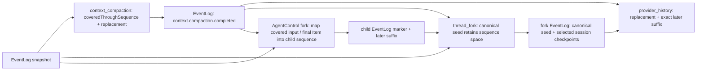

普通 thread fork 在创建目标前，以原 EventLog 校验选中 canonical compaction Item 的源 marker、top/artifact 一致性和覆盖边界，再保留原序号空间的 canonical seed 与逐次模型工具记录；AgentControl child fork 使用自己的 EventLog 序号重写覆盖边界，输入与已覆盖 final answer 以实际持久事件映射，marker 在导入完成后落盘。replacement/window lineage 不变，公开 `contextCompaction` Item 仍只有 type/id。手动压缩继续保留最近四个已完成 Turn，但该策略只由生产者转成一次前缀序号，reader 不再推断 Turn 范围。artifact policy 分别声明 `durableHistoryRewrite=false`、`providerHistoryRewrite=true`、`providerTailMode=after_covered_sequence`。

普通 fork 同时保留选中 rollout 前缀内没有 canonical Item 的 session-level checkpoint。完整 fork 包括最后 Turn 之后的 checkpoint；`lastTurnId` 截止到下一 Turn 起点，`beforeTurnId` 截止到目标 Turn 起点，较晚 checkpoint 不进入目标也不参与该前缀校验。选中的原 marker 在 child 创建前验证 replacement、top/artifact 与 covered sequence，再复制到同一序号的 fork baseline 占位；`forkSequence` 覆盖这些 marker，冷恢复沿同一 EventLog 合并，连续 fork 不丢失摘要。缺省 `Thread.metadata=null` 只在 fork settings 规范化为空对象，非法非对象仍拒绝。没有第二 store 或兼容分支。

2026-10-19 连续 fork 数据流确认（root）：已核对 Codex `thread_rollout_truncation` 的 full/last/before 边界、既有 owner、序号空间、projection 和 public RPC 边界。新增公共 RPC **5/5**（含原三项）与 AgentControl 冷恢复连续 fork **2/2** 通过；更大 fork 回归与产品门禁按 `codex-child-checkpoint-fork-20261019/validation.json` 单独记账。此片只修复 durable checkpoint 组合，生产自动 Loop 仍未接入。

2026-10-19 前缀边界架构图确认（root）：本片沿既有 App Server、EventLog、canonical projection 和 fork owner 修改，没有第二 store、公开 RPC 或兼容入口。此边界为同 Turn 自动压缩的前置条件；生产 Loop 尚未接入，不能据此声明 C02 或 Desktop 自动压缩完成。验证范围见执行计划及 `codex-compaction-boundary-20261019/validation.json`。

2026-10-20 同 Turn capability 接线确认（root）：`ExecutionRequest.mid_turn_compaction_commit` 是 App Server 注入的 step-scoped capability；`agent-runtime::provider_turn` 只接收 provider-neutral request/receipt，在 tool output 或 pending input continuation 边界按 selected model 的 `auto_compact_token_limit` 请求摘要。当前 route 的 `model-provider` 负责摘要采样，App Server 在 receipt 成功后追加 `context.compaction.completed`，并返回 summary 加 `history_prefix_len` 之后的 suffix 继续同一 Turn。该接线不调用独立 `compact_session_now`，不引入第二 EventLog、旧插件或协议兼容层；真实 provider、四协议、cold/fork、GUI/TUI 和 tar.gz 证据仍开放。Architecture impact: major；责任 root，2026-10-20。

模型工具历史的正文以逐次 `ModelHistoryRecord` 为准，保存产生时的原始返回值与独立 host budget；后续 sampling/summary 只裁剪请求副本，不能用聚合命令或 UI preview 重建逐次结果。canonical 工具展示和显式 artifact 读取仍只以 nested `ToolOutput` 为正文来源：App Server 可在 append 边界把过长 `text` 截为 preview，并把完整内容写入 `tool_output` sidecar；nested output 回写稳定 `outputRef + truncated`，outer event 只保留 `outputBytes/outputSnapshotFile/sidecarRef` 等持久投影，禁止从 outer `output/result/runtimeEvent` 反向恢复正文。没有逐次记录的 canonical 导入历史只消费 preview，仍在请求边界有界截断；full sidecar 只供显式 artifact/evidence/read owner 读取，禁止为模型历史自动回灌。Tool、MCP 与 Collab 使用同一 sidecar owner；raw `tool_end` 与 raw Tool lifecycle 一并在 EventStore normalization 前 fail-closed。

图片任务的 GUI media projection 只消费 `item.completed` 中 completed `ThreadItemPayload::Tool`：tool identity 来自 typed call/name，任务 owner facts 来自 `item.metadata`，结构化响应来自 `ToolOutput.structured_content`。只有 `normalized_status=succeeded` 且图片拥有可校验 sidecar reference 时才生成 final media content part；pending、非 terminal、失败、无 sidecar 或 raw Tool event 必须 fail closed。异步 worker 的最终结果继续由 media task store read owner enrich，不得把“任务创建完成”误报为“图片生成完成”。

steer 输入的 current 接纳边界由 session actor 与 turn-input guard 共同维护。actor 先校验 active Turn identity，guard 内检查 finishing，再调用 App Server 的 EventLog/canonical commit；只有成功 receipt 才把输入加入 pending queue 并发布 activity。commit 失败不修改队列、mailbox phase 或模型输入，canonical terminal 导致空 append 时也拒绝投递。相同文本的独立输入以各自 client/Item identity 保留，禁止文本去重。

```text
turn/steer / active turn/start
  -> RuntimeCore input preparation
  -> session actor: validate active Turn
  -> turn-input guard: check finishing
       -> App Server EventLog + canonical Item commit
       -> durable receipt -> pending steer queue -> next provider step
       -> failure: return error; queue and mailbox phase unchanged
canonical new Turn admission -> StartTask -> started / queued / busy
```

新 Turn 已在 canonical admission 取得身份后，只能作为 StartTask 提交 actor。并发碰到另一个 active actor Turn 时走既有 queued/busy 结果，不能把候选输入隐式 steer 给另一个 identity。既有显式 active-start 仍经同一 commit handler；收到 receipt 后不再以 active 状态过滤已合法完成的 canonical Turn。`turn_execution/input_commit.rs` 承接两个入口与 receipt，`session_loop/input_queue/commit.rs` 承接队列 barrier；原 root 只保留 orchestrator 接线。没有新 RPC、第二 history store、provider wire 或兼容层。

2026-10-19 输入接纳数据流确认（root）：已按 Codex `session/turn.rs::run_hooks_and_record_inputs`、`hook_runtime::record_pending_input` 的输入记录顺序核对 owner 和失败边界；同步回调是 Lime 现有 actor/EventLog 的实现方式，不当作 Codex 同名 API。此片只关闭未提交 steer 可被消费的竞态，不声明模型历史前缀/generation、epoch 提交或同 Turn 自动摘要已完成。验证以 `codex-steer-admission-20261019/validation.json` 与执行计划为准。

### 6.3.1 Multi-Agent crash commit

S4am 的 crash contract 取代上段 S4v“child 创建后直接写 Open”的旧顺序。`AgentGraphStore` 的 current 状态为内部 `Pending`、产品态 `Open` 和审计态 `Closed`。spawn 的第一笔 mutation 必须原子 reserve Pending 并携带临时 child session identity；随后才能创建 child、写 `session.created` EventLog、fork history/lineage、identity 与初始 TriggerTurn mailbox，最后以 `(child_thread_id, child_session_id, Pending)` CAS 单次发布 Open。

Pending 必须在 canonical/projected/in-memory 的 Thread/session read/list、roster、terminal recovery 与 GUI/API 中全部隐藏。任一步返回错误都在 Pending 隐藏下清 ProjectionStore、EventLog/workflow audit、sidecar、approval cache、identity、mailbox 与内存 session，全部成功后才删 intent。硬崩溃由 App Server 在 EventLog/ProjectionStore/sidecar 装配完成且接收请求前全局回滚 Pending，并只继续 Open child 的 durable TriggerTurn；普通 descendants 继续按 Codex V2 lazy resume。禁止新增 metadata journal、第二 history store、Electron 后端或兼容入口。

### 6.4 领域与基础设施组

| Crate                                            | 准入                                                                                                                                                  |
| ------------------------------------------------ | ----------------------------------------------------------------------------------------------------------------------------------------------------- |
| `config`、`infra`、`core`                        | 配置、平台无关基础设施和稳定公共模型；不接受默认塞入的新 runtime 逻辑。                                                                               |
| `services`、`processor`                          | 有明确领域 owner 的服务与处理器；中心 facade 只做 dispatch。                                                                                          |
| `embedding`、`document-preview`                  | 独立领域能力。                                                                                                                                        |
| `gateway`、`websocket`、`server`、`server-utils` | 网络/服务边界。                                                                                                                                       |
| `providers` / `lime-providers`                   | `dead / deleted / forbidden-to-restore`；provider 网络、wire lowering、stream、catalog 只归 `model-provider`。                                        |
| `scheduler`、`automation_execution` 对应 owner   | 调度与自动化领域，不承接 turn loop。                                                                                                                  |
| `cli`                                            | Rust CLI 入口，只通过 `app-server-client` 消费 App Server 产品协议；`execpolicy check` 只读取规则文件并输出匹配结果，不承接执行或 sandbox authority。 |

新增 Rust crate 必须说明：现有 domain 为什么不适合、公开 contract 是什么、依赖方向是什么、如何避免落入 `core`/`services` 平铺层。

## 7. Agent 产品主链

```text
Renderer
  -> Electron preload / Desktop Host
  -> app_server_handle_json_lines
  -> App Server JSON-RPC v2 initialize + Thread/Turn commands
  -> RuntimeCore / agent-runtime
  -> model-provider and tool-runtime
  -> RuntimeEvent
  -> ProjectionStore / thread-store
  -> canonical Thread/Turn/Item read model + notifications + derived exports
  -> Renderer projection / GUI
```

Codex app-server 的核心约束在 Lime 中保持不变：先初始化连接；以 Thread 开始或恢复会话；以 Turn 驱动一次执行；以 Item 和 notification 报告过程；以明确 terminal turn 状态结束；从持久化 read model 恢复历史。任何 UI、Plugin 或桌面入口都必须进入这条主链。

本地历史扫描、预览和跨产品会话导入的 `conversationImport/*` 已删除。历史恢复只通过
canonical `thread/read`、`thread/resume` 和分页投影进入同一主链；Renderer 不再按导入来源
设置全量历史、失败消息或工具显示特例。Codex 的 `externalAgentConfig/import` 和
`externalAgentConfig/import/recordHistory` 属于配置导入，由其现有 owner 继续持有。

Agent GUI 的聊天/工作台响应式布局同样不得按来源分叉。`LayoutTransition` 是唯一布局
owner：实际工作区容器宽度大于 `900px` 时可以并排展示聊天与工作台；不大于 `900px`
时必须切为聊天优先的单面板，并提供明确的“聊天 / 工作台”模式切换。断点切换只能改变
排列和显隐，不能重挂载消息树，否则会丢失 canonical timeline、滚动位置或输入草稿。
普通会话与历史恢复共享该 contract；真实 Electron 视觉门禁必须覆盖
desktop、compact、narrow，并拒绝模式控件与其他按钮发生矩形重叠。

历史 GUI 投影遵循 Codex App 的运行态边界：canonical Thread/Turn/Item 和 read model 永远
保留完整 command、reasoning、tool、approval、search、patch 等事实，但 Renderer 只有当前
active turn 才挂载 operational details。terminal turn（completed、failed、canceled 或
interrupted）只投影最终正文、附件、文件产物/变更与处理时长分隔；历史分隔是不可交互的
`div`，没有展开、预览恢复或按历史 item 重新挂载的入口。该规则同时适用于普通会话与历史恢复；read model 完整性必须由 App Server `thread/read` / `thread/items/list` 独立验证，
不能用 GUI 隐藏推断 canonical item 被裁剪。运行中审批卡、command/tool/search/reasoning
仍按当前 turn 的真实 lifecycle 展示，turn 终态后统一收口为 compact history。

canonical identity/control read edge 使用 Codex v2 `thread/read`、`thread/list`、`thread/turns/list` 与 `thread/items/list`，由 App Server handler 直接查询 `ThreadStore` 并返回 Thread/Turn/ThreadItem DTO 和 store-owned opaque cursor。`thread/list.includeArchived=false` 只返回 active thread，`true` 返回 active 与 archived thread；过滤和 cursor 顺序必须由 store 在同一查询边界完成。携带单一 `threadId` 的 read method 由 protocol catalog 声明 Thread scope + shared-read access；App Server request serialization 必须消费该 metadata，不能在 handler、client 或 GUI 另建并发策略。不存在第二个 session presentation endpoint；canonical detail 缺失或 store 失败必须显式失败，禁止 event/app-data fallback 或 Renderer 合成空 history。

loaded `thread/resume` 的运行态判断只允许读取 `agent-runtime` session actor 的有序
snapshot：App Server 先由 canonical ThreadStore 解析 `threadId -> sessionId`，cold hydrate
只恢复 RuntimeCore/read model，不得伪造 active actor；已存在 actor 才能报告唯一
`activeTurnId`。resume 投影据此保留 live turn 的 `inProgress`，把其它 stale
`inProgress` 映射为 `interrupted`，并将 Thread 归一为 `active`、`idle` 或保留
`systemError`。App Server 的 `ThreadStateManager` 是唯一 loaded-thread listener owner：
RuntimeEventHub 只按 canonical `AgentEvent.threadId` demux，缺失 threadId 直接 fail closed；
每个 listener generation 持有唯一 projector 和 command channel，在同一 actor 内先订阅精确
connection，再依次把 response、canonical token usage、canonical ThreadGoal snapshot、
thread-scoped pending server request replay 和后续 live event入队到该 connection 的既有 bounded
writer。`thread/start` 与 `thread/resume` 都走此订阅边界，
断连同步移除双向 subscription；external runtime append 不再保留全连接 raw publish 旁路。
token usage snapshot 由 `runtime/thread_usage.rs` 从 canonical event 严格读取；main runtime 的完整
flat terminal usage 在 EventLog 写入前 lower 为 cumulative `total/last/context-window`，其它 partial 或
untrusted usage 继续 fail closed。ThreadGoal 由 canonical ThreadStore 的 `thread_goals`、
`thread_goal_turn_accounting` 与 durable update outbox 持久化，禁止复用或映射旧
`ManagedObjective`。`turn.accepted` 绑定 exact goal id、Plan mode、累计 token 与 wall-clock baseline；
RuntimeCore 是 admission producer，synchronous collecting path 在 backend 首个 Turn lifecycle
进展前补齐缺失的 `turn.accepted`，但零事件 rejection 仍不持久化假 Turn。若 accepted 时尚无 Goal，
运行中的首次 active Goal mutation 在持有 RuntimeCore state 锁时，以已进入 canonical state 的累计 usage、
source watermark 和当前时间 late-bind 当前 Turn；后到或 replay 的 accepted 不得重置该 baseline。
已有 Goal 的 external set/clear 也保持 `RuntimeCore state mutex -> SQLite BEGIN IMMEDIATE` 单一锁序：
同一事务先按 exact goal id flush mutation 前 token/time，再写入 set/clear；Active set 即使 goal id 未变也会
把当前 cumulative usage/time 重置为新 baseline，pause/resume 排除 paused 区间，clear 删除旧 Turn binding，
因此同 Turn recreate 可以绑定新 goal id。mutation flush 不写 terminal outbox，set/clear response 后的
listener notification 是唯一最终 snapshot，避免旧 objective/status 延迟回放；同 source sequence 只允许
external mutation 推进 wall time，terminal/replay 仍要求严格递增 watermark，过期或 terminal rebind fail closed。
`turn.completed|failed|canceled`
在存在完整 cumulative usage snapshot 时于同一事务推进 source watermark、usage、
`budget_limited` 和 typed update outbox；`turn.failed.payload.reason` 只使用结构化
`turn_error|usage_limit_exceeded`，Active goal 分别转为 `blocked|usage_limited`，Plan turn 与
cancel 不改变 goal。per-thread listener 严格在对应 accounting event 后发送
`thread/goal/updated` 并确认 outbox。中间 provider usage 已由独立
`provider.usage` current event 承载：同 attempt 取最新 snapshot，不同 attempt 累加，
`provider.step` 仅保留生命周期和诊断，正常 `turn.completed` 不与中间 usage 双计。生产 usage
producer 的异常终止 flush、tool-finish/abort flush、
outbox crash-drain 与 MCP terminal notification 仍为 OPEN；禁止在 Renderer、Electron、RuntimeCore read
model 或 transport 层另建 accounting 或 resume 状态机。

ThreadGoal idle wall-clock accounting 的 current owner 是
`canonical_thread_store/goal_idle.rs`。它只保存进程内 `active_goal_id + last_accounted_at`
baseline；累计秒数仍原子写入 canonical `thread_goals`，不新增持久化状态机。单一 permit 覆盖
snapshot、SQLite usage write 与 baseline 推进，clone store 和并发 mutation 不会重复扣时。
active Goal 的 set/pause/clear 在 mutation 前 flush；非 Plan `turn.accepted` 在同一 SQLite
`IMMEDIATE` 事务内完成 idle wall seconds、typed outbox 与 exact Goal Turn bind，token delta 固定为零，
idle snapshot 以 accepted event timestamp 截断，投影延迟不得与 per-turn time 重叠；任一阶段失败
必须整体回滚。Plan admission 只清 idle baseline，不结算 prior idle。Turn terminal 只有在
persisted Goal 仍为 active 且不是 Plan mode 时才重新起 idle baseline；paused、blocked、
usage-limited、budget-limited、complete 与 Plan terminal 均清 baseline。同进程重复 `thread/resume`
对同一 active Goal 保留已有 baseline；cold `ProjectionStore` resume 才从当前时刻建立新 baseline，
进程离线时间不计入。accepted replay 先识别既有 Turn binding，不得清除当前 baseline、覆盖
late-bind baseline 或重复结算。

ThreadGoal 自动续跑的 current owner 是 `runtime/thread_goal_continuation.rs`。它把 Codex
`InternalModelContextFragment(source="goal")` 对应为独立 durable
`thread.goal.continuation` event：当前 Turn 通过 agent-only provider input 获取上下文，后续
Turn 从 provider history 恢复，但 canonical Thread/Turn/Item 和 v2 notification 不生成
`userMessage` 或 raw side-channel。Goal continuation 只 admission，不在同一 future 内同步递归；
driver 继续挂在现有 Tokio runtime，Completed 后重新进入 idle gate。per-session single-flight
保护 goal read + admission，queued 用户 Turn 和 TriggerTurn mailbox 由 pending-work gate 优先
清空，内部 pending-owned Turn 不重入 idle scheduler。idle `thread/goal/set(active)` 与无 live
Turn 的 `thread/resume` 可直接启动；set 路径必须先完成 response 与 `thread/goal/updated`
listener publish，resume 路径复用 barrier 保证 `response -> Goal snapshot -> continuation live events`。
Plan mode 跳过但不丢 Goal；普通 failed 先把 Goal 推进
`blocked|usage_limited`，显式 canceled 不立即续跑。

Renderer 的唯一 Goal owner 是 `useAgentSessionThreadGoal -> ThreadGoalPanel`，只接受 canonical
`thread_id + ThreadGoal`。Harness detail、Inputbar inline 和 TaskRail 共用同一 thread identity
规则；identity 不匹配时 fail closed，不从 session/workspace id 猜测 Goal，也不读取
`threadRead.managed_objective`。聊天旧 `ManagedObjectivePanel`、inline wrapper、criteria/audit/
continue UI、Automation Objective summary/details/audit、v0 `agentSession/objective/*`、
`managed_objectives` repository/table 和 `agentChat.managedObjective.*` 文案均为
`dead / deleted / forbidden-to-restore`。不得恢复 owner kind、criteria、evidence audit 或手动
Objective continue wrapper。Automation 只负责按 schedule 向 persisted Thread 提交 Turn；Goal
identity、状态、预算、用量和 idle continuation 仍由该 Thread 的 canonical `ThreadGoal` 唯一拥有。

public `thread/fork` 的 current owner 是
`protocol/v2::ThreadForkParams -> processor/thread_fork.rs -> RuntimeCore::thread_fork ->
canonical ThreadStore`，与 AgentControl child topology fork 完全独立。它从 canonical
Thread/Turn/Item 复制 full、`lastTurnId` 或 `beforeTurnId` 的 terminal prefix，并只改 target
thread/session identity；不得以 raw EventLog 或 AgentControl 的有损 history 充当第二个 fork owner。
显式 `path` 通过同一 rollout reader 读取实际普通/压缩文件，优先于 threadId；ephemeral
沿原内存 session owner 保留 seed，不创建 projection/rollout/EventLog/sidecar。
普通 fork 的历史配置与当前执行设置分离：按 Codex `InitialHistory::Forked` 从 Default 模式
开始，不复制当前 `collaborationMode` 中的 Plan 指令。fork 模型/provider/tier 覆盖复用
`session_operations::apply_thread_settings_patch`，模型 identity 改变时清理旧 effort、tier 与
agent route；多模型 route 和当前模型不能被源历史的 collaboration model 重新覆盖。
普通 fork 不继承 Goal；只在
persistent `deferGoalContinuation=true` 时，`goal_fork.rs` 持 source Goal idle permit，在同一
SQLite `IMMEDIATE` 事务中 flush source usage、复制 exact Goal snapshot、写带 Goal 外键的 durable
deferral marker。fork/resume 都不自动启动 Goal；首个真实 `turn.accepted` 幂等消费 marker，随后仍由
既有 continuation owner 决定自动续跑。marker 随 target Goal 删除级联清理。已覆盖 full/last/before、
无 Goal、paused Goal、restart/resume、首个 explicit Turn、删除级联和参数 fail-closed。fork 的
provider history 只从 copied canonical Item 生成 typed in-memory seed；`forkSequence` 固化 copied
prefix 边界，baseline slot 保持 EventLog sequence 稠密，UserMessage、AgentMessage、Reasoning、Tool
与 McpToolCall 由 `provider_history` 唯一 lowering，MCP 名称必须经 `lime_mcp::naming` 规范化。
restart 时先 hydrate target EventLog tail，再按 sequence 合并 canonical seed；ProjectionRepair 也必须
用相同 seed 补齐 prefix 后再修复 canonical history，不能用只有 target tail 的 raw EventLog 删除 copied
Turn/Item。source raw EventLog 不整体复制到 target；权威 model-history、用量、compaction checkpoint
和 interrupted boundary 按所选前缀校验并保留。user sidecar 图片在 durable fork 复制，在 ephemeral
fork 内联；完整且有 durable lineage 的 compaction replacement 使用同一恢复 owner。当前 canonical
payload 无法无损表达的 assistant media、CollabAgentToolCall arguments 与未知 Extension 均在
`thread/fork` 创建边界 fail closed，不允许猜测、占位或 compat fallback。

用量恢复复用 `thread_usage` 的完整计数解析；Codex `ThreadTokenUsage.model_context_window`
是可选字段，模型窗口未知时返回 None 并保留有效计数，不按模型名称推定窗口或丢弃整份用量。

Fork provider-history architecture confirmation: root, 2026-07-21. The current owner remains
`canonical ThreadStore -> RuntimeCore seed -> provider_history`; ProjectionRepair only preserves this
prefix while applying the target EventLog tail, and no second transcript or Electron owner was added.

工作区 artifact 持久化的 current 写入口是 App Server v2 `artifact/write`：Renderer 只提交
`threadId + optional turnId + typed ArtifactSnapshot`，App Server 解析 canonical thread identity，
由 RuntimeCore 追加 `artifact.snapshot` 并返回 event identity、sequence、persisted time 与
`relativePath/bytes/sha256/contentStatus` sidecar evidence。Electron 只转发 JSON-RPC，禁止直接写
artifact 正文、伪造 evidence 或恢复 `agentSession/runtimeEvents/append` 通用写入口。

代码/文档 `artifact.snapshot` 在进入 canonical Thread history 时按 completed `FileChange`
lower：路径来自 artifact sidecar 摘要，正文/preview 进入 typed diff；图片仍使用
`ImageView`。这让 Workbench cold read 继续消费 Codex v2 Item，而不是恢复
`agentSession/read` 的 artifacts/tool_calls 胖 detail。其它没有 v2 表示的 generic media 继续
fail closed，不能伪装成图片或塞进 metadata。

FileChange 的唯一事实源是 canonical `ThreadItemPayload::File { changes, status }`：一次
patch call 只生成一个 Item，完整保留 Add/Delete/Update/Move 的有序 `changes[]`，Move 的
`path` 始终是源路径、`move_path` 是目标路径。`patch.started/applied/declined/failed` 只能更新
同一 `patchId` Item，终态没有 snapshot 时保留 started 的 changes；patch 专属的逐文件
`file.changed` 旁路已删除。v2 `PatchChangeKind` 直接复制 Codex tagged wire：
`{ type: "add" | "delete" | "update", move_path? }`；拒绝审批投影为 terminal
`Declined`，取消后由 turn lifecycle 单独终止，禁止把用户拒绝伪装为执行失败或恢复旧单文件
Update 投影。

direct notification 主链已把 Codex v2 lifecycle 与流式 Item method 纳入统一 App Server method catalog、schema manifest 和 generated client：`thread/started`、`turn/started`、`turn/completed`、`item/started`、`item/completed`、`item/agentMessage/delta`、`item/commandExecution/outputDelta`、`item/fileChange/patchUpdated`、`item/plan/delta`、`item/mcpToolCall/progress`。App Server 只保留一个按 command/file-change/MCP/Plan owner 拆分的 `V2NotificationProjector`，对覆盖事件采用 direct / side-channel / reject 三态；畸形覆盖事件 fail closed，只有未覆盖的 provider/media 等旁路事件保留 `agentSession/event` raw envelope。Rust/TypeScript client、Electron 和 Renderer 已直接消费 v2 lifecycle/stream delta，delta 不伪造 durable sequence；`agentSession/event` 的 `typedEvent`、`canonicalEvent`、旧 lifecycle DTO、`agentSession/runtimeEvents/append` schema、fixture 和正向测试已物理删除。Renderer sequence gate 按 direct method/raw event 与 session 隔离，只允许 direct lifecycle/stream 与明确 raw side-channel，wrapper lifecycle/action 一律 fail closed；残留 `canonicalEvent` 字符串只允许作为待删除测试夹具或负向回流守卫，不是生产 contract。真实 Electron Gate B 必须证明动态 `turn/start` response、direct delta/Item/Turn terminal 与 `thread/read` Item 共享同一 thread/turn identity；Claw fixture 不得通过 wrapper event 或 deferred assertion 获得成功。`turn/start` response 只由 App Server/RuntimeCore admission owner 产生，Electron Host 必须按 generic JSON-RPC 转发；禁止从 notification、recent buffer、`thread/read` 或 `clientUserMessageId` 猜测并伪造 accepted response。

### 7.1 事件与完成态

- canonical live lifecycle 的 current contract 是 Codex v2 direct notification：`thread/started` 携带完整 `Thread`，`turn/started|completed` 携带 `threadId + Turn`，`item/started|completed` 携带 `threadId + turnId + ThreadItem` 和对应毫秒时间；AgentMessage/CommandExecution/Plan delta、FileChange patch update 与 MCP progress 都携带同一 canonical `threadId + turnId + itemId`。Rust/TypeScript client、Electron 与 GUI 只能向这些 typed notification + canonical read model 收敛。
- `typedEvent`、`canonicalEvent` 和 legacy lifecycle DTO 已是 `dead / deleted / forbidden-to-restore`。`agentSession/event` 当前只允许携带显式 allowlist 内的 raw 非 lifecycle side-channel；任何 Thread/Turn/Item 或 action wrapper 都必须拒绝，不能再通过 fixture、Renderer projector 或 client parser恢复。
- 单一 TypeScript codegen 继续对异构 nested `$defs` fail closed；禁止通过 allowlist、覆盖顺序、`Legacy*` 重命名、namespace compat 或第二套 flat codegen 选择其中一边。删除旧 lifecycle schema 后当前 codegen 为 731 个协议类型、0 生成失败、0 漂移；未来新增冲突必须修 owner，不得放宽生成器。
- 非 Thread 领域通知只能通过集中 allowlist 绕过 canonical sequence gate。当前允许 provider diagnostic、`runtime.status` 与 `image_task.presentation.generated/created/parameters.required`；它们只承载诊断或媒体任务展示，不得表达或修补 Thread/Turn/Item lifecycle。未知 raw event 与 raw Thread lifecycle 必须继续 fail-closed。
- 只有 production producer 全量发出 canonical entity、package/Renderer consumer 全量迁移、负向守卫覆盖旧 surface 后，S6 才能删除 raw lifecycle envelope；在此之前每个 slice 必须记录剩余 producer/consumer，不能把 optional canonical field 当作完成证据。
- `turn.completed`、失败、取消和中断是产品一等终态。
- 工具、审批、消息和产物是 Item/RuntimeEvent 的可投影活动，不是 renderer 私有日志。
- `request_user_input`/approval 由 session/turn scoped pending state 承接，不能建立进程全局单例。
- deprecated raw `action.required` 边界只能透传 runtime `data.availableDecisions`，不得在 App Server 或 Renderer 固定补一套按钮列表；退出条件是 GUI 分别消费 canonical Item 与其独立 typed server request，二者不得互相降级。
- canonical event log 的 gap、regression、equal-sequence divergence、malformed/unterminated tail 必须在 App Server repair 边界 fail-closed；只有可审计的尾部损坏允许按 `last_valid_offset` 截断并重建 ProjectionStore。
- canonical Item append 必须遵循 raw rollout append + metadata patch contract；ThreadStore apply 失败时 notification/mailbox ack 不得发生，restart/repair 从连续有效 durable tail 和 raw rollout 重建。
- Evidence refs、replay、analysis、review 与 GUI 从 App Server v2 read model 和 notification 消费同一 canonical 事实源；derived exports 只做下游投影，不提供 portable signed receipt。

#### 7.1.1 Renderer ConversationProjection 与 direct TurnTimeline

Renderer 的 current Item 状态 owner 已收敛到同一个 typed `ConversationProjection` reducer：

```text
direct App Server v2 notification
  -> direct notification router / sequence gate
  -> typed AgentEvent payload
  -> request-scoped ConversationProjection reducer
  -> canonical AgentThreadItem state
  -> pure canonical Turn render projection
  -> direct User / Agent / Media / Process segments
  -> MessageList

thread/read + thread/items/list + thread/turns/list
  -> bounded canonical history window
  -> canonical Item reader
  -> the same ConversationProjection reducer
  -> canonical AgentThreadItem state

thread/resume
  -> canonical Item reader
  -> install the same ConversationProjection reducer into active stream state
  -> subsequent live notifications reuse the same reducer

App Server reverse requests
  -> one PendingInteractionController
  -> semantic interaction identity only
  -> one actionable layer above Composer
```

异步问题（2026-10-20，minor impact；root 已核对并确认 owner、可信配置接线与下图，真实进程验收另行结算）：

```text
canonical Thread.parent_thread_id -> ExecutionRequest.is_root_agent
resolved tools config -> AgentSessionConfig.experimental_request_user_input_enabled
  + existing model native-tool capability policy
  -> existing tool-runtime request_user_input_async
  -> existing tool lifecycle emitter
  -> canonical AgentMessage { delivery, questions } / same call ID
  -> existing live / read / rebuild projection
  -> same Renderer canonical Item reader
     -> per-question timeline view IDs (source item + index)
     -> AppScope QuestionDraftStore (local drafts and selection only)
     -> shared QuestionAnswerEditor above the main Composer
     -> existing sendMessage -> turn/steer or turn/start
```

公开 `AsyncUserInputQuestion` 为唯一问题合同；不是同步 reverse request，不新增 pending waiter、私有问答 RPC、业务历史 store 或 runtime。题目与已接受答案由同一 canonical Item 派生，本地草稿按 host/thread 隔离；每题时间线只展示 title，用户答案复用普通用户正文。普通发送器省略问答的权限覆盖，真实 runtime-accepted 才消费未被后续编辑的快照；失败保稿，关闭/跳过不 interrupt。selected async question 无附件时驱动已有 Composer 单行布局，同步 pending 不冒充该 selection。六个 trusted-context 接点已接入：canonical Thread 缺失时 root=false，普通 fork 不以 forked_from_id 误判为子 agent，配置读取失败时开关=false，renderer metadata 不能覆盖这两个 typed 条件；模型能力仍由既有 native-tool policy 限制。agent-control fork 排除异步展示文本，保留真实工具调用与结果。此图不代替完整生产 catalog 能力发现或 Gate B 证据。

direct notification 没有上游 event id 时，stream owner 只能在 router 去重之后分配 request 内单调到达序号；不能用内容 hash 去重，因为相同 chunk 可以合法重复，也不能把该序号当作跨重连 replay identity。Item identity 仍是 `thread_id + turn_id + item.id`，首次 canonical sequence 决定顺序，completed snapshot 权威覆盖 delta 草稿，terminal 后 late delta 只记录诊断。

Renderer session id 不得预绑定为 canonical thread id。live reducer 只能从 existing canonical Item 或首个带明确 direct-v2 protocol method 的事件建立 thread owner；无 protocol method 的 compat 事件继续委托 legacy lifecycle，不能抢占 current owner。session detail/read model 只接受 requested id 等于 canonical `sessionId` 或 `threadId` 的响应，其他 identity 必须在 App Server client 与 Renderer adapter 两层 fail closed，且不得写入 identity cache。

活动线程恢复沿 `threadClient.resumeThread -> consumeSnapshot -> AppServerAgentSessionEventDrainRouter.restoreThread`：同一 canonical 快照先初始化共享 sequence gate，再固定每个 inProgress Turn 的 thread/turn route，并恢复已有 session Command 的 process identity。恢复后即使不重放 `turn/started`，也须接收原 Turn 的 Item 与真实终态；指定 Turn 的 route 不可被外 Turn 首事件重定向。terminal Turn 只保留仍活动的 session Command route，真实退出后回收，tombstone 阻止迟到事件重开。原 `restoreCommands` 路由入口已直接替换，不保留 alias；底层 Command sequence 恢复原语继续由既有 verifier 持有。此修复不新增协议、后端或历史 store。责任开发者确认 root，2026-10-20；真实桌面复验结果由异步问题执行计划结算。

cold read 对 `historyMode=paginated` 的 `thread/read` embedded turns 一律视为 partial view，使用 store-owned `thread/items/list` cursor 选取 message window，再扫描 `thread/turns/list` 到 EOF，恢复选中 Item 所属 Turn 以及所有 active/failed/interrupted 等无 Item Turn。Renderer 分页以 opaque canonical Item ID `oldest_item_id` 为稳定锚点；旧数字 `oldest_message_id` 仅作迁出兼容并让位于 Item ID。`has_more` 是继续分页的事实，未到 Item EOF 时 `messages_count` 未知且不生成 `start_index`；只有 EOF 后才暴露精确总数和绝对索引，GUI 不得把观察下界显示为总数。

历史 DOM 由单一 viewport Turn window 持有：`threadVirtualizer` 计算稳定 key、高度、offset 与 overscan range，`VirtualizedTurnList` 测量并只挂载可见范围。canonical 已加载数据与离屏 DOM 数量分开；后端 `has_more` 继续决定 Load More，不能用 Expand All 或 idle 渐进挂载恢复全量 DOM。流式尾随尊重用户滚轮、键盘、触摸和滚动条意图；用户阅读历史时按稳定 Turn anchor 补偿动态高度。目标 Item 导航先挂载所属 Turn，再定位子项。已完成历史正文暂复用 `HistoricalAssistantMessagePreview` 有界预览；该预览与后端分页都不替代 viewport 卸载。旧固定尾窗性能数字已退役；新 Gate B 必须证明已加载页内滚动替换 DOM、卸载旧行、完整滚动几何和返回尾部，实际加载规模与 seed 总数分别记录。

Files 的 current renderer 为 `ReviewThreadSidePanelTab`，由统一 RightSurfaceHost 注册。WorkspaceConversationScene 通过只读 `ReviewThreadSidePanelProjectionContext` 传入同一次 coding projection 的 changeView、workspaceRoot 与 loadFilePreview；Context 不持有审批、文件或会话业务状态。Canvas 与 Files 共用既有 `CanvasWorkbenchChangesPanel` / ReviewState / diff owner。选择文件只更新选中项并定位同路径 diff，外部打开是显式动作；Git baseline 和完整文件异步请求必须绑定 thread/root/base/commit identity，迟到结果失效。

```text
App Server canonical Thread/Turn/Item + current read gateways
  -> existing conversation projection
     -> canonical entry index -> threadVirtualizer -> VirtualizedTurnList -> mounted Turn rows
     -> one coding changeView
        -> CanvasWorkbenchChangesPanel
        -> read-only ReviewThreadSidePanelProjectionContext
           -> RightSurfaceHost -> ReviewThreadSidePanelTab
              -> same CanvasWorkbenchChangesPanel / ReviewState / diff owner
PendingInteractionController -> PendingRequestItemPanel -> ApprovalCard
  -> existing reverse-request response owner -> App Server approval authority
```

2026-10-14 Renderer 对齐：业务 owner 与协议不变；新增只读 projection 消费者并直接替换旧 DOM window。架构图责任开发者确认：root，2026-10-14；已复核 Scene 同次 coding projection、只读 Context、唯一 viewport DOM owner 与独立 canonical paging。当前切片与 Gate B 结果由 `internal/exec-plans/codex-gui-alignment-current-plan.md` 记录，不代表全面 GUI 或 release 验收。

CommandExecution、Tool、WebSearch 与 Patch stdout/stderr 在 projection 边界限制为 256 KiB，超限保留尾部并带显式截断标记。unknown Item/notification 只向受控 diagnostics 记录 protocol revision、method、upstream type、Item identity 与脱敏字段名；raw 值、credential、metadata 和 provider payload 不进入 diagnostic。known-unprojected/unknown notification recorder 只提供 fail-visible 诊断，不能替代 V2-05 planned notification 的 producer、typed protocol、projection 或 Gate B。

canonical Item -> Message 的 tool/agent/reasoning `toolCalls/contentParts` 合成、`canonicalItemsToMessages` 与 MessageList canonical compatibility branch 已物理删除并有回流守卫，属于 `dead / deleted / forbidden-to-restore`。未被 canonical Item 覆盖的 optimistic/imported/local product surface 只作为 direct render projection 的 residual Message，不得成为第二个 Item store。HookPrompt、Sleep、Review boundary 使用 typed Item DTO；Hook 的 runtime identity 不进入可见 DOM。UserMessage audio/localAudio 不在 Lime 当前产品协议范围，reader fail closed；DynamicTool `inputAudio` 继续由真实 v2 schema/typed client/renderer 链承接。

command approval、file approval、requestUserInput 与 MCP elicitation 只由 `PendingInteractionController` 注册和终结。JSON-RPC transport id/action token 只能留在 dispatcher 请求闭包；React state 只持有 semantic interaction identity。旧 server-request controller、独立 MCP Dialog/controller 与第二 pending store 均为 `dead / deleted / forbidden-to-restore`。

Architecture impact: major; this changes the Renderer live/read/resume Item state owner, canonical Turn rendering and pending-interaction owner while preserving Electron as transport host, App Server/ThreadStore as canonical owner, and model-provider/tool-runtime boundaries. Architecture diagram updated: this section and the Renderer data-flow chain above. Responsible developer confirmation: root, 2026-07-29.

### 7.2 Plugin、Skills 与 MCP

MCP Apps 面板只从 completed canonical `mcpToolCall` item 及 `ui:` resource identity 投影：

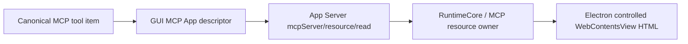

旧 `appSurface` pending 的 URL/embedding/strategy 插件外壳直接删除，App Server 拒绝该输入，
renderer 不再从 pending 创建 Plugin descriptor，也不向 native mount/navigate 传插件 URL。
MCP descriptor 必须携带资源身份；lease、多页签、canonical 恢复与卸载后历史继续走同一 owner。
旧 URL 视觉 fixture 的正向验收删除，不用空白页面或浏览器外链冒充插件能力。
架构影响：重大。责任开发者确认：root，2026-10-17；验证归 P04a6，完整对齐仍 active。

共享账号基础链新增为：

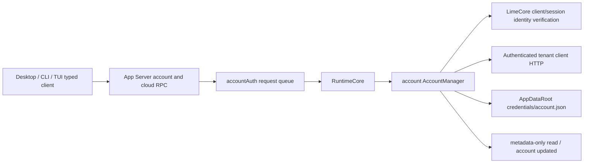

组合根显式注入同一 AppDataRoot；账号领域持私有凭据、HTTP 验证与同 issuer 认证 HTTP，不加入 PluginDataSource
supertrait 或 Electron 后端。导入先校验 tenant/user/session 与有效期，再以私有临时文件
原子替换；失败保留原账号。
loopback issuer 使用 direct HTTP client，避免系统或环境代理截获本地认证；公网 HTTPS
继续使用正常 proxy-aware client。两者均禁止 redirect，保持相同 timeout/身份验证。
read 每次读共享文件，冷启动/同根多进程可见，notification 仅
广播同 App Server 的连接，不宣称跨进程实时通知。logout 删除本地凭据，不撤销发行方会话。
`cloudAuthTokens` 不冒充 ChatGPT token，OpenAI managed/device/API-key 模式未完成。
GUI 的 localStorage 凭据 owner、window token/bootstrap globals 与旧远端注销入口已删除。
公开 OAuth/邮箱/密码登录响应的临时 token 只用于 account/login/start 导入；恢复、换号、注销
读取共享 account RPC。Renderer 只缓存 metadata/view 与不含账号凭据的临时 bootstrap，
同进程通知和窗口 focus 触发重读，不宣称跨进程实时通知；不读取或迁移旧凭据。
所有认证 Core client HTTP（含 Expert、Skills/Service Skills 与 Provider 同步）经 cloud/request
进入同一 accountAuth 队列和 AccountManager，params 不接收任意 URL/headers/token；仅允许
当前 issuer、当前 tenant 的 client 路径，禁止跳转/越界与 GET body，15 秒预算、4MiB body。
返回 HTTP status/body 和请求所属账号 metadata。Renderer 重新读取共享身份并比对初始身份、
响应身份和当前身份，丢弃换号/注销后的旧响应。Session/bootstrap 的账号 token 不出 owner；
独立开发者 API Key 保持原合同。登录请求诊断只保留 id/method/type，不把 JSONL 凭据写回
localStorage。CLI 登录入口和远端 Plugin 物化仍待接入，完整对齐继续 active。
Electron safeStorage 仅是未来 WebSocket transport 凭据基础设施。
架构影响：重大。root 已确认此 owner/数据流，2026-10-17；验证与剩余见 P04b3/P04b3b，未进入发布证据。

LimeCore 远端读取合同已直接替换为租户认证 base URL 下的 `/ps/plugins/list` 与
`/ps/plugins/{id}`。唯一来源为现有 catalog/release/tenant enablement，返回 Codex 的 raw
snake_case directory 与 plugins/pagination；租户发布映射 WORKSPACE/LISTED，先按当前用户
授权再分页。详情仅显式 includeDownloadUrls=true 且当前授权允许时返回 bundle_download_url。
旧 plugin-marketplace/v1、activation/packageRef 投影、SDK 读取方法和旧 activation 产品验收器
均已删除，不增加兼容或数据迁移。商业注册码由现役目录授权 owner 承担。旧 install-state
自报遥测及其服务端存储、snapshot、审计动作、SDK 和合同已删除；客户端旧签名可信根解析、
服务端 bootstrap 下发及专用配置也已删除。本地物化事实仍只来自共享 App Server 插件 owner，
不得恢复旧遥测或 renderer 验签分支。服务端 release 签名证据校验独立归发布 owner。
完整合同门禁现同时校验 YAML 层级、重复键与引用完整性。

```mermaid
flowchart LR
  Package[Controlled tar.gz upload] --> Scan[Bounded static component scan / private temporary files]
  Package --> Bytes[Core private immutable hash files / configured persistent volume]
  Package --> UploadState[Core Repository revision CAS / session and scan snapshot]
  Scan --> UploadState
  UploadState --> Verified[Verified record only / read hash and size validation]
  ShareUpload[Authenticated share upload-url / active actor and edit role] --> Capability[15-minute credential-free PUT / 50 MiB / immutable content]
  Capability --> Bytes
  Capability --> UploadState
  ShareUpload --> UploadState
  UploadState --> ShareCommit[Static identity discovery / etag and base hash / same-lock SQL transaction]
  Scan --> ShareCommit
  ShareCommit --> Release
  ShareCommit --> ACL[Current catalog ACL / owner policy / editor package]
  ACL --> Directory
  Directory --> Signed[Explicit detail or installed download / 5-minute HMAC]
  Signed --> Recheck[Current membership creator ACL policy release and bytes]
  Recheck --> Bytes
  Revoke[Owner DELETE / archive catalog and revoke releases] --> Release
  Bytes --> Verified
  Verified --> Binding
  Scan --> Binding[Package hash / identity / components check]
  Binding --> Release
  Facts[Catalog typed directory / scope / creator / vertical] --> Release
  Release[LimeCore catalog / release components / tenant policy] --> Directory[Authenticated ps/plugins directory]
  Policy[Current tenant user / explicit policy precedence] --> Directory
  Directory --> SkillRead[Core authenticated skill detail / no installation prerequisite]
  SkillRead --> Verified
  Verified --> SkillBody[Same manifest and skill discovery / original UTF-8 body]
  SkillBody --> SkillResponse[Raw plugin_id name skill_md_contents / no download URL]
  Directory --> Mutation[Core authenticated install / uninstall]
  Mutation --> Installed[Core tenant-user installed facts / snapshot]
  Installed --> InstalledRead[Core installed page / current authorization]
  InstalledRead --> Snapshot[Validate full snapshot / canonical IDs / account fence]
  Snapshot --> State[PluginStore account-scoped installed projection]
  State --> Store
  State --> Components
  Catalog[Shared App Server plugin owner] --> Account[Shared AccountManager]
  Account --> Directory
  Directory --> Plan[Internal plugin_remote Context / wire]
  Plan --> Download[Credential-free bundle download / 60s / 100 MiB]
  Download --> Extract[Private tar.gz extraction / 512 MiB]
  Extract --> Prepare[GLOBAL metadata preparation / raw Apps / portable preservation]
  Prepare --> Stage[Shared PluginStore private staging / digest / components]
  Stage --> Confirm[Authenticated install mutation / matching id and enabled]
  Confirm --> Store[Shared PluginStore cache and config commit]
  Account --> Identity[Issuer tenant user fingerprint]
  Identity --> Store
  Surface[CLI / TUI / GUI] --> Catalog
  ShareGUI[PluginShareDialog / staged access / account fence] --> ShareGateway[Typed pluginShare gateway]
  ShareGateway --> Catalog
  Catalog --> ShareRPC[AccountAuth queue / shared share save list updateTargets delete checkout]
  ShareRPC --> Archive[PluginStore native or standard manifest / relative tar.gz / 50 MiB streaming limit]
  Archive --> ShareUpload
  ShareRPC --> ShareACL[Authenticated ACL update and owner DELETE]
  ShareACL --> ACL
  ShareRPC --> Created[Complete created and installed metadata snapshots]
  Directory --> Created
  Created --> ShareView[Typed share summary / installed facts / local editor path]
  ShareCommit --> Paths[PluginStore account-scoped editor path cache]
  Identity --> Paths
  Paths --> ShareView
  ShareRPC --> Checkout[Authorized shared detail / account fence / editable checkout]
  Checkout --> Download
  Extract --> Editor[Home plugin directory / preserve mapped edits / no install]
  Editor --> Personal[Store lock / personal marketplace and editor mapping / rollback]
  Personal --> Paths
  Personal --> Catalog
  Catalog --> Components[Skills / MCP / typed Hooks]
  Components --> Runtime[RuntimeCore / canonical Thread Turn Item]
```

P04b13a Core技能正文沿当前目录授权与选中release进入同一verified包owner，原组件摘要与
正文共用技能根选择及namesByPath发现映射；覆盖普通包与分享包，未安装可读，不执行包。
正文成功响应no-store且不签发下载URL；托管包校验失败报存储错误，外部非托管正文不可得
返回显式null，不请求任意外部URL。P04b13b新增共享plugin/skill/read：typed surface经AccountAuth
队列进入RuntimeCore remote owner，沿同一Context认证GET，逐段编码并校验plugin_id/name，
保留原始正文；账号fence拒绝迟到响应。GUI技能卡片优先走现役fs/readFile，本地path为空时才
使用远端identity；不以skill.enabled或installed禁止授权预览。关闭/换号取消并丢弃旧正文，
Markdown投影集中复用Skills owner，frontmatter/一级标题规则来自同版Desktop原字节REA。
不引入renderer HTTP、假本地path、本地datasource空实现、第二业务缓存/registry或runtime。
root确认该只读数据流，2026-10-18。公共RPC/GUI和真实进程结果见执行计划，未验不计完成。

P04b13c的 `plugin/model/skillPreviewQueries` 是技能正文唯一Renderer查询owner，使用
TanStack Query的五分钟staleTime、请求合并、取消、过期重取与inactive GC；仅缓存原始
nullable正文，不保存凭据、安装/启停事实或格式化Markdown。PluginSkillsSection绑定
同一cloudAccount identity代际并管理查询provider，Preview只呈现query状态及本地Retry。
identityVersion由cloudAccount在身份变化时单调递增，同账号metadata刷新不失效；换号、
注销、会话变化及A→B→A隔离旧query，订阅恢复时清除旧代际缓存，请求前后再检查代际。

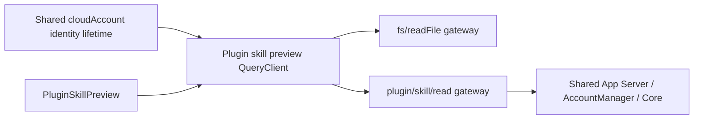

此为可丢弃的UI查询投影，业务和授权owner保持上述共享主链。Desktop REA已定位的账号
清理回调只覆盖space，不能声称其清空全部plugin query；Lime代际fence为明确本地安全接线。
沿qNc/Vq/Bq原字节证据关闭窗口聚焦自动重取，最多3次自动重试；有HTTP状态时只重试
408/425/429/5xx，无numeric status沿同一上限，不从错误文字猜状态。账号代际错误立即终止。
架构影响：重大（Renderer查询依赖/投影owner）。责任开发者确认：root，2026-10-18；
已核对依赖、目录、数据流、协议边界及Gate B验证合同，结果归执行计划P04b13c。

P04b13d远端详情不再覆盖本地物化包的Skills/MCP/Hooks。RuntimeCore沿同一Context按opaque
ID读取授权release，由响应scope确定canonical marketplace；完整分页读取fresh installed
（includeDownloadUrls=false），按ID关联安装状态、installed release版本及逐技能禁用名单。
远端技能保留raw name、path=null、hooks=[]；未安装技能默认启用。summary还经过共享plugins
配置门禁，onboarding要求插件可用、启用且匹配技能启用。公开installedAt统一Unix秒。

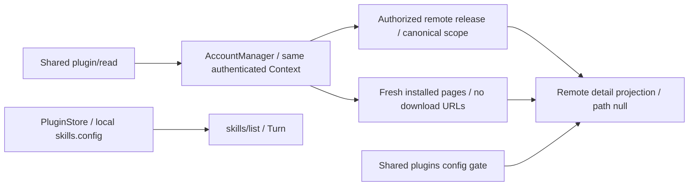

该读面不下载、不发布本地安装投影，也不把远端偏好写进skills.config；runtime仍只消费
现役本地store和配置。CLI/native summary.localVersion使用installed release版本，不能套用
Desktop hosted H2的null。Core included_files内部规则仍未定位。
重大架构调整由root于2026-10-18确认：沿既有owner替换详情事实来源，无新增RPC、迁移或
兼容层。验证结果归执行计划P04b13d，静态REA不作为Codex运行证据。

P04b13e 将同一远端目录读面收敛到 fresh installed：先完整校验本次各 collection 的
directory，再以同一 Context 读取一次 all-scope 安装分页（includeDownloadUrls=false），
按 scope/opaque ID 关联；共享 plugins 配置只限制 enabled。current version 来自目录，
localVersion 来自 installed release，installedAt 为 Unix 秒；不以物化包摘要覆盖。
GLOBAL 补 installed-only，其余普通集合不补；Shared 保留显式分享和链接安装两桶，空集合省略。

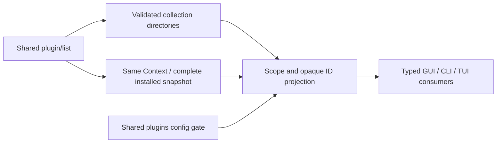

旧列表本地安装 overlay helper 已删除；此路径不下载、物化或写回安装状态/配置。
先验证目录再读一次安装清单是 Lime 现有 all-scope Core API 的复用选择；上游按 scope
读取，安装事实与集合语义一致。全部读取和最终返回保留账号 fence，失败不发布部分远端
目录。重大架构调整由 root 于 2026-10-18 确认；验证合同与结果归 P04b13e 专项计划。
缓存/prefer-cache/forceRefetch、本地 readiness 和偏好编辑不能由本刀核销。

P04b13f 的 REA Tkn/uAn 已定位远端插件和逐技能的 enable/disable 无 body POST。
GUI 插件开关按 source 分支：local 走 config/batchWrite，remote 走既有 cloud/request；
认证仍归 AccountManager，renderer 不持有 token 或直接访问认证 API。请求前捕获账号
identity/epoch，返回后重读账号并拒绝换号及切走再切回的迟到结果。成功才发 catalog changed，
页面随后 reconcile/fresh read，失败保留原状态并显示五语言提示。
Core 的安装事实模型保存 enabled/disabledSkillNames，复用同一 snapshot repository，
保存成功后发布内存；列表投影不再伪造 true/空数组。偏好不能创建安装或绕过当前目录授权，
技能按授权 release 声明原文匹配；远端逐技能偏好仍不写本地 skills.config 或 Turn 技能开关。
普通技能开关 UI 与安装 release 固定策略继续单独跟踪。
架构图由 root 于2026-10-18确认，详见 P04b13f 计划；没有新增RPC、IPC或数据库表。

Core 包会话、内容 hash 与静态扫描事实已从进程 broker 收回现役 Repository/snapshot；原字节
进入 `plugin.packageRootDir` 的私有不可变 hash 文件，只有已提交 verified 记录才能经原下载
API 读取，读取复验 hash/大小。上传/扫描以 revision CAS 提交；写盘或持久化失败不发布 URL，
已 verified 对象不受上传 TTL 影响。不再保留内存 bytes fallback 或 example 下载基地址；默认
未配置时上传 fail-closed，启用时 runtime 要求数据库可用，生产使用持久卷及 HTTPS publicBaseUrl。
P04b12b分享沿同一upload record附目标、etag、短时上传token hash与独立下载key；不增加registry。
原文capability只返回一次；PUT不携带账号凭据、禁止换bytes。finalize复用现役tar.gz scanner发现
name/version/hash/components，校验当前actor/owner或editor和base release/hash，同锁及MySQL事务
提交catalog/release/upload/ACL/audit/snapshot；失败只恢复本次写集。owner管理ACL，LISTED及广泛
workspace授权复用publisher规则；UNLISTED补workspace reader。分享包绕过通用公开asset入口被拒绝，
仅认证详情/installed显式要URL时签发5分钟HMAC链接，无凭据GET仍重新授权；撤权、停用、更新和
DELETE后旧URL失效。DELETE归档目录并revoke releases，保留历史。share_url暂为认证API详情。
P04b12c/d五个分享RPC从同一AccountAuth队列进入RuntimeCore/PluginDataSource/PluginStore；
归档在blocking任务执行，不把文件IO放入async请求线程。保留相对树、隐藏文件和执行权限，
拒绝链接/特殊文件，压缩输出50 MiB、展开512 MiB及10000条目上限。P04b12c1已将Core scanner
同步为10000条目、manifest 2 MiB、路径256层及整个tar流32 MiB额外metadata/padding预算；
只接受全零尾部，目录body与稀疏文件拒绝，两仓固定同一批56个字节样例与manifest/hash。
常见./根目录可读；未选中manifest不阻断有效候选，Core其他组件metadata保留1 MiB/累计8 MiB。
当前账号HTTP只申请capability和finalize；独立PUT不携带账号凭据、禁止
redirect，30秒预算，前后检查共享账号。delete严格要求204；成功后只清编辑路径映射，不删用户
目录或历史。映射在同一store按账号fingerprint隔离，复用跨进程锁、bounded读取及原子写入；
缓存写失败不伪造远端提交失败。list完整分页created与installed事实，拒绝重复ID/cursor及不匹配
creator/owner，不请求下载URL。checkout显式请求授权详情的下载URL，复用无凭据GET与同一解包
owner，锁内注册home/.agents/plugins/marketplace.json和账号编辑映射。新目录默认home/plugins/name；
既有映射目录保留用户编辑，未映射现存目录拒绝。mapping和marketplace各自原子写，普通失败
回滚注册，仅清本次创建目录，不提供跨文件断电事务。checkout不写远端install或installed cache。
typed client/gateway和Host等待策略同步。基础分享GUI已由独立Dialog、权限草稿投影与状态hook
消费同一typed gateway，支持PRIVATE创建、同ID更新、已有对象权限/工作区策略、复制、checkout
和撤销；目录读取SharedWithMe/created shares并按canonical ID合并。账号身份同时绑定目标与
异步响应，远端成功先保留ID，随后列表失败不重复创建；失败保留权限草稿，不增加renderer
HTTP/凭据owner。人员/组搜索邀请、组editor capability及非creator冷重开编辑定位仍待补。
源码与本地验证不替代Core进程/MySQL、模型Turn、Electron/CLI/PTY或平台证据。
架构图确认：root，2026-10-18；完整目标仍active，本节不进入release evidence。
Core源码/HTTP与SDK验证归P04b12b；App Server share五RPC已过本地真实JSON-RPC与HTTP夹具。
checkout新产物已过Electron/preload/IPC、个人市场可见、冷启保留编辑和stdio共享状态，
依赖为受控Core形状HTTP；分享GUI专项已用固定摘要新产物通过PRIVATE创建、权限保存、原生
复制/恢复、同ID更新、确认撤销和checkout，五RPC均经真实Electron/preload/IPC；冷复用与
stdio共享状态另验，结果及摘要归P04b12d1。普通GUI smoke继续独立记账。
真实Core进程/MySQL、模型Turn与完整分享GUI仍待验。
普通Electron壳smoke不替代分享产品验收。
未引用对象GC不在本刀。架构图/目录归属/依赖方向由root于2026-10-18确认。

远端 installed/install/uninstall/reconcile/share、下载物化到真实 Turn 的完整产品路径仍未验收，
不能用 directory metadata 测试核销。架构图由责任开发者 root 于 2026-10-18 确认。P04b8 新增 Core 用户安装事实，
不增加 Agent runtime 或第二套 CLI/GUI 后端；App Server mutation/reconcile接线由P04b9/P04b10继续验证。

远端 directory 的 backend ID 与本地 `name@marketplace` 分离：前者遵循 Codex ASCII 字母数字/`-_~`
约束，由现役 catalog 的 name 与 marketplace 生成稳定 SHA-256 ID；后者继续由共享 PluginStore
拥有。release、展示名和授权变更不改变远端 ID，每次详情和分页仍重新授权；不新增 registry、
旧 ID alias 或迁移。WORKSPACE/LISTED 的 canonical 市场为 `workspace-directory`，跨 catalog
market 同名条目映射相同 canonical key 时，Core 在同一 resolver 对目录、详情、安装和
installed 一致拒绝，客户端完整快照也先验证再提交，不以云端ID独立冒充可并存安装。
架构图与 owner 边界由root于2026-10-18确认。现役远端 list/read 已通过 RuntimeCore 插件 owner 委托共享
AccountManager 访问当前 issuer/tenant 的 client API；所有 host 复用同一 JSON-RPC。
响应只投影 PluginSummary/Detail，原始 bundle URL 不进入 renderer。目录分页最多 100 页/
10000 项、总预算 30 秒；重复 ID/名称、错 scope、游标循环和换号/注销后的响应被拒绝。
显式本地不触网，默认隐式远端失败保留真实本地目录；显式远端错误直接返回。
GLOBAL/USER/WORKSPACE 的固定外部市场标识与 canonical name、opaque service ID 分离；
远端 read/install 消费 opaque ID，配置和卸载使用 canonical `name@marketplace`。
GUI 插件页和 customization 侧栏均从现有 metadata 订阅观察账号；插件页附加请求
workspace/created-by-me 目录，侧栏 fresh read 同一 plugin/installed。账号变化清空旧视图并
拒绝迟到结果，注销后仍读取本地安装；不建立账号或插件第二存储。Apps 摘要委托现有 Apps owner，缺元数据
仍显示声明 ID，不据此推定 hosted access。安装状态只接受 PluginStore 的真实来源记录。
P04b6 实现将 Context/wire 提为 App Server 内部共享 plugin_remote，认证详情后单独下载 bundle，
不通过 cloud/request 放大 JSON 请求权限；URL/账号 header 不进入 renderer 或下载诊断。
PluginStore 在 cache base 写 schema_version/remote_plugin_id/账号 fingerprint，未匹配身份或
没有来源记录的同名缓存不被远端消费。Skills/MCP/Hooks 都复用同一 installed 读取，远端持久
data 按账号 fingerprint 隔离；变更身份拒绝提交，失败恢复旧 cache/config。所有物化/卸载
使用 store 文件锁串行提交。该受限下载/物化切片已通过 owner、公共 RPC/HTTP/stdio 与真实
Electron 安装/账号隔离/冷启/卸载验收；模型 Turn 和实际 Core 发布闭环仍单独欠账。
Electron 安装请求消费窗口归 `electron/appServerRequestTimeout.ts`，Host 只委托解析；
`plugin/install` 与 current DevBridge long-running policy 均等待 150 秒，容纳详情请求、
60 秒下载及物化提交，其他插件读请求仍为 30 秒，不在 Host 复制插件编排。
GLOBAL 准备归 plugin_catalog/remote/preparation.rs，仅修改私有无链接解包树；原生 manifest
覆盖 release 版本并保留其他字段，受支持 portable manifest 原字节保持。远端 app_manifest
保留完整 JSON；非 null 时按已解析的 Apps 声明/extension 路径写入，无有效声明则写默认
.app.json，省略/null 保留原包、显式空覆盖。Apps owner 共用路径规则并拒绝包外路径；
native 默认 Apps 接入同一 installed/app/list，portable Apps 只保留原文、不启用组件。
USER/WORKSPACE 元数据不被覆盖；任何准备失败都在唯一 store 提交前结束，保留旧安装/config。
本批未改变 owner 或依赖方向，上图由 root 于 2026-10-18 确认；验证归 P04b7，不复用旧产物。
P04b9 App Server install 先下载/解包/GLOBAL准备，并在唯一PluginStore构建私有staging，
manifest、digest和组件校验通过才POST远端install；返回opaque ID/enabled匹配且账号仍相同，
再提交cache/config。mutation失败只丢弃暂存，旧包和config保持；这对齐Codex remote_mutations
先materialize再调用远端的失败边界，且本地提交后置。远端成功而本地提交失败仍待installed
reconciliation收敛，不用补偿uninstall误删既存云端事实。请求按既有installAttemptId转snake_case
install_attempt_id，返回的optional app_ids_needing_auth可过滤已发现Apps；完整connector授权仍待接。
uninstall从当前账号provenance定位opaque ID，远端确认enabled=false后复用唯一store移除事务；
失败保留旧包/config。跨进程.remote-mutation.lock协调完整远端操作，后取store mutation锁，
等待后重新捕获账号、提交时再次校验；本刀不增加协议、凭据、下载或存储owner。
架构图由root于2026-10-18确认。真实产品和installed对账未验收前不核销两仓闭环。
P04b10 新增同名 `plugin/reconcile`。它复用 `plugin_remote::Context` 读取完整 `/installed`
分页（全scope、limit=200、includeDownloadUrls=true；30秒、100页、10000项，循环/重复/错误
身份全部拒绝），完成所有 canonical key 验证后，在唯一 PluginStore 的 `remote-state/<账号
fingerprint>.json` 原子发布安装投影。文件仅保存无凭据/下载URL的 typed PluginSummary，
不建立第二 registry；云端安装事实仍归Core。缺少本地包时installed=true而localVersion=null。
同版本保留包，新版本经同一 package preparation/PreparedPackage 物化；部分失败明确返回
failed IDs，旧版本可保留。Skills/MCP/Hooks/Apps沿用store.installed，并受安装投影约束，
已撤回记录先失去runtime可见性，清理失败后重试缓存删除。显式install/uninstall在同一
mutation锁内更新已有投影，配置提交失败回滚投影；首次完整fetch前只有确认过的显式安装
provenance，不伪造完整云端列表。本地启停override保留，不投影上游尚未消费的disabled_skill_names。
跨进程remote gate覆盖整个pass；逐页/物化/提交核验账号，换号不能发布另一账号视图。
RuntimeCore在pass前后失效MCP，processor通知现役Skills/Apps读面。GUI插件页在认证身份下
先reconcile再读取目录；typed package/Desktop客户端与current bridge共享150秒消费窗口。
服务端mutation已成功而客户端未提交的失败可由此路径恢复。本批架构图root于2026-10-18确认；
当前源码/受控RPC验证不等于真实Core发布、模型Turn或stdio/Electron/CLI/PTY与跨平台验收。

P04b8 Core 新增 raw installed/install/uninstall，唯一记录为 MySQL snapshot 的
remotePluginInstallations，按 tenant/user/opaque ID 隔离。安装复用 directory 授权和策略，
卸载可删除已撤回可见性的自身记录；保存候选快照成功后发布内存新状态，不全量回滚。
已安装分页重新授权，默认 limit=200，cursor 绑定 tenant/user/scope，与目录 cursor 分离。
它是云端用户意图事实；PluginStore 仍拥有本地包/config，不把已下载包当云端安装。
当前客户端 mutation与reconcile已接线；两仓真实发布安装、模型Turn及产品面仍待验收。
Core请求每次重新授权；Codex prefer-cache与share写路径仍pending。SharedWithMe由P04b11b消费；当前installed/reconcile
已有源码与定向验证，三产品面完整验收仍欠账。实际架构图 root 确认，
2026-10-18；目录和安装产品验证结果分别归 P04b4/P04b6，未通过的证据不得进入 release evidence。

P04b11a在同一Core catalog增加typed `directory`，scope/creator/collections随catalog快照与
SQL `directory_json`投影持久化，不建立独立目录registry。省略directory的current默认值为
WORKSPACE；GLOBAL取active catalog当前ready release，USER额外绑定当前tenant/creator user。
creator必须来自现役活跃用户事实；catalog更新不改变scope/creator。显式tenant enablement
优先，包括选定release、暂停、灰度、用户可见性、license与registration；拒绝不能回退默认
授权。没有显式策略的GLOBAL/USER采用目录默认策略，不伪造WORKSPACE_SETTING来源。
目录分页limit=200，GLOBAL支持`collection=vertical`，cursor绑定tenant/user/scope/collection；
全部页重新授权，list/detail/install/installed复用同一resolver。catalog创建/更新在同一仓储
锁内保存快照，成功后对读取者可见，失败仅恢复本次catalog/audit写集，不回滚其他领域。
开发期只更新现役初始DDL，无旧插件迁移或双轨；真实MySQL/新GUI、CLI/TUI产物未据此验收。
P04b11b 增加下列 current 授权边界（Core/App Server定向验证通过，产品待验）：

```mermaid
flowchart LR
  HTTP[Authenticated plugin HTTP] --> Resolver[Same catalog/release/tenant policy resolver]
  Resolver --> ACL[Catalog directory discoverability and targets]
  ACL --> Users[Active tenant and user facts]
  ACL --> Groups[Active Organization and OrganizationMember]
  ACL --> Governance[Current tenant role bindings]
  Resolver --> Views[Listed / explicitly shared / created views]
  Resolver --> Consumption[Detail / install / installed]
  Shares[Owner shares PUT] --> Locked[Repository lock and snapshot commit]
  Locked --> ACL
```

workspace 分享仍在同一 catalog.directory_json/snapshot，group ID 使用现役 Organization.ID，
授权读取真实 active 成员，不创建第二个 registry。creator tenant 限定边界；PRIVATE 仅 owner
与匹配主体，UNLISTED workspace reader 只授予链接访问，不能进入显式 shared 视图；created
独立于 USER scope。详情、安装和 installed 统一重新授权，tenant policy 优先；canonical key
按 LISTED/workspace-directory 与 PRIVATE/UNLISTED/workspace-shared-with-me 区分。owner-only ACL、
租户级管理员发布门槛是 Core 设计选择，上游源码只证明 wire 合同；UNLISTED workspace reader
无需管理员授权。owner/editor 可读 principals，普通 reader 不读取完整 ACL。旧 tenant role
绑定同步现在撤销被移除的角色，发布权限直接读取现役治理事实。ACL mutation 在仓储锁内
重新验证 owner/target/发布权限并保存，失败仅恢复本次 catalog/audit/seq，500 不泄露存储细节。
共享 App Server 的 collection 已通过同一 plugin_remote Context 接线：vertical 请求 GLOBAL
collection=vertical，SharedWithMe 请求 workspace/shared 并读取 fresh installed 完整分页，
区分直接分享与仅链接安装的 view bucket；两桶 summary、read、install 与 reconcile 只写
workspace-shared-with-me canonical 缓存，不把 view 名持久化成第二份安装。LISTED 继续使用
workspace-directory，变更 discoverability 后对账物化新 identity 并清理旧缓存。creator、principals、
can_publish、share_url 的 snake_case wire 元数据转换为同一 typed PluginShareContext；read
接受 view 名时先还原 canonical 安装身份，冷启仍从同一 store 读取组件。
分享链接/上传与 tar.gz 出站、GUI集合入口、其它集合fresh installed/cache策略、
stdio/Electron/CLI/PTY 和真实同包 Turn 继续待验；不新增旧插件迁移。root 于2026-10-18确认 owner、依赖方向与本图。
架构影响：重大；root于2026-10-18确认上图与owner变更，验证分母仅P04b11a，不核销完整目标。

LimeCore release 的 typed `components` 与同一 catalog/release/tenant-policy owner 关联，
单条及批量发布、更新、repository 深复制、snapshot 与 SQL `components_json` 使用同一记录；
授权 directory 在 release 中展开 Apps/模板/Skills/MCP/onboarding/定时任务摘要。schedule 内部
保留 Codex camelCase tagged union。内容 hash 实际变化且未提供替代摘要时清除旧组件，
幂等发布保留；显式空 app_manifest 和 scheduled_tasks 保留空对象/空数组语义。
受控 tar.gz 的 Skills/onboarding/MCP key 和原生 Apps 声明由同一上传扫描 owner 自动提取，
scan report.components 与所选原始 manifest/package hash 绑定。开发者审核前以及平台单条创建/
更新、bulk publish/preflight 均对照包内字段；手填不一致拒绝，省略自动填充。受控包显式空对象
仅清云端字段，不能删除包内事实；任务与 Apps workspace 模板/授权继续来自云端，不能从包推导。
标准包固定 skills/mcp.json，原生包使用声明 roots 或默认 skills/.mcp.json/.app.json；onboarding
必须指向已发现的 SKILL.md。归档上传/交付使用 tar.gz，压缩上限 100 MiB，普通文件总量
512 MiB；默认 application/gzip，对象后缀 .tar.gz，无 ZIP 双轨或旧包迁移。只接受普通文件/
目录，路径越界、链接/特殊类型、重复/冲突、gzip CRC/截断和额外压缩流均拒绝。扫描暂存到
私有临时目录的受控数字文件，不按包内路径写宿主目录、不执行包代码，成功/失败均清理。
P04b12c1将两端合同收敛为10000 entries、manifest 2 MiB、路径256层和tar全流32 MiB额外
metadata/padding预算；Core其他组件metadata仍为单文件1 MiB/累计8 MiB。客户端P04b6
download owner实施60秒预算，实际验证单独记账；共享package copy上限为512 MiB。
共同资源/安全约束明确区别于Codex上游限制，56个共同golden/负向字节样例不冒充跨平台产品证明。
架构图与此事实源由 root 于
2026-10-17 确认，产品验证结果归 P04b5。
扫描结果和审核单深复制保持 JSON 值与 null/空数组语义，审核 hash 在保存后仍相同；扫描期间
字节被替换则拒绝提交证据。技能相对图标只报未发布告警，不伪造公共 URL；标准包 Apps 按当前
Codex manager 保持未启用。客户端该行为仍需单独复核，不能从服务端回归推定已同步。
不新增 registry、执行器或 renderer owner；外部平台 URL 的下载/内容验证、完整 MCP/技能
runtime 解析一致性、公共资源发布、账号/HTTP/物化仍 pending。服务端对格式错误的声明严格拒绝，
不会复刻客户端所有容错修复，也不把声明摘要当作可调用性验证。
本刀只更新开发期现役建表基线，未操作实际数据库或增加旧数据迁移。架构图及组件事实源由
root 于 2026-10-17 确认，不能用 metadata 回归核销客户端完整远端安装或真实 Turn。

插件按 [Codex 目标合同](../roadmap/plugin/codex-contract.md) 重构，进度归
[执行计划](../exec-plans/codex-plugin-reconstruction.md)。标准根 `plugin.json` 与 Codex 支持的
原生生态 manifest 由同一 loader 选择；标准包固定资源与原生声明 roots 分别解析，不能把
`.codex-plugin/plugin.json` 限制为 overlay。App Server 插件领域唯一拥有 catalog、安装缓存、
共享配置与组件快照，Skills、MCP、Hooks 继续归既有领域 owner，Electron 只转发 transport。

```text
CLI / TUI / Electron GUI
  -> App Server JSON-RPC -> RuntimeCore PluginDataSource
  -> plugin_catalog: manifest / discovery / PluginStore / install / marketplace
       plugins/cache/<marketplace>/<plugin>/<version>
       shared config: plugins.<name@marketplace>.enabled
       shared config: marketplaces.<name> -> local source | .tmp/marketplaces/<name>
       plugins/data/{agent-plugins/<identity hash>,<plugin>-<marketplace>}
  -> immutable plugin component snapshot
  -> Skills / MCP / Hooks -> RuntimeCore -> Thread / Turn / Item

hooks/list / provider step capture
  -> PluginDataSource.load_plugin_hooks -> plugin_catalog/hooks
  -> typed PluginHookSource -> tool-runtime discovery / trust
  -> validated step snapshot -> command reporter -> canonical hook notifications

marketplace/upgrade -> validated Git snapshot
  -> configured plugin keys -> install::materialize (staging / digest / atomic replace)
  -> preserve enablement -> MCP invalidate + Skills watch/cache/changed

LimeCore package scan / release / marketplace / tenant policy
  -> same manifest selection / effective identity / bundle contract
  -> client App Server; Go gateway only transports tenant-owned Rust App Server
```

已替换的存储不再读写旧安装 records；插件身份为 `name@marketplace`，同名不同市场独立。
cache 选择版本并按共享配置决定启停，同版本重装原子替换；标准技能与原生声明的多 roots
生成真实 metadata，技能显示使用 `plugin:skill`，内部 ID 保留完整插件身份。MCP 复用既有
配置和执行 owner，保持 Codex server 名称，不再生成旧私有前缀。

市场来源管理继续归同一 `plugin_catalog/marketplace` owner，公开入口为
`marketplace/add/remove/upgrade`。共享配置 `marketplaces.<name>` 记录来源、ref/sparse和已激活版本；
本地源只引用，Git在 `<AgentRoot>/.tmp/marketplaces/<name>` 保存受管快照。网络工作在锁外，
提交时持共享配置锁、重读来源并原子替换/回滚；移除市场不卸载已安装插件。旧
`plugins/marketplaces/*.json` 私有目录扫描已删除，无迁移或fallback。CLI `plugin marketplace`
与typed GUI gateway消费同一App Server，不建立私有registry。定向owner、真实Git公共JSON-RPC、
新产物CLI市场管理和同产物Skills/GUI smoke/Apps/插件Electron回归已通过。
升级新快照后，由同一 install::materialize 强制刷新对应市场的已配置插件，包含 disabled 与同版本内容；
刷新不写启停配置，不安装未配置插件。失败逐插件返回并保留该插件旧 cache，其他插件继续。
有 upgraded roots 才失效 MCP、重建 Skills watch 并通知 catalog；指定非 Git/未知市场返回错误。
`openai-curated` / `openai-api-curated` 按上游排除，归remote reconcile，不能用本地刷新代替。
本刀新产物的公共JSON-RPC、双连接5个runtime Turn/两次Git升级/冷启、CLI、标准GUI smoke和插件
Electron均通过，证据归执行计划的`marketplace-refresh-*`，不以旧产物核销。配置层级/托管策略、跨进程一致性、
Hooks完整生命周期、远端控制面与Desktop管理入口继续由执行计划跟踪。

core/config 的唯一写盘入口使用同目录临时文件完整写入并同步后原子替换，保留配置文件
符号链接及权限；安装和卸载在配置提交失败时恢复原 cache。配置锁由共享 config owner 提供，
Skills、PluginStore 与 App Server config methods 不再各自维护独立锁。

自建启停 method 已删除，启停走 `config/batchWrite`。公开 API 的 `sourcePath` 安装与旧 catalog DTO
已直接替换为分市场 list/installed、唯一市场定位的 read/install 及授权结果；正式 schema/client
已重新生成。新固定产物已通过本地 Skills、CLI 管理、正式 GUI smoke、Apps 与插件 Electron
安装/启停/冷启/卸载闭环；完整嵌套合同与远端能力仍待验收，不能据此视为完全对齐。`plugin/uninstall` 使用 Codex 的
`PluginUninstallParams` 和空 `PluginUninstallResponse`；CLI/GUI 只在请求成功后更新状态，
不再依赖旧 bool 或旧 Catalog 卸载类型。CLI、TUI、GUI 共用生成 schema/client。
Hooks、Apps、远程市场、share 与授权语义仍逐项补齐；旧产品范围裁决不再排除 Codex 插件能力。
本批真实 App Server/CLI/Electron 证据归执行计划；Apps只证明本地catalog/通知和待接入状态，
不证明hosted授权可调用。新批exec/PTY、Windows、live与两仓发布安装Turn仍未验证。

旧私有插件 worker/runtime、renderer registry、包 schema 和安装 records 为
`dead / deleted / forbidden-to-restore`；不迁移旧数据，不恢复旧实现或另建兼容后端。
原 UI runtime 专用模型代理 token 与 Connector delivery 脚本也已删除；模型代理统一使用
既有 API key 校验，插件权限、连接器授权和市场发布在 current App Server/LimeCore owner 实现。
未接入生产的独立 `pluginCapabilityRuntime` catalog 投影及其导出/测试已删除，不建立旁路事实源。
旧官方插件创作技能及官网同名 ZIP/bundle/file-tree 已删除；官网生成器在 build/check 均拒绝
无源码公开包。无 current 消费者的旧 VM/反馈 Connector 专用技能及官网同名制品一并删除。
发布模板不再生成旧 renderer/skills 摘要，实际组件仍由受控包扫描 owner 提供。
Article Editor 直接构造其领域 action metadata，旧 generic pane-action helper 已删除。
generic workflow 只接受现役 resume 绑定，不再从旧插件/worker metadata 容器推断恢复，也不再
于取消/重试事件写入冗余插件状态；通用 workflow 的顶层状态、取消和重试仍归原 owner。
上述清退不新增协议、状态副本或兼容层。架构图及唯一 owner 由 root 于 2026-10-17 确认；
无调用方的 Article 插件 renderer host、声明模型和授权占位策略已删除，现役文章编辑器
只消费领域动作和 artifact 投影；正向夹具改验分镜内容，不保留旧 renderer 合同。
本轮验证结果与剩余项归执行计划 P04a3/P04a4/P04a5，不能核销远端安装到真实 Turn 的完整目标。
tool-runtime 中零消费者的旧 activation JSON -> HookPluginSource 转换已删除，不能恢复
`packageSourceUri` 旁路。插件Hooks来源由同一catalog loader解析为typed component source，
`hooks/list`与provider每次sampling step消费同一启用安装事实；后续step重读停用/升级/卸载，
已捕获step不变，后续sampling重新捕获；普通空final不额外采样。按上游HooksOnly规则，Mention选择不关闭
其他启用插件的Hooks；标准Agent Plugins格式不加载Hooks。原生默认文件、显式路径/数组及inline
对象/数组保留完整插件ID与来源key；坏组件报告warning，不读取renderer传入的目录。
Command子进程注入PLUGIN_ROOT/DATA及CLAUDE_PLUGIN_ROOT/DATA，data归既有PluginStore；
安装不能绕过hash信任。来源失败或快照无效在sampling前失败，不允许静默绕过门控。
本切片实现与验证结果归执行计划的typed Hooks条目；其他生命周期admission、MCP handler、
executor/builtin清理allowlist及managed config/layers仍未核销，不代表完整Hooks对齐。
本地来源切片已通过143项Rust、6项前端/守卫、两次真实stdio四场景、标准GUI smoke和插件Electron回归；
产物macOS rpath准备前后摘要分别保留，prepared复跑与最终9项产物/25项源码复核通过。
全仓docs boundary仍受并行发布计划引用阻塞；云端远端合同、live、Windows、packaged与新CLI/PTY不由此核销。
GUI suggestion 直接消费 App Server 的完整插件 ID，不重复拼接 marketplace。

本刀架构图确认：root，2026-10-17；复用 App Server 插件事实、安装事务和现有 Skills/MCP owner，
不新增协议、运行时或兼容后端。未验证的产品层级由执行计划单独保留。
MCP App 从 canonical MCP Tool Item/resource 进入 Right Surface。生产路径不能回退 mock。

Architecture impact: major; 插件包选择、缓存/配置、组件快照与云端扫描沿同一 owner 重构。
Architecture diagram updated: this section. Responsible developer confirmation: root, 2026-10-17.

MCP server 的执行环境身份只来自 `McpServerConfig.environment_id`，由 `lime-mcp::McpEnvironmentRegistry`
在 transport 启动前解析。当前 MCP registry 只注册 `local`；未知显式身份必须 fail closed，禁止把
`remote` 或其它配置值降级成本机 stdio/HTTP 执行，也禁止从 `cwd` 猜测环境。Codex 的
`environment/{add,info,status}` 现由 App Server `processor::EnvironmentRegistry` current owner
承接：远端 URL 经过 `ws://`/`wss://` 校验，连接按 `initialize -> initialized -> environment/info ->
environment/status` 建立并保持，状态只允许 `Pending/Ready/Disconnected/Unknown`，ready 环境的
status 使用现有连接做 fail-fast probe；`environment/info.cwd` 在 App Server 边界收敛为 canonical
`file:` `PathUri`。Thread/Turn environment selection 现在由同一 registry 做 ID、绝对 cwd、workspace roots
去重和默认 root 规范化，并写入 Thread metadata；选择请求完成时按当前 registry 状态发射
`thread/environment/connected|disconnected`，Pending 不伪造 connected。`thread/resume` 从持久化 Thread
metadata 恢复 typed selection 并复用同一状态投影，损坏 metadata 或缺失 registry entry fail closed。
远端 registry 已支持冷启动重建、有限健康探测/重连和主动断线到已选 Thread 的事件转发；selection 的 durable
full/patch 与当前 typed provider snapshot 也已接入。RuntimeCore 仍缺 exec-server `process/*` 与 `fs/*` transport，
不得将 transport-level recovery 当作完整可执行 backend。
未完成前不得把远端环境宣称为可执行 backend，也不得新增 compat fallback 或空壳 JSON-RPC。

Architecture impact: major; Environment registry/WebSocket transport、Thread/Turn selection、resume binding、
typed provider context 与 execution identity lowering 均已有 current owner，远端 process/filesystem transport 和
Desktop evidence 仍明确 pending. Architecture diagram updated: this section. Responsible developer confirmation:
root, 2026-08-23.

本地 stdio 启动还必须复用 Codex 的平台核心环境变量 allowlist，并仅叠加配置显式 `env`；
不得把 Desktop Host 的完整环境（尤其凭证变量）隐式继承给 MCP 子进程。启动 deadline
严格使用配置的 `startup_timeout`，禁止按命令类型隐式放大。

### 7.3 Scheduled Tasks

已安排任务属于 App Server 调度领域，产品入口、协议、持久化和 Agent 执行沿单一主链：

```text
ScheduledTasksPage
  -> Renderer scheduledTasks typed gateway
  -> Electron Desktop Host / app_server_handle_json_lines
  -> App Server scheduledTask/* processor
  -> RuntimeCore
  -> LocalAppDataSource automation owner
       automation_jobs（当前唯一任务表）
       agent_runs（运行历史）
  -> RuntimeCore thread/session + turn submission
  -> canonical Thread / Turn / Item projection
  -> App Server typed scheduledTask/changed + scheduledTask/run/updated
  -> Renderer Scheduled Task notification policy / refresh bridge
  -> Electron Desktop Host system notification (壳能力)
  -> ScheduledTasksPage history / open conversation
```

公开 surface 为 `scheduledTask/list|read|create|update|delete`、`scheduledTask/enabled/set`、
`scheduledTask/run/start|list` 与 `scheduledTask/schedule/preview`。Schedule wire 使用
`hourly/daily/weekdays/weekly` 和 Codex weekday `MO..SU`；这是 Lime Desktop 的产品 CRUD 扩展，不能表述为 Codex
Desktop 已存在同构实现。任务写入继续复用 `automation_jobs`，不得新增第二张长期任务表或 Renderer store；运行历史从
`agent_runs.source_ref=taskId` 投影。`new_thread` 每次运行产生新 lineage，`continue_thread` 必须使用显式来源 lineage；
运行返回真实 `sessionId/threadId/turnId` 后 GUI 才能恢复 canonical 对话。

Electron 只负责 JSONL 转发和系统通知宿主能力，不承接 scheduler、任务 CRUD、运行状态或 timer。App Server 是任务变更与 canonical
terminal event 的 typed notification owner：任务 create/update/delete/enabled-set 发布 `scheduledTask/changed`，
`turn.completed/failed/canceled` 经过 Agent Run 幂等终态写回后发布 `scheduledTask/run/updated`。Renderer 只按任务的
`all_runs / failures / none` policy 决定是否调用 Desktop Host；`unsupported/failed` 必须进入可见错误通道，不能伪造发送成功。
Renderer timer、生产 mock backend/fallback、browser session automation 与已退役应用编排 context 均禁止成为 current owner。旧
`automationJob/*`、`automationSchedule/*`、`automationScheduler/*`、Renderer automation gateway 及旧 Settings 工作台已物理删除，
分类为 `dead / deleted / forbidden-to-restore`；旧 method 字符串只允许作为 contract、fixture 或治理扫描的负向回流守卫。Rust
`AutomationJob` DAO、`automation_jobs` 表与内部 execution helper 是 Scheduled Tasks 的 current 存储映射，不是公开双轨。scheduler 原子 claim、
missed/catch-up、DST、通知、软删除及并发运行合同已由 current owner 收口；任务删除写入 tombstone、禁用并清除未来调度，
但不取消已运行 Turn，canonical terminal write 仍保留 Agent Run 历史且不得复活 tombstone。真实 OS sleep/wake、Windows
Notification Center 与 Windows Gate B 仍是平台证据缺口，按 `internal/roadmap/task/scheduled-tasks/` 和对应执行计划收口。

Architecture impact: major; this adds the Scheduled Tasks public JSON-RPC/read-model boundary and top-level GUI workspace while
preserving Electron as transport/system-notification host and RuntimeCore/ThreadStore as the execution truth. Architecture diagram
updated: this section and `internal/aiprompts/commands.md#scheduled-tasks-主链`. Responsible developer confirmation: root,
2026-08-17. Confirmation content: 已核对 scheduledTask JSON-RPC、typed invalidation/terminal notifications、Agent Run
幂等终态、soft-delete tombstone、Renderer notification policy、Electron system notification boundary，以及未完成的
Windows/sleep-resume 平台证据，以及旧 Automation 协议、GUI、client、smoke 与 Agent UI projection 的物理删除和回流守卫。

## 8. 命令、配置与数据边界

### 8.1 Turn 请求字段归属

`turn/start` 只有一组 Codex v2 请求结构。Renderer 必须由 typed gateway 构造；
`threadClient` 只负责转发、通知路由与 read-model 投影，不再接受或转换第二套
snake_case runtime request。

| 边界                            | 唯一 owner                              | 字段                                                                                                                                                                                                                                             |
| ------------------------------- | --------------------------------------- | ------------------------------------------------------------------------------------------------------------------------------------------------------------------------------------------------------------------------------------------------ |
| `TurnStartParams`               | Codex v2 Turn 协议                      | `threadId`、typed `input[]`、model/effort、cwd/workspace roots、approval/sandbox/permissions、output schema、service tier、environment、collaboration/personality 与 typed context metadata；deprecated typed `multiAgentMode` 被 runtime 忽略。 |
| `TurnSteerParams`               | Codex v2 Turn 协议                      | `threadId`、`expectedTurnId`、typed `input[]`、`clientUserMessageId`、additional context 与 Responses API client metadata。                                                                                                                      |
| `RuntimeRequest`                | App Server -> RuntimeCore 内部 lowering | provider/model/config、typed `collaborationMode`、reasoning、approval/sandbox、workspace 与执行 metadata；Renderer 不再直接构造或传输该内部 DTO。                                                                                                |
| `RuntimeOptions` / queue fields | dead for current turn protocol          | `runtimeOptions`、`queueIfBusy`、`skipPreSubmitResume`、caller-supplied `turnId` 不属于 v2 `turn/start`，不得通过 alias、metadata 或 compat wrapper 回流。                                                                                       |
| `hostOptions`                   | dead / deleted                          | 不在 current turn 协议中；不得作为宿主扩展、provider route、tool policy、workspace、session context 或任意 runtime JSON escape hatch 恢复。                                                                                                      |

`collaborationMode` 采用 Codex 的 `ModeKind + settings` 结构，由 `turn/start` typed wire 进入
`RuntimeRequest`，再进入 `TurnContextOverride` 和 Goal admission；Plan 判定只读取
`ModeKind::Plan`。GUI submit adapter 负责把当前输入框状态降为该结构并从
`additionalContext` 移除旧的 mode 字段，goal 等非模式 metadata 不得承接 mode 语义。

Renderer submit gate 只把 canonical `thread/read` 当作 start/steer 的输入事实：先解析
`threadId`，再读取唯一 `activeTurnId`；有 active turn 时提交 `turn/steer` 并携带精确
`expectedTurnId`，无 active turn 时才创建 `turn/start` 的 optimistic lifecycle。Renderer
本地 `ActiveStreamState.turnId`、busy/queued flag 和 draft status 都不是调度事实；ID 冲突
必须 fail closed，不能退回 start 或伪造 queue。steer 接受后不创建第二个 Turn、不绑定第二个
事件 listener，并刷新同一 canonical read model 以投影用户输入与原 Turn identity。Renderer
不得恢复旧 queued snapshot 的 promote/remove facade；durable pending-work 的执行、恢复与续跑只归
RuntimeCore/session loop。`QueuedMessageList` 读取现有 scoped queue projection，经唯一 typed
`threadQueueActions` 调用 current `thread/queue/update|reorder|delete|start`，再读回 canonical queue。
默认折叠数量与显式展开的可读/编辑 preview 分开；局部 mutation 锁和草稿绑定 thread/request
identity，不成为第二 queue store。`thread/queue/start` 当前仅在 idle 启动，不能冒充运行中
`turn/steer`；active-turn Queue Steer 的原子消费合同尚待对齐。

Queue/Header renderer 对齐图确认：root，2026-10-14。`QueuedMessageList` 直接替换旧组件，
thread-scoped 草稿与同步 mutation 锁只管理 UI 操作；现有 queue/store 是唯一业务 owner。
Header 编辑绑定开始编辑的 session/token/callback，切换会话取消旧编辑。

Queue 拖拽 handle、方向键与上下按钮共用 `queuedMessageReorder` 的按 ID 变换，再由现 `runAction -> reorderThreadQueue` 提交并读回 canonical queue。drag 仅保存当前实例/thread/源 ID 顺序/原始 submissions 引用/mutation epoch/transfer identity；drop 再验同一快照与锁，取消、在途、跨线程往返与失败均不乐观改队列。没有新增 queue store 或 runtime 动作。root 于 2026-10-18 确认此为同一 renderer owner 的交互接线，65 项局部回归不替代真实 Electron Gate B。

Queue mutation、公共历史与队列呈现沿同一 canonical owner：

```text
thread/queue/{add,update,reorder,delete}
  -> existing queue events -> thread_item_projection materializer
  -> ThreadStore canonical Turn + completed UserMessage Item
  -> thread/queue/changed -> AppServerEventBus
       -> scoped queue list reader -> QueuedMessageList
       -> useAgentThreadReadSync -> existing session full thread/read
            -> thread_read/history_visibility excludes pending Queue
            -> same-read public thread_turns/thread_items -> timeline replacement
```

`queue.added|updated` 依据 payload 的 queued Turn identity 生成或更新稳定 User Item，
完整 typed input/client identity 贯穿 edit、remove/add reorder 与冷恢复；不重新追加
`message.created`。完整 `thread/read` 的 Turn 数组顺序是 authority，Renderer 不从 queue list
修补历史，不将分页 detail 当完整替换。替换保护当前真实 stream 与未确认 optimistic input；
scope 含 session/thread/workspace generation，A→B→A 迟到 read 不落地。连续 queue 通知串行并
保留最后一次重读，读取失败保持原投影。内部 queue 属于 durable pending facts，admission
之前不进入 public transcript；公共 v2 Turn 无 queue 字段，Renderer 不从私有字段猜状态。
RuntimeCore read/list/resume 排除 queued，并从执行事实计算 idle/active；turn/item pagination
补取可见条目与 lookahead EOF，cursor 仍由 store 解释，重复 cursor fail closed。
队列首图由既有 MessageImageAttachments thumbnail → media/read verified sidecar owner 读取；
不新增第二 media store 或任意 metadata 文件读取。架构图确认：root，2026-10-14；已复核唯一
materializer、public visibility、同次 canonical DTO、通知订阅与最小 session 接线，未新增
queue/history store。搜索snippet/occurrence在既有canonical search owner分页前排除pending，
admission后恢复匹配；public搜索结果状态复用thread/read执行投影。opaque occurrence游标
保留原ordinal校验，未合成游标或增加renderer过滤；root，2026-10-14复核同库/分库与
JSONL回归。诊断export/rebuild/unload另立合同，不能由read/search通过推导完成。

Right Surface 的同线程局部 open 集合与 selected 分开，select 保留其他标签，close 移除指定
标签；唯一 local state owner 使用 workspace/session/thread 与单调 generation 拒绝 ABA 回调。

```text
current registry / resource availability -> one available set
  -> projection(opened intersect available, selected)
  -> RightSurfaceHost tabs -> select / close
  -> same local display state owner -> generation-scoped setters
Browser native resource remains owned by existing BrowserTabHost
  -> sender-scoped browser_tab_list -> complete live tab snapshot
  -> useBrowserWorkspaceHydration(epoch / events / close tombstones)
  -> BrowserWorkspace(selected native tab / bounds)
  -> only an empty snapshot permits hidden primary mount
```

availability 撤销时 prune；切换 thread/workspace 首次渲染即隔离旧集合。BrowserTabHost 是 live
tabs / selected / URL / native view 的唯一事实源；App Server 仍分配 canonical session / thread。
只读 snapshot 从实际 IPC sender 校验 window / ownerWebContents / browserSession / thread，身份
不符拒绝。重挂载恢复完整 snapshot，合并查询期间的 select / close 事件，以 view tombstone 防止
已关闭标签回流；非空不重建 primary。单调 epoch 隔离迟到 snapshot / mount / bounds，隐藏
bootstrap 只能由当前 workspace 显示。此合同不提供跨 Electron 重启的 native process 持久化。
首次 `browser.newTab` 无 native tab 时，`BrowserToolWorkspace` 通过
`BrowserAppServerBridge -> workspaceRightSurface/request(browser_identity_tool, open)`
取得同一 canonical identity，消费内部请求后先在原 Host 注册无 URL 的空白 WCV。
随后发布 `browser_tool` foreground pending（只含 identity，不含 launchUrl），由既有
Right Surface coordinator 自动展开；hydration 恢复该 WCV，不能额外加载默认搜索页。
workspace pending读取合并同一canonical session的无workspace browser请求，通知使用相同
scope规则；跨session与其他surface不穿透workspace过滤，切换session使旧read失效。
真实 WCV 是原 `BrowserPermissions` 的审批锚点，批准后在同一页导航目标；拒绝目标在
分配前拦截。turn terminal、断线、原窗口失效、route 关闭或策略变化使迟到 bootstrap 失效。
已有标签仍走原 newTab 创建路径，并通过相同 foreground pending 展开折叠面板。
架构图确认：root，2026-10-25；新增为短宿主编排委托，未新增 RPC、IPC、store 或执行体。
架构图确认：root，2026-10-14；已复核 scoped 接线、选择/关闭、availability、snapshot 和 epoch
owner，未增加 browser/artifact store、业务后端或 App Server 协议。真实证据只按实际执行范围
记入当前计划。

项目运行上下文的唯一 Renderer owner 是 `ComposerUtilityBar`，由首页完整上下文和导航栏
project-only 入口复用。动作只归 `useComposerUtilityActions`，依赖既有 project/projectGit
typed gateway，不进入 Composer document 或复制业务状态：

```text
home / navbar -> ComposerUtilityBar -> useComposerUtilityActions
  -> existing project/projectGit gateway -> Electron preload/IPC
  -> app_server_handle_json_lines -> current Project / ProjectGit owner
  -> typed project/root/branch readback -> same keyed utility instance
```

实例 key 为 project ID + rootPath；一个同步 mutation 锁与 request identity 隔离迟到
success/error/finally/navigation。Git read loading/error/retry 是局部显示状态，真实结果来自
既有 status owner。未消费的 Inputbar context 透传已删除；旧组件不得恢复为包装层。
现有立即创建 worktree 不冒充 staged composerMode，cloud/remote/environment 仍待合同。
架构图确认：root，2026-10-14；已复核共享入口、gateway 与领域 owner，未新增业务后端。

Thread 设置通知沿以下生产路径消费，不另建设置 store：

```text
GUI model/access selection -> agentRuntimeAdapter -> thread/settings/update
  -> App Server effective ThreadSettings -> independent stdio notification
  -> Electron Host app_server_drain_events -> AppServerEventBus
       <- typed response.notifications (only when transport returns a mirror)
  -> thread-scoped adapter -> existing per-session preference cache
       -> useAgentModelSettingsSync -> useAgentContext / future submit
       -> useAgentSessionThreadSettings -> existing threadRead cache / header cwd
```

ACK 仅结束提交，UI 与后续发送使用服务端 canonical 设置。response/drain 只消耗成对镜像，
保留同来源合法 A→B→A；通知没有服务端 revision，不能推导跨重连全序。thread/workspace
及订阅 generation 隔离迟到结果；设置通知不修改 active Turn/Item 或 transcript。
架构图确认：root，2026-10-14；已复核现有 cache、read model 和 EventBus 接线及真实 Electron
idle model/cwd Gate B。该证据不声明 active/future Turn 执行、live Provider、Windows 或 packaged 验收。

前端不会持有或修补 Thread/Turn/Item 真相。输入发送后，用户消息、流式增量、终态、
工具活动和历史恢复均从 App Server notification 与 canonical Thread read model 投影到 UI；
v2 `thread/read` 直接返回同一 ThreadStore-backed read model；固定 timeout、renderer cache、
host payload 或缺失 detail 的本地 fallback 不能合成 history 或完成态。

Renderer 不再接收或投影 user-turn 的 `queue_added`、`queue_removed`、`queue_started`、
`queue_cleared` raw side-channel，也不再将 `QueuedTurnSnapshot` 的 message/attachment/path
细节恢复为输入草稿。上述路径已删除，不得通过 protocol parser、stream lifecycle、projection
package 或 workspace prop 重新引入。Plugin/task 的通用 `task:queued -> queue.changed`、
Multi-Agent 的队列计数，以及 RuntimeCore/session loop 的 durable pending-work/recovery 仍由各自
current owner 负责；它们不是 user-turn queue GUI 的兼容替身。

一次跨层命令改动必须同时更新：

1. Renderer gateway 或 `packages/app-server-client`。
2. Electron preload/IPC 白名单（仅宿主转发需要时）。
3. `app-server-protocol` schema、App Server handler 与 Rust client。
4. catalog、受控 fixture、mock policy 和 `npm run test:contracts`。

生产路径不得回退 `defaultMocks`、`mockPriorityCommands`、`invokeMockOnly`、renderer mock 或 mock backend。受控 fixture 可以使用 external backend，但必须经过真实 App Server、read model 与产品 event 链。

配置变更必须成组更新 schema、validation、consumer、默认值、文档和 lockfile；用户数据、缓存、日志和凭证必须走统一路径/平台 API，不写入仓库或硬编码平台目录。

## 9. 脚本、文档与测试目录

### 9.1 Scripts

`scripts/` 是质量与自动化入口：

- `scripts/agent-runtime/`：Agent runtime fixture/smoke。
- `scripts/app-server/`：sidecar 与协议 smoke。
- `scripts/electron/`：真实 Electron fixture。
- `scripts/governance/`：结构与旧路回流检查。
- `scripts/harness/`：evidence/harness 验证。
- `scripts/i18n/`：locale 边界检查。
- `scripts/mcp/`：MCP smoke。
- 插件 fixture 归 `scripts/app-server/` 与 `scripts/electron/`；旧 `scripts/plugin/` 独立 Connector 交付链已删除，禁止恢复。
- `scripts/smoke/`：跨域最小 smoke。
- `scripts/lib/`：脚本共用实现。

根 `scripts/` 与一级目录是冻结边界。新脚本必须归入既有领域或 package；例外同时更新 `scripts/README.md`、基线和执行计划。

### 9.2 文档

| 文档位置               | 写入规则                                    |
| ---------------------- | ------------------------------------------- |
| `internal/aiprompts/`  | current owner、边界、验证、目录规范。       |
| `internal/exec-plans/` | 计划、责任人确认、进度、验证结果、blocker。 |
| `internal/roadmap/`    | 后续目标与优先级，不覆盖 current owner。    |
| `internal/research/`   | 外部对照与审计证据。                        |
| `docs/`                | 对外站点内容。                              |

历史路径只能留在历史 evidence；不得出现在 current 导航、架构规则、active checklist 或新代码说明中。

### 9.3 测试与交付证据

| 风险              | 最低验证                                                                  |
| ----------------- | ------------------------------------------------------------------------- |
| 纯逻辑/投影       | 定向 unit test。                                                          |
| Rust domain       | 受影响 crate 的 test/check，再按风险扩大。                                |
| JSON-RPC / bridge | `npm run test:contracts` + 定向 Rust/TS 测试。                            |
| Agent runtime     | `npm run smoke:agent-runtime-current-fixture` + 相关 current fixture。    |
| GUI 主路径        | `npm run verify:gui-smoke`。                                              |
| 真实桌面闭环      | Gate B：Electron、preload、IPC、App Server、runtime/read model、可见 UI。 |
| 发布/配置         | `npm run verify:app-version` 和对应 release/Forge 检查。                  |

Gate A 只证明 browser/renderer projection；Gate B 才证明真实 Electron 产品链。两者不得混用。

## 10. 依赖方向与禁止边界

```text
Renderer -> typed client / Desktop Host bridge -> App Server -> runtime owners
App Server -> agent-runtime, model-provider, tool-runtime, thread-store, domain services
agent-runtime -> agent-protocol, model-provider, tool-runtime
thread-store -> agent-protocol and storage primitives
model-provider / tool-runtime -> protocol and low-level utilities only
```

禁止：

- Renderer 导入 Rust implementation 语义或直接调用 provider/tool runtime。
- Electron 保存 RuntimeCore 状态、复制业务 API 或解释模型 stream。
- `model-provider`、`tool-runtime` 反向依赖 App Server、Electron 或 React。
- App Server handler 内拼 provider wire payload、实现工具权限或复制 tool dispatch。
- `core`、`services` 成为无明确边界的 runtime 垃圾桶。
- 已删除目录、旧 wrapper、临时 adapter 或 mock fallback 重新成为 current owner。

## 11. 重大架构变更与开发者确认

### 11.1 何时属于重大变更

满足任一项即为重大架构变更：

1. 新增、删除、移动或合并顶层目录、Rust crate、TypeScript package、运行时 host 或持久化 owner。
2. 改变 Renderer、Electron、App Server、RuntimeCore、provider、tool 或 Thread/Turn/Item 的职责/依赖方向。
3. 新增或替换 JSON-RPC transport、初始化握手、跨层 method、schema、event 或 read model。
4. 改变 provider protocol/lowering、工具权限/执行、MCP/Skill 注入或媒体 part 的唯一 owner。
5. 改变 session/thread/turn/item 持久化、ProjectionStore、canonical read model、replay 或历史恢复事实源。
6. 改变主窗口/独立窗口路由、Electron Host 模式、Forge 打包/更新链或跨宿主产品入口。
7. 改变 Gate A/Gate B 证据等级、GUI 交付门槛或生产 mock 边界。

纯局部 bug 修复、保持 owner 不变的内部重构、只改文案或只补测试不属于重大架构变更，但只要不确定，就按重大处理。

### 11.2 必须更新与确认

重大架构变更在实现同一变更集中必须：

1. 更新本文件中受影响的目录地图、owner、数据流、依赖方向或验证门禁。
2. 更新相关 `internal/aiprompts/` 领域文档和 `internal/exec-plans/` 执行计划。
3. 在执行计划和 PR 描述中填写以下确认，由负责开发者明确勾选并署名。每个 PR 都必须声明重大或非重大；触及架构敏感路径时，`npm run governance:architecture-confirmation` 只接受重大声明：

```text
架构影响：<重大变更项，或“无”>
架构图已更新：<章节/路径，或“不适用：原因”>
责任开发者确认：<姓名或账号>，<YYYY-MM-DD>
确认内容：已核对目录归属、数据流、依赖方向、协议边界和验证门禁。
```

未更新架构图、未写不适用原因或没有责任开发者确认的重大变更，不得标记为完成、不得进入 release evidence、不得合并为 current 架构结论。

### 11.3 评审问题

重大变更评审至少回答：

1. 新 owner 是否是唯一事实源，旧 owner 是否已删除或明确退场？
2. 跨层调用是否仍沿 Renderer -> Host -> App Server -> runtime 方向？
3. 状态是否仍通过 Thread/Turn/Item、RuntimeEvent、ProjectionStore/read model 收敛？
4. provider lowering 与 tool execution 是否仍在各自 owner？
5. 验证是否覆盖对应的 contract、fixture、Gate A 或 Gate B？

FileChange batch architecture confirmation: root, 2026-07-21. The canonical owner remains
`agent-protocol -> App Server materializer -> v2 projection`; no Electron, renderer, or raw
file-event owner was added.

## 12. 实施前检查

新增或重构前依次回答：

1. 它属于哪一个目录与 owner？为什么不是相邻现有 owner？
2. 是否需要新 JSON-RPC 契约，还是已有 method 足够？
3. 产生/消费哪些 Thread、Turn、Item、RuntimeEvent 和 read model？
4. provider、工具、持久化、Renderer 各自是否仍只做自己的职责？
5. 是否触发重大架构变更？若触发，架构图和开发者确认落在哪里？
6. 最小验证是 unit、contract、fixture、Gate A 还是 Gate B？

任何问题无法回答时，先补执行计划或架构图，不在临时 facade、无 owner helper、旧目录或 UI 层堆实现。

## 13. v2 Turn Admission and Background Completion

The current v2 `turn/start` path follows single-owner submission semantics:

```text
JSON-RPC turn/start
  -> RequestProcessor serialization scope
  -> RuntimeCore admission
  -> RuntimeSession actor submission
  -> immediate inProgress response
  -> owned completion driver
  -> RuntimeCore state/event-log/ProjectionStore append
  -> canonical ThreadGoal idle continuation (when active and idle)
  -> RuntimeEventHub
  -> one App Server v2 notification projector
  -> transport/GUI
```

`RuntimeCore::start_turn` remains the synchronous owner for internal workflows that still require
the completed result. v2 `processor/turn.rs` uses `start_turn_admitted`; it returns the canonical
turn identity after the session actor accepts the task and never captures the request's borrowed
event callback in the background task. Completion, failure and terminal events are appended by
the same RuntimeCore sink and forwarded through `RuntimeEventHub`. After a terminal completion,
the background driver re-enters the canonical ThreadGoal idle gate. The ThreadGoal owner applies
its status, budget, usage and pending-work guards before admitting a new Turn. The continuation
worker owns its callback and publishes through the same hub; it never captures the request callback
or creates a second turn queue.

Turn admission is actor-first and intentionally two-phase. RuntimeCore may submit steer only to an
already existing session actor. If that actor accepts the input, RuntimeCore resolves the canonical
active Turn and returns it; a missing canonical Turn fails closed. If no actor exists, or the actor
has no steerable active task, RuntimeCore performs the canonical new-turn/queue state check and then
submits the candidate task. RuntimeCore must not scan its read model first and bypass this decision
with a second steer path.

All non-user session operations use the same actor queue. Their handler context carries canonical
session identity, submission identity, active Turn identity, client message identity and trace
metadata. A variant is not production-complete until an App Server method and its existing domain
owner consume it. A same-named but semantically different memory, export, MCP-management or shell
surface must not be wired as a placeholder.

The App Server owns one event pump and one `V2NotificationProjector` instance per runtime. This is
required because turn lifecycle de-duplication is projector state, not transport state. Electron
is only a JSON-RPC transport/desktop host and must not infer turn identity by issuing a second
`thread/read` or by waiting for a streaming ACK.

Architecture impact: major; this changes the request completion boundary and the runtime-to-
transport event ownership while preserving the existing App Server JSON-RPC method and
Thread/Turn/Item projection owners.

Architecture diagram updated: this section and the main chain above.

Responsible developer confirmation: root, 2026-07-19.

Confirmation: the admission boundary, owned completion task, state/event-log append path,
RuntimeEventHub, single v2 projector and transport fan-out were checked against the Codex
`turn_processor`/session listener split. Admitted ThreadGoal continuation is connected to the same
RuntimeCore and event hub owners; its focused integration test must pass before this slice is used
as release evidence. The retired v0 ManagedObjective worker is not part of this architecture.

## 14. v2 Thread Resume Cold-Recovery Boundary

The current v2 `thread/resume` path has one App Server owner:

```text
JSON-RPC thread/resume
  -> v2 ingress and canonical threadId serialization scope
  -> RequestProcessor::handle_thread_resume_v2
  -> RuntimeCore::resume_thread
  -> canonical ThreadStore read + session hydration
  -> RuntimeCore::paginated_resume_backwards_cursors
  -> canonical ThreadStore descending turn/item head pages
  -> Thread/Turn/Item projection and optional turns page
  -> per-thread listener generation
  -> subscribe exact transport connection
  -> JSON-RPC response
  -> canonical token-usage snapshot
  -> canonical ThreadGoal updated/cleared snapshot
  -> pending typed server-request replay
  -> subsequent live AgentEvent projection
```

Resume never accepts or resolves the legacy `sessionId` shape, never pops a queued turn, and never
emits `thread/started`. `excludeTurns` controls the durable thread snapshot while
`initialTurnsPage` reuses the `thread/turns/list` owner. The listener owns response/replay/live event
ordering and thread-scoped connection isolation; history/path and runtime-config overrides still
fail closed rather than being acknowledged without changing durable or live state. The v2
serialization scope keys only on `threadId`; the v0 session resolver remains outside this method
boundary.

Architecture impact: major; this introduces the canonical public resume boundary and removes the
old queued-session resume route from the method dispatch path.

Architecture diagram updated: this section and the v2 App Server chain above.

Responsible developer confirmation: root, 2026-07-21.

Confirmation: the public JSON-RPC tests prove same thread/session identity, metadata-only resume,
initial turns page parity, paginated-history constraints, and fail-closed legacy/source/override
inputs. The listener owns exact connection subscription, detached pending-request claim,
thread-scoped event routing and ordered response/token-usage/ThreadGoal/pending/live enqueue. Raw
JSONL reconnect covers owner reclaim and the same replay barrier. Terminal ThreadGoal usage 已具备
durable baseline/watermark/outbox 与 listener FIFO；带完整 cumulative snapshot 的
completed/failed/canceled 已幂等入账，`provider.usage` 中间快照已覆盖异常前的已报告 usage；
普通 failure 与 provider usage-limit 已通过 structured reason 分别推进 `blocked` 与
`usage_limited`；Turn 中途首次创建 Active Goal 已从 mutation 时的 canonical cumulative usage late-bind，
不会计入创建前 token；已有 Goal external mutation 已原子 flush/rebind，pause 区间与 clear 前旧 binding
不会污染后续 Goal。生产 failed/canceled usage producer 的完整 flush、tool-finish/abort flush、
跨重启 provider history lowering、outbox crash-drain 和 Codex
thread-scoped first-terminal MCP 语义仍是明确 follow-up，不能把本切片报告为完整 Codex resume
parity。

2026-09-10 extension confirmation: paginated metadata-only resume now returns store-owned,
inclusive turn/item head cursors. Public JSON-RPC coverage proves empty embedded turns, stable
cursor values across rejoin, and cursor-based reread of the newest canonical Turn and Item. TUI
history hydration consumes the same item cursor through `app-server-client`; no Renderer, TUI or
Cloud surface parses or mints a store cursor.

Architecture extension impact: major; this completes the paginated resume/history cursor edge
between App Server, RuntimeCore, ThreadStore and TUI without changing provider, tool or transport
ownership. Architecture diagram updated: this section and the TUI pagination chain above.
Responsible developer confirmation: root, 2026-09-10.

## 15. Model Reroute Transient Notification Boundary

Codex `model/rerouted` 只表达 first-party Responses 服务端因高风险网络安全活动改变实际模型，不能复用
普通 provider retry/fallback。current 数据流为：

```text
trusted OpenAI Responses server-model metadata
  -> model-provider requested/server ASCII case-insensitive comparison
  -> RuntimeCore canonical ModelReroute
  -> Agent Runtime Turn-level de-duplication
  -> App Server cross-route Turn-level de-duplication
  -> transient RuntimeEvent sink (no state/EventLog append)
  -> exact v2 model/rerouted notification
  -> transport/GUI consumer
```

`model.server_reported` 继续走 durable diagnostic evidence，并包含 provider、requested model、selected model
与 route attempt；它不直接投影为公开通知。普通 runtime provider failure 仍只产生
`routing.fallback.applied`。selector、展示名、第三方兼容 endpoint 与 `response.model` 均不能建立 reroute
信任。App Server transient sink 只绕过持久化，不绕过 thread/turn identity 与 v2 typed projector；因此 cold
resume 不重放 reroute，畸形 payload 也不会回退 deprecated side channel。

Architecture impact: major; this adds an explicit non-durable branch to the existing runtime event pipeline while
preserving `model-provider` as the network trust owner, Agent Runtime/App Server as Turn orchestration owners, and the
v2 projector as the public protocol owner.

Architecture diagram updated: this section and the canonical chain above.

Responsible developer confirmation: root, 2026-07-27.

Confirmation: trusted mismatch, case-only equality, third-party endpoint rejection, sampling/route de-duplication,
ordinary provider fallback isolation, transient publication and exact v2 round-trip were checked against Codex current
semantics. No Renderer/Electron, compatibility wrapper or second provider backend was added.

## 16. Gemini GenerateContent Current Transport

Gemini API Key chat uses the same multi-model control plane and provider owner as OpenAI/Anthropic; OpenCode supplies
the wire/lowering reference, while RuntimeCore and Thread/Turn/Item ownership remain aligned with Codex:

```text
provider store/catalog/readiness
  -> RuntimeCore GeminiGenerateContent route admission
  -> model-provider canonical request lowering
  -> Google streamGenerateContent SSE
  -> canonical text/reasoning/tool/usage/finish events
  -> Agent Runtime tool loop
  -> ToolLifecycleEvent provider metadata
  -> ThreadItem.metadata persistence
  -> provider history lowering for later Turns
```

The current wire is `POST /v1beta/models/{model}:streamGenerateContent?alt=sse` with `x-goog-api-key`; Bearer auth is
forbidden. Canonical lowering covers system instruction, user/model roles, inline base64 images, function declarations,
function calls/results and generation controls. Remote HTTP media, unsupported content parts, blocked prompts, malformed
tool calls and truncated streams fail closed. Gemini `thoughtSignature` remains provider metadata: it is preserved on the
assistant function call, copied through generic tool lifecycle metadata, stored on the canonical Thread item and restored
when historical tool calls are lowered into a later provider request. It is not promoted to a product-level field.

`GeminiGenerateContent`, Vertex Gemini and Azure OpenAI Responses are `current`. Azure keeps a dedicated provider identity
through the shared Responses algebra so its `api-key` and typed `api-version` wire cannot degrade to OpenAI Bearer auth.
Vertex keeps a dedicated runtime identity through the shared Gemini canonical algebra so its project endpoint and Bearer
token cannot degrade to the Gemini API-key wire. Bedrock Converse and Fal chat remain unsupported and must not be admitted
through aliases or custom protocol strings.
Ollama Chat is deleted; Ollama now shares the current Responses algebra described below. No compatibility adapter or
parallel provider backend exists.

Architecture impact: major; this extends the current provider transport union and durable tool-history contract without
changing owner direction. Architecture diagram updated: this section and the provider/runtime chain above. Responsible
developer confirmation: root, 2026-07-27.

## 17. Ollama Responses Current Transport

Codex HEAD removed `wire_api = "chat"` and the `ollama-chat` provider. Lime follows the same single transport algebra:

```text
Ollama provider store + /api/tags discovery
  -> RuntimeCore OpenaiResponses route + NoAuth
  -> model-provider canonical Responses request
  -> POST /v1/responses without Authorization
  -> shared Responses SSE reducer
  -> Agent Runtime Thread/Turn/Item chain
```

Provider identity remains the resolved selection/provider id; the App Server does not relabel a keyless Ollama route as
`openai`. `ProtocolKind::OllamaChat`, `ollama_chat`, NDJSON agent turns and Ollama-specific lowering are
`dead / deleted / forbidden-to-restore`. `/api/tags` remains the independent model-discovery endpoint and must not become
a second execution transport. Hosted OpenAI verification/reroute evidence remains disabled because an Ollama route is not
a trusted first-party OpenAI endpoint.

Architecture impact: major; this removes a public protocol variant and admits Ollama through the existing Responses
owner without adding a provider-specific wire owner. Architecture diagram updated: this section and the provider/runtime
chain above. Responsible developer confirmation: root, 2026-07-27.

## 18. Official Responses Hosted Web Search

Hosted web search follows the Codex Responses item lifecycle without creating a second network or tool-execution owner:

```text
official OpenAI/Codex Responses route + exact api.openai.com host
  -> canonical WebSearch tool definition
  -> model-provider { type: "web_search", external_web_access: true } lowering
  -> Responses web_search_call item
  -> canonical provider-executed ToolCall / ToolResult
  -> Agent Runtime provider tool lifecycle
  -> Thread/Turn/Item projection + exact raw Responses item history
```

The hosted capability is true only when the resolved provider type selects the Responses protocol and the final endpoint
host is exactly `api.openai.com`. OpenAI-compatible gateways, Ollama, Chat Completions and unknown routes retain no hosted
capability and cannot promote a function tool to `web_search`. Only the current canonical `WebSearch` definition is
eligible; legacy aliases and MCP-shaped names remain ordinary function tools. A `provider_executed=true` search emits
started/completed Item lifecycle with environment `provider`, preserves the raw response item for later Responses
history, and never enters the local `WebSearch` executor or changes the response finish reason to a local tool call.

The official request lowering, Responses reducer, provider-executed lifecycle and capability projection are `current`.
Provider-name-only capability guesses, third-party hosted promotion, alias-based promotion and provider-executed search
falling through to local execution are `dead / forbidden-to-restore`; no `compat/deprecated` path exists.

Architecture impact: major; this adds a provider-executed tool branch to the existing provider/runtime chain while
preserving `model-provider` as network owner and `tool-runtime`/Agent Runtime as lifecycle owners. Architecture diagram
updated: this section and the provider/runtime chain above. Responsible developer confirmation: root, 2026-07-27.

## 19. Model Capability Provenance And Route Admission

Model catalog hints and executable route facts have separate trust levels:

```text
canonical registry / provider-explicit capability fields / typed direct config
  -> EnhancedModelMetadata capability_provenance
  -> App Server modelRegistry.modelCapabilities.provenance
  -> RuntimeCore authoritative snapshot admission
  -> capability gap check + resolved provider route

provider name / model name / models[] entry without capability
  -> inferred_hint catalog metadata
  -> picker/search diagnostics only
  -> capability_snapshot_missing
```

The only authoritative provenance values are `canonical` and `provider_explicit`. `inferred_hint` remains useful for
catalog grouping and display, but RuntimeCore must reject it before provider execution even when the inferred object is
non-empty. Direct runtime config is authoritative only when it carries an explicit capability snapshot. Renderer
`model/list` projection preserves Codex picker, reasoning-effort and input-modality fields while forwarding the selected
catalog record's typed `providerId` and `capabilitySnapshot` unchanged. It also forwards known context/output limits. The
optional `multiAgentVersion` is forwarded only when the catalog explicitly declares `disabled`, `v1`, or `v2`; absence
remains `null`, and provider name, model name, task family or tool capability must never infer a version. This model-declared
runtime support field does not replace the Grok-aligned provider route/readiness owner or Lime's Multi-Agent lifecycle
owner. The Renderer reads capabilities, task families, input/output modalities and runtime features from that snapshot and must not
synthesize tools, streaming, JSON mode, function calling, capability provenance or limits. `inferred_hint` is excluded
from executable `model/list` rather than being relabeled locally. Executable chat entries are checked by the same canonical
`ModelTaskRequest + route_capability_gap` contract used by Turn admission: they must explicitly advertise the `chat` task
family, accept `text`, produce `text`, and support streaming. Reasoning and vision may be additional capabilities, but cannot
replace the chat contract. Their current sampling input contract
is narrowed to ordered `text | image` parts, matching grok-build; image/audio/video/file-only models remain outside the chat
picker and are admitted only by their dedicated media owner. `CapabilitySnapshot.source` is the nested capability
`provenance`, while the registry lookup source remains `modelRegistry.source`; `reasonCode` records matching or lowering
reasons such as `chat_wire_text_image_only` and is never used as capability provenance.

Provider configuration has one shape: `Provider.models[]` entries contain `id`, optional `displayName` and optional
`capability`. Entries with capability become `provider_explicit`; entries without it remain `inferred_hint` and fail
closed. Protocol, endpoint and authentication can still be resolved for diagnostics, but an id-only entry cannot
authorize a Turn. The product-owned `lime-hub` gateway is the only additional hosting-provider identity allowed to map
an id-only entry through the bundled canonical registry: admission becomes `canonical` only when the model resolves to an
existing canonical record; unknown OEM model ids remain `inferred_hint` and fail closed. This restores persisted Windows
Lime Hub selections without mutating user data or treating the gateway name itself as capability evidence.
`modelProvider/fetchModels` carries backend capability provenance into the typed Renderer gateway; live API metadata
wins over same-id local hints, and model selectors exclude `inferred_hint` entries instead of offering a route that
RuntimeCore will reject. Bundled provider records may authorize documented upstream models such as Agnes 2.5, while
unknown chat, image and video ids remain catalog-only hints. In particular,
the Ollama Responses transport remains the single current wire owner while its
discovered id-only model entries are not execution-ready until provider configuration supplies a typed capability
snapshot. The deleted `custom_models/customModels` fields, name-based route authorization and Renderer false/default
capability fabrication are `dead / deleted / forbidden-to-restore`; no `compat/deprecated` path exists.

Architecture impact: major; this changes the trust boundary between model discovery, App Server route metadata and
RuntimeCore admission without adding a second catalog or execution owner. Architecture diagram updated: this section and
the model-provider/runtime chain above. The public catalog projection was extended on 2026-07-28 to preserve the same
authoritative snapshot through the Renderer boundary; it does not add a second owner. Responsible developer confirmation:
root, 2026-07-28.

## 20. Model Catalog Refresh And Turn Selection Reconciliation

Catalog refresh and durable Thread selection use one admission path:

```text
provider store mutation -> model_route_generation
  -> ready provider-scoped catalog
provider credential create/enable/delete
  -> foreground provider-scoped catalog refresh
       | success: credential-scoped cache + provider last-success snapshot
       | transient failure without last-success: one retry flight per provider
           -> immediate background retry, then bounded 5s exponential backoff
           -> at most 5 attempts, 60s delay cap
  -> successful cache transaction advances model_route_generation
  -> model/list/updated { generation, providerId }
  -> Renderer cache invalidation + forced model/list read
  -> App Server isDefault / ready catalog order is the only default-selection fact
  -> pending route recovery for the committed generation
  -> RuntimeCore::start_turn_inner reconciliation
  -> visible + authoritative + chat-capable candidates
  -> current route preflight
       | valid: keep current selection
       | rejected/missing: same-provider candidate, then catalog order
  -> session actor thread-settings preflight + durable metadata update
  -> thread/settings/updated
  -> Turn admission with the reconciled provider/model/effort/service tier
```

Every production Turn entry, including public `turn/start`, synchronous RuntimeCore callers, queued resume, ThreadGoal
continuation, workflow retry and mailbox TriggerTurn, reaches the same reconciliation boundary before provider execution.
Public `thread/start` resolves an omitted provider/model pair to the first ready, visible, authoritative chat model in the
same catalog order that produces `model/list.isDefault`, then performs the exact provider/model route preflight before
creating the session or thread. Partial or blank explicit routes fail closed. An unready provider, unknown model or
capability gap leaves no durable session/thread side effect. Switching provider/model without an explicit service tier
installs the target catalog model's validated default tier, or clears the previous tier when the target has no default;
model-only changes likewise clear an effort that the target model does not support. Renderer selection consumes only App
Server `model/list` and its `isDefault` bit. The Agent warmup and session gateway do not read `get_default_provider`, require
an explicit route, or arbitrate a local default; configured-provider reads remain diagnostics rather than a parallel
selection owner. Public v2 chat `InputModality` is exactly `text | image`; audio/video/file remain general provider catalog
taxonomy until a dedicated chat ingress, durable sidecar and exact wire lowering exist.
The boundary reads the route generation before and after catalog construction and retries at most three times; continuous
generation churn or the absence of an executable candidate fails closed. Candidate ordering preserves the current provider
first and then catalog order. Hidden models, `inferred_hint` capability records and explicit non-chat task families cannot
be selected. A catalog-present current selection is still checked by route preflight so stale credential, effort or service
tier state cannot bypass normal admission.

Credential mutation never creates a second catalog owner. The foreground refresh and every background retry pass through
the same provider-scoped coordinator and `ModelProviderAppDataSource`; overlapping retry loops for one provider are
suppressed. Background retry is scheduled only for `network`, `invalid_response`, or request-backed transient `other`
failures when no provider-level last-success snapshot exists. Authentication, permission, not-found and configuration
failures stop immediately. A successful retry commits the normal cache transaction, publishes typed `model/list/updated`
and schedules pending route recovery; Renderer does not poll or infer generation. Existing last-success data remains the
visible catalog during credential rotation failure and does not start a redundant retry loop.

Typed direct provider config is outside catalog replacement. An explicit request with a direct API key/base URL is retained,
and a durable AgentControl route records `routeSource=direct_provider_config`; neither is rewritten merely because the model
is absent from the provider catalog. A catalog route records `routeSource=catalog`. When reconciliation changes selection,
the previous route snapshot/provider config is removed, model/reasoning/service-tier defaults come from the chosen catalog
entry, and the existing session actor `thread/settings/update` preflight remains the only persistence gate.

Foreground `turn/start` returns exactly one `thread/settings/updated` notification in its response dispatch. Reconciliation
performed by background/internal Turn entry publishes the same exact notification through a transient RuntimeEvent and the
single v2 projector; it is not appended to EventLog and is not replayed by cold resume. The catalog, durable Thread settings,
RuntimeCore route preflight and v2 notification remain `current`. Silent fallback, inferred capability authorization,
catalog replacement of direct routes, stale route reuse, preflight-after-persist and a second Renderer model-selection
store are
`dead / forbidden-to-restore`; no `compat/deprecated` path exists.

Selection/default/reconciliation and public picker projection are owned by
`runtime/model_providers/selection.rs`; Provider CRUD, catalog refresh coordination and retry permits remain in
`runtime/model_providers.rs`. A dedicated media model can remain in the provider catalog for image/audio tasks, but it cannot
be retained as an Agent chat Thread selection or bypass `thread/start` chat preflight. Mixing those two admission paths is
`dead / forbidden-to-restore`.

Architecture impact: major; this adds a generation-aware admission stage and a transient settings-notification branch while
preserving the existing provider, session actor, Thread metadata and v2 projector owners. Architecture diagram updated: this
section and the RuntimeCore Turn admission chain above. Responsible developer confirmation: root, 2026-07-28.

## 21. Official Responses Hosted Image Generation

Hosted image generation reuses the same provider-executed lifecycle as hosted web search and projects the Codex exact Item:

```text
official OpenAI/Codex Responses route + exact api.openai.com host
  -> canonical ImageGeneration tool definition
  -> model-provider { type: "image_generation" } lowering
  -> Responses image_generation_call item
  -> canonical provider-executed ToolCall / ToolResult
  -> Agent Runtime terminal raw-item history upsert
  -> App Server ImageGenerationItem
  -> Renderer image_generation read model
```

Only the canonical `ImageGeneration` definition is promoted. OpenAI-compatible gateways, Ollama, Chat Completions,
aliases such as `ImageGenerationTool`, and the local `lime_create_image_generation_task` tool remain ordinary function
tools. Provider-executed image calls never enter the local executor and do not change the final provider finish reason.
The reducer de-duplicates added/done/completed events by response item identity and rejects a completed item without a
string `result`. Agent Runtime replaces an earlier `in_progress` raw response item with the terminal item before durable
provider history is reused.

App Server projects provider metadata with `type=image_generation_call` to the exact Codex item shape: required `id`,
`status` and string `result`, plus optional `revisedPrompt` and `savedPath`. Renderer consumes that dedicated item and
fails closed on malformed required fields; it does not downgrade hosted image state into a generic extension. The hosted
request/reducer/lifecycle/history/protocol/read-model chain is `current`. Third-party promotion, alias promotion, local
media-task promotion, local re-execution and the previous loose `result?: Value/status?: String` DTO are
`dead / deleted / forbidden-to-restore`; no `compat/deprecated` path exists.

Architecture impact: major; this adds one provider-executed item variant while preserving `model-provider` as network
owner, Agent Runtime as lifecycle/history owner, and App Server as Thread/Turn/Item projection owner. Architecture diagram
updated: this section and the provider/runtime chain above. Responsible developer confirmation: root, 2026-07-27.

## 22. Vertex Gemini Current Transport

Vertex Gemini uses the existing provider store and model catalog control plane while keeping a dedicated wire identity:

```text
Provider(project, location, declared models) + enabled access token
  -> RuntimeCore VertexGemini route admission
  -> RuntimeCredentialData::VertexKey
  -> regional/global Vertex project endpoint
  -> model-provider Gemini canonical lowering
  -> Authorization Bearer request
  -> Gemini SSE reducer
  -> Agent Runtime Thread/Turn/Item lifecycle
```

`model-provider` is the only endpoint owner. A regional location resolves to
`https://{location}-aiplatform.googleapis.com`; `global` resolves to `https://aiplatform.googleapis.com`. The path is
typed from project/location and always ends in `publishers/google/models/{model}:streamGenerateContent?alt=sse`.
Provider-supplied origins may replace the host for controlled gateways and fixtures, but must be HTTP(S), have no path,
query or fragment, and still receive the typed Vertex project path. The access-token string uses Bearer auth and never
uses `x-goog-api-key`.

Vertex request lowering, SSE reduction, tool history and usage semantics reuse the current Gemini canonical algebra.
Provider identity, auth, endpoint construction, readiness and health scope remain distinct. The exact route health key
includes protocol and credential scope, so a plain Gemini API-key route and a Vertex route never share circuit state even
when provider, model and gateway origin are otherwise equal. Configured readiness requires enabled provider, non-empty
project/location and an enabled credential; only declared authoritative models enter the selectable catalog. Automatic
Vertex model discovery remains unsupported and cannot create route authority.

Vertex Gemini is `current`. Plain Gemini aliasing, OpenAI-compatible lowering, API-key header auth, missing context,
unresolved direct endpoints, WebSocket and hosted OpenAI capability promotion are
`dead / forbidden-to-restore`; no `compat/deprecated` path exists. Bedrock and Fal chat remain fail closed; Fal video is
admitted only by the dedicated media task chain below.

Architecture impact: major; this extends the current provider transport union without changing owner direction.
Architecture diagram updated: this section and the provider/runtime chain above. Responsible developer confirmation:
root, 2026-07-28.

## 23. Dedicated Video Media Task Execution Skeleton

Video generation is a dedicated media task, not an Agent chat input or a chat picker model. Its model control and product
semantics follow `grok-build`; provider body lowering remains in Lime's `model-provider` owner:

```text
default video_generate Skill / Agent -> current typed video_generate tool
  -> tool-runtime gateway -> RuntimeCore MediaAppDataSource
provider model capability { taskFamilies: [video_generation], outputModalities: [video] }
  -> RuntimeCore ModelTaskRequest + route_capability_gap
  -> App Server ResolvedModelRoute + exact credentialRef/auth header/prefix
  -> mediaTaskArtifact/video/create public JSON-RPC
  -> App Server media video worker
  -> model-provider protocol lowering + network execution
       -> Fal synchronous POST
       -> xAI POST /videos/generations -> durable request_id -> GET /videos/{id}
  -> media-runtime durable provider progress + terminal task artifact
  -> mediaTaskArtifact/get read model
```

`video_generation` must be provider-explicit or canonical and must produce `video`; model-name inference cannot authorize
execution. A dedicated video model remains outside `model/list` because that method is the executable text chat picker.
The worker accepts only `fal` or `xai_video`, resolves the exact durable credential reference, honors the route's header
name and prefix, and records failed state when route or credential resolution is incomplete. Generic OpenAI video routes,
hard-coded Bearer auth, an executable contract without binding, and creating an artifact without starting a worker are
`dead / replaced / forbidden-to-restore`; no `compat/deprecated` path was added.

This slice is intentionally a product skeleton, not full Grok video parity. Fal handles a synchronous provider result;
xAI handles asynchronous start/poll and the `done/failed/expired/timeout/cancelled` terminal set. `media-runtime` persists
`provider_task.protocol/request_id/status`, and the App Server scheduler resumes only stale running xAI tasks that already
have a request id, so recovery polls without issuing a duplicate POST. `model-provider` is the only video HTTP and lowering
owner; `media-runtime` owns task progress and artifacts only. Live provider validation, video GUI/history projection and
audio workers remain `alignment-open` and must fail closed until implemented.

Architecture impact: major; this adds the first executable video media task branch while preserving chat admission and
Thread/Turn/Item ownership. Architecture diagram updated: this section and the media/provider chain above. Responsible
developer confirmation: root, 2026-07-28.

## 24. Thread-Scoped Media Read And Fail-Visible Preview

Media references remain canonical Thread/Turn/Item data while the App Server owns bounded sidecar reads:

```text
canonical Media Item + host-safe sidecar URI
  -> Renderer typed media/read { threadId, uri, offset, length, maxBytes }
  -> Electron preload/contextBridge -> app_server_handle_json_lines
  -> App Server v2 dispatcher -> thread-scoped SidecarStore reader
  -> bounded bytes + range/size/digest metadata
       | available and browser-decodable: bounded object URL -> image/audio/video preview
       | unavailable/denied/invalid/too large: metadata fallback surface
       | browser decode failure: unsupported fallback surface
```

`media/read` is the single `current` read method for GUI media sidecars. It is a Lime-owned host-safe extension because
Codex has no equivalent public method; its owner is the App Server read model plus SidecarStore, not Electron or the
Renderer. Requests and responses use canonical `threadId`; the Renderer cannot send `sessionId`, absolute source paths,
credentials or inline unbounded payloads. The reader enforces Thread scope, range and maximum-size constraints, validates
the sidecar digest, and returns only bounded base64 content. The Renderer owns the resulting object URL lifecycle and
releases replaced, unmounted and over-budget URLs.

A read failure never restores filesystem access or a production mock fallback. Missing or unreadable sidecars preserve a
visible metadata artifact without exposing the underlying error or absolute path. Browser image, audio or video decode
failure switches the existing preview to the shared `unsupported` surface instead of leaving an empty media element.
Permission denial, unsupported format, oversized results, invalid ranges and digest mismatch are covered at the nearest
Rust or Renderer boundary. The controlled Electron Gate B additionally proves a 471-byte PNG success path and the
sidecar-unavailable metadata fallback through real preload/IPC/App Server JSON-RPC/read-model/GUI boundaries; it does not
claim live-provider execution or every audio/platform failure mode.

The former v0 `agentSession/media/read` method, `AgentSessionMediaRead*` types, `MediaReadParams.stream`,
`media.read.chunk`, `media.read.completed`, matching raw-event subscriptions and Renderer live-drain helpers are
`dead / deleted / forbidden-to-restore`. Media progress is derived only after each bounded range response passes offset,
length, digest and size validation. This closes only the media transient bypass; the broader V2-05 notification surface
remains incomplete. No production `compat` path was added.

Architecture impact: major; this replaces the GUI media read protocol and makes media failure rendering explicit while
preserving App Server, SidecarStore and Thread/Turn/Item ownership. Architecture diagram updated: this section and the
desktop/App Server projection chain above. Responsible developer confirmation: root, 2026-07-29. V2-05 media transient
retirement confirmation: root, 2026-07-31.

## 25. Host Capabilities And Product-Scope Reverse Requests

The remaining V2-04 reverse requests are host-owned capabilities on the same canonical product chain:

```text
Electron Desktop Host
  -> App Server JSON-RPC / server-request dispatcher
  -> RuntimeCore session loop and exact response waiter
  -> Thread/Turn/Item canonical lifecycle and DynamicToolCall projection
  -> GUI PendingInteraction / typed timeline
```

`currentTime/read` is a read-only Electron host capability. The host is the only system-clock reader; App Server validates
the canonical thread scope and deadline, and RuntimeCore resumes the exact waiter. The request does not create a Thread
Item or expose a renderer clock API. Non-integer, out-of-range, duplicate, late, or mismatched responses fail closed.

`item/permissions/requestApproval` is owned by `tool-runtime` (permission profile parsing), `agent-runtime` (typed action
and waiter), App Server (JSON-RPC request/response validation), and the existing PendingInteractionController (GUI
decision surface). Session, thread, turn, cwd, environment, profile subset and response identity are checked at every
boundary. A grant is applied only after the exact pending request resolves; Renderer cannot synthesize a grant or bypass
the runtime policy.

`item/tool/call` is an Electron Desktop Host binding, not a renderer command. `thread/start` and `thread/resume` receive
the host-owned `desktop.appInfo` namespace; after the canonical Thread identity is observed, the binding is frozen. The
host accepts only the exact namespace/tool/schema/arguments/call identity and returns app name, version, locale and
platform. It never accepts paths, shell commands, URLs, arbitrary IPC or handler parameters.

The App Server's existing ThreadStateManager owns the connection binding. A nonempty `thread/start.dynamicTools`
declaration binds the initiating transport; `thread/resume.dynamicTools` explicitly offers host capabilities for the
persisted frozen tools, without replacing their definitions. Every frozen namespace/tool/inputSchema must be supported;
additional host tools and changed descriptions do not alter the thread catalog. A resume without a declaration only
subscribes. A different live host is rejected, and disconnected ownership can only be rebound while the thread is idle.
Lookup and pending-request registration share the Thread state lock, so disconnect cancellation cannot run before a
request is registered. `item/tool/call` is sent only to this live owner and never uses global writer selection or Thread
broadcast. Disconnect drops the binding and cancels its pending tool requests; Electron also revokes its local frozen
bindings and approval phase state. No connection identifier is persisted, and cold resume must declare capabilities again.

Dynamic-tool registration and first dispatch run through the same Thread listener as interactive requests. A pending
resume defers execution dispatch until its response has entered the connection writer, allowing the Host to freeze its
local binding first. Resume snapshots only replay subscriber-owned interaction prompts; they never replay
`item/tool/call`. Resuming the same live Host cannot execute a pending tool again.

Server-request settlement records runtime transition separately from the JSON-RPC error code. Only a real Turn
interrupt/delete or server shutdown suppresses a domain response. A disconnected Host or a client-supplied cancellation
error instead produces a failed tool/approval result and releases the runtime waiter; it cannot leave an active Turn
waiting for a response that the router has already discarded.

```text
thread/start.dynamicTools / thread/resume.dynamicTools
  -> frozen tool/schema validation
  -> ThreadStateManager connection-owned host binding
  -> Thread listener resume barrier -> ServerRequestRouter exact owner
  -> one Host, no execution replay -> canonical DynamicToolCall
```

Architecture impact: minor completion of the established Host boundary. Responsible developer confirmation: root,
2026-10-17; existing transport, runtime, tool and persistence owners retained. Codex's Thread-scoped outgoing sender is
the upstream reference; this single-host restriction is required by Lime's Browser preflight/approvalToken contract,
and is not attributed to an upstream dynamic-tool connection registry.

DynamicTool definitions are trusted only from session metadata. Runtime snapshots flatten namespace routes (for example
`desktop + appInfo -> desktop__appInfo`) and reject deferred loading, invalid schemas, reserved names and collisions with
native/MCP/gateway tools. The executor registers the exact `DynamicTool` waiter before emitting
`dynamic_tool.requested`. Canonical `ThreadItemPayload::DynamicToolCall` stores callId, namespace, tool, raw JSON
arguments, ordered text/image/audio content, success and duration as typed fields. App Server projection, provider history,
read model and GUI consume those fields directly; metadata is limited to non-contract enrichment.

The three reverse requests, the host binding, the typed dynamic tool payload, and the permission/current-time waiters are
`current`; no compatibility owner was added. V2-05 notification, transient bypass and broader recovery surfaces remain
`deprecated / migration-open`. Legacy MCP Desktop commands, renderer-forged bindings, metadata core-field inference and
production mock fallback are `dead / deleted / forbidden-to-restore`.

Architecture impact: major; this closes the V2-04 host-capability boundary while preserving Electron as a thin Desktop
Host, App Server as JSON-RPC/projection owner, RuntimeCore as session/turn owner, and Thread/Turn/Item as the durable
fact source. Architecture diagram updated: this section and the reverse-request path above. Responsible developer
confirmation: root, 2026-07-30.

## 26. Config Warning V2 Notification Owner

Local configuration warnings use the existing App Server product chain and a single typed v2 notification owner:

```text
initialize / turn/start
  -> App Server config parser and RequestProcessor
  -> v2 ConfigWarningNotification { summary, details, path?, range? }
  -> app_server_handle_json_lines response notification batch
  -> typed Renderer response projection
  -> deduplicated five-locale global warning toast
```

`configWarning` keeps its existing wire method and producer timing. `details` is nullable; `path` and `range` are optional,
and `TextPosition` uses the Codex 1-based line/column contract. The Renderer only projects a decoded notification and does
not parse configuration files, invent warnings, or fall back to a mock backend. The notification is global UI state and
does not create or mutate a Thread/Turn/Item.

The v2 `config` module, v2 `ServerNotification`, central method catalog and v2 schema registry are the sole `current`
typed owner. The former v0 constant, DTOs, notification variant, catalog entry, schema files and positive tests are
`dead / deleted / forbidden-to-restore`; a v0 decoder regression test keeps that boundary fail closed. No `compat` owner
was added.

Architecture impact: major because the public notification/schema owner moved from v0 to v2, although the wire and
runtime behavior did not change. The canonical product direction remains Electron Desktop Host -> App Server JSON-RPC ->
RuntimeCore -> Thread/Turn/Item projection -> GUI. Architecture diagram updated: this section and the App Server protocol
boundary above. Responsible developer confirmation: root, 2026-07-31.

## 27. Runtime Warning V2 Notification And Recovery Owner

Thread-scoped runtime warnings use one typed live path and one durable event fact source:

```text
AgentEvent::Warning { code?, message }
  -> persisted runtime.warning with canonical thread identity
  -> V2NotificationProjector
  -> v2 warning { threadId, message, code? }
  -> Renderer typed projection { type: "warning" }
  -> existing localized deduplicated toast

persisted runtime.warning
  -> full canonical read / history-limit projection summary
  -> derived historical warning item with message + code?
  -> the same GUI warning presentation contract
```

The Codex base contract remains `threadId?: string | null` plus required `message`. Lime adds only optional `code`, omitted
when absent, because the current structured-input producer already emits stable warning codes and the five-locale GUI must
not expose a backend-language message in place of localized Skill/Mention warnings. `code` changes presentation only; it
does not select providers, mutate runtime state, or create another warning owner. Malformed message/code and missing
thread identity fail closed in the current Agent Chat path. The generic protocol can still decode a global
`threadId: null` warning, but no global GUI delivery is claimed until a real global producer and GN owner exist.

`runtime.warning` remains the ordinary durable warning fact. It is not forced into `ThreadItemPayload` and does not create
an Item lifecycle. Full cold reads and limited projection-summary reads derive the ordinary warning beside canonical items
from the same event log, preserving message, sequence and localization code without a second store. Live raw
`agentSession/event` warning wrappers are `dead / forbidden-to-restore` and covered only by negative tests.
`guardian.warning` is a separate durable fact produced only by the Guardian denial circuit breaker; it projects to the
strict `guardianWarning` v2 notification and Desktop `NoticeProjection`, and must never be represented as ordinary `warning`.

Architecture impact: major because a live notification and recovery surface moved from the deprecated raw side channel
to the v2 protocol/projector/Renderer boundary. The product direction remains Electron Desktop Host -> App Server
JSON-RPC -> RuntimeCore -> Thread/Turn/Item projection -> GUI. Architecture diagram updated: this section and the App
Server notification boundary above. Responsible developer confirmation: root, 2026-07-31.

## 28. Skills Changed Catalog Invalidation Owner

Skill catalog discovery and invalidation use one current owner and one typed transient notification path:

```text
default Skill roots create / modify / remove
  or successful Lime Skill catalog mutation
  -> invalidate lime-skills snapshot + summary caches
  -> App Server v2 skills/changed {}
  -> app_server_handle_json_lines notification drain
  -> Renderer typed notification bus
  -> current skills/list { cwds, forceReload }
  -> RuntimeCore -> workspace-scoped AgentSkillSnapshot
  -> data[{ cwd, skills, errors }]
  -> Composer Skill catalog projection and GUI refresh

skills/extraRoots/set { extraRoots }
  -> replace process-scoped extra roots
  -> invalidate the same caches
  -> skills/changed {}

skills/config/write { exactly one of path/name, enabled }
  -> Lime YAML skills.config
  -> invalidate the same caches
  -> skills/list and Agent turn snapshots apply the same enablement policy
```

The App Server watches only default Skill roots. Existing roots are recursive watches; roots created after startup are
reconciled and watched. Filesystem create, modify and remove events invalidate both discovery caches and broadcast at
most once per ten-second throttle window. Successful Lime catalog mutations invalidate the same caches and attach the
same typed notification at the processor boundary; failed mutations and mutations for other apps do not notify.

`skills/list` is the sole executable catalog read for Composer. It matches the Codex v2 request and response shape:
empty `cwds` resolves to the App Server process cwd, explicit cwd order is preserved, `forceReload=true` clears both
snapshot and summary caches, and discovery errors remain attached to their cwd without discarding valid skills. Scope
lowering is `project -> repo`, `user -> user`, `app -> system`, `other -> admin`; `path` is the absolute `SKILL.md`
locator. The Renderer applies the Desktop-only projection, derives the stable detail-read id, filters `enabled=false`
entries and never adds a TUI surface. `skill/read` remains the independent body/workflow detail read.

`skillManagement/list` retains its management-center semantics and does not become a second Composer catalog owner.
Reconnect or remount performs a fresh list independently of notification delivery. `skills/changed` carries the strict
empty object only and is a process-level transient invalidation; it does not create a Thread/Turn/Item, durable event,
persistence record or replay requirement.

The v2 protocol/schema/generated client, App Server watcher and successful mutation producer, `lime-skills` cache
invalidation, Renderer typed event bus and current `skills/list` refresh are `current`. Singular `skill/list` and the
zero-consumer `get_local_skills_for_app` Desktop facade are `dead / deleted / forbidden-to-restore`; no `compat` path
exists. `skills/config/write` is the current user-level enablement writer: Lime Desktop persists it in the existing YAML
configuration owner rather than copying Codex's TUI-oriented TOML path. `skills/extraRoots/set` is current process state,
replaces the full root set, accepts absent directories as empty discovery inputs and never persists them. A second
catalog/read model, durable notification replay and production mock fallback are `dead / forbidden-to-restore` as
alternate implementations.

Architecture impact: major because the catalog read moved to Codex v2 while keeping the product direction unchanged:
Electron Desktop Host -> App Server JSON-RPC -> RuntimeCore/domain owner -> GUI. Architecture diagram updated: this
section and the Skill catalog path above. Responsible developer confirmation: root, 2026-08-07. Directory ownership,
data flow, dependency direction, protocol boundary and required public JSON-RPC / Electron evidence gates are confirmed.

## 29. Durable Ordered Thread Section Owner

Thread organization uses the same durable App Server read model as Codex, with Desktop-specific grouping:

```text
threadSection/list
  -> ordered section catalog
  -> thread/list { sectionId, sortKey: "section_position" }
  -> App Server canonical Thread projection
  -> Renderer session gateway
  -> Pinned/custom section shelf, then unsectioned project/conversation groups

thread/section/move { threadId, sectionId: string | null }
  -> ThreadStore section membership and position
  -> canonical Thread section + sectionEnteredAt
  -> Desktop sidebar refresh
```

`threadSection/list/create/update/delete` and `thread/section/move` are the sole current protocol and storage
boundary for section catalog, membership and ordering. The built-in Pinned section has one stable UUID, cannot be
renamed or deleted, and uses `sectionId: null` to remove a thread from the section. Renderer session projection keeps
the returned section order and never re-sorts by `updatedAt`; sectioned sessions are excluded from project and
standalone groups so one thread has one visible navigation owner.

The v2 protocol/schema/generated client, App Server section store and JSON-RPC tests, Renderer typed gateway/session
projection, and Desktop Pinned/custom shelf are `current`. The former Thread `isPinned` metadata, localStorage
favorite-session list, favorite boolean projection and second timestamp sort are `dead / deleted / forbidden-to-restore`;
no compatibility owner was added. Custom section CRUD remains available through the current typed gateway; a separate
TUI-style section manager is not introduced into the Desktop shell.

Architecture impact: major because durable thread membership and navigation now share one ordered read model across the
App Server and Desktop GUI. The product direction remains Electron Desktop Host -> App Server JSON-RPC -> RuntimeCore
-> Thread/Turn/Item projection -> GUI. Architecture diagram updated: this section and the Thread/Turn/Item projection
path above. Responsible developer confirmation: root, 2026-08-06.

## 30. Codex Hook Lifecycle Owner

Hook discovery and execution now use one current owner across the runtime and Desktop projection chain:

```text
CODEX_HOME/config.toml + <cwd>/.codex/config.toml + active Plugin catalog
  -> tool-runtime Hook discovery/trust snapshot
  -> Agent sampling step / command gate
  -> AgentEvent hook.started / hook.completed
  -> App Server v2 hook notifications
  -> Renderer transient Hook timeline projection

canonical Thread/Turn/Item materializer
  -> excludes hook.started / hook.completed
  -> thread/read + thread/items/list contain no Hook lifecycle Item
```

`hooks/list` is the sole public discovery contract. `tool-runtime` owns source loading, stable key/hash, trust and
execution; Agent runtime owns lifecycle events; App Server owns JSON-RPC dispatch, notification projection, durable
event append and public read-model exclusion; the Renderer validates the typed notification and may display a transient
timeline row. Started and completed notifications must carry the same run id, but they do not create or update a
canonical Item. This follows Codex's separate `hook/started` and `hook/completed` notifications and its ThreadItem union,
which contains `HookPrompt` but no Hook lifecycle Item.

The v2 protocol/schema/generated Rust and TypeScript clients, public JSON-RPC `hooks/list`, Hook event projector,
canonical history exclusion and five-locale transient timeline row are `current`. The former canonical
`ThreadItemPayload::Hook`, `item_<hookRunId>` identity, public history recovery path, raw hook config shape,
`known_unprojected` Hook drift path and production mock/fallback execution are `dead / deleted / forbidden-to-restore`;
no compatibility owner was added. Lime remains a compact Electron Desktop GUI and does not copy Codex TUI surfaces.
Provider/model/media behavior remains owned by the Grok-aligned `model-provider` control plane.

Architecture impact: major because the Hook lifecycle boundary is a typed live notification rather than a durable
Thread Item and recovery contract. Architecture diagram updated: this section and the App Server notification versus
Thread/Turn/Item projection split above. Responsible developer confirmation: root, 2026-08-09. Confirmation content:
已核对 Codex notification/ThreadItem 边界、Lime EventStore 分类、公共历史排除、Renderer transient 投影和验证门禁。

## 31. Apps Catalog And Readiness Owner

Apps/connectors 只有一个 catalog owner，并保持 Desktop 与 Codex TUI 的产品边界分离：

```text
Codex standard / native plugin manifest
  -> resolved `apps: "./config.json"`
  -> independent `apps.{name}.{id,category?}` config
  -> App Server PluginDataSource / local plugin_catalog
  -> RuntimeCore app/list | app/read | app/installed
  -> App Server JSON-RPC
  -> Renderer typed Apps gateway
  -> Desktop Apps catalog/readiness projection

successful plugin/install | plugin/uninstall | config/batchWrite (plugins.*)
  -> same Plugin catalog mutation owner
  -> app/list/updated { data: AppInfo[] }
  -> App Server notification event bus
  -> Renderer typed watcher -> fresh Apps read
```

`app/list` reads the resolved Apps declaration from the shared manifest loader. For standard packages,
`extensions.com.openai.apps`, with `.codex-plugin/plugin.json` as the standard overlay fallback, must be a package-relative
path to a separate Apps JSON document. Native manifests resolve their own declaration through the same owner; remaining defaults/overlay details are tracked by P01. Connector `id` is the catalog identity; inline Apps objects fail closed and an
invalid Apps component is isolated from Skills/MCP and package installation. `app/read` deduplicates ids while preserving
first-request order and returns `missingAppIds`; the processor rejects more than 100 ids with `INVALID_PARAMS`. Optional
`threadId` on list/installed is validated against the loaded canonical Thread and fails closed with `SESSION_NOT_FOUND`.
The local registry is read fresh on every request, so `forceRefetch` and `forceRefresh` never fabricate a hosted cache
refresh.

`callable` is a readiness boundary, not an install flag. Until a local Plugin app has a committed hosted connector
model-visible tool snapshot, enabled local apps report `callable=false` and Desktop readiness remains false. No UI or
provider route may infer model-callability from `isEnabled`, manifest declaration or Plugin installation alone.

The v2 Apps DTOs, method/notification catalogs, generated schema/client, App Server Plugin catalog projection, public
JSON-RPC tests, Renderer typed gateway, typed notification parser and App Center readiness consumer are `current`.
`src/components/AppPageContent.tsx -> src/features/plugin/ui/PluginCatalogPage.tsx` remains the only App Center route
owner; Apps are projected inside the selected Plugin detail sidebar instead of creating a second Apps page or state
source. The consumer reads `app/list + app/installed`, renders `ready / disabled / pending`, and reruns the same fresh
read after typed `app/list/updated` arrives through the App Server event bus.

The Apps-specific Electron Gate B runner now uses isolated app data, a standard root Agent Plugins manifest and a Codex
extension path to an independent Apps JSON. Its prior 2026-08-07 artifact used the retired inline manifest shape and is
historical only. The migrated runner passed on 2026-08-09 and proved the transport/UI flow across real Electron
renderer/preload/IPC, `app_server_handle_json_lines`, `plugin/list -> plugin/install`, exact
`app/list` / `app/read` / `app/installed`, GUI 启停（历史自建 method，现改为 `config/batchWrite`）, the subsequent fresh Apps read and the same visible
row changing from `enabled=true / callable=false / pending` to `disabled`. Console, page, invoke, trace, legacy command
and production mock fallback counts were all zero. Evidence:
`.lime/qc/project-gates/standalone-apps-catalog-20260809T054741397Z-147740/apps-catalog-gate-b/apps-catalog-gate-b-summary.json`.
All seven required methods were observed; install notification and pending-to-disabled fresh read succeeded; console,
page, invoke, trace, mock fallback and legacy command counts were zero.

There is no second Apps catalog, `window` custom-event fact source, TUI-style Apps surface, compatibility wrapper or
production mock fallback. Hosted connector model-visible tool snapshot and a real `callable=true` provider path remain
open capability work; the local Gate B does not claim either one.

Architecture impact: existing cross-layer Apps owner corrected in place; no second runtime or storage owner added.
Architecture diagram updated: this section now distinguishes the portable Agent Plugins manifest from the explicit
Codex Apps extension path and independent config file.
Responsible developer confirmation: root, 2026-08-09. Confirmation content: 已核对 portable/extension
边界、Apps identity、失败隔离、JSON-RPC 数据流与 Gate B 重验要求。

Architecture impact: major because this adds a cross-layer catalog/readiness contract and live invalidation path while
reusing the existing Plugin catalog owner. The product direction remains Electron Desktop Host -> App Server JSON-RPC
-> RuntimeCore -> Thread/Turn/Item projection -> GUI; provider/model/media behavior remains owned by
`model-provider`. Codex source and Desktop REA remain the primary reference; grok is supplementary only for multi-model
catalog, routing, capability/readiness and retry health mechanisms. Responsible developer confirmation: root, 2026-08-07. Confirmation content: 已核对唯一
Plugin catalog owner、`callable=false` fail-closed 边界、notification 数据流和 Desktop/TUI 分界。

## 32. Exact Memory Reset Owner

全局记忆重置复用现有 MemoryStore 领域 owner，不保留第二套 scoped reset wire：

```text
Desktop Settings
  -> Renderer resetMemory()
  -> App Server JSON-RPC memory/reset
  -> RuntimeCore::reset_memory
  -> MemoryAppDataSource::reset_memory
  -> LocalMemoryBackend::reset
  -> clear global memory root contents
  -> recreate managed memory layout
  -> {}
```

`memory/reset` 对齐 Codex 的无参数全局动作：omitted、`null` 和空对象 params 可接受，其他字段 fail closed；响应恒为
空对象。`LocalMemoryBackend` 仍是唯一文件删除 owner，只清理 global memory root 并立即重建摘要、memory、notes、
skills 与 index 等受管布局。ThreadStore、Thread/Turn/Item projection、event log、session history 和 memory root 外的
soul 配置不在该删除边界内。

v2 protocol/schema、App Server handler、RuntimeCore/AppDataSource 委托、Rust/TypeScript typed client、Renderer
Settings 消费与 public JSON-RPC durable isolation test 为 `current`。旧 `memoryStore/reset`、scoped params、富计数
response、typed clients 和设置页调用为 `dead / deleted / forbidden-to-restore`；没有 compat alias，也不保留未被产品
消费的 workspace reset。

Architecture impact: major because the public reset contract moved from a custom v0 method to the exact Codex v2
boundary while retaining the existing storage owner. The product direction remains Electron Desktop Host -> App Server
JSON-RPC -> RuntimeCore/domain owner -> GUI. Responsible developer confirmation: root, 2026-08-07. Confirmation content:
已核对目录归属、删除边界、依赖方向、协议形态和 durable history 隔离门禁。

## 32.1 Codex Memory Readiness Boundary

Codex 的 memory readiness 只通过 `memory/status` 暴露 consolidation 进度和可用性，不把记忆文件、数据库表或
内部 lease 结构暴露给 Desktop、CLI 或 TUI。Lime 复用 `MemoryStore` current owner，并沿同一主链提供：

```text
Desktop / CLI / TUI
  -> App Server JSON-RPC memory/status
  -> RuntimeCore::memory_status
  -> MemoryAppDataSource::memory_status
  -> LocalMemoryBackend::status
  -> consolidated-thread count + strict v2 summary validation
```

`MemoryStatusParams.minConsolidatedThreads` 使用 Codex 的 `1..=4096` 校验和默认 20；响应只包含
`v2ConsolidatedThreads` 与 `v2Ready`。summary 必须以 `v1` 开头、低于 10KB，并包含 Codex v2 的四个固定段落。
Lime 本地 rollout consolidation 仍是现有文件 owner 的当前实现，但 readiness 不再用“目录存在”或任意 Markdown
标题推断，避免把旧 `services::ContextMemoryService` 当成 runtime memory owner。

`memoryStore/*` 继续作为 Lime 内部 memory tool / 文件读写 surface；其扩展 CRUD、搜索和审计不是 Codex
`memory/status` 的替代协议。`LocalMemoryBackend` 现在把 `memory_state.sqlite` 作为唯一的 readiness/ownership
事实源：rollout content hash/status、phase1 lease/retry、strict provider output snapshot、usage count、phase2
owner lease、lease expiry、失败原因和 completion watermark 写入状态库，`rollout_summaries/processed` 与
`memory_summary.md` 只是可读投影。并发 consolidation 必须先取得 scope-scoped lease，完成或失败后清理 owner；
文件存在不能绕过 lease 或伪造 readiness。`memory_store/stage_one_output.rs` 直接复刻 Codex
`memories/write/src/phase1_output.rs` 的 v1/v2 `deny_unknown_fields` schema、secret redaction 与 v2 9KB
摘要上限；read/search citation 会把使用计数回写状态 owner。当前还没有 Codex 完整的 phase1 provider 调度、
model capability/budget/protocol 路由、phase2 模型 agent 和 heartbeat，且 reset/thread 删除/disabled scope
清理仍待接入，所以这只是 M01/M02 的状态与契约边界落地，不代表 Memory pipeline 完成。无生产消费者的
`services::ContextMemoryService` 仍是 M01 的 dead-candidate，后续 memory pipeline 替换完成后直接删除，不新增
compat 包装。Architecture impact:
major；负责 root，2026-10-20。确认内容：已直接读取 Codex `app-server-protocol/v2/memory.rs`、
`request_processors/memory_status.rs`、`state/src/runtime/memories.rs`、`memories/write/src/{start,phase1,phase2}.rs`
与 `memories/write/workspace.rs`，并用 Lime protocol/schema/backend 测试固定 wire、ready 和失败边界。
确认内容：已直接读取 Codex `app-server-protocol/v2/memory.rs`、`request_processors/memory_status.rs` 与
`memories/write/workspace.rs`，并用 Lime protocol/schema/backend 测试固定 wire、ready 和失败边界。

## 33. Exact Process Control Owner

Codex exact process lifecycle 复用 `tool-runtime` 的 local process supervisor，但 public handle ownership 只属于
App Server transport connection：

```text
typed App Server client
  -> process/spawn
  -> App Server ProcessServer keyed by (ConnectionId, processHandle)
  -> tool-runtime LocalExecutionProcessHandle
  -> spawn response
  -> process/outputDelta (zero or more)
  -> process/exited (exactly one terminal notification)

process/{writeStdin,resizePty,kill}
  -> same (ConnectionId, processHandle)
  -> same supervisor control handle
```

同一 `processHandle` 可以由不同连接独立使用，同一连接内重复 active handle 必须失败。spawn 在 response 成功发送后才
activate notification pump，保证 response-before-notification；supervisor 通过单一 ordered event stream 保证全部 output
先于 exited。连接关闭、response 发送失败或 notification writer 失败都清除 owner 并终止进程。stdout/stderr raw bytes
以 base64 notification 投影；非流式终态保留 UTF-8 lossy 聚合文本，默认 output cap 为 1 MiB。`outputBytesCap` 与
`timeoutMs` 保持 omitted/null/value 三态；stdin close 后的非空写入、非 TTY resize、零值 terminal size、未知 handle
均 fail closed。

Desktop 不复制 Codex TUI process UI。Workspace command Item 属于 Thread/Turn/Item projection，其后台终端控制继续走
`thread/backgroundTerminals/list -> itemId 匹配 -> thread/backgroundTerminals/terminate`，不能把 command item 的
`processId` 当成任意 transport connection 的 `processHandle`。因此旧 GUI status refresh、drain output、signal-only
interrupt 和 stdin 控件均删除；Renderer 只保留 Codex 有明确 public Thread owner 的终止动作。

v2 protocol/schema、App Server dispatcher/connection cleanup、`ProcessServer`、local supervisor、Rust/TypeScript typed
clients 和 notification tests 为 `current`。内部 `tool-runtime::execution_process::live` 请求/查询类型和
`ExecutionProcessServer` 继续服务 unified exec、Thread shell 与 background terminal，不进入 public protocol。
旧 `executionProcess/*` JSON-RPC、v0 DTO/schema、typed helpers、Renderer gateway、status/drain/interrupt/stdin UI 为
`dead / deleted / forbidden-to-restore`；`compat` 与 `deprecated` 均为空。

Architecture impact: major because process ownership, notification ordering and Desktop projection boundaries now have one
explicit cross-layer contract. The product direction remains Electron Desktop Host -> App Server JSON-RPC -> RuntimeCore/domain
owner -> Thread/Turn/Item projection -> GUI; process control does not create a second Electron backend. Responsible developer
confirmation: root, 2026-08-08. Confirmation content: 已核对 connection/Thread owner 分界、目录归属、数据流、依赖方向、
协议与 notification 顺序、删除边界和验证门禁。

### 33.1 Exact Command Exec Owner

Codex standalone `command/exec` 是 Desktop coding terminal 与 CLI sandbox 的唯一 current owner；它与 Thread-owned
command Item、Codex TUI 的 `process/*` 控制面分开，但共享 `tool-runtime` 本地进程 supervisor：

```text
Renderer commandExec gateway
  -> typed App Server client
  -> command/exec
  -> App Server CommandExecServer keyed by (ConnectionId, processId)
  -> App Server ExecutionProcessServer keyed by connection-scoped internal owner id
  -> tool-runtime LocalExecutionProcessHandle

command/exec/write|terminate
  -> same (ConnectionId, processId)
  -> ExecutionProcessServer owner for stdin/terminate/timeout
  -> same supervisor control handle
command/exec/resize
  -> same (ConnectionId, processId)
  -> same session control handle
command/exec/outputDelta
  -> same owner connection, raw bytes as deltaBase64
```

公开 `processId` 仍只在 originating `ConnectionId` 内有效；为避免不同连接复用公开 ID 时污染全局执行索引，
`CommandExecServer` 将其 lowering 为 `command-exec-{connectionId}-{processId}` base internal owner id；当该 base
owner 仍被终态 snapshot/output 保留时，为下一次合法复用追加 instance UUID。该 internal id 不进入 command/exec
response 或 notification，但启动、stdout/stderr delta、终态 snapshot、超时终止、stdin 写入和断连清理均通过同一
`ExecutionProcessServer` owner；PTY resize 继续使用同一 session control handle。这样 command/exec 与 Thread shell、
unified exec 和 background terminal 共享 process lifecycle/status/output owner，而不复制协议层 session 映射或改变
公开 connection-scoped 语义。

`permissionProfile` 是唯一允许的 profile 选择入口。App Server 在 `command/exec` ingress 根据当前 YAML
`default_permissions`、named profile inheritance、请求 cwd 和平台 sandbox readiness 解析 profile，再把
`sandboxPolicy` 与内部 `GrantedPermissionProfile` lowering 给 `tool-runtime`；`grantedPermissions` 不属于
v2 客户端协议，客户端直接注入该字段必须被拒绝。CLI/TUI 与 Desktop 共用这条 resolver，不在 surface 层复制权限策略。

独立 `command/exec` 的 sandbox 选择由 `command_exec/sandbox.rs` 持有，复用 `tool-runtime::sandbox`
的系统 backend 计划和 `LocalExecutionSandbox`。显式受限策略必须启用真实 sandbox，backend 不可用时
fail closed；默认请求继续消费 current runtime 配置。该边界对齐 Codex `command_exec_processor.rs`，
不调用 Agent tool 的静态脚本分析、危险词或审批判定；交互 Shell 的 stdin 无法预先静态分析，不是启动失败的理由。
Agent/Thread 工具仍由原执行策略、审批与 shell permission owner 管理。不得让 standalone 终端修复扩大到放宽
Agent 权限。责任开发者确认：root，2026-10-19；已核对权限 ingress、系统 sandbox、共享进程 owner 与协议数据流。

一次性命令 response 保留 UTF-8 聚合 stdout/stderr；开启流式输出时，所有 delta 在最终 response 前按顺序投影，
response 的 stdout/stderr 为空。`command/exec` 的 `outputBytesCap` 和 `timeoutMs` 使用 Codex exact 三态字段，默认
output cap 为 1 MiB，超时退出码为 `124`；PTY resize 只允许正数尺寸，stdin close 后非空写入失败。`processId` 可以由
客户端提供，也可由服务端生成，但只在 originating ConnectionId 内有效；断连和终止都会清理 session。

Desktop terminal 只消费 `src/lib/api/commandExec.ts`，通过 xterm 展示真实 outputDelta，不在 Renderer 伪造 prompt、
session reconnect、明文 stdin 或 fallback output。终端仅在收到真实进程输出后显示已连接；启动失败和进程退出
必须关闭 stdin 并拒绝迟到输出/写入。Electron 仅承担既有 JSONL sidecar 转发职责。验收须检查匹配的 JSON-RPC
result/error 和实际命令输出，IPC transport success 与相同 processId 不能单独证明进程存活。

流式命令的 wire response 虽晚于输出，Renderer drain 仍可能未交付。gateway 在返回真实结果前等待同一
`AppServerEventBus.flushNotifications()`，只确认屏障请求之后的 drain，满批次继续排空，错误/reset拒绝。
这是现役 transport/fanout 的交付屏障，不增加终态事件、延时或第二总线；终端先展示输出再消费退出码。
root，2026-10-25确认 owner、依赖方向与失败终态；快速命令回归和Desktop证据见设置对齐执行计划。

REA确认的 `TerminalTab -> TerminalPanel` 是唯一交互终端展示链；同一外层标签owner按tabId组织多session，
主题改变更新现有xterm而不重启进程，切标签或折叠只隐藏，关闭只终止所属进程。Workbench现有外层工具标签
也直接消费同一TerminalTab，不再维护内层session tabs。旧TaskCenterShellPanel、ProjectShellSurface、
ProjectShellTerminal和叠加的ShellBackgroundTerminalList为dead/deleted/forbidden-to-restore，旧快捷命令及
固定白色主题直接删除。后台命令/输出仍归canonical Item与共享runtime；独立`background-terminal`标签经
`LocalConversationBackgroundTerminalTab -> XtermOutputPanel`只读消费完整thread/turn/item身份的aggregated_output，
关闭该标签不会写入stdin或终止任务。canonical item暂时缺失时展示空态，不建立业务影子buffer；上游session buffer
fallback和完整入口的等价性仍待验收。参考合同及unknown见Terminal合同，责任开发者确认root，2026-10-19。

Renderer `commandExecTimeout` 与 Host `appServerRequestTimeout` 共同委托
`packages/app-server-client/src/command-exec-timeout.ts`。该纯投影只让 transport 覆盖协议声明的进程
生命周期：禁用进程时限时不设 transport timer，有限时限追加 response grace；其它请求保留原 deadline。
`http-client` 与 `appServerHost` 仅迁接线，不新增执行策略或业务状态。责任开发者确认：root，2026-10-19；
唯一进程、权限和超时 authority 仍为上述 App Server owner。

v2 protocol/schema、CommandExecServer、connection cleanup、`ExecutionProcessServer` lifecycle owner、typed client、
Renderer gateway、GUI terminal 和负向回流 guard 为 `current`；旧 `project_shell_*`、`run_project_shell_command`、
Project Shell v0 DTO/schema、旧 gateway 与 Electron host 为 `dead / deleted / forbidden-to-restore`；`compat` 与
`deprecated` 均为空。

Architecture impact: major because a public JSON-RPC command family replaced the private Project Shell IPC/session owner,
and command/exec lifecycle now converges on the shared App Server process owner. Architecture map updated: sections 6.1,
33.1 and command boundary document. Responsible developer confirmation: root, 2026-09-06. Confirmation content: 已核对
Desktop/App Server/runtime owner、公开与 internal process ID 隔离、notification 顺序、raw bytes lowering、删除边界和
GUI/contract 验证门禁。

### 33.2 Unified exec command/test lifecycle

第127架构图确认（实施验证中）：actual gateway request { argv, resolved cwd }
-> tool-runtime unified_exec::Invocation -> typed CommandStartEvent -> current Agent
canonical Command ItemStarted -> App Server JSON-RPC -> GUI/TUI；同一 session invocation
-> output delta / poll / write_stdin / terminal Item -> durable read/items page/restart。
generic dispatch不提前发布Command；执行准备失败以Unknown/no process的invocation
started/completed记录拒绝结果，不绕过App Server lifecycle validator。canonical Item
独占开始/完成，coding_events mirror仅补output/test/terminal interaction，清除重复的
command.started/exited及其覆盖实际argv/source/process事实的路径。
Invocation独占bounded的脱敏terminalInteractions快照；poll/write记录成功交互后沿同一
output/result进入canonical Item，projection以实际envelope区分快照替换与独立interaction
增量追加。原单值producer已删除，镜像仅消费最后一项摘要；snapshot不会重复镜像事实，
真实相同摘要的多次输入仍保留。实际OS public stdio完整live/read/page/restart对象相等已
通过，原失败证据与新冻结产物登记在第127执行计划。
event sequence verifier以canonical Command开闭同一command scope，仍拒绝重复开始、
无开始/完成后输出和未关闭Turn；未流式尾部输出必须在canonical完成前发布，静默完成
不生成假output。校验器与current_provider_turn的tests已拆到各自领域目录，旧镜像并非
canonical开始条件，不通过放宽sequence/tool lifecycle gate掩盖接线缺口。
unified_exec按definitions/shell/session/collect/output/invocation拆分；Agent protocol按
DTO/tool_lifecycle/tests拆分；coding_events按canonical/metadata/policy/tests拆分，相关
主文件均不越800行。不新增method/schema/wire shape、第二后端、GUI/TUI parser或compat。
责任root，2026-10-12；已确认依赖方向与唯一事实源，真实OS/public stdio、CLI/TUI/
history及Electron/GUI Gate已通过。最终local已通过；当前1.155.0共享Rust2813与TUI1879
回归通过，shared strict旧告警与跨平台范围仍开放。无binary override的resolver真实stdio
与Electron历史Gate也已通过，现场进程路径与SHA记录在执行计划；冻结1.154.0功能包、
1.155.0资源与实际resolver产物分别登记provenance，不冒充新版packaged/release验收。

第128架构图确认（root，2026-10-12；实施架构已确认，验收范围见下方记录）：
session-owned unified_exec::async_watcher -> 原Invocation/interaction lock ->
Agent CommandEventPublisher -> scoped EventAppender/EventHub -> canonical原Thread/
Turn/Item/process -> shared verifier -> GUI route/binding与TUI projection/commands。
模型Turn完成与session Command退出独立；原process supervisor是唯一执行owner，
watcher只观察与发布，callback不捕获RuntimeCore或ExecutionProcessServer。
只有已登记后台Command允许原Turn terminal后的同scope输出/interaction/completion。
模型、普通工具、新Command及process漂移继续拒绝；真实尾部输出先于单次完成。
GUI保留原订阅，Command退出仅更新原Item，不重启sending；TUI普通Item仍随Turn
settle。GUI Turn/diagnostic投影移入conversationProjection/turns与diagnostics，旧Turn
迟到terminal不覆盖下一Turn状态。没有新method/schema、compat或第二runtime。
GUI冷恢复通过同Thread canonical thread_items识别后台Command，沿既有read model
刷新持续跟随实际命令终态；projection/commandActivity为live保留监听与cold活动
判定的唯一owner，不重开模型Turn或sending。完整恢复流式绑定与进程重启策略仍待验收。
实际stdio/PTY与同一App Server下GUI冷恢复已验收；完整恢复流式绑定与服务重启时
仍运行Command的恢复尚未验收，详见第128执行计划。

第128身份校验收口（root，2026-10-12；行为回归与新冻结产物验收通过）：Rust既有verifier的
command_scope_matches同时服务运行期与terminal continuation。已登记原Command的
process/Item/Turn/Thread/session保持一致；拒绝foreign output/interaction/completion时
不消耗原active Command。运行期raw stream保留原可省略process metadata合同，terminal
continuation仍要求已登记原process。删除ItemUpdated内重复scope判断，不新增状态机、
协议字段、method或owner。24项verifier回归、完整App Server与最新冻结98e08cab的
真实stdio/PTY/Desktop验收均通过，未将旧冻结产物作为新guard通过证据。

第128冷恢复投影收口（root，2026-10-12；真实Desktop两轮复验通过）：canonical thread detail
同时向items与thread_read.thread_items输出同一投影，getSession与getSessionReadModel不再
分头补Command信息；后者删除重复补items。恢复后的GUI sync仍依据同一Command活动
判定刷新原read model，不设置sending或重开Turn。字段/环境/Plan投影拆到canonicalReadFields、
threadEnvironments、threadPlan，直接迁移环境消费者并删除原模块出口；没有新runtime、
method或wire字段。Renderer reload后的接线缺口已用parser->Hook行为回归定位和修复；
同一冻结App Server的Desktop live/reload两轮均证明实际tail/完成/draft可见，原PID和
Thread/Turn/Item/process保持一致，不以read model polling证据冒充恢复流式订阅。

第128当前产品范围确认（root，2026-10-12）：App Server 1810全量、最新冻结98e08cab的
三组actual OS stdio、实际TUI PTY与Desktop live/Renderer reload后台Command均通过；
Desktop保持相同App Server PID、原Thread/Turn/Item/process，尾输出/完成/draft可见且
无mock fallback或额外provider调用。冷恢复缺失items已在唯一canonical投影修复，原
read model client的重复补齐为dead/deleted。完整冷恢复流式绑定、服务重启时仍运行
Command、observer EOF/观察失败及退出drain signal、CLI单轮结束清理和Windows/packaged/
live范围继续开放，不以本批真实Unix GUI/TUI证据宣称全方位Codex对齐。

第128基础门禁确认（root，2026-10-12）：verify:local最终通过，前端120批/11478 passed/
1既有skipped，受影响Rust9 crate/4998 passed/0 failed，contracts与真实Electron shell
smoke通过。类型DTO守卫直接迁到turnEventBindingTypes并禁止重复Options定义回流，
未为旧binding恢复无用import。已实现的Unix主链达到本地门禁；本批退出条件3/4满足，
条件2中的observer错误终态和实际取消/CLI退出清理仍开放，状态partial。
恢复订阅的下一步必须同时接通canonical快照、原App Server route与共享sequence gate；
目前resumeThread只委托typed调用，快照没有初始化Command scope，不能只放宽目标
判断或绕过缺少started的校验。继续使用同一投影和runtime，不新增method/schema。

Thread 内的 Codex `exec_command` 不再把 `Command` Item 当成只在终态读取的 batch outcome。`tool-runtime::unified_exec`
从同一个 `RuntimeLiveExecutionGateway` 读取 `ExecutionProcessSnapshot`，把 `processId`、`executionProcessStatus`、
`stdinWritable`、bounded output counters、exit code 与 `executionSurface=unified_exec` 写入每次 canonical result；
因此短命令、yield 后仍运行的命令和 `write_stdin` 续接都保留同一 process identity。App Server
`runtime_backend::coding_events::CodingEventMirror` 消费 `Command` Item 的 `ItemStarted -> ItemUpdated ->
ItemCompleted`，仅补 `command.output` 与 test command 的 `test.started/completed`，Workbench/read
model 不再只依赖最后一个 ToolEnd metadata。需要 workspace sandbox backend 的命令仍由 Agent sandbox executor 承接；
unified exec 只能通过 `RuntimeLiveExecutionGateway -> ExecutionProcessServer`，不能降级裸进程或创建并行 owner。

这一变更仍沿用 `Product Surface -> App Server JSON-RPC -> RuntimeCore -> Thread/Turn/Item projection`，不新增协议方法、
不把 process owner 暴露为第二套 Renderer API。architecture impact: major because canonical command/test lifecycle 的
事实源从终态 batch metadata 收敛为共享 process snapshot + Item lifecycle。Responsible developer confirmation: root,
2026-09-06. Confirmation content: 已核对 unified exec、ExecutionProcessServer、Command Item lifecycle、sandbox fail-closed
分支、read model hydrate 与现有 command/exec owner 的依赖方向。

## 34. Exact Filesystem Owner

Codex exact filesystem contract 由 App Server 独立 `FsServer` 承接，Desktop 只消费 typed wire 并投影富 GUI：

```text
Renderer fileBrowser/session-files gateway
  -> typed App Server client
  -> fs/readFile | fs/writeFile | fs/createDirectory
  -> fs/getMetadata | fs/readDirectory | fs/remove | fs/copy
  -> App Server FsServer
  -> tokio filesystem

fs/watch { watchId, absolute path }
  -> FsServer keyed by (ConnectionId, watchId)
  -> filesystem watcher
  -> fs/changed { watchId, changedPaths[] }
  -> owning connection only
  -> `src/lib/api/fileSystemWatch.ts`
  -> current FileEditorController disk-change reconciliation
```

协议路径必须为绝对路径，raw bytes 始终以 base64 传输。`readFile` 有 512 MiB 上限并在越界时 fail closed；
`writeFile` 不创建父目录；`createDirectory.recursive`、`remove.recursive/force` 与 `copy.recursive` 保持 Codex wire
语义。symlink metadata 显式投影，directory listing 只返回 exact entry shape；Desktop 再读取 metadata，生成文件类型、
隐藏状态、预览文本和其他 GUI 字段，不把这些投影写回协议。

watch owner 固定为 `(ConnectionId, watchId)`。同一连接重复 active watch id 失败，不同连接可独立复用同一 id；
notification 只投递给 owner，断连仅清理该连接 watcher。rename 不扩充 public protocol，由 Desktop 组合
`getMetadata -> copy -> remove`，明确为非原子操作。Electron 仍只拥有目录选择、主目录和图标读取等宿主能力，
不成为第二套文件业务后端。

2026-10-19 显示层收敛：旧左侧 FileManager 及专属系统位置命令已删除，工作区文件入口统一归右侧 Files 与
FileEditorController；通用附件/路径拖放和磁盘变更监听仍消费既有 current owner。责任 root 确认上述架构链和
依赖方向不变，无新增 runtime、read model 或兼容 owner。验证进度见 `codex-file-manager-retirement-20261019.md`。

v2 protocol/schema、App Server dispatcher/connection cleanup、`FsServer`、Rust/TypeScript typed clients、公共 JSON-RPC
和 Renderer file gateway 为 `current`。旧 `fileSystem/*`、v0 DTO/schema、App Server RuntimeCore file projection、
`processor/file.rs`、services `file_browser_service` 与 renderer aliases 为 `dead / deleted / forbidden-to-restore`；
`compat` 与 `deprecated` 均为空。旧 preview 曾承担的 Office/PDF 文本提取不属于 exact raw-byte fs contract；若产品继续
需要，必须在独立 current 文档能力 owner 中重建，不能恢复 `fileSystem/readFilePreview`。

Architecture impact: major because the public file contract, watch ownership and Desktop projection boundary moved to one
exact v2 owner. The product direction remains Electron Desktop Host -> App Server JSON-RPC -> RuntimeCore/domain owner ->
Thread/Turn/Item projection -> GUI; filesystem IO does not create a second Electron backend or copy Codex TUI. Responsible
developer confirmation: root, 2026-08-08. Confirmation content: 已核对目录归属、绝对路径/base64 边界、connection watcher
owner、Desktop GUI 投影、旧 owner 删除与验证门禁。

## 35. Review Lifecycle Owner

Desktop review 复用 RuntimeCore 的异步 turn admission 和 Thread/Turn/Item canonical lifecycle；它不复制 Codex TUI
的 review UI 或后台入口：

```text
Desktop review gateway
  -> App Server JSON-RPC review/start
  -> RuntimeCore::start_review
  -> admitted Turn (inProgress)
  -> enteredReviewMode Extension Item
  -> provider/backend review turn
  -> exitedReviewMode Extension Item
  -> turn.completed
  -> v2 ThreadItem projection / GUI timeline
```

`review/start` 是 inline Desktop action。`threadId` 必须命中已加载 session，active turn、空 branch/sha/instructions
和 `delivery=detached` 均 fail closed；detached review 明确不属于 Lime Desktop。base branch、commit sha/title 和 custom
instructions 在 prompt 构造前统一 trim/校验，canonical boundary 与恢复数据只保存规范化后的 target，避免 prompt 与 read
model 分叉。

review admission 立即返回 v2 `turn.status=inProgress`，实际 backend 在 session loop 中异步执行。durable 事件至少保持
`item.started(enteredReviewMode) -> turn.accepted -> item.completed(exitedReviewMode) -> turn.completed` 的 review-specific
顺序；review 输出优先从 assistant message/item 事件聚合，没有输出时使用稳定的 user-facing hint。两个 Extension Item
分别投影为 v2 `ThreadItem::EnteredReviewMode` 与 `ThreadItem::ExitedReviewMode`，未知 Extension 继续 fail closed。

v2 protocol/schema、App Server review handler、RuntimeCore review context、canonical/read-model projection、Rust/TypeScript
clients 与 review 定向测试为 `current`。Desktop review gateway 可消费该 current method；Electron 只转发 JSONL，不承接
review runtime。Codex TUI 的 detached/background review、旧 raw side-channel 和未被 Desktop 消费的兼容入口为
`dead / deleted / forbidden-to-restore`；`compat` 与 `deprecated` 均为空。

Architecture impact: major because review now has one cross-layer asynchronous admission, durable boundary Item and v2
projection contract. The product direction remains Electron Desktop Host -> App Server JSON-RPC -> RuntimeCore ->
Thread/Turn/Item projection -> GUI; model/provider behavior remains owned by the Grok-aligned `model-provider` control plane.
Responsible developer confirmation: root, 2026-08-09. Confirmation content: 已核对 review owner、target 规范化、事件顺序、
Desktop/TUI 边界、删除分类和 Rust/contract 验证门禁。真实 Electron Gate B review evidence 已建立：
`.lime/qc/gui-evidence/code-artifact-workbench-electron-fixture/code-artifact-workbench-electron-fixture-summary.json`。
证据确认真实 Electron preload/IPC 命中 `app_server_handle_json_lines` 与 typed `review/start`，backend `turnId` 与
raw v2 `enteredReviewMode`/`exitedReviewMode` 及 canonical `thread/read` 同一身份；GUI 显示“代码审查完成：未发现阻塞性问题”
和“审查已完成”，内部 Review prompt 不进入页面文本，生产 mock fallback 命中为零。共享壳证据为
`.lime/qc/project-gates/standalone-shell-01-20260808231556-70202/shell-01-electron-smoke/summary.json`。

## 36. Existing Current Method Classification Audit

插件管理合同（2026-10-17，P03 执行中）：`plugin/list` 与 `plugin/installed` 以
`PluginMarketplaceEntry` 分组，workspace 发现只接受调用方显式 `cwds`；
`plugin/read` / `plugin/install` 以唯一 `marketplacePath` 或 `remoteMarketplaceName` 加 `pluginName` 定位。
GUI、CLI 和 mention 直接消费同一 typed 协议；安装响应只有 `authPolicy` / `appsNeedingAuth`，
消费者重新读取 canonical catalog。删除旧 Catalog DTO、目录直装与 capability/UI resource 通用 DTO，
不新增 adapter 或迁移链。marketplace/store/config、Skills/MCP owners 不变。
远端 materialization、Hooks、scheduled tasks 与 LimeCore 远端市场仍待实现和验证。
架构图确认：root，2026-10-17；四组本地合同的新固定产物 stdio/CLI/GUI/插件 Electron
验证已通过，证据归插件执行计划。完整嵌套语义、远端与两仓闭环继续逐项验收。

本轮不新增平行实现，只修正产品范围矩阵中把 current owner 混入 planned 组的分类漂移。以下 13 个 exact method 已有
同方向 generated manifest、真实 owner、typed client/projection 和可追踪证据：

```text
PluginCatalogPage
  -> typed pluginCatalog gateway
  -> plugin/list | plugin/read | plugin/install | plugin/uninstall | plugin/installed
  -> App Server Plugin processor / RuntimeCore PluginDataSource
  -> local plugin_catalog

RuntimeCore waiter
  -> currentTime/read | item/permissions/requestApproval | item/tool/call
  -> Electron Desktop Host / unified PendingInteraction exact responder
  -> validated response identity
  -> canonical continuation / permission grant / DynamicToolCall Item

runtime.warning | runtime.error | command terminal interaction fact
  -> App Server warning | error | item/commandExecution/terminalInteraction
  -> typed client / canonical read model / Renderer projection

update_plan completion
  -> durable turn.plan.updated fact
  -> App Server turn/plan/updated v2 notification
  -> typed client / Renderer projection

apply_patch exact Turn delta
  -> durable turn.diff.updated fact
  -> App Server turn/diff/updated v2 notification
  -> typed client / canonical conversation Turn unified_diff
  -> Desktop Changes previous-conversation projection
```

基础 Plugin catalog 的旧形状曾经过真实 Electron fixture；该历史证据不覆盖当前 Codex 插件重构。
list/installed/read/install 的新本地合同已取得独立产物证据；完整公开协议、Plugin share、
`plugin/skill/read`、remote catalog watcher 与 hosted connector readiness
仍由插件执行计划逐项验收。`currentTime/read` 仍只读取 Host 时钟；`item/permissions/requestApproval` 仍经 tool-runtime
permission parser、App Server exact waiter 和统一 PendingInteractionController 返回 scope-bound grant；`item/tool/call`
仍只响应冻结的 Desktop dynamic-tool binding，不开放任意 Electron IPC。typed `warning` / `error` 继续由 durable
runtime fact 和 canonical read model 承接，terminal interaction 只保留 bounded redacted summary。
`turn/plan/updated` 只投影 RuntimeCore producer 的 typed plan fact，不把 Renderer 本地 checklist 或 Tool Item 变成第二事实源。
`turn/diff/updated` 只投影 `apply_patch` 在当前 Turn 内聚合出的精确 unified diff；连续 patch 由 RuntimeCore coding event tracker
校验并合并，未知或不连续 mutation 发送空 diff 清理旧快照。App Server projector 与 typed client 严格拒绝额外字段，Renderer
只把它归并到 canonical conversation Turn 的 `unified_diff`，Desktop Changes 在 previous-conversation 模式直接读取该字段。
空字符串是有效 net-zero 结果，不得回退到由 GUI items 拼装的第二份 patch。该链路不复制 Codex TUI，也不改变 provider owner；
多模型、多模态 sampling 和媒体 lowering 继续归 Grok-aligned `model-provider`。

`plugin/share/*`、Codex `marketplace/*` 与 `plugin/skill/read` 纳入 Codex 插件对齐目标，
当前实现与未完成项见插件执行计划；不得继续以旧范围排除裁决阻止实现。Skills catalog/`skill/read`
与独立 `skillMarketplace/install` 保持各自领域 owner，不复制插件安装状态。
external-agent migration 与远端执行环境按各自执行计划验收；
`item/autoApprovalReview/*` 已由 Guardian current owner 承接；`turn/moderationMetadata` 由下一节 current
主链接管。没有新增 `compat` 或
`deprecated`；旧 Plugin 私有协议、Renderer 伪造 reverse request、raw diagnostic side-channel、未脱敏 terminal
interaction 和生产 mock fallback 继续为 `dead / deleted / forbidden-to-restore`。

`deprecationNotice` 已按 Desktop 产品范围裁决为 `product-scope-excluded`：它是 Codex 开发/设置诊断，不进入
对话通知链；旧实现无外部兼容负担时直接替换或删除，不恢复同名通知包装。

Codex `server/diagnostics` 已纳入planned，由共享App Server提供有界、无内容的进程诊断；
缺少用户入口是待实施缺口。Electron不新增诊断业务后端，也不把该接口指标当作模型
capability、provider readiness或sandbox enforcement证据。

Architecture impact: major; 本节新增了从 Turn-scoped 精确 delta producer、durable event、v2 notification、canonical Turn
到 Desktop Changes 的跨层数据流，并明确空 diff 清理与唯一事实源边界。Responsible developer confirmation: root,
2026-08-09. Confirmation content: 已核对 `apply_patch` 连续 mutation 校验、EventLog/projector 顺序、typed client 严格
解码、canonical Turn 恢复、Desktop/TUI 分界，以及多模型/多模态仍由 Grok-aligned `model-provider` 承接。

## 37. Turn Moderation Metadata Projection

Lime 只从 trusted first-party Responses transport 读取
`response.metadata.openai_chatgpt_moderation_metadata`，不接受第三方兼容端点伪造该字段。SSE 与 WebSocket 共用同一
Responses reducer，产生 provider-neutral `CanonicalLlmEvent::TurnModerationMetadata`；Agent runtime 不对该事件去重，
每次 sampling 更新都生成 durable `turn.moderation_metadata` fact。App Server 按事件顺序投影 exact
`turn/moderationMetadata { threadId, turnId, metadata }`，缺少 thread、turn 或 metadata 时 fail closed；显式 `null`
仍是有效 metadata。

```text
trusted first-party Responses response.metadata
  -> model-provider CanonicalLlmEvent::TurnModerationMetadata
  -> agent-runtime CurrentProviderTurnEvent / AgentEvent
  -> durable turn.moderation_metadata
  -> App Server turn/moderationMetadata
  -> typed client signal router
  -> Renderer canonical Turn.moderation_metadata
```

`metadata` 是 opaque JSON value，可以是 object、array、scalar 或 `null`。各层不得猜测供应商私有字段、生成第二份
typed schema 或直接展示 raw JSON；Renderer reducer 仅做 last-write-wins，后续不含该字段的 Turn snapshot 必须保留已有
值，cold/hydrate reader 也读取同一 canonical Turn 字段。Codex TUI 当前忽略该通知，Lime Desktop 不复制 TUI UI；
Electron 继续只转发 App Server JSONL，不新增 IPC 或第二业务后端。OpenAI moderation metadata 的可信 transport lowering
归 `model-provider`，但多模型 catalog、默认选择、model switch、provider capability/readiness、retry/circuit breaker 与
多模态 sampling/media lowering 仍由 Grok-aligned control plane 承接。

Architecture impact: major; 本节新增 first-party provider metadata 到 durable Turn projection 的跨层数据流，并固定
opaque JSON、无去重、last-write-wins 与 Desktop/TUI 分界。Responsible developer confirmation: root, 2026-08-09.
Confirmation content: 已核对 SSE/WS 共用 reducer、first-party trust gate、App Server exact wire、canonical Turn 恢复、
Electron 无新增业务边界，以及 Grok-aligned 多模型/多模态 owner 不变。

## 38. Guardian Auto Approval Review Projection

shell/`exec_command` 的审批在 reviewer=`auto_review` 时进入现有 Guardian；permission grant 的
`strictAutoReview` 另行强制审查，并保留更严格策略。无审批需求的一般自动模式不增加审查采样；它不是用户审批的重命名，也不复制 Codex TUI 的 detached review UI。reviewer 复用当前 session 的
`model-provider` 路由，以无工具结构化采样读取一次风险判断；provider 未就绪、取消、超时、非法 JSON 或不确定结果
均 fail closed 为拒绝。

```text
approval-required shell + auto_review / strictAutoReview permission grant
  -> tool-runtime reviewer selection (initial + sandbox/network retry)
  -> agent-runtime Guardian reviewer (same session model-provider, no tools)
  -> AgentEvent guardian_review_started/completed
  -> App Server durable event projector
  -> item/autoApprovalReview/started|completed
  -> typed app-server client / Renderer sequence gate
  -> ConversationProjection pending_interactions
```

App Server 的 settings actor 为 reviewer 的 durable owner；Turn 输入更新当前及后续设置，RuntimeRequest 和
Turn context 使用同一 typed enum。普通自动模式不读取人工 session approval cache；不支持自动审查的非 shell 审批
明确拒绝，不回退 user reviewer。Guardian 输入包含真实用户请求、审批阶段、有效 sandbox 和实际 grant；取消和超时覆盖
建连及 stream 阶段。Guardian handler 自己结算取消，编排层不提前丢弃其完成事件。public v2 DTO、RuntimeRequest、
CLI/TUI policy 使用同一 `agent-protocol::ApprovalsReviewer`；响应缺省为 `user`，读取别名 `guardian_subagent`
只输出 `auto_review`。旧 settings 事件的 null/missing 只在 durable projection 输入边界规范化。
`processor/thread/lifecycle` 承接 start/resume lowering，`runtime/thread_fork/settings` 承接 fork 设置转换；
它们不新增 settings authority。存储初始化在 rollout rebuild 后由现有 `projection_store/session_settings`
归一化已发布 metadata：在同一 Thread transaction 内选择 canonical 非 null、root snake、导入 continuation/settings
的有效值，复用 metadata durable writer 同步 rollout 与投影，再删除旧 reviewer 副本。归档数据仍留在原归档
rollout，不解除归档或改变排序时间；写入失败可重试，非法选中值保留旧数据并报告 Thread identity。投影修复从
canonical Thread 恢复 reviewer，避免重放旧 event metadata 复活过期设置。新 importer 先校验再写，Thread 只写
canonical reviewer，历史 RuntimeRequest 使用同一 enum，原始 `codexMetadata` 只保留来源信息；runtime defaults
只消费 canonical 字段，不长期双读。

started 以 `reviewId` 建立 `kind: guardian_review` 的 pending interaction，并携带目标 Item、action 和风险审查快照；
completed 只接受 `agent` decision source 与 `approved|denied|timedOut|aborted` 终态，分别投影为
`resolved|declined|cancelled`。缺失 start、错 thread/turn、额外字段或非终态 completion 均 fail closed；Reducer 不创建
第二份审批 Item、Message synthesis 或独立 pending store。审查 rationale 是内部 bounded payload，GUI 不展示 provider
原始 JSON 或 prompt。

Electron 继续只转发 App Server JSONL，不新增 IPC 或第二业务后端。Codex TUI 的 detached/background review 不属于
Lime Desktop 产品面；`guardianWarning` 由独立 Guardian denial circuit breaker producer 接入 current 主链。Guardian 风险 lowering 归
`model-provider`，而 Grok-aligned 多模型 catalog/default/model switch/provider capability/readiness/retry/circuit
breaker 与多模态 sampling/media lowering owner 不变。

Architecture impact: major；本节新增 Guardian review 从工具决策、provider sampling、durable AgentEvent、v2 notification
到 GUI pending projection 的跨层数据流，并固定 fail-closed 与 Desktop/TUI 边界。Responsible developer confirmation:
root, 2026-08-09。Confirmation content: 已核对 strictAutoReview producer 范围、session provider 复用、超时/取消/非法响应
拒绝语义、App Server typed wire、Renderer pending 状态、Electron 无新增 IPC，以及 Grok-aligned 多模型/多模态 owner
不变。

Responsible developer confirmation: root, 2026-10-17。Confirmation content：已复核公开 typed reviewer、
settings actor、初始化迁移与 EventLog repair 的数据方向；metadata append 仍由既有持久化 owner 承接，
普通更新继续拒绝 archived，只有初始化格式迁移可写原归档 rollout。依赖图仍为 surface → App Server →
runtime/settings owner → rollout + canonical/projection，未增加平行 authority。R02-C 的迁移验收继续由执行计划跟踪。

rollout `schema_version=2` 的内容摘要先递归排序所有 JSON object，再计算 SHA-256，不能依赖 Cargo
对 `serde_json/preserve_order` 的 feature 合并。旧 v1 仅在文件读取边界按已落盘原始 payload 字节严格校验，
新 writer 只追加 v2；metadata 的前驱摘要沿用扫描得到的实际末尾摘要，允许在原日志上继续追加，无需删除或
重写已发布历史。扫描、append tail guard 和归档迁移复用 `canonical_rollout/digest` 的同一算法；
JSON-RPC/schema/Thread 数据形状不变。责任开发者 root，2026-10-17，minor：只调整既有日志 owner 的
格式校验合同，不新增持久化 authority。损坏内容或错误前驱仍拒绝，不能以跳过摘要校验代替数据迁移。

## 39. Guardian Warning Circuit Breaker Projection

Guardian review denial 的高优先级告警现在由唯一的 `agent-runtime` current owner 产生。对同一 session/turn，状态机维护
连续拒绝计数和最近 5 次 review 窗口；连续 3 次拒绝时只发出一次 `AgentEvent::GuardianWarning`，并取消当前 turn。
provider 不可用导致的 Guardian denial 也进入同一计数器；approved 会清理该 turn 的计数，关闭 provider session 会清理
session 状态，不建立第二份持久化 store。

```text
strictAutoReview denial
  -> AgentRuntimeState guardian denial circuit breaker (3 consecutive / 5-review window)
  -> AgentEvent guardian_warning
  -> durable guardian.warning
  -> App Server v2 guardianWarning { threadId, message }
  -> typed client signal
  -> Renderer ConversationProjection NoticeProjection(code = guardian_warning)
```

`guardianWarning` 必须保持独立于普通 `warning`、Guardian review completed 和用户审批；非法 thread/message、额外协议字段
和未知 producer 均 fail closed。Lime Desktop 只呈现高优先级 notice，不复制 Codex TUI detached review UI；Electron 仍只
转发 App Server JSONL，不新增 IPC 或第二业务后端。无 `compat`/`deprecated`；旧 raw side-channel、普通 warning 冒充和
生产 mock fallback 为 `dead / deleted / forbidden-to-restore`。多模型、多模态控制面仍由 Grok-aligned `model-provider`
承接，Guardian lowering 只复用当前 session provider。

Architecture impact: major；本节新增 denial circuit breaker 到 Desktop notice 的跨层数据流，并固定一次性告警、turn
中断、fail-closed 和 Desktop/TUI 边界。Responsible developer confirmation: root, 2026-08-09。

## 40. Feature Configuration Owner

Feature 目录和配置沿唯一 App Server 主链演进。开发者/实验室页面及其 WebMCP、ClawTrace 专属功能、工具调用调试
开关已删除；公共 feature 协议只提供 Codex Stable 默认开启的 `workspace_dependencies`。

```text
Configuration -> typed primaryRuntime gateway -> App Server JSON-RPC
  -> RuntimeCore -> tool-runtime::primary_runtime
  -> 用户数据目录内的依赖 bundle

experimentalFeature/list | experimentalFeature/enablement/set
  -> App Server feature catalog / existing config batch write
  -> core ConfigLayers (User / Project / Admin)
```

未知 feature 返回参数错误，受管写入沿同一 config owner 拒绝；不保留进程全局环境变量或另一份配置事实源。
自定义 Usage Stats 页面、三条 usageStats 公共协议、SDK、service、DAO 及建表实现一并删除；真实 Thread/Turn 的
usage projection、多模型及 provider 能力不依赖该统计平台。通用 trace carrier、审批 ledger 与支持包诊断保留既有 owner。
专家广场与消息渠道是用户明确保留的 current 产品能力，继续复用同一 App Server/runtime，不得随减负删除其业务链。

分类：上述退休实现为 `dead / deleted / forbidden-to-restore`，没有新增 compat/deprecated 包装。
Architecture impact: major；依赖管理领域 owner 与数据流由 root 于 2026-10-24 确认，最终验证尚在执行。

## 41. Desktop Permission Profile Owner

Lime Desktop 的新回合权限选择由 App Server permission profile catalog 与 Turn lowering 共同构成唯一 current owner。
Renderer 的 access mode 只是用户选择意图，不能直接把本地 sandbox 字符串当作 runtime 事实。

```text
Desktop access mode
  -> Renderer typed permissionProfiles gateway
  -> app_server_handle_json_lines
  -> permissionProfile/list
  -> unique allowed built-in profile
  -> turn/start { approvalPolicy, permissions }
  -> App Server profile resolver
  -> RuntimeRequest sandbox policy
  -> tool-runtime
```

catalog 先按 Codex 内建顺序返回 `:read-only`、`:workspace`、`:danger-full-access`，再返回 YAML named profiles
（按 id 排序）。每个 profile 由 App Server 根据 inheritance、filesystem/network grants 和当前平台 readiness
解析；Renderer/TUI 在每次新 Turn 或命令提交前只选择 `allowed=true` 的目标。App Server lowering 为 runtime
`sandboxPolicy`，并在 Thread/Turn metadata 保留 `permissions`、`activePermissionProfile` 和可选
`grantedPermissions` provenance。未知/禁止/重复 profile、继承环、无效 catalog 以及 profile 与显式
`sandboxPolicy` 组合均 fail closed。

Electron 仍只负责通用 App Server JSONL 转发，不新增权限 IPC 或第二份 catalog。YAML 是 Lime 本地配置事实源；不读取
project-local `.codex/config.toml`，也不复制 Codex Cloud managed requirements。`thread/start`、`turn/start`、
`thread/settings/update.permissions` 和 `command/exec.permissionProfile` 共用同一 resolver；Cloud profile 只能
未来由 authenticated `app-server-client` transport 提供，不能进入本地 CLI/TUI 配置。旧 Renderer 新回合 `sandboxPolicy`
wire 为 `dead / deleted / forbidden-to-restore`；历史导入、read model/evidence 中的 canonical sandbox fact 不属于兼容入口。
多模型 catalog、默认选择、model switch、provider capability/readiness、retry/circuit breaker 与多模态
sampling/media lowering 仍由 Grok-aligned `model-provider` 承接。

Architecture impact: major；本节新增 Desktop access mode 经 exact catalog 到 runtime sandbox owner 的跨层数据流，并固定
fail-closed、Desktop/TUI 分界和 settings mutation blocker。Responsible developer confirmation: root, 2026-08-10。

## Config Control Plane

Desktop 配置的唯一业务 owner 是 App Server config processor 与 core config；用户 YAML、可信项目和真实系统受管来源合成同一配置读模型：

```text
Settings / fixture / internal provider selection
  -> AppServerClient config/read|config/value/write|config/batchWrite
  -> Electron app_server_handle_json_lines
  -> App Server config processor
  -> lime_core config.yaml
```

`config/read` 返回用户/可信项目/真实 macOS MDM 层、版本、origins 与有效配置；精确写入经过当前版本、已知 key、规范路径和 managed 父子路径只读校验。core `config::managed` 是强制偏好读取与来源组合 owner，`config::requirements` 是三个 allowed lists 与 `in_app_browser` 的唯一解析/校验 owner；后者直接使用上游同名 `InAppBrowserRequirementsToml`。RuntimeCore 每次读取同一来源组合，用于独立 `configRequirements/read`、继承默认值收敛、显式 Thread/Turn admission 与 standalone command sandbox 校验。浏览器管理要求投影为 `inAppBrowser.allowExternalBrowserSettingsImport`，显式 false 为禁止、缺省不覆盖低层显式值；无有效约束的组合返回 null。管理员源独立于用户/项目/会话，不进入可写配置；损坏策略 fail closed。强制 config 在 User/Project 之后覆盖；UI 仅对真实 managed 层显示 Admin，按 canonical origins 锁定字段且无文件源不提供打开按钮。缓存完整保留 layers 和唯一 raw User 层，混合受管字段的表仅提交变化子项，不把 effective 管理值写回 User。enterprise authenticated source、其他 requirements 字段与依赖修复仍为 planned。

```text
macOS forced preferences (com.limecloud.lime) -> core::config::managed
  -> ConfigLayers (User -> trusted Project -> MDM) -> config/read layers/origins
  -> Configuration Admin / readonly controls
System requirements.toml + forced config backfill + forced requirements
  -> core::config::managed -> core::config::requirements -> RuntimeCore
  -> configRequirements/read -> typed client -> Configuration choices / inAppBrowser requirements
  -> config/read / new Thread defaults
  -> config writes / Thread settings / Turn admission / command sandbox
```

Electron 仍只转发现役 JSONL，CLI/TUI 共用同一 App Server；没有新增后端、IPC 或持久化库。MCP外部配置 reload 继续 planned。

Managed settings 架构影响 major；责任开发者 root 于 2026-10-24 确认上图。CFPreferencesAppValueIsForced 在 CopyAppValue 前后必须均为真；普通用户 defaults、User/Project 字段与 env/RPC 不能提供 authority。当前仅管理已接入 Configuration 默认值的字段及 desktop.enabled-reasoning-efforts；未接线的策略键明确拒绝。测试组合函数不对产品 transport 暴露。

Requirements 架构影响 major；责任开发者 root 于 2026-10-24 确认上图的系统策略单一 owner、公共查询与执行准入共用同一源。当前实现三个 allowed lists 及 `in_app_browser` 管理要求读取，不将其冒充 MDM/enterprise 配置层或依赖安装服务。本次浏览器字段扩展为 minor，沿用同一受管组合和公共读路径；原生外部浏览器导入执行器尚未实现，不能据此声明完整导入或执行器策略强制已完成。

Architecture impact: major；本节完成 Electron config facade 到 App Server config control plane 的 owner 迁移，并同步
Settings/Claw evidence。Responsible developer confirmation: root, 2026-08-10。

## 42. Windows Sandbox Readiness Owner

Windows sandbox readiness 是 Desktop 控制面能力；Windows restricted-token runner 的当前基础也已归入
`tool-runtime`，但 readiness 仍必须以真实平台 enforcement 证据为准。控制面唯一数据流为：

```text
Settings execution policy
  -> typed windowsSandbox/readiness gateway
  -> app_server_handle_json_lines
  -> App Server windowsSandbox/readiness
  -> tool-runtime::plan_sandbox_backend
  -> WindowsSandboxReadiness { notConfigured | updateRequired | ready }
```

非 Windows 平台或未启用 workspace sandbox 返回 `notConfigured`；Windows 已启用但 backend 不是
`Ready + enforced=true` 返回 `updateRequired`；只有真实 enforcement 才能返回 `ready`。Windows 执行面唯一数据流为：

```text
App Server -> tool-runtime::execution_process host
  -> ACL lease + sandbox account/network policy selection
  -> scoped named pipes + DPAPI credential
  -> CreateProcessWithLogonW(windows-sandbox-runner.exe as sandbox account)
  -> runner current primary token -> restricted token + TokenDefaultDacl
  -> CreateProcessAsUserW + STARTUPINFOEX
       -> job + handle list + pipe child
       -> job + pseudoconsole + TTY child
  -> framed output/exit/error -> existing bounded ExecutionProcess projection
  <- framed stdin/close/resize/terminate
```

runner executable、宿主 transport、restricted token 和 child supervisor 都属于 `tool-runtime::execution_process` 同一
current owner；它不是 Electron backend、App Server method 或平级 process supervisor。Electron 只将 runner 作为 App Server
相邻的 Windows runtime resource 打包并校验 manifest digest。宿主创建的 named pipe DACL 只允许被选中的 sandbox account，
连接后校验 client PID；framing、单帧大小、启动握手和 cleanup 必须有界。宿主直接用 sandbox-account token 调用
`CreateProcessAsUserW` 以及 `CreateProcessWithTokenW` fallback 均为 `dead / forbidden-to-restore`：前者在普通宿主缺少
`SeAssignPrimaryTokenPrivilege`，后者无法可靠承接 pipe child 且不支持当前 ConPTY attribute contract。

`tool-runtime` 当前拥有 target-gated restricted-token runner：受限 token、sandbox account user SID、capability SID、workspace/explicit write-root
双重访问检查、workspace/explicit read/write-root ACL lease、`.git/.codex/.agents` 写入拒绝、Job Object 进程树、显式继承句柄列表、stdout/stderr reader
和既有有界 retained output 均在同一 owner；ACL audit、ConPTY 与 Job/supervisor 分别由
`windows_audit`、`windows_runner*`、`windows_conpty`、`windows_job` 子模块承接，主入口只保留 policy/ACL/account 编排。TTY 请求由同一 restricted-token owner 创建 ConPTY，使用
`PROC_THREAD_ATTRIBUTE_PSEUDOCONSOLE + PROC_THREAD_ATTRIBUTE_JOB_LIST` 原子附着，合并输出并承接 stdin/resize/terminate，
不回退普通 `portable-pty` 非沙箱进程。Windows 环境块继承父环境并按大小写不敏感应用请求覆盖；正常根进程
退出时遵循 Codex 语义关闭 `KILL_ON_JOB_CLOSE`，由 reaper 持有 Job 与 ACL lease 到 Job 为空，取消、超时、控制断开或
等待失败则终止整棵进程树并立即 rollback；allowlisted stdin handle、bounded output、ACL lease rollback 和
Job Object descendant cleanup 已进入 target-gated integration matrix。ConPTY 的 stdin/resize/combined-output
也已进入同一矩阵；Windows Quality run `32975574520`（SHA `19e08daa2`）已取得 schema v3 `7/7` 真机证据。网络隔离 current owner 由三部分组成：
`windows_setup` 编排 offline/online 本地账户与 machine-scope DPAPI artifacts，其中账户、组与 SID 操作集中在
`windows_setup::accounts` 子模块；`windows_firewall` 使用 offline account SID
安装一条非 loopback 全协议规则和两条 loopback TCP/UDP 出站 block rule，并拒绝 group-policy override、部分 profile 生效、active
profile firewall disabled 或属性 read-back 漂移；`windows_wfp` 以同一账户的 ALE user identity 安装 V4/V6 全 outbound-connect block，
并保留 ICMP/DNS/SMB 专项过滤器作为 fail-closed defense in depth。Firewall/WFP 的属性 read-back 只能证明规则存在，仍须以
真机连接矩阵证明 enforcement。
restricted runner 在 `network.enabled=true` 时使用 online account，否则使用 offline account；sandbox account user SID 进入
restricted SID access check，但不进入默认 DACL 充当 capability。runner 不设置
`SBX_NONET_ACTIVE` 或代理环境变量冒充 enforcement。命令 lowering 仍对
`RestrictedToken` fail closed，但执行入口会在 Windows 直接进入 runner，不把 command wrapper 当作第二套 owner。
setup 同时创建专用 `LimeSandboxUsers` 本地组并将 offline/online 两个账户加入该组；文件访问必须同时通过普通
token 侧的 sandbox group ACE 与 restricted-token 侧的短生命周期 capability SID ACE。ACL lease 在第一次修改每个目标前
保存原始 DACL security descriptor，进程树结束后逆序恢复，不能用删除稳定 group ACE 的方式破坏用户预先存在的 ACL。
protected metadata 与显式 read-only carveout 的 deny-write 继续只绑定 capability SID；显式 `Deny` 则同时拒绝 sandbox
group 与 capability SID 的全部访问，与 Codex restricted access check 和 permission profile 语义一致。
Windows backend capability 在上述真机矩阵与 packaged runner 守卫关闭后为 `SandboxBackendStatus::Ready`、`enforced=true`；
App Server 仍先验证 setup marker、账户、凭证、Firewall/WFP read-back，未配置或属性漂移继续返回 `UpdateRequired`，
不能由 Settings 或 setup 文案推断 ready。

Architecture impact: major; Windows restricted execution now uses a sandbox-account runner sidecar inside the existing
`tool-runtime` owner, and Windows packages must carry that runtime resource beside App Server. Responsible developer
confirmation: coso, 2026-08-26.

setup artifact 的结构事实源同样归 `tool-runtime::windows_setup`：Lime AgentRoot 下的 `.sandbox/setup_marker.json`
与 `.sandbox-secrets/sandbox_users.json` 使用单一版本号，固定 offline/online account identity，并只保存 DPAPI 密文的
base64 表达。App Server 只能消费该 owner 的结构校验结果；文件缺失、未知字段、版本/账户漂移、空或异常大的密文均
返回 `updateRequired`。默认 Windows probe 还必须以 machine-scope DPAPI 解密两份凭证，并通过
`LookupAccountNameW` 解析两个本地账户 SID并实际验证 `LogonUserW`；任一失败继续 fail closed。默认 Windows probe 还会
解析 `LimeSandboxUsers` SID，并通过 NetAPI 枚举确认 offline/online 两个账户均为直接成员；组缺失、成员漂移或枚举失败
同样返回 `updateRequired`。默认 Windows probe 还会
重新读取 Firewall policy/profile/rule direction/action/protocol/address/SID scope 与全部 WFP conditions；任何缺失或漂移返回
`updateRequired`。源码与 read-back 仍不替代实际 enforcement，因此在 Windows evidence 完成前不得提升
`Ready/enforced=true`。

`windowsSandbox/setupStart`、`windows/worldWritableWarning` 与 `windowsSandbox/setupCompleted` 已是 current
typed protocol/App Server/Renderer consumer；setup producer 已在 `tool-runtime::execution_process` 提供 bounded
Everyone-write ACL audit，setup completion 只报告异步尝试结果，readiness 仍必须重新读取真实 backend 状态。Quality 通过
`scripts/lib/windows-restricted-execution-evidence.mjs` 在真实 Windows runner 上逐项
显式 `--provision` 后先在隔离 AgentRoot 执行 setup helper，再执行七个必需 case，并在 schema v3 中分别记录 setup/test
summary/stdout/stderr artifact 以及缺失、失败、ignored 或 unexpected case；未显式 provision、非 Windows 主机和未完成矩阵
均 fail closed。workspace case 还必须在进程运行期间证明 sandbox group 与 capability SID 两类 ACE 同时存在，并在终态后
逐路径恢复为原始 SDDL。后续仍需在 Windows 平台完成 ACL audit/ConPTY/Firewall/WFP/NetAPI/DACL API 编译与实际执行证据、backend enforcement
与 Gate B evidence，才能把 readiness 从 `updateRequired` 提升为 `ready`。

Electron 只转发 App Server JSONL，不新增 Windows 业务 IPC 或第二套设置后端；Desktop Settings 只消费 readiness
状态和 typed setup lifecycle，不复制 Codex TUI 的 setup UI。Windows runner 的 token、ACL、进程生命周期和网络/读限制仍归
`tool-runtime` sandbox owner；多模型、多模态 sampling/media lowering 与 provider readiness 仍归
Grok-aligned `model-provider`，与此控制面无关。

Architecture impact: major；本节固定 Windows readiness、typed setup lifecycle 与实际 enforcement 的 fail-closed
边界，并把 Desktop Settings、App Server 与 tool-runtime 的唯一数据流写入架构事实源。Responsible developer
confirmation: root, 2026-08-26。Confirmation content: 已核对 `SandboxBackendStatus::Ready`、`enforced=true`、
per-user Firewall/WFP read-back、offline/online account 选择、`windows_setup::accounts` 子 owner、sandbox group + capability SID 双重 ACL、原始 DACL rollback、
七项 Windows evidence matrix、非 Windows/未配置状态，以及
Desktop/TUI、Codex runtime 和 Grok model/multimodal owner 分界。

## 43. Desktop Composer Fuzzy File Search Owner

项目文件 `@` 补全属于对话工作台 Composer 的紧凑选择面板，不是新的文件浏览页，也不是 pending interaction。
唯一产品链为：

```text
CharacterMention current @token
  -> project root from App Server project read
  -> Renderer typed fuzzyFileSearch gateway
  -> Electron app_server_handle_json_lines
  -> App Server fuzzyFileSearch processor
  -> filesystem search owner
  -> relative project path candidates
  -> replace only the active @token
```

App Server 校验每个 root 是可读绝对目录，不跟随目录 symlink，并跳过 `.git/.hg/.svn/node_modules/target/dist/build/coverage`
目录；结果限制为 50 条并按 score/path 稳定排序。同 cancellation token 的新请求标记旧扫描取消，Renderer 再用
AbortSignal 与 request version 拒绝迟到响应。空 query/root 返回空结果；GUI 只显示项目相对路径，空格路径加引号，
不会把本地文件伪装为 `plugin://`、connector 或 canonical UserInput Mention。

Codex experimental session request/notification 会建立第二套长生命周期 search registry，Lime Desktop 没有对应产品
consumer，因此统一为 `product-scope-excluded / forbidden-to-restore`；notification inventory 只做脱敏 drift diagnostics，
不进入 current projector。Electron 不新增业务 IPC，Grok-aligned 多模型 catalog、route、capability/readiness 与多模态
sampling/media lowering owner 不变。

Architecture impact: major；本节新增 Composer 到 App Server filesystem search owner 的跨层数据流，并固定 one-shot
request、双层取消、Desktop/TUI 分界和 session surface 排除。Responsible developer confirmation: root,
2026-08-10。Confirmation content: 已核对 protocol/processor/client/gateway/Composer 依赖方向、绝对 root 与相对结果、
session 回流守卫、Electron 通用转发边界，以及 Grok 多模型/多模态 owner 不变。

## 44. Desktop CodeMode Runtime Boundary

CodeMode 是 Agent runtime 的工具编排模式，不是 Codex TUI 功能。Lime Desktop 只复用其 runtime contract；
模型 capability/readiness 与 provider wire 仍分别归 Grok-aligned `model-provider` 控制面和各协议 lowering。
目标唯一数据流为：

```text
Desktop turn request + selected model capability
  -> selected profile slot requiredCapabilities
  -> authoritative model runtime_features
  -> resolved provider protocol/host capability intersection
  -> App Server / agent-runtime sampling-step snapshot
  -> tool-runtime RuntimeToolMode + frozen CodeMode tool plan
  -> model-provider native freeform/custom-tool lowering
  -> thread-owned CodeMode session runtime
  -> exec/wait -> canonical nested RuntimeTool execution
  -> Tool lifecycle + Thread/Turn/Item projection -> GUI
```

当前已落地的 production foundation 包含 planning boundary、Agent loop executable boundary、thread-owned
session service、in-process V8 provider 与 Runtime backend factory 接线。
`RuntimeToolExposure` 与 Codex 一致为
`Direct / Deferred / DeferredModelOnly / DirectModelOnly / CodeModeOnly / Hidden`；规划器从同一个 frozen
tool snapshot 生成 direct model、searchable 和 nested surface，并固定 namespace 拼接、JavaScript identifier
normalization、`exec`/`wait` 保留名与 normalization collision 的确定性 first-winner。普通 `CodeMode` 在 runtime
不可用时仅可按显式策略回退 Direct；`CodeModeOnly` 或禁用 fallback 必须 fail closed。

`tool-runtime::code_mode` 是 transport-neutral session contract owner：`execute` 返回带稳定 `cell_id` 与独立
`initial_response` future 的 `RuntimeCodeModeStartedCell`，`wait/terminate` 返回保留 live/missing 语义的 outcome，
同一 handle 提供 `shutdown`；session provider 在启动 host 前报告 availability，并以 delegate 承接 nested tool、
notification 与 cell close，非默认 yield/heap limits 在 provider 未实现时 fail closed。模型可见结果固定包含
`Script running/completed/failed/terminated` 状态，yielded 输出必须带 `cell_id`，error 不能吞掉已产生的 output；
output token budget 复用 `tool-runtime` 的统一 token truncation。

`agent-runtime::provider_turn::code_mode` 只在 frozen sampling-step snapshot 持有 executable session handle 时，
成组广告 Codex `exec` custom tool 与 `wait` function tool；没有 handle 时继续拒绝 custom call，生产默认 snapshot
不会暴露这两个工具。provider response 必须先完整 materialize，再执行 function/custom/wait，混合结果按原始 call
顺序回写 transcript；同批并行策略仍保留。turn cancellation 在 cell 已启动后必须调用同一 session 的
`terminate`，不得只丢弃 future 留下后台 cell。`wait` 的 `yield_time_ms/max_tokens/terminate` 都由该窄模块解析，
普通 tool executor/lifecycle 不冒充 CodeMode runtime。

模型门禁继续复用 Grok-aligned catalog/readiness 唯一事实源。`tool_mode` 与 provider capability 是两个独立事实：
catalog/direct provider config 只接受 `direct / code_mode / code_mode_only` 三个精确 token，缺失或未知值统一为
`Direct`，禁止按 model/provider 名称推断。基础 coding requirement 固定为
`coding/tools/streaming`，只有最终选中的 profile slot 才能追加 `custom_tools`；review/fast/local 等未选中
slot 只保留诊断展示，fallback 后按最终 slot 重算。模型侧必须在 authoritative `runtime_features` 显式声明
`custom_tools`。当前只有 Codex 上游同样声明 freeform tool 的精确 canonical 映射 `openai/gpt-5.2` 带该 capability，
但该模型没有 `tool_mode` 声明，因此仍按 `Direct` 执行；capability 不能反向开启 CodeMode。resolved route 再与实际 provider wire 求交集：Responses 与 AzureResponses 保留显式声明的本地 custom-tool
能力，包括 Lime 自有或第三方 endpoint；Chat Completions、Anthropic、Gemini 等不支持该 wire 的路由
从 effective snapshot 移除，若选中 slot 要求该能力则以不可重试的
`capability_gap / capability:custom_tools` 在 sampling 前失败。普通聊天没有该额外 requirement，不受影响。

`model-provider` 已建立 provider-neutral `ToolDefinition::Custom`、`FreeformToolFormat`、
`CustomToolCall/CustomToolResult` canonical contract，并在支持 Responses wire 的 route 与显式
`custom_tools` capability 下 lowering 为原生 `type: "custom"`、`custom_tool_call` 和
`custom_tool_call_output`；Chat Completions、Anthropic、Gemini 与无 capability
历史均在发网前 fail closed。本地 custom tool 不受官方域名限制；远端 hosted search/image
继续独立检查服务条件，不能因 custom tool 可用而自动启用。失败 custom output lowering
必须优先保留格式化 runtime output，不得只发送裸 error。

`agent-runtime::session_loop` 现已成为 canonical thread-owned CodeMode lifecycle owner。actor 创建必须同时绑定
`session_id + thread_id`；同一 session 的 thread identity 漂移直接 fail closed，不保留旧单参数入口。provider
availability 通过后才建立 service，runtime session 在首次 CodeMode operation 时 lazy create；actor replace/interrupt
终止 active cells，shutdown 关闭已初始化 session，未初始化 service 的 shutdown 不得反向创建 runtime session。
task/input handle 只从 actor resources 读取同一 canonical `thread_id` 与 session handle，不另建全局 registry。

production Runtime backend factory 只给 current runtime backend 注入 `RuntimeCodeModeServiceFactory::production()`；
mock、external 与 unavailable backend 不注入。factory 只使用 `ProcessCodeModeSessionProvider`，通过同目录
`code-mode-host` 的 length-prefixed stdio protocol 创建 session；host 进程内部使用 `V8CodeModeSessionProvider`，每个
cell 在 fresh sandbox-enabled V8 isolate 中执行 async module。host 仅暴露 frozen nested tools、
text/image/audio/generatedImage、store/load、notify、timer、yield 与 exit，不提供 Node、filesystem、network 或
console。session store 只在同一 thread-owned host session 内共享，cell terminate 使用 V8 isolate handle；host
缺失、握手不兼容、崩溃或资源上限不支持均 fail closed，production 不回退 App Server 进程内 V8。
`code-mode-host` 同时提供 `stdio://` 与 `grpc://IP:PORT` transport；`code-mode` facade 的
`ProcessCodeModeSessionProvider` 承接本地 sidecar，`GrpcCodeModeSessionProvider` 承接远端
host，二者共享同一 `code-mode-protocol` 和 RuntimeCodeModeSession contract，不复制 V8
runtime 或 delegate 语义。gRPC 主链覆盖 session lease、tool subscription/completion、execute
stream、wait、terminate 与 close；OpenSession stream 丢弃和显式 CloseSession 都会终止 runtime、
释放 active-cell permit、取消 pending callback 并关闭事件 stream；execution ID 在 runtime
执行前先做有界 reservation/去重，避免重复请求覆盖 active cell；notification 通过 typed
pending/ack/cancel 与 tool callback 使用同一生命周期边界。facade 已按 Codex 拆分
callbacks/conversion/operations/reconnect/state/transport owner，stream 断开会退休 binding
并在下一次操作单飞重建。Runtime response 使用 typed text/image/audio content item 作为
canonical contract，stdio 与 gRPC 只做 wire lowering，Agent Runtime 仅在模型工具结果边界
投影文本。generation cell-id 映射与旧 generation 拒绝已有 unit/owner coverage；真实 host
重启 integration 受 tonic 已建立 HTTP/2 连接无法被 graceful shutdown 立即切断的测试夹具
限制，不能将强制 listener abort 当作稳定断流证据。
CodeMode model surface 必须同时满足模型 `tool_mode` 请求、resolved provider `custom_tools` capability 和当前
`RuntimeSessionInputHandle` 持有 executable session，随后才附着 session 并由 provider turn 成组广告 `exec/wait`。
普通 `CodeMode` 缺任一条件回落 Direct，`CodeModeOnly` 缺任一条件 fail closed，`Direct` 即使持有 session 也不广告。

每个 `exec` cell 现在通过 `RuntimeCodeModeService` 建立独立 dispatch route；runtime 在 `execute` 返回
`StartedCell` 前发起 nested callback 时，route gate 会等待 cell identity 绑定，而不是落到最近 turn 或 session-wide
可变 delegate。provider-turn delegate 只从本 sampling step 的 frozen `RuntimeCodeModeTool` 集合按 JavaScript global
name 查找定义，并复用同一个 `RuntimeToolExecutorHandle.bind(...).execute_call(...)`，因此 nested tool 继续经过普通
权限、取消、lifecycle 和 output projection；`exec`/`wait` control tool 禁止递归 nested 调用。cell terminal、terminate、
interrupt、cell-close 与 shutdown 都清理 route/gate，不能把下一 turn 的 executor 接到旧 cell。

`exec` 与 `wait` 现在都经过 canonical `ToolLifecycleEmitter` 发出 Started/Completed；完成输出保留 cell identity、
CodeMode terminal 状态、`handler_executed` 和格式化 partial output，并由既有 Tool lifecycle 投影形成普通 Tool Item。
nested `notify` 复用同一 turn/call/cell correlation 发出 `ToolOutputDelta`，经 Lime Agent 的既有 Desktop host event
pipeline 进入 App Server/GUI 可消费的事件链；同时以同一 outer `exec` call id 在本 sampling step 的下一次 provider
request 中追加 `custom_tool_call_output`，顺序位于最终 exec output 之前，等价于 Codex
`inject_if_running(CustomToolCallOutput)` 在当前 turn 内的模型可见结果。空通知静默，已取消通知 fail closed。该注入
只存在于当前 provider turn 的下一 sampling request，不经过 `RuntimeSessionInputHandle`，也不作为独立 durable Item
持久化；CodeCell 的独立 trace/evidence 由下方 App Server `TraceEventWriter` owner 承接，不能借用 current-turn `Tool`
Item 或公开 ThreadItem 伪造跨 Turn 的 started/closed 阶段。cell route 还保留 closed-cell 终态集合：terminal response、terminate、
interrupt、shutdown 或 host `cell_closed` 后，迟到的 nested invoke/notify 直接返回 closed error，不会重新创建空 gate
并永久等待，也不会落到 fallback delegate；provider-turn delegate 同时以原子 closed 标志拒绝迟到的 Desktop delta 和
provider transcript output。

CodeCell trace/evidence 现已收敛到唯一的 App Server owner，数据流为：

```text
tool-runtime typed CodeCellTraceEvent
  -> agent-runtime CodeMode lifecycle
  -> Lime Agent provider-turn forwarding
  -> App Server RuntimeEventSink interception
  -> TraceEventWriter JSONL
  -> code_cell reducer/replay
  -> diagnostics/trace/read
```

`TraceEventWriter` 的 `code_cell` reducer 按 `thread_id + model_visible_call_id` 关联
`source_item_observed -> started -> initial_response -> ended -> output_item_observed`，允许 source Item 晚到、yielded
cell 跨 Turn、nested tool/wait 关联，并在 Turn failed/canceled 时关闭未终止 cell；terminal 后迟到事件 fail closed。trace
只保存源码字符数和 SHA-256，公开 diagnostics 继续使用既有 `DiagnosticsTraceReadResponse`，不新增公开
`ThreadItem`、`RuntimeEvent`、GUI card 或第二套 trace store。`source_item_id/output_item_id` 使用 canonical `item_*`
ID，`model_visible_call_id` 保留 provider call ID。Gate B 通过 `diagnostics/trace/read` 真实 Electron bridge 读取该
trace，证明 reducer 是生产 consumer 而不是 dead code。

V8 build 输入从 `lime-rs/Cargo.lock` 读取精确 crate version；整树取样已删除，不允许再从
中转目录读取锁文件或构建依赖，禁止混用第二份锁文件的 V8。`scripts/lib/rusty-v8-artifacts.mjs` 只接受
Codex `ptrcomp_sandbox_release` 的受支持 platform target，下载 archive/binding/checksum manifest 后逐项校验 SHA-256，
再向 Rust test、local CI 和 App Server sidecar build 注入成对的 `RUSTY_V8_ARCHIVE` /
`RUSTY_V8_SRC_BINDING_PATH`。默认缓存使用各平台稳定的用户缓存目录，并对 curl 下载设置有限重试和超时；
`RUSTY_V8_MIRROR` 保持不使用，因为 v8 crate 的 `/v<version>` 路径与 Codex 的 `/rusty-v8-v<version>` release tag 不兼容。
V8 archive 编译期只静态链接进 `code-mode-host`，不复制进 Electron resources。
dev、Electron asset 与 Windows build 使用同一次 Cargo invocation 成组产出 `app-server` 和 `code-mode-host`；Electron
release bundle 将二者放在同一平台目录，manifest 分别记录 `sha256` 与 `codeModeHostSha256`，packaged verifier 必须同时
校验。`default_code_mode_host_path` 只解析 App Server/测试二进制同目录，不搜索 PATH 上的替代 runtime。

CodeMode 专项 Electron Gate B 已通过
`.lime/qc/gui-evidence/code-mode-electron-gate-b/code-mode-electron-gate-b-summary.json` 建立：真实 Electron、
preload/contextBridge、IPC、`app_server_handle_json_lines`、App Server runtime backend、official-host Responses route、
production process factory、custom `exec` 回采样、canonical Thread/Turn/Tool Item 与 GUI 可见终态使用同一 identity；
fresh evidence 同时要求 `appServerParentPid == electronPid` 与 `codeModeHostParentPid == appServerPid`；具体 PID 和
thread/turn identity 只以该机器可读 evidence 为准，不固化为架构常量。公开 Item
类型只有 `userMessage/dynamicToolCall/agentMessage`，mock fallback、invoke/console/page/provider error 均为零。该场景通过
标准 `HTTP_PROXY` 把仍以 `api.openai.com` 为 Host 的请求路由到受控本地 fixture，只证明 official-host capability、
production lowering 与 macOS dev-process isolation，不冒充 live OpenAI、Windows/packaged parity 或公网稳定性证据。

当前 alignment blocker 不再包括 CodeCell trace/evidence owner：该能力已由 App Server `TraceEventWriter` 与内部
`code_cell` reducer/replay 承接。Codex 公开 App Server ThreadItem 本身没有 CodeCell variant，因此继续只消费既有 outer
Tool Item/GUI lifecycle surface，不新增 CodeCell GUI card 或产品事件旁路。
不得借用系统 Node、shell eval、Electron renderer 或 Codex TUI 进程执行 JavaScript；CodeCell trace 现由上述真实
consumer 与唯一 App Server evidence owner 承接。Electron 仍只做 Desktop Host、sidecar lifecycle 与标准 GUI 投影。

Architecture impact: major；本节固定 CodeMode 的唯一 owner、Desktop/TUI 分界、selected-slot requirement、
authoritative model declaration 与 resolved provider route 交集、provider custom contract、session lifecycle contract
和 Agent loop fail-closed 上线顺序。Responsible developer confirmation: root, 2026-08-12。Confirmation content:
已核对 Codex `ToolMode`/`ToolExposure`、`StartedCell`、session provider/delegate、sandbox V8、freeform `exec`、function
`wait`、yield/terminate/cancel 与 mixed-call transcript 顺序；确认 Lime 当前完成 transport-neutral contract、
canonical thread-owned lazy service、process-owned sandbox V8 host、production factory、三重门禁、per-cell nested
dispatch、outer Tool lifecycle、notify Desktop event/provider-transcript projection、双 sidecar 构建供应链、gRPC session
lease/execute reservation、notification ack/cancel、专项 Electron Gate B 与 CodeCell trace/replay 唯一 owner。未把受控 fixture 等同于 live provider，
也未把 macOS dev Gate B 等同于 Windows/packaged parity；真实 host 重启 generation integration 仍受 tonic 测试夹具断流
限制，未被计入完成证据。

Responsible developer confirmation: root, 2026-08-18. Confirmation content: 已复核 `TraceEventWriter` JSONL、CodeCell
reducer、`diagnostics/trace/read` 生产消费和真实 Electron Gate B evidence；确认 CodeCell trace 属于 `current` App Server
evidence owner，公开 ThreadItem/GUI card/第二套 RuntimeEvent 属于 `dead / forbidden-to-restore`，无 `compat` 或
`deprecated` 路径。

## 45. Browser Workspace 同 Tab Owner

导航前的 New tab 地址草稿只归既有 `useWorkspaceRightSurfaceLocalStateRuntime` 的 `ThreadSidePanelTab.addressDraft`，输入为受控呈现，经原 navigation context 更新。更新复用 owner/version 检查，且仅接收仍存活的 workspace-new-tab；组件重建读取同一 tab 字段，关闭或原位替换即丢弃，首次 canonical owner 接管沿原 stateForOwner 迁移。Esc 清空草稿并退出编辑，IME 确认不取消。没有新增持久化或普通网页地址草稿缓存；提交继续走原 handleOpenBrowserAddress 到同一 BrowserTabHost/Session/WCV。架构影响 minor，root 于2026-10-24确认沿本节唯一 owner 与数据流。

地址提交验证成功后先释放输入焦点，原导航/重载完成后通过 `browser_tab_focus_page` 向同一原生页面交接。Renderer以完整native identity、组件存活、focus generation及当前DOM焦点取消迟到请求；Host再次核验owner、view/WebContents identity、selected/attached/visible和当前owner WebContents焦点，只调用原生WebContents.focus，不激活OS窗口或变更Agent控制。该命令是Desktop Host呈现能力，不增加App Server/Rust协议或持久化状态。

地址栏编辑值、选区、IME 与焦点属于 `BrowserNavigationBar` 的局部呈现。native 身份切换或已编辑期间 URL 改变时取消编辑并释放焦点；title/loading 投影不重置草稿。导航仍委托既有 BrowserTab gateway，实际 URL 由 Host 投影，不新增网页草稿持久化或第二份 tab 状态。

Browser 的唯一产品目标是让用户和 Agent 操作同一个 Electron `WebContentsView`。Browser 不再以外部 Chrome/CDP
target、Canvas 镜像或 `BrowserSessionRef` adapter 作为执行体。目标数据流为：

```text
Right Surface Browser Workspace
  -> typed Desktop Host mount / bounds / user chrome
  -> Electron BrowserTabHost
  -> one WebContentsView + one webContents.debugger

Agent Browser capability
  -> RuntimeCore / tool-runtime dynamic tool binding
  -> App Server item/tool/call server request
  -> connection-owned Electron AppServerDynamicToolHost
  -> exact BrowserRoute (thread/turn/session/tab/view/webContents)
  -> the same BrowserTabHost (page tools: debugger; history: original history owner)
```

`BrowserRoute` 的逻辑身份包含 `connectionId`、`threadId`、`turnId`、`windowId`、
`ownerWebContentsId`、`sessionId`、`tabId`、`viewId` 和 `webContentsId`。App Server 负责 server-request 的 connection、
thread、turn owner 与 terminal abort；Electron 只负责 route 对应的原生窗口、WebContentsView、debugger、下载、权限和
窗口事件。Renderer 不直接执行 CDP，不保存第二份 tab 状态机，也不能伪造 `webContentsId` 或 `turnId`。

Browser 动态工具绑定必须随 thread/resume 冻结，并在每次 `item/tool/call` 前重新校验 route。window mismatch、owner
mismatch、destroyed view、stale turn、重复 call identity 和未知 tab 全部 fail closed。工具结果必须回传
`threadId/turnId/sessionId/tabId/viewId/webContentsId/actionId/status`，使 Thread/Turn/Item、evidence 和 GUI 能以同一
identity join。

Browser 浏览许可与高风险 action 使用同一个 `item/tool/call` reverse-request owner 的有界多阶段合同。第一阶段
`phase=preflight` 由 Electron BrowserTabHost 读取真实 AX/DOM 目标并返回 typed approval descriptor；安全动作可以直接
完成。需要审批时，`agent/current_provider_turn` 必须通过现有 `agent-runtime::action_required` 和
`tool-runtime::execution_approval` 发出 `toolFamily=browser_action`、`contractKey=browser_action` 的 canonical
tool confirmation，默认只允许 `allow_once / decline / cancel`，不得开启 session cache。批准后 Runtime 以同一
session/thread/turn/call/tool 发起 `phase=approvedExecute`，携带 Host 生成的一次性 opaque token；Host 只有在
tab/view/WebContents/snapshot/backendNode lineage 全部仍匹配时执行一次并消费 token。decline 不发第二阶段 mutation，
cancel 走既有 turn/action cancellation。Electron 不保存用户决策，Renderer 不解析或伪造 approval descriptor，
filesystem/network permission grant 也不得代替 Browser action approval。

同一 call 最多接受四个新 token 的审批阶段，参数与 route 在整个调用内冻结；重复 token、第五阶段、
迟到响应或已结束 turn 均拒绝。浏览许可绑定精确 origin、owner/window/thread/session/turn；批准 browse
后须重新 preflight，危险 action 仍有独立审批。`BrowserTabPolicy` 保留 ask/allow/deny 三态，不能将 ask
当成 allow。`BrowserPermissions` 只持有 turn 内 grant 和一次性恢复校验，canonical 决策仍归现有 runtime。
读取页面内容的异步 CDP 返回前再次核验控制权与授权。主框架网络请求由 `BrowserPermissionRequests`
检查；尚未接通的异步导航审批暂拒绝目标，不重放 loadURL。该门禁不等同于跨 origin frame 的内容授权。

2026-10-22 完整会话浏览器扩展的已实现结构：

```mermaid
flowchart LR
  TABS[统一工作区标签 / Browser UI] --> GW[typed gateway / preload / IPC]
  GW --> HOST[BrowserTabHost]
  HOST --> PAGE[同一 WebContentsView]
  HOST --> DEVICE[EmbeddedBrowserHost / 原容器与设备请求]
  CATALOG[共享 browserDevicePresets / 13项目录] --> TABS
  CATALOG --> DEVICE
  DEVICE --> LAYOUT[共享 browserDeviceLayout / 自动适配几何]
  LAYOUT --> PAGE
  DEVICE --> VIEWPORT[deviceViewport / 实际 bounds 与 scale 投影]
  VIEWPORT --> HANDLES[BrowserDeviceViewport / 原生区域外五个手柄]
  HANDLES --> GW
  HOST --> OVERLAY[BrowserOverlayHost / 可信 sandbox preload]
  TABS --> ADDRESS[地址输入 / 同一历史查询与补全]
  ADDRESS --> OVERLAY
  PAGE --> SITE_REQUEST[Session permission request / check]
  SITE_REQUEST --> HOST
  HOST --> SITE_PROMPT[BrowserSitePermissionPrompt / 用户文档确认]
  SITE_PROMPT --> OVERLAY
  SITE_REQUEST --> SITE_GRANT[EmbeddedBrowserPermissionGrants / 临时原生文档 grant]
  HOST --> SELECTION[BrowserAnnotationHost / 主进程选区与截图]
  SELECTION --> PAGEPRELOAD[同一 WCV / 受限 main-frame preload]
  OVERLAY --> EDITOR[BrowserAnnotationEditorHost / 独立可信 Composer]
  TABS --> TOOLBAR[BrowserAnnotationToolbar / 同 scope 草稿投影]
  TOOLBAR --> OVERLAY
  TOOLBAR --> DRAFT
  TOOLBAR --> FOCUS[同 identity 的 renderer 焦点交接]
  FOCUS --> SELECTION
  FOCUS --> COMPOSER[已挂载同 scope 主 Composer]
  EDITOR --> DOC[ComposerController / 正文与手动图片]
  DOC --> DRAFT[Desktop BrowserAnnotationDraftStore]
  DRAFT --> LOWER[单一 text / image lowerer]
  LOWER --> SUBMIT[现有 InputbarSendHandler / start·steer·queue]
  SUBMIT --> RUNTIME
  HOST --> HISTORY[BrowserHistoryHost / BrowserHistoryStore]
  HOST --> DOWNLOADS[BrowserDownloadsHost / BrowserDownloadsStore]
  PAGE --> NATIVE_DOWNLOAD[原生 DownloadItem 事件]
  NATIVE_DOWNLOAD --> DOWNLOADS
  SETTINGS[现有 App Server config / CAS] --> POLICY[BrowserTabPolicy / turn grant]
  POLICY --> HOST
  RUNTIME[RuntimeCore / canonical approval] --> RPC[item/tool/call]
  RPC --> HOST
  HOST --> APPROVALS[BrowserActionApprovals / 一次性参数与 route 校验]
  HOST --> HISTORY_TOOL[BrowserHistoryTool / Agent 历史策略与有界查询]
  POLICY --> HISTORY_TOOL
  HISTORY_TOOL --> APPROVALS
  HISTORY_TOOL --> HISTORY
  HOST -. 待实现的版本化绑定 .-> SERVICES[同一引擎 Profile 原生服务]
```

设备视口保持同一 Browser owner：外层 `containerBounds` 与原生 WCV 实际 bounds 分离，
`device.scale` 是用户倍率上限，实际 `deviceViewport.scale` 由 Host 自动计算。设备布局与请求
校验之外没有新增 runtime/Session/权限/持久偏好；切标签等恢复读取原容器，批注继续读取实际
WCV。Renderer 五个响应式手柄位于网页外围20px区域，冻结拖动倍率、RAF合并与串行最新输入，
身份变化取消旧输入和迟到 receipt。原生main-frame导航投影独立navigationRevision，避免把自身
device请求触发的pageRevision快照失效当作导航而取消拖动。责任开发者 root 确认本轮 minor 架构方向；本段和图只说明
实现接线，完整设备/批注坐标、参考视觉、物理OS指针与双平台 packaged 仍按执行计划验收。

设备目录唯一 owner 为 `src/lib/browserDevicePresets.ts`。Renderer 选择与 Host parser 使用同一
封闭 id 集合；原生 `device.presetId` 随同一 WCV 状态往返，宽高不决定身份。未指定的自定义
请求归 responsive，非法 id 在原生变更前拒绝。目录只确认宽高，不按机型臆造 DPR/mobile；
原生服务/Agent 权限边界不变。root 确认该 minor 接线，完整工具栏 UI/UX 仍在执行计划验收。

工具栏的字符串草稿归 `BrowserDeviceDimension`，待发送动作归 `useBrowserDeviceControls`，
实际尺寸与页面 zoom 仍由原生 Host 投影。尺寸范围由共享 `browserDeviceLayout` 统一为
宽240–4096、高160–4096；有效输入即时发送，失焦归整。队列合并连续尺寸且保留预设的
page zoom reset 顺序，身份变化/隐藏/卸载取消未发送动作。`browserZoom` 统一原生25–500%
边界及设备显示百分比换算，预设重置原生zoom=1，旋转保留zoom。无新增IPC/RPC、store或runtime。
root 确认此 minor 接线；整体行高/旋转动效、参考像素及完整键盘/主题矩阵仍未验收。

每个 canonical browserTabId 对应一个工作区顶部标签，Browser 内层标签条已替换。Renderer 仅投影原生
状态与管理输入，可信菜单覆盖层由 Host 管理 generation/sender/token/焦点；普通 DOM z-index 不承接
WCV 上方的交互。Cookie 使用应用级持久 Browser partition，会话/回合隔离依赖 route 授权。用户历史
的唯一数据 owner 为 `BrowserHistoryStore`，设置 UI 经 typed gateway/IPC 委托，不建立 Renderer store；
用户管理历史与 Agent 读取历史的授权是不同能力。

历史存储 schema2 在同一文件、原子写入和串行队列中保存每次访问的时间与原生来源。
`BrowserTabHost` 在 main-frame commit 时从实际 route 的 controlOwner 派生 isActorVisit，
不接受网页伪造来源；标题更新不制造访问。Agent 继续消费 URL 汇总，用户管理消费
URL/本地日期/来源的最新访问投影，底层原生 search 的参考去重算法仍 unknown。
选择身份为 URL/time/source，删除 targets 按 URL/本地日期去重并移除当天所有来源，保留其他日期；
整批校验在任何删除前完成，旧 ids payload 和 schema1 文件直接拒绝，无迁移或第二份 store。

```text
native commit + route controlOwner -> BrowserHistoryHost -> BrowserHistoryStore (schema2)
Agent history -> existing read approval -> same Host/Store -> URL summary
Settings history -> typed list(view=visits)/remove(entries) -> same Host/Store -> visit projection
Settings clear data -> existing BrowserDataHost -> same history owner
```

`useBrowserHistory` 只管理查询、分页、选中与展开呈现；来源/搜索切换失效旧请求，分页失败保留已加载行，
变更失败保留选择。清理继续复用原 BrowserData 对话框与原生限制。
架构影响 minor，root 于2026-10-24确认本图沿唯一 Session/原生历史 owner，未增加 runtime、Profile 或业务后端。
此确认不代表完整 S06、参考像素或双平台 packaged 验收。

网站设备权限同样复用该 Session。无 activeTurn 且由用户控制（含已释放的用户标签）时，
`BrowserSitePermissionPrompt` 使用可信 overlay 展示 native requesting origin、顶层 origin、权限及媒体种类；
只在选中、可见、attached 的同一窗口/标签/文档接受决定。未知权限、来源不明或无法唯一定位的 frame
直接拒绝。导航、子 frame 变化、切标签、接管、关闭或断连拒绝 pending；原 native callback 仅消费一次。
`EmbeddedBrowserPermissionGrants` 同时服务 request/check，按 native frame/origin/permission 区分，
媒体按 audio/video 分开；只在当前文档内存中保存，导航、控制变更或回合终态撤销，不写第二权限数据库。
Agent 控制时仍只走原 `grantPermission` canonical 回合审批，不弹用户网站确认或复用用户 grant。
public permission event 的 isMainFrame/mediaTypes 由原生 API 生成，两种 Renderer listener 复用同一校验器；
网页仍无应用 IPC。该切片不替代 S14 的完整原生网站设置/持久规则及 OS 权限管理。

网站持久规则的唯一 owner 为 `BrowserSiteSettingsStore`，摄像头、麦克风、位置、通知、剪贴板、声音、自动多文件下载共用
`browserSiteSettingsTypes` 的封闭键清单。设置页经既有 typed gateway/IPC 的
`browser_site_settings_list/update/remove` 进入 BrowserTabHost；同一原生 Session 的
request/check handler 消费权限规则，未知权限不借用媒体许可。可用的请求类权限全局默认为 ask，站点 ask 为独立规则，
持久 allow 只在用户拥有且无 active turn 的原生标签生效；Agent 仍需原 canonical 回合 grant，block 对两者生效。
仅 null 表示继承默认；原 v1/v2/v3 文件在同一 store 读取时升级为 v4，下一次保存使用 v4 原子替换。
受保护内容 ID 已保留类别与 `mediaKeySystem` 映射；当前版本缺少可用内容 ID 服务，UI 明确不可用，
Store 拒绝对应更新且实际决策固定 block，不将静态 handler 接线或 EME 不支持当作 DRM 播放完成。
剪贴板将原生 `clipboard-read`/`clipboard-sanitized-write` 映射为同一 `clipboard` 规则，
临时 grant 仍分别绑定原生 permission、frame 与文档，不能互相借用或成为 Agent 的持久授权。
声音默认 allow，仅接纳 allow/block；短 `EmbeddedBrowserSiteAudio` 把站点规则与标签手动静音叠加，
导航开始先静音，提交/失败后按真实最终 origin 重算。Store ready、保存及清理后同步刷新现有 WCV，
用户解除标签静音不能绕过网站 block，网站改为 allow 不能取消用户标签静音。没有异步音频规则回调或第二存储。
自动多文件下载由原 DownloadItem → 原下载权限/Agent policy → 原 Session permission handler → 同一 Store
执行。短 `embeddedBrowserAutomaticDownloads` 仅聚合同一文档的并发询问，复用 PermissionGrants 文档 revision
与首文件 slot；各 item 的 AbortSignal 独立，最后一个消费者离开才取消共享请求。原生暂停/恢复、导航/关闭取消
与 shutdown 委托原下载 owner，不新增 Session、IPC、Profile 或权限 authority。slot 仅在主文档 commit 重置，
恢复下载不重复计数。stock DownloadItem 缺 initiator，存在子 frame 的多文件请求保守拒绝；Chrome 的完整
gesture/reset/批量节流、DRM 模块和跨平台真实进程另行验收。will-download 后暂停不保证零网络/磁盘副作用。
成功保存或清理后同步撤销临时 grants 及待确认提示；异步读取前固定文档 revision，导航、进程退出、
撤权后的迟到读取不得授权或创建新提示。root 确认 minor 接线沿唯一 Session/Profile，
不新增 runtime、命令或业务后端；操作系统授权、正在运行的媒体流终止以及其余内容设置仍单独验收。

浏览器准入沿 Codex 同名 `config/browser_use.rs` 与公共 `v2/browser_use_config.rs`，
由根 `browser_use` 持有 allow_history_access/default_origin_policy/origins。
Desktop 的询问偏好和站点 grants 使用 REA 确认的原字段（approvalMode、
downloadApprovalMode、uploadApprovalMode、iabHistoryApprovalMode、fullCdpAccessEnabled、
webMcpEnabled 与十个 allowed/denied origin arrays），保存在既有 `browser` 表。
两者在同一 ConfigManager authority，以一次 config/batchWrite CAS 原子更新，不建立原生第二配置文件。
`agent_permissions` 矩阵与 `history_access` 仅为 UI 投影，已退出持久化。

```text
BrowserUseSettings -> browserSettings gateway -> existing config/batchWrite (CAS)
  -> ConfigManager { browser_use: admission, browser: native approval preferences }
  -> config/read -> BrowserAppServerBridge -> BrowserTabPolicy -> same native Session/WCV
```

任意匹配的准入 deny 优先，规范化别名重复时不接纳宽松值；匹配字段缺省才继承默认。
access deny 连带禁止下载、上传和 CDP；allow 不自动免除用户审批。更改策略通过原 policy revision
撤销回合 grant 和 pending token。默认 fullCdp/webMcp 仅允许/拒绝；全局 neverAsk 下不能强制单站点 ask。
新增网站保留稀疏继承，编辑仅写变化字段，删除同时清准入条目及原生 grants。
设置矩阵通过既有 `getConfigSnapshot` 同次读取 effective 配置、raw User 层与 canonical origins；
独立 `browserUsePolicySitePermissions` 只投影保存选择、生效值、继承说明和真实受管来源。
模式集合比较区分完整覆盖与部分交集，不构造网址推断通配授权；部分交集显示“按网址判定”，
不承诺范围中存在可访问网址。受管规则覆盖的拒绝、只读字段与关闭能力禁用单元格，
用户行优先，受管行不能改名/删除；编辑仍经过原 CAS，Host 对实际 URL 的判定保持唯一执行 authority。
独立 browser_use requirements 由系统/强制管理员源经 configRequirements/read 投影，BrowserAppServerBridge 与设置 gateway 同时读取；企业网络准入仍未接入，不由 Renderer 伪造。persistentApproval/lifetime 限制使没有 thread identity 的已保存授权退回 canonical turn receipt；跨 turn 的 thread 授权和持久审批 UI 尚未实现，不能将这个保守边界声称为完整复刻。
本次 Architecture impact: major；Responsible developer confirmation: root, 2026-10-24；
已核对目录、单一配置 owner、依赖方向、协议生成和验证门禁；不包含完整原生服务或平台验收。

Agent 的 `browser__history` 复用既有 namespace、动态工具阶段和同一 `BrowserHistoryHost/Store`。
根 `browser_use.allow_history_access=false` 在存储读取前拒绝；否则原生
`iabHistoryApprovalMode=alwaysAsk` 对每次冻结查询请求 canonical 单次审批，`neverAsk` 跳过历史审批，
`disabled` 同样拒绝；个人管理历史保持可用。历史读取不 claim 网页、不 attach debugger，
也不受网站 browse grant 替代。现有审批 descriptor 要求 native route，当前使用同 thread 中可见
canonical tab 作为审批 anchor；无此 anchor 时显式失败。设置、turn terminal、断连、用户接管和
原生 route 变化撤销 pending 与异步读取；IO 后回读权威配置、核验 policy revision 与完整 route，
成功结果才进入原 Tool Item/provider history。查询复用原 parser、cursor 和 1–200 上限，拒绝未知字段。
`BrowserActionApprovals` 从超大 Host 迁出原 action token 冻结、一次消费与身份核验；canonical
用户决定仍只归 RuntimeCore。App Server 配置语言仅投影历史审批文案，不成为另一份配置 authority。
本次 Architecture impact: major；Responsible developer confirmation: root, 2026-10-23；
已确认新增模块的依赖方向、原 history owner、原动态工具协议复用与生命周期撤销，不新增 IPC/RPC。

下载管理继续由同一 `BrowserTabHost` 持有 `BrowserDownloadsHost`：只从所属 Browser 的原生
`DownloadItem` 事件接收记录，活动句柄与落盘路径只留 Main；Renderer 经三个 `browser_downloads_*`
命令查询或按 id 操作。`BrowserDownloadsStore` 使用统一 AppDataRoot 和平台文件封装原子写入。
每次保存仍递增与磁盘一致的 durable revision；Host 另持有进程内 historyRevision，只在列表成员、
状态、排序/搜索元数据改变时更新。typed changed 通知仅携带公开增量或 invalidated，
`BrowserDownloadsProjection` 是有界 Renderer 合并投影，不能新增历史成员或成为持久 authority。
正常字节增长不取消历史分页；结构变化才重读已加载范围，历史查询继续检查真实文件可用性。
该通知/分页合同变更为 Architecture impact: major；Responsible developer confirmation: root, 2026-10-23；
已核对唯一 Host/store owner、typed gateway 依赖方向、现有 IPC 白名单和定向/原生验证门禁。
暂停/恢复/取消受原生能力与原 Agent 下载授权限制；清历史只删除终态记录，不删除文件或取消活动下载。
正常退出沿现有异步quit drain先停止下载准入和迟到权限续接，再暂停原生句柄并保存私有部分文件。
`BrowserDownloadFiles`只管理AppDataRoot下的检查点，以排他创建恢复缺失目标，不覆盖既有无效文件；
`BrowserDownloadResume`校验原生URL chain/ETag/Last-Modified等元数据，Store v2迁移旧记录时不补造缺失事实。
重启后先投影interrupted；只有真实部分文件或检查点有效时才提供恢复。受控id经同权限resolver委托
`BrowserDownloadRecovery`在同一Session调用createInterruptedDownload，并关联无WebContents的原生item，
继续使用同一事件绑定、进度和完成事实。Renderer不接收路径/恢复参数，清理保留仍可恢复记录。
冷恢复的可续传项也可按原id直接取消：只持久化cancelled并清除私有检查点，不创建原生item、
不发起网络请求或删除用户路径文件；取消后才允许移除或清除该记录。
该宿主能力不增加App Server业务method、第二下载后端、runtime或生产fallback。Architecture impact: minor；
Responsible developer confirmation: root, 2026-10-23；确认上图依赖方向，两个大Host只委托独立owner，
main仅增加现有quit drain的await。真实恢复与完整设置/跨平台验证仍按执行计划结算。

网页批注仍复用该 Browser owner。`BrowserAnnotationHost` 绑定完整原生 identity、page revision、文档与
viewport token，只接受当前 main frame 的 page preload 选择；捕获从 Host 保存的选区执行
prepare/ready/capture/retain（失败或失效清理），Renderer 不传截图裁剪坐标。加载中的主文档不能启动选择。
`browserAnnotationFrames` 在同一主frame输入盾内命中可访问的同源iframe，按文档对象身份、frame路径
与shadow路径定位；元素和文本helper使用目标document，几何经边框/正向缩放及嵌套viewport裁剪后
映射到顶层capture。跨源iframe停留在容器，不开放child IPC；frame导航/脱离/滚动等撤销陈旧选择。
`browserAnnotationKeyboard`在同一isolated world监听可访问的同源document，物理Space暂时隐藏
未提交选择的输入盾，松开或失焦恢复；输入目标、IME与修饰键保留原行为，脚本合成键不接管。
暂停会撤销未完成拖动，暂停中的真实滚动不产生旧选区；已提交选择的失效/capture规则保持不变。
frame加载、导航和脱离更新监听，退出批注时清理；child仍无preload、IPC或独立授权入口。
原生view/window blur由同一`BrowserAnnotationHost`经已有page command恢复未提交输入盾，避免
stock Electron的`document.hasFocus()`迟滞；仍校验当前entry/identity/revision/document token，旧回调
不得恢复后继会话，已提交选区/capture不变。新文档加载仍撤销旧会话，持续模式仅以新的选择会话恢复。
DOM 文本选择由同一 isolated-world preload 内的 `browserAnnotationText` 负责 caret/Range、UTF-16
定位、行矩形和 open shadow 路径；批注工具按文本拖选、区域拖选、元素点击的实际输入分流，不增加第二入口。
可信 Host 重校验 text kind、原文/定位偏移和有界几何；节点、正文或布局变化拒绝陈旧捕获，受保护文字不作为文本输出。
表单文字由独立 `browserAnnotationFormText` 复用同一文本链：临时镜像命中并测量逐行几何，保留 value
内 UTF-16 范围与方向；不修改页面原生选区、focus 或 value，输入盾继续抑制网页动作。镜像通过对象身份
从 mutation 观察中排除，表单 value 的无事件写入通过有界轮询与 capture 重校验失效。密码/保护文字及
旋转变换不输出表单文本。同源frame字段沿既有批注消费者迁移，主frame scope改为page描述选择范围，
不改变sender/token authority。Architecture impact: minor；Responsible developer confirmation: root,
2026-10-23；沿同一 Host/草稿/lowerer 演进，无新增 runtime、配置或业务历史 owner，验收见 Browser 执行计划。
可信编辑器使用独立固定本地 renderer 与窄 preload，复用 `ComposerController`，不暴露通用 bridge 或
App Server；`BrowserOverlayHost` 统一协调菜单与编辑器的互斥、焦点和销毁。关闭先撤权，再最多等待250ms
最后正文快照；旧 editor/generation 的回传可以保存旧稿，不得向新会话发送或关闭后继浮层。

捕获上下文和 live 展示位置分离：`BrowserAnnotationHost` 按 annotationId 保留多个临时锚点，同一 native
view 仅注册一组生命周期监听；新 picker 只替换未捕获选择。`BrowserAnnotationAnchorLayer` 在原 isolated
world 渲染不拦截页面的 highlight/marker，scroll、resize、mutation、transition 与 visualViewport 事件经 RAF
合并。元素/文本重测并按 composed overflow 与 frame viewport 裁剪。`browserAnnotationRegion` 单独保存
区域起始 frame 的文档坐标与结束点命中的 composed overflow 容器初值；滚动偏移经正向 scale 换算，
再按容器/frame/viewport 裁剪。区域覆盖 fixed 像素时仍按文档坐标移动，fixed 元素批注仍由 live element
geometry 跟随；区域 helper 不拥有截图或新的捕获 authority。
页内只通过原 main-frame channel 回传有界布局；Host 重校验原 sender/token/document/revision 后，直接经
`BrowserOverlayHost -> BrowserAnnotationEditorHost.position` 更新同一可信 WCV 的 bounds。离屏/目标丢失
仅令 editor 回到 page top-left；布局不得改 capture/context/screenshot、正文 revision、generation 或 pending。
真实 marker 点击经 typed activation 通知重开现有草稿；当前 editor 只恢复原生焦点，不重建输入文档。
草稿删除/接受消费释放对应锚点，失败保留；导航、文档失效与销毁撤销原生锚点，
旧 capture 不获得新文档授权。隐藏/切tab时retained marker只暂停展示并轮换token，未捕获picker仍撤销；
同一native identity/frame/document/pageRevision重新visible/selected/ready后，经新token握手恢复只读marker。
隐藏时、旧token、错误document与未请求的恢复ACK均无效；恢复不重新截图或创建草稿。page marker几何抽到
`browserAnnotationMarkers`，与输入盾职责分开；跨文档locator重建与历史锚点恢复仍待实现。
Agent/human_takeover期间同一Host拒绝选择与编辑器输入，并暂停saved marker；释放后重新握手。
可信Host在使snapshot失效时，仅对仍属于同一native identity/frame/document/URL的retained marker推进
presentation revision；连续版本变化不修改原capture identity、context、正文或截图。page preload只接受
旧展示版本、新token及同一document的restore命令，将展示绑定到明确的next revision；ACK和后续geometry
必须匹配当前展示版本。activation携带不可变capture pageRevision及独立presentationPageRevision，GUI分别
校验原草稿与当前tab；旧capture不能取得新选择、截图或Agent执行authority。导航与跨文档仍硬撤销。
`BrowserAnnotationModeStore`只保存按canonical session/thread与完整native tab隔离的Desktop内存模式意图，
与picker/capture/editor分离。保存/关闭编辑器后继续选择；隐藏、切tab与加载先撤销旧picker，重新可见且
ready后经原begin命令获取全新的annotationId/token/document/revision，旧捕获不能复活。Agent控制期间
暂停自动选择，Escape或用户关闭模式清意图。此store不持有页面授权、截图、业务消息或持久化；
hook的截图等待仅阻塞同一runtime epoch，旧会话迟到结果不能阻塞或清除新会话的等待。
跨文档saved anchor重新定位与进程重启恢复仍待独立实现和验证。
Architecture impact: minor；Responsible developer confirmation: root, 2026-10-23。确认新增 helper 仅拥有页内
布局与同一 BrowserTabHost 的展示接线，无新业务后端、public method 或持久化 owner；原生验收按执行计划。

`BrowserAnnotationDraftStore` 只拥有 Desktop 待提交草稿，不拥有 canonical 消息或业务历史。单一 lowerer
把页面上下文、正文和真实截图附件送入既有 typed input，start/steer/queue 共用原 acceptance；仅同
session/thread 的接受结果消费捕获 revision，失败保留正文和图片，新编辑不被旧 receipt 清除。
原生marker释放由应用级草稿store的注入回调在实际remove/接受消费时触发，不依赖Browser面板挂载；面板卸载
只关闭临时picker/editor并接收最后正文flush，不删除保留marker。
批注工具条复用相同草稿store与runtime发送owner，按canonical session/thread和完整native tab identity投影计数，
不创建另一条发送或业务历史链。退出模式关闭临时picker/editor并接收最后正文flush，保留草稿与原capture。
批量丢弃只接受确认时的不可变草稿对象快照；任意正文revision或pending变化拒绝整批，后建草稿不删除。
确认框复用BrowserOverlayHost的同一可信原生WCV，有限confirmation presentation只含title/description与两个
纯文字动作，不允许HTML/URL、动态更新或页面快捷键；取消默认焦点、Tab循环、Escape/外部点击关闭。
`browser_tab_set_annotation_markers`仅修改同一Host内view的saved marker展示偏好：window/tab ownership重验，
不改变capture、草稿或选择authority；隐藏时拒绝activate，Agent/隐藏/恢复握手期间不提前恢复标记，ACK后
按最新偏好校准。Renderer的同scope内存偏好等待精确receipt，迟到结果只更新原scope，不覆盖新标签。
非floating批注工具条替换导航条，Space临时浏览与平台主修饰键仅投影为只读picker状态。页面输入经原有
主frame/sender/token/document/revision校验；retained/capture/Agent/隐藏状态不得发布新picker状态。Renderer
在begin回执前仅保存有界候选，精确annotationId匹配后显示；切页、退出和selection立即失效。
`browser_tab_focus_annotation_composer`只校验完整原生identity/选中/可见/attached并聚焦owner renderer，
不授权新选择、不接管Agent、不产生业务消息。加入输入框退出批注模式、保留原文原图，经精确回执再向
已挂载的同session/thread主Composer发送一次即时焦点请求；不排队、不在后续挂载时重放，不复制草稿。
Architecture impact: minor；Responsible developer confirmation: root, 2026-10-23；确认同一BrowserTabHost、
原生overlay与runtime owner不变。工具条本刀不结算floating拖动、Design Tweaks或完整G03验收。
参考静态证据已确认 text/image lowering，rich 草稿持久化、跨设备及完整历史回显仍 unknown，不预设扩第二套 runtime wire。
手动图片由同一可信编辑器的`ComposerController`管理，粘贴/拖入经editor lifetime约束读取，文件路径不进入
网页或新文件读取命令。窄preload/Host、typed事件与Desktop草稿在同一revision校验正文和有界内联图片；
同revision更换附件拒绝，final flush与重开保留已提交图片，关闭后异步读取不得回流。图片读取期间拒绝发送，
预览复用既有Dialog焦点圈定，Escape优先关闭预览。原lowerer按每条批注的原截图、手动图片顺序并入现有
text/image输入；接受仅消费精确版本，失败或在途新版本保留。没有新媒体存储、通用网页bridge或发送后端。
卡片内容尺寸沿同一可信Editor Host管理：独立model负责presentation/identity校验，layout负责原生范围和锚点几何；
Renderer以ResizeObserver报告内容高度，窄preload和Host只接受当前ready主frame/token/editor/generation的有界数值。
原生宽度、最大高度和位置始终由Host计算，窗口缩放重发约束，正文/附件revision和capture不因布局变化推进。
图片预览临时展开同一view，关闭后恢复当前内容尺寸；长正文沿卡片内有界滚动，不新增窗口、图片store或网页权限。
Architecture impact: minor；Responsible developer confirmation: root, 2026-10-23；本段确认现有图与依赖方向，
不结算原生物理交互、参考视觉或完整G03。元素/区域/DOM与表单文本、编辑、手动图片与发送当前为实施中切片；
Design Tweaks、多选、完整原生/视觉及历史恢复仍按执行计划补齐。

Design Tweaks 的 CSS/纯文本切片沿上述 owner 接入：

```mermaid
flowchart LR
  Page[受限 page preload / 原 PageAnnotation] -->|有界 designSnapshot| Annotation[BrowserAnnotationHost]
  Annotation -->|原 selection 事件| Draft[原 BrowserAnnotationDraftStore]
  Draft --> Trusted[可信 Annotation Editor / ComposerController]
  Trusted -->|同 revision 正文 / 附图 / designChange| Editor[BrowserAnnotationEditorHost]
  Editor --> Relay[原 editor/generation 事件保序]
  Relay --> Tab[BrowserTabHost 事件委托]
  Original[工具条指针 / 键盘按住原图] --> Desktop[typed gateway / 原 Desktop IPC]
  Desktop --> Tab
  Tab --> Annotation
  Annotation --> Presentation[临时 marker / 原图手势]
  Presentation --> Annotation
  Annotation -->|原 frame / token / document| Preview[BrowserDesignPreview 临时 CSS / 文本]
  Preview --> Page
  Annotation -->|首次 Design save/send；私有 prepare / 双 rAF ACK| Capture[同一 WCV capturePage]
  Capture -->|原 selection + 同 revision 新截图 / 失败无图| Relay
  Relay -->|原 typed editor event| Draft
  Draft --> Lower[原 lowerBrowserAnnotations]
  Lower --> Canonical[原 App Server Thread / Turn / Item 提交链]
```

`BrowserAnnotationDesignHost` 仅持有 annotation 内的 baseline、展示 revision 和已保存预览；
`BrowserDesignPreview` 仅持有原元素及可恢复 DOM/CSS，不增加业务后端、持久化 authority 或网页能力。
临时 CSS 以 CSSOM 校验后的构造样式表加入原 Document/ShadowRoot 的 adoptedStyleSheets；
不写内联 style、不改站点 CSP。原图、暂停与删除只移除本批注的 sheet，保留网页自己的 sheet；
恢复继续使用同一 sheet 和原目标。严格 `default-src 'none'` 页面是原生回归边界。
Architecture impact: minor；Responsible developer confirmation: root, 2026-10-23；
确认唯一 BrowserTabHost/Annotation/Preview owner 与依赖方向不变，无协议或网页权限扩展。
Desktop 构建分别生成四个独立 CJS preload，并在每个单入口内联动态依赖；sandbox preload
不能 require 本地公共 chunk。真实构建回归在仅允许 require Electron 的 sandbox VM 中执行共享模块的两个入口。
CSS 字段复用参考 19 项基础与 6 项 flex 字段；纯文本仅对直接文本、无有文案子元素的目标开放。
只含 designChange 的草稿可沿同一 Composer/工具条提交；接受精确 revision 后才消费，拒绝保留完整变更。
canonical 用户消息继续委托既有 MarkdownRenderer；松散列表归一化保留英文属性名与选择器中的连字符，
不为 Browser 新建专用消息投影或第二显示层。
首次创建 Design 批注的 save/send 在原 frame/token/document 上准备修改后预览，双 rAF 后由同一
WebContents 采集；保留原 selection 上下文，截图 viewport 元数据使用本次实际几何。
`BrowserAnnotationCapture` 共用初次选择与首次 Design 提交的截图、超时和清理逻辑；已有保存批注的
edit 不重新截图。`BrowserDesignPreview` 的临时采集状态只覆盖 original 显示，不覆盖用户最新偏好，
结束或暂停恢复最新偏好。导航、接管或新 revision 拒绝旧结果；失败不沿用旧图。
`BrowserAnnotationEditorRelay` 即时处理预览失效，再按 editor/generation 顺序投递 save/send 和 close；
同 revision 的截图结果经既有 typed 事件原子更新唯一草稿，随后复用原 Composer/runtime 提交。
Architecture impact: major；Responsible developer confirmation: root, 2026-10-23；确认仍为唯一
BrowserTabHost/Annotation/Draft owner，无新增 public command、Profile 或 App Server 业务后端。
站点 controls/virtual、provenance 与完整原生/参考视觉矩阵继续未完成；验证范围见执行计划。
临时展示状态集中在`BrowserAnnotationPresentation`：marker偏好和原图手势独立，原图仅按view持有
当前精确page identity/gestureId与生命周期监听。工具条`BrowserAnnotationOriginalButton`经typed gateway与
既有Desktop IPC委托Annotation Host，再经原token/document/frame临时撤销CSS/text；释放显示当前变更。
指针/Space/Enter按住、失焦与卸载由同一hook串行start/release；Host在窗口失焦、owner丢失、导航、隐藏或
Agent暂停时独立清hold。旧手势/旧页面不可更改当前展示，原图不产生canonical turn，不改变草稿和marker偏好。
Architecture impact: major；Responsible developer confirmation: root, 2026-10-23；已核对唯一 BrowserTabHost、
annotation/page/editor/提交 owner、依赖方向与窄 IPC 边界；此确认不代表完整 G03 或参考 UI/UX 已验收。

右侧面待办按明确 workspace ID、无 ID 时的 root、最后 session 依次选择查询范围，不把 ID 与 root
叠加为恢复门槛。Browser 投影及 consume/dismiss 再校验当前 runtime session；前台与手动打开均在
当前请求挂载/历史展示 ACK 后只消费对应 request ID，旧 scope、乱序列表和迟到 ACK 不得复活已处理请求。

参考安装包的静态身份为 Codex 26.1007.30912/build20156、Owl/Chromium155.0.8059.40，ASAR
SHA-256 `75e397e2280dde93b70a85aa926f4282c728eacc84dfeb15ba7fb6ddd84628af`；其 electron42.3.0
开发依赖不是实际运行时身份。参考实际采用 webview 与私有 adoption/transfer API，不能声称参考使用 WCV。
当前 Lime 的 stock Electron42.3.3 E0 未提供完整密码、Autofill、资料导入、扩展工具栏与管理页服务。
完整原生等价的实施路线是维护一个锁定源码/补丁的 Electron/Chromium 引擎，在同一 Profile 内集成服务；
不增加第二引擎、daemon 或 Agent runtime。源码/补丁固定、实际编译与 Forge archive 接入均尚未完成，
现阶段没有替换 npm 引擎依赖。原生路线 N0–N6 与完整 G01–G12 以 Browser 执行计划为验收事实源。

用户在同一个 native `WebContentsView` 中产生 `mouseDown`、`contextMenu`、`mouseWheel` 或 `keyDown` 时，
`BrowserTabHost` 必须立即让用户优先：detach debugger、递增 page revision、清除 snapshot 与该 tab 的 pending
approval token、清空 active turn，并把 `controlOwner` 投影为 `user`。随后到达的旧 `approvedExecute` 必须 fail closed，
不得重放 mutation。Agent 经 CDP 发出的 click/fill/press 必须在 Host 的 agent-input 抑制作用域内执行，不能被 Electron
input event 误判成人工接管；Renderer 也不能通过合成 DOM 事件伪造 native user control。

`hover` / `scroll` 继续经 frozen Browser dynamic tools → 原 `item/tool/call` → BrowserTabHost →
短 `browserPageInput` → 同一 WebContents 的 isolated world/CDP input。隔离世界只检查主文档目标和
可见命中位置，原 Host 持有 snapshot、route、turn、browse receipt 和 policy authority。
每个异步步骤前后重新校验；导航开始即撤销旧 snapshot。输入抑制只包住实际派发，等待期间保留人工接管。
节点滚入视口后可悬停或对容器滚动；无节点滚动使用 viewport 中心，原生命中子 frame 时拒绝。
本片 root 于 2026-10-25 确认 owner/数据流/权限不变，无新 IPC、Profile、runtime 或后端；
不据此结算跨 frame、drag/select 或完整 actionability。

`select` / `drag` 复用上述输入执行上下文与现役 canonical 一次性审批。`browserSelect` 在同一主文档
的原生 HTML select 上按 value/label/index 选择，批准前后比较目标/完整 options 指纹，提交时再次检查，
使用真实 DOM 值变化和合成 input/change，立即 readback；事件处理器改写选择或值时返回 outcome unknown。
`browserDrag` 同时绑定同一最新 snapshot 内的源与目标，批准后使用 CDP pointer 或捕获的 HTML5 drag data，
拒绝本地文件；drop/release 前重验目的地命中与坐标，导航、接管、策略变化、终态或超时停止后续动作。
同一 WCV 的这些输入操作互斥；未获取操作权的请求不能使正在执行者的 snapshot 失效。拖动 finally
恢复 interceptor/pressed 状态及监听器，不向新的 debugger attachment 清理。两端须能同时进入视口，
不宣称跨 frame、自动滚动长距离拖动、完整 actionability 或双平台包验收。root 于 2026-10-25
确认这仍是同一 Browser owner、同一审批 authority，无新 RPC、Profile、runtime 或业务后端。

Tab lifecycle 由 BrowserTabHost 与 canonical turn 共同驱动：Agent tab 在 `turnEnded` 默认 close，User/Claimed tab 默认
release，Handoff/Deliverable mark 只在当前 turn 有效。`turnEnded` 必须清理 debugger、clipboard、download grant、
permission intent、takeover overlay 和 pending waiter；历史恢复只打开 snapshot/replay，不自动恢复控制权或 pending
mutation。

Browser 的当前事实源分类如下：

| 分类       | Owner / surface                                                                                         |
| ---------- | ------------------------------------------------------------------------------------------------------- |
| current    | Electron BrowserTabHost + `WebContentsView` / `webContents.debugger`                                    |
| current    | App Server JSON-RPC + connection-owned `item/tool/call` server request                                  |
| current    | RuntimeCore / tool-runtime Browser dynamic capability and approval policy                               |
| current    | Right Surface Browser Workspace and Browser read projection                                             |
| deprecated | `CanvasWorkbenchBrowserPanel`，只允许迁出后删除                                                         |
| deprecated | 外部 Chrome/CDP `browserSession/*`，只允许迁出后删除主链                                                |
| deprecated | `BrowserSessionRef` 与 `mcp__lime-browser__*`，被强类型 BrowserRoute/BrowserTab 替换后删除              |
| dead       | production browser mock/fallback、旧 v0 Browser Session、旧 connector/Chrome relay、第二 Browser daemon |

禁止新增 Browser compat wrapper、旧 `embedded_browser_view_*` Browser 产品命令、外部 CDP fallback 或 renderer mock。Plugin
若另有 WebContents 宿主需求，必须在其自身 current owner 中重新定义，不得继续把 Canvas Browser 作为共享业务事实源。

Architecture impact: major；本节新增 Browser Workspace 的唯一 WebContents 执行体、connection-owned reverse request、
route identity、turn cleanup 和删除边界。Architecture diagram updated: this section and
`internal/roadmap/browser/README.md`. Responsible developer confirmation: root, 2026-08-18. Confirmation content: 已复核
本机 Codex Desktop Browser plugin 的 tab claiming/cleanup/safety 合同、Lime `ServerRequestRouter`、Electron
`AppServerDynamicToolHost`、`WebContentsView` Host 与 current App Server JSONL 边界；确认 Gate A 只证明投影，真实同 tab
闭环必须通过 Electron Gate B identity evidence。

Responsible developer confirmation: root, 2026-08-20. Confirmation content: 已复核 dynamic tool session waiter、
App Server connection-owned reverse request、current provider turn 通用 approval handler 与 Electron Browser Host 的
风险检测位置；确认 Browser action 采用 typed 两阶段合同，canonical approval 仍由 RuntimeCore/agent-runtime owner，
Electron 仅负责 preflight 与一次性 token/identity/snapshot 校验，不新增第二套审批状态机。

Responsible developer confirmation: root, 2026-08-20. Confirmation content: 已复核 Electron 42
`before-mouse-event` / `before-input-event` 与 CDP input 的触发边界；确认 native 用户输入由 BrowserTabHost 直接撤销
Agent lease、snapshot 和 approval token，Agent CDP input 只通过 scoped suppression 排除自触发，不改变 canonical
Thread/Turn/Item 与 approval owner。

Responsible developer confirmation: root, 2026-10-22. Confirmation content: 确认上图已实现的统一标签、
可信覆盖层、配置/历史 owner 与有界多阶段审批的依赖方向；原生 Profile 服务为明确待实现边，未宣称
完整复刻或平台验收通过。仅修改本节 Browser 边界，未改并行文件预览领域。

Responsible developer confirmation: root, 2026-10-22. Confirmation content: 已复核本节新增的选择/截图 Host、
可信编辑器、Desktop typed 草稿与单一 lowerer 依赖方向，canonical 提交仍由现有 App Server/RuntimeCore
负责；未改通用文件批注 owner，G03 真实 Electron 与完整 UI/UX 仍待对应证据结算。

## 46. TUI ChatWidget session-local owner 收敛

CLI/TUI 继续沿用唯一业务主链：

```text
CLI/TUI Host -> App Server JSON-RPC -> RuntimeCore -> Thread/Turn/Item projection -> ChatWidget
```

`ChatWidget` 是终端 chat surface 的唯一 session-local owner。除主 composer、BottomPane 交互与 transcript
presentation 外，它还持有 locale/copy presentation、runtime keymap/global chord matcher、
selection scope与right-click paste 竞态、queued submissions、per-thread `BottomPaneInputState` 快照、turn lifecycle 以及
skill/MCP startup warning presentation state。`App` 只保留 host 生命周期、transport/session action、Thread/notification routing 和 canonical
projection；不得恢复同名平行字段、getter、Deref facade 或第二份 queue/history/backend。
CLIPBOARD/PRIMARY native leases只归session-lived `Tui.clipboard` worker，不能恢复到ChatWidget。

主 composer 的 `input_enabled`、禁用态 placeholder、popup 清理与 cursor 可见性也属于同一
`ChatWidget -> BottomPane -> ChatComposer` presentation owner。输入禁用只阻断终端编辑、粘贴和鼠标
变更，保留可恢复草稿与 remote image rows；不修改 App Server JSON-RPC、RuntimeCore 或 canonical
Thread/Turn/Item。`RequestUserInputOverlay.composer` 仍是独立 notes editor，不得机械并入主 composer。

这些字段仍是 UI session state，不是 App Server canonical Thread/Turn/Item、RuntimeCore、provider 或工具 authority。
模型/provider/effort/permission/collaboration 的 surface projection 与 Codex-shaped 推导由
`chatwidget/settings.rs` 单一持有；启动、重连和 App Server 返回的快照直接调用 ChatWidget
setter，不保留第二套协作模式选择或 catalog 归一化逻辑。旧 `app/thread_settings.rs` 已删除，
由结构守卫防止回流。
Max/Ultra的effort ignition与status-line transition由同一ChatComposer presentation owner持有，
同名effort_ignition/styles、effort_status_line消费terminal palette及FooterProps，复用Host的
FrameRequester；不创建timer、settings副本或业务runtime。首次可见render起算，startup/
resume/hydrate显式baseline不重放；共享core TuiConfig的animations同时控制档位效果和
运行状态shimmer，经既有config/read/batchWrite读取与保存，GUI gateway保留同一字段。
右键粘贴的 native clipboard worker 继续由 runtime/host 驱动，ChatWidget 只校验 thread/draft identity 并接收完成态；
queued submissions 继续由 App Server `thread/list_queued_submissions` 提供事实源，ChatWidget 仅作可见投影与编辑接线。

分类：ChatWidget session-local state 为 `current`；旧 App 平行字段与直接消费为 `dead / deleted / guard-only`；
transport reconnect snapshot 仍是 `compat` 边界，仅负责跨线程把 canonical 返回值交给 ChatWidget；本阶段没有新增
`deprecated`、协议、schema、provider 或 GUI backend。Desktop 与 TUI 仍共享同一个 App Server/runtime/canonical
projection，TUI/CLI Gate B 不替代 Desktop Gate B。

Architecture impact: major；Responsible developer confirmation: root, 2026-10-02。Confirmation content：已对照公开
Codex `tui/chatwidget.rs`、`chatwidget/input_queue.rs`、`chatwidget/turn_runtime.rs` 与 `app/right_click_paste.rs`，
确认上述 session-local 状态归 ChatWidget/BottomPane，App 不再成为第二个 ChatWidget；CLI/TUI 共享业务主链与 GUI，未复制
runtime、provider、transport 或 canonical read model。

## PDF 页面预览（2026-10-17）

`workspaceFilePreview` 与会话文件 artifact 共用 `previewArtifact -> ArtifactRenderer -> PreviewArtifactRenderer -> PdfPreviewPanel`；PDF 的 current render mode 为 `document_pages`。`pdfDocument` 经既有 `fileBrowser.readFileBytes -> fs/readFile` 读取源字节，并持有 PDF.js loading task/worker 生命周期；字体、CMap 与 WASM 经 Vite 的固定打包资源映射读取，不接受 PDF 指定的任意资源路径。`PdfPageView` 仅持有可见页面的 canvas/TextLayer；`PdfPreviewPanel` 管理取消、失败、分页、缩放与虚拟化。文件/版本变化释放旧任务，迟到响应不得覆盖当前投影。

专业源预览不进入生成文档的自动文本轮询或merge。重载由明确的 `previewRequestKey` 控制：主动重开生成新请求，批注回原文沿指定请求定位；同路径消息合并的 `updatedAt` 仅为投影时间，不能触发字节重读或清空用户选区。没有新请求时保留当前格式面板，格式适配器自己的重试与重新定位仍可显式重新读取。

canonical fileChange 的 `path` 与 rename `move_path` 是操作 identity，reader 原样保留；路径缩略仅在显示层进行，不能改变后续文件 gateway 的读取目标。历史抽取文本不决定专业格式 renderer，PDF/DOCX/Workbook/PPTX 使用原字节面板，尚无 renderer 的 Office 格式明确 system_open，不退回 Markdown。

该依赖仅属于 Renderer，PDF 的脚本、链接和表单没有交给页面执行；不新增 App Server、工具、配置、持久化或 Thread/Turn/Item authority。Office 文本抽取继续归原 owner，不能据 PDF 新面板声称 Office 版式或文件批注已经完成。依赖与锁文件同步为 PDF.js 6.4.299，验收和剩余范围由 `internal/exec-plans/codex-professional-files-alignment.md` 持有。

Architecture impact: minor；Responsible developer confirmation: root, 2026-10-17。确认同一 artifact surface 内的格式分发和渲染资源边界，不形成第二条业务主链。

## 专业文件批注与 DOCX 版式（2026-10-17）

PDF / DOCX 批注通过单一 `ArtifactCommentSubmissionContext` 接入既有 Workspace。`ArtifactAnnotationDraftStore` 仅持有按 canonical session/thread/path 隔离的内存草稿视图，正文仍由每条批注的 `ComposerController` 持有。应用 scope 的 `artifactAnnotationDraftsAtom` 复用既有 Jotai Store，Workspace 卸载/重挂载保留同一批注 Controller、位置、附件、pending 和失败状态；独立应用 Store 互不共享，进程重启耐久性仍未建立。页面选择产生 scale-1 坐标、源 SHA-256、页码/尺寸及可选截图；截图沿当前 Composer 附件通道，结构 metadata 不重复携带 base64。`useWorkspaceArtifactCommentSubmission` 在原文件 hash 校验后委托已有 `handleInputbarSend` 与 typed start/queue acceptance。失败保稿、导航取消、重复发送和 revision-safe cleanup 继续复用原 settlement；文件变化必须明确重新定位，不暗中把旧位置绑定到新版本。应用内批注状态不新增业务后端或存储 authority。

DOCX 沿同一 `document_pages` 分发到公开同名 `DocxPreviewPanel`。`docxDocument` 经相同 `readFileBytes -> fs/readFile` 读取；`docx-preview@0.4.1` 仅在 Renderer 解析、分页和渲染。节点先在无 browsing context 的 Document 构造，再进入无脚本、允许父页面读取已清洗 DOM 的 sandbox iframe。CSP 禁止网络资源和表单，altChunk 关闭；仅允许 HTTP/HTTPS 链接通过已有 Main window-open guard 向系统浏览器打开。分页、缩放、适宽和修订为显示状态；不声明 DOCX 编辑、原文件保存或批注 roundtrip。

DOCX readiness 在当前文档及显示样式就绪后成立；同一源版本的翻页/缩放只更新既有 iframe 的样式，源版本、修订或文件变化才重建文档。忽略初始空白 iframe 的 load，旧页监听在切换/卸载时清理。PDF 批注的完整输入保留在 canonical item；展示层仅识别可完整校验并精确重建的批注输入，复用文件名/页码/正文格式化，不将本地临时 Message 当作历史 authority。模型请求、原始 canonical 内容与文件版本/位置不会因展示投影被改写。

```mermaid
flowchart LR
  F[会话文件 / 文件树] --> P[previewArtifact / ArtifactRenderer]
  P --> PDF[PdfPreviewPanel]
  P --> DOCX[DocxPreviewPanel]
  PDF --> B[readFileBytes]
  DOCX --> B
  B --> A[现有 App Server fs/readFile]
  PDF --> C[批注 Controller / 文件版本校验]
  DOCX --> C
  M[主 Composer 批注审阅] --> O[现有 artifact 文件打开]
  O --> P
  C --> S[handleInputbarSend / typed settlement]
  S --> T[原 App Server Thread / Turn / Item]
```

Architecture impact: minor；Responsible developer confirmation: root, 2026-10-17。确认依赖均属 Renderer，显示状态和真实提交沿原 gateway/authority；没有增加协议方法、业务后端、工具或历史 owner。公开组件名称来自 REA，内部 helper 名称为 Lime 职责名。阶段验收和剩余差距见专业文件执行计划，图不构成全面完成声明。

专业文档共享批注：`documentAnnotation` 定义 format、scale-1 page/point/region 及严格 canonical 展示投影；`ArtifactAnnotations` 只编排当前文件编辑卡和草稿可见性，`ArtifactAnnotationCommentEditor` 复用单一 ComposerController，`ArtifactAnnotationDraftStore` 复用同一 session/thread/path 隔离与 settlement。PDF 的 canvas/TextLayer 与 DOCX 的受限 iframe DOM 分别提供定位，不建立格式专用提交后端。DOCX 的父页面通过 allow-same-origin 读取已清洗的 DOM 并以原生 DOM/event listener 挂载批注按钮；sandbox 不允许 scripts、forms、top-navigation，CSP 继续禁止脚本及主动网络。显式格式只进入同一 artifactAnnotation type 合同；PDF 既有完整 canonical 输入仍可恢复。架构边界保持原 owner，此次为同 Renderer 内的重复实现收敛，未新增跨层 owner。

DOCX 内的批注按钮由父页面建立原生节点并注册 addEventListener，换页/卸载移除节点；文档的脚本权限与 CSP 不变。React portal 的 onclick 占位曾作为诊断线索，但移除后原生轮次仍失败，不能将其写成已证明根因。实际加载 chunk 和 realm 诊断确认 Playwright 在子文档主世界及隔离世界注册鼠标监听器；fixture 改为父文档读取同源 DOM、CDP Input 产生真实点击和选区后，同一 Renderer 完整通过且 console/page error 为零。没有启用 scripts、过滤错误或修改零错误断言，失败原件保留。

批量批注由 `artifactAnnotationSubmission` 统一捕获 per-comment Controller receipt、原子 beginBatch、调用既有 Workspace submit，并在接受后逐条 revision-safe commit。文档浮层和 `ArtifactAnnotationComposerAccessory` 共用该函数与同一个 Store pending；按当前 session/thread 与文件分组，普通主 Composer 正文和附件不受批注清理影响。Store 聚焦请求仅承载从 Composer 回到当前文件/页码的显示意图。每次回跳生成 previewRequestKey，随同既有文件打开投影传给 PDF/DOCX 面板；只有匹配该请求且源文件就绪的面板才能一次消费聚焦，旧面板不能提前消费。文件打开结束后仍检查 scope、导航代次、最新打开请求和草稿身份；同一 predicate 取消迟到文件选择。Workspace 两处旧文本打开已统一委托 openFilePreviewArtifact -> openArtifactInWorkbench，document_pages 不再落入文本 Canvas；提交来源 Turn 直接读取 canonical `thread_turns`，不使用可能滞后的 surface `currentTurnId`。PDF 的默认分页和宽度/滚动初始化先于批注定位，避免新面板回跳被第一页覆盖。这些 Renderer 状态仍为应用 scope 内存草稿，Workspace 卸载后保留；不声明进程重启耐久性。

## 工作表预览与原文件编辑（2026-10-17）

`previewArtifact` 的 `workbook` content kind/render mode 统一消费 XLSX/CSV/TSV。公开 `WorkbookPanel` 与 REA export 对齐；`WorkbookGrid` 仅持有页签对应的选择、焦点和双轴虚拟滚动。`loadWorkbookDocument` 读取原字节并绑定 SHA，Worker 内的 `workbookDocument` 使用固定 ExcelJS/SSF 解析并生成只读 snapshot。公式只显示原式/缓存结果；CSV/TSV、超链接和 HTML 样值均为文本，不执行或请求网络。合并、隐藏行列和可表达格式沿 snapshot 投影，未实现格式不伪造保真。

```mermaid
flowchart LR
  Files[Workspace 文件树] --> Projection[previewArtifact]
  Timeline[canonical artifact 打开] --> Open[既有原文件打开]
  Open --> Projection
  Projection --> Renderer[PreviewArtifactRenderer]
  Renderer --> Panel[WorkbookPanel]
  Panel --> Grid[WorkbookGrid]
  Panel --> Load[loadWorkbookDocument]
  Load --> Gateway[fileBrowser.readFileBytes]
  Gateway --> RPC[App Server fs/readFile]
  Load --> Import[Worker / workbookDocument]
  Import --> Snapshot[只读 snapshot / 原字节 SHA]
  Snapshot --> Panel
```

读取中取消阻止创建 Worker，解析中取消立即结算/终止；成功与失败均释放 Worker，迟到响应不能覆盖当前 path/预览请求。规模上限和失败重试由 Renderer import owner 负责，五语言错误使用现有 namespace。专业文件时间线不再提前拒绝二进制，仍委托 `openProjectFilePreviewInCanvas`；保留其原绝对源路径和共享 artifact 分发。Canvas 面板样式使用既有主题 token。

PDF 显式跳页改成导航请求，在包含页面总高度的 DOM 提交后滚动；滚动观察与显式导航分开，真实验收同时检查页码、编辑卡和目标页在视口内的位置。旧截图只证明页码/编辑卡的成功不得扩张为视口定位通过。

Architecture impact: minor；Responsible developer confirmation: root, 2026-10-17。没有新增协议、业务后端、持久化或提交 authority。工作表范围批注已接入下述共享 owner；原文件编辑/保存实现与原生验收分别按下述合同及[工作表计划](../exec-plans/codex-workbook-alignment.md)记录。公式计算、完整 Excel 编辑和文档草稿重启耐久性仍未实现。

`WorkbookController` 是应用 Jotai scope 中按源路径保留的编辑 owner，持有 active sheet、各表选区、活跃输入和未保存 edits；Workspace 卸载/返回复用同一实例。默认关闭编辑，`openCellEditor`、`updateFormulaInput`、`commitCellEdit`、`cancelCellEdit` 与 REA 可确认方法名对齐，类名是 Lime 的职责名。`flushEdits` 结算输入；`flushPublicFile` 合并并发保存，先读原 SHA、在原包内编辑、序列化后再读 SHA，最后委托 `fileBrowser.writeFileBytes -> fs/writeFile`。保存中阻止继续编辑和放弃；已观测冲突零写入，失败保留正文，明确放弃后才重读外部版本。现有协议没有 CAS，双重核验不宣称跨外部进程原子写入。

```mermaid
flowchart LR
  Grid[WorkbookGrid / formula input] --> Controller[WorkbookController application scope]
  Clipboard[Native ClipboardEvent / grid focus only] --> Controller
  Controller --> ClipboardCodec[workbookClipboard / text matrix validation]
  ClipboardCodec --> Delimited[delimitedWorkbook.parseDelimitedRows]
  Controller --> Check[Read original bytes / SHA]
  Check --> Package[workbookPackage or delimitedWorkbook]
  Package --> Recheck[Recheck source SHA]
  Recheck --> Gateway[fileBrowser.writeFileBytes]
  Gateway --> RPC[Existing App Server fs/writeFile]
  Feedback[Workspace annotation submission] --> Flush[Validate annotation then flushPublicFile]
  Flush --> Controller
  Flush --> Revision[Verify current scope and annotation source SHA]
  Revision --> Turn[Existing typed turn / queue submission]
```

范围剪贴板继续委托同一 Controller 的 `requestClipboardPayload(copyKind)` 与 `pasteClipboardData(payload)`；`workbookClipboard` 只拥有当前选区文本的 TSV 转换与整批矩形校验。原生事件仅在网格拥有焦点且没有单格/公式输入时接管，输入框保留浏览器行为。复制只使用 `cell.text`，不计算公式；粘贴先校验完整范围，成功后一次通知并进入既有 flush/writer。XLSX 前导等号遵循原输入公式合同，CSV/TSV 保留字面。merged 交集、越界或非法矩阵整批拒绝并保稿。未实现 cut、HTML/结构 MIME 和相对引用迁移，不把纯文本切片描述为完整 Excel 剪贴板。Architecture impact: minor；Responsible developer confirmation: root, 2026-10-18。

XLSX 使用固定 JSZip 修改原 worksheet cell，保留样式和非目标包成员 payload；不通过 ExcelJS 整包重建。central directory 在解压前检查声明尺寸/数量、重复和穿越路径，XML 禁止实体；受保护或包含分组公式的目标表明确拒绝保存。输入修改后移除公式缓存与 calcChain，并标记由外部表格引擎重算，Renderer 不执行公式。CSV/TSV 读取和保存复用 `delimitedWorkbook`，保留未改字段的原词法、BOM、UTF-8/UTF-16 编码及换行。批注提交先验证结构，再 flush 文件，然后检查当前 scope 与原 SHA；保存导致版本改变时要求重新定位，保存失败不新增 Turn。该图描述 current 实现；真实保存、冲突与往返验收仍以独立原生收据为准，不扩大旧只读收据。

工作表范围反馈继续沿 `artifact/annotations/` 唯一 Renderer owner：`ArtifactAnnotationDraftStore`、`ArtifactAnnotationCommentEditor`、`ArtifactAnnotationComposerAccessory`、`artifactAnnotationSubmission` 与 `useArtifactAnnotations` 共享草稿、pending、文件版本检查和 typed acceptance；旧 document 下的同义实现已迁移调用者并删除，无兼容别名。`useDocumentAnnotations` 仅为 PDF/DOCX 的页面坐标适配器，`workbookAnnotation` 使用 sheetName/sheetId/address 与源格式，禁止把工作表范围降低成页码。WorkbookGrid 负责单格/A1 范围、Shift/拖选、双轴定位；WorkbookPanel 在同一 snapshot 中解析批注目标。过期或不存在目标显示失败并保留正文，显式重新定位后才接受新 SHA。单条和跨表批次仍通过 Workspace 的原字节校验与既有 start/queue 接受回执，未新增协议、业务存储或 provider 后端。

```mermaid
flowchart LR
  PDF[PDF / DOCX page adapter] --> Drafts[ArtifactAnnotationDraftStore]
  WB[Workbook sheet / range adapter] --> Drafts
  Drafts --> Editor[Shared comment editor / Composer accessory]
  Editor --> Submit[Workspace submission + file SHA verification]
  Submit --> RPC[Existing App Server turn / queue]
  RPC --> Projection[Canonical Thread / Turn / Item]
```

架构影响 minor；责任开发者 root 于 2026-10-17 确认仅收敛 Renderer 显示状态 owner。草稿仍为会话内存状态；进程重启耐久性、Office 原文件编辑/保存/roundtrip 和幻灯片不由该范围反馈图证明。

原文件预览不进入生成文档的 `useArtifactAutoPreviewSync` 文本轮询或文本 merge；已有 `isPreviewArtifact` 合同直接区分该边界。PDF/DOCX/Workbook/PPTX 的 bytes、readiness 与重试由对应格式面板持有，禁止文本抽取更新 timestamp 后重建正在审阅的面板。生成文档的 streaming 文本同步继续由原 owner 负责。

## 幻灯片只读预览与源 slideId 反馈（2026-10-17）

`previewArtifact` 的 `presentation` 分发只服务 OOXML PPTX；旧二进制 PPT 明确 system_open。REA确认公开导出 `PresentationPanel`；内部 snapshot、解析和定位 helper 为 Lime 职责名，不声称还原压缩前源码。`presentationDocument` 沿既有 `fs/readFile` 读取原字节并绑定 SHA，有界解析ZIP/XML，使用真实 OOXML slideId（不是页码）与原尺寸坐标。固定渲染库为 Lime 实现选择，参考库版本 unknown。外部关系先剔除，渲染节点清洗后才采用到受限同源 iframe；CSP/sandbox 禁止脚本、表单、导航和主动网络。父文档以原生 DOM/event listener 管理定位和 marker，未开放iframe脚本或另建业务后端。

```mermaid
flowchart LR
  Files[Files / canonical fileChange / imported history] --> Preview[previewArtifact presentation]
  Preview --> Panel[PresentationPanel]
  Panel --> Bytes[fs/readFile original bytes + SHA]
  Bytes --> Snapshot[presentationDocument bounded ZIP/XML + source slideIds]
  Snapshot --> Frame[PresentationSlideView inert iframe]
  Snapshot --> Edit[PresentationController application-scope draft]
  Edit --> Package[presentationPackage targeted OOXML edits]
  Package --> Snapshot
  Edit --> Save[fs/readFile SHA checks then fs/writeFile]
  Edit --> Flush[workspace annotation flush registry]
  Flush --> Submit
  Frame --> Drafts[artifactAnnotationDraftsAtom / ArtifactAnnotationDraftStore]
  Drafts --> Submit[useWorkspaceArtifactCommentSubmission]
  Submit --> Composer[existing Composer typed start / queue]
  Composer --> AppServer[App Server canonical Thread / Turn / Item]
```

单条与跨slide批次沿 `artifact/annotations` 的同一 Store/Controller/pending/settlement，主 Composer、文件变化拒绝与显式重新定位同 PDF/DOCX/Workbook。仅使用已确认的 `target.slideId` 语义；本实现的 slideSize/position schema 是明示合同，参考完整 proto unknown。DOCX/Slides 原生测试共用 `artifact-frame-driver` 的父DOM读取与CDP输入，不给受限iframe注入自动化脚本。

Presentation 编辑只扩展该 owner：按路径注册的 `PresentationController` 在应用 scope 保管编辑稿、选区与撤销/重做；顶层文字、frame/style 和删除经 `presentationPackage` 修改原包并重新导入同一投影。受限 iframe 的原生文字与对象控件由父文档安装，不开放脚本。保存前两次读取原文件并核 SHA，再委托既有 `fs/writeFile`；冲突/失败保稿，批注提交先 flush，保存后的旧 SHA 批注必须明确重新定位。此机制不是跨进程原子 CAS；完整对象/分组/表格编辑、CRDT、完整 Office roundtrip 和进程重启耐久性仍有缺口。幻灯片结构、自动保存与关闭/导航前flush已在下述current owner接续，真实验收独立记录在 [Presentation 计划](../exec-plans/codex-presentation-alignment.md)。

Architecture impact: minor；Responsible developer confirmation: root, 2026-10-17。确认仅 Renderer 格式适配与既有批注调用者迁移，无新协议、跨层 authority 或兼容双轨；验收状态以专业文件计划和独立候选收据为准。

结构编辑仍由同一Controller持有有序操作日志，`presentationEdits`按原顺序重放对象/表格/幻灯片修改；连续对象编辑在结构操作前合并，确保复制的是当时内容。`presentationSlidesPackage`与`presentationPackageGraph`处理原slideId、真实layout、私有部件复制/关系重写及删除，未知不可安全处理的结构明确失败。`usePresentationController`只持有500ms定时器，已提交编辑空闲后委托同一flush；活动文字/IME、投影、保存或失败期间不启动自动保存，卸载取消定时器但不丢应用scope稿。

自动保存不清撤销历史。Controller区分操作重放起点与最后落盘snapshot/revision；保存只推进已保存日志位置与源SHA，undo/redo跨保存边界仍按同一日志重放，保存前后两次核验最后落盘SHA。显式放弃才以最后落盘snapshot重置日志。原字节属于格式编辑状态，不是业务read model或第二持久化后端。

```mermaid
flowchart LR
  Controls[Slide / element / table controls and iframe input] --> Controller[PresentationController ordered edit history]
  Controller --> Replay[presentationEdits]
  Replay --> Elements[presentationPackage]
  Replay --> Slides[presentationSlidesPackage / PackageGraph]
  Replay --> Tables[presentationTablePackage]
  Tables --> Grid[presentationTableGrid / StructurePackage]
  Tables --> Advanced[AdvancedPackage / Dimensions / Merges]
  Tables --> Format[FormatPackage / resolved TableStyle and BorderStyle]
  Selection[presentationTableSelection] --> Format
  Measure[Real renderer DOM and font readiness] --> Track[Track and reorder overlay]
  Track --> Controller
  Advanced --> Move[Shared presentationTableMove validation]
  Track --> Move
  Format --> Projection
  Advanced --> Projection
  Grid --> Projection
  Tables --> Projection
  Elements --> Projection[Same imported presentation snapshot]
  Slides --> Projection
  Timer[500ms idle timer] --> Controller
  Actions[Toolbar / Workbench public file actions] --> Gate[usePublicFileAction scope and generation check]
  Navigation[Workbench file / tab / mode / preview request] --> Gate
  Outer[Canvas close / collapse scope epoch] --> Slot[Visible Workbench beforeLeave callback]
  Slot --> Gate
  Gate --> Existing[Existing presentation / workbook Controller]
  Existing --> File[Existing fileBrowser and App Server fs methods]
  Gate --> Action[Download original bytes / system open after flush]
```

`usePublicFileAction`委托原有两种Controller map，无第二份稿件或保存registry。动作锁与scope/generation只管理可见文件动作；读取后再次检查身份，失败保稿并阻止动作。下载原始字节，读取失败不回退预览文本；Blob下载与文件名算法分别复用唯一helper。DocumentState持有Workbench唯一动作锁，所有文件、标签、模式与预览请求转换复用；替换文件前保留已接受context，保存失败不确认请求。CanvasLayoutRuntime仅保留一个可见surface生命周期slot，外层关闭/收起await该guard后改布局，scope epoch拒绝迟到动作，Layout关闭不重复获取同一锁。Architecture impact: minor；Responsible developer confirmation: root, 2026-10-18，确认图与调用链，无新增业务authority或协议。结构/自动保存/文件动作/导航的新产品验收由新候选独立证明，不扩大基础候选收据。

基础编辑固定候选曾于2026-10-18通过，但随后整个 `.lime/` 消失，该收据原件当前missing，须新验收重建。历史观察：8670源/2233产物零漂移、173 IPC、错误/mock 0、Main正常退出，收据 `presentation-edit-final-20261018-1/receipt.json`（SHA `35a781088939c351c8a2b7a00c81dda80699b019d3168331b604fdf536525d2f`）。此结果不覆盖随后增加的结构、自动保存、跨保存undo和导航flush。Workbench可见文件guard由现有CanvasLayoutRuntime向下注册到单一可见Layout；外层关闭/收起await guard成功后再更改布局，并核scope epoch。注册是组件生命周期回调，无全局事件或新文件owner。

表格编辑沿同一链扩展：`PresentationController.tableEditing.{subscribe,getSnapshot,interact,edit}` 投影单元格选区，逻辑row/column与原cNvPr tableId是明确Lime OPC适配，不伪造上游cellId。`presentationTableSelection`校验完整格网、合并锚点/continuation并扩展完整选区；受限iframe的父文档overlay只投递动作，不持有第二份编辑稿。文字、样式、清空按原序委托`presentationTablePackage`，与对象/slide共享undo/redo、SHA冲突保护和500ms自动保存。

行列增删与尺寸同步继续由该owner持有：`presentationTableInteraction`只生成导航/追加意图，末格Tab经同一历史追加一行；新投影后clamp numeric选区并恢复焦点。`presentationTableGrid`为cell与结构codec共用完整矩阵校验；`presentationTableStructurePackage`复制邻轨格式、清空新增正文、变换合并矩形，并将轨道和外框尺寸作为同一动作写回。删除原合并锚点不迁移其正文。外框resize按比例缩放tracks，保留rotation/flip；原先尺寸拒绝的过渡实现已替换，冻结候选1仍保留其旧字节。Lime增加OPC正safe-integer EMU与舍入一致性校验，不伪造参考raw的16px下限。

行列移动、合并创建/解除、均分与单轨resize延伸到 `presentationTableAdvancedPackage`；Dimensions/Merges为原包共享校验。合并只改标记、保留全部cell正文，移动与GUI共用`presentationTableMove`守住merged连续性及内部原序，分布在整数EMU保持总长。父文档track/reorder installer只持有指针预览，结束时向同一tableEditing提交单次动作；键盘、新投影焦点和历史沿现有owner。`presentationTableMeasure`唯一绑定真实renderer table并测量rich DOM内容下限，字体loading明确not-ready，歧义绑定或未知布局不启用行拖动。该下限只适用于单行改变，不能整体写回所有轨道。

`presentationTableFormatPackage`修改原包边框和表头options，`presentationTableStyle`解析真实OPC样式/主题关系，`presentationTableBorderStyle`为原包与选区snapshot共用resolved reader；未知继承明确unavailable，不以explicit-only假装完整样式。五语言控件仍委托同一Controller，border unavailable不阻止独立表头编辑。custom格式与themeOverride已由候选4独立验证；74种builtin定义已接线，独立builtin/对象Electron与富文本仍待各自终态。group/ungroup producer保持unknown。此变更未新增runtime、协议、read model或文件owner。Architecture impact: minor；Responsible developer confirmation: root, 2026-10-18，确认上图与调用链；定向/候选验证只按Presentation计划及独立收据结算，不能据此标记完整GUI完成。

### Presentation 原包文本与集合编辑接续

`selectedElementIds`/`primarySelectedElementId`是对象选区唯一状态；`presentationElementController`协调preview/commit/cancel，`presentationElementOverlay`只接真实指针/键盘。preview不修改文档、历史或dirty；commit把所有frame（含table tracks）作为同一Controller事务，cancel无历史。四种z-order按原序移动完整spTree绘制节点，不被Map合并。框选SAT为本地策略，group/ungroup producer未证实。

主题与内置表格样式从原始OPC登记不可变输入；custom定义优先，builtin仅为缺失定义提供已确认74种fallback。clr/font/fmt组件按base/master/layout/slide覆盖，派生theme及按需style只服务本次render，禁止写回原包或污染共享model。unknown builtin/无theme限制authoring/snapshot；原可预览文件的renderer fallback继续可观察。

```mermaid
flowchart LR
  OPC[原始PPTX bytes / slide XML / relationships] --> Import[presentationDocument import]
  Import --> Model[同一snapshot.model]
  Import --> Raw[presentationTextDocument model-keyed immutable source adapter]
  Raw --> Text[presentationTextController transient body / canonical selection]
  DOM[presentationTextEditor inert iframe DOM events] --> Text
  Text --> Range[TextRange / Selection / Style / Html codecs]
  Text --> History[PresentationController ordered edit history]
  Objects[presentationElementController preview / commit] --> History
  History --> Apply[presentationEdits]
  Apply --> Codec[TextEditPackage / element / table / slides codecs]
  Codec --> OPC
  History --> Save[existing SHA checks / fs-write gateway]
  Model --> Render[presentation renderer / theme projection]
```

文本原文适配器只按模型identity登记不可变XML及关系字符串，每次读取返回独立body；不是第二持久化或业务read model。renderer外部关系仍先清洗，copy/paste链接从原始同part关系验证，禁止网络请求。canonical anchor/caret使用合法UTF-16的block/para/run/char；临时正文、HTML片段、选区样式及草稿undo/redo归同一文本协调模块；草稿历史恢复body/方向选区/typing style/临时链接，提交后才产生一个全局text历史动作，再走既有重建、双SHA及保存。原有内部slide跳转关系只保留，不作为可新建链接；新外部URL仅http/https/mailto，已删除的临时链接不进入原包。GUI接线与真实富文本证据仍active，不能以codec通过宣称原生完成。Architecture impact: minor；Responsible developer confirmation: root, 2026-10-18，确认唯一Controller、协议及文件owner边界。

Files 路径标签的唯一展示状态（root，2026-10-19 架构图确认）：

```mermaid
flowchart LR
  Tree[Workspace file tree] --> Open[openWorkspaceFile]
  Open --> Tabs[ThreadSidePanelTabs: path + contentInstance + single previewTabId]
  Tabs --> Strip[Shared tab strip: basename and path]
  Tabs --> Host[RightSurfaceHost: dndId keyed mounted panes]
  Host --> Pin[Pointer/key capture: pinSidePanelTab]
  Pin --> Tabs
  Host --> File[WorkspaceFileThreadSidePanelTab]
  File --> Gateway[Current file gateway]
  Gateway --> Server[App Server / file owner]
```

路径身份、内容实例与标签开闭只属于 renderer local state；不另建文件业务后端或历史存储。空 Files 打开具体路径后移除空标签并固定；已有路径激活原内容实例。已有文件页单击替换同面板唯一预览，双击固定；固定仅改变外层 preview identity，保留 tab 对象、草稿及 controller。替换预览时新建 contentInstance、沿用 dndId 保留 pane/文件树 DOM，文件编辑内容按路径重建。Host 捕获键盘/指针固定预览，按 native composedPath 豁免文件树。Changes 的 canonical review target 继续独立消费，不能再把它当 Files 选中路径。责任 root 确认此为 renderer 显示状态的 minor 变更，既有 owner、协议与依赖方向不变；REA60/61 静态合同及桌面验证边界见消费者审计。面板折叠资源寿命尚未包含在本切片完成证据内。

### 33.2 Workspace File Editor

```text
right-surface LocalState: tab/path/contentInstance
  -> WeakMap<same tab instance, FileEditorDraft>: renderer-only checkpoints
  -> WorkspaceFileThreadSidePanelTab
  -> TextFileEditorTabContent
     -> FileEditorController (document/save/draft/revision)
     -> CodeMirror EditorView (input/selection/history/scroll)
        -> FileEditorHistoryToolbar (actual history depth + same controller save status)
     -> InlineFileDiffReview (external conflict overlay; same document and resolution owner)
     -> FileSourceBreadcrumb -> shared HeaderToolbar pane + local directory popover
        -> WorkspaceDirectoryTree -> FileTree (shared with WorkspaceFileTree search)
        -> useCanvasWorkbenchFileTreeState -> existing App Server fs/readDirectory
     -> textFileStorage -> existing typed App Server fs/{getMetadata,readFile,writeFile}
     -> current fs/watch -> canonical fs/changed -> same controller

controller draft/history snapshot -> FileTabDraftContext -> same LocalState checkpoint
controller remount -> same tab checkpoint + real disk read -> ready/conflict + history restore

shared tab close -> useFileTabCloseGuard
  -> same tab instance + same save handler
  -> saveUntilClean -> close OR discard confirmation -> recheck identity -> discard/close
```

文件系统继续是内容事实源；Renderer仅拥有当前标签的编辑草稿，不建立文件业务store。源码路径直接替换只读CodePreview；
Markdown/HTML预览与源码共用controller和保留的EditorView，切换前保存，失败保留当前模式。媒体仍由既有Artifact owner处理。
保存使用同一App Server的metadata比较后write再metadata，明确不是原子CAS；串行saveUntilClean处理在途新输入，
diskReadRevision与abort拒绝迟到读取。参考ready/conflict审阅方向、CRLF/CR/LF、500ms草稿、3s自动保存和10MiB只读门槛
由当前控制器投影；完整桌面/窗口退出、跨进程草稿恢复、全部编辑器功能及所有命名等价仍须各自取得证据。
草稿检查点不驱动渲染或持久化；LocalState只接受仍存活的同一标签和owner epoch，关闭重开同路径不能复用旧草稿。
CodeMirror在存在undo/redo时回传historyField初始化扩展，保存为干净状态后仍保留历史；恢复内容变化时不套用旧history。
历史工具条按实际EditorView深度投影，在右下浮动；无历史且无保存状态时不渲染，审阅时隐藏。旧顶栏Save/Unsaved已删除，保存继续由相同controller的自动保存和Mod+S承接。
外部冲突审阅复用既有buildCanvasWorkbenchDiff/CanvasWorkbenchDiffState，完整展开上下文；原EditorView保持挂载但hidden/inert，底部动作依序wrap/Edit/Reject/Accept。Edit与Accept取review newContent、Reject取oldContent，Edit返回源码并聚焦相同view；262144字符/5000行上限之前拒绝差异计算，保留动作。候选32独立八阶段passed，含真实审阅/焦点/磁盘/history/终端矩阵；root复核三张图。完整toolbar不在此切片完成范围。

路径面包屑按已提取的20个完整参考函数投影cwd/workspaceRoot、Windows/UNC/扩展前缀及WSL比较。目录弹层只拥有局部展开状态，主树和菜单共用同一目录读取/cache/error owner、同一文件选择和tab身份；并发同目录读取去重。移除旧visibility策略与专用测试，目录读取保留隐藏文件及内部产物；旧loadDirectory的无消费者workspaceRoot参数同时迁出。候选33八阶段通过，含五语言、完整types、156项风险、共享pane菜单及真实文件/终端；执行时源零漂移。其验证目录后来消失，收据/截图保留，不能重验或继承丢失产物。没有新增协议、持久化或业务store；参考workspace-search条件、完整菜单及其它编辑功能仍开放。

目录顺序唯一归fileTreeOrder：依据model/controller/store与完整比较函数REA链，目录在前，名称按小写自然数字token比较，再以lower/原始文本稳定tie-break。旧VM内容包/Markdown/locale优先级及三个sort helper删除；主树/菜单共用WorkspaceDirectoryTree，旧visibility回流受负向guard限制。共享renderer由同一directoryCache/expanded投影扁平可见行，按REA tree/treeitem的level/posinset/setsize/selected和单焦点tabIndex组织，焦点仅是presentation局部状态，不复制selection或目录读取。目录chevron与文件icon共用一列，旧双图标/aria-current/私有旧data标记清退。43追加fileTreeViewport纯投影与useFileTreeViewport局部DOM适配：28px固定行、overscan10、sticky目录、离屏parked焦点行；键盘使用逻辑行索引而非已挂载DOM下标，选中路径首次可用时定位且不抢外部焦点。WorkspaceFileTree和面包屑共同委托该滚动owner，删除面包屑失效的旧aria-current选择器；目录读取和业务selection仍归原owner。34在renderer之后验证目录消失仍为failed；35/36独立后继已通过，37树行后继另验。

Files 搜索与目录行共用唯一 Renderer（2026-10-20，root 已核对目录/搜索投影与实际消费者）：

```mermaid
flowchart LR
  Cache[Current directory cache and expansion] --> Directory[WorkspaceDirectoryTree]
  Directory --> DirectoryRows[getDirectoryTreeRows]
  Query[WorkspaceFileTree root and query] --> Gateway[Current fuzzy file gateway]
  Gateway --> Search[createSearchFileTree and getSearchFileTreeRows]
  Search --> SearchRows[Local search rows and expansion]
  DirectoryRows --> Tree[FileTree]
  SearchRows --> Tree
  Tree --> Viewport[useFileTreeViewport and fileTreeViewport]
  Tree --> Open[Existing onSelectFile and canonical file tabs]
```

`FileTree` 承接已有 DOM、键盘、viewport 与 sticky；`WorkspaceDirectoryTree` 只适配真实目录读取结果。搜索结果按 root/query 校验身份，临时树去重路径、展开命中祖先并合并单目录链，query/root 变化重置搜索显示状态；迟到请求不得回流。搜索展开与选中仅属 presentation，不写 directoryCache、不覆盖普通目录展开或文件标签身份。旧平面搜索列表删除，没有新增网络入口、协议、业务 store、菜单或重命名 authority；目录和搜索均通过现有文件打开合同产生 preview/固定标签。Architecture impact: minor；责任 root 于 2026-10-20 核对并确认此图与实际依赖方向；真实 Electron 验收独立结算。

### 32.2 Codex Memory phase-2 与 Agent Loop Stop 边界（2026-10-20）

Memory 的 phase-2 业务 owner 是 `App Server -> RuntimeCore -> LocalMemoryBackend -> 同一 RuntimeCore 的内部 Agent -> memory_state.sqlite`。LocalMemoryBackend 负责 claim/heartbeat、不可变提取快照、workspace diff、artifact 校验、baseline 与精确版本选择；RuntimeCore 负责同一会话 actor、回合、工具循环和关闭。phase-2 不再使用 JSON proposal，也不移动、归档或人工 review 来源。v2 要求合法的 `memory_summary.md`，不强制 v1 的 `MEMORY.md`。`memory/status` 继续只读取状态表的 consolidation count/readiness，不能由摘要文件、索引或 GUI projection 伪造。多模型、多协议 route/capability/readiness 由当前 provider 控制面承接，不能把 grok-build 的 catalog 当作 Codex Memory runtime。

phase-1 保留结构化直接提取；phase-2 已替换为可信 typed capability 的 ephemeral 内部 Agent。terminal → shutdown → artifacts → ownership heartbeat → baseline → exact snapshot commit 的次序以文末架构图为准；关闭失败保留租约。当前实现正在验证，不能据此核销 M01、平台矩阵或全量产品验收。

共享 ephemeral 会话由原 `RuntimeCore.state` / session actor 承接，不能克隆一个移除 writer 的 Core 冒充隔离。`start_session` 跳过 canonical 创建，`event_store::append_runtime_events_to_stored_session` 在真实会话标记上统一关闭 EventLog、trace、projection、checkpoint、artifact/media sidecar 和 output snapshot 写入；canonical store 的创建/修复入口也拒绝为该会话建立持久历史。CodeCell 独立 trace 和 workflow cancel/resume audit 同样受会话策略约束。输入媒体在 start/steer/queue 与 provider history 重建时保留经校验的内存数据；模型切换仍经现有 metadata actor 和 route preflight，ephemeral 只跳过持久提交。ModelHistoryRecorder 保留原 event identity/order，`HistoryReceipt::in_memory` 明确不承诺落盘，普通会话仍要求真实 EventLog owner。

```text
thread/start(ephemeral) -> same RuntimeCore state / session actor / ExecutionBackend
  -> same Thread/Turn/Item materializer + ordered in-memory model history
  -> central session storage policy -> no rollout/projection/trace/sidecar writes
thread/read -> loaded metadata only; includeTurns and history pagination reject
same shutdown owner -> cancel/drain/close -> remove loaded session -> no cold recovery
```

Context compaction artifact 与 Memory summary prompt sidecar 的写入发生在事件提交前，由 `context_compaction` / `memory_prompt` 各自检查同一会话标记，保留内存 context/window 而跳过 sidecar。

Memory managed 写根限制复用现有 OS 进程 owner，结构化 `SandboxPolicy` 不得在 launch 前丢字段：

```text
command/exec typed SandboxPolicy -> existing permission profile admission
  -> CommandExecServer -> LocalExecutionSandbox (complete policy + granted permissions)
  -> tool-runtime sandbox policy -> same Seatbelt / bubblewrap / Windows ACL runner
existing Turn string configuration -> boundary conversion -> same LocalExecutionSandbox
```

`sandbox/policy.rs` 统一解析 cwd、显式绝对写根与未被排除的 TMPDIR / Unix `/tmp`；readOnly 没有隐式临时写根。网络配置继续由该 runner 与实际 permission grants 执行，模型采样网络仍归 model-provider。`command/exec` 的任意 JSON/string policy 与丢字段的 label helper 已替换，schema/client 同步生成；不增加第二 sandbox 或 runtime。Windows 同步 typed roots 与 TEMP/TMP 排除，但不因此宣称 Windows 运行验收。root 于 2026-10-20 确认上述 owner、数据流与依赖方向；该片证据只闭合共享执行前提；受限 Memory Agent 的 current 接线见下方共享内部 Agent 图，行为验收独立记录。

架构图确认：root，2026-10-20；对照 Codex `core/src/session/session.rs` 与 App Server `load_live_thread_view`，唯一 runtime、provider、工具和存储 owner 不变。此为受限 Memory Agent 的存储前提，尚不证明 phase-2 Agent、工具隔离或 Memory workspace 对齐；验证终态记录到 Memory harness 执行计划。

Agent Loop 的 Stop owner 是 `agent-runtime::provider_turn::stop_hooks`，Hook source/reporter 仍由 App Server/Agent host 提供。每个 sampling step 捕获一次 immutable `RuntimeHookStepSnapshot`，同一快照用于工具 gate 和 terminal Stop evaluation；终态检查发生在工具 continuation、pending input 与 provider completion 收敛之后。Block 构造成同一 Turn 的 user-role `HookPrompt`，先经既有双层 ordered `ModelHistoryRecorder` 等待真实 EventLog `event_id/sequence` 回执，再发出 `item.started`/`item.completed`、追加 provider user message、原子重开当前 Turn 的 steer/mailbox 边界，置 `stop_hook_active` 继续采样。缺 recorder 或 durable append 失败均不发布 HookPrompt、不继续采样或切换路由；fragment identity 必须全部有效，不可静默丢弃部分 prompt。记录保持 provider-neutral user text，不接受 native envelope、producer 或 tool budget。

`AgentSessionSource` 是 Hook target 的唯一 typed 来源：Root/普通 fork 使用 Stop；ThreadSpawn 使用 SubagentStop，并携带父子 transcript、agent id/type；SyntheticSubagent 不派发 Stop/SubagentStop；MemoryConsolidation 的 block **或 abort** 都失败，禁止无人值守递归。取消后的 terminal check 跳过 Stop。provider history 按 `(turn_id, source_item_id)` 优先恢复持久记录，抑制同一 canonical HookPrompt Item 的重复输入；fork 复用既有 model-history copy owner，保留 source identity/order，不建立第二历史表。

```text
Product Surface -> App Server JSON-RPC -> RuntimeCore/session actor
  -> agent-runtime/provider_turn/stop_hooks
  -> ordered ModelHistoryRecorder -> existing App Server EventLog transaction
  <- HistoryReceipt(actual event_id, sequence)
  -> canonical HookPrompt Item started/completed
  -> resume same-turn input -> next provider sampling
EventLog -> provider history / cold resume / canonical fork (one input per identity)
```

架构图确认：root 于 2026-10-20 核对上述调用链、唯一 history/Stop owner、依赖方向与失败边界；没有新增 runtime、store、公开 RPC、兼容包装或旧 Lime 插件 owner。Codex 事实源为 `core/src/session/turn.rs` 与 `session/mod.rs::record_response_item_and_emit_turn_item`；Desktop REA 静态 timeline 不能证明后端提交顺序。验证及开放义务见 `internal/exec-plans/codex-hook-prompt-receipt-alignment.md`。当前 unit/domain 回归不替代 public JSON-RPC、GUI/CLI/TUI Gate B、四协议 capture、Memory usage/prompt/cold/fork、插件/tar.gz/LimeCore 验收。

Files 本地文件菜单与原生目标后继（2026-10-20，minor impact；root 已核对并确认原保存链、唯一 FileShellHost、共享 native client 和 Host 偏好依赖方向；实际 OS/GUI 独立验收）：

```mermaid
flowchart LR
  Tree[FileTree native composedPath file only] --> Menu[WorkspaceFileContextMenu]
  Tab[Existing file tab instance] --> Menu
  Breadcrumb[Actual file source breadcrumb button] --> Menu
  Menu --> TreeItems[getFileTreeContextMenuItems]
  Menu --> TabItems[getWorkspaceFileTabContextMenuItems]
  TreeItems --> Actions[useWorkspaceFileActions]
  TabItems --> Actions
  Actions --> Clipboard[System clipboard with actual path]
  Actions --> Text[Same FileTabLifecycle saveUntilClean]
  Text --> Document[Existing usePublicFileAction document flush]
  Document --> Save[Existing saveFileCopy and native save dialog]
  Save --> Copy[Current App Server fs copyFile]
  Menu --> Targets[Shared open-in-targets query and prefetch]
  Targets --> Gateway[Typed openIn gateway]
  Actions --> Gateway
  Gateway --> IPC[Shared Electron IPC allowlist and preload]
  IPC --> FileShell[Single FileShellHost]
  FileShell --> Native[Existing SystemUtilityHost native client]
  Native --> Associations[NSWorkspace file associations and default app]
  FileShell --> Preferences[Host open-in-target-preferences global and perPath]
  FileShell --> Launch[Checked OS launch and reveal]
```

tabStrip 与内容分发同一 lifecycle 实例，文件菜单不会绕开 dirty/close owner；菜单目标与 root/query、完整 tab 实例绑定，迟到保存/对话框不能复制旧文件。树只从 file 行 composedPath 取真实路径；目录树行无菜单，已证面包屑按钮单独按目录 workspace/file 模式接同一菜单。树不等待 query，显示 disabled Open in；内容/标签等待同一 query，实际打开组后才画分隔线。首选/Open with、Save as、Copy path 使用同一目标快照与原保存链；内容/标签的 Reveal 委托同一 fileManager target。

目标 query 以 cwd/hostId/path/deferEnrichment 隔离，一分钟 staleTime，pointer/focus 预取与 consumer 共用同一 QueryClient；detect 失败只退出该目标，图标失败保留可用性，abort 后不回写。FileShellHost 的 getTargets/detectTarget/loadTargetIcon/open/setGlobalPreferredTarget 是唯一目标 authority，macOS 复用已交付 helper 的 Launch Services 只读原语，实际打开使用参数数组与退出结果。Windows 只有系统默认/文件管理器入口，完整关联发现为 unsupported，不能把 catalog 视为本机安装集合。显式不可用、remote host 或非绝对本地路径 fail closed。普通选择不保存偏好，明确 preference path 才同时写 global/perPath；全局设置只改 global。偏好只落统一 appDataRoot 下一个原子 Host 值，不使用 renderer localStorage。旧 open_with_default_app IPC/Host/catalog 全删，现默认打开 gateway 直接委托 openIn.open，原 reveal/icon/HTML preview 仍由 FileShellHost 承接。没有新增 Agent 后端或业务 store，新增仅 Electron 文件壳合同和偏好；前驱冻结保持独立。完整 editor/custom target catalog、Windows 原生关联枚举、remote transport、Copy contents、GitHub/library/Add to chat 和其它实际内容消费者继续 gap，真实 OS/GUI 验收由 root 独立结算。

文件viewer默认动作由ArtifactPreviewHeader消费现有usePublicFileAction的pending/scope/error owner；Open无首选target时走既有file-shell reveal IPC，Save as使用原生位置选择后在scope仍有效时调用同一App Server fs/copy，原文件不转码。TextFileEditorTabContent接入该动作；没有新增protocol、backend或文件store。项目位置的现有消费者同样委托revealPathInFinder -> FileShellHost；旧projectToolsHost、四值ProjectPathOpenTool、open_project_path_with_tool及其gateway已整条删除，无第二原生执行路径或compat。该删除仅收敛既有职责，架构确认root，2026-10-19。FileShellHost按REA仅对stat确认为文件的路径showItemInFolder，其余openPath并暴露原生错误；不存在的工作区不能假定位成功。本地关联发现与首选target已由上段2026-10-20的唯一Host/query接管；剩余为editor/custom target、Windows完整关联、remote及GitHub/Drive和其它预览消费者。35是前驱构建记录，不能证明本轮菜单与OS保存对话框；两类真实交互分别结算。

结构/数据流确认：root，2026-10-19。新增组件名按模块职责命名，未知上游压缩类名不伪装为已恢复源码名称。

Summary 后台进程入口（root，2026-10-19 图确认）：

```text
canonical Thread/Turn/Item -> selectBackgroundTerminals -> ThreadSummaryPanel
  -> BackgroundTerminalList -> existing Coordinator opener -> same background-terminal item key
  -> cleanBackgroundTerminals -> current typed App Server thread/backgroundTerminals/clean
  -> refresh canonical read -> same selector (no optimistic shadow list)
LayoutTransition existing pane measurement/resize -> getDefaultContentPaneWidth -> same chat/content panes
CodeMirror Compartment -> localized phrases/contentAttributes (same EditorView/history)
```

没有新增runtime/store/protocol；停止全部复用现有authority，不把关闭输出标签当终止进程。旧Coding面板的新增打开按钮及回调已退出；列表只读canonical已加载turn，最后running turn中的命令留在时间线。参考interruptedItemIds的独立排除与session buffer fallback仍为缺口。宽度按REA的defaultWidth600分支与unified320下限替换旧固定680聊天规则，既有手动resize/焦点/compact owner继续唯一。候选23文件保存边界已取得真实Electron证据；后继尺寸与Summary进程生命周期独立验收。

后台opener身份后继（root，2026-10-19）：Summary传递canonical完整item；Coordinator按thread/turn/item匹配当前投影，拒绝未加载/跨线程目标后委托localState。已删除itemId-only与processId前置门槛，不接受影子输出。ExecutionProcessServer公开后台列表时使用既有canonical ItemId构造，工具执行仍持原call ID；不让renderer猜前缀。单个终止/停止全部必须保留既有exit watcher，待supervisor最终输出进入同一Command Item后由watcher移除session；提前forget的helper/export与冗余registration wrapper直接删除。后台列表按最近turn优先，关闭输出不终止任务。runtime26/27失败原件证明身份及终态缺口，后继28/29按真实进程收据结算；架构方向由root确认，业务owner不变。

Memory phase-2 共享内部 Agent（2026-10-20，实施中）：

```text
RuntimeCore memory startup / memoryStore/consolidate
  -> LocalMemoryBackend (claim + heartbeat + immutable extraction snapshots + workspace diff)
  -> MemoryAgent implemented by the SAME RuntimeCore
  -> same ephemeral StoredSession / session actor / start_turn / RuntimeBackend / model-provider
  -> trusted InternalAgentPolicy (not deserializable from metadata)
  -> same per-step tool snapshot AND executor
     -> native patch filesystem helper -> existing LocalExecutionProcess OS sandbox
     -> shell command -> existing ExecutionProcessServer -> same typed OS sandbox
  -> true terminal -> shared shutdown owner (10s)
  -> artifact validation -> ownership heartbeat -> fresh workspace baseline -> exact source selection/watermark
```

责任开发者 root 确认上述 owner、数据流与依赖方向。LocalMemoryBackend 继续持有 root、租约、来源与 baseline；RuntimeCore 继续持有唯一会话/回合/关闭 owner，model-provider 继续持有多模型、多协议网络边界。Memory 使用单一内存会话与原工具 continuation；MCP、Apps、插件和递归 Agent 不进入其快照或执行器，本地 Skills、AGENTS 与全局 hooks 保留。插件 hooks 单独关闭；Memory Stop block/abort 沿既有明确失败语义处理。父 Disabled/External 原样保留，managed 仅 Memory root 可写且禁网/排除临时写根。原生文件 helper 的 owned task 复用现有 OS process supervisor；会话 actor 停止后，同一 shutdown owner 取消并等待 helper drain，防止 100ms task abort 留下写者。进程 wait 可在取消后重新等待实际退出。shutdown 未完成时保留租约至过期。phase-2 direct sampling、strict JSON proposal 与相应解析器已删除，无兼容/fallback。该图是实现确认，验证及未闭合义务记入 Memory harness 执行计划，尚未标记完成。

Memory phase-1 单次采样（2026-10-21，root 架构确认）：

```text
LocalMemoryBackend immutable extraction + strict schema
  -> RuntimeBackend MemoryStageOneProvider
  -> direct_text_generation (one request, no tools/hooks/Agent loop)
  -> existing configured model-provider client (route/readiness/credential/protocol)
  -> canonical Finish(Stop, no follow-up) -> extraction parse + exact ownership save
```

此路径复用 agent-runtime 的 generation controls 与既有 model policy；phase-2 继续使用上图同一 RuntimeCore 的完整受限 Agent。阶段差异由调用者和 request contract 表达，不使用可伪造 metadata 关闭工具，也不新增业务 runtime/provider。采样只采用当前请求 usage；工具事件、错误、截断和缺失 Finish 均失败，不把部分文本或旧会话统计当结果。macOS native filesystem helper 的 sidecar 在链接时内建 sibling dylib rpath，使用原 OS runner 和打包布局；不放宽 Seatbelt、也不依赖其已清除的 DYLD 环境。验证状态见 Memory harness 执行计划。

### 32.3 同 Turn compaction durable receipt（2026-10-21）

```text
provider loop / tool continuation
  -> model-provider summary request
  -> RuntimeCore::commit_same_turn_compaction
     -> one RuntimeCore state lock
     -> replacement artifact + coveredThroughSequence
     -> EventLog / projection / in-memory canonical history append
     -> durable context.compaction.completed event_id
  <- RuntimeMidTurnCompactionResult { messages, context_epoch, durable_event_id }
  -> provider loop advances epoch and uses replacement suffix
  -> App Server mapper emit_preappended_by_id(event_id)
     -> current CLI/TUI/GUI sink publishes the already committed canonical event
```

同 Turn replacement 的 boundary、artifact、EventLog 与 projection 仍由 App Server 唯一 owner 持有；provider loop 只消费 provider-neutral replacement 和 receipt，不创建第二个事件或 store。`durable_event_id` 经过当前 `RuntimeEventSink::emit_preappended_by_id` 发布，避免把同一 compaction marker 再追加一次；缺少 receipt 的测试能力只能发 transient signal，不能伪造 durable history。`context_epoch` 只有在 durable commit 成功后推进，后续 tool/Hook snapshot 读取新 epoch。架构影响：major；责任 root，2026-10-21。Codex 对照为 `core/src/session/turn.rs` 与 `core/src/compact.rs`，REA 仅作为 Desktop 静态行为证据；完整四协议、cold/fork、Pre/PostCompact 输入、Memory、插件和 LimeCore 验收仍按执行计划独立结算。

### 32.4 多模型 native history 边界（2026-10-21）

```text
canonical Thread/Turn/Item + provider.model_history
  -> current route fingerprint(provider, model, endpoint, protocol, credential, api version)
  -> same fingerprint: preserve native Responses item / encrypted content / continuation state
  -> changed model or route: portable lowering only
       -> assistant text/summary + ordinary tool history
       -> drop response id, encrypted content, producer and opaque continuation state
  -> selected model provider request
```

`history_producer` 复用 provider health 的完整 route identity，并把 model 作为 opaque-state 兼容边界。模型切换仍保留 canonical history 和可迁移内容，由当前 `model-provider` 负责 lowering；不会在 App Server 或 GUI 建第二份会话历史，也不会把 grok-build 的 route catalog 当作 Codex Loop 语义。多模型预算、capability、readiness 与 retry 继续由 provider 控制面提供，Context/Memory/Agent Loop 的 owner 不变。架构影响：major；责任 root，2026-10-21。Codex 对照为 `core/src/session/turn.rs`、`core/src/compact.rs` 和 provider session history；REA 仅用于 Desktop 打包行为证据。

### 32.5 Hook MCP 执行边界（2026-10-21）

```text
immutable HookSnapshot (event + handler + MCP target/input)
  -> agent-runtime Hook lifecycle admission
  -> tool-runtime CommandHookReporter
       -> command handler: existing OS process runner
       -> mcp_tool handler: McpHookExecutor callback
  -> current AgentRuntimeState::call_mcp_tool(session, thread, server, tool)
  -> same thread-scoped MCP runtime / canonical tool result
  -> Codex-compatible output parser -> Allow / Block / Rewrite / Abort / Context
  -> HookStarted/HookCompleted + same Turn projection
```

Hook discovery、snapshot、生命周期和 MCP 调用保持单一 owner；`tool-runtime` 不持有 MCP registry，只依赖窄 `McpHookExecutor` 接口，`lime-agent` 通过已有 `AgentRuntimeState` 注入 thread-scoped runtime。MCP hook 的参数模板从同一事件 JSON 展开，超时和错误 fail closed；App Server/GUI/CLI/TUI 继续消费同一 Hook lifecycle。该架构影响为 major，责任 root，2026-10-21；Codex 事实源为 `hooks/src/engine/mcp_runner.rs`、`dispatcher.rs` 和 `app-server-protocol/src/protocol/v2/plugin.rs`。Prompt/Agent handler 仍明确拒绝，未建立第二套执行后端。

### 32.6 Hook Interrupt 取消边界（2026-10-21）

```text
turn/interrupt / session actor cancel
  -> RuntimeSessionActor::stop_active_task
  -> RuntimeSessionTask::interrupt (explicit interrupt only)
  -> ExecutionBackend::run_interrupt_hooks
  -> RuntimeBackend route/session/plugin/MCP owner
  -> lime-agent::run_interrupt_hooks
  -> tool-runtime discovery + immutable HookSnapshot
  -> CommandHookReporter (command 或 McpTool)
  -> AgentEvent HookStarted/HookCompleted
  -> ChannelRuntimeEventSink
  -> RuntimeCore canonical hook.started/hook.completed projection
```

Interrupt 只在 Root typed session target 运行；ThreadSpawn、SyntheticSubagent 与
MemoryConsolidation 沿既有 `RuntimeStopHookTarget` 排除。输入/输出遵循 Codex `Interrupt`
合同，取消后不进行新的 provider sampling；Hook lifecycle 仍走同一 App Server/Thread/Turn
投影。`ExecutionBackend` 只提供窄的 Interrupt hook operation，MCP registry 仍由
`AgentRuntimeState` 持有，未新增 runtime、store、RPC 或兼容层。架构影响为 major，责任
root，2026-10-21；Codex 事实源为 `core/src/hook_runtime.rs`、`hooks/src/events/interrupt.rs`
和 `hooks/src/engine/output_parser.rs`。真实 transcript flush、stdio/PTY/Electron Gate B
与 packaged/Windows evidence 尚未关闭，不能将本图视为完整产品验收。

## Portable rollout 的模型上下文（2026-10-21）

current owner 仍是 App Server `canonical_rollout` / canonical ThreadStore；schema 3 的同一
history batch 持有 Thread/Turn/Item changes 与原始 runtime records。模型 receipt 的 producer、
压缩 checkpoint 的 replacement/window lineage、usage 和 surviving suffix 不再依赖界面 Item
逆推或源 EventLog。必要的输入图片只在待写快照中内联；live projection 保留其 sidecar owner。
旧 Lime rollout schema 1/2 直接拒绝，不提供迁移、双读或旧顺序摘要分支。

```text
RuntimeCore events + canonical changes + verified input media
  -> canonical ThreadStore history transaction
  -> portable history batch (changes + runtime records, one digest/JSONL record)
  -> rollout fsync -> SQLite commit -> runtime ACK / notifications

selected plain/zstd rollout -> identity/digest/sequence validation
  -> canonical history + original model receipts/checkpoints/usage
  -> thread/fork or cold thread/resume -> same RuntimeCore/provider-history owner
  -> model-provider route identity check -> protocol lowering -> provider
```

EventLog 仍承接既有诊断/未 ACK 尾部恢复；已提交 rollout 是文件恢复的事实源。
显式旧文件提供其自身历史，索引只覆盖当前模型设置；不混入更新的内存/EventLog 历史。
durable fork 将 canonical seed、模型记录、session-only checkpoint 和 usage 一并写回同一
rollout，冷恢复和嵌套 fork 复用同一路径。原生 opaque 数据仍由既有完整 route identity
（provider/model/endpoint/protocol/API version/credential scope）控制适用范围。

结构：rollout 的 scan、history、media、digest 分模块；ThreadStore 的 history、rollout rebuild
和 repair 分模块；fork 的 seed/merge 移入 history。没有新增业务后端、存储或 public method。
责任开发者 root 于 2026-10-21 确认该数据流、目录 owner、依赖和 ACK 边界；测试终态与开放
义务以 `internal/exec-plans/codex-rollout-context-alignment.md` 为准，不据此声明全 Codex 完成。

签名内容也经过同一完成项链：`model-provider` 解析 Anthropic thinking/signature delta、
Gemini thought/text 签名后，发布携带原始内容块的 `ResponseItemDone`；
`agent-runtime` 使用既有 completed-item receipt 保存到同一 rollout。
GUI Item 只接收可展示内容。provider request 副本先校验完整 producer route，
同路由 lower 原始块；跨路由 lower 可移植文本/思考并清除 opaque 签名，持久化原件不变。
该逻辑只属于 provider 网络边界，没有新增 protocol method、runtime 或存储 owner。

压缩历史的物理文件也由同一 `canonical_rollout/compression` 管理。active/archived 发现
将 `.jsonl.zst` 归一为 plain 逻辑路径并去重；read/rebuild 流式校验，不生成 plain 文件。
history/metadata 写入前先解压至同目录临时文件，校验摘要、序列和 identity，
保留权限及 mtime，fsync 后无覆盖发布，再删除压缩源。归档/恢复直接移动所选物理文件，
保持压缩形式，沿用 Codex 的生命周期边界。plain sibling 优先；移动和删除同时
清掉隐藏压缩副本，防止新索引重建复活旧线程。ThreadStore、provider route 与公共 JSON-RPC
边界不变。root 于 2026-10-21 确认此 owner/dataflow；通过情况继续以 rollout 执行计划为准。

公共 `thread/metadata/update` 的 metadata patch 也经 `canonical_thread_store/metadata`
调用上述 rollout writer，刷盘后才提交同一 SQLite 事务；不再只有索引中的 Git 信息。
name/preview 等索引字段继续由现有 snapshot owner 管理。工作区默认 roots 的合法 `null`
表示在 settings 规范化中保持原样，避免读取 current 压缩历史时发生无意义 metadata 重写；
显式 `[]` 仍表示空 roots。未增加存储、协议、provider 分支或兼容层。
责任开发者 root 于 2026-10-21 确认此补充的数据流与原有边界一致，验证状态见同一执行计划。

生命周期继续由 `canonical_thread_store/archive` 与 `canonical_rollout/lifecycle` 持有。
同一 SQLite 写事务内先验证并移动所选 plain/zstd 物理文件；取消归档触碰 mtime，
索引 updated_at 取物理 mtime，recency 保持原值。移动 guard 在 SQLite 提交后才释放；
touch、SQL update 或 commit 失败显式恢复原路径与 mtime，Drop 只承担异常退出兜底。
read/rebuild 使用文件时间恢复 updated_at，metadata record 的时间继续承担摘要链 revision；
metadata 更新在同一 store 写事务内核对 expected 内容，使用已校验记录的 previous digest
与单调时间推进摘要链，物理 mtime 不充当内容版本。修复或复制文件后，mtime 改变不会
错误拒绝合法重试；身份、内容冲突与摘要校验仍然有效。没有新 schema、存储、RPC 或兼容路径。
默认 recency 在初始 header 解析，归档事务同时写回 SQL 列与 Thread JSON，防止
列表在缺省时按新的 updated_at 回退而推升排序。COMMIT 失败时保留事务对象的写锁，
先回滚物理文件，再释放 SQLite 事务。
架构影响 minor；root 于 2026-10-21 确认 owner、依赖与事务边界。r31 owner 76/76、
公共 RPC 63/63 与真实 CLI 生命周期通过；Electron 聚合边界及其余未验证事项见 rollout 计划。

后台压缩继续在同一 canonical_rollout owner：RuntimeCore 的 startup gate
experimental.local_thread_store_compression 默认 false；rollout/compress 通过现有
App Server JSON-RPC 调度同一个 worker，只返回 ACK。Electron IPC 仍是透明 JSONL 转发，
Rust 与 TypeScript client 消费同一 protocol/schema/catalog，不增加宿主业务分支。

worker 使用独立非阻塞 maintenance 文件锁与六小时 run marker，冷文件阈值七天，
zstd level 3、最多两个 blocking jobs、五小时扫描预算；仅清理六小时旧压缩临时文件。
编码和完整解码/记录校验在发布锁外；发布时经 coordination 锁阻止 writer 获取，
探测真实 writer ownership 后复查源长度/mtime/权限，再 fsync/no-clobber 发布、
复查并删除原文件。写入/尾修复/移动/删除均参与同一 writer 文件锁命名空间，
生命周期移动 guard 保留锁至索引提交或文件回滚；持锁对象脱离 store 后仍保有 ownership。
当前 Lime writer 同步开闭文件，不引入空壳 recorder actor，也不以活跃 Turn 代替文件锁。

unarchive 的唯一 mutation 判定在 canonical ThreadStore：缺少 archived 线程返回
InvalidRequest（wire -32600），不预读猜测 changed；成功才投影 thread/unarchived 与
环境通知。重复 archive 的既有语义保持其独立 owner，不由此次修改推导。
本片架构影响 minor，root 于 2026-10-21 确认 current owner/调用流和锁边界；
无 compat/deprecated/迁移层。验证结果继续记录在 rollout 执行计划。

## 独立资源平台退役（2026-10-24）

独立资源页面、Resource Manager 窗口、临时 session/navigation intents 及其专用 Host 命令
已删除；不再把普通工作区文件或图片输出自动复制到资源 catalog。图片多模型生成仍归现有
media task owner，点击输出时用 `createPreviewArtifact(source: task, sourceRef: outputId)`
投影并交给同一 `handleWorkspaceArtifactClick`；task/output/thread/project 身份随 meta 保留。
预览复用 Artifact/Files 和现有右侧面，不增加全局 preview bus、runtime 或存储。
普通文件保存继续由 session/files owner 负责，失败保持既有错误处理和当前投影。

```mermaid
flowchart LR
  ImageTask[现役图片任务输出] --> Preview[createPreviewArtifact]
  Preview --> Artifact[Workspace Artifact / Files 预览]
  Write[普通文件写入] --> Files[现役 session/files]
  Files --> Server[App Server JSON-RPC]
  Server --> Runtime[RuntimeCore / canonical Thread Turn Item]
```

MCP/plugin/runtime resources、专家 Skill 资源与用户工作区文件继续由各自 current owner 持有，
不能按 resource 字符串删除。material/catalog 的内容平台消费者尚在下一切片范围，
此处不声明它们已全部退役。无新增 compat/deprecated，专用资源平台为 dead/deleted/forbidden-to-restore。
root 确认上述 owner、依赖方向和架构图；实际验证与未完成事项见 settings-alignment-20261022。

## 创作上下文子链退役（2026-10-24）

删除独立主题上下文 hook、搜索/导入/详情 UI、选择缓存、专用搜索 API 与发送前正文拼接。
Renderer 不再维护这套上下文 catalog 或 prompt authority；正文和 typed input 交给同一 App Server。
标准 Skills、审批、工具状态、用户 Files 和 canonical Thread/Turn/Item 继续由既有 owner 持有。
仍被执行日志消费的 `SidebarActivityLog` 类型迁入既有 `generalWorkbenchWorkflowData`，没有新增 owner。
Harness 保留技能、审批和真实 runtime 状态，移除失去消费者的上下文计数与名称。

```mermaid
flowchart LR
  Composer[用户正文与typed input] --> Server[App Server JSON-RPC]
  Server --> Runtime[RuntimeCore]
  Runtime --> Projection[canonical Thread / Turn / Item]
  Projection --> GUI[消息 / 审批 / 工具 / Files]
  Skills[标准 Skills] --> Runtime
```

此切片没有新增配置、协议、持久化或 compat 层。内容/material 平台及其现有视频消费者尚未整体退役，
不能把本子链的删除写成全部产品清理完成。root 确认上述 owner、依赖方向与图；
实际验证和剩余缺口见 `internal/exec-plans/settings-alignment-20261022.md`。


## 图库平台退役（2026-10-24）

无生产消费者的ImageGallery、图库hook/API、8条galleryMaterial* RPC及其
processor/runtime/data source、专用DAO和metadata模型已删除。图库建表和poster迁移代码
一并退出，不对现存用户数据库执行DROP。视频仍使用的project materials由现有owner持有，
下一切片迁移后再删除；模型媒体任务、标准Files、主题、专家Skills和消息渠道继续保留。

```mermaid
flowchart LR
  Media[模型图片与视频任务] --> Server[现役媒体 App Server RPC]
  Server --> Task[同一 media task owner]
  Task --> Files[标准 Artifact / Files 预览]
  Video[现有视频参考输入] --> Materials[现有 project materials owner 待后续迁移]
```

root确认上述删除后的owner、依赖方向与架构图。无新增compat或替代图库实现；
完整验证与共享生成物合并状态见settings-alignment-20261022第三十六阶段。


### Browser 独立管理员策略（2026-10-24）

```mermaid
flowchart LR
  System[系统 requirements.toml] --> Managed[core config managed]
  Forced[macOS forced requirements] --> Managed
  Managed --> Runtime[RuntimeCore read_config_requirements]
  Runtime --> RPC[configRequirements/read]
  RPC --> Bridge[BrowserAppServerBridge]
  RPC --> Settings[设置 gateway / 只读权限投影]
  Config[config/read 用户选择] --> Bridge
  Config --> Settings
  Bridge --> Policy[BrowserTabPolicy]
  Policy --> Host[唯一 BrowserTabHost / BrowserHistoryTool]
  Host --> Native[同一 EmbeddedBrowserHost / WebContentsView]
```

`core::config::requirements` 新增 Codex 同名 BrowserUseRequirementsToml 和 allow_browser_and_computer_use，
各管理员层按已设置字段组合；空表不能抹去低层限制。v2 使用 camelCase，原生偏好和用户 browser_use 继续
使用既有配置字段，不把管理员策略写回 User。Header Debug 保持上游脱敏。协议类型来源和摘要归档在
`internal/exec-plans/artifacts/codex-in-app-browser-20261022/browser-enterprise-sources-20261024.json`。

Host 每次工具执行读取 config 和独立 requirements；当前读取失败临时关闭 Host Agent 控制、撤销旧 token/grant，
并使工具失败。旧读取失败不能覆盖较新的成功读取。实际 URL 继续复用同一 origin evaluator，管理员 allow 仅
准入；拒绝仍高于用户保存授权。requirements 单独变化同样改变 policy revision，撤销 pending browse/action
receipt，历史 IO 返回前再读取并检查 revision；管理员关闭控制释放现有 debugger，用户页保留。

BrowserPermissions 是同一 Host 的短权限 owner：thread lifetime 的批准凭据按
owner/window/thread/browserSession/origin 隔离，普通回合结束及临时 Agent 标签清理保留该凭据，
pending token 仍精确绑定原 turn/tab/view/page revision。策略 revision 改变、人工接管、手动关闭、
release、断线和 Host 销毁撤销凭据；回合结束仍释放 debugger/控制权。默认 lifetime 按参考策略为 thread，
管理员 turn 限制优先。此原生内存状态不增加业务后端或持久化事实源；参考 native 内部缓存行为仍需运行证据。

自动审核服务、完整 CDP/WebMCP 工具、企业网络代理/域名策略、扩展传输 requestHeaders 的执行
仍未实现。本次复制协议与限制执行不代表原生密码/Autofill/导入/完整扩展可用。

2026-10-24 CDP 主页面执行切片沿用同一 authority：

```text
GUI turn/start -> RuntimeCore/provider -> item/tool/call
  -> AppServerDynamicToolHost / browser__executeCdpCommand
  -> BrowserTabHost / existing route and one-use action approval
  -> browserCdp.executeCdpCommand / command scope, policy, deadline
  -> same WebContents.debugger -> canonical tool result / same Thread/Turn/Item
```

短模块 `browserCdp.ts` 管理命令作用域、执行和超时，BrowserTabHost 仅组装已有原生与权限回调。
`BrowserTabPolicy` 在 attach 前检查实际 URL 的 debug 权限；默认关闭，受管策略优先，
原 browse 批准不能替代独立 full_cdp action 批准。尚无生命周期 owner 的持久 debugger 覆盖、
跨站 cookie、裸 frame/context 和未知命令拒绝。
导航目的再验 browse/debug 策略，返回前重新读取独立管理员配置并核对 revision/控制权；
超时释放控制且丢弃迟到结果，原生释放异常也必须收口为失败。终态沿用原 debugger detach，
无新端口、Session、存储、IPC/RPC 或 renderer 执行路径。

`browserCdpTargets.ts` 接入同名 `executeEmulatedTargetCommand` 和 `getDebuggerFrameTargetInfos`：
逻辑页 target ID 使用参考的 `browser-use-iab-tab:${tabId}`，读取/关闭仅当前目标，列表只读
同 owner/window/thread/browserSession 的原 route。原生全局发现结果另外与同 WebContents 的
frame tree id/URL join 或以该树为根的 native parentFrameId 后代链，再验 browse/debug 策略；
Page.getFrameTree 会省略独立进程子框架，不能把省略当成不存在。该 join 是 Lime 为共享 Session 的作用域适配，
不冒称参考逐字实现。Target 关闭在最终权限回读后调用原 Host close，沿原 detach/route 删除/
原生销毁/GUI 移除，结果不再读取已关闭 state。不建立目标缓存或 Session owner。

`browserCdpSessions.ts` 管理同一 WebContents debugger 的临时 target/session 双向映射与 listener：

```text
canonical attachTarget / detachTarget / executeCdpCommand(target)
  -> same BrowserTabHost route / action approval / origin policy
  -> browserCdp / current native frame ancestry + policy recheck
  -> browserCdpSessions / tab + debugger attachment generation
  -> same WebContents.debugger / flattened native session
  <- native Target.attachedToTarget / detachedFromTarget
     -> update mapping + invalidate old snapshot/approval
```

模块沿 REA 已确认的 register/unregisterDebuggerListener、recordDebuggerTargetEvent、
remember/forgetDebuggerTargetSession、sendDebuggerCommand 职责接线，不创建第二浏览器 Session。
targetId/sessionId 同时提供必须指向同一连接；执行前再次验证当前原生祖先和 origin，不因曾 attach 放宽。
setAutoAttach 仅允许 flatten=true、waitForDebuggerOnStart=false。初始化异常及时清理，旧 attach 代的迟到
初始化/事件不能影响新代；撤权/人工接管/终态/关闭/断线/native detach/crash 清监听和映射。
当前事件只服务内部 session 生命周期，完整外部 CDP 事件 transport、更多命令域和 WebMCP 仍未完成，
本切片不替代这些能力及其平台验收。

Architecture impact: minor；Responsible developer confirmation: root, 2026-10-24；已确认上图复用
既有 canonical 审批与原生 owner，命令注册、输入/结果与拒绝边界一致，未增加平行业务后端。

Architecture impact: major；Responsible developer confirmation: root, 2026-10-24；已核对目录归属、数据流、
唯一 Host、独立管理员 authority、协议/配置边界和验证门禁。验收与剩余项归 browser-enterprise-policy-plan.md。

## Computer Use 应用策略配置接线（2026-10-25）

```text
Desktop / CLI / TUI
  -> existing App Server config/read, config/value/write, config/batchWrite
  -> core::config::Config.computer_use / ConfigManager / existing lock + CAS
  -> one user configuration (macOS bundle_ids / Windows aumids + signed-product exes)

system requirements.toml / forced administrator preferences
  -> core::config::requirements + managed composition
  -> existing configRequirements/read -> ComputerUseRequirements
```

`computer_use.rs` 与 `computer_use_config.rs` 直接取自上游 revision
`970111f6cb62cc02fe36a82ea7d71b37a2889c97`；保留原类型与字段，配置实现文件逐字一致。
管理员 Computer Use 类型来自上游 `browser_computer_use_requirements.rs` 和协议 `config.rs`。
唯一配置 owner 仍是 `core::config`；`lime-config` 目前依赖 core，不能反向依赖而形成循环，
也不为源树前缀另建配置数据库。用户配置不提供 `allow_persistent_approval` 等管理员 authority，
项目层不能覆写 `computer_use`。持久化边界拒绝未知嵌套授权字段；显式 false 与空值保留语义。

此处为配置切片记录；准入和 native 工具接线见下节。不从用户 allow 配置推导系统授权、
连接就绪或动作成功；Chrome/Office transport 仍未完成。四端三通道 Gate B 仍为 0/12。
源码复制收据与后续交付跟踪见 [实施记录](../exec-plans/native-computer-use-implementation-20261025.md)。
Architecture impact: minor；Responsible developer confirmation: root, 2026-10-25；确认沿用现役
配置锁、CAS、管理员 authority 和协议生成链，无第二 runtime、服务端控制面或授权库。

## Computer Use 准入与连接租约（2026-10-25）

```mermaid
flowchart LR
  Surface[Desktop / CLI / TUI] --> Transport[现役 IPC / stdio transport]
  Transport --> Envelope[v2 typed Computer Use envelope]
  Envelope --> Processor[App Server processor]
  Processor --> Runtime[RuntimeCore: canonical Thread / Turn 校验]
  Runtime --> Admission[tool-runtime: ComputerUseService]
  Runtime --> Bound[根回合接纳: 绑定可信 transport connection]
  Bound --> Tools[模型 / Code Mode: 现役 tool lifecycle]
  Tools --> Gateway[NativeDispatch gateway: canonical session / turn / call]
  Gateway --> Admission
  Config[core::config: 用户策略 + 管理员 requirements] --> Admission
  Host[可信 host composition] --> Driver[适配器 snapshot / setup]
  Resources[Lime 资源清单: 同产品 App Server 与 helper hash] --> Driver
  Driver --> IPC[独立 JSON-lines NativeHost]
  IPC --> Helper[现役 Swift / C++ helper]
  Driver --> Admission
  Admission --> Grant[连接与目标绑定的 grant]
  Grant --> Lease[Thread / Turn / epoch / 30 秒 lease]
  Gateway --> AutoLease[按回合发起连接选 grant: 单动作 acquire / execute / release]
  AutoLease --> Lease
  Lease --> Lock[tool-runtime: 每用户 desktop OS lock + 持久 fence]
  Lock --> Action[动作持有 lease 引用直至停止]
  Action --> IPC
  Helper --> Fence[macOS: 目标 / 权限 / 焦点 / OS 锁与持久 fence 复验]
  Revoke[撤销 / 断连 / 策略变化 / 目标变化] --> Cancel[取消 lease]
  Terminal[interrupt / canonical turn terminal] --> Cancel
  Lease --> Cancel
```

协议、生成 schema/TS、Rust RequestHandle、共享 TS request client 与 renderer gateway 共用
现役 App Server 边界。应用策略以复制的配置类型为源；native identity 来自适配器观察，RPC
不能提供 publisher、consent 或 readiness。管理员拒绝、用户拒绝、锁屏限制与 persistent
approval 限制在 setup/acquire/动作前复验；策略加载失败使已有 lease 失效。配置写入成功后
立即取消旧授权；共享同一 RuntimeCore 的克隆共用状态与取消 token，不新增 transcript。

这部分是公开源码缺失时的 Lime 宿主适配，不登记为 Codex 原始源码。当前只支持 native
应用策略准入；Chrome/Office 专属 policy driver 尚未接入，不能取得 grant。App Server main
组合根已注册独立 NativeAdapter；从自身产品资源清单解析并验证 helper，不通过 Electron、
PATH 或 renderer 提供的路径。资源缺失为 `not_installed`，Windows helper 的执行驱动仍
明确 `unavailable`，macOS 依据 OS 权限/锁屏/签名窗口报告真实状态。测试 adapter 仅由 fixture
composition 注入；普通 RuntimeCore::default 不隐式启动平台进程。
native 租约通过 `tool-runtime::computer_use::broker` 使用每用户平台数据目录下同一
`computer-use/desktop.lock`；路径不随 workspace、配置路径或 AgentRuntimeRoot 改变。
独立 App Server 的文件句柄锁互斥，持有锁时递增并同步持久 fence；锁文件不删除/替换，
损坏或耗尽时拒绝而不重置。撤销/过期先取消动作；已有动作持有的 lease 引用释放后才
关闭锁句柄，避免宣称取消成功时旧动作尚未停止而交出控制。空闲租约过期由定时任务清理，
不依赖下一次 RPC。测试只注入隔离控制目录，RPC 不得配置该路径。

macOS 动作执行前复验 OS 锁仍被占用、磁盘 fence、issuer 父进程和准确目标；输入还复验
焦点、窗口几何和 secure input。内部 `ComputerUseService::execute` 按每个动作的租约能力
准入，以独立任务持有 lease；调用 future 被丢弃也先取消 helper 动作。原生 stdin 取消帧
绕过主线程动作队列，拖拽 defer 释放鼠标；Rust 等待有界停止并 kill/wait helper 后才释放
动作引用。helper 只报告 `submitted`，文字应用成功必须由独立 readback 证明，不自动重试
结果未知的输入。坏帧/会话重启/过期 generation 使旧授权失效。

模型与 Code Mode 共用 `computer_use` 工具、NativeDispatch 和现役工具生命周期；gateway
保留可信 tool identity，在 App Server 核对 canonical 活动 session/turn/call。transport 连接
来自 host context，根回合接纳时绑定于 ComputerUseService；不从 clientInfo、模型 JSON 或
runtime metadata 推导。逐动作按发起连接选择既有 grant，取得并自动释放 lease；在途准入
完成后再次核对回合连接，防止取消后再产生动作。终态、断连与 admission rollback 移除绑定。
模型缺 consent 时直接失败，不自动 setup；只读 status 可发现目标和真实 readiness。
截图复用 canonical image content，经 gateway 与 Agent 投影保留图片，不输出 base64 文本。
Code Mode 的 nested 返回值保留去除 PNG transport data 的结构化业务结果，不能让
`tool_family` 等 metadata 取代目标、readiness 或 observation；含图片时由现役 MCP 投影
提供 `content` 和 `structuredContent`，内部 metadata 不进入 JS。真实 host 的 `image(...)`
输出保持为 typed content；Responses lowering 消费同一 canonical 工具结果的 content 数组，
保留 call identity、相对顺序与失败前部分结果。共享 provider result/history 接线仍需按实施记录
验收，不能以这两个叶子转换当作完整截图闭环。结果仍经过同一 gateway，不建立媒体旁路。
gateway 持 RuntimeCoreEventAppender 与配置路径，不反向持有 backend，不形成所有权循环；
canonical 校验在控制状态锁外执行，lease 准入通过已绑定回合与取消 token 复验。

已有 helper 实进程与 stdio status 证据；模型工具接线的验证结果单独记录，不能升级既有证据。
Windows 驱动、CLI 原生载荷、签名发布与 Chrome/Office transport 仍未完成。
仅 helper 级动作回读和准入状态不能计为完整 Desktop/CLI 或平台 Gate B。

Architecture impact: minor；Responsible developer confirmation: root, 2026-10-25；已核对上图、
现役 owner、typed ingress、可信配置 authority、连接/回合边界与取消路径；不新增业务后端。
