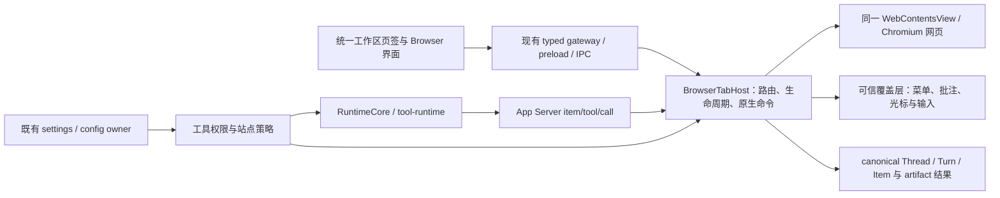

# Codex 会话内置浏览器复刻执行计划

更新时间：2026-10-22

状态：完整复刻实施中；本次完整产品尚未验收。2026-08-23 的 P1-P4 Completed 仅表示下半部分记录的历史纵切，不表示 Codex Browser 已完整复刻。

## 2026-10-22 目标、阶段与本轮交付

主目标：完整复刻用户截图中的 **Codex 会话内置浏览器**，覆盖 UI/UX、真实网页、浏览器设置与管理子页、网站兼容性、页面生命周期、Agent 同页操作及权限。交付单位是完整用户行为，不能用相似工具栏、空菜单或单测通过代替。

当前阶段：E0/E1/E2/E4/E7 实施。统一工作区 canonical 标签、真实新标签网址入口、设置持久化与 Host 策略已落代码；正在接可信原生菜单、设备工具栏与用户浏览历史。密码/扩展集成和完整平台证据继续是退出条件。

本轮认领写集：root 负责本文件、工作区 localState/coordinator/HostRuntime context、统一标签与 Browser chrome、Electron IPC/catalog/AppServerHost 最小配置及身份桥、独立 browserChrome 五语资源与 bundledNamespaceParts、build-host 第二窄 preload 构建、App.tsx 已有导航的 context provider、types/page 与 settings sections/layout 的 Browser 子页接线；native worker 负责 BrowserTabHost/EmbeddedBrowserHost 拆分、命令、原生 overlay/preload、历史 Host 接线；settings worker 负责 core config/browser、Config.browser 机械字段、App Server 可编辑根 browser、Browser 设置及 settings.json、纯类型与 BrowserHistoryStore。已脏 main/通用 preload、WorkspaceRightSurfaceHostRuntime、文件预览、agent.json、架构、总执行计划、.gitignore 保持只读避让。未修改或重置其他进程文件。

大文件例外：core/config/types.rs 仅添加 browser 字段/default，不追加业务逻辑；新逻辑全部落 config/browser.rs。AppServerHost 仅添加独立 Browser 配置/identity helper 的生命周期接线，不追加 Browser 业务；退出条件是本切片定向测试、类型和 contracts 通过，后续不据此继续堆逻辑。BrowserTabHost 先抽命令/解析与状态 helper，再扩能力；仍须继续按职责拆分。

用户本轮的完整范围覆盖旧路线图冻结的 P6 能力；旧冻结不能作为排除批注、设备视口、历史、设置、扩展和 WebMCP 的理由。Lime 保留主题、多模型、首页 Banner；Browser 的结构与行为按证据对齐。

## 参考身份、证据与限制

| 来源          | 确认内容                                                                                                                                             | 边界                                                                                                                                                                                                   |
| ------------- | ---------------------------------------------------------------------------------------------------------------------------------------------------- | ------------------------------------------------------------------------------------------------------------------------------------------------------------------------------------------------------ |
| 用户 U1/U2    | Browser 与 Files/Changes 共用顶部工作区页签；单独导航行、居中地址；新标签工具/推荐；真实网页标题/favicon/批注/扩展/更多                              | 原图均为 2560×1294；未提供 DPR、版本、窗口逻辑尺寸，不能直接把物理像素当 CSS px                                                                                                                        |
| 用户 U3/U4/U5 | 更多菜单顺序；扩展菜单与空态；批注说明和 `Shift+Cmd+.`                                                                                               | 截图证明可见状态，不证明点击后的执行结果                                                                                                                                                               |
| 用户 U6       | 完整 Browser 设置与所有可见分组                                                                                                                      | 原图 2556×2072；开关是用户当前状态，不等于产品缺省值                                                                                                                                                   |
| 指定安装包    | `/Applications/ChatGPT.app` 的 bundle id 为 `com.openai.codex`；版本 `26.1007.30912`，build `20156`                                                  | 文件名不能用来判断产品为 Atlas；截图未给版本，暂未发现与此包的已证实冲突                                                                                                                               |
| ASAR          | 567757587 bytes；SHA-256 `75e397e2280dde93b70a85aa926f4282c728eacc84dfeb15ba7fb6ddd84628af`                                                          | 只读静态取证，没有运行参考应用                                                                                                                                                                         |
| 首轮 REA      | `ev_9d9999a19dcf0fac061fd9da551ba5e22949938a34485eff13a04ce201b304ad`；summary `ev_379625af5f8534d83c92484b79e0c856b045cf433ba1e5fab9d3e455704b15f4` | 仅 Browser 主组件与 registration/chrome 三文件，130605 bytes、44863 AST nodes、0 parse failure；语义图 partial，100000-node ceiling                                                                    |
| 补充 REA      | `ev_e216c618a8a2bb330a20c57070b7b35734a966e96cb0b1700ca44be9beb2386b`                                                                                | options、tweaks、comment popup、clear-data、input、BrowserUseSettings 六文件；349885 bytes、102195 AST nodes、0 parse failure；语义图 partial，options/comment 达 parent result budget；不覆盖整个应用 |

本地材料：`reference/`、`full-ui-input/`、`settings-policy-source/`、各自 manifest、完整 REA JSON/summary、`user-reference/manifest.json` 与六张用户图。U1/U2 仅存右侧工作区裁剪，未复制无关聊天。每个提取成员均核对 ASAR integrity SHA-256。后续三份 settings-policy 与 main 函数体属于静态源码读取，不能算入前述九文件 REA 图。

这些新材料目录被现有 `.gitignore` 忽略，属于本地可复核材料；**本文件内的决策、引用、矩阵才是已纳入版本管理的事实记录**。本轮不夹写已脏的 ignore 文件。此前新建的同名日期计划只保留指向本文件的导航，不作为第二份 active 计划。

参考应用的 Computer Use 访问已被工具拒绝，本轮不绕过。Lime 自己的 Electron 42.3.3 空白 profile 探针退出 139，stderr 为 macOS MachPort rendezvous `Permission denied (1100)`，启动未完成；不能据此判断 WebMCP 或 Chromium 管理页支持与否。该失败与参考应用访问拒绝分别记录。

## 建议宿主方案

采用 **现有 Electron Chromium + WebContentsView + React 浏览器界面 + 可信原生覆盖层**。保持 BrowserTabHost 唯一 owner，用户和 Agent 使用同一 WebContents；浏览器是会话工作区的一种页面，不另建业务 runtime。



1. **标签归属**：一个 canonical browserTabId 对应一个顶部工作区 tab。移除 BrowserWorkspace 内部第二层 tab strip；新标签页复用已有 workspace-new-tab 入口，输入网址后替换对应新标签，不按 `kind=browser` 去重。网页标题、favicon、loading、音频、Agent busy 来自 Host projection。
2. **网页执行体**：现有 WCV 继续承载真实网页；cookie、DOM、滚动、iframe、登录态和 Agent 操作共享同一页面。BrowserTabHost 从约 2000 行中拆出生命周期/恢复、原生命令、页面操作和策略职责，先拆再扩，不新增同义 backend。
3. **覆盖层**：WCV 位于原生层，普通 DOM `z-index` 不能解决菜单和批注遮挡。拟由现有窗口 Host 管理只加载可信本地 UI 的 overlay WebContentsView，普通浮层按实际区域布局，批注时覆盖页面；负责绘制与输入，状态回交同一 owner。其点击穿透、外点关闭、焦点/IME、窗口缩放/DPR、临时操作网页和无障碍是 E0 必须验证的事项，失败时先调整宿主方案。
4. **参考实现差异**：Codex 实际使用 renderer electron-webview，且有私有 `_createWebViewAdoptionLease`、`createWebViewTransfer`、`adoptWebContents`。stock webview 不公开这些接口；只换 HTML 标签无法复刻采用 child WebContents 和跨窗转移。WCV 公开支持采用既有 WebContents 和窗口 View 重挂，是本方案保留它的依据，仍须实测 opener/OAuth 与焦点。
5. **登录与隔离**：参考包使用应用级 `persist:codex-browser-app`；Lime 继续应用级持久 Browser partition。会话隔离由 thread/session/tab/owner identity 实现，不把它误做成每会话一套 Cookie。网页登录与站点数据归同一 Browser profile；Agent 跨会话访问仍受 route 与策略限制。
6. **生命周期**：显式表达 cold、live-attached、live-detached、suspended，呈现与存活分离。持久化身份、URL、标题/favicon、导航 entries/currentIndex/pageState；恢复页面不恢复 debugger、claim、审批 token 或 pending mutation。后台资源预算保护当前、Agent 活跃、音视频/录制、下载和恢复页；参考值为 32 个 detached renderer、最近 30 分钟会话选中页保护，先作为对齐基线，再验证资源占用。
7. **Popup**：保留同会话前台/后台新 tab、opener 与来源 tab 相邻插入。用 `setWindowOpenHandler.createWindow` 与 WCV 采用能力验证 OAuth/child 流程，替换当前把 popup URL 导航到原 tab 的行为。
8. **配置与权限**：普通偏好接既有 settings owner；Agent 浏览/上传/下载/history/WebMCP/CDP 策略归 canonical config 与 tool-runtime。Electron 只持有原生资源、站点权限回调和短期执行校验，Renderer 不缓存另一套审批决定。不能照搬上游多个偏好文件形成 Lime 的第二份配置 authority。

以上不能声称 Codex 使用 WCV。2026-10-22 root 已按窄写集仅同步 `internal/aiprompts/architecture.md` 第45节 Browser 图、配置/历史 owner 与有界审批，并确认实际实现依赖方向；并行文件预览领域未改。原生 Profile 服务在图中保留待实现边，架构同步不代表完整产品验收。

### 原生服务路线补充

参考包的实际 runtime 为 Owl/Chromium **155.0.8059.40**，SCM `cfaadc5a132d78e1828635aa8405a499f3e14864-refs/branch-heads/8059@{#936}`；根与 Framework plist、`owl-electron-app.json` 一致。ASAR 的 `electron42.3.0` 是开发依赖，不能用它代替运行时身份。限定包内搜索未取得 Owl 源码/补丁，不能声称可直接复建参考引擎。

完整密码/联系人 Autofill/资料导入/扩展选择**单一锁定源码与补丁的 Electron/Chromium 引擎集成**，保留 BrowserTabHost、WCV、可信覆盖层、同一持久 Profile 和 canonical Agent 主链。公开 Electron API 继续承接导航、用户历史、下载和权限；不以脚本填充、CSV 或 unpacked extension 子集结算完整原生服务。

可复核研究为 `artifacts/codex-in-app-browser-20261022/native-services-route.md`。工程包依次为 N0 固定公开 Electron v42.3.3 的 commit/DEPS/toolchain 并编译基线与最窄绑定；N1 同一 Profile 的版本化服务绑定；N2 PasswordManager/Autofill；N3 受授权资料导入；N4 扩展安装/权限/toolbar/更新/恢复；N5 现有 Forge 的 electronZipDir 固定 archive 与签名资源链；N6 darwin-arm64、darwin-x64、win32-x64 的原生与 UI/UX 联合验收。当前未改变核心引擎依赖，N0–N6 实现为0%，本机 E0 不替代另外平台。

N0 已锁定 Electron commit `22bbbc9f265d4b6f138f6dc7451891241037a780`（v42.3.3 tag object `d3e88b6b4728b3682cc4c59e80ffc9c41d1cd41e`，unsigned），其 DEPS 的 Chromium 148.0.7778.218 对应 commit `e1d853ded38ac7d1c5a4c83f3e30dfbf76b10c34`。`n0-source/source-lock.json` SHA-256 为 `040c896592de1061c8135458a77f5f2b0ad1c5405444ca8b5c93a419deaab3fb`，48份成功源码/元数据与28个片段的哈希复算通过。源码明确 `ElectronBrowserContext` 继承 `content::BrowserContext`，现有 Electron 补丁使 Chrome ProfileSelections 返回空；不能直接链接依赖 Chrome Profile 的密码 factory。正式路线是在同一 BrowserContext 生命周期内提供 Chromium component 的 embedder client/driver/service adapter。

N0 最小 capability binding 候选补丁仅完成 `git apply --check`，四项服务均为 false，未应用、未编译、未进入产品。当前 PATH 缺 gclient/gn/ninja/autoninja/siso，五个已检查 depot_tools 常见路径不存在；active developer dir 仅 CommandLineTools，`xcodebuild -version` exit1，`/Applications/Xcode*.app` 无匹配。CLT SDK26.2/build25C56 与上游指定 build25C58 的兼容性未验证。可用空间约78.46GiB，完整递归源码/DEPS/缓存预算未核；无编译尝试，不把候选补丁适配或源码研究计作 N0 通过。

N0 工具链补证（仅研究）：已核定 Clang `llvmorg-23-init-5669-g8a0be0bc-4`、Rust `6f54d591…` subrev7、GN/Ninja/Siso 三平台9个 CIPD 实例与 in-tree depot_tools commit。官方 Mac 参考为 Xcode26.3(17C529)/SDK26.2(25C58)/Metal17C519；精简 Xcode 属需认证及许可证流程的内部包，不能当作公开下载。本轮额外读取301,667 bytes，34个新增文件hash、2个生成产物hash、48个来源/行范围复核通过；原 source-lock hash 未变。`n0-source/toolchain-metadata/` 仅补部分 metadata，仍缺完整递归 DEPS/patch/toolchain lock、外部 bootstrap revision、受支持 Xcode、baseline/candidate 实际编译运行。Linux 同 revision 至少100GB源码空间与50–80GB构建空间仅作参考，Mac 完整预算未知；本机空余78.46GiB是取证快照。没有安装、hook、工具包或源码树下载，N0仍未通过，原生能力实现仍0%。

## 原生能力可行性与开工门槛 E0

| 能力                                           | 当前证据                                                                                                               | 实施决定与 E0 退出条件                                                                                                                                                                              |
| ---------------------------------------------- | ---------------------------------------------------------------------------------------------------------------------- | --------------------------------------------------------------------------------------------------------------------------------------------------------------------------------------------------- |
| 页面、打印、截图、查找、缩放、device emulation | stock 有 WebContents/CDP 原语                                                                                          | 复用并验证页面聚焦下的快捷键、打印取消/失败、视口缩放和高 DPI                                                                                                                                       |
| 导航栈与窗口转移                               | stock 有 navigationHistory.restore、WCV 采用与 View 重挂                                                               | 实测完整前后导航栈、popup/opener、隐藏/恢复、跨窗与 crash；不以 reload 代替恢复                                                                                                                     |
| 完整 UI 覆盖层                                 | WCV 需独立可信原生 presentation                                                                                        | 最小真实页面上完成菜单、批注、输入法、外点关闭、临时交互、DPR 与焦点恢复，再实现整套 UI                                                                                                             |
| 下载与浏览历史                                 | stock 有 DownloadItem，无参考包的完整 history 服务                                                                     | 扩展既有下载 owner；由 committed navigation 建 Browser 历史库，与 App Server thread 历史、单 tab 导航栈分开。暂停/恢复/取消、非覆盖命名和真实落盘全部验收                                           |
| 网站权限与清理                                 | stock 有 permission handlers、storage/cache/cookies 原语                                                               | 自有 origin 权限记录和 prompt，补 OS 权限续接；清理同时覆盖应用历史/权限/表单库。不能强转上游 history/formData/siteSettings/timeRange 参数假装支持                                                  |
| 密码与联系人自动填充                           | Codex 使用 chrome://password-manager 与 addresses/contactInfo，及私有密码命令；stock 无同等公开 API                    | **独立原生工作包**：密码保存/生成/管理、表单识别/建议/填充、站点绑定、系统凭证加密与重启恢复逐项实现；仅 safeStorage 加列表页不足以等价。原生集成路线在 E0 确认                                     |
| Cookie/密码/资料导入                           | Codex 有 session.browserProfileImporter，stock 无该接口                                                                | macOS/Windows 分别验证显式导入、系统授权、加密资料迁移、失败与取消；CSV 只算一种输入，不能冒充完整浏览器 profile 导入                                                                               |
| 完整扩展                                       | stock 可 loadExtension，但公共说明不支持完整 Chrome 扩展 API/直接 CRX 安装；参考包另有 toolbar/action/pin/管理原生接口 | **独立原生工作包**：商店安装/更新、权限、MV3/background、toolbar/popup/pinning、重启恢复分别验证。只有解包加载不能结算此项                                                                          |
| WebMCP                                         | 参考代码经 WebMCP.enable、frame target、isolated world 与 modelContext；仓库 CDP 类型已有该 domain                     | 本地 Electron 42.3.3/Chromium 148 在安全 localhost + WebMCP Blink flag 下有 navigator.modelContext，真实 registerTool 成功；WebMCP.enable 不存在。DOM 注册不等于工具发现/执行闭环，产品启动尚未启用 |
| 完整 CDP                                       | stock 有 debugger.sendCommand；参考功能还受站点、能力与设置控制                                                        | 实现会话范围 target/frame 校验及工具授权；关闭后高权限命令不可达。参考完整命令门禁调用链仍需补证，不由一个 toggle 推断                                                                              |

推荐先沿 current Electron 验证。若完整扩展生态、原生密码/Autofill 与 profile 导入无法用公共接口等价实现，路线升级为 **同一 Electron/Chromium 发行版中的原生集成或定制**，仍使用相同 Host 与业务链。这个成本属于完整范围；不能靠隐藏入口、固定不支持或外部 Chrome fallback 把它消掉。E0 未通过前不承诺普通 Electron 足以全部完成，也不直接安装/升级依赖。

## 完整行为映射与差距

下表是本次范围账本，不表示均已实现。offset 为原始 JS UTF-16 半开区间；压缩符号仅用作定位，不作为源码命名事实。

| 组                     | 参考模块 / 可确认入口                                                                        | Lime current owner、差距与退出条件                                                                                                                                                                                  |
| ---------------------- | -------------------------------------------------------------------------------------------- | ------------------------------------------------------------------------------------------------------------------------------------------------------------------------------------------------------------------- |
| B01 工作区/标签        | tab-content `Bl 126726:128308`；initial `zfa 5479273:5482957`                                | RightSurfaceTabStrip + threadSidePanelTabs + hydration；修复 browser 按 kind 去重，移除内层页签；新建/选择/关闭/恢复/复制/重命名/静音/跨窗动作有真实效果                                                            |
| B02 新标签与布局       | 用户 U1；thread-side-panel-new-tab；shared `oHi 6881011+`                                    | 统一新标签工具、推荐与网址入口；左右停靠、全宽、会话/Browser resize 不丢页面；推荐使用当前 profile 数据，不写死截图里的 Google 卡片                                                                                 |
| B03 地址与建议         | tab-content `77400:79100`、`100490:101070`；input `d 244:9578`；shared `jNi 6696278:6696705` | BrowserNavigationBar 草稿待整合；完整 URL/域名展示、站点信息、历史/搜索建议、键盘选择/行内补全/删除、IME、粘贴光标、草稿恢复、同 URL reload；空输入不导航                                                           |
| B04 导航/find/zoom     | tab-content `hc 36646:43184`、`Oc 46297:50463`；main focused-page command                    | gateway/EmbeddedBrowserHost；页内焦点下原生快捷键、匹配计数/前后查找、缩放百分比/重置/临时浮条、加载/失败/重试一致；刷新与停止切换细节待补证                                                                        |
| B05 完整更多菜单       | 用户 U3；options `Xs 148187:160490`                                                          | 按截图顺序：查找、打印、缩放、Device toolbar、截图、导入、密码与自动填充、下载、历史、清理、设置；全部接可用 action/submenu、禁用与错误反馈                                                                         |
| B06 设备视口           | options `ii 31201:45295`；tab-content `zc 50738:63452`                                       | Host CDP + Browser viewport；预设/响应式宽高/旋转/缩放适配/边角拖动/新标签偏好；区分页面缩放、设备 scale、DPR 与 overlay 坐标                                                                                       |
| B07 批注/设计修改      | 用户 U5；tweaks `ye 4563:8693`、`Ue 20588:31589`；comment popup `ke 761:20287`               | 浏览器 annotation presentation → 既有 Composer/附件提交 owner；元素和区域选择、评论编辑/设计调整、标记显隐、批量发送、未发送丢弃确认、空格临时操作网页、可移动工具条、快捷键；加入当前会话后可继续定位对应页面      |
| B08 截图与附件         | tweaks `ke 11178:13090`；Host pageAssets/context-menu                                        | 同一页截图→受控 artifact/剪贴板/Composer；元素上下文、图片附件与拖拽；发送失败保留批注草稿，图像随截图偏好与模型媒体能力处理，不丢失上下文                                                                          |
| B09 网站权限/站点信息  | options `yr 17352:24618`、`Ja 93652:98381`；main fje/PermissionPrompts                       | embeddedBrowserPermissions + App Server authority；普通用户浏览无 active turn 也有 prompt；requesting/embedding origin、允许/本次/拒绝、OS 权限、证书错误、失效 prompt 与导航 generation 绑定                       |
| B10 下载/上传          | options `Vo 110769:114928`；clear-data 文件含下载操作；main Xwe                              | embeddedBrowserDownloads + artifact owner；下载产品操作与历史，原生 file chooser/multiple/accept/drop、Agent 来源附件与审批分别验收；当前受控 artifact upload 不代表完整网页上传已支持                              |
| B11 扩展               | 用户 U4；options `Rs 136987:146308`；main toolbar/action API                                 | Host 原生集成 + 设置；数量、空态、固定/隐藏、popup/action、管理、商店、加载/失败与卸载；扩展 sidebar 等参考明确不支持的分支保持同义反馈，不能擅自新增支持宣称                                                       |
| B12 历史/数据/自动填充 | clear-data `Xe 20822:25023`；BrowserUseSettings；main importer/password API                  | Browser profile 领域能力；搜索/删除历史、清理类型/时段/数量、密码/联系人/导入/填充、下载记录与实际文件存在性；设置不是空壳入口                                                                                      |
| B13 生命周期/网站行为  | main PageHostLifecycle `1922503+`、restore `1929999+`、popup `1883383+`                      | BrowserTabHost/EmbeddedBrowserHost；导航恢复、挂起/保活/预算、popup/OAuth、窗口转移、crash/reload、redirect/frame/外部协议统一导航 policy                                                                           |
| B14 Agent 同页控制     | main IAB backend `1745606:1785807`                                                           | current dynamic tools + tool-runtime；补 actionability/稳定节点、等待/重试、scroll/hover/drag/select、iframe/dialog、viewport/full screenshot、用户可见光标与 arrival 同步；保留用户接管、stale 拒绝、turn 终态清理 |
| B15 完整设置与通用 UX  | BrowserUseSettings `da 62742:63691`；下表                                                    | 既有 settings/插件或 capability owner；五语言、主题、ARIA/键盘、modal inert、reduced-motion、焦点/错误恢复；总开关真正影响工具与执行，子页更改即时消费并可恢复                                                      |

## 浏览器设置逐项合同

设置入口从 Browser 更多菜单转入应用 Settings 的 Browser 页面，并支持返回原会话原 tab。Codex 路由 `/settings/browser-use`，子页含 downloads/history/extensions/contact-info/passwords/site-settings；Lime 路由接既有设置导航，不开另一套设置应用。

参考 `browser-use-settings-dd15aad57b40.js`：`fa 63691:66960`、`pa 66960:71966`、`ma/ha/ga/_a/va 71966:74765`、`Sa 76062:78018`、`Ca 78018:79004`、`Ta 79625:80791`、`Ea 80791:81853`、`Oa 82474:85975`。

| ID  | 控件/入口               | 有证据的状态语义与 Lime 验收                                                                                                                                                                     |
| --- | ----------------------- | ------------------------------------------------------------------------------------------------------------------------------------------------------------------------------------------------ |
| S01 | 浏览器总开关            | 参考是 Browser 插件 installed/enabled owner，不是 Renderer 本地布尔；Lime 接 current capability 启停与设置 owner，关闭后不可发起新的 Agent Browser 操作，已有页面处置补证后定案，不擅自清 Cookie |
| S02 | 网页 URL 和链接打开位置 | in-app-browser / external-browser；Desktop 有效默认 external-browser：显式配置优先，其次 rollout。验证聊天链接等全部入口，PR 链接已有代码审阅专门规则继续消费同一配置                            |
| S03 | 本地 URL 打开位置       | 同两值，schema 默认 in-app-browser；localhost/回环/开发端口正确判定，与网页链接偏好分别生效                                                                                                      |
| S04 | 显示完整网址            | 默认 false；闲置显示规则与编辑完整地址分开，切换后所有 Browser tab 一致                                                                                                                          |
| S05 | 浏览数据→清除           | 打开类型/时段/数量预览与进度/错误对话框；清理 Cookie/站点数据、cache、history、download history 等对应真实 store，删除记录与删除文件语义分开                                                     |
| S06 | 浏览历史→管理           | 用户自己的搜索、打开、删除、清空；不受“Agent 是否能读取历史”开关冒充替代                                                                                                                         |
| S07 | 批注截图                | always / necessary；默认 always。参考文案为始终包含/仅拖选时包含，但静态消费只改变单个非 element 的裁剪请求；element/text 仍尝试采集，Composer 仅按 screenshot 是否存在附图。不能把标签解释为必要模式关闭元素截图；详见下方合同精化                                                                          |
| S08 | 密码管理器              | 添加/编辑/删除/生成/保存/建议填充、origin 绑定、系统安全存储；原生集成 E0 未收口                                                                                                                 |
| S09 | 联系信息                | 地址/电话/email 管理、建议与表单填充；与密码库职责分开，完整 Autofill 链验证                                                                                                                     |
| S10 | 扩展程序管理器          | 安装/移除/配置/权限/更新/重启加载、toolbar 联动；完整生态 E0 未收口                                                                                                                              |
| S11 | 下载位置                | 默认系统 Downloads，平台 API 获取；更改/重置持久化，文件名不覆盖，路径失败可恢复                                                                                                                 |
| S12 | 下载前询问保存位置      | 默认 false；启用后原生保存对话框、取消、Agent 下载 grant 与命名约束正确                                                                                                                          |
| S13 | 下载历史记录→管理       | 查看/搜索/暂停/恢复/取消/打开/定位/清记录、文件失效提示；完成态由 DownloadItem 事实驱动                                                                                                          |
| S14 | 网站设置→管理           | 摄像头/麦克风等 origin 权限、清理/撤销与 OS 状态；用户网站权限和 Agent 操作授权是不同维度                                                                                                        |
| S15 | Agent 历史访问权限      | alwaysAsk / neverAsk / disabled，缺省 alwaysAsk；tool-runtime 执行消费，禁用后不返回历史；有策略限制时呈现原因                                                                                   |
| S16 | 启用站点工具            | WebMCP 未配置时按 enabled=true，但受能力/策略控制；发现、schema、读写性质、使用记录与 canonical 工具生命周期打通                                                                                 |
| S17 | 智能体权限矩阵          | 网站/模式例外＋默认；不只截图可见的 Browsing/Downloads，还包括 Uploads、Debug/CDP、Site tools（水平分页/能力可见）；添加/编辑/移除、版本冲突与失败回滚都有行为                                   |
| S18 | 完整 CDP 访问           | 参考缺省 false；截图打开是用户状态。local host/capability/站点策略均生效，权限作用于会话范围命令，不开放远程调试端口；不据此推断存在 DevTools UI                                                 |
| S19 | 导入 Cookie 和密码      | 菜单和设置常规区共用一个导入流程；profile 发现、显式选择、系统授权、类型选择、进度、冲突/失败/取消，导入后实际网页登录/填充可用                                                                  |

参考持久化区别：普通配置通过 settings.write；showFullUrl 为 persisted-atom；截图/下载偏好为 global-state；原生权限偏好另存 codexHome/browser/config.toml。Lime 只复刻行为，由既有配置 owner 定 schema/存储，不能照上游物理文件再造 authority。

策略参考：settings-plugin-controls 中 history `ht 8916:14133`、WebMCP `ct 5422:7093`、CDP `et 1812:4557`；site-permissions `Mt 15362:15455`、`Zt 23176:28271`。默认/站点例外覆盖 access/downloads/uploads/full_cdp_access；策略受限时呈现 loading/error/unsupported/locked 的真实分支。持久 neverAsk 与既有一次性 allow_once 合同存在差距，须在 tool-runtime 策略层扩展并验证撤销，不把用户偏好冒充一次性 token。

## UI/UX 状态故事板与交互验收

| 状态           | 必须出现的界面与转换                                                                                                 |
| -------------- | -------------------------------------------------------------------------------------------------------------------- |
| 新标签         | 与 Files/Changes 同层的 New tab；下方一行导航＋居中搜索/URL；工具与真实推荐；输入后原位成为网页 tab                  |
| 地址编辑       | Cmd/Ctrl+L 从网页焦点进入，完整 URL 左对齐、选区与 IME 正确；建议键盘导航；Esc 恢复；提交后页面焦点按来源处理        |
| 正常网页       | 紧凑前后/刷新/批注、居中站点、右侧扩展/更多；标题/favicon/live 状态更新；缩窄/全宽/切 tab 不重载                     |
| 菜单/子菜单    | 按 U3/U4 的顺序、分隔、对齐与空态；覆盖真实网页且不被遮挡；箭头/Enter/Esc/外点、嵌套菜单和焦点恢复可用               |
| 批注           | 元素 hover 高亮→选择/评论或拖选→浮动编辑→加入 Composer/批量发送；撤销/关闭提示、截图偏好、网页临时交互和滚动跟随正确 |
| 设备工具栏     | 开关、预设、宽高/旋转/适配、拖动边角；视口变化同步页面与覆盖层，退出还原偏好                                         |
| 权限/上传/下载 | 真实来源和可用动作；用户浏览与 Agent 审批分别走对应 owner；完成/取消/拒绝/错误均有终态与可恢复入口                   |
| 设置/管理      | 按 U6 的分组密度和层级；菜单进入对应子页，返回原 tab；更改消费、失败回滚、重启恢复与策略锁定可见                     |
| Agent 工作     | 可见同页操作/光标、状态和接管；用户操作立即优先，旧节点/审批失效；停止/断连/切窗口后无悬挂控制                       |
| 失败与恢复     | 空白、loading、DNS/TLS、crash、挂起唤醒、无权限、文件失效与 Host unavailable 分开；保留原 URL/草稿且提供实际重试动作 |

视觉标定：以六张用户图作为结构与可见状态基线，再从实际样式/窗口逻辑尺寸确定高度、间距、圆角、图标尺寸、地址最大宽度和浮层位置；记录证据来源。浅/深/系统与 skin 走语义 token。先完成上述完整状态板和 click-through 行为，再进行真实页面截图对照；不拿一张静态 mockup 作为 UI/UX 已完成证据。

## 实施顺序、写集与删除项

| 阶段                   | 产出与 owner                                                                            | 退出条件                                                                                          |
| ---------------------- | --------------------------------------------------------------------------------------- | ------------------------------------------------------------------------------------------------- |
| E0 能力与结构定案      | 原生 overlay、popup/opener、导航恢复、引擎密码/导入/扩展、WebMCP probe；完整状态板      | 每个未知有运行结果或明确原生集成工作包；宿主架构图确认，设置/权限 schema 明确；环境失败不算不支持 |
| E1 页面生命周期        | BrowserTabHost 拆分、EmbeddedBrowserHost、持久化/预算、导航 policy                      | cold/live/suspended、恢复、前后台 popup/登录、窗口与终态清理真实通过                              |
| E2 统一工作区与 chrome | threadSidePanelTabs、RightSurfaceTabStrip、BrowserWorkspace、地址/建议/find/zoom/新标签 | 内层 tab strip 删除；多 Browser 顶部 tab、一一 canonical identity、原生快捷键及完整基础状态板通过 |
| E3 批注/设备/上下文    | Browser annotation/overlay、Composer/附件 current owner                                 | 元素/区域/截图/设计修改/批量提交与 device 整体闭环，原生层不遮挡                                  |
| E4 权限/文件/历史      | 既有 permissions/download/artifact + config/tool-runtime                                | 用户权限、Agent 站点矩阵、下载/上传、历史/清理所有操作真实可用                                    |
| E5 原生浏览器服务      | E0 确定的单一 Electron/Chromium 集成，密码/联系人/导入/扩展                             | 完整能力与设置子页可用；不以解包扩展或 CSV 子集代替全部                                           |
| E6 Agent/WebMCP/CDP    | existing dynamic tools、App Server protocol、tool-runtime                               | actionability/frames/光标/接管、工具发现、权限配置与执行门禁闭合                                  |
| E7 全部设置与验收      | Browser Settings presentation、五语/主题/平台证据                                       | S01-S19 全接线，下列 G01-G12 全通过；旧布局、重复状态、过期 fixture/护栏同步迁移                  |

预计需要协调的热区：main/preload/IPC、WorkspaceRightSurfaceHostRuntime、Composer 批注提交、五语资源、App Server schema/client/catalog 与架构。每刀只认领精确文件，不覆盖并行文件预览工作。不因当前热区不可写而额外造一套浏览器入口。

删除/替换目标：BrowserWorkspace 内层页签、按 browser kind 单例的显示路径、popup 覆盖原 tab 的路径、只显示状态却无操作的旧权限/下载替代 UI，以及与新行为冲突的测试/fixture。现有 current Host、identity、审批、artifact 与有效安全回归直接迁移；本轮不恢复任何旧 BrowserSession/Canvas/MCP/外部 Chrome owner。

## 完整产品 Verification Contract

- 风险：major / 跨 GUI、Electron、协议、权限与持久化。已有产品代码与切片验证，完整 G01-G12 尚未结算；每刀记录 affected owner/命令/失败终态。
- 业务链：GUI → preload/IPC → BrowserTabHost；Agent → App Server JSON-RPC → RuntimeCore/tool-runtime → item/tool/call → 同一 Host；结果归 canonical projection/artifact。
- 审批：普通网站权限、Agent origin 权限、危险动作、history、上传/下载、WebMCP/CDP 分别有可追踪决策；导航/关闭/接管/取消撤销旧 callback/snapshot/token。
- 确定性测试：导航/选择/恢复/资源预算、配置优先级、origin 匹配、actionability、失败回滚；真实多 frame/下载/上传/OAuth fixture。测试风险行为，不镜像实现形状。
- 协议变更同步 Host/preload、JSON-RPC schema/client、gateway/catalog/fixture，运行 `npm run test:contracts`；主路径运行 current fixture、GUI smoke、对应 Browser Gate B 与 `verify:local`。
- Gate A 证明 Renderer/UI，Gate B 必须经过真实 Electron/preload/IPC/App Server/runtime/read model，保留同一 thread/tab/WebContents join。原生服务另补实际文件/系统对话框/扩展证据；live/packaged/平台分账。

| ID  | 完整验收组                                           | 最低证据                                                                         |
| --- | ---------------------------------------------------- | -------------------------------------------------------------------------------- |
| G01 | 统一页签/新标签/导航/地址建议/快捷键                 | Gate A + 网页实际聚焦下的 Electron Gate B                                        |
| G02 | 菜单、子菜单、find、zoom、打印、截图、native overlay | 真实网页遮挡/焦点/取消/失败与视觉对照                                            |
| G03 | 元素/区域批注、设计修改、Composer 与附件提交         | 同页/同 thread 闭环，成功与发送失败保留草稿                                      |
| G04 | device viewport/DPR/resize/旋转/临时交互             | 真页面、输入坐标与覆盖层一致                                                     |
| G05 | Cookie/登录、前后台 popup、OAuth/opener              | 受控跨 origin fixture + 已授权真实站点；不读取现有私人账号资料来代替测试         |
| G06 | 用户站点权限、OS 权限、Agent 默认/例外与撤销         | 无 active turn 的用户浏览 + canonical Agent approval，两者都有拒绝/允许/失效证据 |
| G07 | 下载/上传、历史/清理与 artifact                      | 文件真实完成/多选/取消/恢复、清理语义与路径控制，macOS/Windows                   |
| G08 | 密码/联系人自动填充与导入                            | 系统凭证存储、表单实际填充、迁移/失败/取消/重启，macOS/Windows                   |
| G09 | 完整扩展安装/更新/权限/toolbar/popup/管理            | 实际扩展生态矩阵、重启恢复与失败场景；不能只有 0 扩展空态                        |
| G10 | Agent actionability/frames/光标/接管/WebMCP/CDP      | 同一 WebContents 的完整工作流，站点策略与关闭设置后执行不可达                    |
| G11 | 冷恢复/后台预算/挂起/跨窗/crash/断连/turn 终态       | 真实进程边界、身份/导航栈恢复与零残留控制                                        |
| G12 | S01-S19 设置、五语言/主题/键盘/无障碍/平台           | 每控件真实消费与重启恢复、全部状态视觉矩阵、macOS/Windows packaged               |

完成口径：G01-G12 是本次完整验收分母，目前 **0/12 已完成本次完整验收（0%）**，不表示现有 Browser 没有基础能力。历史 Gate B 只复用其明确通过的子断言；86 个草稿定向测试不能代替上述完整验收。不对未执行的 live provider、参考实机动画、Windows 或 packaged 行为作通过声明。

当前分类：current＝canonical identity、同一 BrowserTabHost/EmbeddedBrowserHost、dynamic tool/审批/artifact、统一顶部 Browser 标签、真实地址入口、配置与历史 Store；实施中＝可信菜单/设备/历史 UI 的整链验证；compat＝不新增；已替换＝Browser 内层页签、按 browser kind 单例去重、popup 覆盖 opener 原页；dead＝生产 mock、第二 Browser runtime、旧外部 CDP fallback/Canvas/BrowserSession owner。缺少的密码/联系人/导入/完整扩展仍是本次范围，未通过隐藏入口消账。

当前未决：原生 overlay 的物理输入/焦点与整屏视觉证据；原生密码/Autofill/profile 导入与扩展的实际引擎集成；WebMCP 产品发现/执行；完整 CDP 最终门禁；参考未显示的动画/拖拽阈值。总开关当前关闭新 Agent 控制，已有页面可供用户继续浏览；browse ask 的真实连续审批已通过本地 Electron 切片，异步导航续接及 history/site_tools/full_cdp 尚未全部执行消费。架构第45节已同步并由root确认已实现依赖方向，完整目标仍未验收。

2026-10-22 验证记录（本次实施）：

- 批注合同精化：`artifacts/codex-in-app-browser-20261022/browser-annotation-contract.md` 记录截图采集、裁剪、附件 lowering 与 Design Tweaks 的逐分支合同；ASAR及成员integrity复核通过。offset为Python字符串字符索引，不冒充UTF-16或字节位置。参考文案与静态分支存在差异，参考App运行仍未观察。element两种设置均尝试viewport采集；region/text在necessary时请求裁剪；virtual复用预采集；edit保留原图；多选和10条compact阈值独立。Design Tweaks为可撤销CSS/text/站点controls预览及结构化请求，发送后才由Agent修改源码；本轮未实现G03。
- 历史普通设置入口：新增只读`settingsReturnLocation`与延迟canonical session查询，菜单owner路径继续原流程。真实Electron复验发现cwd-only current session不会返回旧workspace_id，原严格比较误拒绝；已改为按明确保存的workspace ID查询，并核验返回ID、rootPath与canonical working_dir；显式非空workspace冲突仍拒绝，保存的null不猜默认工作区。绝对路径比较保留POSIX大小写、Windows仅规范盘符；拒绝相对路径、`..`与不同路径族。导航/hook/path identity共117项、Renderer类型、scoped lint与格式通过，真实Electron修复后待复验。完全无session入口仍不计完成。root夹具写集为history场景、独立history-navigation helper及主入口最小workspaceId接线；关联`getProject`一秒缓存的已观察workspace/read来源，不注入旧metadata。两次失败分别保留，第一次menu后无Browser的故障未证实原因，不能用第二次workspace误拒绝反推。
- 待办与挂载确认：PendingRuntime隔离scope/enabled lifetime、list乱序、通知及consume/dismiss ACK之前的快照；workspace列表保持既有语义，Browser只向当前session投影/消费，foreign请求留队，同workspace A→B→A拒绝旧callback/ACK。新增27条组件回归，含既有unit共49/49通过。root移除Browser前台/手动打开的提前消费，在当前launch ACK后只消费对应request ID；历史只读投影激活后确认展示。5条新回归先红，修复后相关5文件67/67通过，scoped lint通过；真实Electron待复验。该可构造竞态不等于首次menu故障因果已证实。
- 待办范围续修：最新真实history复验仍在menu重开后无Browser，独立失败证据`.lime/qc/browser-history-settings-ack-20261022/history-summary-failure.json`保留，console/page error为0。静态定位到history foreground只保存workspaceId、root=null，而旧list把当前workspaceId与root同时作为AND条件；已改为ID优先、无ID才root、最后session fallback。新增history恢复及通知同ID/null-root、不同ID同root拒绝回归，先红后绿共51/51通过，服务端未改。失败诊断新增现有全程trace collector快照、header session/project、workspaceRoot与ID-only只读pending查询；原失败ring缺少早期root，未把推断写为该次已观察事实。Host对无launchUrl的展示/历史请求也转发ACK，已有网页不因纯展示导航到默认页；3项新回归先红，修复后相关4文件32/32通过。root窄写集扩至HostRuntime接线及BrowserWorkspace的导航条件和对应测试，不触碰Composer或文件预览业务。
- 历史恢复收口：修复后两次独立真实Electron均exit0、23/23，通过menu与普通设置两个入口、新canonical tab/native view/标题URL提交、同runtime session/thread/workspace、真实thread/read与workspace/read、visit落盘、单删、清理取消/确认；console/page errors与mock fallback均0。证据分别为`.lime/qc/browser-history-settings-scope-20261022/history-summary.json`、`.lime/qc/browser-history-settings-scope-recheck-20261022/history-summary.json`，两次workspaceReadSource均`history-open`。proofLevel保持`Desktop Host/history`，不冒充Agent历史读取、冷恢复、完整清数据或G07验收。最终Pending/Coordinator/Host/Workspace/Panel共6文件83/83与fixture13/13通过，scoped lint/格式/语法/空白检查通过；一次误用node --test运行Vitest文件仅是runner错误，已用实际Vitest入口exit0。
- 默认门禁续跑：原Node23.4在第74/143批因缺`node:module.registerHooks`失败（此前73批通过）；用本机已安装Node25，原失败2文件14项全部通过。后续第75批遇到Node25默认WebStorage覆盖jsdom的环境冲突；使用仅当前子进程的`NODE_OPTIONS=--no-webstorage`继续同一批次，不修改系统Node或依赖。原143批最后一批的旧inactive断言已迁为保留同一Workspace并委托active控制原生可见性；续跑连同新增测试共144/144批passed，`.lime/test/vitest-smart-last-run.json`状态为passed。i18n、fullsrc lint、renderer/node类型、contracts与治理检查和Rust changed-scope均通过；随后GUI构建时本轮开始写G03，守卫报`Renderer build inputs changed during compilation`，该次默认门禁最终exit1，不记绿。待生产写集冻结后重跑GUI及必要续验，不无差别重复144批。日志`/tmp/lime-browser-verify-local-ack-resume-20261022.log`。
- ACK修复的真实回归：lifecycle场景exit0、25/25，证据`.lime/qc/browser-history-launch-lifecycle-20261022/summary.json`；受影响current fixture的`gui-coding-input`场景exit0，覆盖Browser打开/切换/恢复/关闭及现有Changes/terminal/recents，证据`.lime/qc/gui-evidence/code-artifact-workbench-electron-fixture/browser-launch-ack-coding-input-20261022-summary.json`。既有其余current场景证据仅复用原边界，不扩大为本次完整产品验收。
- 设置视觉核验：隔离真实Electron的`.lime/qc/browser-settings-visual-20261022/settings-top.png`、`settings-bottom.png`已与用户U6实际查看对照。当前缺S05清数据、S08密码、S09联系信息、S10扩展管理、S13下载历史、S14网站设置、S19导入；常规区历史行顺序也与参考不同。行高、留白、侧栏占比仍需同逻辑尺寸/DPR对照，U6长图不能直接作CSS像素基准。Lime粉色skin属于允许保留的主题差异，不能解释缺失功能或结算S01-S19。截图采集成功，临时probe进程清理尚待确认，不计独立通过门禁。
- S05合同收口：`browser-clear-data-contract.md`与`browser-clear-data-ui-seams.md`记录六类、五时段、默认lastHour/前四类、lastMonth=28天、policy锁定及pending阻止关闭。cookie站点与cache摘要是当前总量，非选定时段删除估计。参考main把timeRange交给私有clearData；锁定stock Electron42的C++只做全时段清理，未知类型静默跳过，不能强转timeRange或以Promise resolve结算。完整时段清理纳入原生绑定，当前不增加误删全时段的设置入口。独立视觉probe已只终止其确认属于本轮的node进程，最终exit137；截图仍可核验，但不记脚本exit0。
- G03补证修正：`browser-annotation-implementation-seams.md`已闭合初次start、follow-up/steer及实际`thread/queue/add/update`的Browser text/image lowering；rich commentAttachments留在Desktop恢复/展示上下文。按typed草稿+单一lowerer复用既有UserInput与acceptance，不预设扩runtime wire；rich落盘/跨设备/历史完整回显仍unknown。第一个生产窗口已解冻：native worker负责新选择/截图Host、page preload、共享types与原Host窄委托；settings worker负责可信Composer editor/html/vite及独立五语分片；host worker负责可信editor Host/preload和Overlay唯一presentation owner协调；root负责窄gateway/IPC/catalog、BrowserWorkspace/chrome、Browser草稿/lowerer与既有Inputbar提交接线。通用文件预览批注实现只读，SceneRuntime和Inputbar只加独立Browser接线，不改文件owner。
- G03首刀生产接线：新增受限page preload、Host权威选区/截图、可信React Composer编辑器、独立窄preload及六个typed命令。单工具支持元素点击和超过4 CSS px拖动升级区域；capture使用Host保存选区，必要模式只影响区域裁剪，失败保留正文。Desktop草稿按session/thread隔离，单lowerer把截图加入实际composerSubmission.attachments；成功仅消费捕获revision，失败/新编辑保留。导航/换tab/卸载关闭先撤权，仍接最后可信正文flush，精确editorId/generation防旧回调关闭后继浮层。native关联85/85、最终owned34/34、editor28/28与资源15/15、可信Host/preload/menu40/40通过；root发送/Workspace/chrome28/28、接线生命周期7/7通过。尚未build或真实G03 Electron，不计G03完成；空主Composer发送接线及真实fixture仍在实施。架构第45节已同步并由root确认。

- REA 补充 summary `ev_b6fde85b3b1de15d42602e0177adcc7bb21d9a44b4539a991d1ce78b0de6a8a8` 的 application/semantic coverage 为 partial。六张用户图已归档，设置截图是 S01-S19 验收基线；截图状态不当成默认值。
- 原生 E0：`artifacts/codex-in-app-browser-20261022/e0-native-20261022-061222/manifest.json` 保存探针与摘要。stock 无参考私有密码/importer/history/extension toolbar API；指定 chrome:// 页面 ERR_INVALID_URL；flag 下 WebMCP DOM 注册成功、私有 CDP domain 缺失。两个真实 WCV 定向 sendInputEvent 和 outside dismiss 成功，物理 OS 命中及恢复焦点未证；BrowserWindow.capturePage 未捕获 child WCV，PNG 不能充当合成视觉证据。未运行参考 App。
- 设置：UI/search 55 tests、core 5 tests、App Server `browser_preferences_persist_with_cas` 1/1 通过，涵盖真磁盘、旧版本冲突和非法策略拒绝。裸 cargo 的 V8 404 已由仓库 resolveRustyV8CargoEnv 消除，无依赖改动。
- 统一工作区与 Host：projection、LocalState owner 失效/首次接管、AppServer bridge/popup、导航/IME/草稿及单 Browser presenter 回归通过。最近 chrome/Host 定向 4 files / 26 tests 通过；新标签含非法端口 11/11。此前 native 8 files / 73 tests、菜单原语 19/19 通过，后续接线仍需最终整合复验。
- 用户历史 Store 29/29 通过，含真磁盘重启、并发、cursor 失效、范围清理、预算、原子失败/损坏 fail-closed 和 Windows rename 短重试；不等于实际导航接线已验收。
- `npm run test:contracts` exit0。`npm run verify:gui-smoke` exit0，证据 `.lime/qc/project-gates/standalone-shell-01-20261022060524-97843/shell-01-electron-smoke/summary.json`；仅 shell 证明，且后续代码仍在改动，不能结算 G01-G12。
- `smoke:agent-runtime-current-fixture`：history/stream/message/guard、unknown Item、home hotpath 通过，Coding Workbench 因编辑期间 artifacts stale 中止；最终稳定后按 current fixture 续验，不记整套通过。
- 当前 Renderer 类型必须用 tsconfig.renderer.json；一次误用总 tsconfig.json 纳入历史测试文件，产生既有测试类型错误，不将此结果解释为生产 Renderer 失败。后续按正式 typecheck 验证。
- 续验：迁移 Gate A 的统一页签 session 属性与侧栏 toggle 选择器后，真实 Electron projection 16/16 通过；保留 Gate A 等级，不代替同页 Agent Gate B。lifecycle Gate B 在用户导航后的 reclaim/observe 超时，已把等待纳入现有失败诊断，待定位实际工具响应，不能记通过。
- 续验前冻结切片：原生聚合 15 files / 127 tests、菜单 hook/设备栏/设置/gateway/catalog/fixture 6 files / 57 tests、Workspace/历史页/资源/layout/HostRuntime 5 files / 86 tests 通过。最新 shell smoke 证据为 `.lime/qc/project-gates/standalone-shell-01-20261022064332-48871/shell-01-electron-smoke/summary.json`；生产 overlay E0 在 `artifacts/codex-in-app-browser-20261022/e0-production-overlay-20261022-063405/manifest.json`，证明窄 sandbox preload、typed IPC、原位缩放与焦点控件保留、Esc/外点/stale generation，未证明物理 OS 焦点或完整 App Server 链。
- 下一刀权限写集：root 认领 `agent/current_provider_turn/dynamic_tool_bridge.rs` 与独立集成测试；settings worker 认领 `electron/appServerDynamicToolHost.ts`、独立调用阶段 owner 与测试。目标为同一 canonical call 有界多阶段审批（最多4次、新 token、参数冻结、拒绝重放和迟到响应），支撑浏览许可后独立危险动作审批。native worker 先只写独立 E0 目录验证 webRequest 暂停/跨 origin/POST 保留，生产 grant/异步审批入口尚未实现。当前 `browse:ask` 尚未闭环，不能把设置保存或 deny 生效当成 ask 已生效。
- 多阶段切片：Rust `lime-agent --lib dynamic_tool_bridge` 6/6 通过，包含真实 session actor 的两次独立审批/第二次拒绝/重复 token/第5阶段上限/非 Browser namespace 拒绝；Electron Host 40/40 通过，调用参数冻结与逐阶段 token 校验下沉 `dynamicToolCalls.ts`，终态/reset 使旧 attempt 失效。沿用既有 wire 字段，无新增 IPC/protocol 字段；首次 Rust 测试自身事件关闭竞争已修为等待 task result，不放宽生产断言。
- 请求暂停 E0：`artifacts/codex-in-app-browser-20261022/e0-webrequest-permission-20261022-064925/README.md`，14/14、Electron exit0。302/307/308 跨 origin mainFrame 在目标收到请求前再过 onBeforeRequest；保留 callback 后允许恰好一次，307/308 保留 POST 77bytes 与 Content-Type，302 POST 正常转 GET；拒绝/模拟撤销后0目标请求、迟到 allow 无效。只证明本地 HTTP 差端口/mainFrame 原语，未证明 canonical 异步审批或 GUI Gate B。
- 原生权限切片写集扩大为 `browserTabPolicy.ts`、独立 `browserPermissions*.ts` 与测试，两个 Host 只委托接线，测试 harness 显式 browse allow；生产缺省仍 ask。当前 mainFrame 导航门禁覆盖主页面与 popup，CDN/图片/脚本等 subresource 不以顶层站点 grant 逐个阻断；跨 origin frame 的 Agent 读取仍待独立门禁，不能把它宣称已受完整策略约束。异步导航暂拒绝未授权目标，不重放 loadURL 或建立独立原生审批，完整暂停续接仍未完成。
- 菜单快捷键切片：`browserOverlayHost` 原生覆盖层 focus 下复用有限 page-command parser，关闭/cleanup/恢复原页面焦点后按原 viewId 发命令；22/22 tests、Electron 类型与 scoped lint 通过。无 callback、过期 generation、普通文本/IME/Esc 继续原路径。Host 接线待随权限切片整合复验。
- root 扩展既有巨型 Browser Gate B 入口时只做场景接线/selector/失败诊断，新增浏览审批与历史业务放独立脚本；退出条件为定向 fixture tests 与真实场景通过。browse-approval 将验证初始 claim 无提前控制/debugger、站点策略变更撤销 grant，以及同一 click call 的 browse→action 两次独立 canonical 审批；尚未执行不得记通过。

- 权限返回竞态补齐：observe/screenshot 在异步 CDP 返回前再次核验 control 与精确 origin grant；阻塞内容 Promise→设置撤销→释放响应的两项回归均拒绝内容返回。原生权限切片合计8files/71tests、Electron类型与scoped lint通过，生产缺省保持ask。菜单原生快捷键接线另2项回归通过。
- fixture初始化修复：Config.browser 为缺省时会被Rust序列化省略，fixture显式合并ask baseline；普通生命周期显式browse allow，download/artifact显式download allow，不改变生产缺省。此前setup的undefined失败已定位为夹具缺陷。
- 真实lifecycle续验仍失败：等待原生加载终态后，初次claim/observe与用户同tab导航通过，但provider发出导航后的openTabs后没有后续model请求；未得到reclaim结果。失败诊断已改为只保留状态/工具摘要并单独落盘，避免页面正文挤掉错误。当前证据 `.lime/qc/gui-evidence/browser-runtime-electron-gate-b/browser-runtime-electron-gate-b-summary-failure.json`，不能记Gate B通过。测试页已迁至独立localhost真实HTTP owner，不依赖example.com；等待native commit不放宽stale/control断言。
- 历史真实场景由独立 `browser-runtime-electron-gate-b-history.mjs` 承接并已接入口：受控页面真实导航、菜单进入历史、搜索、单删、清理取消/确认与IPC/只读磁盘revision核对；尚未执行。设置worker写集扩大到history UI/五语/独立全局导航context+hook、App最小provider、菜单canonical owner与SettingsPageParams及分组保留。仅菜单来源具备可靠canonical owner；直接全局设置无owner不能伪造thread，仍属产品缺口。
- 最新 `npm run test:contracts` exit0，Browser Gate B fixture定向13/13、独立localhost页面2/2 HTTP200、脚本scoped lint与语法通过。一次renderer构建因并行编辑被freshness守卫拒绝，未进入产品；不标记该次Gate通过。架构窄写集扩至第45节并由root确认已实现边界；原生服务仍为明确待实现边。
- browse-approval 真实 Electron 续验 exit0，24项断言通过，证据 `.lime/qc/gui-evidence/browser-runtime-electron-gate-b/browser-runtime-electron-gate-b-browse-approval-summary.json`。首次claim批准前无控制/debugger；站点策略CAS变更撤销原grant；同一canonical click call先browse再action，两阶段独立token/card；批准恰好一次mutation，拒绝下一动作无mutation；同一Thread/Turn/Tab/WCV完成并释放debugger，真实IPC且mock命中0。仅为本地HTTP/可控provider fixture切片，不结算完整G06/G10。
- lifecycle失败根因已明确：renderer导航等命令复用native physical takeover helper，导致地址导航/zoom/print/mute/device扩大为整turn interrupt。HEAD原合同为renderer release-only，native物理输入interrupt。参考静态navigate及zoom完整JS链未见turn interrupt，但未运行参考App，不能排除其他通知；本轮按最小回归恢复Lime已有区别，不迁fixture接受意外中断。
- 历史设置闭环冻结：真实canonical owner建tab/返回原会话、导航守卫拒绝不留pendingNavigation、失败/过期清理tab与foreground请求、打开与清理互斥。历史UI23、历史导航24（含真实useAppNavigation late dirty集成）、导航owner21、菜单/layout/Workspace56、五语10，合计134项通过；Renderer类型、scoped lint、格式、fixture语法与import通过。history fixture已追加真实点击重开/新tab/native commit/IPC+disk新增visit再返回历史，尚待实际运行；全局设置无canonical owner仍明确是产品缺口。
- 导航回归已修复并冻结：抽出共享release-only helper，renderer命令撤销grant并释放控制，native物理接管继续emit并请求canonical interrupt。导航/zoom/print/reload/mute同turn reclaim与device回归、既有native interrupt共4files/43tests通过，Electron类型/scoped lint/diffcheck通过。真实lifecycle重新执行exit0、25项断言通过：同tab/WCV用户导航、旧snapshot拒绝、同turn reclaim/fresh observe、canonical完成释放和原生销毁闭环，证据 `browser-runtime-electron-gate-b-summary.json`。
- history真实Electron执行exit0、20项断言通过，证据 `browser-runtime-electron-gate-b-history-summary.json` 与4张截图。localhost两页native commit→真实菜单→标题/URL搜索→点击新建canonical tab→同thread/browserSession不同WCV且真实preload mount→新增visit落盘→菜单返回→单删→清理确认取消不改revision→确认后IPC/disk一致，mock命中0。此项是Desktop/history切片，不冒充Agent历史访问或完整S05清数据。
- native user-control真实Electron续验exit0：原生输入通路撤销pending action并interrupt，迟到approval token不能重放；fixture通过sendInputEvent进入原生网页事件，不等于OS物理操作证明。与地址栏release-only场景分别保留，证据 `browser-runtime-electron-gate-b-user-control-summary.json`。fixture定向13/13与脚本目录治理通过。
- current fixture续验发现旧双层Browser标签和完整地址显示假设：root窄写集新增 `scripts/electron/lib/right-surface-lifecycle-gate-b{,.test}.mjs`，迁到顶部canonical tab、真实新标签地址与Host URL projection，保留同Thread/WCV、双tab、切换恢复、关闭primary不复活全部断言；oracle新增多Browser中选择非首项回归，36/36及scoped lint通过。相邻website fixture仅改完整URL等待为Host projection，保留并行文件预览selector改动。修复后 `gui-coding-input` 真实Electron exit0，Right Surface lifecycle、terminal、recents和website入口均通过。聚合前已通过history/stream/message/guard、unknown Item与两种home hotpath；余18个Electron场景待按原入口参数续跑，不重复已通过阶段。
- `npm run verify:local` 本轮exit1：版本一致性、五语言资源结构通过（8404 source keys，missing/extra=0），停在i18n unused检查29项。分类为browserChrome动态key的静态引用不可识别、历史时段和保存错误动态key、另有未用clearData资源；尚未运行后续lint/typecheck/全量test/Rust/GUI。正在修正实际引用并清理未用资源，不给scanner加白名单。
- i18n续修完成：四组件改完整key引用/有限映射，删除确实未用clearData；unused=0、65项定向、Renderer类型/scoped lint通过。默认门禁随后通过全src lint，硬编码扫描仅报device的DPR正文，已接五语dprLabel，显示保持DPR；该文件scan=0、device/resources19项通过、unused=0（8404 keys）。未改scanner或保护白名单。`npm run typecheck`（正式renderer+node两项目）exit0。默认门禁再次从入口执行中，未提前记整套通过。
- GUI shell最新 `npm run verify:gui-smoke` exit0，证据 `.lime/qc/project-gates/standalone-shell-01-20261022081402-79362/shell-01-electron-smoke/summary.json`，只证明壳/重载/3种viewport，不代替完整视觉矩阵。
- current fixture余18个Electron场景按原入口参数分段续跑全部exit0，包括图片/自然意图、stop后继续、四类approval、draft恢复、steer、plan hydrate、Skills/MCP/media/Expert、typed error与article workspace。续跑记录 `.lime/qc/browser-current-fixture-resume/{plan,summary}.json`，与此前4个Electron场景合为22/22；原聚合首次退出1后的Coding场景已单独修复通过，没有把首次入口退出码改写成0。其非Electron定向组已在原聚合通过，仍属于controlled provider/backend fixture，不是live provider或完整Browser验收。

### 后续可实施切片：全局历史与网页批注

全局历史无owner时的只读结论：`useAppNavigation.settingsReturn` 已保存明确的返回Agent session/workspace，但当前未暴露给历史；可由 `sessionClient.getAgentRuntimeSession` 读取并验证真实 `id/thread_id/workspace` 后复用现有 Browser gateway。完全无会话则需一次性URL intent进入已挂载Agent的 `ensureBrowserWorkspaceOwner` / `useAgentSession.createFreshSession` / canonical hydration，不能在设置侧复制模型/provider/access/workspace选择或把sessionId当threadId。当前参考静态history点击能证明有上下文回原conversation、否则走全局in-app-browser bridge；没有证据证明后者如何选择Thread/workspace。全局无owner重开仍未实现，不删除完整范围。

G03静态取证补齐（不是运行证据）：参考 `browser-page-preload.js` SHA-256 `6844ec68a38171555a8dbdd97c1bfb524e358edff60e0146fd77073694dbb515`，416300–419800为frame/viewport坐标、492400–501100为trusted pointer元素/拖框选择（4px阈值）、510300–511700为截图ready；`src-CP7XXlpZ.js` SHA-256 `79623d50989f9efbcb8e5752c56b3cc608a0f5993c05112e03e11b718ac7a586` 的51000–54800包装结构化Browser context/comment/screenshot；`app-primary-6f60e9ac4103.js` SHA-256 `7fe9c00b03cb1de3ebc3a4bf298fc44b13a7fe67ca9cc335a9e2ecda969a1321` 的1191400–1193000过滤conversation/tab并以editor session去重，1333900–1344100经既有submitTarget发送与失败fallback。main 1578981–1585300打开可信editor、1590500–1598000保存/direct、1606800–1615500截图；popup的11000–14200发送body/attachedImages/designChange/crop请求。以上成员完整性已核对，REA覆盖仍partial。

G03工程方向：继续由 `BrowserOverlayHost` 管唯一可信原生overlay生命周期，新增可信React批注编辑入口；受限page preload只负责元素/区域选择、只读marker与截图ready，不向网页提供Composer/App Server能力。独立Browser annotation owner绑定session/thread/tab/window/WCV/pageRevision/editor session/selection revision，反查sender与origin，异步截图前后重新核验；navigate/viewport/Agent接管使旧操作失效。截图采用prepare→ready→capture→clear，失败保留正文。保存/直接发送和主Composer附件复用 `ComposerController`、`createComposerSubmissionSettlement`、既有InputbarSendHandler，不把Browser伪装成有path/sourceSha256的文件批注，也不夹写并行artifact owner。先实现元素/拖框/浮卡/保存/direct/附件预览，再补文本/多选/Design Tweaks；第一刀通过不能结算完整G03。

G03接缝核对见`artifacts/codex-in-app-browser-20261022/browser-annotation-implementation-seams.md`。参考的start、follow-up/steer与实际queue增改均已确认Browser rich草稿lower为text/image；rich commentAttachments并列留在Desktop恢复/展示上下文。撤回“完整等价必需扩queue/steer metadata/wire”的无证前提，当前按Desktop typed草稿+单lowerer复用现有input/acceptance。菜单presentation不充当可信Composer；首刀已接page/editor固定入口、文档/视口校验及截图握手，真实Electron仍待验证。图片必须进入捕获的composerSubmission.attachments；rich落盘/跨设备/历史回显尚unknown，不通过任意metadata冒充模型上下文或完成证明。

以上只记录已执行切片；完整 Browser Gate B、五语/主题整屏对照与 macOS/Windows packaged 尚未完成，G01-G12 分母继续 0/12。

---

以下为 2026-08-23 同 Tab 纵切历史。完成状态、写集、命令和“100%”均只针对当时范围；新的完整复刻以本文件上半部分为准。

## 历史纵切目标

把 Browser 收敛到唯一 current 主链：用户在 Right Surface 看到的 Electron `WebContentsView`，与 Agent 通过 App Server connection-owned reverse request 操作的页面必须是同一个 native view。外部 Chrome/CDP、Canvas Browser owner、`BrowserSessionRef` adapter 和 `mcp__lime-browser__*` 不再作为内嵌 Browser 的兼容路径。

## 历史纵切事实

```text
Renderer Browser Workspace
  -> Electron Desktop Host host capability（mount / bounds / user chrome）
  -> BrowserTabHost
  -> WebContentsView + webContents.debugger

Agent Browser capability
  -> RuntimeCore / tool-runtime dynamic tool binding
  -> App Server item/tool/call server request
  -> Electron AppServerDynamicToolHost
  -> 同一个 BrowserTabHost route
```

App Server 仍是业务与 turn owner；Electron 只执行原生 WebContents、debugger、权限、下载和窗口宿主能力。Dynamic tool binding 的 connection/thread/turn owner 与 BrowserTabHost 的 session/tab/view identity 必须在每次请求中精确校验。

## 历史纵切写集与避让

### 本轮认领写集

- `internal/exec-plans/browser-runtime-right-surface-plan.md`
- `internal/aiprompts/architecture.md` 末尾独立 Browser owner 小节
- `electron/embeddedBrowserHost.ts` 及后续拆出的 BrowserTabHost/测试
- `electron/appServerHost.ts`、`electron/appServerDynamicToolHost.ts` 及对应测试
- `src/lib/api/embeddedBrowser.ts` 迁移后的 Browser typed gateway 与测试
- `src/components/agent/chat/workspace/right-surface/browser/**`
- Browser 专项 protocol/catalog/fixture/negative guard 文件
- `lime-rs/crates/app-server-protocol/src/protocol/v2/item.rs`、生成 schema/client 与协议测试；原因是
  `item/tool/call` 需要表达 `preflight / approvedExecute` 和 typed approval descriptor。
- `lime-rs/crates/agent/src/current_provider_turn/dynamic_tool_bridge.rs`、
  `tool_executor/orchestration.rs`；原因是 Browser dynamic tool 必须复用 canonical `action_required`
  waiter，批准后恢复同一 dynamic call，不新增 runtime 状态机。
- `lime-rs/crates/app-server/src/dynamic_tool_server_request.rs` 与精确测试；原因是 App Server 负责把
  dynamic-tool phase/token 从 Runtime 事件投影到 connection-owned reverse request。
- `lime-rs/crates/agent/src/agent_tools/catalog.rs`、`inventory.rs` 中仅限
  `BrowserAssist`、`mcp__lime-browser__*`、`lime_site_*` 静态工具面；原因是这些旧 catalog
  仍与 `browser__*` dynamic capability 竞争唯一 Browser owner。验证使用 agent/app-server
  Rust related tests、`npm run test:contracts` 与 legacy guard。
- App Server tool inventory / workspace skill binding 的 `browser_assist` protocol、runtime、typed
  client 与直接测试 consumer；只删除该字段和旧正向断言，不改相邻 AgentControl/CodeCell 行为。

### 只读避让写集

- `lime-rs/crates/agent-runtime/**`
- `lime-rs/crates/agent/**` 除上述两个 Browser dynamic-tool 文件外的现有并行 CodeCell/AgentControl 改动
- `lime-rs/crates/app-server/src/runtime/event_sink.rs`
- `lime-rs/crates/app-server/src/runtime/trace_store*`
- `lime-rs/crates/tool-runtime/src/tool_lifecycle.rs`
- `src/components/input-kit/**`
- 其它未与 Browser 纵切直接相关的用户改动

如必须触碰避让写集，先登记具体文件、函数、原因和验证命令，不覆盖既有改动。

## 删除集

完成迁移后直接删除，不新增 compat wrapper：

- `lime-rs/crates/app-server-protocol/src/protocol/v0/browser_session.rs` 及其 v0 schema/catalog 正向引用。
- `lime-rs/crates/app-server/src/runtime/browser_session.rs` 对外部 CDP 的生产调用。
- `lime-rs/crates/browser-runtime/**` 的内嵌 Browser 主链调用；若无其它 current consumer，物理删除 crate。
- `src/features/browser-runtime/**` 的外部 Chrome/connector Settings 工作台与正向入口。
- `BrowserSessionRef`、`browserSession/*` 的 Renderer current gateway 和 `mcp__lime-browser__*` catalog 正向依赖。
- `CanvasWorkbenchBrowserPanel` 及 Browser 专属 Canvas 子组件；共享的 Host policy 逻辑迁入 Browser Workspace 后删除旧 owner。
- `embedded_browser_view_*` 作为 Browser 产品命令；Plugin 若仍需要 WebContents，迁到独立宿主 owner，不回流 Browser 双轨。

允许出现在负向回流 guard、不可变历史 evidence 和执行计划历史记录中；不得出现在 production method、mock priority、catalog 正向断言或 GUI 主路径。

## 阶段与退出条件

### P0：事实源与 route identity

状态：骨架完成，negative guard 待补。

- [x] 重写本计划和 Browser 路线图。
- [x] 追加架构 owner 图与责任确认。
- [x] 定义 Electron Host `BrowserRoute`、`BrowserTab`、`BrowserTabMark` 边界。
- [x] 明确 `threadId + turnId + windowId + ownerWebContentsId + sessionId + tabId + viewId + webContentsId` 的校验与 stale 行为。
- [x] 将 identity 收敛到 canonical App Server read model，删除旧 `BrowserSessionRef` 输入。
- [x] 为旧 BrowserSession/Canvas/MCP 前缀补 current-owner 负向回流守卫，覆盖 Browser Host、typed gateway、Right Surface 与通用 Agent prompt。

退出条件：协议、dynamic tool binding、Host route、Renderer projection 使用同一 identity；任何只凭 `BrowserSessionRef` 或外部 CDP target 的完成项均失效。

### P1：同一 WebContents 纵切

状态：基础纵切、active-turn identity、native 用户接管、cancel、disconnect、window-close、permission、download 与 renderer termination cleanup Gate B 已通过。

- [x] BrowserTabHost 按稳定 `sessionId/tabId/viewId` 创建或复用 `WebContentsView`。
- [x] App Server `item/tool/call` reverse request 能由 Electron Host 精确路由到该 tab。
- [x] `navigate`、`observe`、`screenshot`、用户后退/刷新与 Agent action 返回同一 identity。
- [x] Host attach debugger 前后校验 owner；destroyed、window mismatch、stale turn 一律 fail closed。
- [x] `turnEnded` 清理 debugger，并按 origin/mark close 或 release。
- [x] 真实 Electron fixture 证明 Renderer mount 与 Agent `openTabs -> claimTab -> observe` 使用相同 `browserSessionId/tabId/threadId/webContentsId`，并绑定同一 active turn。
- [x] Electron Host 断连会 detach debugger，并对 user tab release、Agent tab close；原生 `WebContents` destroyed 会回收 Browser route。
- [x] 真实终止 App Server sidecar 后，pending provider request 取消、user tab release、debugger detach，且 Electron main 不再进入 read-pump 自旋。
- [x] 真实页面调用 geolocation 后，Electron permission handler fail closed，并把 canonical tab identity 与 blocked 状态投影到 viewport 外的 GUI 状态带。
- [x] 真实页面触发下载后，同一 Electron session 产生 `started -> cancelled`，并把 canonical tab identity 与取消终态投影到 viewport 外的 GUI 状态带；fixture 不写入用户下载目录。
- [x] Host current owner 已实现受控 `artifactRef`、artifact/write sidecar 记录、approval-scoped open/reveal/copy、clipboard read/write、permission pending/grant 和 upload preflight；Electron completed-download artifact Gate B 已通过，证据位于 `.lime/qc/gui-evidence/browser-runtime-electron-gate-b/browser-runtime-electron-gate-b-artifact-summary.json`。Gate B fixture 覆盖 download -> artifact/write -> copy ref -> turn grant/evidence；open/reveal/read/write clipboard/upload 仍以 Host 定向单测为边界，未声称 live provider 或跨平台 packaged coverage。
- [x] 真实 Electron fixture 证明用户人工操作后的 Agent observe 和同一 `webContentsId`。
- [x] 用户直接点击/输入 native `WebContentsView` 会立即 detach debugger、撤销 Agent control/snapshot/pending approval token，并使旧 `allow_once` fail closed；Agent 自身 CDP input 不触发人工接管。
- [x] 真实 Electron GUI 停止操作经 `turn/interrupt` 将 read model 投影为 `interrupted`，release 用户 tab 并 detach debugger，同时取消 pending provider response。
- [x] 真实 Electron owner `BrowserWindow` 关闭后，Renderer page、native Browser WebContents 与 Browser route 同步销毁，close event 保留 canonical thread/tab/view identity 和 `window-closed` 原因。

退出条件：真实 Electron 中 Agent navigate/observe 改变用户可见页面，且 `browserSessionId/tabId/webContentsId` 全部相等；不是普通 Chrome、browser mirror 或 mock 证据。

### P2：Right Surface Browser Workspace

状态：组件骨架、原生状态带、五语言真实 Electron 生命周期截图与状态矩阵已通过；Gate A/Gate B 证据边界已记录。

- [x] 用稳定 tab identity mount Right Surface，不再使用 React `useId()` 生成产品 view identity。
- [x] 独立 Browser Workspace 承担 tab strip、chrome、viewport、权限/下载/接管状态。
- [x] 用户切换、收起、恢复、resize 只改变同一 view 的 bounds/visibility，不重建页面。
- [x] 五语言文案已补齐，Browser component test 已覆盖基础 DOM identity。
- [x] permission/download/load-failed 只接受当前选中 native tab 的完整 identity；状态带位于 native viewport 外，`ResizeObserver` 同步下移 WebContents bounds。
- [x] 独立 Browser Gate A projection 场景已覆盖首屏 mount、同 tab 导航、查找、缩放、新建/选择/关闭 tab、收起/恢复、桌面视口 resize、canonical session/thread 投影和横向溢出；证据标记为 Gate A，不替代 Gate B。
- [x] `verify:gui-smoke` 与五语言 Gate B 截图矩阵复核无第二右栏、无系统浏览器或布局重叠；同一 WebContents identity 继续只由 Gate B 证明。

退出条件：Gate A 打开、切换、收起、恢复和 resize 通过，无系统浏览器弹出、第二右栏、Canvas 镜像或重复 WebContents。

### P3：旧链清退、Agent Browser API 与安全

状态：已完成；Browser identity、stale-control、active-turn、native 用户接管、permission/download Host 投影、native lifecycle cleanup、Browser action approval、artifact/grant 与旧链物理清退均已收口。

- [x] Dynamic Browser capability 以稳定对象语义暴露 tabs/open/claim/release/navigate/observe/screenshot/mark。
- [x] 空白 Claw 任务打开 Browser 前先建立 canonical runtime session/thread；owner 申请失败显示明确错误，不再永久显示 loading。
- [x] App Server 校验 `runtimeSessionId -> canonical threadId`，拒绝跨 session 或伪造 Browser identity。
- [x] Browser action 校验 `pageRevision + snapshotId`，页面导航或动作后使旧 snapshot 失效。
- [x] 重建 protocol schema/generated client，删除 `browserSession/*`、外部 CDP Settings 和旧 fixture；当前协议只保留 canonical BrowserRoute/BrowserTab。
- [x] 删除 `BrowserSessionRef`、Canvas Browser owner 与 `mcp__lime-browser__*` 正向依赖；保留负向回流守卫和历史 evidence。
- [ ] DOM snapshot 使用稳定 node identity；click/fill/press/select 只对 actionability 通过的目标执行。
- [x] 普通读取/导航自动执行；危险 click、敏感 fill 与 Enter 提交进入 canonical action approval，批准后恢复原 action，拒绝不执行 mutation。
- [x] Browser dynamic tool 已进入 `agent/current_provider_turn` + `tool-runtime` 的通用 execution approval lifecycle；Electron 关键词/敏感字段 heuristic 只生成 fail-closed preflight 风险事实，不保存用户决策或建立第二套审批状态机。
- [x] action-time 风险覆盖已扩展到 upload、download completed、permission grant、artifact open/reveal/copy 与 clipboard；一次性 approval、turn-scoped grant/evidence 和 route identity 已进入 Host。任意脚本执行不在 current Browser dynamic tool catalog，继续 fail closed。上传/permission/open/reveal/clipboard 的行为证据由 Host 单测覆盖，artifact completed-download/copy 的真实 Electron Gate B 证据已落盘。
- [x] 用户人工操作后 Agent observe 能继续读取同一 tab，不创建新 session。
- [x] native 用户输入优先于 pending approval：旧 snapshot/token 同时失效，Host 不允许延迟到达的 `approvedExecute` 重放页面 mutation。

#### P3 action approval 两阶段合同

```text
dynamic tool call
  -> item/tool/call(phase=preflight)
  -> completed | approval descriptor
  -> canonical action_required(toolFamily=browser_action, allow_once/decline/cancel)
  -> item/tool/call(phase=approvedExecute, one-time approvalToken)
  -> completed | failed closed
```

- `DynamicToolCallParams.phase` 只允许 `preflight / approvedExecute`；第二阶段必须携带 Host 在第一阶段生成的
  一次性 opaque token。
- approval descriptor 只携带 action kind、reason、risk class、tab/snapshot/node lineage 和 token；普通 tool
  content 不承担控制协议解析。
- Rust `agent/current_provider_turn` 是审批等待与 resume owner；`tool-runtime::execution_approval` 生成
  `browser_action` projection，固定 `session_cache_supported=false`，因此只允许
  `allow_once / decline / cancel`。
- Electron 只做风险 preflight 和 token/identity/snapshot 校验。批准执行必须匹配原
  `thread/turn/call/tool/tab/view/WebContents/snapshot/backendNode`，token 消费一次；stale、重放、跨 tab 或跨
  snapshot 一律 fail closed。
- decline 不发第二阶段 mutation；cancel 继续使用 canonical turn/action cancellation。Browser Host 不保存用户
  决策，不把风险动作改成 `human_takeover` 后再假装完成。

退出条件：至少一个真实网页工作流完成 observe、导航、用户操作、Agent observe 和 evidence join；旧 MCP Browser 工具不再是 current owner。

### P4：Evidence、恢复与清退

状态：已完成；历史只读投影、五语言 Gate B 证据与旧链物理清退均已接入并验证。

- [x] action/evidence 关联 thread/turn/session/tab/view/webContents/action identity：Host grant/result 已写入该 identity；真实 Electron artifact Gate B 已证明 artifact/write sidecar + copy ref 的 route/turn evidence。
- [x] 历史恢复不自动恢复 debugger、claim 或 pending mutation：Browser Host 不持久化 route/debugger/approval；新 Host 实例只接受 Renderer current tab mount，`turnEnded`/disconnect 先清理 pending permission 与 approval。snapshot/replay 的 App Server historical read model 保持唯一恢复入口。
- [x] 删除外部 CDP、Canvas owner、BrowserSessionRef、旧 v0 schema、旧 Settings connector 和 Browser mock 正向路径；物理清理后仅保留负向 guard、历史文档/evidence 与 current identity 字段。
- [x] 负向 guard 阻止旧路径回流；`browserCurrentBoundary.test.ts` 与治理扫描继续把旧 BrowserSession/Canvas/MCP 前缀限制在历史 evidence、compat/deprecated 或负向测试范围。

退出条件：治理扫描无 Browser 分类漂移；断连、窗口关闭、turn cancel 和 stale route 均有可观察终态。

## Gate A / Gate B

### Gate A：投影与布局

使用显式 test-only fixture 或 renderer projection 验证 Right Surface Browser Workspace 的 DOM、chrome、bounds、状态和五语言文案。Gate A 不能证明 Agent 使用同一 WebContents。

### Gate B：真实 Electron 同 tab

必须使用真实 Electron Desktop Host、preload/contextBridge、Electron IPC、`app_server_handle_json_lines`、App Server current turn/tool chain 和用户可见页面，证明：

```text
Agent action.browserSessionId == visible sessionId
Agent action.tabId            == visible tabId
Agent action.webContentsId    == Host visible webContentsId
Agent action.threadId         == canonical threadId
Agent action.turnId           == active turnId
```

证据至少包含 Electron Host route、reverse request id、App Server method、debugger attach/detach、用户人工操作后的 observe，以及 `turnEnded` close/release。普通 Chrome CDP、外部 target、Renderer `data-*`、静态截图、mock bridge 或 external backend 单独通过均不足以标记 Gate B。

2026-08-19 核心 identity Gate B 已通过：`npm run smoke:browser-runtime-electron-gate-b -- --timeout-ms 60000` 启动真实 Electron 与 runtime provider fixture，经 `app_server_handle_json_lines` 建立 current Thread/Turn，完成 `browser__openTabs -> browser__claimTab -> browser__observe -> final assistant` provider round trip。Agent observation 与 GUI 的 `browserSessionId/tabId/threadId/webContentsId` 全等，`viewId/windowId/ownerWebContentsId` 为有效 native identity，turn 以 `completed` 收口，Renderer 地址栏随后通过真实 `browser_tab_navigate` 操作相同 tab；console/page error 为零，生产 mock fallback 命中为零。脱敏证据位于 `.lime/qc/gui-evidence/browser-runtime-electron-gate-b/browser-runtime-electron-gate-b-summary.json`。

同一 fixture 已扩展为 active-turn lifecycle、approval、user-control、cancel、disconnect、window-close、permission、download 与 completed artifact 场景。lifecycle 场景覆盖用户导航后旧 snapshot mutation fail-closed、Agent 重新 claim/observe、terminal release/debugger detach 和真实 renderer-process-gone route cleanup；approval 场景覆盖危险 click 的 `preflight -> action_required -> allow_once -> approvedExecute`，同一 tab/snapshot/action 只执行一次，再以 fresh snapshot 触发第二次审批并拒绝，页面 mutation count 保持为 1；user-control 场景在审批等待中直接点击 native 页面，证明同一 `webContentsId` 上 `controlOwner=user`、`activeTurnId=null`、debugger detached，旧 token 被拒绝；cancel、disconnect、window-close、permission、download 的既有 Gate B 证据继续通过。artifact 场景新增 completed download -> `artifact/write` -> 受控 ref copy、turn-scoped grant/evidence 与 terminal release；open/reveal/clipboard/upload 的 Host 定向单测边界已在 claimBoundary 中明确。

五语言真实 Electron 截图和状态矩阵证据：`.lime/qc/gui-evidence/browser-runtime-electron-gate-b/browser-runtime-locale-matrix-summary.json`。矩阵覆盖 `zh-CN`、`zh-TW`、`en-US`、`ja-JP`、`ko-KR`，每种语言 7 个生命周期截图（renderer-loading/ready、browser-loaded、agent-controlled、user-takeover、released、destroyed），目标 locale 与 `document.documentElement.lang` 逐项相等，行为矩阵引用 approval/artifact/cancel/disconnect/download/permission/user-control/window-close Gate B summary，console/page error 均为空。

## 验证矩阵

| 改动                             | 最低验证                                                       |
| -------------------------------- | -------------------------------------------------------------- |
| Browser protocol/catalog/client  | `npm run test:contracts` + protocol/Rust related tests         |
| Electron BrowserTabHost          | Host unit/integration + `npm run typecheck:electron`           |
| Right Surface Workspace          | Browser component tests + `npm run verify:gui-smoke`（Gate A） |
| Agent dynamic Browser capability | tool/runtime related tests + current Agent fixture             |
| 真实同 tab 闭环                  | Electron Gate B fixture / Playwright identity evidence         |
| legacy 删除                      | `npm run governance:legacy-report` + negative guards           |

每次验证记录实际命令、scenario、identity、terminal/pending 状态和未验证原因；生产路径禁止 mock fallback。

## 架构确认

本计划对应 `internal/roadmap/browser/README.md` 的 P0-P4。责任开发者：root，2026-08-18。确认内容：已复核 Codex Desktop Browser plugin 的 tab cleanup/claiming/safety 合同、Lime App Server connection-owned reverse request、Electron `WebContentsView` Host 与现有 dynamic tool server request；确认内嵌 Browser 唯一执行体为 Electron BrowserTabHost + 同一 `webContents.debugger`，外部 Chrome/CDP、Canvas Browser owner、BrowserSessionRef adapter 与 MCP 前缀不再作为 compat 主链。Gate A 与真实 Electron Gate B 分开取证，未把普通 Chrome、fixture 或 Renderer projection 冒充 Gate B。

## 进度记录

- 2026-08-18：路线图重构完成，确认 Browser 当前综合完成度约 20%；文档和治理校验通过。
- 2026-08-18：完成本执行计划重写和架构确认，下一刀为 BrowserTabHost route identity 与同 WebContents debugger 纵切。
- 2026-08-18：完成 Electron `BrowserTabHost`、`browser__*` dynamic tool reverse request、Right Surface `BrowserWorkspace` 和五语言基础投影；定向 Electron/Renderer 测试与 Electron typecheck 已通过。当前综合完成度约 45%，下一刀为 schema/client 重建与旧 Browser 链物理清退，Gate A/Gate B 尚未标记完成。
- 2026-08-19：定位并修复用户截图中的“正在打开网页”根因：空白 Claw 任务先显示 Right Surface，但 canonical Thread 尚未创建，Browser identity 申请被拒绝，native `WebContentsView` 没有合法 owner。Renderer 现在在打开 Browser 前调用 `ensureSession -> getThreadIdForSubmit -> refreshSessionReadModel`，再申请 App Server Browser identity。
- 2026-08-19：Browser Host 增加 `pageRevision + snapshotId` stale-control；Electron dynamic tool 增加 connection/thread/turn/native owner 校验。`npx vitest run electron/browserTabHost.test.ts electron/appServerDynamicToolHost.test.ts` 通过（10 tests）；`npm run smoke:agent-runtime-current-fixture` 通过；`npm run verify:gui-smoke` 通过。前置 `npm run typecheck`、`npm run test:contracts` 和 Browser/Renderer 定向组件测试已通过。
- 2026-08-19：Rust related 入口执行 1660 个 app-server lib tests，1659 通过、1 个 approval projection 断言失败；失败文件属于并行 approval 改动，不在本轮 Browser 写集。额外按测试名重跑时触发 `v8 150.4.0` macOS arm64 预编译包 404，未形成新的 Browser 结果。
- 2026-08-19：现有 `right-surface-visual-matrix` 在通用 files 面板 geometry 断言处提前失败，且仍携带旧 Canvas/CDP fixture，未进入 Browser；因此不能作为 Gate A/B 结论。当前运行中的旧 Lime 进程未加载本轮改动，9223 CDP 端口也未启用，未中断现有进程。
- 2026-08-19：继续定位 Agent Browser 工具永久 `inProgress`：`dynamic_tool.requested` 未被 App Server `V2NotificationProjector` 接受，事件泵在创建 `item/tool/call` reverse request 前直接跳过。当前将该 typed server-request 生命周期事件投影为空通知，Electron App Server client 增加持续 server-request handler，Host 在初始连接和 sidecar restart 后安装 handler；Host 已消费请求的 `serverRequest/resolved` 不再泄漏为 GUI 协议诊断。Rust projector 精确回归 `1 passed`，App Server client `122 tests` 通过，Electron Host/Gate 定向回归 `29 tests` 通过。
- 2026-08-19：Browser 核心 Gate B 通过。真实 Electron evidence 证明同一 session/tab/thread/turn/WebContents、四次 dynamic tool/provider round trip、用户地址栏导航同 tab、final assistant 可见、turn completed、console/page error 为零；证据已去除整页正文和本机路径。stale snapshot 在用户导航后的重新 claim/observe 与完整 terminal cleanup 仍是下一轮 blocker。
- 2026-08-19：重新执行 `npm run test:contracts`，协议生成无漂移，App Server client、command、harness、modality、scripts、Electron release、cleanup 与 docs boundary 全部通过，命令退出码为 `0`。
- 2026-08-19：重新执行 `npm run verify:gui-smoke`。SHELL-01 真实 Electron summary 的 `21/21` 产品断言全部通过，覆盖启动、reload、preload/IPC、App Server current method、Workbench/Settings、console/page/invoke error 为零、legacy/mock 命中为零；但 evidence 写入后 Electron 主进程未自行退出，launcher 在 120 秒触发 watchdog，命令最终退出码为 `1`。该结果分类为 smoke 生命周期清理缺口，不标记最新 GUI smoke 门禁通过，也不推翻 Browser 专项 Gate B 的独立通过证据。
- 2026-08-19：`npm run smoke:agent-runtime-current-fixture` 的最新运行在既有 `unknown-item` Electron 场景超过声明的 240 秒仍未收口；只清理本轮创建的进程树，未终止其它并行任务。该项记录为 current fixture/harness 阻塞，不能作为 Browser dynamic-tool 回归失败，也不能标记通过。
- 2026-08-19：扩展 `smoke:browser-runtime-electron-gate-b` 为 active-turn 生命周期场景并通过，退出码为 `0`。同一真实 Electron `WebContentsView` 完成初次 Agent observe（pageRevision=3）、用户地址栏导航（同 tab/webContents，controlOwner=user，pageRevision=8）、旧 snapshot mutation fail-closed、重新 claim/observe（新 snapshot、同 tab/webContents），turn `completed` 后用户 tab `released`，debugger 从 attached 变为 detached；24 项 Gate B 断言全部通过，console/page error 为 0。脱敏 evidence 仍位于 `.lime/qc/gui-evidence/browser-runtime-electron-gate-b/browser-runtime-electron-gate-b-summary.json`。
- 2026-08-19：补齐 Electron sidecar disconnect 与 native `WebContents` destroyed 的统一清理：`AppServerHost` 在 stop、sidecar exit、restart failure 和 stale connection 触发 `BrowserTabHost.connectionLost`；user-origin tab release 并 detach debugger，Agent-origin 无 mark tab close；原生 `destroyed` 事件发出 `browser-tab-closed`。`embeddedBrowserHost`、`browserTabHost`、`appServerDynamicToolHost` 定向回归共 32 tests 通过，`npm run typecheck:electron` 与 `git diff --check` 通过。尚未把该单测结果冒充真实 Electron disconnect/window-close Gate B evidence。
- 2026-08-19：真实 Electron Gate B 以 `npm run smoke:browser-runtime-electron-gate-b -- --timeout-ms 60000 --interval-ms 500` 通过（退出码 `0`）。25 项断言全部通过：同一 session/tab/thread/WebContents、用户接管后的 stale snapshot 拒绝与重新 observe、turn release/debugger detach，以及 renderer-process-gone 后 Browser route 关闭；console/page error 为零。证据文件为 `.lime/qc/gui-evidence/browser-runtime-electron-gate-b/browser-runtime-electron-gate-b-summary.json`。该运行验证的是 renderer termination 触发器；`destroyed` 事件路径仍以 Host 单测为准。
- 2026-08-19：补齐取消/失败终态的 fail-closed 边界：`AppServerDynamicToolHost` 仅在 `turn/completed` 携带 `completed/failed/interrupted/canceled/cancelled` 状态时调用 `BrowserTabHost.turnEnded`，缺少状态或仍为 `inProgress` 时不释放 Browser 控制；Electron DynamicTool/Browser/AppServerHost 定向回归 62 tests、`npm run typecheck:electron` 通过。真实 Electron cancel、sidecar disconnect 和 window-close evidence 仍待补。
- 2026-08-19：`smoke:browser-runtime-electron-gate-b -- --scenario cancel` 以真实 Electron 退出码 `0` 通过。GUI 停止按钮经 `safeInvoke -> app_server_handle_json_lines -> turn/interrupt` 取消 active Browser turn；Electron IPC trace 的 thread/turn identity 与 Agent 控制态一致，read model 为 `interrupted`，pending provider response 在完成前关闭且没有续发请求，同一 user tab 保留原 `webContentsId` 并进入 `released`，debugger `attached -> detached`。15 项断言全部通过，console/page/invoke error 与生产 mock fallback 均为零；脱敏证据位于 `.lime/qc/gui-evidence/browser-runtime-electron-gate-b/browser-runtime-electron-gate-b-cancel-summary.json`。Browser/Electron 定向回归 68 tests、`npm run test:contracts` 均通过；默认 `--scenario lifecycle` 随后重跑，25 项断言和真实 Electron 退出码仍为 pass。
- 2026-08-19：`smoke:browser-runtime-electron-gate-b -- --scenario window-close` 真实 Electron 场景通过。Agent 已 claim/observe 同一用户 tab 且 debugger attached 后，fixture 在主进程关闭对应 owner `BrowserWindow`；Renderer page 随之关闭，原生窗口与 Browser WebContents 均不可解析，`BrowserTabHost` 广播 `browser-tab-closed(reason=window-closed)`，其中 thread/tab/view identity 与关闭前 route 一致，provider 无续发请求。12 项断言全部通过，console/page error 为零；脱敏证据位于 `.lime/qc/gui-evidence/browser-runtime-electron-gate-b/browser-runtime-electron-gate-b-window-close-summary.json`。Browser/Electron 定向回归 69 tests 与 `npm run typecheck:electron` 通过。
- 2026-08-19：`smoke:browser-runtime-electron-gate-b -- --scenario disconnect` 真实 Electron 场景通过。根因是 `AppServerConnection` 安装持续 server-request handler 后，sidecar 退出令 transport 立即 reject，而 read pump 在 `finally` 中因 handler 仍存在而无间隔自启，微任务自旋使 Electron main 占满 CPU，并饿死 sidecar restart timer 与 Renderer IPC。connection 现把首个非 timeout transport error 固化为 terminal read 状态，失败现有与后续读取且不再重启 pump；回归测试先在旧实现稳定观察到第二次 read，再于修复后通过。真实 `SIGTERM` 场景 12 项断言全部通过：pending provider response `responseFinished=false`、同一 user tab `released`、debugger `attached -> detached`、无 provider 续发、console/page error 与生产 mock fallback 为零，命令退出码为 `0`。脱敏证据位于 `.lime/qc/gui-evidence/browser-runtime-electron-gate-b/browser-runtime-electron-gate-b-disconnect-summary.json`。App Server client 123 tests、Browser/Electron fixture 36 tests、`npm run typecheck:electron`、`npm run test:contracts`、`npm run governance:scripts` 与 `npm run docs:boundary` 通过；随后 lifecycle 25 项和 window-close 12 项真实 Gate B 回归均以退出码 `0` 通过。`npm run verify:gui-smoke` 的 SHELL-01 真实 Electron summary 与命令退出码均为 pass；`npm run smoke:agent-runtime-current-fixture` 也完整通过，此前挂起的 unknown Item 场景已收口，聚合 fixture 同时覆盖 history/cache、terminal、cancel-then-continue、approval、Skills/MCP/media 与 Coding Workbench，且 `liveProviderUsed=false`。
- 2026-08-19：修复 Browser Host 事件投影的 tab 漂移和 native view 遮挡。Renderer 现在按 session/thread/tab/view/WebContents/owner/window 完整 identity 接受 permission/download/load-failed 事件，切 tab 清除上一 tab 状态；error/permission/download 状态带移到 native viewport 外，bounds observer 让真实 `WebContentsView` 从状态带下方开始。Browser Host 与 Workspace 回归覆盖 canonical identity、selected-tab 过滤、状态带顺序和非 absolute 布局。
- 2026-08-19：`smoke:browser-runtime-electron-gate-b -- --scenario permission` 真实 Electron 场景通过。native page 的 geolocation 调用经 Electron permission handler 返回 `User denied Geolocation`，Host 决策为 `blocked`；事件与 GUI 当前 tab 的 session/thread/tab/view/WebContents/owner/window identity 全等，permission band 底边与 native viewport 顶边对齐，turn 以 `interrupted` 收口。11 项断言全部通过，console/page error 与生产 mock fallback 为零；脱敏证据位于 `.lime/qc/gui-evidence/browser-runtime-electron-gate-b/browser-runtime-electron-gate-b-permission-summary.json`。`navigator.permissions.query` 在 Electron 中仍可能报告 `granted`，不能代替真实 API 调用结果。
- 2026-08-19：`smoke:browser-runtime-electron-gate-b -- --scenario download` 真实 Electron 场景通过。native page 触发 data URL 下载，Electron `will-download` 产生同一 `downloadId` 的 `started -> cancelled`，GUI 当前 tab 显示取消状态且不遮挡 native viewport，evidence 不含 `savePath` 或用户目录，turn 以 `interrupted` 收口。11 项断言全部通过，console/page error 与生产 mock fallback 为零；脱敏证据位于 `.lime/qc/gui-evidence/browser-runtime-electron-gate-b/browser-runtime-electron-gate-b-download-summary.json`。fixture 主动取消下载，故不证明文件落盘、artifact ref、完成后的 open/reveal 或 packaged 跨平台行为。
- 2026-08-19：收尾回归使用最新 Electron 构建全部通过：Browser Host/Workspace/Gate assertion 21 tests，根与 Electron typecheck，`npm run test:contracts`，`npm run smoke:agent-runtime-current-fixture`，`npm run verify:gui-smoke`，lifecycle Gate B 25/25、permission Gate B 11/11、download Gate B 11/11，`npm run governance:scripts`、`npm run docs:boundary` 与全工作树 `git diff --check`。三份 Gate B evidence 的 `proofLevel=Gate B`、`status=pass`、`failedAssertions=[]`；本轮未运行 live provider、Windows/macOS packaged 下载完成、Browser 专项 Gate A 或历史恢复。
- 2026-08-20：确认 dynamic Browser route 在通用 orchestration 前直接返回是审批旁路根因；确认
  `RuntimeSessionInputHandle` 可在前一 waiter resolve 后以同一 call id 顺序注册第二阶段。冻结上述 typed
  `preflight -> action_required -> approvedExecute` 合同，开始实现协议、canonical approval 与 Host 一次性恢复。
- 2026-08-20：Browser action approval 主链与真实 Electron Gate B 安全行为收口。协议/schema/generated client 已表达
  `preflight / approvedExecute / approvalToken / typed approval descriptor`；Rust current provider turn 复用 canonical
  `action_required`，Browser 固定 `allow_once / decline / cancel` 且关闭 session cache；Electron Host 对危险 click、敏感
  fill 与 Enter 做 preflight，并以一次性 token 校验原 thread/turn/call/tool/tab/view/WebContents/snapshot/node 后执行。
  最新 `--scenario approval` 中首次 `allow_once` 后 mutation count 为 1，fresh snapshot 的第二次危险 click 经 GUI
  `decline` 后仍为 1，user tab `released`、debugger detached，console/page/invoke error 与 production mock fallback 均为
  零；此前 canonical turn 曾因并行 read-model 终态投影漂移为 `interrupted`，形成 14/15、退出码 `1` 的中间结果；
  该结果已由后续 15/15 重跑证据取代，未放宽断言，也未覆盖并行 `runtime/read_model.rs` / `runtime/load_context.rs`。
- 2026-08-20：新增 native 用户接管 Gate B。`--scenario user-control` 在 canonical approval 等待期间直接点击同一
  `WebContentsView`，Host 立即 detach debugger、将 `pageRevision 4 -> 5`、`activeTurnId=null`、`controlOwner=user`，
  并清除 snapshot 与 pending token；随后 GUI 的旧 `allow_once` 被拒绝，mutation count 在用户点击后和 stale approval 后
  均为 1。canonical turn 以 `interrupted` 收口，12/12 断言、console/page/invoke error 与 production mock fallback 门禁
  全部通过，退出码 `0`。脱敏 evidence 位于
  `.lime/qc/gui-evidence/browser-runtime-electron-gate-b/browser-runtime-electron-gate-b-user-control-summary.json`。
- 2026-08-20：本轮 Host + Gate assertion 22/22、`npm run typecheck:electron`、`npm run test:contracts`、
  `npm run governance:scripts`、`npm run verify:gui-smoke` 和 lifecycle Gate B 均通过。最新
  `npm run smoke:agent-runtime-current-fixture` 已通过 history/cache、streaming、Electron guard、unknown Item 与 Claw
  首页热路径，但最终在 Coding Workbench recovery 退出 `1`：App Server recovery turn 已为 `completed` 且成功预览可见，
  GUI 未出现 recovery assistant 文本。该并行投影阻塞不在 Browser 写集，不能把聚合门禁标记为全绿。
- 2026-08-20：收口 Browser P0 current-owner negative guard。生产 prompt 不再写入旧
  `mcp__lime-browser__*` 正向工具名，测试 fixture 改用中性的 `mcp__site__*` 命名；新增
  `src/lib/governance/browserCurrentBoundary.test.ts` 扫描 Browser Host、App Server dynamic-tool host、typed gateway、
  Right Surface 与通用 prompt，阻止旧 MCP/Canvas/BrowserSessionRef owner 回流。Browser 相关治理与 prompt 定向测试
  41 项通过，`git diff --check` 通过；protocol/schema/generated client 与历史 fixture 清退仍未完成。
- 2026-08-20：重跑 Browser action approval Gate B。最新并行 read-model 终态投影已稳定为 `completed`，真实 Electron
  `--scenario approval` 15/15 断言、退出码 `0`；首个危险 click 经 `allow_once` 仅执行一次，第二次 fresh snapshot
  经 `decline` 不产生 mutation，tab release、debugger detach、console/page/invoke error 与 production mock fallback
  均通过。证据位于 `.lime/qc/gui-evidence/browser-runtime-electron-gate-b/browser-runtime-electron-gate-b-approval-summary.json`。
- 2026-08-20：修复 Browser Right Surface 收起/恢复时已有 route 被重新导航的问题：`BrowserTabHost` 对已有 tab remount
  只恢复 native view bounds/visibility，不再次传入初始 URL；补充 Electron Host 回归，确认同一 WebContents 与当前 URL
  保留。Gate A fixture 同时等待导航终态 `isLoading=false`，避免加载完成覆盖 zoom。重跑
  `npm run smoke:browser-runtime-gate-a -- --timeout-ms 120000 --interval-ms 500`，真实 Electron fixture 在不启动 Agent
  turn 的前提下完成首屏 canonical tab、同 tab 导航、查找、缩放恢复、新建/选择/关闭 tab、收起/恢复、session/thread
  identity 稳定、桌面视口 resize、可用 viewport 和横向溢出检查，16 项断言全部通过；console/page error 为零。证据位于
  `.lime/qc/gui-evidence/browser-runtime-gate-a/browser-runtime-gate-a-summary.json`，proofLevel 明确为 `Gate A`，不宣称
  Agent 与用户共享 WebContents。
- 2026-08-21：Browser 状态带补齐稳定 `data-browser-workspace-status` 语义与 live-region/alert 角色，覆盖
  `loading`、`host-unavailable`、`load-error`、`host-error`、`permission-blocked` 与下载终态；新增
  `BrowserWorkspaceStatus.test.tsx`，逐项检查 `zh-CN`、`zh-TW`、`en-US`、`ja-JP`、`ko-KR` 资源、插值文案、状态
  identity 和非 viewport 布局护栏。该结果属于 Gate A 组件级证据，尚未替代真实 Electron 的多语言/状态截图矩阵。
- 2026-08-21：补充 `BrowserWorkspace.test.tsx` 的真实 `load-failed` 事件回归，确认当前 native tab 的 DNS 失败会进入
  `load-error` 状态带并保留错误详情，其他 tab 的同类事件被忽略；Browser Workspace/Status 定向回归 7 tests、根
  typecheck、Prettier、`git diff --check` 与真实 Electron Gate A projection 16/16 通过。
- 2026-08-21：按 source 拆分 `load-error` 与 `host-error`，避免 Host/IPC 操作失败被误记为页面加载失败；重跑
  `npm run verify:gui-smoke`，SHELL-01 真实 Electron summary 为 pass、退出码 `0`。最终 Browser 定向回归 7/7、Gate A
  16/16、根 typecheck、docs boundary、Prettier 与 scoped `git diff --check` 全部通过；仍未生成五语言逐项截图或状态
  matrix，不扩大本轮 proof claim。
- 2026-08-22：Browser Host 补齐受控下载 artifact 注册表：completed download 仅向 Renderer 投影 `artifactRef` 与脱敏 metadata，绝对落盘路径保留在 Electron；Host 异步调用现有 App Server `artifact/write` 写入 sidecar。`openArtifact`、`revealArtifact`、`copyArtifactRef`、`uploadArtifact` 均只接受该 ref，不能由 Renderer 或 Agent 提供任意本机路径。clipboard read/write、permission grant、artifact open/reveal/copy、上传均使用既有 dynamic-tool `preflight -> approvedExecute` 一次性 token，结果带 thread/turn/session/tab/view/WebContents evidence；turn completion 与连接断开撤销所有 pending permission callback 与 approval。新增五语言 permission-pending 文案。Electron Host/Dynamic Tool/Status 定向回归 46 tests、根 typecheck 与 diff check 通过。
- 2026-08-23：完成真实 Electron artifact Gate B 与五语言生命周期截图矩阵。`browser-runtime-electron-gate-b-artifact-summary.json` 证明 completed download、`artifact/write` sidecar、artifact ref copy、action approval、turn-scoped grant/evidence 和 terminal release；open/reveal/clipboard/upload 仍明确为 Host 定向单测边界。`browser-runtime-locale-matrix-summary.json` 的五语言 rendererLocale、35 张截图、七个生命周期状态与既有行为证据全部通过，console/page error 为零。
- 2026-08-23：按确认完成旧 Browser 正向路径物理清理：删除 `scripts/playwright/` 旧交互脚本与 package、Browser Assist 旧入口资源，并从 scripts 冻结基线与架构导航移除目录；负向回流守卫、历史 evidence、current `browserSessionId` 身份字段保留。Gate B fixture 增加一次 stale claim 后的 `openTabs -> claimTab` 重试，宿主继续 fail-closed；重跑 lifecycle/artifact Gate B、五语言矩阵、`verify:gui-smoke`、`smoke:agent-runtime-current-fixture`、`test:contracts`、legacy/scripts governance、bridge health 均通过。

## 2026-08-23 纵切结论（历史范围）

- 当前 Browser 纵切完成度 100%；owner/identity/Host 基础纵切、reverse-request 回环、同 tab Gate B、native 用户接管与 stale-control/reclaim、turn complete/cancel cleanup、真实 sidecar disconnect、window-close、permission block、download cancel/completed artifact、Browser action approval、turn-scoped grant/evidence、历史只读恢复、五语言截图矩阵、current-owner negative guard 与旧正向路径物理清理均已落地。
- 用户闭环：空白 Claw 任务会先补齐 canonical owner，再进入 Browser mount；Agent Browser 工具不再永久停在 `inProgress`，真实 Electron 已完成 `openTabs -> claimTab -> observe -> final assistant`。
- Gate A：独立 Browser projection 场景已形成 `Gate A` 证据并通过 16 项 chrome/identity/layout 断言，包含收起/恢复后同一 session/tab/thread/address；五语言真实 Electron 生命周期截图矩阵已完成，error/permission/download/approval/takeover/released 行为引用 Gate B summary，旧 files geometry visual matrix 继续保持 dead fixture，不作为 Browser Gate A/B。
- Gate B：核心 identity/dynamic-tool round trip、同一 `WebContentsView`、用户地址栏导航同 tab、用户导航和 native 点击后的 stale snapshot/token 拒绝、重新 claim/observe、Browser action `allow_once/decline` 的 mutation 安全性、cancel/disconnect debugger detach/release、window-close、permission block、download cancel 和 renderer-process-gone route cleanup 已有真实证据；`user-control` 为 12/12 pass，最新 approval 为 15/15 pass。
- 通用门禁：Host/Gate 定向回归、Electron typecheck、contracts、scripts governance、legacy report、GUI smoke、Browser lifecycle/artifact Gate B、五语言矩阵、Agent current fixture 与 Bridge health 均取得退出码 `0`；跨平台打包与 live provider 不在本轮 claim boundary。
- 后续只保留能力扩展：open/reveal/clipboard/upload 继续保持 Host 定向单测 claim boundary，不能扩大为未执行的 live provider 或 packaged 跨平台证据；旧 owner 与旧正向 mock 不得恢复。
