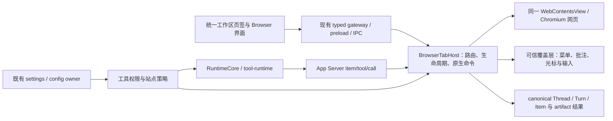

# Codex 会话内置浏览器复刻执行计划

更新时间：2026-10-23


### Browser 续刀：最终回复与空回复误报（2026-10-23，进行中）

- 主目标仍为完整 Codex 会话内置浏览器和 S01–S19/N0–N6、完整 UI/UX；完整 G01–G12 维持 0/12。本轮先修复上轮真实历史授权截图中最终正文与“模型未输出最终答复”Toast 并存的问题，不缩小设置图 U6 范围、不新增委派。
- 窄写集：current notification projector、既有 completion lifecycle helper 及独立定向回归，原 history-access 验收脚本的完成观察/断言、本计划和独立 `completion-verification-20261023/` 证据目录。大 RuntimeHandler 仅在必要时机械接线；不追加状态机、不隐藏 Toast、不加 grace timer、不放宽真实空回复护栏。其他设置、Rust/protocol、外部 workspace lifecycle 测试及未知并行改动只读避让。
- Verification Contract：budget:normal / P1。GUI Composer → 原 gateway/preload/IPC → `turn/start` → 同一 RuntimeCore/provider/tool → public `item/*`/`turn/completed` → current notification projector → renderer completion → 同 identity 的可见正文/终态。`thread/read` 为 canonical 对照；本地受控 provider，非 live 或物理输入。
- 退出条件：先以真实通知确定根因并留下确定性红测；工具后 final 正文/完成快照/stream delta 不误 Toast；commentary、工具前开场白、空 final 仍失败；不借用其他 turn/item 正文。只修 current owner，无第二后端、mock fallback 或计时终态。
- Evidence Layers：deterministic tests=yes，gui trace=yes，runtime transcript=yes，release artifact=no。本刀证据独立落盘，旧 snapshot 只验证与本轮冻结一致的输入。必跑定向测试、完整 Renderer 类型、限定 lint/format/contracts；current-fixture、GUI smoke 和 verify:local 按实际入口记录，既有 Rust 缓存缺文件不通过清理未知缓存规避。后台 Electron 严格观察空回复 Toast、终态与最终正文，官方 smoke 与聚合分开报告。
- 架构影响暂定 minor：保持现有 projection/lifecycle owner、协议和依赖方向；若根因要求跨层协议修改再更新架构确认。负责人 root，2026-10-23。完整产品目标 active；本轮不将切片通过写成 G01–G12 完成。
- 根因证据：`native-before-v2` 同一 canonical turn 的无 phase `agentMessage` 包含真实 provider 最终 marker，实际 GUI 已显示，却出现空回复 Toast；新增严格断言当场失败。上游公开 `protocol/v2/item.rs` 的 `AgentMessage.phase` 为 `Option<MessagePhase>`。本轮未产生新的 REA runtime 证据。
- 实现：直接通知沿用原有有界 Turn/Item 顺序缓存，增量投影同一 item sequence 与已知 phase；原 lifecycle 接纳位于最新 process 之后的无 phase 快照。完成 Turn 快照仅从最新 process 之后选择正文，保留显式 final 优先，拒收 commentary、真正空正文与工具前 final。旧投影文件1044行，先迁出 `appServerDirectItemState` 和 `appServerTurnFinalAnswer` 两个辅助 owner，降至991行；大 RuntimeHandler未修改。无第二状态机、时间宽限、Toast隐藏或新协议字段定义。
- 确定性红测：首版测试遗漏 public Item 通知必需时间戳，14条均未进入受测逻辑，保留为夹具错误；修正后 red-v2 5 pass / 9 fail，其中2条只是测试误以为成功时 requestFinished 必置 true，其余7条分别指出无 phase 回复、快照、增量顺序/phase与工具前显式final问题。首批修复后3文件118/118通过；新增迟到快照/跨线程phase隔离及原completion/text lifecycle回归另跑。原生首轮遗漏真实语言资源文件名失败；v2修正后复现真实产品误报。两个已失败runner退出后仍留Node句柄，定点终止自有8131/13567，未触碰未知进程。


- 本轮当前结算（progress，未完成）：最终定向回归按不同测试去重为5文件154/154（首轮118、最终50，重叠14）；两轮限定lint、格式、完整contracts（含docs边界）通过。主树完整Renderer类型退出2，41条诊断均位于并行Storage客户端/设置/网关及其缺失协议导出，本刀6文件无诊断；不修改他人协议或Storage写集。新隔离副本完整类型 session15258/PID82540继续运行。
- 构建与证据尚待结算：冻结副本Renderer构建session63454、runner97058/Vite98178仍在运行（已观察超过20分钟），没有错误输出；当前主机负载曾超过500，1秒进程采样仅7/8个有效tick，两者仍在Node/V8执行，不以此认定死锁或产品失败。不得重复启动构建、覆盖锁或将未结束作业算通过。6文件与冻结及实际副本hash匹配；对应`completion-verification-20261023/verification.json`、`jobs.json`与`source-audit.json`为持续索引，当前没有新版Electron或smoke通过声明。
- 后续步骤明确：先收取现有build和snapshot类型会话；构建成功后以冻结源码跑history-access严格版本，等待同一GUI terminal再检查Toast并看最终截图，补官方smoke和收尾源码/进程审计。若检查失败，只修本轮current owner并重新验证受影响边界。生产current、夹具test-only，无compat/deprecated/dead或删除项；本轮不提交、不创建分支，完整G01–G12保持0/12（0%，完整验收组），goal保持active。

### S15 续刀：Agent 浏览历史实际消费（2026-10-23，授权消费切片通过，完整 S15 未验收）

- 上轮为 progress：设置冲突代码及五语原生证据已经落盘；完整 G01–G12 仍 0/12，S01–S19/N0–N6 和完整 UI/UX 范围不变。本轮不新增委派、不提交、不改分支。
- 事实缺口：`history_access` 已可持久化，但当前冻结动态工具表没有历史查询，BrowserTabHost 也未消费该字段。复用原设置静态证据与 `settings-policy-manifest.json` 中 history 的 alwaysAsk/neverAsk/disabled；新增工具的具体命名属于 Lime 实现选择，不声称来自上游函数名或运行观察。
- 窄写集：独立 `BrowserActionApprovals`（从超大 BrowserTabHost 迁出既有一次性 action token）、`BrowserHistoryTool` 及定向集成回归；原 BrowserTabHost 仅委托/生命周期接线，BrowserTabPolicy 只公开当前历史策略与版本，AppServerDynamicToolHost 注册一个只读 `history` 动态工具及独立合同回归；现有后台 native fixture 的独立历史场景/严格证据器，命令事实源、架构45、本计划及专属证据目录。设置 UI/资源、共享 Rust/protocol/client、其他并行文件只读避让；历史审批五语文案在独立 Host 模块，原配置桥只投影 config.language，测试夹具透传 locale。
- Verification Contract：P1 / normal。真实 GUI 设置 -> 原 `config/batchWrite`/BrowserAppServerBridge -> BrowserTabPolicy；Agent -> 同一 RuntimeCore/动态工具 -> `item/tool/call` -> 原 AppServerDynamicToolHost/BrowserTabHost -> 原 BrowserHistoryHost/Store。alwaysAsk 为每次 query 的 canonical 一次性审批，neverAsk 仅跳过历史读取审批，disabled 在查库前拒绝；个人历史管理不受 Agent 开关限制。不新增历史库、第二 runtime、IPC 或 JSON-RPC 方法，不把历史许可当作网页 browse grant。
- 安全及失败合同：查询有界并复用原 parser/cursor，审批冻结 query 与 owner/window/thread/turn/session/tab/view/WebContents/page identity；过期/重放/变参拒绝。设置撤销、turn 终态、断连、窗口或 tab 销毁使 pending 及异步返回失效；读库后再次读取权威配置并校验同一 identity，不把错误当空历史。模型只收到获准的查询结果，不接收本地路径或原数据库。
- 先保存确定性红测，再跑历史路径、既有 action/browse 审批与 dynamic host 回归、类型/contracts；真实后台 Electron 经最终生产 bridge 和本地 provider fixture 验证三态、审批及 canonical tool result。仍不冒充物理输入、live provider、完整历史设置视觉/跨平台验收。证据目录 `artifacts/codex-in-app-browser-20261022/history-access-verification-20261023/`。
- 架构影响 major：新增既有 namespace 的动态工具及授权消费；同变更更新架构图并由 root 确认。BrowserTabHost 当前 1979 行，先迁出 action pending/冻结/消费，新增历史业务全部留独立模块；本轮超大文件仅机械委托，退出条件为不继续追加历史业务分支、迁出逻辑的既有回归保持通过及本刀证据归档。

- 实现与结构：`browser__history` 接入原动态工具、BrowserTabHost 与唯一 BrowserHistoryHost；新增 BrowserHistoryTool 和迁出的 BrowserActionApprovals，原超大 Host 从1979降至1892行，只保留委托/生命周期接线。BrowserTabPolicy 使用真实配置变化的单调 revision；IO 后回读配置、核验原 native anchor。原配置桥投影 config.language，独立 Host 文案覆盖五语。dynamic validator 同步拒绝 allowEmpty 字段的非字符串及超过 schema.maximum 的整数。无新增 IPC/RPC、历史 store、runtime 或网页 claim/debugger。
- 最终定向验证：10文件134/134；新增历史26、动态历史合同11及provider证据7，连同原 browse/action/动态工具/Host/命令/配置桥与脚本合同回归。最后夹具调整后2脚本20/20续测，不与134混加。Electron类型、14文件初轮限定lint、最终4脚本lint、限定格式、scoped diff、原工作区完整 contracts（含最终脚本治理）均通过。类型/log的空stdout不是跳过，已记录退出0。格式沿用原大Host/桥/fixture，只检查本轮格式化文件，未无关重排。
- 红测与中间失败：历史原实现直接失败已保存，原21条中的5个在途场景旧实现未进入存储而超时、9个非法参数碰到旧claim拒绝，不算各自parser/撤销红测。dynamic红测11中2失败确定性指出query非字符串和limit>200入口缺校验。初轮夹具缺forget、错误正则遗漏disabled及locale透传遗漏已修，未放宽生产。provider typed output envelope与失败Tool Item可缺contentItems也已纳入夹具处理和回归。
- 真实Electron最终`native-v8`退出0、62/62、6场景；受控HTTP原生导航生成实际历史。四个GUI三态/批准/拒绝结果与同一thread的canonical Tool Item、provider结果对应；网站browse=deny仍能按独立history许可查询，未claim或attach debugger。同live turn中，第二配置写者经真实config/batchWrite+CAS撤销后再点原allow_once，失败且无历史；该写者不是GUI操作。另一路从GUI进入设置时，实际canonical turn已interrupted，旧原生token清零且无provider历史结果；不把审批消失误判成恢复丢失，也不声称跨设置保持审批已对齐。12条provider端请求为服务器实际记录（含模型目录请求）；1537条受控invoke trace仅输出method/id/transport/status摘要，mock fallback=0，renderer/harness/preload错误=0。
- 原生迭代v1–v7保留：DOM click未触发Radix pointerdown、typed结果解析、可空contentItems、将导航已中断回合误当待恢复审批，以及trace数组误当计数对象均归夹具/假设错误，不冒充产品红测。v7原始invoke参数预览已最小化为计数，留原摘要哈希与脱敏原因；最终不落完整config/provider请求/密钥。
- UI复核：最终四张审批截图已实际查看，五语审批仅有模块/桥回归，native仅zh-CN。可见“模型未输出最终答复”提示与已出现的最终文本并存，根因未定位，登记为后继canonical完成/Toast投影调查；没有为通过切片隐藏提示或改断言。隐藏主窗口capture不证明native child的合成显示，也不代表Codex参考像素、主题/尺寸全矩阵、物理输入或跨平台。原生导航与history由同WebContents/实际store单独证明。
- 构建与官方检查：仅在既有隔离副本重建Host/四preload及桌面资源，freshness三段ready；15个自有源/测试/夹具与副本哈希相同。原工作区其他Renderer/Rust并行输入继续避让，不把副本证据推广整棵原树。官方direct hidden smoke退出0、24/24，所有error/legacy/mock计数0；不替代npm聚合verify:gui-smoke。沿用共享Rust缓存缺bindgen.rs/stdlib-symbols.txt阻塞，本轮未重复强制侧车构建、未跑verify:local或完整current-fixture聚合；未清未知缓存、修改系统或下载巨大引擎源码。
- 架构impact major由root确认，architecture45 Mermaid和commands同步。生产为current，独立native/provider场景为test-only；无新增compat/deprecated/dead路径或删除项。KISS/DRY复用原历史parser/store、CAS、动态工具和canonical审批；pending token与用户决定职责分离。实际写集15个代码/测试/夹具加3文档与证据目录；外部lifecycle测试、其他设置/语音/Rust协议只读避让。仅结算历史授权消费切片；S01–S19/N0–N6、完整UI/UX和G01–G12仍0/12（0%，完整验收组），goal保持active。原生密码/Autofill/导入/扩展/17类网站设置仍依赖锁定Electron/Chromium fork；下一刀由当前owner继续原生能力及完成投影/导航行为对标。

### S17 续刀：权限设置冲突与编辑草稿（2026-10-23，冲突子链通过，完整 S17 未验收）

- 目标：拒绝旧 UI 快照覆盖新权限；配置版本冲突、保存失败恢复权威值，保留未提交的网站模式草稿。完整 S01–S19、N0–N6 与 G01–G12 范围不变。
- 窄写集：`src/lib/api/browserSettings.ts`、`useBrowserSettings.ts`、`BrowserAgentPermissions.tsx`、Browser 设置 `index.tsx`、五语 `settings.json` 最小文案、对应定向回归、专属验证材料及本计划；不修改外部 lifecycle 测试、Rust/protocol 或其他设置领域。
- Verification Contract：P1 / normal。GUI 权限矩阵 → 既有 Browser settings gateway → 唯一 `updateConfig` 队列 → `config/batchWrite(expectedVersion)` → App Server 配置文件；增加字段旧值比较，不新增配置 store、命令、协议或审批 owner。先确定性红测，再 gateway/component、类型、contracts、官方 GUI smoke 与隔离 Electron 设置切片；各层分别结算。
- 退出条件：已刷新的新权限不能被旧矩阵覆盖；尚未刷新的远端版本由原 CAS 拒绝；不自动重试放宽授权；失败后矩阵恢复权威值、表单保留草稿、重试需用户重新确认当前规则；相关键不冲突时保留其他 Browser/Desktop 设置。S05 已有完整静态合同明确 stock Session 无时段清理，不新增错误的全时段替代入口。
- 架构影响 minor：仅在既有 gateway 增加输入前置条件与 UI 冲突状态，owner/依赖方向不变；责任开发者 root 确认。实际写集为 13 个源码/测试/五语/夹具文件及本计划、命令事实源；未触碰其他设置领域、共享 Rust 协议和外部 lifecycle 测试。
- 实现：`updateBrowserSetting` 必须携带字段旧值，在原配置写队列内比较规范化快照，并将远端 `configVersionConflict` 归为同一冲突。UI 回读权威矩阵、保留网站输入，不自动重放授权；回读失败禁止保存，显式重试再次失败仍保持锁定。编辑中被删除的规则不能被重建或当作空操作保存成功。五语补齐冲突、回读失败、规则删除及下载描述文案；真实截图发现的下载描述 raw key 已修复。复用原队列、CAS 和配置 owner，无新 store/命令/协议。
- 定向证据：原实现红测 4 fail / 2 pass，五语缺失描述键红测 5 fail；最终 3 文件 51/51（API 6、设置集成 27、原配置队列 18），Renderer/Electron/Node 类型、限定 lint/格式、原工作区完整 contracts 通过。测试夹具遗漏必需配置字段、归档源码误入测试发现等中间失败均保留，不算产品红测。证据目录为 `artifacts/codex-in-app-browser-20261022/settings-conflict-verification-20261023/`，入口 `verification.json`。
- 真实 Electron：最终五语言各 21/21，真实生产 Main/preload/IPC/App Server 配置读写、两个不同 CAS 版本、冲突不写入、显式重试继承最新 deny、实际配置文件及同 Profile 冷重启恢复通过。输入为合成 DOM；后台 Host 只抑制窗口显示，无 bridge replacement、provider turn 或 Agent 权限执行声明。105 为重复语言矩阵断言，不与 51 个不同测试混加。官方 direct hidden smoke exit0、24/24、39 次 App Server IPC，错误/legacy/mock 均 0；不替代 `verify:gui-smoke` 聚合。
- 截图复核：五语冲突、矩阵、重启共 15 张均已实际查看；原繁中两张未呈现目标位置，不能由 DOM 断言结算截图。test-only capture 改为临时关闭隐藏节流、两个实际绘制帧、最近滚动容器定位及 viewport/shell scroll 断言，随后恢复节流；只补跑繁中，`native-zh-TW-capture-v4` exit0、21/21，三张新图可见目标。中间 v3 图曾滚动外层 shell，原图和行为摘要保留，未用生产改动迁就截图。原截图失配的唯一原因仍未证明；新证据只覆盖当前设置状态，不证明参考像素、主题/尺寸全矩阵或物理输入。
- 构建与边界：本刀最终验收使用隔离快照 Renderer 构建，freshness 三段 ready；本刀 13 文件与快照匹配。误并行启动的两棵自有构建已定点停止、已死锁归档；当时原工作区 Renderer manifest 标为 invalid，收尾只读发现已被另一份 08:27:42 UTC 的 ready manifest 替换，归属未确认，未覆盖或作为本刀验收依据。原工作树与快照分别包含 2876/2848 个 Renderer 输入，不能将快照结果推广到包含其他并行输入的整棵原工作树。本轮未执行 `verify:local` 或 npm 聚合 `verify:gui-smoke`，沿用已记录的共享 Rust 缓存缺文件限制；没有删除未知缓存、下载巨大引擎源码或更改系统配置。
- 分类与下一刀：生产为 current，截图/后台场景为 test-only；无新增 compat/deprecated/dead、第二浏览器后端或删除项。KISS/DRY 复用唯一队列及权限矩阵，UI 草稿与配置 authority 分离。仅结算“设置编辑冲突”，不结算完整 S17 Agent 权限消费、G12、S01–S19 或 N0–N6。原生密码/Autofill/导入/扩展/17 类网站设置仍依赖锁定 Electron/Chromium fork；下一刀继续同 Profile 原生集成及实际权限消费。完整 G01–G12 仍 0/12（0%，分母为完整产品验收组），持续目标 active。

状态：完整复刻实施中；本次完整产品尚未验收。2026-08-23 的 P1-P4 Completed 仅表示下半部分记录的历史纵切，不表示 Codex Browser 已完整复刻。

## 2026-10-22 目标、阶段与本轮交付

主目标：完整复刻用户截图中的 **Codex 会话内置浏览器**，覆盖 UI/UX、真实网页、浏览器设置与管理子页、网站兼容性、页面生命周期、Agent 同页操作及权限。交付单位是完整用户行为，不能用相似工具栏、空菜单或单测通过代替。

当前阶段：E0/E1/E2/E3/E4/E7 实施。统一工作区 canonical 标签、真实网页/菜单、配置/审批、历史管理、批注四路图片提交、DOM/表单及同源frame拖选、空格临时浏览已具备明确切片证据；下载管理已通过五语真实 Electron 与102条下载滚动分页。下一刀继续补齐完整批注、下载页 UI/UX 和其余设置；密码/Autofill、扩展、导入的原生引擎集成与完整平台证据继续是退出条件。

本轮认领写集：root 负责本文件、工作区 localState/coordinator/HostRuntime context、统一标签与 Browser chrome、Electron IPC/catalog/AppServerHost 最小配置及身份桥、独立 browserChrome 五语资源与 bundledNamespaceParts、build-host 第二窄 preload 构建、App.tsx 已有导航的 context provider、types/page 与 settings sections/layout 的 Browser 子页接线；native worker 负责 BrowserTabHost/EmbeddedBrowserHost 拆分、命令、原生 overlay/preload、历史 Host 接线；settings worker 负责 core config/browser、Config.browser 机械字段、App Server 可编辑根 browser、Browser 设置及 settings.json、纯类型与 BrowserHistoryStore。已脏 main/通用 preload、WorkspaceRightSurfaceHostRuntime、文件预览、agent.json、架构、总执行计划、.gitignore 保持只读避让。未修改或重置其他进程文件。

大文件例外：core/config/types.rs 仅添加 browser 字段/default，不追加业务逻辑；新逻辑全部落 config/browser.rs。AppServerHost 仅添加独立 Browser 配置/identity helper 的生命周期接线，不追加 Browser 业务；退出条件是本切片定向测试、类型和 contracts 通过，后续不据此继续堆逻辑。BrowserTabHost 先抽命令/解析与状态 helper，再扩能力；仍须继续按职责拆分。

用户本轮的完整范围覆盖旧路线图冻结的 P6 能力；旧冻结不能作为排除批注、设备视口、历史、设置、扩展和 WebMCP 的理由。Lime 保留主题、多模型、首页 Banner；Browser 的结构与行为按证据对齐。

## 参考身份、证据与限制

### G03 续刀：Design 批注 canonical 提交（2026-10-23，实施中）

- 上轮为progress，原图/标记分离代码、107项回归、17项native与官方smoke已取得证据；完整UI/UX、S01–S19/N0–N6与G01–G12分母不变。本轮不新增委派、不提交、不改分支。
- 窄写集：新增test-only后台Design提交场景/启动Host/严格证据器及回归；既有Gate B入口只登记/委托`annotation-design`并选择后台启动，不向2300行主脚本追加场景业务；本计划与证据目录。生产编辑器/layout在先观察后仅修有证据的问题，变更前记录红测；其他设置/侧栏/语音/Rust协议及外部lifecycle测试只读避让。
- Verification Contract：budget:normal/P1。真实canonical Browser页 → 原工具条开始选元素 → 合成DOM输入驱动真实私有page preload → 同owner可信editor CSS/text编辑 → 原save/draft/Composer → 真实preload/IPC `app_server_handle_json_lines` → App Server JSON-RPC/runtime/Thread/Turn/Item → 本地provider请求与GUI消息。后台Host只抑制show，不替换bridge/selection/ACK/permission/acceptance或退出生命周期；原前台焦点场景不重复启动，不声称物理输入。截图可用/timeout分支均严格记录，不用无图成功代替设计后截图验收。
- 验证精确baseline→new的CSS/text、design-only空正文保存和原图按住/释放、同Browser identity、恰好一次canonical user item、provider摘要一致、IPC响应/Thread读取/用户消息关联及接受后原草稿消费；拒绝缺任一层的伪证。另记录真实editor/native card几何与resize事件，先定位裁切原因，不能用capture成功推断完整布局。最终类型/contracts/定向回归及官方smoke按实际生产改动风险执行，保留所有失败。
- 重大架构影响初始为none（仅test-only场景）；若修生产layout则同步架构45与root确认。本轮允许超大Gate B脚本仅机械入口接线，退出条件为独立场景保持≤800行、证据器严格负向回归、无新增产品业务/后端或未知写集变更。证据目录`artifacts/codex-in-app-browser-20261022/design-submit-verification-20261023/`。
- 原生v1/v2已保留失败：CSS/text两次实际私有IPC到Host，但严格`default-src 'none'`拒绝临时内联style，只有text生效。v2先等待CSS再输入text，仍报CSP错误，排除连续输入时序作为本次原因；新增批量字段组件回归8/8通过，不能冒称红测。窄写集扩为`browserDesignPreview.ts/.test.ts`、既有diagnostics被动记录designChange/截图SHA、Design组件回归及架构45；无需改layout或站点CSP。
- 修复将CSSOM序列化规则直接装入原Document/ShadowRoot的构造样式表，原图/暂停/删除仅定点撤下自有sheet。保留原页面sheet与策略，不增加网页权限、IPC或业务owner，架构影响minor/root确认。真实全Host后台首次已capture成功，证据器新增严格captured分支，关联原capture SHA/尺寸、canonical media/read、provider和GUI图片；timeout分支仍独立且不计图片/视觉通过。首轮新captured单测因测试fixture遗漏Viewport元数据失败，补齐fixture，不放宽生产或旧证据器。
- v3修复后实际CSS/text预览、空正文save、UI键盘按住原图/释放和canonical completed turn已发生。验收探针将图片wrapper和img同时计数为2而失败；改为只统计HTMLImageElement，并缩小超时诊断，原失败保留。该轮editor几何415px、save底394px，PNG人工查看已包含完整卡片与footer，只结算当前场景。真实消息还暴露Markdown归一化把`font-size`/`nth-of-type`拆为列表；新增实际Renderer红测失败，已有normalizer单个规则去掉ASCII单词内标记识别后20/20通过。窄写集再增加无外部改动的`MarkdownRendererMarkdownModel.ts`/normalization回归；不增加浏览器特判或第二显示层。
- jsdom不实现构造样式表，初轮扩大回归出现adoptedStyleSheets缺失；新增只用于测试、可恢复的同realm shim并覆盖子frame。单位测试不用于证明CSP。新captured证据fixture最初仅24字节，旧严格证据器要求大于24；保留失败后修正测试字节，未放宽证据器。快照首次copy命令误在快照cwd中复制自身而失败，随后以显式绝对root同步并重建Host，未使用旧产物验收。
- 最终真实`native-v4`退出0、15/15：严格CSP下原h1字号32→28px和纯文本修改、design-only保存、工具条键盘按住原图与松开恢复、同Thread/Tab/View/WebContents、唯一canonical client user item/completed turn、provider完整文本及原capture/media/GUI图片SHA一致、接受后草稿消费。原截图899×1280、44308bytes；新设计页PNG只是诊断截图，未重新加入批注，不结算设计后重采集。输入全部为合成DOM；production main/BrowserTabHost/editor/preload/IPC/App Server/runtime/store均真实，只有provider使用本地fixture，所有renderer/page/harness错误0。editor高度415px、save底394px，最终完整卡片、预览页、原图和展开消息4张PNG已查看；renderer PNG不含原生WCV合成画面，不结算整窗像素或参考一致性。
- 最终定向回归11文件132个不同用例通过：主矩阵131项中的旧23项证据器由最终24项替换，重叠批次不累加。包含五语design资源、原图、page/frame生命周期、样式表定点释放/保留原sheet、layout、Markdown和严格跨层负向证据。Renderer/Electron类型、15源码限定lint/格式、完整工作区contracts、写集diff与两份文档边界通过。最终Renderer/Host/preload构建及资源复制后freshness三段ready；首次因新增测试fixture被Host输入追踪而stale，补建Host，未跳过守卫。
- 官方direct`scripts/electron/smoke.mjs`退出0、24/24；真实App Server IPC、reload、设置路由与三尺寸布局通过，错误/legacy/mock均0。没有重跑会强制Rust构建的`npm run verify:gui-smoke`或默认`verify:local`，既有共享Rust缓存缺文件阻塞仍保持原限制，不把direct作为聚合全绿。完整产品Gate B矩阵、五语主题/参考视觉/物理输入/live和macOS/Windows packaged未完成。
- 分类为current：原BrowserDesignPreview的内联style直接迁为同root构造sheet，原Markdown规则收窄，无新owner/compat/deprecated/dead；其余新增代码为test-only。root确认架构45，KISS/DRY复用原提交、media和严格图片证据器，无第二后端。证据入口本轮`verification.json`；`status=incomplete/sliceStatus=pass`，完整G01–G12仍0/12（0%，分母是完整产品验收组）。完整S01–S19/N0–N6、密码/Autofill/扩展/导入、17类网站设置、Design重采集/多选/controls/provenance、历史退出与完整UI/UX继续保留，下一刀返回设置与原生服务缺口，持续目标active。
- 收尾审计：17文件冻结（15源码/测试、2文档）；391文件扩展快照仅已知外部`useWorkspaceRightSurfaceLifecycle.unit.test.tsx`差异，未覆盖。全部自有job终态，已知native PID及快照/Host/证据路径无残留进程，无未知进程清理。官方direct记录36次真实App Server IPC；同一结果不与本刀15项submission断言叠加成完整产品门禁。旧孤立hidden fixture裁切/截图超时的原因仍unknown，本次完整Host场景成功不能冒充该夹具已修复。

### G03 续刀：按住原图与标记独立显隐（2026-10-23，实施中）

- 上轮分类为progress：CSS/纯文本预览代码、244项定向回归、12项真实原生行为和官方shell smoke已落盘；完整目标、设置U6/S01–S19/N0–N6及G01–G12分母不变，本轮不新增委派。
- 参考复用REA `ev_e216c618a8a2bb330a20c57070b7b35734a966e96cb0b1700ca44be9beb2386b`与已核对旧preload SHA，合同P477800–478650、503300–504100：按住original清空预览组，释放恢复原组；不能仅隐藏marker冒充原图。该来源是静态证据，不证明参考运行或像素等价。
- 窄写集：独立Annotation presentation helper/原图按钮与hook，原Annotation Host/Model/Page及DesignPreview最小接线，typed annotation gateway、现有IPC/catalog、五语browserAnnotation与定向回归，本计划/架构45/命令事实源和独立证据目录。侧栏、语音、设置布局、共享Rust协议和已知外部lifecycle测试只读避让。原Host接近800行，先抽临时presentation owner，再扩原图交互；超大TabHost不加业务逻辑。
- Verification Contract：budget:normal/P1。工具条指针或Space/Enter按住 → typed gateway → 原Desktop preload/IPC → BrowserTabHost委托 → Annotation Host精确identity/同页可用性 → 原private token/document/frame → 原元素CSS/text临时恢复；释放恢复当前变更，不重建草稿、不发turn。gestureId区分重叠与迟到释放，Renderer在开始回执后串行发送释放；失焦/卸载/导航/隐藏/Agent接管清临时hold，旧identity不可改新页。
- 标记可见性仅控制marker，CSS/text展示独立；原图保留marker偏好。补现有生命周期与严格parser失败回归、五语指针/键盘/异步竞态、真实Electron原图/恢复/Agent行为、types/contracts与GUI smoke。网页capture的隐藏窗口限制继续单列，不用marker截图或组件通过代替完整G03/设置/UI/UX/跨平台验收。
- 架构影响major（新Desktop临时展示命令，无App Server业务方法）；实现后同步架构图与root责任确认。证据目录`artifacts/codex-in-app-browser-20261022/original-preview-verification-20261023/`。退出条件是行为/身份/生命周期边界证据完整并归档；完整canonical design提交、设计后截图、多选、controls/virtual/provenance与完整设置仍为后续退出条件。
- 实现：`BrowserAnnotationPresentation`接收原marker偏好并持有按view区分的临时original lease；Host只委托、验证精确identity和当前页面可用性，仍为781行。`browser_tab_set_annotation_original`已同步共享IPC白名单、catalog、typed gateway与原BrowserTabHost命令列表，main/preload自动消费共享白名单，不新增App Server业务方法或生产mock。原图仅撤销CSS/text，释放应用最新变更；隐藏marker不再撤销设计。新按钮支持主指针与Space/Enter按住，hook串行start/release，取消/失焦/禁用/卸载释放，Host在窗口失焦、owner renderer丢失、页面/控制权变化独立清理，迟到旧gesture释放不影响新hold。
- 回归：红测复现缺原图命令与隐藏marker错误恢复原文。最终10文件107个不同用例通过，包含Host旧/错identity、原生blur/owner丢失、restore ACK期间按住与page advance、原节点恢复与预览期间新编辑、五语指针/键盘/快速连续手势/卸载清理；后续同一14项hook/五语资源回归通过，不重复累加。网关首轮误用包含annotationId的session parser而拒绝合法page identity，已拆分页面与批注校验；新资源直接检查各语言bundle，不能由fallback掩盖缺词。限定lint首轮ref cleanup警告已改为捕获生命周期对象，最终25文件格式、限定lint、Renderer/Electron类型与原工作区完整contracts通过。
- 构建与原生：最终Renderer/Host/preload构建及资源复制通过；第一次Renderer成功后因上述hook调整重新冻结并构建，最终freshness三段ready，无missing/stale/invalid。真实Electron隐藏窗口原生集成退出0、17/17，使用实际Host/可信Editor/两份最终preload和Renderer，在同一WCV验证隐藏marker仍显示设计、原图还原CSS/原节点、旧gesture释放无效、松开恢复saved、Agent接管清hold且返回后按隐藏marker偏好显示设计。网页截图仍为`timeout/page-ready-timeout`，diagnostic无display surface；editor PNG成功。输入为合成DOM，原图命令由fixture直接Host invoke，没有完整BrowserTabHost/App Server/物理键鼠或参考像素证明。
- GUI smoke：直接官方`scripts/electron/smoke.mjs`退出0、24/24，37次真实App Server IPC，全部console/page/preload/invoke/legacy/mock计数0；不提交provider turn，不将它与分段native结果拼成完整原图Desktop Gate B。本轮未执行默认`verify:local`或会强制Rust构建的npm聚合`verify:gui-smoke`，沿用已记录的共享Rust缓存缺文件限制，不把direct结果冒充聚合全绿。
- 审计与结算：25个自有文件冻结，383文件扩展快照仅已知外部`useWorkspaceRightSurfaceLifecycle.unit.test.tsx`差异，未覆盖。架构45和数据流图、命令事实源已同步，root于2026-10-23确认同一BrowserTabHost/Annotation/预览owner及依赖方向。生产为current，既有native夹具扩展为test-only，无新增compat/deprecated/dead或第二后端；marker偏好从原Host Map直接迁至唯一presentation helper，不保留双轨。KISS/DRY复用原命令委托、page token和预览组，原图不建立草稿store/持久化/turn。证据入口为本目录`verification.json`，`status=incomplete/sliceStatus=partial`；完整G01–G12仍0/12（0%，完整验收组分母），原图完整UI/UX/物理输入/跨平台、完整design提交、设计后截图、多选/controls/provenance与S01–S19/N0–N6继续未完成。下一刀补完整Design提交及工具条真实视觉交互证据，完整设置范围继续保留。
- 最终观察：本轮editor PNG已人工查看，实际截到顶部与部分字段，卡片底部/actions被裁切；只证明该捕获帧内容，不结算编辑器布局或原图工具条UI/UX。17项native断言依靠真实DOM/Host行为，不能据此声称所有动作在截图可见。最终进程审计无快照/Profile/fixture相关残留，全部已知unified exec session终态，未清理未知进程；原shared Rust缺文件、旧三语退出与上轮选择超时均保持原unknown边界。

### G03 续刀：Design Tweaks CSS/文本预览（2026-10-23，实施中）

- 完整目标、用户设置图 U6 的 S01–S19、原生 N0–N6 与 G01–G12 分母均不变。当前安装包已更新到 26.1016.61520 / 21421，ASAR SHA256 `c9945f821fcbaf48424933a82860beac4dd4ad8b8a5444a75568fa6e38a1ad4b`；保留旧 preload 的 SHA256 重新核对为 `6844ec68a38171555a8dbdd97c1bfb524e358edff60e0146fd77073694dbb515`，与原合同匹配。旧偏移只用于该保留文件，不混用新包。
- S14/N0 现实条件复核：当前磁盘可用约 21.24 GiB，`xcode-select` 指向 CommandLineTools，`xcodebuild -version` 要求完整 Xcode。原生设置仍采用同 BrowserContext 的锁定 Electron/Chromium fork；17 类内容设置不能由现有请求权限开关替代。本轮不下载大型源码、不改系统配置、不删除未知文件，原生服务保持未验收。
- 参考映射：旧 preload `qu/ns/as/Yb/Pb` 和已归档 REA `ev_e216c618a8a2bb330a20c57070b7b35734a966e96cb0b1700ca44be9beb2386b` → 既有 Annotation Host/page preload/可信 Editor/草稿与 lowering。人工静态补读确认 19 个基础 CSS 字段、flex 时增加 6 个字段、只编辑直接纯文本、baseline 差异归并和局部 style 恢复。静态来源不证明参考运行或像素等价。
- 窄写集：独立 Browser Design 类型/校验/页面预览/可信编辑组件及回归；既有 Annotation Host/page preload/Editor model/Host/preload/types、draft/lowering/hook 的最小接线；BrowserTabHost 构造器仅委托一次，五语 browserAnnotation、命令事实源、架构45、本计划及专属证据目录。避让侧栏、语音、设置布局、共享 Rust 协议与已知外部 lifecycle 测试；不新增委派。
- Verification Contract：budget:normal / P1。用户选元素 → 原私有 page IPC/同 frame identity → Host 校验 baseline → 可信 Editor CSS/文本修改 → 同一 revision 草稿事件 → 同一 PageAnnotation 元素临时预览；保存/直接发送沿原 Composer、typed text/image、App Server Thread/Turn/Item 链。预览自身不新增 App Server method、工具或文件写入，callback 不向网页暴露 bridge。
- 失败终态与验证：先保留确定性红测；验证 baseline 回退、CSS 规则注入拒绝、文本子节点恢复、多组同目标、shadow/frame、导航/Agent/隐藏/销毁清理、旧 token/revision 拒绝、可信 editor → draft → 模型摘要和失败保留。运行定向测试、类型、contracts、风险限定真实 Chromium/Electron 及官方 GUI smoke；未通过层单独记录，不用静态/组件证据结算原生用户路径。
- 本刀仅结算 CSS/纯文本纵切；站点 controls/virtual、provenance 完整溯源、多选、原图全局工具条与参考 UI/UX 全矩阵继续属于完整 Design Tweaks 退出条件，不能用字段表单替代。架构影响 major（可信编辑事件携带结构化 design draft），完成前同步架构图及责任确认。证据目录 `artifacts/codex-in-app-browser-20261022/design-preview-verification-20261023/`。
- 原生首轮暴露真实构建缺陷：page/editor preload 共同依赖 Design parser 后被 Rollup 拆出本地公共 chunk，sandbox require 拒绝该 chunk，页面 preload 未启动。失败摘要及超时保留。构建 owner 最小扩展为 `scripts/electron/build-host.mjs`：四个 preload 分别生成独立 CJS，禁止共享本地 chunk，CLI 入口加直接执行判断；新增真实构建＋sandbox require 执行回归。回归首轮导入旧 CLI 意外触发原工作区生成物重建，未修改源码；入口修正后必须重建正确原产物，不能使用该失败产物验收。current-entrypoints 的分类遗漏了既有 `.testFixture`：补齐单/复数测试叶子分类，并验证生产源码导入这些叶子仍被拒绝，不白名单特定 fixture 或放宽生产依赖。
- 实施结果：19项基础/6项flex字段、直接纯文本、基线差异归并与严格parser已接入真实选中元素；CSS经CSSOM解析后局部预览，文本保存原节点对象，reset/cancel恢复原DOM。正文、附图与designChange共用一个revision；原草稿store、工具条/Composer和lowering均接受design-only内容，模型摘要携带old→new及修改实际源码的指引，不提交临时attribute。沿原token/frame/document/page/tab身份，不增加通用网页bridge或新的App Server方法。
- 最终定向验证：21文件244/244（唯一合并集，包含真实preload构建回归），Renderer/Node/Electron类型、原工作区完整`npm run test:contracts`与限定源码lint通过。44文件全量格式检查仅BrowserTabHost失败；与上刀归档逐行核对确认原文件已未格式化，本刀仅一处构造器委托，保留原失败与baseline证据，其他43文件单独通过，不将全量格式写为通过。最新原工作区与隔离快照Host/preload均重建并复制桌面资源，已纠正红测误构建的生成物；freshness的Renderer/Host/sidecar三段ready，无missing/stale/invalid。官方direct `scripts/electron/smoke.mjs`退出0、24/24，39次真实App Server IPC，全部错误/legacy/mock计数0；未运行本轮npm聚合`verify:gui-smoke`或`verify:local`，不混用前轮结果。
- 原生集成结果：`native-behavior-final-result/`进程exit0、12/12断言、preload/page error为0；真实Annotation Host、可信Editor Host、最终两份preload及Renderer完成同一WCV的CSS/text修改、非法CSS不发布/reset恢复原节点对象、design-only保存关闭保留预览、模拟Agent控制恢复原值、同文档私有恢复saved预览和取消清理。隐藏窗口使用合成DOM输入，不经过BrowserTabHost/App Server/runtime，不冒充物理输入或完整Desktop Gate B。原生截图实际为`timeout/page-ready-timeout`，失败文案可见且草稿可编辑；网页diagnostic capture无display surface，可信editor PNG成功，已人工查看字段、变更值和失败文案，未结算页面截图或参考UI/UX等价。
- 保留失败：旧隐藏窗口native输入未选中；DOM选择后一度在截图断言失败；新一轮选择超时原因仍unknown；随后fixture按真实content尺寸修正原生边界，移除必须捕获隐藏网页diagnostic图的前提，并逐次记录实际capture结果。没有改生产ACK、截图等待、身份或窗口退出来求通过；后续原生通过不视为选择超时已归因。网页crypto attribute已改用非安全上下文可用的getRandomValues，带真实页面环境回归。
- 结算：本刀代码和上述原生行为边界已通过，完整design提交的canonical Gate B、设计后截图、全局按住原图、多选、站点controls/virtual、完整provenance、参考UI/UX矩阵和packaged跨平台仍待实现或验证；S01–S19/N0–N6不缩小，完整G01–G12继续0/12（0%，完整验收组分母）。生产owner为current，新增夹具为test-only，无新增compat/deprecated/dead或第二Browser后端。架构45含独立preload构建事实，root已核对owner、数据流和依赖方向；证据入口为本目录`verification.json`，持续目标active。
- 最终审计：44个自有文件冻结与快照一致，378文件扩展比较仅已知外部`useWorkspaceRightSurfaceLifecycle.unit.test.tsx`差异，未覆盖；全部31个REPL job及最终原生unified exec进程终态，未终止未知进程。新增preview/host/editor按单一职责拆分，原TabHost只加一次委托，baseline和字段parser复用同一共享类型，未引入第二草稿store或业务后端。下一刀补完整Design交互和canonical提交证据，并继续S14/原生管理页路线；不以本刀替代用户设置图U6的完整交付。

### S13 续刀：实时进度与历史分页（2026-10-23，子链通过，完整产品未验收）

- 主目标仍为完整 Codex 会话内置浏览器与 U6 设置 S01–S19、原生 N0–N6；本刀仅处理 S13 持续下载打断历史分页，完整 G01–G12 继续 0/12。不新增委派、不提交、不改分支。
- 参考：复用 REA `ev_e216c618a8a2bb330a20c57070b7b35734a966e96cb0b1700ca44be9beb2386b` 保留成员 `browser-use-settings-dd15aad57b40.js`，SHA256 `9894f2cc6d759d13ade75484ed472bf634039770626c00f1c044d9a127e5bbc3`；人工静态补读 Qr/ei/si/ii：实时字节与历史结构失效分离，100 条 offset 分页。未新增参考 runtime 证据。
- 窄写集：`electron/browserDownloadsHost.ts`、`browserTabHost.ts` 构造器一处接线，`src/lib/api/browserDownloads{,Types}.ts`、下载 Hook/纯投影及对应回归、现有下载历史证据器与分页 fixture、本计划及 `download-live-verification-20261023/`。沿用前序已确认写集，避让设置布局、侧栏、语音、共享 App Server 协议等外部改动。超大 BrowserTabHost 仅替换回调参数传递，不添加业务逻辑。
- Verification Contract：budget:normal / P1；current 链为下载设置页 -> typed gateway -> preload/IPC -> BrowserTabHost -> BrowserDownloadsHost -> 原 Session/DownloadItem/store -> typed changed event。App Server/RuntimeCore/Thread 不变，只在真实 fixture 核对原 canonical identity；不新增 JSON-RPC/IPC 命令、第二 store 或网页 bridge。
- 合同：durable `revision` 继续与磁盘相等；新增进程内 `historyRevision` 标识成员、状态、排序/搜索元数据变化。进度-only typed delta 直接更新已加载行，不取消分页或重查历史；结构变化才使旧请求失效。网关拒绝私有/畸形字段，失败事件显式 invalidated；迟到事件、查询切换、卸载、清空/移除和历史 fileExists 保持正确。
- 退出条件：先保存红测，再通过 Host/gateway/component 与证据器定向回归、contracts、类型/构建、GUI smoke；真实 Electron 在超过 100 条 HTTP 原生下载记录和持续下载并发时加载第二页，记录实际进度与 IPC 请求次数，暂停后仍结构刷新。记录源码 hash、原始失败、进程终态和证据索引。未通过不结算本刀或完整 S13。
- 架构影响：major（下载通知与分页响应合同变化）；唯一 owner、持久格式、命令名和业务主链均不变，不新增 read model owner。架构图已更新：`internal/aiprompts/architecture.md` 第 45 节下载管理段；责任开发者确认：root，2026-10-23，已核对目录归属、数据流、依赖方向、协议边界和验证门禁。无新用户文案；不以本刀代替五语整屏、参考像素、物理输入或 macOS/Windows packaged 验收。原韩语/繁中/日文退出超时继续 unresolved。
- 实施记录：已保留 Host 一项及组件四项红测；新组件文件最初误用 `.live.test.tsx` 被仓库 Provider 防护排除/拒绝，改为 `.progress.component.test.tsx` 后执行真实红测，未开启真实 Provider。证据器起初误用 node:test（实际为 Vitest）失败，正确入口 20/20 通过；错误入口不算产品失败或通过。Host/gateway/component 第一轮 66/66 通过。共享纯类型统一记录上限，Store 直接迁移 import，无 re-export/alias 双轨。架构图与命令事实源仅补下载通知/分页合同。
- 最终实现：Host 保存后发公开增量，durable revision 继续与磁盘一致；成员、状态、finished、filename、URL、startedAt 变化才递增 historyRevision。有界 Renderer 投影按每条记录版本合并，保留历史 fileExists；progress-only 不重读、不增加 request epoch、不丢 pending loadMore，结构事件才重读已加载范围。网关严格拒绝私有字段、畸形数组、重复/交叉 id 与非法版本；旧 void 通知已直接替换。唯一 BrowserTabHost 构造器只转发 typed payload。
- 最终验证：7 文件 86/86 Vitest，Renderer/Electron 类型、限定 ESLint、格式检查、真实工作区 `npm run test:contracts` 均 exit0。快照 contracts 在 scripts governance 因无 `.git` 中止，保留原失败；原工作区完整门禁随后通过，不能把前者写成通过。Host/Renderer 构建通过；首次 freshness 因未执行静态资源拷贝显示 host stale，执行既有 `copy-desktop-assets.mjs` 后三段 freshness 通过，未更改时间戳或跳过守卫。
- 真实 Electron：`native-zh-CN/summary.json` 为 pass、24/24、进程 exit0、console/page/harness error 均0。102 个真实 HTTP 完成下载加 1 个持续下载，GUI 滚动显示103个唯一原id；测量窗口内4个原生增量从2916352增长至4096000 bytes，durable revision53→56，historyRevision始终50；额外历史重查0次，可见字节文字变化。真实暂停将 historyRevision 推进至58并刷新两个已加载页。102个附件 SHA/响应字节、清记录保留文件、缺失后恢复同一文件/记录及返回原 canonical Thread/Browser tab/view/WebContents 均通过。此场景不提交 Agent turn，不声明零后台模型请求、RuntimeCore 推理或跨平台通过。
- GUI smoke：直接执行官方 `scripts/electron/smoke.mjs`，24/24、exit0、35次真实 App Server IPC，全部错误/legacy/mock计数0。没有重跑会重复完整构建的 npm 聚合 `verify:gui-smoke`，也未跑 `verify:local`；本刀是风险限定验证，不能称完整本地/产品/发版门禁通过。五语组件回归包含在86项内；本轮仅中文真实场景，无新文案，不重跑上一刀五语原生矩阵。
- 截图与审计：8张原生截图归档，人工查看分页末尾与缺失文件2帧；未作参考同视口/DPR或主题像素结算，侧栏并行 Archived chats 英文仍只读保留。18文件冻结与实际快照一致；361文件扩展快照审计仅保留已知外部 lifecycle 测试差异。26个自有job全部终态，已知PID、快照/证据路径和cwd匹配均无进程残留，无未知进程清理。主下载场景791行，后续扩展前拆出场景职责，不能继续堆叠。
- 分类与结算：Host/store/gateway/投影为current，原 void 通知直接替换，Store 局部记录上限迁至共享纯类型并直接迁移消费者；新验证 helper 为test-only，无新增compat/deprecated/dead owner。按KISS/DRY复用原命令、文件和原生句柄，投影不新增历史 authority。证据入口 `artifacts/codex-in-app-browser-20261022/download-live-verification-20261023/verification.json`，`status=incomplete / sliceStatus=pass`。完整S13、S01–S19、N0–N6、参考UI/UX、密码/Autofill/扩展/导入及macOS/Windows packaged仍未完成，G01–G12维持0/12（0%，完整验收组分母）。历史三语quit超时仍unresolved，持续目标active；下一阶段回到S14和原生管理页/引擎合同，不以继续下载微调替代完整设置交付。

### S13 续刀：下载行交互与密度（2026-10-23，五语子链通过，完整产品未验收）

- 上轮为progress：五语真实失败反馈、34项组件/6项证据器及官方smoke24/24通过；所有自有job终态，9文件冻结无漂移。本轮继续同一Browser owner，不新增委派，完整G01–G12仍0/12。
- 同摘要静态补读`di`（UTF-16 37650:41829）：已完成且文件存在使用整行action row，open与右侧actions独立；其他状态为非交互row。Deleted与文件名同行；完成态description为空，其余为状态/进度，不逐行显示来源URL。参考UI共享行几何、图标分类与runtime未复核，不据此声称像素一致。
- 当前差异：仅文件名按钮可打开，未完成/缺失文件也渲染禁用open按钮；来源网址使行额外增高，缺失文案另占一行。窄写集为下载页及独立下载行组件、现有列表/操作回归、失败验收helper最小迁移、本计划和`download-row-verification-20261023/`；设置布局、侧栏、语音、协议与原生下载owner只读避让。
- 验证合同：先复现非交互状态仍暴露open与来源URL额外呈现，再将row presentation拆为独立组件，已完成整行可点且不嵌套按钮；右侧定位/删除仅执行本身动作，pending/失败重试与原id保持，来源URL继续参与搜索。真实Electron以行边缘点击和键盘验证，缺失文件移除open动作、状态与文件名同行，恢复后原记录可操作；复验五语、类型/构建/官方smoke。无新文案、权限、IPC、store或业务authority，完整设置与原生引擎范围不变。
- 中间原生轮：英文、简中、繁中、日文各exit0；韩语在capture进程正常退出等待30秒超时，尚未进入recover/下载行验证。两条真实下载已持久化为paused且保留resume信息；失败后已无原PID/Profile/快照进程。此与历史退出超时现象相同，但原因仍unknown，不以下载行问题归因。窄写集追加现有restart入口与host两个test-only脚本，仅被动记录退出事件和进程终态；保留原失败目录，单独诊断复验，不延长超时或更改生产退出生命周期。
- 实现：新增独立`BrowserDownloadRow`承担presentation；页面保留唯一pending、操作、搜索、分页和toast流程。完成态使用覆盖整行的原生button，文本不截获指针，右侧action为同级独立button；不可打开状态不渲染open，缺失文案与截断文件名同行，来源URL不再逐行显示但继续可搜索。无新增文案、IPC、权限、store或业务后端；`BrowserTabHost`仍为唯一Browser owner。
- 最终原生：英文、简中、繁中、日文原轮及韩语单独诊断轮均pass，10个capture/recover进程exit0。每语真实行空白边缘点击到系统`Failed to open path`，移动自有文件后以Playwright Enter触发Host拒绝；严格关联原id和两次`browser_downloads_action/open`，capture错误0、recover预期2/额外0。恢复后仍为原id，Range/If-Range/Cookie/文件SHA、清记录不删文件、取消冷记录、canonical同Thread恢复且0 turn均通过。每轮仍记录一次本地provider POST、messageCount3，用途未归因，不声称零模型请求。
- 真实几何：五语完成态row高度51 CSS px，open覆盖row的四项坐标差均≤1px；缺失态50px、无open、状态与文件名同行且不撞时间/操作，恢复后原动作可用。右侧各action exact-once及不触发open由组件回归覆盖；本刀未重跑reveal/remove的系统动作，不以DOM推断OS结果。70张最终PNG摘要复算通过，人工查看五语共9帧；只结算本刀布局/交互，不结算完整主题、窄窗口设置页、参考runtime/像素一致性或物理输入。
- 定向验证：旧实现组件32/34，失败为来源URL与不可打开行仍暴露open；旧真实Electron先在URL显示断言失败，未执行到整行几何。最终组件34/34、证据器6/6、完整Renderer类型、Renderer构建/freshness、7文件scoped lint、脚本语法/治理、格式/docs边界通过。直接执行官方`scripts/electron/smoke.mjs`24/24、exit0、37次App Server IPC，console/page/preload/额外invoke错误及生产mock均0；本刀未重跑`verify:gui-smoke`聚合或默认`verify:local`全量，不将direct结果替代聚合。
- 退出诊断：韩语新轮记录两次before-quit/will-quit及exit0，未复现超时；仅补被动stderr事件/进程终态观察，不包装或取消退出。原韩语失败与历史繁中/日文退出超时继续unresolved，后续通过不能当作归因修复。最终7文件冻结/归档无漂移，355文件快照仅已知外部lifecycle测试差异；全部已知PID、7个Profile和快照/证据路径无进程残留，无未知进程清理。restart入口777行，继续扩展前应拆独立退出/进程观察helper。
- 分类与结算：新增生产row为current，移除页面内重复row JSX、逐行URL及无效open控件；诊断与原生helper为test-only，无新增compat/deprecated/dead。`status=incomplete / sliceStatus=pass`，完整G01–G12仍0/12（0%，完整验收组分母），完整S13、S01–S19/N0–N6、完整批注/Design Tweaks、密码/Autofill/扩展/导入、参考UI/UX与macOS/Windows packaged仍未完成。证据入口`artifacts/codex-in-app-browser-20261022/download-row-verification-20261023/verification.json`，持续目标active。

### S13 续刀：下载失败反馈（2026-10-23，五语子链通过，完整产品未验收）

- 上轮为progress：搜索/日期组五语、真实macOS open/reveal与默认模式已通过；完整G01–G12仍0/12。执行前重核上轮全部job终态、自有5文件冻结一致与生产下载页hash一致，本轮不新增委派。
- 参考复用REA `ev_e216c618a8a2bb330a20c57070b7b35734a966e96cb0b1700ca44be9beb2386b`及同SHA成员。人工静态补读`ci`的action/clear回调、`pi`（UTF-16 offset41988）确认失败使用全局danger toast，action失败不invalidate查询、成功才刷新；`di`的completed且fileExists=false显示删除状态和禁用打开。此为保留安装包字节补读，不是新REA或参考runtime观察。
- 生产差异：Lime把action/clear错误插入下载页，影响参考反馈方式；沿用既有Sonner全局owner和五语错误键，移除本页重复错误状态/段落，保留挂载生命周期、pending防重复与失败重试，不擅自追加参考没有的失败刷新。
- 窄写集：下载页；现有790行组件测试拆共享夹具和独立actions测试，避免继续堆叠；独立失败验收helper、既有重启runner/HTTP/Host最小接线、本计划及`download-failure-verification-20261023/`。设置布局、侧栏、语音、协议、原生Downloads业务owner只读避让。无新生产命令、文案、权限、后端或store。
- 验证合同：先组件回归复现错误反馈方式差异，再验证五语toast、清失败、重复防护与离页迟到失败不污染新页；最终构建后，真实设置页打开无默认应用关联的非执行文本下载，核对实际shell失败返回与toast/原id保留。仅在隔离目录移动自有已完成文件，以真实Host缺失拒绝证明错误与无shell调用，搜索刷新后显示缺失/禁用打开，恢复文件且字节保持；不删除用户文件或改系统默认关联。完整类型与官方GUI smoke另行串行，两个历史quit超时及原生UI工具启动失败继续保留。
- 当前实现与回归：原790行测试拆为475行列表、271行操作与130行共享夹具，原34项合同拆分后exit0；随后旧生产实现稳定复现7项toast合同失败，修正后34/34，五语同时覆盖action和clear错误。生产移除本页operationError状态/段落，复用已有Sonner/翻译；失败不重取列表，成功仍刷新。3项错误相关性证据器及原3项透明shell观察器共6/6，lint/scripts治理通过。独立failure helper持有真实文件移动/恢复及toast操作；既有file-actions模块仅导出共用只读默认handler查询，重启runner752行仅接线，后续不继续堆业务。
- 保留失败：首次拆分的34项本身通过，但上刀归档`.test.tsx`被Vitest额外发现而exit1；归档统一改`.source`并更新准确字节索引，重跑exit0，未改全局测试发现规则。首轮修正后两项断言仍用旧substring片段作exact文案，已按现有完整翻译修正；拆分遗漏BrowserDownloadEntry类型和残留unused deferred也已修复，未改用户文案。9文件已冻结，353文件快照仅既知并行lifecycle测试不同。最终完整Renderer类型退出0、生产构建退出0，Renderer/Host/App Server freshness均ready；官方隐藏GUI smoke退出0、24/24、37次App Server IPC，console/page/preload/invoke/legacy/mock均0。
- 初轮五语真实设置页均pass，runner及10个capture/recover进程退出0。每语通过实际无默认关联的1MiB纯文本下载触发系统原始`Failed to open path`，再在隔离目录移动自有文件触发Host拒绝；两条错误严格限定同一原download id、open和electron-ipc，capture error=0、recover error=2/expected=2/unexpected=0。原id、重试、文件缺失/恢复、搜索刷新后禁用打开与清记录保留文件均通过；同canonical Thread恢复且0 turn。每轮仍有1次本地模型fixture请求、messageCount=3，用途未归因，不声称零模型请求或Agent执行。
- 视觉续验：初轮英文toast截图首行截断，不能当成稳定视觉证据。最终helper实测相同提示在入场动画中y=-3.04、opacity=0.644，动画结束后y=24、opacity=1，正文与关闭按钮完全在1280×820视口内；确认是采集时机，不修改全局Sonner布局。追加等待真实动画结束与视口边界的状态检查，并记录两条错误各自的initial/settled几何；保留初轮70张及9文件原始字节，新的五语final矩阵串行续采。生产冻结不变，仅test-only helper更新，已有官方smoke和构建不重复执行。历史两次quit超时仍unresolved，原生UI工具启动失败不重复调用。
- 最终五语`final-zh-CN/zh-TW/en-US/ja-JP/ko-KR`均pass，runner与10个capture/recover进程全部退出0；每语两条错误均严格相关且unexpected=0，console/page/preload/非原生transport与生产fallback均0。10个toast均在动画结束后opacity=1、y=24，正文和关闭按钮完全位于视口内；70张最终PNG记录hash，人工查看五语共8帧，缺失态和恢复态均未见明显遮挡。保留70张初轮PNG及其矩阵，未将动画中画面结算为稳定参考视觉。清历史后完成文件SHA不变，续传Range/If-Range/Cookie与同原id均核对；每轮本地provider请求仍单独记录，不扩大为Agent执行证据。
- 证据与分类：入口为`download-failure-verification-20261023/verification.json`、`language-matrix.json`、`visual-review.json`及`evidence-index.json`。最终9文件与冻结、实际快照无漂移，353文件快照仍仅既知并行lifecycle测试不同，未覆盖。源码前后均使用`.source`归档；定向组件34/34、最终证据器6/6、完整Renderer类型、构建、官方smoke、scoped lint/格式/scripts治理/docs边界分别记录。生产current为既有下载页全局反馈；夹具为test-only，无新增compat/deprecated/dead、删除项、生产IPC、文案、权限或架构边界。KISS/DRY复用Sonner及五语键，测试按列表/操作拆分职责；同一BrowserTabHost owner和架构45节继续适用。
- 结算与下一刀：本轮为progress，仅S13系统失败/文件失效反馈子链通过。完整S13、加载/分页失败的真实恢复、完整无障碍/主题/参考UI/UX、S01–S19/N0–N6、密码/Autofill/扩展/导入、完整批注/Design Tweaks、物理输入和macOS/Windows packaged仍未完成。两个历史quit超时仍unresolved；完整G01–G12维持0/12（0%，分母为完整产品验收组），持续目标active。下一刀复核下载页剩余状态、无障碍与参考UI/UX，再沿同一Browser owner补齐完整设置，不缩小用户设置图U6范围。

### S13 续刀：系统文件动作（2026-10-23，macOS 子链通过，完整产品未验收）

- 上轮搜索/日期组/键盘五语子链、34项回归、最终类型和官方smoke已通过，完整G01–G12仍0/12。本轮继续同一Browser owner，不新增委派；生产、设置布局、侧栏、语音、协议和未知并行改动只读。
- 窄写集为既有`browser-download-restart.mjs`及HTTP/Host夹具、独立`browser-download-file-actions.mjs`与对应证据回归、本计划及独立`download-file-actions-verification-20261023/`目录。不新增生产IPC、store、配置或文案。
- 合同：实际设置页点击已完成原生下载的open/reveal，经原id/action和真实Electron shell委托；夹具只记录调用/返回，不替换系统动作。只读探测发现RTF默认关联WPS、TXT关联TextEdit，选用1MiB本地确定性TXT，原cancel仍为16MiB附件；保持现有默认应用关联，不打开可执行下载。核对真实文件字节、shell结果、Finder所选文件及默认应用中的对应文档。缺失文件/失败反馈和记录保留按实际现象另记，不由按钮可见推断系统成功。
- 平台边界：原生界面工具调用失败`Sky Computer Use native pipe startup failed`；不重复启动同一失败入口。先用macOS应用只读接口核对自有测试文件，若系统访问不可用则保留阻塞，不声称视觉、物理输入、Windows或完整S13通过。原始两个quit超时继续unresolved。
- 实际结果：`native-zh-CN`真实设置页open/reveal均经原id/action、`electron-ipc`成功，委托真实`openPath`返回空错误字符串、`showItemInFolder`正常返回。默认TextEdit实际文档的canonical路径与下载路径一致且正文含唯一测试marker；Finder选中同一URL。只关闭匹配自有完整路径的测试文档，未退出用户应用。1MiB完成文件SHA为`95b5dad10a11e85826bc287942e28a18ada845ca488433f1a3f9f280342387b2`，系统动作及两次清记录后字节保持不变；Range从211968续传，If-Range与持久Cookie一致。
- 默认模式回归：`native-default-en-US`未启用shell观察器、仍为仅隐藏窗口的原模式，两份16MiB原生附件、搜索/键盘、重启原id恢复/取消和清记录均通过；完成文件SHA仍为`287507f403176f1f5b22b9a4d9cb49f7d7f88ac19e406b5ae87ce109564846bd`，Range从2392064续传。两轮runner及4个capture/recover进程均退出0，App Server IPC均大于0，非原生transport/error、console/page/preload error及生产fallback均0；canonical Thread恢复均为0 turn。各轮仍有1次本地模型fixture请求、messageCount=3，用途未归因，未声称零模型请求。
- 夹具质量与复用：独立观察器3/3验证原receiver/参数、同一Promise/void返回、同步异常、异步拒绝和原错误字符串；scoped lint、格式、scripts治理与diff检查通过。349文件核对仅既知并行lifecycle测试不同，未覆盖。与上刀347个输入相比仅3个既有test-only脚本变化、另新增2个test-only文件；生产Renderer/Host/App Server与上刀最终构建完全相同，因此复用其34项组件、完整类型、build/freshness及独立官方smoke 24/24，不重复编译或虚增验证次数。上刀4个冻结文件的准确字节已保存在其`frozen-source/`及`source-archive.json`，随后夹具扩展不改变其历史证明范围。
- 证据与分类：本刀`verification.json`、`native-matrix.json`、`source-frozen.json`、`source-final-audit.json`、`snapshot-final.json`、`changed-since-search.json`与`process-audit.json`为入口；22张产品PNG均记录hash，人工查看中文system-reveal帧未见明显遮挡。TextEdit/Finder结论来自实际应用查询，不是原生截图或参考视觉。全部自有job终态，自有PID、隔离Profile与证据/快照路径无匹配残留；保留Finder进程等用户系统应用，不杀未知进程。本刀全为test-only，生产仍current，无新增compat/deprecated/dead、删除项、生产IPC、权限或架构边界，按KISS/DRY复用已有重启runner、原生下载及系统默认应用关联。
- 结算与下一刀：本轮为progress，只证明macOS当前TXT默认关联的实际open/reveal及默认验收模式回归。缺失文件/系统失败反馈、完整无障碍/主题/参考UI/UX、其余S01–S19/N0–N6、完整批注/Design Tweaks、物理输入与macOS/Windows packaged均未完成。两个历史quit超时仍unresolved；完整S13及G01–G12不结算，完整分母保持0/12（0%），持续目标active。下一刀补缺失文件和系统失败时的实际设置页反馈，保留用户设置图U6完整范围。

### S13 续刀：搜索与日期组交互（2026-10-23，五语子链通过，完整产品未验收）

- 上轮为progress：五语实际设置页重启下载路径、20项证据器回归及源码/进程审计通过；完整G01–G12保持0/12。执行前核对上轮全部job终态、自有源码冻结无漂移，本轮不新增委派。
- 同摘要静态补读：复用REA `ev_e216c618a8a2bb330a20c57070b7b35734a966e96cb0b1700ca44be9beb2386b`；保留成员`browser-use-settings-dd15aad57b40.js` SHA256=`9894f2cc6d759d13ade75484ed472bf634039770626c00f1c044d9a127e5bbc3`复算一致。其`ci`通过`expandedState.searchText === debouncedQuery`限定日期组展开状态；不同搜索默认只展开首组，当前搜索内更新保留手动选择。该补读为已有安装包字节的人工静态核对，不是新REA或参考runtime证据。
- 生产缺口：现有`BrowserDownloadsPage`只有跨搜索共用的day→expanded Map，先折叠某日再搜索该日文件会把匹配结果继续隐藏。窄写集为该组件及对应回归、独立下载搜索交互验收helper、现有重启runner的helper接线、本计划和独立证据目录；既有设置布局、侧栏、语音、协议与原生下载owner只读避让。
- 验证合同：先用组件回归复现跨搜索折叠泄漏，再按参考限定状态作用域；同一搜索实时刷新继续保留折叠，切换搜索只有明确属于该查询的状态可用，不改变搜索debounce、下载状态或原生文件。真实Electron用实际设置页搜索框键盘输入、日期组Enter/Space和恢复/取消按钮验证，并复验五语重启原id/文件/IPC主链；补最新Renderer构建和GUI smoke。无新增用户文案/IPC/owner，无物理输入、参考像素、Agent turn或跨平台结算。
- 证据目录：`artifacts/codex-in-app-browser-20261022/download-search-verification-20261023/`。完整S13、其余S01–S19/N0–N6与完整Browser退出条件保持不变。
- 首轮原生中英文搜索/键盘及重启链通过；查看`native-en-US/en-US-search-keyboard-no-results.png`暴露空态根容器缺`w-full`，页面随文案收窄导致标题/搜索框横移。追加同一组件的最小宽度约束，真实helper逐态比较root的x/width，旧首轮不结算此追加修正。主工作树首轮类型检查处于并行instructions协议生成过渡期，四条缺导出错误保留；不修改其owner，隔离快照类型及生成完成后的主树复验分开记录。
- 对应真实旧布局`native-layout-before`已在新进程复现：filename-match的x/width从464.4296875/637.140625变为466.90625/632.1875，几何断言失败；尚未进入resume，不计完整恢复通过。参考展开状态还使用当前查询的完整key集合，手动折叠后实时新增日期组不自动展开；追加回归再复现1项失败后，生产状态直接对齐query＋ReadonlySet，未增加并行store。最终组件34/34与lint通过，最终构建/原生矩阵待结算。
- 保留首轮`native-zh-TW`、`native-ja-JP`正常退出drain等待30s超时，两轮均未进入recover，不能归因或当作修复。同期确认系统压缩/交换压力及高负载，停止重复的隔离快照tsc（SIGTERM，未通过）；生成完成后的主工作树tsc复查退出0。后续仅串行桌面场景，最终源码另跑完整类型检查，不以资源压力推断产品无缺陷。
- 最终源码五语`final-zh-CN/zh-TW/en-US/ja-JP/ko-KR`均pass，runner与10个capture/recover Electron进程均退出0。实际设置页通过Tab/Shift+Tab/Enter/Space、文件名/URL搜索、无结果和清搜索验证原native id恢复；5种布局状态的x/width均为463/640。每语恢复一个原id、直接取消另一个原id、清记录保留用户文件；16MiB完成文件SHA均为`287507f403176f1f5b22b9a4d9cb49f7d7f88ac19e406b5ae87ce109564846bd`，Range分别从2818048/2916352/2031616/1966080/1802240续传，If-Range与持久Cookie一致，取消项均仅首次1次HTTP请求。首轮中英文旧通过不作为最终源码验收。
- 主链与证据边界：五语同一canonical Thread跨进程恢复且0 turn；10阶段App Server IPC均大于0、非原生transport/error为0，console/page/preload error与生产fallback均0。每语仍观察到1次本地模型fixture的`POST /v1/chat/completions`、messageCount=3，用途未归因；不声称零模型请求或Agent执行通过。50张PNG均记录字节hash，人工查看五语共6帧，未见明显遮挡；中文侧栏并行归档会话英文文案保持只读记录。没有参考同视口/DPR像素、动画、完整主题或物理输入结算。
- 最终门禁：组件34/34、scoped lint/格式、Node类型与scripts治理通过；最终Renderer生产构建退出0，freshness的Renderer/Host/App Server均ready。串行`type-renderer-serial-final`完整Renderer类型退出0，独立官方`gui-smoke-final`退出0、24/24、37次App Server IPC、错误/legacy/mock均0；该shell smoke不拼接为完整下载或Agent覆盖。最初协议生成过渡态的类型失败与两次主动SIGTERM均保留，不冒充通过。
- 收尾：`verification.json`、`language-matrix.json`、`visual-review.json`、`source-final-audit.json`、`snapshot-final.json`、`jobs-final.json`和`process-audit.json`为本刀索引。4个自有源码/回归/脚本与冻结及实际快照无漂移；347文件核对仅既知并行`useWorkspaceRightSurfaceLifecycle.unit.test.tsx`不同，未覆盖。全部自有job终态，52个历史PID、10轮隔离Profile与快照/证据路径无匹配残留。生产current为同一Browser owner内的查询展开状态及宽度修正；新增验收为test-only，无新增compat/deprecated/dead或删除项，无新文案、IPC、配置、权限或架构边界，按KISS/DRY复用既有页面、原生记录与重启runner。
- 结算与下一刀：本轮为progress，只结算S13搜索/日期组/键盘与原id重启下载子链；两个历史quit超时仍unresolved。完整S13、S01–S19、原生N0–N6、完整批注/Design Tweaks、系统open/reveal、参考UI/UX、物理输入与macOS/Windows packaged均未完成。完整G01–G12保持0/12（0%，分母为完整产品验收组），持续目标active；下一刀沿同一Browser owner补S13系统open/reveal与剩余UI/UX，不缩小用户设置图U6的完整范围。

### S13 续刀：设置页重启操作（2026-10-23，五语子链通过，完整产品未验收）

- 上轮分类为progress：生产Host两进程续传/直接取消、69项回归与官方smoke已完成；完整G01–G12仍0/12。执行前再次检查12个自有文件与上轮冻结一致，所有自有job均终态。本轮不新增委派。
- 本刀写集仅为独立`browser-download-restart*.mjs`验收脚本、本计划和独立证据目录。设置布局、侧栏、语音、协议生成与未知并行改动只读避让；若真实UI暴露生产缺陷，再按根因认领最小写集。不增加生产IPC或测试后门。
- 读码发现既有download-history证据器仍锁定v1且把所有interrupted项视作终态，与v2重启恢复相冲突；追加认领该独立证据器及测试，直接迁移current v2和可恢复项保留语义，不保留旧正向合同。
- 验证合同：运行最终真实Electron main/Renderer/preload/App Server，创建canonical线程并在同一Browser WCV发起两个真实HTTP下载；正常app.quit经过生产退出链。新进程、同Profile，从实际设置导航进入下载页，用可访问按钮继续一个原id、取消另一个原id，核验原生事件、Range/If-Range、持久Cookie、最终文件SHA、用户可见状态和清记录语义。只被动观察状态；不注入下载记录、不手工复制部分文件、不直接调用下载action代替UI。
- 隔离和边界：复用既有隔离构建快照、真实App Server与fixture配置；本地HTTP与模型目录为test-only，不发真实provider请求。测试入口只抑制窗口show/showInactive并记录该可见性改动，避免依赖前台物理焦点；不修改产品业务代码。证据应分别报告设置UI/原生恢复和canonical App Server身份，不推断Agent turn、物理输入、参考像素或Windows packaged通过。
- 最终实际设置UI路径：`ui-v2-zh-CN/zh-TW/en-US/ja-JP/ko-KR`五语均pass，runner及每语capture/recover两个Electron进程全部退出0。实际设置导航进入Browser下载页，重启后原id的恢复/取消按钮均经`browser_downloads_action`、`electron-ipc`返回success；清完成记录保留另一条可恢复记录，随后可直接取消和清除，私有检查点为空且已完成用户文件未删除。各语真实16MiB文件SHA256均为`287507f403176f1f5b22b9a4d9cb49f7d7f88ac19e406b5ae87ce109564846bd`，Range分别从2457600/3080192/3112960/2686976/2064384续传，If-Range为原ETag且持久Cookie存在；取消项各仅初始一次HTTP请求。
- 证据等级为本地fixture的真实Electron设置UI/原生恢复子链（Gate B-F）：同一canonical Thread在新进程读取恢复，`includeTurns=true`确认0 turn；10阶段App Server IPC均大于0，非原生transport/error均0，console/page/preload error与生产mock均0。每语本地模型fixture另外收到1次`POST /v1/chat/completions`、messageCount=3，用途未归因；只保留method/path/model/count，不能声称零模型请求，也不能把canonical Thread恢复推断为Agent执行通过。最终停留空下载页`settings/browser/downloads`，实际URL为隔离快照`dist/index.html?nativeStartup=1`。
- 回归和复用：证据器v2/可恢复项保留语义20/20，最终5文件scoped lint、格式、scripts治理与diff-check通过。12个上轮生产/回归文件和5个本轮脚本与最终冻结、实际快照均无漂移；复用上轮对应源码69/69、类型/contracts、最终build/freshness及独立官方GUI smoke 24/24，未将其算作本轮新增测试或重复无差别全仓验证。esbuild `write:false`盘点runner静态依赖41个，纳入346文件核对，仅既知并行`useWorkspaceRightSurfaceLifecycle.unit.test.tsx`漂移，未覆盖。
- 视觉与保留失败：30张PNG已记录hash，人工查看五语各一帧，冷恢复、完成/取消的文案、长文件名/URL、进度及按钮未见明显遮挡；未做Codex同视口/DPR像素对照或完整主题矩阵。中文侧栏可见并行归档会话英文文案，保持只读记录。保留顶层ready/生产main加载时序、旧侧栏selector、错误零模型请求断言及未持久化语言等失败轮；修正均在test-only入口/前提，不改变生产行为或放宽下载合同。`ui-navigation`的旧pass缺最终IPC汇总，只有五个`ui-v2-*`作为本轮最终矩阵。
- 收尾：证据目录`artifacts/codex-in-app-browser-20261022/download-restart-ui-verification-20261023/`，入口`verification.json`，另有`language-matrix.json`、`visual-review.json`、`source-final-audit.json`、`snapshot-final.json`与`process-audit.json`。全部自有job终态，37个历史PID、11轮隔离Profile与快照/证据路径无匹配残留。生产仍为原current BrowserTabHost/Session/Downloads owner；本刀新增/迁移均test-only，无新增compat/deprecated/dead或删除项，无公共命令或架构边界变化，按KISS/DRY复用既有设置、IPC及fixture。
- 结算与下一刀：本轮为progress，设置页重启下载操作子链通过，完整S13及G01–G12仍未验收，完整分母保持0/12（0%，不是基础能力完成率），持续目标active。下一刀补S13系统open/reveal及搜索/分组/键盘/无障碍和参考UI/UX；用户设置图U6的S01–S19、同Profile原生N0–N6、完整批注/Design Tweaks、物理输入及macOS/Windows packaged范围均保留，不以下载子链替代完整复刻。

### S13 续刀：重启续传（2026-10-23，Host 行为已验证，完整产品未验收）

- 上轮为progress：批注卡片110项回归、20组Gate A、七阶段真实Editor Host尺寸与官方hidden smoke完成，完整G01–G12仍0/12。执行前重读当前源码，自有15文件无漂移、所有job已终态；既有子agent均completed，本轮不新增委派。工具条同SHA静态证据已复看，floating、原图与Design Tweaks仍为完整范围。
- 本刀目标：补下载管理的重启续传，保持同一BrowserTabHost、EmbeddedBrowserDownloads、持久Profile与受控download id。首轮真实Electron探针证实正常退出会删除未完成文件，不能仅凭存储记录或API存在宣称支持。正常退出前需暂停并保存私有部分文件，重启后由真实Session.createInterruptedDownload与DownloadItem.resume继续；Range/If-Range、同Profile Cookie和最终字节都必须实际验证。
- 窄写集：Downloads Host/Store、独立resume元数据/文件/原生重建模块与对应回归、EmbeddedBrowserDownloads单一事件绑定；两个既有大Host只加独立owner的字段/构造/方法委托，main只在现有异步quit drain先等待下载检查点。本计划/架构45及本刀独立证据目录同步。设置布局、侧栏、语音、release、协议生成与未知并行文件只读避让；不新增公共IPC命令、第二下载后端或网页bridge。
- 大文件退出条件：EmbeddedBrowserHost和BrowserTabHost均已超过1000行，不追加恢复业务，所有解析/文件/重建放独立模块；原生能力只通过已有浏览器Session与观察者接线。main目前clean，只允许现有dispose callback中的最小await委托。完成条件为受影响定向测试、类型/contracts、最终Host构建、真实两进程Host恢复与官方hidden smoke，不能由纯API探针替代产品接线。
- 验证合同：保存原生URL chain/ETag/Last-Modified/开始时间和字节事实；Renderer不能传路径/URL/偏移，仍只传id/action。缺失且没有有效检查点、目录/符号链接或大小非法的文件不可恢复，不覆盖既有无效文件；取消/完成不恢复，正常退出检查点和跨进程重建保留原id。恢复仍经过同下载permission resolver；拒绝/失败不合成完成或丢记录。UI消费实际canResume，清除保留仍可恢复项；恢复期间实际进度、完成文件SHA与Profile Cookie/Range均需证明。证据目录`artifacts/codex-in-app-browser-20261022/download-resume-verification-20261023/`。
- 复核追加：首轮两进程生产Host续传、最终构建与官方hidden smoke通过后，发现冷恢复的可续传项只能恢复、不能直接取消。新增同一受控id的本地取消：持久化cancelled并清除私有checkpoint，不创建原生item、不发网络请求、不删除用户路径文件；随后允许清除记录。回归先复现2项失败，再修复并重新冻结、构建和验证。前轮证据全部保留；仅证明其对应源码，不代表追加修正已验证。
- 最终回归：七文件69/69，包含恢复文件、原生重建/身份/权限、Downloads Host、正常退出和下载页能力消费；Electron类型、12文件scoped lint、contracts与diff-check通过。首次测试mock缺方法、类型推断和追加取消前两项预期失败均保留日志，修复后终态通过。Renderer生产代码/五语文案未变，不重复上轮页面层视觉矩阵。
- 真实生产Host两进程：`native-host-evidence-v2/`正常app.quit经过实际quit drain保存私有部分文件，新进程用原id恢复。Range从1,605,632开始，If-Range为原ETag，持久Profile Cookie存在，8MiB最终SHA为`bdf23837181f5808331800c1ae2b4f7d7a839536b10d58491471c50dde23833a`。`native-host-cancel-evidence/`证明新进程直接取消、检查点清空且可清记录，服务器只有首次下载的一个请求。两组均隐藏窗口、preload-error为0；原生bundle的49输入与最终源码一致。
- 构建与官方smoke：最终Host及配套资源构建通过，官方freshness的Renderer/Host/App Server三段均ready。`gui-smoke-evidence-v2/summary.json`为独立run id，24/24、37次App Server IPC、错误/legacy/mock均0。首轮freshness因旧配套资源失败已保留，按原构建链拷贝资源后通过；没有用touch伪造新鲜度。
- 收尾：证据入口`verification.json`，12文件最终冻结无漂移；306文件快照只有既知并行lifecycle测试不同，未覆盖。所有自有job与原生子进程已终态，PID/本轮证据路径/Profile匹配残留为空。架构45同步，root确认同一BrowserTabHost/原生Session/权限/Store方向，生产current、夹具test-only，无新增compat/deprecated/dead或删除项。
- 结算和下一刀：本轮为progress，只证明真实生产Browser Host的重启续传/直接取消，以及独立官方shell smoke。两进程恢复夹具经可信Host直接invoke，不经过Renderer IPC/App Server/runtime；不能拼接shell smoke冒称完整恢复Gate B。下一刀补下载页重启后从实际设置UI操作的证据。S13整体、S01–S19/N0–N6、参考UI/UX、前台物理输入、Windows/packaged与完整G01–G12仍未验收；完整分母保持0/12（0%），持续目标active。

### G03 续刀：批注卡片内容尺寸（2026-10-23，实施中）

- 上轮为progress：附件代码、168项回归、20组Gate A与官方hidden smoke已落盘；完整G01–G12仍0/12。当前读取工作树确认自有文件无漂移、自有job均已终态。前台物理键鼠条件仍未答复，不重复启动依赖该条件的场景。
- 参考复用新版card的REA `ev_fe0c458a529f9d9751f117b9eca1585b130a91d7ab8e8b0721f471b4680adde7`及同SHA成员；静态读取确认ResizeObserver测量surfaceSize、内容高度及maxSurfaceHeight约束，正文滚动有高度上限。Lime当前固定360×264，不等价于该布局行为；本轮补内容自适应及预览展开，不据此结算完整compact卡片、Design Tweaks或参考运行视觉。
- 窄写集：原EditorHost拆出presentation/identity校验与纯布局模块，Host测试先抽共享fixture；同可信preload/typed bridge新增只报告高度的私有resize消息；原Editor与独立layout hook、对应Host/preload/组件测试及fixture、本计划/架构45。设置、侧栏、语音、release和未知并行改动只读避让，不新增委派。
- 合同：正文、附件、状态与用户字体变化由真实ResizeObserver测量；宿主决定宽度、最大高度与锚点位置，预览只临时展开同一原生view，关闭后恢复内容尺寸。高度消息须来自同一ready的主frame/sender/URL/token/editor/generation，未知字段、非法数值、关闭/替换后的消息拒绝；它不修改正文revision、capture或提交状态，不让网页获得新bridge。
- 验证合同：窄preload与Host的伪造身份/未ready/旧代/关闭/非法高度/窗口收缩、锚点跟随和预览恢复；组件覆盖Observer与StrictMode/卸载、内容变化、布局约束更新、预览Escape回焦及原附件/提交回归。随后类型、lint、contracts、隔离最终构建、官方hidden smoke和实际bundle的五语/主题/宽度Gate A。完整原生交互、参考像素与其他产品退出条件保持未通过。证据目录`artifacts/codex-in-app-browser-20261022/annotation-layout-verification-20261023/`。
- 实现：原769行Host拆为642行Host、151行model与64行layout；原763行测试拆为520行既有回归和262行共享fixture，新边界进入独立测试文件。readonly高度消息不新增IPC命令名或catalog入口；现有私有channel校验后按当前原生范围与锚点布局。正文采用内容高度和有界滚动，header/footer/错误行不被长文挤压；预览临时请求Host最大高度，关闭后恢复测量值。仅布局约束更新不重置Composer文档或DOM选区；Observer断开后排队回调不回流，约束变化即使高度相同也重报，以覆盖原生过渡布局拒绝的重试。
- 定向验证：修正后8文件110/110，矩阵`test-matrix.json`去重记录，包含原草稿/附件/保存发送回归；Renderer、Electron与Node类型、contracts、scoped lint及格式通过。首轮共享fixture直接导出vi.hoisted变量被Vitest拒绝；改为既有fixture同样的独立export。后续两项失败来自测试未延迟loadURL完成、错把缩放后锚点y=12写成16，未改生产ready/几何规则来迁就测试。Node检查误用build与tsBuildInfoFile组合已改回仓库既有noEmit入口，全部失败日志保留。首次Renderer候选因发现约束重试缺口而定点终止自有Vite，未接受其产物；15文件重新冻结，最终Renderer/Host及preload构建和资源同步全部exit0。
- 页面层证据：实际最终Renderer bundle、系统Chrome headless、显式test-only窄bridge，五语×浅深主题×320/360宽度20/20。中文短卡142px，加两图216px，20行正文360px；正文容器168px、内容480px，实测scrollTop由0变312。预览临时展开至Host约束584px，Escape先关闭预览并回焦，再恢复原卡片高度；收紧至300px时正文收缩，日文等错误文案不覆盖操作按钮。80张截图与哈希清单保留，人工查看中文短/长卡、日文受限错误和英文深色预览。首轮误把ProseMirror的空包装parent当滚动容器，诊断保存真实祖先geometry与截图后改为section直接滚动子节点，新增scrollTop变化断言；两轮失败原样保留，生产代码未为此修改。此证据仅Gate A，不证明原生Host实际尺寸、系统剪贴板/拖放或参考像素等价。
- 构建与官方门禁：freshness全部ready，无stale；重新读取实际App Server与Code Mode Host字节，SHA与本轮release manifest一致。官方direct hidden smoke run `browser-annotation-layout-hidden-20261022233641` exit0、24/24，35次App Server IPC，renderer/preload/IPC错误、旧命令和mock fallback均0；只证明SHELL-01，不替代完整批注Gate B或`verify:gui-smoke`聚合。已知Rust缓存失败的聚合和全量`verify:local`本轮未重跑。
- 原生尺寸补证：`native-layout/summary.json`及`launch-stable.json`为pass且exit0，7/7阶段使用同一真实WCV，实际bounds依次为360×142、360×216、360×360、预览360×584、恢复360×360、窗口收缩320×300、窗口恢复360×360；关闭后WebContents destroyed且view detached。直接编译未改动的生产Editor Host为test-only入口，加载最终生产preload/Renderer，真实私有IPC接收图片与正文revision 2/3，布局期间不新增action或推进revision，普通网页无窄bridge/通用bridge/Node。窗口全程隐藏；只在夹具关闭该editor的background throttling，使隐藏内容继续触发布局，不改变产品配置。该证据验证原生presentation合同，不经过BrowserTabHost/App Server，不证明物理输入、完整会话接线、参考视觉或packaged平台。
- 原生失败保留：父进程NODE_OPTIONS不受Electron支持（exit9）仅在子进程移除；顶层await等待ready导致初始化超时，改为独立异步入口；Host拒绝夹具遗漏targetPath后补显式null，未放宽生产parser；默认隐藏节流时只有短卡通过，保留超时摘要；七阶段首次通过后的关闭断言错误读取已销毁view的webContents getter，改为事先捕获同一WebContents引用。全部旧入口/日志/失败摘要保留。早轮曾出现退出0而摘要fail，最终launcher同时要求退出0、fresh摘要和result=pass，未据退出码单独结算。
- 收尾与下一刀：`verification.json`记录去重矩阵、源码冻结、最终构建、页面层、官方smoke与局限。299文件范围核对只有既知并行lifecycle测试不同；15个自有文件无源码漂移，所有自有job终态，原job PID与本轮证据目录进程匹配均为空。架构45仍是同一BrowserTabHost/可信Editor Host/Composer/提交owner，model与layout按单一职责拆分；生产current、夹具test-only，无新增compat/deprecated/dead或删除项。用户设置图U6的七组设置、导入及密码/联系人/扩展真实能力仍在完整范围；本轮尺寸验证不替代其验收。完整G03、原生交互、参考UI/UX、S01–S19/N0–N6与跨平台均未完成，完整G01–G12仍0/12（0%，分母为完整产品验收组），目标继续active。

### G03 续刀：批注图片附件（2026-10-23，实施中）

- 上一轮取得最终构建、216项定向回归与官方隐藏smoke证据，属于progress；完整目标、S01–S19/N0–N6与G01–G12分母不变。本轮认领可信批注编辑器及独立图片hook/view、窄preload/Host与typed事件、原草稿store/lowerer/hook、五语browserAnnotation和对应回归、本计划与架构45。设置/侧栏/语音/release与未知并行文件只读避让，不新增委派。
- 参考：原comment-popup证据确认attachedImages随保存/直接发送提交。当前安装包另提取annotation-comment-editor-card补证，独立记录新ASAR/member摘要，不混为原版本。人工静态追踪可见FileReader、粘贴handler、drop、按索引移除和预览组件；未运行参考App，不由静态代码结算实际效果。REA首轮因其Node24拒绝父进程NODE_OPTIONS中的no-webstorage而退出9，仅为该REA子进程移除不支持参数后继续，未改系统环境。
- 合同：手动图片属于同一ComposerController文档；Host/preload/草稿在同一revision同时校验正文与附件。关闭final flush、重新打开、加入主输入框与start/queue均保留附件，接受仅消费精确提交版本，失败与迟到结果不丢新图。读取异步绑定当前editor/generation，关闭、卸载、替换或发送后不回流旧图片/错误。网页不获得附件读文件或通用bridge能力；只接受有界内联图片，不接收任意路径读取请求。
- 验证合同：粘贴/拖入/顺序/删除/预览及焦点/读取失败、读取期间防发送、换代迟到不回流；Host/preload拒绝伪造身份/旧revision/非法附件；草稿lowerer的原截图加手动图片顺序与接受/拒绝/重试；五语、定向类型/lint/contracts、隔离构建和官方隐藏smoke。前台物理键鼠仍待条件，不重复启动；完整批注及参考视觉保持未验。证据目录`artifacts/codex-in-app-browser-20261022/annotation-attachments-verification-20261023/`。
- 实现：只接受PNG/JPEG/WebP/GIF内联base64，单张10MiB、总20MiB、最多20张；共享parser拒绝未知字段、重复id和外部路径/URL。FileReader批次串行保证粘贴/拖入顺序，单批失败不改变已提交图片，正文仍可编辑，读取期间禁止保存/发送。预览沿用Radix Dialog，Escape先关预览并回焦同一Composer。draft保存与重开不重新采集原截图，lowerer按已有主输入图片→各批注原截图→其手动图片依次提交，精确正文/图片revision接受后才消费。Host为769行、测试763行，下次扩展先拆分。
- 新版补证：ASAR SHA256=`c9945f821fcbaf48424933a82860beac4dd4ad8b8a5444a75568fa6e38a1ad4b`，成员`webview/assets/annotation-comment-editor-card-a779fd538f1a.js` SHA256=`9c447e6d1e3fa7d9e2fc8c0390017faf7250896c02c3c3cd36d17facf355bd67`；REA `ev_fe0c458a529f9d9751f117b9eca1585b130a91d7ab8e8b0721f471b4680adde7`，1文件/140998bytes/41384 AST nodes，parse失败0，application graph完整，semantic graph在100000节点上限partial。原始manifest与完整结果保留，不与旧基线混版本；仅图片发送仍要求非空正文，和已读静态提交条件一致，运行等价unknown。
- 定向验证：最终12文件168/168，矩阵`test-matrix.json`去重记录，不与此前重叠批次累计。Renderer、Node与Electron类型、contracts、scoped lint和25文件格式通过。初轮lint的控制字符正则错误与Hook依赖告警已修正，未关闭规则或放宽边界；三文件补丁重新冻结并同步隔离快照，最终Renderer/Host重新构建通过。Root Electron类型曾因并行听写协议生成缺口失败；在该owner自行更新生成结果后复验通过，本轮没有修改其协议/client文件。其余类型夹具、回焦生命周期与初轮测试失败日志均保留。
- 页面层证据：系统现成Chrome无界面运行实际生产Renderer bundle，显式test-only窄bridge，不改产品入口或增加生产fallback。五语×浅深主题×320/360宽度共20/20，覆盖真实浏览器FileReader读取合成paste/drop图片、顺序、预览、Escape回焦、不误关编辑器、按id移除、非法文件错误及保存payload；逐场景检查页面溢出和错误文案/按钮重叠，console/page/network error均0。60张截图与`visual-gate-a/summary.json`保留，已实际查看中文窄宽度附件/错误态与英文深色预览。此证据仅Gate A，不证明系统剪贴板、原生拖放、Host/App Server接线或参考像素一致；预览仍局限于当前editor原生view范围。
- 构建与官方门禁：最终Renderer、Host及四preload、桌面资源同步均exit0；构建期间观察到内存压力，精确暂停自有Renderer类型检查，待构建退出后恢复原进程并取得exit0，其他进程未操作。官方freshness全部ready，无missing/stale/invalid资产；首轮启动脚本换行转义语法错误已保留，修正的是验收子进程文本，没有重建或修改产品。两个真实侧车SHA与release manifest一致。官方direct hidden smoke run `browser-annotation-images-hidden-20261022230922` exit0、24/24，37次App Server IPC，renderer/preload/IPC错误、旧命令和mock fallback均0。该结果不替代此前因Rust缓存缺文件失败的`verify:gui-smoke`聚合，本轮未重跑聚合或全量`verify:local`。
- 收尾与下一刀：证据入口`verification.json`记录源码冻结、去重矩阵、freshness、侧车、页面层与官方smoke。293文件范围核对仅既知并行lifecycle测试不同，25个自有文件与最终构建快照一致，未覆盖他人文件；自有job均已终态。架构45节已同步，root确认同一BrowserTabHost/Composer/提交owner，无第二图片store、媒体后端或网页权限。生产为current，夹具为test-only，无新增compat/deprecated/dead或删除项。完整附件原生交互、参考UI/UX对照、多选/Design Tweaks、rich历史、S01–S19/N0–N6和跨平台仍未验收；完整G01–G12保持0/12（0%，分母为完整产品验收组），目标继续active。下一刀沿同一owner补完整批注交互与原生证据，前台条件未就绪时不重启依赖连续物理键鼠的场景。

### G03 续刀：批注输入状态与加入 Composer（2026-10-23，实施中）

- 目标仍为完整 Codex 会话内置浏览器，设置截图继续纳入 S01–S19；当前只补批注交互，不据此结算完整产品。窄写集为 Annotation Model/Host/page preload/keyboard 与回归、typed gateway/IPC/catalog、toolbar/hook/Workspace、draft store/Accessory、Inputbar 的 accessory 焦点一处接线、五语 browserAnnotation、本计划与架构45。设置/侧栏/语音/release及未知并行改动只读避让，不新增委派。
- 参考继续复用原 REA/ASAR 工具条与 tab-content；非 floating 工具条替换导航栏，Space 暂停是显示状态。original 是暂时撤销 Design Tweaks 的页面预览，缺少真实 tweaks owner 时不能用隐藏 marker 冒充。原安装包已更新为 SHA256 `c9945f821fcbaf48424933a82860beac4dd4ad8b8a5444a75568fa6e38a1ad4b`；原共享 app-initial 成员已不存在，修饰键另建新版补充证据，不能混为同版本。新版 tab-content 的 `isAddModifierPressed` 经共享 atom 到平台函数，macOS 使用 Meta、其他平台使用 Ctrl；只有此问题使用新版证据，无运行/版本等价结论。
- 合同：Space/modifier 只读事件必须验证同一主 frame/sender/token/document/revision；retained、capture、Agent、隐藏、旧身份不得更新 picker 状态。begin receipt 前事件只暂存有界候选，receipt 后精确匹配；取消/选择/切页/退出清状态。加入 Composer 只关闭批注模式、保留同 scope 的原文原图并由 Host 把焦点交回 renderer，再请求主输入框焦点；不发送、不复制、不消费草稿，不产生第二 canonical turn。
- 验证合同：Host 权限/失效/Agent期间已有草稿交接、page trusted input与失焦/恢复、receipt/选中身份竞态、toolbar 单行替换/五语/modifier、Accessory 焦点消费、原提交回归、类型/contracts与官方隐藏 smoke。依赖连续前台物理键鼠的场景仍待前台条件，不重复启动；已知 Rust 缓存缺文件不通过清共享缓存绕过。证据目录 `artifacts/codex-in-app-browser-20261022/annotation-interaction-verification-20261023/`。
- 实现：页内真实 Space/平台主修饰键经既有 private token 与 Host 主frame/document 校验投影；原生view/window失焦立即发布复位并按原私有消息恢复输入盾。hook 对 begin 回执前最多暂存4个候选，精确annotationId命中后才显示，selection/退出/隐藏/Agent/换页不继承旧状态。工具条为与导航互斥的三列布局，展示页面与临时浏览状态、发送计数和五语提示。加入输入框继续使用原draft store，退出后经精确native focus回执与runtime epoch重验，向已挂载同scope Composer即时交焦；没有重放队列、复制附件或新发送owner。
- 地址栏快捷键保持可用：原生Command/Ctrl+L已由既有EmbeddedBrowserHost聚焦renderer；现在先保留草稿并退出批注模式，再核验同tab/revision后恢复地址栏与DOM焦点。这是导航替换后的Lime接线选择，不冒充已观察的参考运行行为。现有Inputbar只新增Accessory焦点回调，不触碰语音owner。
- 补充REA：`ev_ada5d23d67be7545997b84ae2ebda6c09d0d4b892b5d50b60c8d5d95a6d9d837`，仅新版tab-content完整成员与两个完整声明片段，共3文件/130922bytes/44718 AST nodes，parse失败0；application graph完整，semantic graph触及100000节点上限而partial。原成员SHA、UTF-16范围与摘录SHA均保存；共享atom/平台函数的解释来自保留源码人工静态追踪，片段外关系unknown，不声称恢复完整依赖或实际运行。
- 已取得回归：最终按16个文件合并216个不同测试场景，其中最后4文件38/38覆盖地址快捷键、真实DOM输入框焦点、延迟回执/切会话/删除/重复加入/Agent控制及原capture保留；重叠批次不累加。Node、Electron、Renderer类型与contracts通过；Renderer在最终源码冻结后再次通过增量检查。26文件最终scoped lint、32文件格式与scoped diff通过。Renderer类型首轮因抽出的test-only共享夹具暴露3处原来未受类型检查的写法而失败，已改显式mock参数/字面量/全局声明。page测试拆分时漏import、native blur旧空事件断言、memo布局夹具未触发重渲染与test-only Fast Refresh规则均已修正；保留所有失败日志，不调整生产authority来满足夹具。
- 构建记录：最终Renderer、Host与四个preload构建通过；首次Renderer构建冻结后又发现地址快捷键回归，因此定点停止该自有Vite进程，保留退出1与进程树记录，未使用其产物验收。最终32文件重新同步后Renderer退出0；官方freshness首次指出同步夹具使Host过期，补建Host与同步桌面资源后Renderer/Host/sidecar全部ready，无missing/stale/invalid资产。官方direct hidden smoke退出0、24/24，真实preload/IPC转发35次App Server请求，三尺寸布局通过，renderer/preload/IPC错误及mock fallback均为0；没有provider turn、批注原生交互或参考像素对齐声明。该结果不替代此前受Rust缓存缺文件阻塞的聚合`verify:gui-smoke`，本轮未重复强制Rust构建，也未运行完整`verify:local`。
- 设置截图U6已再次人工核对：常规（标题右侧导入）、自动填充和密码、扩展程序、下载、浏览器权限、智能体权限、开发者模式均在完整范围内。截图中的开关仅是用户当时状态，不当作默认值。S01–S19、同Profile原生服务N0–N6与完整产品退出条件不变；本轮未修改设置owner，也未用管理入口结算密码/联系人/扩展等实际能力。
- 收尾：证据入口为上述目录的`verification.json`，包含最终源码冻结、216项去重矩阵、构建freshness、真实侧车摘要、官方smoke与失败日志。287文件最终比较仅已知并行lifecycle测试不同，自有32文件无冻结后漂移，未覆盖并行文件；全部自有job已退出，进程审计未发现匹配的残留。架构45节与焦点交接图已同步，root确认同一BrowserTabHost/overlay/runtime依赖方向。生产分类current，夹具test-only，无新增compat/deprecated/dead或删除项。`status=incomplete / sliceStatus=unverified`：完整G01–G12仍0/12（0%，分母是完整产品验收组），本刀功能原生交互/参考视觉仍待证，完整复刻目标继续active。

### G03 续刀：批注工具条与标记显隐（2026-10-23，实施中）

- 上轮为progress；Agent控制代码与定向检查通过，前台原生验收仍待用户提供连续前台窗口条件，本轮不重复启动依赖该条件的场景。完整产品范围与0/12验收口径不变。
- 参考复用REA补充`ev_e216c618a8a2bb330a20c57070b7b35734a966e96cb0b1700ca44be9beb2386b`与ASAR SHA；核验`tweaks-toolbar-view`成员SHA=`17d1c0606ff8bf65ad0919b4d5d4529df34798375fdaac13491ff5788b386e96`。`Ue`展示退出/丢弃/标记显隐/原图预览/批量发送与计数，`tab-content`的`rc`按同一conversation/tab读取markersVisible；同时存在嵌入导航与floating两种布局。静态代码不证明参考运行，非floating实现不能结算完整floating/Design Tweaks。
- 窄写集：Annotation Model/Host/page preload/anchor layer及定向测试、annotation gateway/IPC catalog、独立toolbar组件/hook及BrowserWorkspace最小接线、draft store批量删除、独立五语browserAnnotation分片与回归、本计划/架构第45节。设置、侧栏、语音、release及未知并行文件只读避让；不新增委派，不向超大TabHost追加业务。
- 合同：标记显隐只控制saved marker展示，不清草稿、不改变原capture、不授权新选择；隐藏时旧activate不可重开，生命周期暂停/恢复后保留用户选择。命令校验宿主window/tab，网页只接收既有窄private命令。退出保留草稿；丢弃需确认且只删除打开确认时的同scope草稿，pending或新revision拒绝，不能误删之后新增/编辑的草稿。批量发送复用现有runtime接受/失败保留及queue/start语义，无第二发送后端。
- 验证合同：Host隐藏/恢复/Agent期间不复活、页面真实marker可见性与不可重截图、typed命令边界、store批量删除竞态、toolbar键盘/五语/错误/重复发送、既有annotation回归与类型/contracts；可用条件下补真实Electron及官方GUI smoke。完整floating拖动、Design Tweaks、截图附件及其余G03能力继续保留退出条件，不用无功能控件代替。
- 弹层补充写集：既有BrowserOverlayModel/Host/Document、独立BrowserConfirmationDocument及其回归、useBrowserNativeMenu最小presentation参数；复用同一原生overlay与既有show-menu命令，不新增网页bridge。confirmation只允许固定title/description与两个纯文字动作，默认焦点取消、Tab循环、Escape/外部点击关闭；不接受HTML/URL/任意控件，禁止动态更新或触发页面快捷键。普通菜单行为继续回归。
- 实现：新增非floating的BrowserAnnotationToolbar及独立hook，接入当前BrowserWorkspace。显式退出关闭picker/editor并沿原final flush保留正文；同canonical session/thread及完整native tab筛选计数，批量start/queue继续复用原lowerer/接受消费owner，拒绝与错误保留正文原图。确认只CAS删除打开时的对象快照，正文/pending变化整批拒绝，之后新增草稿保留。marker偏好与异步receipt按同scope保存，切tab迟到结果不覆盖新标签；Host在恢复ACK后重新应用最新偏好，关闭握手期间toggle的时序缺口。不改变capture/token/document/revision授权。
- 最终定向检查：15文件181/181，覆盖五语控件、cancel/confirm竞态、pending/双击、真实start与queue接受、原正文原图lowering、显隐/Agent/恢复握手、显式exit final flush及原BrowserWorkspace/菜单回归；Renderer、Node、Electron类型、contracts、25文件scoped lint、31文件格式、docs boundary与scoped diff检查通过。初轮Node检查误禁用composite incremental、page测试缺this类型及一条未使用import均已修正，失败日志保留。Node缓存改落本轮artifacts，不覆盖共享tsbuildinfo。
- 官方门禁：本轮`npm run verify:gui-smoke`聚合退出1，Renderer/Host构建成功，侧车强制构建仍因缓存缺`libsqlite3-sys/out/bindgen.rs`与`tree-sitter/out/stdlib-symbols.txt`失败，未进入Electron。随后官方freshness为ready、无stale/missing/invalid资产，两个暂存真实侧车与release manifest哈希匹配；同一官方`scripts/electron/smoke.mjs`24/24、退出0。direct通过不替代聚合失败；未扩大到已知Rust构建缺口阻塞的默认`verify:local`，无Rust产品源码变更或生产fallback。
- 独立原生弹层检查：真实Electron42.3.3/Chromium148、hidden BrowserWindow/WCV、同生产BrowserOverlayHost bundle及真实sandbox preload/IPC；v4有16项断言通过，覆盖浅/深主题、顶层原生view、默认cancel、Tab循环、错误menu/action拒绝、confirm/cancel真实IPC与overlay销毁、网页无bridge。交互为programmatic DOM，未证明物理键鼠、完整UI视觉、App Server/runtime提交或完整Gate B。v1在ESM入口ready前超时；v2隐藏capture返回`Current display surface not available for capture`；v3在原生关闭后读取已失去的view.webContents导致探针失败，改为提前保留contents引用；失败均保留。v2/v3/v4的app.exit未正常退出，精确核验自有probe命令后强制停止，launcher均退出1，v4断言pass不能冒充进程退出成功或产品验收。
- 证据与结算：本轮目录`artifacts/codex-in-app-browser-20261022/annotation-toolbar-verification-20261023/`，入口`verification.json`。280文件比较仅已知并行lifecycle测试不同，未覆盖他人文件；最终进程审计无残留probe/Electron/sidecar，所有job已退出。架构45节与图已同步，root确认同一BrowserTabHost/overlay/runtime依赖方向。current为本刀31个源码/测试/资源写集中的生产实现，测试与探针为test-only，无新增compat/deprecated/dead或删除项。`status=incomplete / sliceStatus=unverified`，完整G01–G12仍0/12（0%，分母为完整产品验收组）。floating拖动、original按住预览、Space状态展示、modifier加入Composer、Design Tweaks、多选/手动附件、rich历史、真实Agent恢复、五语主题/参考视觉、S01–S19/N0–N6与live/packaged跨平台仍是退出条件；持续目标保持active。

### G03 续刀：Agent 控制与同文档标记版本恢复（2026-10-23，实施中）

- 上轮为progress，完整目标及S01–S19/N0–N6不变。本轮窄写集为Annotation Host及独立control测试/共享fixture、page preload及测试、TabHost最小控制/版本接线、activation typed事件与hook/组件回归、独立Agent原生验收helper/provider分发、本计划与架构第45节；设置/侧栏/语音/release及未知并行改动继续避让，不新增委派。
- 参考复用相同REA/ASAR/member身份，补读保留preload的runtime sync（488500–490500）：comments与临时选择状态分离，Agent控制作为单独runtime状态传入。静态证据不证明参考运行；本轮只在同一native/frame/document/URL内恢复，导航与销毁仍硬撤销。
- 合同：原capture identity/context/body/revision不变；同文档页面版本变化由可信Host推进展示版本，不复活capture。Agent/human_takeover期间Host拒绝新选择并暂停所有saved marker；释放后必须对当前展示版本、新token、同一document完成有界握手。activation分别携带capture与presentation revision，消费者必须同时验证；旧token/revision/document/未请求ACK无权恢复。跨文档、rich历史与完整G03不在本刀结算。
- 验证：先定向覆盖控制期间begin/capture拒绝、连续版本推进、迟到ACK/再接管、删除/导航/销毁与原capture不变，再类型/contracts与真实Electron通过canonical Agent工具claim/同文档操作/terminal释放/原批注重开和原图提交，补官方GUI smoke。大文件只做委托接线；旧775行Host测试先抽共享fixture，新逻辑进入独立测试文件。
- 实现：Annotation Host 将不可变 capture revision 与 Host 推进的 presentation revision 分离；page marker 只接受精确 document/token 与不倒退的展示版本握手。Agent/human_takeover 期间暂停 retained marker、拒绝新选择并关闭可信编辑器；同文档连续版本变化不再销毁已保存草稿，释放后才允许新 token 恢复。activation 事件同时携带原 capture 与当前展示版本，hook 分别核验。TabHost 只做控制/失效/状态发布接线，无第二 Browser runtime、新配置或通用网页 bridge。
- 当前检查：受影响5文件76/76，编辑器/验收夹具3文件44/44；Renderer/Node与Electron类型、contracts、17文件scoped lint与15文件格式检查通过。原生首轮在Agent步骤前发生真实窗口blur到Wave，49字符正文flush并关闭，后续editor跟随检查失败；同源码第二轮在keyboard场景等待前台焦点超时。失败诊断保留，首轮原日志/截图因下述清理事故丢失；不禁用blur、不放宽身份/版本校验，不以单测结算原生Agent恢复。前台窗口条件已询问，待回复后再执行依赖物理输入的场景。
- 证据保留事故：验证期间发现`.lime/qc`下已有Browser批注目录被外部过程清理，原因unknown；已丢失的旧日志/截图不能再作为可复核文件引用，不伪造hash。第二轮失败JSON/截图、首轮内存诊断、job记录和274文件快照已转存`internal/exec-plans/artifacts/codex-in-app-browser-20261022/agent-control-verification-20261023/`；缺失日志的定向测试、类型与contracts重新执行并保存。此前计划中的历史SHA仅保留为历史记录，不能证明已丢失的文件仍可复核。274文件仍仅已知并行lifecycle测试漂移，未覆盖他人文件。
- 官方门禁：为子进程补齐cargo PATH后执行`npm run verify:gui-smoke`，Renderer/Host构建成功，但强制侧车构建因缓存缺失`libsqlite3-sys/out/bindgen.rs`与`tree-sitter/out/stdlib-symbols.txt`退出1，未启动Electron；没有改Rust源码或清理缓存来吞掉失败。随后官方freshness报告Renderer/Host/sidecar全部ready，两个暂存真实侧车均与release manifest的SHA匹配；直接运行同一官方`scripts/electron/smoke.mjs`24/24、退出0。两个结果分别记录，direct通过不替代聚合失败；默认`verify:local`未全量重跑。
- 当前结算：`status=incomplete / sliceStatus=unverified`，完整G01–G12仍0/12（0%），分母为完整产品验收组。真实Agent生命周期与两语原图提交尚未结算；跨文档saved anchor、Design Tweaks、多选/手动附件、rich历史、五语主题/参考视觉、设置S01–S19、原生N0–N6、live/packaged跨平台退出条件不变。current为同一Browser owner的控制/展示版本恢复，新增原生helper为test-only，无新增compat/deprecated/dead或删除项。架构第45节已同步，root确认唯一owner与依赖方向；最终证据索引为上述artifacts目录的`verification.json`，本轮全部job已退出，持续目标保持active。

### G03 续刀：同文档 saved marker 暂停与恢复（2026-10-23，实施中）

- 上一轮为progress，持续目标与S01–S19/N0–N6不变。本轮认领Annotation Host及测试、page preload/anchor layer及测试、BrowserTabHost选择后的最小revalidate接线、draft store的移除释放回调及hook/测试、独立原生验收helper与frame场景分发、本计划和架构第45节。设置/侧栏/语音/release与未知并行文件继续避让，不新增委派。
- 参考复用相同REA、ASAR/member SHA，人工补读保留preload的saved comments与`Y_/By/Uy/zy`消费（502000–505550）：saved comment与临时selection分离，按当前页面计算anchor。静态证据不证明参考实际运行；本轮同文档恢复不结算跨文档locator重建、rich持久化或完整G03。
- 合同：hide/tab-switch暂停retained marker并撤销旧token，回到同一原生identity/frame/document/pageRevision且visible/selected/ready后，以新token握手恢复只读marker。旧token、隐藏时消息、旧capture与错误document均不可重新授权。草稿不可变capture/context与正文revision不变；草稿删除/接受消费仍定点释放marker，面板卸载本身不代表删除。导航、加载revision变化、Agent接管、owner销毁仍终结旧展示，跨文档恢复保持明确缺口。
- 验证：Host暂停/恢复握手、token/document/sender拒绝、capture不可复活与单组监听；page marker隐藏/恢复/真实点击、草稿卸载后删除与接受释放；真实Electron保存后隐藏/切tab、原草稿重开、旧输入拒绝、canonical原图提交，类型/contracts和官方GUI smoke。所有失败保留，完整验收仍0/12。
- 实现：retained marker在隐藏/切tab时轮换私有token并暂停几何；恢复必须是同一native identity/frame/document/pageRevision、可见且ready，并完成有界的新token握手。恢复中再次隐藏会撤销该握手及其timeout，旧ACK不能复活标记。page marker几何抽至独立`browserAnnotationMarkers`；draft store只在实际remove/接受消费时释放原生标记，面板卸载不再删除saved marker。无新增public IPC、配置、文案或业务owner。
- 最终原生：`native-current-zh-CN`与`native-current-zh-TW`各28/28、退出0，每语6次不同canonical turn/user item的原正文/原图提交；provider/media字节与可见图片hash匹配。两条saved marker经真实面板toggle和launcher切tab恢复，各自annotationId/main-frame/WebContents/documentDigest/pageRevision不变、tokenDigest改变；真实点击重开原正文且不新增selection。旧滚轮/resize/离屏/多marker删除、区域/fixed/frame与陈旧输入拒绝均通过，console/page/harness error和生产mock均零。46张最终PNG路径唯一、hash复算匹配；已查看中文tab恢复后的可信编辑器原正文截图，仅结算本刀交互，不结算参考视觉。
- 定向门禁：初始5文件71/71；补充BrowserTabHost/EditorHost两文件27/27；最后Host竞态回归21/21，后者覆盖初始Host结果，批次不重复累加。Renderer/Node与Electron类型、contracts、最终17文件scoped lint、16文件格式、scripts治理和docs boundary通过。freshness确认Renderer/Host/sidecar全部fresh后，直接运行官方`scripts/electron/smoke.mjs`24/24、退出0；本轮未重跑`npm run verify:gui-smoke`聚合，上一轮聚合在强制侧车构建前因PATH缺cargo失败的记录仍保留，不以direct通过替代其结果。默认`verify:local`聚合未重跑。
- 中间失败：首两次原生在并发读取同一main-process观察数组时报告execution context destroyed，第二次保留stack定位至`Promise.all(ids.map(lastAnchor))`；改为读取一次快照后本地选择，两语最终不再出现，底层Playwright/Electron原因尚未独立复核。随后原生已通过pane恢复，因场景里多个launcher标签造成测试选择器歧义中断；迁至`aria-selected=true`并补真实native隐藏及新token anchor检查后完整通过。全部失败日志/JSON/截图保留，未吞错、自动重试或放宽生产authority。历史繁中第三次未产生Host/runtime请求的旧失败仍unresolved，不能用本轮通过冒充修复。
- 隔离与分类：270文件快照仅已知并行`useWorkspaceRightSurfaceLifecycle.unit.test.tsx`漂移，未覆盖。BrowserTabHost仅追加一处选择后revalidate委托，保持既有超大文件最小接线例外；Host测试775行、主annotation fixture777行，继续扩展应先拆分。架构第45节已同步并由root确认同一owner和依赖方向。新增生产实现均current，原生helper为test-only，无新增compat/deprecated/dead或第二Browser runtime。
- 结算：本刀同文档隐藏/切tab恢复`sliceStatus=pass`；完整产品`status=incomplete`，G01–G12仍0/12（0%），不是基础能力完成率。跨文档saved anchor、Agent结束恢复、Design Tweaks、多选/手动附件、rich历史、五语主题/参考视觉、S01–S19、N0–N6与live/packaged跨平台仍未完成。证据目录`.lime/qc/browser-annotation-marker-lifecycle-g03-20261023/`；`native-matrix.json` SHA256=`c0c55ccc1614004a7dbbe008d7ba5468753892bd5b49b38ac6d4b3c27d758061`。下一刀继续saved marker的Agent生命周期恢复，持续目标保持active。

### G03 续刀：持续批注模式与新会话恢复（2026-10-23，实施中）

- 上一轮区域锚点为progress；完整范围不变。本轮窄写集为独立内存mode store及测试、`useBrowserAnnotations`/组件测试、BrowserWorkspace按钮可用状态的最小接线、原生annotation helper与keyboard/frame场景的模式语义更新、独立lifecycle验收helper、本计划及架构第45节。设置、侧栏、语音、release及未知并行改动继续只读避让，不新建委派。
- 参考复用原REA与完整保留preload/`tab-content`。静态补读原始tab-content的`set-interaction-mode`消费者（91153/91411/96262）及preload runtime state更新（488990–490300）：comment/browse为tab模式，临时悬浮/拖动/editor与mode分离，暂停/非comment清临时输入。静态证据不证明参考运行，未从此推断跨文档锚点重定位已完成。
- 合同：每个canonical session/thread及完整native tab identity仅保存Desktop内存模式意图；选择/capture/editor是临时会话。保存/关闭后继续选择；Escape或再次点击退出。加载/隐藏/切tab撤销旧picker，重新可见且ready后用新annotationId/token/document/revision建立选择，不能复活旧capture。Agent控制期间不自动抢回控制。正文最终flush和原图提交沿既有owner；旧saved marker跨文档恢复仍缺口。
- 验证：模式隔离、一次pending begin、迟到ACK撤销、加载/隐藏/切tab恢复、Agent暂停、Escape/手动退出、capture与editor恢复时序、final flush与旧正文不丢；类型/contracts与真实Electron模式保持、新会话id、旧输入拒绝和canonical图文，补GUI smoke。完整G03/S01–S19/N0–N6及G01–G12不结算。
- 实现：独立内存mode store只存UI意图；hook在ready且无Agent控制、capture或editor时申请fresh picker。保存/关闭后继续选择，Escape与再次点击退出；迟到begin receipt撤销。saved marker层高于新picker，page capture listener按closed-shadow root事件路径分流，真实点击仍走原trusted activation，synthetic无效。截图等待按runtime epoch隔离，旧会话等待既不阻塞新会话也不清掉新等待；新回归先复现阻塞，再修正为16/16（mode2、hook14）。无public IPC、配置或新文案。
- 中间失败保留于`.lime/qc/browser-annotation-mode-g03-20261023/`：marker测试的HTMLCollection迭代在Electron TypeScript失败，改为Array.from后17/17及Host构建通过；首轮原生在初始化App Server前page screenshot超时60s，确认无遗留进程后独立复验。后者进入完整场景，keyboard旧夹具只看最后一条撤销而被持续模式后的viewport-changed覆盖；限定本次加载记录范围内的page-changed后，中文`native-scoped-zh-CN`26/26、退出0且6次canonical图文提交。此为时序修复前的中间产物，最终构建与两语/GUI smoke尚待结算；生产权限、token、document与pageRevision未放宽。
- 最终原生`native-final-zh-CN`与`native-final-zh-TW`各26/26、退出0，每语6次不同canonical turn/user item的原文/原图、provider/media字节与可见图片hash匹配。真实侧面隐藏/显示、launcher切回原tab、刷新均保留模式并产生不同annotationId；物理Escape退出。原keyboard/frame、saved marker点击/删除、scroll/resize/offscreen、region/fixed、main-frame authority与陈旧输入拒绝回归全部通过；console/page/harness error与生产mock均零。42张最终PNG路径唯一、hash复算匹配，已查看中文刷新后的网页与marker重开编辑器，仅证明本刀交互，不结算参考视觉。
- 最终验证：mode/hook16/16（含旧runtime截图等待回归）；marker/anchor/Host与旧hook批次54/54、修正后的preload17/17，批次重叠不累加；根Renderer/Node类型、Host类型/构建、contracts、13文件scoped lint/格式、scripts治理通过。`npm run verify:gui-smoke`聚合在强制准备侧车时因子进程PATH缺cargo退出1，尚未启动Electron，失败日志保留；freshness随后确认Renderer/Host/sidecar均fresh，直接运行同一官方`scripts/electron/smoke.mjs`通过24/24、退出0。不把direct smoke通过写成npm聚合命令通过，未改生产构建或跳过真实bridge。
- 分类与退出：生产current为同一Browser owner内的Desktop模式意图与原生marker事件分流，新helper为test-only；无新增compat/deprecated/dead。268文件快照仍仅已知并行生命周期测试漂移，未覆盖。完整G03尚缺saved marker跨文档/隐藏恢复、Design Tweaks、多选/手动附件、rich历史及五语主题/参考视觉；S01–S19、N0–N6、live provider与packaged跨平台继续未验收，默认verify:local聚合未重跑。完整G01–G12为0/12（0%），不是基础能力完成率；历史繁中第三次未产生Host/runtime请求仍unresolved，本轮通过不冒充其修复。证据入口为本刀`verification.json`、`native-matrix.json`与`screenshots-verified.json`，下一刀继续saved anchor的生命周期恢复。
- 最终证据：`verification.json` SHA256=`f5bc966ae663412cafefc31ee966f2ac1b25e097914c838fe67ae128375ff6ec`，`native-matrix.json` SHA256=`08ad03211e3985850ce0776e5d686df4c6c13041c183b5283da531657bbd0ff1`。全部本轮job终止，无遗留Electron主进程或快照路径进程；docs、格式与diff检查退出0。`status=incomplete / sliceStatus=pass`，持续目标保持active。

### G03 续刀：区域滚动锚点（2026-10-23，实施中）

- 主目标仍为完整复刻；用户设置截图与 S01–S19、原生 N0–N6 退出条件不变。窄写集为独立 region anchor helper/测试、page preload 的 region/frame 接线、共享 geometry 的单容器裁剪、独立原生验收 helper及既有场景的最小分发、本计划与架构第45节。设置、侧栏、语音、release 及未知并行文件只读避让，不新建委派。
- 复用同一 REA Evidence、ASAR/member SHA；人工补读完整保留 preload 的 `s_`（416485）、`wc/Tc/Ec`（88944/89104/89358）、`nd`（119539）、`a_`（414755）与 `f_`（417617）。静态观察：区域以拖动起始 frame 保存文档坐标，记录结束点命中的 composed overflow 容器及其 scroll offset；`s_` 明确 `isFixed:false`，框住 fixed 元素不会转换为元素锚点。以上不是新增 REA 分析或参考运行证据。
- 合同：capture selection/context/截图继续不可变。私有 region anchor 只保留同一 document/frame 对象和滚动初值，根文档、嵌套容器滚动后重算展示矩形，按 overflow/frame/viewport 裁剪；离屏回传 null，滚回恢复。正向 scale 的容器 scroll CSS px 转为 viewport px；无新网页 capability、public command、App Server 方法或配置。region 保持文档坐标，fixed 元素批注继续走既有 live element geometry。
- 验证合同：定向检查双轴/嵌套/scale/closed lifecycle/open shadow/frame/裁剪与 capture 不可变，既有 preload/Host/editor 回归、类型与边界检查；真实 Electron 鼠标区域选择、嵌套滚轮、fixed 元素/区域区别、离屏恢复、同一 editor/正文及 canonical 图文提交，再 GUI smoke。完整 G01–G12 仍 0/12，不据此结算 G03 或设置整页。
- 首轮定向63条中1条因jsdom对shadow节点的computed style缓存前提失败，改为真实light-DOM祖先旋转后63/63，生产逻辑未放宽。Electron类型、lint与contracts通过。首轮原生已完成嵌套滚动/scale/离屏恢复及前4次canonical提交，第5次到达canonical user item后provider transport失败；失败日志保留。测试服务器默认1MB请求上限与累计图片历史冲突待复核；窄写集追加该test-only服务器的显式有界容量选项、行为测试及原生入口配置/请求字节统计，不改生产provider或重试行为。
- 已落实：独立`browserAnnotationRegion`保存frame对象、区域文档坐标与composed scroller初值；根/双轴嵌套scroll换算、正向scale、frame/overflow裁剪、离屏null及恢复均不改capture。page preload沿实际拖动起始frame保存region，只有既有main-frame channel发送live geometry；不新增网页bridge。共享geometry抽出单容器裁剪供element/text/region复用，未增加第二套坐标owner。定向6文件63/63，测试服务器/证据/入口3文件50/50；Electron类型、contracts、11文件scoped lint/格式、helper语法与docs通过。
- 原生容量归因：显式16MiB的annotation测试服务器下，中文记录第5次canonical提交对应provider请求为1,016,052字节，第6次为1,178,040字节，超过旧1MB上限。新增行为测试证明默认1MB仍拒绝超限、显式容量接收累计历史且继续拒绝新上限以上请求；生产provider和重试未改。历史繁中第3次未产生Host/runtime请求的问题仍unresolved，本轮容量修正不能冒充它的修复。
- 中间证据保留：`native-capacity-zh-CN`与`native-zh-TW`行为各24/24，但夹具3组截图重名，20条引用仅17个文件、各1条hash因覆盖不匹配，不作为最终截图验收。已给scroll阶段独立文件名，并在公共annotation capture helper添加重复路径拒绝；该最小test-only写集追加在原计划内。没有修改生产断言、权限或revision规则。
- 正式原生最终轮`native-final-zh-CN`与`native-final-zh-TW`各24/24、退出0，每语20张不同路径PNG引用hash全部匹配。每语6次不同canonical turn/user item的原文/原图/media字节/可见图片hash、frame文本定位与provider一致；同一root页内region在正向scale的inner wheel16px后y从148.75到131.11，再由outer wheel12px移到118.51。离屏editor回top-left且同一WCV/正文不丢，滚回恢复。fixed element根scroll40px后bounds不变；fixed region根scroll40px后y从185到145，符合参考静态的文档坐标语义。main-frame authority、跨源容器、导航/detach拒绝与既有keyboard/multiple-marker回归均通过，console/page/harness error及生产mock均零。
- 最终官方GUI smoke复用fresh真实Renderer/Host/sidecar，24/24、退出0；265文件最终快照仅已知并行`useWorkspaceRightSurfaceLifecycle.unit.test.tsx`漂移，未覆盖。查看中文nested region页和fixed region editor截图，仅证明本刀交互，不结算参考视觉一致性。所有本轮job终止，无遗留Electron主进程。证据目录`.lime/qc/browser-annotation-regions-g03-20261023/`，权威入口`verification.json`、`native-matrix.json`与`screenshots-verified.json`。
- 分类与剩余：生产current为同一Browser owner内的region展示几何，验收helper/有界provider服务器选项为test-only，无新增compat/deprecated/dead。未执行默认`verify:local`全量聚合、live provider与packaged macOS/Windows；无新文案，其余三语本刀未重跑。完整G03仍缺加载/切tab/隐藏后的模式与锚点恢复、Design Tweaks、手动附图、rich历史及五语主题/参考视觉；S01–S19、原生N0–N6与完整G01–G12仍0/12（0%）。下一刀继续同一Browser owner的生命周期恢复，不降低原authority或设置验收范围。

### G03 续刀：持续锚点与编辑器跟随（2026-10-23，实施中）

- 当前目标仍为完整复刻；用户设置截图继续是 S01–S19 的验收基线。该刀不减少密码、Autofill、扩展、导入或跨平台退出条件。
- 窄写集：page preload、独立 anchor layer/geometry helper、Annotation Host、Editor Host/Overlay/TabHost 的最小定位接线、annotation API/事件与 hook、相应测试/原生验收 helper、本计划与架构第45节。设置、侧栏、语音、release 及未知并行产物只读避让。
- 参考：复用 REA `ev_8193f4b0869b7f78fbf7c5ebae5947c960445d25776e903358d9d059516d0272` 和已核验 SHA 的完整 page preload；人工静态补读 `Py`（441180）、`By/Hy/Uy/zy`（442600–445500）、anchor runtime update（502000–505450）。选区和已保存 marker 独立于全页输入盾；scroll/resize/mutation/transition 与 visualViewport 事件通过 RAF 合并更新；不可见或目标丢失时 editor 使用 top-left fallback。以上不是新 REA 结果或参考运行证据。
- 合同：capture 原始 selection/context/截图不可变；capture 后保留独立只读 live geometry，释放全页选择盾，多个草稿各有 marker。真实 marker 点击只激活同页现有草稿；synthetic click 无效。live geometry 只调整同一可信编辑器 WCV 的 bounds，不能更新正文/revision/generation/pending，不能触发重截图或网页操作。
- authority：仍只有 main-frame page channel，完整原生 identity、token、document 与 pageRevision；导航/加载失效、Agent接管、隐藏/切tab、销毁清理，不将旧 capture 重新授权到新文档。新 picker 只替换未捕获 picker，不删除同页保留锚点。草稿删除/接受消费释放对应锚点，失败保留。窗口 resize 保留已捕获草稿和编辑器正文，仅重新计算展示几何。
- 验证：geometry/裁剪/RAF/清理、多锚点与合成点击拒绝、Host sender/token/revision 及 capture 不可变、Editor 同一 WCV/revision/pending；hook removal/激活、类型、contracts。真实 Electron 验证编辑中滚动/resize、多 marker 重开/删除及 canonical 图片提交，再 GUI smoke。未通过的边界保留缺口，完整 G01–G12 继续 0/12。
- 已落实展示链：Host 按 annotationId 保存捕获条目，同一 view 共用一组原生生命周期监听；captured/failed/timeout 终态释放 picker 并保留展示锚点，retained 状态不再有重截图 authority。截图握手的 stale 拒绝仍保留，Renderer 遇 stale 不创建草稿。`BrowserAnnotationAnchorLayer` 独立渲染多个 marker，`AnchorGeometry` 裁剪 composed overflow 与嵌套frame；文档/元素消失只回传 null 布局。Host 直接调整同一可信 editor bounds；当前 marker 再点击仅恢复同一 editor 焦点，避免替换输入文档。草稿接受消费/删除通过原 cancel 命令定点清理；未增加 public method、配置、持久化或网页 capability。
- 当前定向证据：10文件127/127；补入原生单监听、同一editor焦点与重复激活不重建检查后3文件40/40（与前批重叠，不累加）。Electron类型、根Renderer/Node类型、contracts、scoped lint通过；首轮lint的DOM callback类型no-undef与root类型的身份参数错误均已修正。真实Electron与最终GUI smoke尚未结算。本刀的`.lime/qc/browser-annotation-anchors-g03-20261023/`保留三次构建与参考SHA，未以中间产物结算验收。
- 原生首轮`native-zh-CN`退出1：夹具误以为缩小窗口必须缩小右侧面宽度。实际右侧面保持640px最小宽度，高度已变化，anchor更新与同一editor跟随已发生。仅修正fixture为核验实际高度变化、页面身份与正文保留；生产源码未改，不放宽pageRevision/token。失败日志、输入与截图全部保留。
- 正式原生复验：`native-layout-zh-CN`与`native-zh-TW`各21/21、均退出0。真实子frame滚轮使同一editor WCV的y从227到210；resize后仍为同一WCV，正文不丢。两条marker分别保留，真实点击重开自己的草稿，删除第二条不消耗第一条；离屏使用page top-left，滚回后可重开。每语随后3次不同canonical turn/user item文本图片提交、provider frame/text/locator和媒体/可见图片hash均通过；main-frame IPC、跨源容器、导航/detach拒绝保留。两语无console/page/harness error或生产mock，22张引用截图逐字节hash核验，并查看中文多marker、重开和离屏编辑器；不结算参考像素一致性。其余三语本刀未重跑，无新增文案。
- 最终门禁：官方GUI smoke经freshness复用最终构建，24/24、退出0；最终19文件scoped lint、helper语法、格式与docs通过。262文件快照仅已知并行`useWorkspaceRightSurfaceLifecycle.unit.test.tsx`漂移，未覆盖。全部本轮进程已终止，无遗留Electron主进程。默认`verify:local`全量聚合、live provider、packaged macOS/Windows本刀未执行，不扩大证明。
- 收尾定位修正：原生view只有x/y移位而viewport宽高不变时，page的几何去重不会再发消息；`revalidateView`现在先用已校验anchor与新native bounds刷新可信editor，再请求page重测，保持同一authority。追加回归证明已捕获条目可重定位、未捕获picker在revalidate即撤销、迟到page input不能复活。4文件55/55及最终Electron类型/lint/docs/diff通过；Host已独立重建，最终中文原生复验21/21。最终繁中与GUI smoke证据索引随后刷新，之前两语/GUI结果仍保留。
- 最终产物复验完成：`native-final-zh-CN`与`native-final-retry-zh-TW`各21/21、退出0，最终`gui-smoke-final`24/24、退出0；22张最终截图hash一致。繁中中间轮`native-final-zh-TW`在启动page screenshot超时60s，未进入App Server初始化与产品场景，日志保留；清理后的同源码重跑通过，无生产代码/断言放宽。最终索引指向这两轮与最新Host构建，旧通过轮只作过程记录。本刀已验证子链，完整G03与0/12全产品验收口径不变。
- 分类与剩余：current为原Browser owner内的page anchor布局与可信editor展示接线，新增脚本为test-only，无新增compat/deprecated/dead。完整G03仍缺加载/切tab/隐藏后锚点恢复、region在嵌套滚动容器/固定区域中的参考等价定位、Design Tweaks、手动附图、rich历史及五语主题/参考视觉；S01–S19和N0–N6未验收。完整验收继续0/12（0%），历史繁中第三次发送中断仍unresolved，后续通过不能冒充其修复。证据入口为本刀`verification.json`与`native-matrix.json`。

### G03 续刀：空格临时浏览（2026-10-23，实施中）

- 主目标与阶段不变。本轮窄写集为`browserAnnotationKeyboard`及测试、page preload、独立keyboard原生验收helper与既有frame场景的最小扩展、本计划与架构第45节；被动diagnostics增加Host取消投影的id/reason元数据，以区分暂停和会话撤销。设置/侧栏/语音/release继续只读避让。不新建委派，不改变权限或发送校验。
- 参考复用REA `ev_8193f4b0869b7f78fbf7c5ebae5947c960445d25776e903358d9d059516d0272`与同一preload SHA。人工静态补读UTF-16 offset 413400–414430的`t_`、492150–493450的键盘/失焦消费者及84182附近`ic/rc`：只接管trusted Space，初次按下遇修饰键/composition或输入目标保留输入；同源frame监听keydown/keyup，按住暂停、松开恢复，document失焦清临时状态。此项是对保留安装包字节的补读，不是新REA结果或参考runtime证据。
- 实施合同：无已提交选区时按住空格暂时隐藏输入盾和悬浮选择，让真实网页接收鼠标/滚轮；松开恢复同一批注选择会话。中途按空格终止未完成拖动，恢复后旧pointerup不能提交。输入框/contenteditable、IME和修饰键不被抢占；脚本合成Space无效。监听覆盖现有与后加载的可访问同源frame/open shadow，不在child注入preload或IPC。失焦/取消/导航清状态和监听；暂停中的滚动只清未提交几何，已提交选择及既有capture失效规则保持fail-closed。
- 验证合同：键盘状态/输入保护/合成事件、同源frame生命周期与清理、preload输入盾回归；类型/contracts；复用隔离快照构建，真实Electron验证按住操作网页、松开恢复、子frame keyup、拖动中切换与原有3次canonical提交，补GUI smoke。无新增文案，本刀不结算完整G03、设置或参考视觉。
- 发送中断续查：`.lime/qc/browser-annotation-send-g03-20261023/repro-1/summary.json`真实繁中frame场景11/11、进程退出0；本轮未改发送生产代码。历史第三次native send未投影的问题仍unresolved，复现通过不算修复。
- 原生首轮夹具前提纠正：`native-zh-CN`与`native-late-diagnostic-zh-CN`在网络iframe加载后误把输入盾消失读成仍暂停；隔离快照的临时监听日志定位后，正式源码已恢复重建，诊断产物不计验收。`native-current-zh-CN`的真实Host取消投影确认网络与blank iframe均触发`page-changed`（不同annotationId，pageRevision 3/5），符合现有`browserPageStateKey`把isLoading变化作为旧上下文失效的合同。夹具现分别断言加载撤销、新会话新id、子frame释放；未放宽生产revision/token校验。加载后持续保持/自动恢复批注模式仍是完整G03缺口。另`native-revision-zh-CN`在启动截图60s超时，未进入产品场景，保留退出1记录；其后根Renderer/Node类型检查退出0。
- 原生失焦修正：`native-fresh-session-zh-CN`直接切主renderer焦点后未恢复；`native-window-blur-zh-CN`进一步确认真实窗口`isFocused=false`时网页`document.hasFocus=true`，不能依赖DOM查询作为唯一宿主失焦事实。本轮写集扩至既有`BrowserAnnotationHost`及测试：同一原生WebContents/窗口blur经原`#send`发送窄`resume`，只匹配当前entry、documentToken、revision和完整原生identity；page仅在原token/文档匹配后恢复未提交输入盾，不新增IPC channel/public命令/网页能力。旧回调和清理后事件不得影响新会话，已提交选择和capture不改。此修正待定向与原生复验，不以DOM失焦前提的夹具失败结算通过。
- 最终原生复验通过：正式生产构建的`native-native-focus-zh-CN`和`native-zh-TW`各18/18、均退出0；真实Space允许点击/滚轮（scrollTop=120）、原同源子frame和新文档新会话keyup恢复、输入和修饰键保护、合成键拒绝、拖动中止、原生pane/window失焦恢复均通过。每语随后3次不同canonical turn/user item文本/图片/provider/media字节与可见图片hash一致，原main-frame IPC authority、跨源容器和导航/detach拒绝保留。原生焦点观察仍可见`documentFocused=true`且`focusedContents=1`，Host恢复路径已实际生效。无console/page/harness error或生产mock。16张PNG逐字节核验，已查看中文恢复后的网页；不结算参考像素对齐。其他三语本轮未重跑，无新增文案。
- 最终门禁：6文件82/82；preload补入已提交capture在resume后保留的检查，再跑14/14（与前批重叠，不累加）。Electron类型、根Renderer/Node类型及最终Node复验、contracts、9源码/fixture的lint/Prettier与diff通过。官方GUI smoke经freshness复用最新构建后24/24、进程退出0。未无差别重复全仓Rust/前端或`verify:local`聚合，不声称其最新全绿。隔离快照257文件仅已知并行`useWorkspaceRightSurfaceLifecycle.unit.test.tsx`漂移，未覆盖；最终bundle已确认不含临时`keyboarddiag`日志。
- 证据与分类：`.lime/qc/browser-annotation-keyboard-g03-20261023/verification.json` SHA256=`6ca38ff4d1af5ba6c327065ee6c3ec6a35c0994910101dd15d649728fa531f21`，`native-matrix.json` SHA256=`7fd870e4d741547dab6fcc4bf8e8c93ca531ceb4eb10214ff007df50d928f110`；保留所有失败轮及隔离诊断源码，只有最终正式两轮计入本刀验收。生产current，验收helper与diagnostics为test-only，无新增compat/deprecated/dead；同一Browser owner与原authority。完整G03仍缺持续选区/滚动跟随、加载后模式恢复、多锚点、Design Tweaks、手动附图、rich历史与主题/参考视觉；S01–S19、N0–N6与packaged跨平台继续未验收。完整验收组G01–G12仍0/12（0%）；历史发送中断继续unresolved，未以本轮通过冒充修复。下一刀继续持续选区与可信编辑器的几何同步。

### G03 续刀：同源 frame 批注（2026-10-23，实施中）

- 上一轮为progress：五语表单真实提交各15/15，源码和证据矩阵已落盘。本轮继续完整G03，不改变S01–S19或N0–N6退出条件。
- 参考复用同一完整preload、成员SHA和REA `ev_8193f4b0869b7f78fbf7c5ebae5947c960445d25776e903358d9d059516d0272`。人工静态补读`qs/ec/nc/rc/ic/kc/xu`：主页面递归命中可访问的iframe/open shadow，frame路径和frameUrl随锚点保存；跨源访问异常返回null并保留iframe容器。此项不证明参考程序运行效果，也不推断跨源内部可选。
- 认领写集：独立`browserAnnotationFrames` helper/测试；既有text/form/selector helper与preload及定向回归；annotation model/types/API、submission和直接消费者fixture的字段迁移；原生frame场景与最小分发；本计划及架构第45节。BrowserTabHost和Host仅允许scope接线，主frame sender/token/document校验保持唯一入口。设置/语音/侧栏/release和未知并行改动只读。
- 行为合同：同一个选择工具可点击/拖选同源嵌套iframe中的元素、DOM/表单文本；从实际document测量并映射/裁剪到顶层capture viewport，保留frame路径、shadow路径和精确文本。border/scale/滚动必须一致；frame导航、脱离、坐标变化或陈旧value撤销。页面不获得桥接能力，不在child注入另一个Agent或授权入口。跨源容器选择与同源内部选择分别验证。
- 验证合同：先定向frame geometry/realm/locator/失效、现有DOM/form/preload/model/Host/API/submission回归；字段消费者同步、类型与contracts；再真实Electron主frame IPC→嵌套同源DOM/表单及跨源容器→可信编辑器→canonical文本图片提交，补GUI smoke。参考视觉、持续选区、跨源内部能力和其他G03缺口继续单独记录，不能以本切片结算完整G03。
- 已落实现：`browserAnnotationFrames`保留真实document/frame对象身份，同源递归命中、边框/正向scale转换及逐层viewport裁剪；text/form helper改用所属document，移除跨realm构造器误判，selector/shadow路径复用同一纯helper。主frame输入盾继续抑制页面事件，子frame滚动/resize/pagehide/load和导航/脱离检查撤销旧选择；Host仍只接受main-frame sender与既有token。参考framePath为selector列表；Lime以`{selector,shadowHosts}[]`保留位于open shadow内的frame身份，主frame为空数组；旧`main`字符串和`main-frame`scope消费者直接迁到`page`，无兼容双轨。
- 定向证据：首轮5文件73/73，扩大后12文件175/175（有重叠，不累加）；包含嵌套边框/scale/clip、跨realm DOM与表单、同URL换document失效、跨源/旋转容器、子frame滚动撤销、Host边界及正文/图片lowering。Renderer/Node与Electron类型、contracts和scoped lint通过；新增fixture后最终Renderer/Node类型复验`31885`已退出0。HTTP测试页独立实跑同源/嵌套200与独立端口跨源container，CSP只对annotation-frames场景放开明确frame来源。上述不冒充Electron完整链路。
- 原生续验：使用上一轮已编译侧车的隔离快照，254文件核对仍只有并行`useWorkspaceRightSurfaceLifecycle.unit.test.tsx`漂移，未覆盖。`53922`重建Renderer后，中文真实Electron场景11/11并退出0：嵌套DOM、子frame open-shadow表单和button共3次canonical提交，跨源容器、导航/detach拒绝与main-frame IPC authority均通过；console/page/harness error及生产mock均零，7张截图，不结算参考视觉一致性。繁体中文首轮在输入58字符后记录前台Wave、原生blur与flush，editor关闭使后续End键失败；保留`native-zh-TW/summary-failure.json`，不禁用生产blur，不加自动重试。后续改用后台进程观察并串行续验。冻结生产源码未变；初始快照与日志在`.lime/qc/browser-annotation-frames-g03-20261023/`及`/tmp/lime-browser-frame-*-20261023.log`。完整G03与G01–G12继续未验收。
- 五语续验：`zh-CN/zh-TW/en-US/ja-JP/ko-KR`最新各11/11并退出0，每语3次canonical提交、7张截图；逐张核验35份PNG的SHA-256。`language-matrix.json` SHA-256为`4d576bcf2fe87c723056244a85ef0eea567ee0f0d1f01b180d93a6520f3edce7`。矩阵只证明这些最新观察，不关闭历史失败或完整产品门禁。另保留繁体后台首轮前台Chrome导致的focus失败，以及`native-zh-TW-final`第三次native send未产生对应start/queue或runtime turn的失败；前两轮已completed，未发现第三轮provider请求，转发边界原因尚未确定，不能以重跑成功标记修复。
- 窄诊断写集扩展：仅`annotation-diagnostics.mjs`记录Host向owner发送的编辑器事件元数据并按原descriptor恢复send方法；`annotation-submission.mjs`超时只保留thread/turn/item状态和正文匹配标记，避免大段config导致截断。保持原receiver/参数/返回/同步异常，不增加授权、不重试。`native-zh-TW-diagnostic`已记录3组change/send/close并通过，生产源码仍冻结。
- 主frame回归首轮17/18，直接/主Composer拒绝保留与重试、active queue/steer、图片/media全部通过；唯一失败为最后设置返回的identity读取。夹具此前只等选择按钮可见，现等待原session/tab/thread/view/WebContents全部恢复并记录`captures.settingsReturns`和`returnedWorkspace`，永久换identity仍失败。补等待后的场景已通过首次设置返回，随后另一Electron PID抢前台导致editor关闭；保留两轮结果，尚不标记主frame回归通过。该夹具修正及`browserAnnotationEditorHost.test.ts`纯格式整理均非产品修复，后者已用Prettier结果比对证明无语义变化。
- GUI smoke已完成：先经既有`ensureElectronFixtureBuild`核验并复用同一新构建产物，再执行官方`scripts/electron/smoke.mjs`，24/24且进程退出0，console/page/invoke/preload/crash及legacy/mock命中均零。未为重复编译再次运行npm包装的build流水线；证据位于本轮`gui-smoke/summary.json`。
- 最终回归：等待并行Electron场景退出后，`regression-main-quiet-zh-CN`18/18并退出0，两次设置返回均保留完整原identity；覆盖保存/重开/编辑/删除、direct/main拒绝保留与重试、active queue/steer、截图偏好/裁剪和canonical图片/media。`regression-form-zh-CN`15/15并退出0，4次真实表单提交，包含Unicode/反向/滚动/open shadow/scale、保护字段与stale value/detach拒绝。两份摘要的全部截图字节hash均核对。最终夹具/编辑器3文件44/44、认领26文件Prettier、scoped lint、docs/scripts与diff检查通过；批次重叠不累加。此前繁体第三次send中断继续未关闭，未宣称产品修复。
- 本轮分类与退出：`current`为同一BrowserTabHost内的frame选择与既有text/image提交；旧`main-frame`scope和`main`字符串framePath已直接迁移，无新增compat/deprecated链，网页/child frame无新授权入口。证据索引在本轮`verification.json`、`language-matrix.json`与`snapshot-final.json`。完整G03仍缺持续选区/滚动跟随、键盘、多锚点、Design Tweaks、手动附图与rich历史；设置S01–S19、原生N0–N6、五语主题参考视觉及macOS/Windows packaged仍未验收。完整G01–G12维持0/12（0%），不以本切片替代整体完成度。

### G03 续刀：表单文字拖选（2026-10-22，实施中）

- 续验认领（2026-10-23）：本轮只修改既有annotation diagnostics与原生form场景和本计划。先补真实失焦时的前台app/PID诊断；同时纠正“编辑器打开后仍有page选区”的错误fixture前提：current hook在capture后明确cancel page选区，持续跟随仍是产品缺口，不将其隐去或结算。`native-frontmost-zh-CN`已完成前三类表单提交；第四类缩放精确选区/capture/show成功后，原生blur记录前台Wave（PID1269）、自有Electron PID24598，随后空白editor flush并关闭，整轮仍fail。`native-recovery-zh-CN`以100ms观察间隔已完成四类表单的编辑/提交，再因保护字段水平拖动产生零高度区域而失败；本轮将该夹具拖动改为有面积的区域，保护字段仍不允许提取文本。生产Host/权限/blur逻辑只读，设置/侧栏/语音/release继续避让。
- 参考沿用 DOM 文本同一 preload/REA Evidence。完整读取 `vu/bu/Nu/Fu/zu/Vu`（UTF-16 offset 109472–116700）：textarea 与 email/search/tel/text/url 可选；表单 locator 为 `form-control`，无 DOM `rangeText`；镜像复制字体、padding、border、方向、缩放和 scroll 后测量所选 span 的行矩形；密码、text-security、旋转/斜切拒绝。普通源码读取仅补充该 Evidence 的人工解释，不冒充运行观察。
- 窄写集：独立 form-text/mirror helper 与测试、共享 selector helper，原 text helper/preload/model/types 及对应测试的最小接线；独立表单原生验收模块和既有 fixture 的分发；本计划与架构第45节。设置/语音/侧栏/release 及未知脏文件继续只读避让。
- 行为合同：同一个批注工具在真实表单字符上拖选，保留 UTF-16 范围/方向/逐行可见几何；同一可信编辑器、草稿、lowerer 与 canonical 提交链。输入盾保留，镜像仅同步测量/命中，不 focus、修改 value、原生 selection 或派发网页事件；镜像 mutation 不造成观察器自循环。value/type/节点/视口变化须撤销旧选择，prepare 再检查。
- 验证合同：定向覆盖正反向/Unicode/多行/滚动/缩放/open shadow、密码/保护/旋转/陈旧值拒绝、镜像清理与输入不变；类型/contracts；冻结原有真实侧车快照，真实 Electron 鼠标选择→编辑→发送→同 canonical item/provider 文本与图片字节，并补 GUI smoke。已有 DOM/下载五语证据复用；本切片不结算完整 G03 或设置整页。
- 实现与设计选择：表单与 DOM 使用明确 locator union；共享 selector/shadow 路径抽到纯 helper，表单镜像测量独立。输入盾保留，临时镜像同步销毁；WeakSet 对象身份排除自身 mutation，网页仿冒属性不能绕过观察。已提交选区的无事件 value 写入由100ms检查撤销，prepare 仍重新读取；input type 变为 password/保护样式同样失效。表单文字最大20000 UTF-16单位，镜像值有100万单位成本上限。宿主使用实际拖动方向；本机原生 selectionDirection 对正反向均可能为 none，参考 vu 则把 none 归一 forward，此差异作为适配选择保留，不声称逐字行为一致。
- 定向验证：首轮56/56；扩大Host/editor/fixture后7文件105/105。真实滚动发现字符像素命中错误后修正：表单已命中时按原生caret吸附，不把行间空白误分流成区域；受影响text/form/preload最终43/43，复用不受影响Host/model结果，不重复累加。Renderer/node类型、最终Electron类型、contracts、scoped lint与格式已通过；没有新增文案或IPC方法。新增实现current，两个原生验收脚本test-only，无compat/deprecated/dead新增。
- 真实几何：`.lime/qc/browser-annotation-form-text-g03-20261022/native-geometry-verified.json` 4/4，生产helper原样bundle到测试页，真实隐藏Electron/Chromium鼠标范围oracle覆盖open shadow、滚动后正反向和缩放；精确原文/UTF-16范围匹配、逐行矩形在控件内、value/原生selection/scroll未变、无镜像残留。最新日志`native-geometry-verified` exit0且graceful清理，已查看滚动截图。此项只有`Real Electron Chromium geometry`，不证明Desktop preload/IPC/App Server/编辑器/provider；此前eval作用域、重复原生选区误触drag/drop和fixture退出错误均保留，未计产品通过。
- 历史失败保留：`native-pointer-zh-CN`及诊断轮的前两种表单完成精确range/capture/editor/canonical提交后，遇shadow滚动命中失败，修复后独立几何通过。后续`native-layout-zh-CN`、`native-focused-zh-CN`、`native-foreground-zh-CN`与`native-frontmost-zh-CN`的原生blur中断均保留；最后一轮已由前台PID诊断确认Wave夺焦。未禁用生产blur撤权或吞异常。`native-recovery-zh-CN`四种表单提交均通过，再遇保护字段零高度区域的fixture前提错误；最终仅修正夹具拖动面积，不放宽保护文本校验。最终夹具无自动重试逻辑。
- 最终证据：真实几何摘要SHA256=`10b519628d399135d149bd0166f8519fb9ea2dbd26a7060643471210e6fd7393`。GUI smoke run `standalone-shell-01-20261022155204-80935` exit0，摘要与日志已复制到本qc目录；其中资源准备因缺少所需本地binary触发增量侧车构建并完成，未重跑全量Rust测试。docs boundary最终通过；未执行`verify:local`聚合、全仓前端/Rust或本轮五语完整原生矩阵，不声称这些已绿。
- 五语真实表单子链通过（2026-10-23）：zh-CN、zh-TW、en-US、ja-JP、ko-KR各15/15，均`Gate B-F`；每语四类真实表单鼠标oracle→精确文字/UTF-16定位→capture→原生可信编辑器→发送→同thread的四个不同canonical turn/user item→provider文字与图片/media字节/可见图片hash全部一致。password、text-security、旋转字段均只允许区域而不提取文本；拖动中无事件value替换及节点移除拒绝，输入盾未触发页面动作。每语console/page/harness error=0、生产mock=0，8张截图hash复算通过。矩阵`.lime/qc/browser-annotation-form-text-g03-20261022/language-matrix.json` SHA256=`9c9cf2493db953b84653bdb8a6ee486fb23435cc2633d7200f9f5f255707826c`；中文`native-area-zh-CN/summary.json` SHA256=`2d6f71cb30173b3e140ee58982e991366538e68002f0a22a4b2ca7ba9cccc301`。已查看中文滚动原页面/缩放编辑器和英文反向选择编辑器，未据此结算参考视觉对齐。
- 冻结复核：2026-10-23最终249文件仍仅并行`useWorkspaceRightSurfaceLifecycle.unit.test.tsx`漂移，未覆盖；`snapshot-final-20261023.json` SHA256=`32b6757459e94ff3eb62781dd304cef486750fb02e6f715cf7326018911969a7`，旧快照记录保留。本轮仅修正两个fixture的诊断/场景前提，没有新的生产变更；fixture13/13、scoped lint/格式/scripts治理/docs边界与旧生产门禁按证据索引分别记录，不因收尾重复全量Rust、GUI smoke或`verify:local`聚合。current实现沿同一Browser owner，新脚本为test-only，无新增compat/deprecated/dead。完整G03及G01–G12仍0/12（0%），分母是完整产品验收组而非基础能力完成率。下一刀继续跨frame、持续选区/滚动跟随、键盘/多锚点/Design Tweaks/附件与rich历史；S01–S19和原生Profile服务N0–N6退出条件不变。

### G03 续刀：同一批注工具的 DOM 文本拖选（2026-10-22）

- 参考：同一 ASAR `.vite/build/browser-page-preload.js`，成员 SHA256=`6844ec68a38171555a8dbdd97c1bfb524e358edff60e0146fd77073694dbb515`。静态 `Ex.handlePointerDown/Move/Up` 优先于区域框选，`Je` 将 text anchor 交回同一编辑器；`lu/uu/hu/Mu` 记录原文、UTF-16 范围、方向和行矩形，拒绝密码/受保护文本。偏移使用 JS UTF-16 code units，详见 `annotation-text-input/manifest.json`；静态观察不证明参考应用运行效果。
- 新 REA Evidence=`ev_8193f4b0869b7f78fbf7c5ebae5947c960445d25776e903358d9d059516d0272`；单个完整 preload 与 manifest 共528382 bytes、171100 AST nodes、0 parse failure，完整输出/summary 已落 artifacts。语义阶段触及1GiB worker heap，application/semantic 均 partial，不能将未恢复关系写为不存在，也不将普通源码片段读取冒充运行证据。本次连接未提供 REA MCP，使用既有6.4.0 CLI；只读 doctor 报 Codex 注册 missing，未修改用户配置或安装任何引擎。
- 窄写集：`electron/browserAnnotationText.ts` 与专属测试、既有 page preload/annotation model/Host/editor Host 的文本分支与测试；`browserAnnotationTypes`/editor labels、现有编辑器和 hook 最小接线、独立 `browserAnnotation.json` 五语资源、既有 submission 的文本定位信息；独立文本原生验收 helper 和主夹具最小分发。本节记录验证与退出条件。通用设置布局、侧栏、语音、release 和未知脏文件只读避让。
- 输入与结果：点击仍选元素；在真实 DOM 文本上拖动时按字符与跨行矩形选择，打开同一可信原生编辑器，保存/发送继续复用同一草稿和 canonical submission。页面脚本不获得 IPC 能力；文本/几何在 Host 重校验，导航、节点移除、文字或几何变化时取消陈旧选择。
- 验证合同：owner 定向回归覆盖反向/跨节点/Unicode/遮罩文字/陈旧选择、Host 身份与输入边界、五语和编辑器标题；contracts、类型、GUI smoke 和真实 Electron 同页文本拖选/编辑/发送与页面 mutation 拒绝。复用已编译侧车的隔离快照，按认领文件冻结，不覆盖并行漂移。
- 实现：纯 `browserAnnotationText` 承接 caret/Range、跨 inline/Unicode 的精确 UTF-16 offset、方向、去重行矩形、open shadow 路径和保护文本拒绝；Page preload 使用同一输入盾绘制行高亮，短点击仍选元素、空白拖动仍选区域。Host 对 text kind、原文/offset 一致性、行矩形与 viewport/target 包含关系再次校验；同一编辑器补五语文本标题。现有 lowerer 携带原文、定位和截图进入既有 text/image input，不新增 wire、IPC 名称、runtime 或持久化 authority。
- 五语真实证据：zh-CN、zh-TW、en-US、ja-JP、ko-KR 各12/12，均 `Gate B-F`；正反向跨行/inline/Unicode 选取、精确原文与 locator 进入 provider、同 canonical item 的截图/media 字节与 DOM 图片 hash、open shadow 保存/重开/删除、保护文本和断开节点拒绝、页面动作被抑制、同一 thread/tab/WCV 全部通过。console/page/harness error=0、生产 mock=0。矩阵 `.lime/qc/browser-annotation-text-g03-20261022/language-matrix.json`，SHA256=`2c45422e185e798337533c0827ad56264ff8949e29b3d1ba34d04b4dbff2b6df`；各摘要路径/hash 在矩阵中。已实际查看中文原网页/编辑器与英文反向拖选编辑器截图，不结算参考视觉对齐。
- 原有批注回归：同一冻结生产范围的元素/区域、保存重开、截图偏好真实设置/返回、直接发送与主 Composer 的拒绝后保稿/重试，以及 active queue/steer 18/18。证据 `element-region-regression/summary.json`（同上述 qc 目录），SHA256=`36292ea9a23cc5057de7105f455cc6583b6485da8e15b25303321ddfe9b47755`；unexpected console/page/harness error=0，受控拒绝日志独立保留。旧区域场景改从空白处起拖，避免把正确的新文本分流误判为区域失败，没有恢复旧生产路径。
- 定向验证：8文件125/125；后续五语编辑器33/33、最终 preload/text22/22、场景/证据/submission40/40；这些批次重叠，不累计成虚假总数。Root Renderer/node 类型、Electron 类型、contracts、scoped lint、格式、scripts 治理与 docs boundary 通过。GUI smoke run `standalone-shell-01-20261022144801-84528` exit0；摘要副本 `gui-smoke-summary.json`（上述 qc 目录），SHA256=`d06e9707b1b8b8c13a80c198d2203fcf7395110567aac49ab572b6c014ecaaa0`，相应原生/构建/门禁日志已复制到 `logs/`，索引见 `verification.json`。本刀未重复全仓 Rust、前端或 `verify:local` 聚合，不声称最新聚合全绿。
- 失败与纠正：首次夹具 innerHTML 的两个 style 属性被测试页 CSP 拦截，导致保护文本用例未真正配置；保留 `native-zh-CN/summary-failure.json`，改为受控 CSSOM，未放宽 CSP。后续原生失焦撤权关闭编辑器或打断重开，`native-final-zh-CN`、`native-focus-zh-CN`、首轮 `native-en-US` 的失败保留；原生 trace 确认 blur/flush，夹具在真实交互前激活其自有 Electron 应用并在重开前等待 window focus，重跑通过。没有禁用生产失焦/销毁逻辑、替换 bridge 或吞掉任意异常。新增测试也修正了 Node-only 类型环境缺少 DOM iterable 和 Element/HTMLElement 推断问题。
- 隔离与分类：244文件最终核对仅并行 `useWorkspaceRightSurfaceLifecycle.unit.test.tsx` 漂移，生产范围一致，未覆盖该文件；`.lime/qc/browser-annotation-text-g03-20261022/snapshot-final.json` SHA256=`2eb4e5ee2445ecd47a1f772c39729d8f20932730f41b72d16e3298aca1e621a5`。新增生产实现归 current，验收 helper 为 test-only，无新增 compat/deprecated/dead；五语文案与 TS 消费者同步。架构第45节已更新，root 确认沿同一 Browser owner，无新增 authority。
- 范围与下一刀：主 frame DOM/open shadow 的文本行为子链通过；表单 selection、跨 frame、滚动跟随、持续选区/完整键盘、主题及参考视觉矩阵仍待实现或验证。多锚点、Design Tweaks、手动附件、rich 历史与原生引擎服务保持原退出条件。完整 G03、S01–S19 不结算，G01–G12 仍为 **0/12（0%）**。下一刀由 current Browser owner 继续表单/跨 frame 选择及其真实提交；并行设置布局/语音/侧栏/release 继续避让。

### S13 当前实施切片：真实下载管理（2026-10-22）

- 目标：设置与更多菜单进入同一下载页；真实 DownloadItem 驱动进度、暂停/恢复/取消，按受控 id 打开/定位，持久记录可搜索、分页和清理。清理只处理终态记录，不删文件，活动下载保留。
- 映射：参考 `Qr/$r/si/ci/ui/di`（REA `ev_e216c618a8a2bb330a20c57070b7b35734a966e96cb0b1700ca44be9beb2386b`；静态子页合同见同目录 artifacts）→ `BrowserTabHost -> BrowserDownloadsHost/Store -> EmbeddedBrowserDownloads`；renderer 只消费 projection，通过三个 `browser_downloads_*` IPC 管理本宿主下载，不接管 RuntimeCore 或 Agent 授权。
- 写集：root 认领新增 downloads Host/Store/API/types 与测试，existing EmbeddedBrowserHost/Downloads、BrowserTabHost/Commands、ipcChannels、catalog 的最小接线，BrowserUseSettings、BrowserOptionsMenu、page browserPage 类型、bundledNamespaceParts 与 browserResources 测试；复用原 worker 只写新下载页/hook/五语资源与新验收脚本。避让并行设置布局、settings.json、侧栏、release 与其他脏文件。
- 大文件接线例外：两个既有 Host 只加独立 owner 的字段、构造和 invoke/observer 委托，不追加下载业务；退出条件为独立模块、定向回归、contracts、类型与真实 Electron 用户路径。无新增兼容入口、生产 mock 或浏览器后端。
- 验证合同：真实本地 HTTP attachment → 同一 WebContents 下载事件 → 受控 ID/持久记录 → 设置管理页用户操作；证明暂停/恢复/取消、搜索、失败和文件缺失、清终态保留活动且文件字节不变。用户下载的 Electron 证据不冒充 Agent runtime 推理或 live provider。
- 已验证：真实 Electron 本地 HTTP attachment 场景 20/20，通过同一 WebContents 下载、GUI 暂停/恢复后的实际字节增长/取消、文件名与 URL 搜索、文件失效划线及禁用、恢复文件后 SHA 一致、单删/清记录保留文件与活动下载、更多菜单/普通设置/真实返回按钮往返、公开 projection 无本地路径。证据 `.lime/qc/browser-downloads-s13-20261022/native-settings-final/summary.json`，SHA256=`4161b77a40ac52eda668deed98f0e914f00bb495db2211d6ac9c3a805422434d`；`proofLevel=Real Electron native host`、`runtimeInferenceVerified=false`，不冒充 RuntimeCore 推理或 live provider。已实际查看设置、暂停与文件失效截图。
- 门禁：下载页面最终 31/31，Host/native 37/37，最终页面/五语批次 69/69，设置定向 18/18，主夹具/证据 32/32；批次互相重叠，不累加成唯一总数。Renderer/Electron 类型、contracts、scoped lint、格式、scripts 治理和 docs boundary 均 exit0。GUI smoke run `standalone-shell-01-20261022131810-85793` exit0，摘要副本 SHA256=`431c7426be298cadb770c869c7d2fc37225165e77fa2947ccda5db5f9fff2609`；随后仅调整设置行文案/顺序，重新构建并通过上述最终真实场景。`verify:local` 聚合没有全量重跑，不声称最新聚合全绿。
- 验证隔离：复用已编译真实侧车的 G03 快照；最终 232 文件核对仅并行 `useWorkspaceRightSurfaceLifecycle.unit.test.tsx` 测试不同，生产文件一致，未覆盖并行设置/侧栏/release。架构第45节已同步，root 确认下载依赖方向与唯一 owner。架构确认脚本缺少 PR event/body-file 返回1；当前没有提交或 PR，不伪造 PR 获取绿色。
- 本次续刀写集：`BrowserDownloadsPage.tsx`/对应测试、`useBrowserDownloads.ts`、纯展示 selector `browserDownloadsView.ts`、独立下载五语分片、下载历史场景/原生观察/分页 helper；主夹具只迁移语言入口，行为放在独立 `browser-runtime-electron-gate-b-locale.mjs`。继续避让通用设置布局、settings.json、侧栏和发布。下载场景774行、页面测试758行，继续扩展应先按职责拆分；未向超大主夹具追加业务。
- 参考纠偏与替换：REA 原始 `ci`（字符偏移 28000–36500）证实“Clear all”直接调用 `clearHistory`，并无二次确认；已删除下载页确认卡及五语废弃键，旧确认正向测试迁为直接清除/重复防护/失败重试。按静态合同补全时段标题、简短“管理”按钮、日期分组/本地时间、空态与无结果说明、sticky 搜索和滚动分页；清除可用性消费未筛选历史，搜索无结果不误禁用，只有活动记录时禁用。单一 `isFinishedDownload` 复用于列表和清除状态，不新增业务 authority。
- 真实分页证据：同一原生 WCV 逐次发起102个本地 HTTP attachment，实际 DownloadItem 和文件驱动首100/次2条查询；滚动前后分别采集去重 trace，必须新增 query/offset=100 的 IPC，并核对102个唯一 native id。逐文件核对真实响应字节，按受控 id 移除后再次证明102份文件均保留；没有向 store 注入完成记录。复用既有 trace merge 去除 observer/ring 的重复记录，不以测试侧主动读第二页冒充 GUI 滚动。
- 五语真实验收：zh-CN、zh-TW、en-US、ja-JP、ko-KR 各23/23，均 `Real Electron native host`、`runtimeInferenceVerified=false`、console/page/harness error=0、生产 mock=0。矩阵 `.lime/qc/browser-downloads-uiux-s13-20261022/language-matrix.json`，SHA256=`a79232da1072cd9328eae65d69066b3af65edc998d3a011a459f8aba20e7ab34`。其中中文摘要 SHA256=`1a98bf30e385c2fa6c1aea17dc2de74440d0b7305e40a1d8214a153031670545`；其余四份摘要路径与 SHA 在矩阵中。已实际查看中文首屏/分页和英文首屏；本轮只结算下载管理五语行为，不结算设置整屏或参考应用运行一致性。
- 本次门禁：页面33/33、五语资源20/20、设置18/18、菜单6/6、夹具/证据32/32；各批次有重叠，不重复累计。最终 Renderer/node `npm run typecheck`、scoped lint、格式、scripts治理、docs boundary和空白检查通过；GUI smoke run `standalone-shell-01-20261022134310-31583` exit0，摘要副本 SHA256=`9baefa3c84b896ea2169a38a43f0a72a68ec0290ee778f15b514b67186bf19ac`。本次没有新增公共命令，复用上刀 contracts；没有重复全量 Rust、全前端或 `verify:local` 聚合。
- 失败与修复：新增组件回归抓到 observer 断开后排队 callback 仍可能重试分页，已用 disposed 生命周期拒绝，33/33复验通过。第一轮英文在进入业务前误找已迁走的侧栏语言菜单而超时，日志已保留为上述目录 `en-US-language-entry-failure.log`；夹具改走 current“设置→常规→语言”及真实返回按钮，四语全部重跑通过，没有恢复旧菜单或修改生产设置。一次用 Node test runner 调 Vitest 只报runner初始化失败，已改用实际 Vitest32/32；不计产品失败或通过。
- 范围复核：235文件中唯一漂移仍为并行 `useWorkspaceRightSurfaceLifecycle.unit.test.tsx` 测试，未覆盖；本轮生产范围与冻结快照一致。核对摘要 SHA256=`22661e7450ec6b7138e12cce542fe803a913965059908e24b3a509037537caec`。owner与依赖方向继续按架构第45节，root确认未增第二 Browser runtime、下载后端或持久化 authority。
- 状态与下一刀：下载生命周期、五语管理与真实滚动分页子链通过，完整 S13 未结算。stock Electron 重启后失去活动 DownloadItem 的记录明确变 interrupted，恢复按钮不可用；重启续传、系统 open/reveal、真实加载失败、完整面包屑/键盘/无障碍/搜索分组状态、主题与参考视觉矩阵、Windows/packaged 仍待验证或实现。新增实现均 current；无新增 compat/deprecated，已删除本切片自加的确认 UI/文案，未删除他人文件。G01–G12 保持 **0/12（0%）**；密码/Autofill、扩展、profile导入与其他设置的原生引擎退出条件不变。

| 来源          | 确认内容                                                                                                                                             | 边界                                                                                                                                                                                                   |
| ------------- | ---------------------------------------------------------------------------------------------------------------------------------------------------- | ------------------------------------------------------------------------------------------------------------------------------------------------------------------------------------------------------ |
| 用户 U1/U2    | Browser 与 Files/Changes 共用顶部工作区页签；单独导航行、居中地址；新标签工具/推荐；真实网页标题/favicon/批注/扩展/更多                              | 原图均为 2560×1294；未提供 DPR、版本、窗口逻辑尺寸，不能直接把物理像素当 CSS px                                                                                                                        |
| 用户 U3/U4/U5 | 更多菜单顺序；扩展菜单与空态；批注说明和 `Shift+Cmd+.`                                                                                               | 截图证明可见状态，不证明点击后的执行结果                                                                                                                                                               |
| 用户 U6       | 完整 Browser 设置与所有可见分组                                                                                                                      | 原图 2556×2072；开关是用户当前状态，不等于产品缺省值                                                                                                                                                   |
| 指定安装包    | `/Applications/ChatGPT.app` 的 bundle id 为 `com.openai.codex`；版本 `26.1007.30912`，build `20156`                                                  | 文件名不能用来判断产品为 Atlas；截图未给版本，暂未发现与此包的已证实冲突                                                                                                                               |
| ASAR          | 567757587 bytes；SHA-256 `75e397e2280dde93b70a85aa926f4282c728eacc84dfeb15ba7fb6ddd84628af`                                                          | 只读静态取证，没有运行参考应用                                                                                                                                                                         |
| 首轮 REA      | `ev_9d9999a19dcf0fac061fd9da551ba5e22949938a34485eff13a04ce201b304ad`；summary `ev_379625af5f8534d83c92484b79e0c856b045cf433ba1e5fab9d3e455704b15f4` | 仅 Browser 主组件与 registration/chrome 三文件，130605 bytes、44863 AST nodes、0 parse failure；语义图 partial，100000-node ceiling                                                                    |
| 补充 REA      | `ev_e216c618a8a2bb330a20c57070b7b35734a966e96cb0b1700ca44be9beb2386b`                                                                                | options、tweaks、comment popup、clear-data、input、BrowserUseSettings 六文件；349885 bytes、102195 AST nodes、0 parse failure；语义图 partial，options/comment 达 parent result budget；不覆盖整个应用 |

本地材料：`reference/`、`full-ui-input/`、`settings-policy-source/`、各自 manifest、完整 REA JSON/summary、`user-reference/manifest.json` 与六张用户图。U1/U2 仅存右侧工作区裁剪，未复制无关聊天。每个提取成员均核对 ASAR integrity SHA-256。后续三份 settings-policy 与 main 函数体属于静态源码读取，不能算入前述九文件 REA 图。

这些新材料目录被现有 `.gitignore` 忽略，属于本地可复核材料；**本文件内的决策、引用、矩阵才是已纳入版本管理的事实记录**。本轮不夹写已脏的 ignore 文件。此前新建的同名日期计划只保留指向本文件的导航，不作为第二份 active 计划。

参考应用的 Computer Use 访问已被工具拒绝，本轮不绕过。Lime 自己的 Electron 42.3.3 空白 profile 探针退出 139，stderr 为 macOS MachPort rendezvous `Permission denied (1100)`，启动未完成；不能据此判断 WebMCP 或 Chromium 管理页支持与否。该失败与参考应用访问拒绝分别记录。

## 建议宿主方案

采用 **现有 Electron Chromium + WebContentsView + React 浏览器界面 + 可信原生覆盖层**。保持 BrowserTabHost 唯一 owner，用户和 Agent 使用同一 WebContents；浏览器是会话工作区的一种页面，不另建业务 runtime。



1. **标签归属**：一个 canonical browserTabId 对应一个顶部工作区 tab。移除 BrowserWorkspace 内部第二层 tab strip；新标签页复用已有 workspace-new-tab 入口，输入网址后替换对应新标签，不按 `kind=browser` 去重。网页标题、favicon、loading、音频、Agent busy 来自 Host projection。
2. **网页执行体**：现有 WCV 继续承载真实网页；cookie、DOM、滚动、iframe、登录态和 Agent 操作共享同一页面。BrowserTabHost 从约 2000 行中拆出生命周期/恢复、原生命令、页面操作和策略职责，先拆再扩，不新增同义 backend。
3. **覆盖层**：WCV 位于原生层，普通 DOM `z-index` 不能解决菜单和批注遮挡。拟由现有窗口 Host 管理只加载可信本地 UI 的 overlay WebContentsView，普通浮层按实际区域布局，批注时覆盖页面；负责绘制与输入，状态回交同一 owner。其点击穿透、外点关闭、焦点/IME、窗口缩放/DPR、临时操作网页和无障碍是 E0 必须验证的事项，失败时先调整宿主方案。
4. **参考实现差异**：Codex 实际使用 renderer electron-webview，且有私有 `_createWebViewAdoptionLease`、`createWebViewTransfer`、`adoptWebContents`。stock webview 不公开这些接口；只换 HTML 标签无法复刻采用 child WebContents 和跨窗转移。WCV 公开支持采用既有 WebContents 和窗口 View 重挂，是本方案保留它的依据，仍须实测 opener/OAuth 与焦点。
5. **登录与隔离**：参考包使用应用级 `persist:codex-browser-app`；Lime 继续应用级持久 Browser partition。会话隔离由 thread/session/tab/owner identity 实现，不把它误做成每会话一套 Cookie。网页登录与站点数据归同一 Browser profile；Agent 跨会话访问仍受 route 与策略限制。
6. **生命周期**：显式表达 cold、live-attached、live-detached、suspended，呈现与存活分离。持久化身份、URL、标题/favicon、导航 entries/currentIndex/pageState；恢复页面不恢复 debugger、claim、审批 token 或 pending mutation。后台资源预算保护当前、Agent 活跃、音视频/录制、下载和恢复页；参考值为 32 个 detached renderer、最近 30 分钟会话选中页保护，先作为对齐基线，再验证资源占用。
7. **Popup**：保留同会话前台/后台新 tab、opener 与来源 tab 相邻插入。用 `setWindowOpenHandler.createWindow` 与 WCV 采用能力验证 OAuth/child 流程，替换当前把 popup URL 导航到原 tab 的行为。
8. **配置与权限**：普通偏好接既有 settings owner；Agent 浏览/上传/下载/history/WebMCP/CDP 策略归 canonical config 与 tool-runtime。Electron 只持有原生资源、站点权限回调和短期执行校验，Renderer 不缓存另一套审批决定。不能照搬上游多个偏好文件形成 Lime 的第二份配置 authority。

以上不能声称 Codex 使用 WCV。2026-10-22 root 已按窄写集仅同步 `internal/aiprompts/architecture.md` 第45节 Browser 图、配置/历史 owner 与有界审批，并确认实际实现依赖方向；并行文件预览领域未改。原生 Profile 服务在图中保留待实现边，架构同步不代表完整产品验收。

### 原生服务路线补充

参考包的实际 runtime 为 Owl/Chromium **155.0.8059.40**，SCM `cfaadc5a132d78e1828635aa8405a499f3e14864-refs/branch-heads/8059@{#936}`；根与 Framework plist、`owl-electron-app.json` 一致。ASAR 的 `electron42.3.0` 是开发依赖，不能用它代替运行时身份。限定包内搜索未取得 Owl 源码/补丁，不能声称可直接复建参考引擎。

完整密码/联系人 Autofill/资料导入/扩展选择**单一锁定源码与补丁的 Electron/Chromium 引擎集成**，保留 BrowserTabHost、WCV、可信覆盖层、同一持久 Profile 和 canonical Agent 主链。公开 Electron API 继续承接导航、用户历史、下载和权限；不以脚本填充、CSV 或 unpacked extension 子集结算完整原生服务。

可复核研究为 `artifacts/codex-in-app-browser-20261022/native-services-route.md`。工程包依次为 N0 固定公开 Electron v42.3.3 的 commit/DEPS/toolchain 并编译基线与最窄绑定；N1 同一 Profile 的版本化服务绑定；N2 PasswordManager/Autofill；N3 受授权资料导入；N4 扩展安装/权限/toolbar/更新/恢复；N5 现有 Forge 的 electronZipDir 固定 archive 与签名资源链；N6 darwin-arm64、darwin-x64、win32-x64 的原生与 UI/UX 联合验收。当前未改变核心引擎依赖，N0–N6 实现为0%，本机 E0 不替代另外平台。

N0 已锁定 Electron commit `22bbbc9f265d4b6f138f6dc7451891241037a780`（v42.3.3 tag object `d3e88b6b4728b3682cc4c59e80ffc9c41d1cd41e`，unsigned），其 DEPS 的 Chromium 148.0.7778.218 对应 commit `e1d853ded38ac7d1c5a4c83f3e30dfbf76b10c34`。`n0-source/source-lock.json` SHA-256 为 `040c896592de1061c8135458a77f5f2b0ad1c5405444ca8b5c93a419deaab3fb`，48份成功源码/元数据与28个片段的哈希复算通过。源码明确 `ElectronBrowserContext` 继承 `content::BrowserContext`，现有 Electron 补丁使 Chrome ProfileSelections 返回空；不能直接链接依赖 Chrome Profile 的密码 factory。正式路线是在同一 BrowserContext 生命周期内提供 Chromium component 的 embedder client/driver/service adapter。

N0 最小 capability binding 候选补丁仅完成 `git apply --check`，四项服务均为 false，未应用、未编译、未进入产品。当前 PATH 缺 gclient/gn/ninja/autoninja/siso，五个已检查 depot_tools 常见路径不存在；active developer dir 仅 CommandLineTools，`xcodebuild -version` exit1，`/Applications/Xcode*.app` 无匹配。CLT SDK26.2/build25C56 与上游指定 build25C58 的兼容性未验证。可用空间约78.46GiB，完整递归源码/DEPS/缓存预算未核；无编译尝试，不把候选补丁适配或源码研究计作 N0 通过。

N0 工具链补证（仅研究）：已核定 Clang `llvmorg-23-init-5669-g8a0be0bc-4`、Rust `6f54d591…` subrev7、GN/Ninja/Siso 三平台9个 CIPD 实例与 in-tree depot_tools commit。官方 Mac 参考为 Xcode26.3(17C529)/SDK26.2(25C58)/Metal17C519；精简 Xcode 属需认证及许可证流程的内部包，不能当作公开下载。本轮额外读取301,667 bytes，34个新增文件hash、2个生成产物hash、48个来源/行范围复核通过；原 source-lock hash 未变。`n0-source/toolchain-metadata/` 仅补部分 metadata，仍缺完整递归 DEPS/patch/toolchain lock、外部 bootstrap revision、受支持 Xcode、baseline/candidate 实际编译运行。Linux 同 revision 至少100GB源码空间与50–80GB构建空间仅作参考，Mac 完整预算未知；本机空余78.46GiB是取证快照。没有安装、hook、工具包或源码树下载，N0仍未通过，原生能力实现仍0%。

## 原生能力可行性与开工门槛 E0

| 能力                                           | 当前证据                                                                                                               | 实施决定与 E0 退出条件                                                                                                                                                                              |
| ---------------------------------------------- | ---------------------------------------------------------------------------------------------------------------------- | --------------------------------------------------------------------------------------------------------------------------------------------------------------------------------------------------- |
| 页面、打印、截图、查找、缩放、device emulation | stock 有 WebContents/CDP 原语                                                                                          | 复用并验证页面聚焦下的快捷键、打印取消/失败、视口缩放和高 DPI                                                                                                                                       |
| 导航栈与窗口转移                               | stock 有 navigationHistory.restore、WCV 采用与 View 重挂                                                               | 实测完整前后导航栈、popup/opener、隐藏/恢复、跨窗与 crash；不以 reload 代替恢复                                                                                                                     |
| 完整 UI 覆盖层                                 | WCV 需独立可信原生 presentation                                                                                        | 最小真实页面上完成菜单、批注、输入法、外点关闭、临时交互、DPR 与焦点恢复，再实现整套 UI                                                                                                             |
| 下载与浏览历史                                 | stock 有 DownloadItem，无参考包的完整 history 服务                                                                     | 扩展既有下载 owner；由 committed navigation 建 Browser 历史库，与 App Server thread 历史、单 tab 导航栈分开。暂停/恢复/取消、非覆盖命名和真实落盘全部验收                                           |
| 网站权限与清理                                 | stock 有 permission handlers、storage/cache/cookies 原语                                                               | 自有 origin 权限记录和 prompt，补 OS 权限续接；清理同时覆盖应用历史/权限/表单库。不能强转上游 history/formData/siteSettings/timeRange 参数假装支持                                                  |
| 密码与联系人自动填充                           | Codex 使用 chrome://password-manager 与 addresses/contactInfo，及私有密码命令；stock 无同等公开 API                    | **独立原生工作包**：密码保存/生成/管理、表单识别/建议/填充、站点绑定、系统凭证加密与重启恢复逐项实现；仅 safeStorage 加列表页不足以等价。原生集成路线在 E0 确认                                     |
| Cookie/密码/资料导入                           | Codex 有 session.browserProfileImporter，stock 无该接口                                                                | macOS/Windows 分别验证显式导入、系统授权、加密资料迁移、失败与取消；CSV 只算一种输入，不能冒充完整浏览器 profile 导入                                                                               |
| 完整扩展                                       | stock 可 loadExtension，但公共说明不支持完整 Chrome 扩展 API/直接 CRX 安装；参考包另有 toolbar/action/pin/管理原生接口 | **独立原生工作包**：商店安装/更新、权限、MV3/background、toolbar/popup/pinning、重启恢复分别验证。只有解包加载不能结算此项                                                                          |
| WebMCP                                         | 参考代码经 WebMCP.enable、frame target、isolated world 与 modelContext；仓库 CDP 类型已有该 domain                     | 本地 Electron 42.3.3/Chromium 148 在安全 localhost + WebMCP Blink flag 下有 navigator.modelContext，真实 registerTool 成功；WebMCP.enable 不存在。DOM 注册不等于工具发现/执行闭环，产品启动尚未启用 |
| 完整 CDP                                       | stock 有 debugger.sendCommand；参考功能还受站点、能力与设置控制                                                        | 实现会话范围 target/frame 校验及工具授权；关闭后高权限命令不可达。参考完整命令门禁调用链仍需补证，不由一个 toggle 推断                                                                              |

推荐先沿 current Electron 验证。若完整扩展生态、原生密码/Autofill 与 profile 导入无法用公共接口等价实现，路线升级为 **同一 Electron/Chromium 发行版中的原生集成或定制**，仍使用相同 Host 与业务链。这个成本属于完整范围；不能靠隐藏入口、固定不支持或外部 Chrome fallback 把它消掉。E0 未通过前不承诺普通 Electron 足以全部完成，也不直接安装/升级依赖。

## 完整行为映射与差距

下表是本次范围账本，不表示均已实现。offset 为原始 JS UTF-16 半开区间；压缩符号仅用作定位，不作为源码命名事实。

| 组                     | 参考模块 / 可确认入口                                                                        | Lime current owner、差距与退出条件                                                                                                                                                                                  |
| ---------------------- | -------------------------------------------------------------------------------------------- | ------------------------------------------------------------------------------------------------------------------------------------------------------------------------------------------------------------------- |
| B01 工作区/标签        | tab-content `Bl 126726:128308`；initial `zfa 5479273:5482957`                                | RightSurfaceTabStrip + threadSidePanelTabs + hydration；修复 browser 按 kind 去重，移除内层页签；新建/选择/关闭/恢复/复制/重命名/静音/跨窗动作有真实效果                                                            |
| B02 新标签与布局       | 用户 U1；thread-side-panel-new-tab；shared `oHi 6881011+`                                    | 统一新标签工具、推荐与网址入口；左右停靠、全宽、会话/Browser resize 不丢页面；推荐使用当前 profile 数据，不写死截图里的 Google 卡片                                                                                 |
| B03 地址与建议         | tab-content `77400:79100`、`100490:101070`；input `d 244:9578`；shared `jNi 6696278:6696705` | BrowserNavigationBar 草稿待整合；完整 URL/域名展示、站点信息、历史/搜索建议、键盘选择/行内补全/删除、IME、粘贴光标、草稿恢复、同 URL reload；空输入不导航                                                           |
| B04 导航/find/zoom     | tab-content `hc 36646:43184`、`Oc 46297:50463`；main focused-page command                    | gateway/EmbeddedBrowserHost；页内焦点下原生快捷键、匹配计数/前后查找、缩放百分比/重置/临时浮条、加载/失败/重试一致；刷新与停止切换细节待补证                                                                        |
| B05 完整更多菜单       | 用户 U3；options `Xs 148187:160490`                                                          | 按截图顺序：查找、打印、缩放、Device toolbar、截图、导入、密码与自动填充、下载、历史、清理、设置；全部接可用 action/submenu、禁用与错误反馈                                                                         |
| B06 设备视口           | options `ii 31201:45295`；tab-content `zc 50738:63452`                                       | Host CDP + Browser viewport；预设/响应式宽高/旋转/缩放适配/边角拖动/新标签偏好；区分页面缩放、设备 scale、DPR 与 overlay 坐标                                                                                       |
| B07 批注/设计修改      | 用户 U5；tweaks `ye 4563:8693`、`Ue 20588:31589`；comment popup `ke 761:20287`               | 浏览器 annotation presentation → 既有 Composer/附件提交 owner；元素和区域选择、评论编辑/设计调整、标记显隐、批量发送、未发送丢弃确认、空格临时操作网页、可移动工具条、快捷键；加入当前会话后可继续定位对应页面      |
| B08 截图与附件         | tweaks `ke 11178:13090`；Host pageAssets/context-menu                                        | 同一页截图→受控 artifact/剪贴板/Composer；元素上下文、图片附件与拖拽；发送失败保留批注草稿，图像随截图偏好与模型媒体能力处理，不丢失上下文                                                                          |
| B09 网站权限/站点信息  | options `yr 17352:24618`、`Ja 93652:98381`；main fje/PermissionPrompts                       | embeddedBrowserPermissions + App Server authority；普通用户浏览无 active turn 也有 prompt；requesting/embedding origin、允许/本次/拒绝、OS 权限、证书错误、失效 prompt 与导航 generation 绑定                       |
| B10 下载/上传          | options `Vo 110769:114928`；clear-data 文件含下载操作；main Xwe                              | embeddedBrowserDownloads + artifact owner；下载产品操作与历史，原生 file chooser/multiple/accept/drop、Agent 来源附件与审批分别验收；当前受控 artifact upload 不代表完整网页上传已支持                              |
| B11 扩展               | 用户 U4；options `Rs 136987:146308`；main toolbar/action API                                 | Host 原生集成 + 设置；数量、空态、固定/隐藏、popup/action、管理、商店、加载/失败与卸载；扩展 sidebar 等参考明确不支持的分支保持同义反馈，不能擅自新增支持宣称                                                       |
| B12 历史/数据/自动填充 | clear-data `Xe 20822:25023`；BrowserUseSettings；main importer/password API                  | Browser profile 领域能力；搜索/删除历史、清理类型/时段/数量、密码/联系人/导入/填充、下载记录与实际文件存在性；设置不是空壳入口                                                                                      |
| B13 生命周期/网站行为  | main PageHostLifecycle `1922503+`、restore `1929999+`、popup `1883383+`                      | BrowserTabHost/EmbeddedBrowserHost；导航恢复、挂起/保活/预算、popup/OAuth、窗口转移、crash/reload、redirect/frame/外部协议统一导航 policy                                                                           |
| B14 Agent 同页控制     | main IAB backend `1745606:1785807`                                                           | current dynamic tools + tool-runtime；补 actionability/稳定节点、等待/重试、scroll/hover/drag/select、iframe/dialog、viewport/full screenshot、用户可见光标与 arrival 同步；保留用户接管、stale 拒绝、turn 终态清理 |
| B15 完整设置与通用 UX  | BrowserUseSettings `da 62742:63691`；下表                                                    | 既有 settings/插件或 capability owner；五语言、主题、ARIA/键盘、modal inert、reduced-motion、焦点/错误恢复；总开关真正影响工具与执行，子页更改即时消费并可恢复                                                      |

## 浏览器设置逐项合同

设置入口从 Browser 更多菜单转入应用 Settings 的 Browser 页面，并支持返回原会话原 tab。Codex 路由 `/settings/browser-use`，子页含 downloads/history/extensions/contact-info/passwords/site-settings；Lime 路由接既有设置导航，不开另一套设置应用。

参考 `browser-use-settings-dd15aad57b40.js`：`fa 63691:66960`、`pa 66960:71966`、`ma/ha/ga/_a/va 71966:74765`、`Sa 76062:78018`、`Ca 78018:79004`、`Ta 79625:80791`、`Ea 80791:81853`、`Oa 82474:85975`。

| ID  | 控件/入口               | 有证据的状态语义与 Lime 验收                                                                                                                                                                                                        |
| --- | ----------------------- | ----------------------------------------------------------------------------------------------------------------------------------------------------------------------------------------------------------------------------------- |
| S01 | 浏览器总开关            | 参考是 Browser 插件 installed/enabled owner，不是 Renderer 本地布尔；Lime 接 current capability 启停与设置 owner，关闭后不可发起新的 Agent Browser 操作，已有页面处置补证后定案，不擅自清 Cookie                                    |
| S02 | 网页 URL 和链接打开位置 | in-app-browser / external-browser；Desktop 有效默认 external-browser：显式配置优先，其次 rollout。验证聊天链接等全部入口，PR 链接已有代码审阅专门规则继续消费同一配置                                                               |
| S03 | 本地 URL 打开位置       | 同两值，schema 默认 in-app-browser；localhost/回环/开发端口正确判定，与网页链接偏好分别生效                                                                                                                                         |
| S04 | 显示完整网址            | 默认 false；闲置显示规则与编辑完整地址分开，切换后所有 Browser tab 一致                                                                                                                                                             |
| S05 | 浏览数据→清除           | 打开类型/时段/数量预览与进度/错误对话框；清理 Cookie/站点数据、cache、history、download history 等对应真实 store，删除记录与删除文件语义分开                                                                                        |
| S06 | 浏览历史→管理           | 用户自己的搜索、打开、删除、清空；不受“Agent 是否能读取历史”开关冒充替代                                                                                                                                                            |
| S07 | 批注截图                | always / necessary；默认 always。参考文案为始终包含/仅拖选时包含，但静态消费只改变单个非 element 的裁剪请求；element/text 仍尝试采集，Composer 仅按 screenshot 是否存在附图。不能把标签解释为必要模式关闭元素截图；详见下方合同精化 |
| S08 | 密码管理器              | 添加/编辑/删除/生成/保存/建议填充、origin 绑定、系统安全存储；原生集成 E0 未收口                                                                                                                                                    |
| S09 | 联系信息                | 地址/电话/email 管理、建议与表单填充；与密码库职责分开，完整 Autofill 链验证                                                                                                                                                        |
| S10 | 扩展程序管理器          | 安装/移除/配置/权限/更新/重启加载、toolbar 联动；完整生态 E0 未收口                                                                                                                                                                 |
| S11 | 下载位置                | 默认系统 Downloads，平台 API 获取；更改/重置持久化，文件名不覆盖，路径失败可恢复                                                                                                                                                    |
| S12 | 下载前询问保存位置      | 默认 false；启用后原生保存对话框、取消、Agent 下载 grant 与命名约束正确                                                                                                                                                             |
| S13 | 下载历史记录→管理       | 查看/搜索/暂停/恢复/取消/打开/定位/清记录、文件失效提示；完成态由 DownloadItem 事实驱动                                                                                                                                             |
| S14 | 网站设置→管理           | 摄像头/麦克风等 origin 权限、清理/撤销与 OS 状态；用户网站权限和 Agent 操作授权是不同维度                                                                                                                                           |
| S15 | Agent 历史访问权限      | alwaysAsk / neverAsk / disabled，缺省 alwaysAsk；tool-runtime 执行消费，禁用后不返回历史；有策略限制时呈现原因                                                                                                                      |
| S16 | 启用站点工具            | WebMCP 未配置时按 enabled=true，但受能力/策略控制；发现、schema、读写性质、使用记录与 canonical 工具生命周期打通                                                                                                                    |
| S17 | 智能体权限矩阵          | 网站/模式例外＋默认；不只截图可见的 Browsing/Downloads，还包括 Uploads、Debug/CDP、Site tools（水平分页/能力可见）；添加/编辑/移除、版本冲突与失败回滚都有行为                                                                      |
| S18 | 完整 CDP 访问           | 参考缺省 false；截图打开是用户状态。local host/capability/站点策略均生效，权限作用于会话范围命令，不开放远程调试端口；不据此推断存在 DevTools UI                                                                                    |
| S19 | 导入 Cookie 和密码      | 菜单和设置常规区共用一个导入流程；profile 发现、显式选择、系统授权、类型选择、进度、冲突/失败/取消，导入后实际网页登录/填充可用                                                                                                     |

参考持久化区别：普通配置通过 settings.write；showFullUrl 为 persisted-atom；截图/下载偏好为 global-state；原生权限偏好另存 codexHome/browser/config.toml。Lime 只复刻行为，由既有配置 owner 定 schema/存储，不能照上游物理文件再造 authority。

策略参考：settings-plugin-controls 中 history `ht 8916:14133`、WebMCP `ct 5422:7093`、CDP `et 1812:4557`；site-permissions `Mt 15362:15455`、`Zt 23176:28271`。默认/站点例外覆盖 access/downloads/uploads/full_cdp_access；策略受限时呈现 loading/error/unsupported/locked 的真实分支。持久 neverAsk 与既有一次性 allow_once 合同存在差距，须在 tool-runtime 策略层扩展并验证撤销，不把用户偏好冒充一次性 token。

## UI/UX 状态故事板与交互验收

| 状态           | 必须出现的界面与转换                                                                                                 |
| -------------- | -------------------------------------------------------------------------------------------------------------------- |
| 新标签         | 与 Files/Changes 同层的 New tab；下方一行导航＋居中搜索/URL；工具与真实推荐；输入后原位成为网页 tab                  |
| 地址编辑       | Cmd/Ctrl+L 从网页焦点进入，完整 URL 左对齐、选区与 IME 正确；建议键盘导航；Esc 恢复；提交后页面焦点按来源处理        |
| 正常网页       | 紧凑前后/刷新/批注、居中站点、右侧扩展/更多；标题/favicon/live 状态更新；缩窄/全宽/切 tab 不重载                     |
| 菜单/子菜单    | 按 U3/U4 的顺序、分隔、对齐与空态；覆盖真实网页且不被遮挡；箭头/Enter/Esc/外点、嵌套菜单和焦点恢复可用               |
| 批注           | 元素 hover 高亮→选择/评论或拖选→浮动编辑→加入 Composer/批量发送；撤销/关闭提示、截图偏好、网页临时交互和滚动跟随正确 |
| 设备工具栏     | 开关、预设、宽高/旋转/适配、拖动边角；视口变化同步页面与覆盖层，退出还原偏好                                         |
| 权限/上传/下载 | 真实来源和可用动作；用户浏览与 Agent 审批分别走对应 owner；完成/取消/拒绝/错误均有终态与可恢复入口                   |
| 设置/管理      | 按 U6 的分组密度和层级；菜单进入对应子页，返回原 tab；更改消费、失败回滚、重启恢复与策略锁定可见                     |
| Agent 工作     | 可见同页操作/光标、状态和接管；用户操作立即优先，旧节点/审批失效；停止/断连/切窗口后无悬挂控制                       |
| 失败与恢复     | 空白、loading、DNS/TLS、crash、挂起唤醒、无权限、文件失效与 Host unavailable 分开；保留原 URL/草稿且提供实际重试动作 |

视觉标定：以六张用户图作为结构与可见状态基线，再从实际样式/窗口逻辑尺寸确定高度、间距、圆角、图标尺寸、地址最大宽度和浮层位置；记录证据来源。浅/深/系统与 skin 走语义 token。先完成上述完整状态板和 click-through 行为，再进行真实页面截图对照；不拿一张静态 mockup 作为 UI/UX 已完成证据。

## 实施顺序、写集与删除项

| 阶段                   | 产出与 owner                                                                            | 退出条件                                                                                          |
| ---------------------- | --------------------------------------------------------------------------------------- | ------------------------------------------------------------------------------------------------- |
| E0 能力与结构定案      | 原生 overlay、popup/opener、导航恢复、引擎密码/导入/扩展、WebMCP probe；完整状态板      | 每个未知有运行结果或明确原生集成工作包；宿主架构图确认，设置/权限 schema 明确；环境失败不算不支持 |
| E1 页面生命周期        | BrowserTabHost 拆分、EmbeddedBrowserHost、持久化/预算、导航 policy                      | cold/live/suspended、恢复、前后台 popup/登录、窗口与终态清理真实通过                              |
| E2 统一工作区与 chrome | threadSidePanelTabs、RightSurfaceTabStrip、BrowserWorkspace、地址/建议/find/zoom/新标签 | 内层 tab strip 删除；多 Browser 顶部 tab、一一 canonical identity、原生快捷键及完整基础状态板通过 |
| E3 批注/设备/上下文    | Browser annotation/overlay、Composer/附件 current owner                                 | 元素/区域/截图/设计修改/批量提交与 device 整体闭环，原生层不遮挡                                  |
| E4 权限/文件/历史      | 既有 permissions/download/artifact + config/tool-runtime                                | 用户权限、Agent 站点矩阵、下载/上传、历史/清理所有操作真实可用                                    |
| E5 原生浏览器服务      | E0 确定的单一 Electron/Chromium 集成，密码/联系人/导入/扩展                             | 完整能力与设置子页可用；不以解包扩展或 CSV 子集代替全部                                           |
| E6 Agent/WebMCP/CDP    | existing dynamic tools、App Server protocol、tool-runtime                               | actionability/frames/光标/接管、工具发现、权限配置与执行门禁闭合                                  |
| E7 全部设置与验收      | Browser Settings presentation、五语/主题/平台证据                                       | S01-S19 全接线，下列 G01-G12 全通过；旧布局、重复状态、过期 fixture/护栏同步迁移                  |

预计需要协调的热区：main/preload/IPC、WorkspaceRightSurfaceHostRuntime、Composer 批注提交、五语资源、App Server schema/client/catalog 与架构。每刀只认领精确文件，不覆盖并行文件预览工作。不因当前热区不可写而额外造一套浏览器入口。

删除/替换目标：BrowserWorkspace 内层页签、按 browser kind 单例的显示路径、popup 覆盖原 tab 的路径、只显示状态却无操作的旧权限/下载替代 UI，以及与新行为冲突的测试/fixture。现有 current Host、identity、审批、artifact 与有效安全回归直接迁移；本轮不恢复任何旧 BrowserSession/Canvas/MCP/外部 Chrome owner。

## 完整产品 Verification Contract

- 风险：major / 跨 GUI、Electron、协议、权限与持久化。已有产品代码与切片验证，完整 G01-G12 尚未结算；每刀记录 affected owner/命令/失败终态。
- 业务链：GUI → preload/IPC → BrowserTabHost；Agent → App Server JSON-RPC → RuntimeCore/tool-runtime → item/tool/call → 同一 Host；结果归 canonical projection/artifact。
- 审批：普通网站权限、Agent origin 权限、危险动作、history、上传/下载、WebMCP/CDP 分别有可追踪决策；导航/关闭/接管/取消撤销旧 callback/snapshot/token。
- 确定性测试：导航/选择/恢复/资源预算、配置优先级、origin 匹配、actionability、失败回滚；真实多 frame/下载/上传/OAuth fixture。测试风险行为，不镜像实现形状。
- 协议变更同步 Host/preload、JSON-RPC schema/client、gateway/catalog/fixture，运行 `npm run test:contracts`；主路径运行 current fixture、GUI smoke、对应 Browser Gate B 与 `verify:local`。
- Gate A 证明 Renderer/UI，Gate B 必须经过真实 Electron/preload/IPC/App Server/runtime/read model，保留同一 thread/tab/WebContents join。原生服务另补实际文件/系统对话框/扩展证据；live/packaged/平台分账。

| ID  | 完整验收组                                           | 最低证据                                                                         |
| --- | ---------------------------------------------------- | -------------------------------------------------------------------------------- |
| G01 | 统一页签/新标签/导航/地址建议/快捷键                 | Gate A + 网页实际聚焦下的 Electron Gate B                                        |
| G02 | 菜单、子菜单、find、zoom、打印、截图、native overlay | 真实网页遮挡/焦点/取消/失败与视觉对照                                            |
| G03 | 元素/区域批注、设计修改、Composer 与附件提交         | 同页/同 thread 闭环，成功与发送失败保留草稿                                      |
| G04 | device viewport/DPR/resize/旋转/临时交互             | 真页面、输入坐标与覆盖层一致                                                     |
| G05 | Cookie/登录、前后台 popup、OAuth/opener              | 受控跨 origin fixture + 已授权真实站点；不读取现有私人账号资料来代替测试         |
| G06 | 用户站点权限、OS 权限、Agent 默认/例外与撤销         | 无 active turn 的用户浏览 + canonical Agent approval，两者都有拒绝/允许/失效证据 |
| G07 | 下载/上传、历史/清理与 artifact                      | 文件真实完成/多选/取消/恢复、清理语义与路径控制，macOS/Windows                   |
| G08 | 密码/联系人自动填充与导入                            | 系统凭证存储、表单实际填充、迁移/失败/取消/重启，macOS/Windows                   |
| G09 | 完整扩展安装/更新/权限/toolbar/popup/管理            | 实际扩展生态矩阵、重启恢复与失败场景；不能只有 0 扩展空态                        |
| G10 | Agent actionability/frames/光标/接管/WebMCP/CDP      | 同一 WebContents 的完整工作流，站点策略与关闭设置后执行不可达                    |
| G11 | 冷恢复/后台预算/挂起/跨窗/crash/断连/turn 终态       | 真实进程边界、身份/导航栈恢复与零残留控制                                        |
| G12 | S01-S19 设置、五语言/主题/键盘/无障碍/平台           | 每控件真实消费与重启恢复、全部状态视觉矩阵、macOS/Windows packaged               |

完成口径：G01-G12 是本次完整验收分母，目前 **0/12 已完成本次完整验收（0%）**，不表示现有 Browser 没有基础能力。历史 Gate B 只复用其明确通过的子断言；86 个草稿定向测试不能代替上述完整验收。不对未执行的 live provider、参考实机动画、Windows 或 packaged 行为作通过声明。

当前分类：current＝canonical identity、同一 BrowserTabHost/EmbeddedBrowserHost、dynamic tool/审批/artifact、统一顶部 Browser 标签、真实地址入口、配置与历史 Store；实施中＝可信菜单/设备/历史 UI 的整链验证；compat＝不新增；已替换＝Browser 内层页签、按 browser kind 单例去重、popup 覆盖 opener 原页；dead＝生产 mock、第二 Browser runtime、旧外部 CDP fallback/Canvas/BrowserSession owner。缺少的密码/联系人/导入/完整扩展仍是本次范围，未通过隐藏入口消账。

当前未决：原生 overlay 的物理输入/焦点与整屏视觉证据；原生密码/Autofill/profile 导入与扩展的实际引擎集成；WebMCP 产品发现/执行；完整 CDP 最终门禁；参考未显示的动画/拖拽阈值。总开关当前关闭新 Agent 控制，已有页面可供用户继续浏览；browse ask 的真实连续审批已通过本地 Electron 切片，异步导航续接及 history/site_tools/full_cdp 尚未全部执行消费。架构第45节已同步并由root确认已实现依赖方向，完整目标仍未验收。

2026-10-22 验证记录（本次实施）：

- 批注合同精化：`artifacts/codex-in-app-browser-20261022/browser-annotation-contract.md` 记录截图采集、裁剪、附件 lowering 与 Design Tweaks 的逐分支合同；ASAR及成员integrity复核通过。offset为Python字符串字符索引，不冒充UTF-16或字节位置。参考文案与静态分支存在差异，参考App运行仍未观察。element两种设置均尝试viewport采集；region/text在necessary时请求裁剪；virtual复用预采集；edit保留原图；多选和10条compact阈值独立。Design Tweaks为可撤销CSS/text/站点controls预览及结构化请求，发送后才由Agent修改源码；本轮未实现G03。
- 历史普通设置入口：新增只读`settingsReturnLocation`与延迟canonical session查询，菜单owner路径继续原流程。真实Electron复验发现cwd-only current session不会返回旧workspace_id，原严格比较误拒绝；已改为按明确保存的workspace ID查询，并核验返回ID、rootPath与canonical working_dir；显式非空workspace冲突仍拒绝，保存的null不猜默认工作区。绝对路径比较保留POSIX大小写、Windows仅规范盘符；拒绝相对路径、`..`与不同路径族。导航/hook/path identity共117项、Renderer类型、scoped lint与格式通过，真实Electron修复后待复验。完全无session入口仍不计完成。root夹具写集为history场景、独立history-navigation helper及主入口最小workspaceId接线；关联`getProject`一秒缓存的已观察workspace/read来源，不注入旧metadata。两次失败分别保留，第一次menu后无Browser的故障未证实原因，不能用第二次workspace误拒绝反推。
- 待办与挂载确认：PendingRuntime隔离scope/enabled lifetime、list乱序、通知及consume/dismiss ACK之前的快照；workspace列表保持既有语义，Browser只向当前session投影/消费，foreign请求留队，同workspace A→B→A拒绝旧callback/ACK。新增27条组件回归，含既有unit共49/49通过。root移除Browser前台/手动打开的提前消费，在当前launch ACK后只消费对应request ID；历史只读投影激活后确认展示。5条新回归先红，修复后相关5文件67/67通过，scoped lint通过；真实Electron待复验。该可构造竞态不等于首次menu故障因果已证实。
- 待办范围续修：最新真实history复验仍在menu重开后无Browser，独立失败证据`.lime/qc/browser-history-settings-ack-20261022/history-summary-failure.json`保留，console/page error为0。静态定位到history foreground只保存workspaceId、root=null，而旧list把当前workspaceId与root同时作为AND条件；已改为ID优先、无ID才root、最后session fallback。新增history恢复及通知同ID/null-root、不同ID同root拒绝回归，先红后绿共51/51通过，服务端未改。失败诊断新增现有全程trace collector快照、header session/project、workspaceRoot与ID-only只读pending查询；原失败ring缺少早期root，未把推断写为该次已观察事实。Host对无launchUrl的展示/历史请求也转发ACK，已有网页不因纯展示导航到默认页；3项新回归先红，修复后相关4文件32/32通过。root窄写集扩至HostRuntime接线及BrowserWorkspace的导航条件和对应测试，不触碰Composer或文件预览业务。
- 历史恢复收口：修复后两次独立真实Electron均exit0、23/23，通过menu与普通设置两个入口、新canonical tab/native view/标题URL提交、同runtime session/thread/workspace、真实thread/read与workspace/read、visit落盘、单删、清理取消/确认；console/page errors与mock fallback均0。证据分别为`.lime/qc/browser-history-settings-scope-20261022/history-summary.json`、`.lime/qc/browser-history-settings-scope-recheck-20261022/history-summary.json`，两次workspaceReadSource均`history-open`。proofLevel保持`Desktop Host/history`，不冒充Agent历史读取、冷恢复、完整清数据或G07验收。最终Pending/Coordinator/Host/Workspace/Panel共6文件83/83与fixture13/13通过，scoped lint/格式/语法/空白检查通过；一次误用node --test运行Vitest文件仅是runner错误，已用实际Vitest入口exit0。
- 默认门禁续跑：原Node23.4在第74/143批因缺`node:module.registerHooks`失败（此前73批通过）；用本机已安装Node25，原失败2文件14项全部通过。后续第75批遇到Node25默认WebStorage覆盖jsdom的环境冲突；使用仅当前子进程的`NODE_OPTIONS=--no-webstorage`继续同一批次，不修改系统Node或依赖。原143批最后一批的旧inactive断言已迁为保留同一Workspace并委托active控制原生可见性；续跑连同新增测试共144/144批passed，`.lime/test/vitest-smart-last-run.json`状态为passed。i18n、fullsrc lint、renderer/node类型、contracts与治理检查和Rust changed-scope均通过；随后GUI构建时本轮开始写G03，守卫报`Renderer build inputs changed during compilation`，该次默认门禁最终exit1，不记绿。待生产写集冻结后重跑GUI及必要续验，不无差别重复144批。日志`/tmp/lime-browser-verify-local-ack-resume-20261022.log`。
- ACK修复的真实回归：lifecycle场景exit0、25/25，证据`.lime/qc/browser-history-launch-lifecycle-20261022/summary.json`；受影响current fixture的`gui-coding-input`场景exit0，覆盖Browser打开/切换/恢复/关闭及现有Changes/terminal/recents，证据`.lime/qc/gui-evidence/code-artifact-workbench-electron-fixture/browser-launch-ack-coding-input-20261022-summary.json`。既有其余current场景证据仅复用原边界，不扩大为本次完整产品验收。
- 设置视觉核验：隔离真实Electron的`.lime/qc/browser-settings-visual-20261022/settings-top.png`、`settings-bottom.png`已与用户U6实际查看对照。当前缺S05清数据、S08密码、S09联系信息、S10扩展管理、S13下载历史、S14网站设置、S19导入；常规区历史行顺序也与参考不同。行高、留白、侧栏占比仍需同逻辑尺寸/DPR对照，U6长图不能直接作CSS像素基准。Lime粉色skin属于允许保留的主题差异，不能解释缺失功能或结算S01-S19。截图采集成功，临时probe进程清理尚待确认，不计独立通过门禁。
- S05合同收口：`browser-clear-data-contract.md`与`browser-clear-data-ui-seams.md`记录六类、五时段、默认lastHour/前四类、lastMonth=28天、policy锁定及pending阻止关闭。cookie站点与cache摘要是当前总量，非选定时段删除估计。参考main把timeRange交给私有clearData；锁定stock Electron42的C++只做全时段清理，未知类型静默跳过，不能强转timeRange或以Promise resolve结算。完整时段清理纳入原生绑定，当前不增加误删全时段的设置入口。独立视觉probe已只终止其确认属于本轮的node进程，最终exit137；截图仍可核验，但不记脚本exit0。
- G03补证修正：`browser-annotation-implementation-seams.md`已闭合初次start、follow-up/steer及实际`thread/queue/add/update`的Browser text/image lowering；rich commentAttachments留在Desktop恢复/展示上下文。按typed草稿+单一lowerer复用既有UserInput与acceptance，不预设扩runtime wire；rich落盘/跨设备/历史完整回显仍unknown。第一个生产窗口已解冻：native worker负责新选择/截图Host、page preload、共享types与原Host窄委托；settings worker负责可信Composer editor/html/vite及独立五语分片；host worker负责可信editor Host/preload和Overlay唯一presentation owner协调；root负责窄gateway/IPC/catalog、BrowserWorkspace/chrome、Browser草稿/lowerer与既有Inputbar提交接线。通用文件预览批注实现只读，SceneRuntime和Inputbar只加独立Browser接线，不改文件owner。
- G03首刀生产接线：新增受限page preload、Host权威选区/截图、可信React Composer编辑器、独立窄preload及六个typed命令。单工具支持元素点击和超过4 CSS px拖动升级区域；capture使用Host保存选区，必要模式只影响区域裁剪，失败保留正文。Desktop草稿按session/thread隔离，单lowerer把截图加入实际composerSubmission.attachments；成功仅消费捕获revision，失败/新编辑保留。导航/换tab/卸载关闭先撤权，仍接最后可信正文flush，精确editorId/generation防旧回调关闭后继浮层。native关联85/85、最终owned34/34、editor28/28与资源15/15、可信Host/preload/menu40/40通过；root发送/Workspace/chrome28/28、接线生命周期7/7通过。尚未build或真实G03 Electron，不计G03完成；空主Composer发送接线及真实fixture仍在实施。架构第45节已同步并由root确认。
- G03发送与构建续修：空主Composer也由主按钮/Enter发送当前session/thread的Browser草稿，走既有包装器而不伪造Controller正文；pending拒绝重复，成功不清除其后输入。Core/Send/Goal及新组合回归55/55。统一renderer/preload入口清单，receipt v2同时绑定main/annotation HTML，fixture与包资源检查包含page/editor/overlay preload及缺源失败；构建相关112/112通过。主fixture仅增加annotation参数、provider与dispatch，业务放791行场景模块和206行独立evidence模块；原主入口已超1000行，本刀例外限于最小接线，退出条件是后续不向其堆批注业务，独立模块各自保持800行附近拆分。主fixture13+evidence14共27/27通过。root最终35/35、contracts、第一轮renderer/node类型、五语结构与unused通过；unused最初7个漏识别已改为显式typed labels，不加忽略规则。fullsrc lint本轮因并行进程删除`settings-v2/home/index.test.tsx`而ENOENT exit2，未恢复他人文件；并行版本已到1.167.0且版本一致性通过。当前产品写集已冻结，GUI smoke/build与最终类型复验进行中；尚不计真实Electron通过。
- G03隔离验证：最终工作区renderer/node类型复验exit0，脚本治理与docs边界exit0。本轮GUI构建期间仍有其他任务修改renderer输入，已只终止确认属于本轮的Vite子进程，入口最终exit1；没有终止他人构建、恢复文件或伪造构建回执。已建立无分支的独立源码快照`/var/folders/87/s6cpr7hd1_v43cs833x4s_900000gn/T/lime-browser-g03-20261022-5zn6vuop`，11214个源码文件，manifest SHA256=`fb563a122db4bfa6416da342fd4965b4e53f6583afeb7a4089c1f42a5bf852d9`；映射留在`.lime/qc/browser-annotation-g03-20261022/snapshot-{manifest,summary}.json`。Browser/新gateway/Inputbar逐文件核对与工作区无漂移，外部依赖复用已安装node_modules，工作区构建产物没有被该快照覆盖。隔离`verify:gui-smoke`与fullsrc lint进行中，日志分别`/tmp/lime-browser-annotation-isolated-gui-smoke-20261022.log`、`/tmp/lime-browser-annotation-isolated-lint-20261022.log`；真实批注Gate B尚未执行，不记通过。

- G03隔离门禁续验：快照全src lint续跑exit0，日志`/tmp/lime-browser-annotation-isolated-lint-resume-20261022.log`；此前主动中断的隔离lint为exit143，不记失败或通过。Browser Electron/API/Workspace与input-kit逐文件hash复核仍零漂移。renderer构建已完成，当前侧车由快照实际编译中；未设置虚假BUILD_READY或复用未核验binary，不提前记GUI smoke/Gate B通过。
- G03隔离构建完成：真实侧车首次编译约22m48s后成功，`verify:gui-smoke`最终exit0，SHELL-01摘要`.lime/qc/browser-annotation-g03-20261022/gui-smoke-summary.json`的SHA256=`564b6ad60ab5d9d331623e4c05c6129cbd7c4fd2c2dd71d8be5707a58327dbeb`，覆盖真实Electron/preload/IPC/App Server、重载、三种窗口尺寸与memory设置。仅结算shell边界。后续批注fixture复用fresh真实assets，未重复首次Rust全编译。
- G03实测与夹具修正：首轮只改Playwright viewport造成真实窗口不足、可信editor bounds被Host拒绝，已改真实BrowserWindow content size，未放宽Host。随后元素选择/capture/保存/重开/编辑成功；发送被本地测试服务的text-only模型发现声明拒绝。已证实App Server凭证变更自动发现及provider-explicit缓存优先，手工model capability不会覆盖。测试服务新增显式`modelInputModalities`，仅annotation声明text/image，并由真实`model/list`校验。新增HTTP发现/直接配置一致性回归，相关fixture45/45通过。提交原图为data URL、canonical存储为sidecar URI；证据校验修正为提交/存储/provider的SHA256一致，新增错图拒绝回归，evidence15/15通过。原失败证据均保留，未把初始化失败算产品通过。
- G03设置往返缺口：真实截图`.lime/qc/browser-annotation-g03-20261022/settings-return-diagnostic-screenshots/zh-CN-browser-annotation-failure-renderer.png`确认设置返回同一会话后Browser面板消失，网页仍由Host保留；仅等待或重新按旧sidebar导航都不能结算设置返回。原生页签投影只补标签、不恢复已卸载Renderer的展示选择。本刀认领`useWorkspaceRightSurfaceLocalStateRuntime.ts`及对应回归、新`right-surface/browser/browserPresentation.ts`，只记同renderer内session/thread的展示tab ID，首次Host快照确认存在后恢复，用户收起/Files焦点/跨会话/原生页已关闭时不恢复；不缓存另一套native状态或审批。新增卸载回归先红（1 failed/19 passed），修正后相关24/24通过；尚待最新真实Electron复验。其余设置布局、侧栏、文件预览与release构建改动保持只读。此生产补丁使快照不再等于初始manifest，后续记录delta哈希；原始manifest不覆盖。
- G03设置往返收口：coordinator 原先仅在已有 Renderer Browser tab 时订阅 Host，空面板恢复因此没有首次快照。现有保存的展示选择也触发真实 Host 读取，新增 coordinator 订阅/回调回归先红后绿；coordinator/localState/tabs 三文件30/30，通过首次快照恢复、主动收起、原生页关闭、跨会话与 Files 先行选择等边界。工作区及隔离快照 `npm run typecheck` 均 exit0，日志分别为既有工作区结果和 `/tmp/lime-browser-settings-return-isolated-final-typecheck-20261022.log`；与 provider/fixture/evidence 定向结果合并共76项通过。只新增 Renderer 展示选择，不新增 native 状态、配置或审批 authority。
- G03真实首切片通过：`.lime/qc/browser-annotation-g03-20261022/settled-layout-summary.json` 为 `Gate B-F/pass`，14/14 主断言及 direct/main 各11/11证据检查通过，覆盖原生元素选择→截图→可信 Composer→保存/重开/编辑→直接发送、真实设置修改→返回同一 Browser→区域裁剪→主 Composer 发送，以及删除草稿不发送、设置原值恢复。same session/tab/thread/view/WCV join、真实 IPC/App Server/RuntimeCore/canonical items 均核验；provider 为显式本地夹具，console/page errors 和 production mock fallback 均0。元素原图1041×1280、51274bytes，SHA256=`c6aebebd72415fc9f9461290d7c697ae27a6af925848220b1556d1b268df3419`；区域图448×312、17503bytes，SHA256=`d914f7a13f827ffb537bc4b589a7b12ca294dfa75d12533738104f288a95b1af`，crop 包含实际选区；区域原页及独立编辑器图均实际查看。设置返回后选区曾因展开动画中的 native bounds 连续变化失效；夹具现先观察三次稳定 bounds 再操作，不放宽 Host stale 校验。该失败记录没有窗口 blur，不能归因为外部失焦。
- G03受影响回归：`gui-coding-input` current fixture exit0，`.lime/qc/browser-annotation-g03-20261022/current-fixture/browser-annotation-g03-20261022-summary.json` 的 `ok/businessAssertionsPassed=true`，覆盖 Browser 打开/切换/恢复/关闭及 Changes/terminal/recents。此场景明确使用 external fixture backend，不冒充 live runtime 验收。最新生产代码再次 `verify:gui-smoke` exit0，快照 run `standalone-shell-01-20261022122813-943`，副本 `.lime/qc/browser-annotation-g03-20261022/gui-smoke-final-summary.json`；仅结算真实 shell 门禁。
- G03直接发送失败/重试：`.lime/qc/browser-annotation-g03-20261022/rejection-retry-5/summary.json` 为 `Gate B-F/pass`，15/15断言。通过真实 `modelProvider/update/fetchModels` 切到独立 localhost text-only 发现源，并由 `model/list` 验证缺 image；发送被接受前拒绝，正文/chip/重试按钮保留，canonical turn IDs 与两个 provider 推理请求数不变；恢复原图片发现源后同一编辑器重试，canonical 图片与 provider 实收仍严格同 SHA。拒绝保留截图已实际查看。只在该拒绝窗口精确分类三条既有 capability-gap console 诊断并完整保存，其他 console/page error 仍失败；缺失、乱序、错误原因及额外报错的7项回归通过，与共享 provider18、fixture13、图片证据15共53/53。失败前提原样保留：首次启动截图超时未进入场景；provider disabled 不会使当前已绑定模型发送失败；同端点 fetch 复用有凭证范围的模型缓存。没有修改生产 readiness、cache、校验或接受语义来迁就测试。
- G03主输入框失败/重试也通过：`.lime/qc/browser-annotation-g03-20261022/both-rejection-retry/summary.json` 为 `Gate B-F/pass`、16/16，SHA256=`14baad6773689d0d896d0a780b19549fb8626da091cd3151701e69c1f5089749`。两个提交入口均证明缺图片能力时接受前拒绝、完整草稿保留、无新 canonical turn/无 provider 推理请求、恢复后实际发送 text/image；主输入框保留截图已查看。六条预期诊断保留，其他 console/page error 为0。辅助观察函数拆入 diagnostics，主场景752行，不继续向超大主 fixture 堆业务。最新53/53与 scoped lint exit0，scripts治理/docs边界 exit0。GUI smoke最终摘要SHA256=`d5946cbca015fbc13b1de0388692c5a6ffdf1db7f85c9296a9b34f05577115b3`。范围快照delta为`.lime/qc/browser-annotation-g03-20261022/snapshot-delta-annotation-rejection.json`，206文件、15处delta，SHA256=`3bff47402045422caa957a3badcdf051d8449db7678f465cb72fae9b0561b1c7`；生产范围与原工作区一致，仅并行`useWorkspaceRightSurfaceLifecycle.unit.test.tsx`测试漂移，未覆盖。完整 G03/G01-G12仍未结算；下一刀为 Browser 批注 queue/steer。
- G03 active queue/steer通过：`.lime/qc/browser-annotation-g03-20261022/active-input/summary.json` 为 `Gate B-F/pass`、17/17，SHA256=`91fdf4554040129b5c1d680f5f351b0b56757db4cafe1afaba1cd33a79f1ea93`，queue/steer各12/12证据检查通过。provider仅对专用普通文本prompt暂缓回复；用户从同一原生页创建批注，direct在运行中真实调用`thread/queue/add`，列表可见且包含图片，后续回合ID等于已接受queue ID且不同于active turn；主Composer Enter真实调用`turn/steer`，expectedTurnId及最终canonical user item仍等于原active turn。两路实际media/read/provider PNG与初始capture同SHA。队列和补充输入截图已查看。增加对错method/错turn/错steer目标的证据拒绝回归，最终56/56；无需修改生产queue/steer协议或runtime。
- G03图片预览核验：截图中曾出现不可用占位，但新增真实DOM检查后四路发送的canonical message图片均最终`complete=true/naturalWidth>0`，`preview-diagnostic/summary.json` exit0；没有证实图片持续丢失。代码确认sidecar异步读取期间`!src`与真实失败共用“图片暂时无法显示”，误导用户。本刀扩展窄写集到`MessageImageAttachments.tsx`及对应测试，读取期间改用既有五语`common.loading`及动效降级，读取失败才显示失败占位；没有修改媒体存储或App Server边界。图片/队列/消息行为三文件41/41通过，含五语言与拒绝读取；scoped lint通过。canonical提交观察拆入独立`annotation-submission.mjs`，主场景回落至约680行。最新生产构建、类型及真实流程复验进行中，不提前结算。
- G03本轮收口：加载状态补丁后的隔离 `typecheck`、scoped lint、`verify:gui-smoke` 均exit0，GUI摘要`.lime/qc/browser-annotation-g03-20261022/gui-smoke-preview-final-summary.json` SHA256=`df854439ab1ad770e12a8e42dc050264df595d4240f959d5aa7d751d8a895a0d`。最终专项`.lime/qc/browser-annotation-g03-20261022/preview-hash-final/summary.json`为`Gate B-F/pass`、18/18，SHA256=`5bc3bc33b29f3bb8e6252fd28c5fa06350615f44b8f3fb391912a93c3aae2d6c`；四路发送不仅读到media，而且实际消息DOM图片已解码、可见图片PNG与capture/canonical/provider逐项同SHA。最新`gui-coding-input` current fixture exit0、44/44，摘要`.lime/qc/browser-annotation-g03-20261022/current-fixture-preview-final/browser-annotation-preview-final-20261022-summary.json` SHA256=`418833c7b4790bee20f60741bc7b75f043b5f48343816e7786773601431b3dcf`，仍明确external fixture backend边界。scripts治理/docs边界与全工作树空白检查exit0；本轮新定向测试共97/97（fixture/evidence/rejection56、图片/队列/消息41），不重复已通过的144批全前端、contracts或Rust。默认`verify:local`此前因并行构建输入变化exit1，本轮以已通过批次加受影响定向/GUI/真实流程分别记录，没有伪称最新聚合入口全绿。
- 最终范围核对：`.lime/qc/browser-annotation-g03-20261022/snapshot-delta-preview-final.json`为210文件、19处delta，SHA256=`78383e2d5bf9a55f896cc9e0740a0233b65d40c5ca2265c7dfb1bbd922a63588`；仅前述并行lifecycle测试漂移，生产范围无漂移，未覆盖他人文件。current为BrowserTabHost、既有App Server/runtime/媒体owner及Renderer展示；新脚本均test-only，未增compat/deprecated路径，无本轮dead删除。完整验收继续0/12（0%）：尚缺文本/多选、Design Tweaks、手动附件、rich历史恢复、五语整屏对照与跨平台证据；S05/S08/S09/S10/S13/S14/S19及原生引擎N0–N6缺口保持原退出条件。上述子链通过不结算完整G03或S01–S19。
- 设置子页补证：新REA `ev_82d1adb02b79e99e28934a0e3f024eef0aea22ededefa28033a9ac017dadbb7b`覆盖4125bytes的`browser-site-settings-subpages-df9a56812e6a.js`及取证manifest，395 AST nodes、0 parse failure；成员SHA256=`efc349244bf288e379ac28f27681f7f927b53b9aea2d11383a0b0176947ccaf8`与ASAR integrity一致，外部import不在本次分析范围。它定义17类网站设置标签及geolocation/embeddedContent别名，不能单独证明原生服务可达。复用原BrowserUseSettings静态证据继续确认：网站/密码/联系人/扩展共用内嵌管理页宿主；下载历史则为React管理页，200ms搜索、100条分页、日期分组、真实能力驱动暂停/恢复/取消，清空仅移除终态记录且保留文件。详见本地`artifacts/codex-in-app-browser-20261022/browser-settings-subpages-contract.md`，新增事实已写在本tracked计划；不扩大S13/S14或G01-G12完成计数。

- REA 补充 summary `ev_b6fde85b3b1de15d42602e0177adcc7bb21d9a44b4539a991d1ce78b0de6a8a8` 的 application/semantic coverage 为 partial。六张用户图已归档，设置截图是 S01-S19 验收基线；截图状态不当成默认值。
- 原生 E0：`artifacts/codex-in-app-browser-20261022/e0-native-20261022-061222/manifest.json` 保存探针与摘要。stock 无参考私有密码/importer/history/extension toolbar API；指定 chrome:// 页面 ERR_INVALID_URL；flag 下 WebMCP DOM 注册成功、私有 CDP domain 缺失。两个真实 WCV 定向 sendInputEvent 和 outside dismiss 成功，物理 OS 命中及恢复焦点未证；BrowserWindow.capturePage 未捕获 child WCV，PNG 不能充当合成视觉证据。未运行参考 App。
- 设置：UI/search 55 tests、core 5 tests、App Server `browser_preferences_persist_with_cas` 1/1 通过，涵盖真磁盘、旧版本冲突和非法策略拒绝。裸 cargo 的 V8 404 已由仓库 resolveRustyV8CargoEnv 消除，无依赖改动。
- 统一工作区与 Host：projection、LocalState owner 失效/首次接管、AppServer bridge/popup、导航/IME/草稿及单 Browser presenter 回归通过。最近 chrome/Host 定向 4 files / 26 tests 通过；新标签含非法端口 11/11。此前 native 8 files / 73 tests、菜单原语 19/19 通过，后续接线仍需最终整合复验。
- 用户历史 Store 29/29 通过，含真磁盘重启、并发、cursor 失效、范围清理、预算、原子失败/损坏 fail-closed 和 Windows rename 短重试；不等于实际导航接线已验收。
- `npm run test:contracts` exit0。`npm run verify:gui-smoke` exit0，证据 `.lime/qc/project-gates/standalone-shell-01-20261022060524-97843/shell-01-electron-smoke/summary.json`；仅 shell 证明，且后续代码仍在改动，不能结算 G01-G12。
- `smoke:agent-runtime-current-fixture`：history/stream/message/guard、unknown Item、home hotpath 通过，Coding Workbench 因编辑期间 artifacts stale 中止；最终稳定后按 current fixture 续验，不记整套通过。
- 当前 Renderer 类型必须用 tsconfig.renderer.json；一次误用总 tsconfig.json 纳入历史测试文件，产生既有测试类型错误，不将此结果解释为生产 Renderer 失败。后续按正式 typecheck 验证。
- 续验：迁移 Gate A 的统一页签 session 属性与侧栏 toggle 选择器后，真实 Electron projection 16/16 通过；保留 Gate A 等级，不代替同页 Agent Gate B。lifecycle Gate B 在用户导航后的 reclaim/observe 超时，已把等待纳入现有失败诊断，待定位实际工具响应，不能记通过。
- 续验前冻结切片：原生聚合 15 files / 127 tests、菜单 hook/设备栏/设置/gateway/catalog/fixture 6 files / 57 tests、Workspace/历史页/资源/layout/HostRuntime 5 files / 86 tests 通过。最新 shell smoke 证据为 `.lime/qc/project-gates/standalone-shell-01-20261022064332-48871/shell-01-electron-smoke/summary.json`；生产 overlay E0 在 `artifacts/codex-in-app-browser-20261022/e0-production-overlay-20261022-063405/manifest.json`，证明窄 sandbox preload、typed IPC、原位缩放与焦点控件保留、Esc/外点/stale generation，未证明物理 OS 焦点或完整 App Server 链。
- 下一刀权限写集：root 认领 `agent/current_provider_turn/dynamic_tool_bridge.rs` 与独立集成测试；settings worker 认领 `electron/appServerDynamicToolHost.ts`、独立调用阶段 owner 与测试。目标为同一 canonical call 有界多阶段审批（最多4次、新 token、参数冻结、拒绝重放和迟到响应），支撑浏览许可后独立危险动作审批。native worker 先只写独立 E0 目录验证 webRequest 暂停/跨 origin/POST 保留，生产 grant/异步审批入口尚未实现。当前 `browse:ask` 尚未闭环，不能把设置保存或 deny 生效当成 ask 已生效。
- 多阶段切片：Rust `lime-agent --lib dynamic_tool_bridge` 6/6 通过，包含真实 session actor 的两次独立审批/第二次拒绝/重复 token/第5阶段上限/非 Browser namespace 拒绝；Electron Host 40/40 通过，调用参数冻结与逐阶段 token 校验下沉 `dynamicToolCalls.ts`，终态/reset 使旧 attempt 失效。沿用既有 wire 字段，无新增 IPC/protocol 字段；首次 Rust 测试自身事件关闭竞争已修为等待 task result，不放宽生产断言。
- 请求暂停 E0：`artifacts/codex-in-app-browser-20261022/e0-webrequest-permission-20261022-064925/README.md`，14/14、Electron exit0。302/307/308 跨 origin mainFrame 在目标收到请求前再过 onBeforeRequest；保留 callback 后允许恰好一次，307/308 保留 POST 77bytes 与 Content-Type，302 POST 正常转 GET；拒绝/模拟撤销后0目标请求、迟到 allow 无效。只证明本地 HTTP 差端口/mainFrame 原语，未证明 canonical 异步审批或 GUI Gate B。
- 原生权限切片写集扩大为 `browserTabPolicy.ts`、独立 `browserPermissions*.ts` 与测试，两个 Host 只委托接线，测试 harness 显式 browse allow；生产缺省仍 ask。当前 mainFrame 导航门禁覆盖主页面与 popup，CDN/图片/脚本等 subresource 不以顶层站点 grant 逐个阻断；跨 origin frame 的 Agent 读取仍待独立门禁，不能把它宣称已受完整策略约束。异步导航暂拒绝未授权目标，不重放 loadURL 或建立独立原生审批，完整暂停续接仍未完成。
- 菜单快捷键切片：`browserOverlayHost` 原生覆盖层 focus 下复用有限 page-command parser，关闭/cleanup/恢复原页面焦点后按原 viewId 发命令；22/22 tests、Electron 类型与 scoped lint 通过。无 callback、过期 generation、普通文本/IME/Esc 继续原路径。Host 接线待随权限切片整合复验。
- root 扩展既有巨型 Browser Gate B 入口时只做场景接线/selector/失败诊断，新增浏览审批与历史业务放独立脚本；退出条件为定向 fixture tests 与真实场景通过。browse-approval 将验证初始 claim 无提前控制/debugger、站点策略变更撤销 grant，以及同一 click call 的 browse→action 两次独立 canonical 审批；尚未执行不得记通过。

- 权限返回竞态补齐：observe/screenshot 在异步 CDP 返回前再次核验 control 与精确 origin grant；阻塞内容 Promise→设置撤销→释放响应的两项回归均拒绝内容返回。原生权限切片合计8files/71tests、Electron类型与scoped lint通过，生产缺省保持ask。菜单原生快捷键接线另2项回归通过。
- fixture初始化修复：Config.browser 为缺省时会被Rust序列化省略，fixture显式合并ask baseline；普通生命周期显式browse allow，download/artifact显式download allow，不改变生产缺省。此前setup的undefined失败已定位为夹具缺陷。
- 真实lifecycle续验仍失败：等待原生加载终态后，初次claim/observe与用户同tab导航通过，但provider发出导航后的openTabs后没有后续model请求；未得到reclaim结果。失败诊断已改为只保留状态/工具摘要并单独落盘，避免页面正文挤掉错误。当前证据 `.lime/qc/gui-evidence/browser-runtime-electron-gate-b/browser-runtime-electron-gate-b-summary-failure.json`，不能记Gate B通过。测试页已迁至独立localhost真实HTTP owner，不依赖example.com；等待native commit不放宽stale/control断言。
- 历史真实场景由独立 `browser-runtime-electron-gate-b-history.mjs` 承接并已接入口：受控页面真实导航、菜单进入历史、搜索、单删、清理取消/确认与IPC/只读磁盘revision核对；尚未执行。设置worker写集扩大到history UI/五语/独立全局导航context+hook、App最小provider、菜单canonical owner与SettingsPageParams及分组保留。仅菜单来源具备可靠canonical owner；直接全局设置无owner不能伪造thread，仍属产品缺口。
- 最新 `npm run test:contracts` exit0，Browser Gate B fixture定向13/13、独立localhost页面2/2 HTTP200、脚本scoped lint与语法通过。一次renderer构建因并行编辑被freshness守卫拒绝，未进入产品；不标记该次Gate通过。架构窄写集扩至第45节并由root确认已实现边界；原生服务仍为明确待实现边。
- browse-approval 真实 Electron 续验 exit0，24项断言通过，证据 `.lime/qc/gui-evidence/browser-runtime-electron-gate-b/browser-runtime-electron-gate-b-browse-approval-summary.json`。首次claim批准前无控制/debugger；站点策略CAS变更撤销原grant；同一canonical click call先browse再action，两阶段独立token/card；批准恰好一次mutation，拒绝下一动作无mutation；同一Thread/Turn/Tab/WCV完成并释放debugger，真实IPC且mock命中0。仅为本地HTTP/可控provider fixture切片，不结算完整G06/G10。
- lifecycle失败根因已明确：renderer导航等命令复用native physical takeover helper，导致地址导航/zoom/print/mute/device扩大为整turn interrupt。HEAD原合同为renderer release-only，native物理输入interrupt。参考静态navigate及zoom完整JS链未见turn interrupt，但未运行参考App，不能排除其他通知；本轮按最小回归恢复Lime已有区别，不迁fixture接受意外中断。
- 历史设置闭环冻结：真实canonical owner建tab/返回原会话、导航守卫拒绝不留pendingNavigation、失败/过期清理tab与foreground请求、打开与清理互斥。历史UI23、历史导航24（含真实useAppNavigation late dirty集成）、导航owner21、菜单/layout/Workspace56、五语10，合计134项通过；Renderer类型、scoped lint、格式、fixture语法与import通过。history fixture已追加真实点击重开/新tab/native commit/IPC+disk新增visit再返回历史，尚待实际运行；全局设置无canonical owner仍明确是产品缺口。
- 导航回归已修复并冻结：抽出共享release-only helper，renderer命令撤销grant并释放控制，native物理接管继续emit并请求canonical interrupt。导航/zoom/print/reload/mute同turn reclaim与device回归、既有native interrupt共4files/43tests通过，Electron类型/scoped lint/diffcheck通过。真实lifecycle重新执行exit0、25项断言通过：同tab/WCV用户导航、旧snapshot拒绝、同turn reclaim/fresh observe、canonical完成释放和原生销毁闭环，证据 `browser-runtime-electron-gate-b-summary.json`。
- history真实Electron执行exit0、20项断言通过，证据 `browser-runtime-electron-gate-b-history-summary.json` 与4张截图。localhost两页native commit→真实菜单→标题/URL搜索→点击新建canonical tab→同thread/browserSession不同WCV且真实preload mount→新增visit落盘→菜单返回→单删→清理确认取消不改revision→确认后IPC/disk一致，mock命中0。此项是Desktop/history切片，不冒充Agent历史访问或完整S05清数据。
- native user-control真实Electron续验exit0：原生输入通路撤销pending action并interrupt，迟到approval token不能重放；fixture通过sendInputEvent进入原生网页事件，不等于OS物理操作证明。与地址栏release-only场景分别保留，证据 `browser-runtime-electron-gate-b-user-control-summary.json`。fixture定向13/13与脚本目录治理通过。
- current fixture续验发现旧双层Browser标签和完整地址显示假设：root窄写集新增 `scripts/electron/lib/right-surface-lifecycle-gate-b{,.test}.mjs`，迁到顶部canonical tab、真实新标签地址与Host URL projection，保留同Thread/WCV、双tab、切换恢复、关闭primary不复活全部断言；oracle新增多Browser中选择非首项回归，36/36及scoped lint通过。相邻website fixture仅改完整URL等待为Host projection，保留并行文件预览selector改动。修复后 `gui-coding-input` 真实Electron exit0，Right Surface lifecycle、terminal、recents和website入口均通过。聚合前已通过history/stream/message/guard、unknown Item与两种home hotpath；余18个Electron场景待按原入口参数续跑，不重复已通过阶段。
- `npm run verify:local` 本轮exit1：版本一致性、五语言资源结构通过（8404 source keys，missing/extra=0），停在i18n unused检查29项。分类为browserChrome动态key的静态引用不可识别、历史时段和保存错误动态key、另有未用clearData资源；尚未运行后续lint/typecheck/全量test/Rust/GUI。正在修正实际引用并清理未用资源，不给scanner加白名单。
- i18n续修完成：四组件改完整key引用/有限映射，删除确实未用clearData；unused=0、65项定向、Renderer类型/scoped lint通过。默认门禁随后通过全src lint，硬编码扫描仅报device的DPR正文，已接五语dprLabel，显示保持DPR；该文件scan=0、device/resources19项通过、unused=0（8404 keys）。未改scanner或保护白名单。`npm run typecheck`（正式renderer+node两项目）exit0。默认门禁再次从入口执行中，未提前记整套通过。
- GUI shell最新 `npm run verify:gui-smoke` exit0，证据 `.lime/qc/project-gates/standalone-shell-01-20261022081402-79362/shell-01-electron-smoke/summary.json`，只证明壳/重载/3种viewport，不代替完整视觉矩阵。
- current fixture余18个Electron场景按原入口参数分段续跑全部exit0，包括图片/自然意图、stop后继续、四类approval、draft恢复、steer、plan hydrate、Skills/MCP/media/Expert、typed error与article workspace。续跑记录 `.lime/qc/browser-current-fixture-resume/{plan,summary}.json`，与此前4个Electron场景合为22/22；原聚合首次退出1后的Coding场景已单独修复通过，没有把首次入口退出码改写成0。其非Electron定向组已在原聚合通过，仍属于controlled provider/backend fixture，不是live provider或完整Browser验收。

### 后续可实施切片：全局历史与网页批注

全局历史无owner时的只读结论：`useAppNavigation.settingsReturn` 已保存明确的返回Agent session/workspace，但当前未暴露给历史；可由 `sessionClient.getAgentRuntimeSession` 读取并验证真实 `id/thread_id/workspace` 后复用现有 Browser gateway。完全无会话则需一次性URL intent进入已挂载Agent的 `ensureBrowserWorkspaceOwner` / `useAgentSession.createFreshSession` / canonical hydration，不能在设置侧复制模型/provider/access/workspace选择或把sessionId当threadId。当前参考静态history点击能证明有上下文回原conversation、否则走全局in-app-browser bridge；没有证据证明后者如何选择Thread/workspace。全局无owner重开仍未实现，不删除完整范围。

G03静态取证补齐（不是运行证据）：参考 `browser-page-preload.js` SHA-256 `6844ec68a38171555a8dbdd97c1bfb524e358edff60e0146fd77073694dbb515`，416300–419800为frame/viewport坐标、492400–501100为trusted pointer元素/拖框选择（4px阈值）、510300–511700为截图ready；`src-CP7XXlpZ.js` SHA-256 `79623d50989f9efbcb8e5752c56b3cc608a0f5993c05112e03e11b718ac7a586` 的51000–54800包装结构化Browser context/comment/screenshot；`app-primary-6f60e9ac4103.js` SHA-256 `7fe9c00b03cb1de3ebc3a4bf298fc44b13a7fe67ca9cc335a9e2ecda969a1321` 的1191400–1193000过滤conversation/tab并以editor session去重，1333900–1344100经既有submitTarget发送与失败fallback。main 1578981–1585300打开可信editor、1590500–1598000保存/direct、1606800–1615500截图；popup的11000–14200发送body/attachedImages/designChange/crop请求。以上成员完整性已核对，REA覆盖仍partial。

G03工程方向：继续由 `BrowserOverlayHost` 管唯一可信原生overlay生命周期，新增可信React批注编辑入口；受限page preload只负责元素/区域选择、只读marker与截图ready，不向网页提供Composer/App Server能力。独立Browser annotation owner绑定session/thread/tab/window/WCV/pageRevision/editor session/selection revision，反查sender与origin，异步截图前后重新核验；navigate/viewport/Agent接管使旧操作失效。截图采用prepare→ready→capture→clear，失败保留正文。保存/直接发送和主Composer附件复用 `ComposerController`、`createComposerSubmissionSettlement`、既有InputbarSendHandler，不把Browser伪装成有path/sourceSha256的文件批注，也不夹写并行artifact owner。先实现元素/拖框/浮卡/保存/direct/附件预览，再补文本/多选/Design Tweaks；第一刀通过不能结算完整G03。

G03接缝核对见`artifacts/codex-in-app-browser-20261022/browser-annotation-implementation-seams.md`。参考的start、follow-up/steer与实际queue增改均已确认Browser rich草稿lower为text/image；rich commentAttachments并列留在Desktop恢复/展示上下文。撤回“完整等价必需扩queue/steer metadata/wire”的无证前提，当前按Desktop typed草稿+单lowerer复用现有input/acceptance。菜单presentation不充当可信Composer；首刀已接page/editor固定入口、文档/视口校验及截图握手，真实Electron仍待验证。图片必须进入捕获的composerSubmission.attachments；rich落盘/跨设备/历史回显尚unknown，不通过任意metadata冒充模型上下文或完成证明。

以上只记录已执行切片；完整 Browser Gate B、五语/主题整屏对照与 macOS/Windows packaged 尚未完成，G01-G12 分母继续 0/12。

---

以下为 2026-08-23 同 Tab 纵切历史。完成状态、写集、命令和“100%”均只针对当时范围；新的完整复刻以本文件上半部分为准。

## 历史纵切目标

把 Browser 收敛到唯一 current 主链：用户在 Right Surface 看到的 Electron `WebContentsView`，与 Agent 通过 App Server connection-owned reverse request 操作的页面必须是同一个 native view。外部 Chrome/CDP、Canvas Browser owner、`BrowserSessionRef` adapter 和 `mcp__lime-browser__*` 不再作为内嵌 Browser 的兼容路径。

## 历史纵切事实

```text
Renderer Browser Workspace
  -> Electron Desktop Host host capability（mount / bounds / user chrome）
  -> BrowserTabHost
  -> WebContentsView + webContents.debugger

Agent Browser capability
  -> RuntimeCore / tool-runtime dynamic tool binding
  -> App Server item/tool/call server request
  -> Electron AppServerDynamicToolHost
  -> 同一个 BrowserTabHost route
```

App Server 仍是业务与 turn owner；Electron 只执行原生 WebContents、debugger、权限、下载和窗口宿主能力。Dynamic tool binding 的 connection/thread/turn owner 与 BrowserTabHost 的 session/tab/view identity 必须在每次请求中精确校验。

## 历史纵切写集与避让

### 本轮认领写集

- `internal/exec-plans/browser-runtime-right-surface-plan.md`
- `internal/aiprompts/architecture.md` 末尾独立 Browser owner 小节
- `electron/embeddedBrowserHost.ts` 及后续拆出的 BrowserTabHost/测试
- `electron/appServerHost.ts`、`electron/appServerDynamicToolHost.ts` 及对应测试
- `src/lib/api/embeddedBrowser.ts` 迁移后的 Browser typed gateway 与测试
- `src/components/agent/chat/workspace/right-surface/browser/**`
- Browser 专项 protocol/catalog/fixture/negative guard 文件
- `lime-rs/crates/app-server-protocol/src/protocol/v2/item.rs`、生成 schema/client 与协议测试；原因是
  `item/tool/call` 需要表达 `preflight / approvedExecute` 和 typed approval descriptor。
- `lime-rs/crates/agent/src/current_provider_turn/dynamic_tool_bridge.rs`、
  `tool_executor/orchestration.rs`；原因是 Browser dynamic tool 必须复用 canonical `action_required`
  waiter，批准后恢复同一 dynamic call，不新增 runtime 状态机。
- `lime-rs/crates/app-server/src/dynamic_tool_server_request.rs` 与精确测试；原因是 App Server 负责把
  dynamic-tool phase/token 从 Runtime 事件投影到 connection-owned reverse request。
- `lime-rs/crates/agent/src/agent_tools/catalog.rs`、`inventory.rs` 中仅限
  `BrowserAssist`、`mcp__lime-browser__*`、`lime_site_*` 静态工具面；原因是这些旧 catalog
  仍与 `browser__*` dynamic capability 竞争唯一 Browser owner。验证使用 agent/app-server
  Rust related tests、`npm run test:contracts` 与 legacy guard。
- App Server tool inventory / workspace skill binding 的 `browser_assist` protocol、runtime、typed
  client 与直接测试 consumer；只删除该字段和旧正向断言，不改相邻 AgentControl/CodeCell 行为。

### 只读避让写集

- `lime-rs/crates/agent-runtime/**`
- `lime-rs/crates/agent/**` 除上述两个 Browser dynamic-tool 文件外的现有并行 CodeCell/AgentControl 改动
- `lime-rs/crates/app-server/src/runtime/event_sink.rs`
- `lime-rs/crates/app-server/src/runtime/trace_store*`
- `lime-rs/crates/tool-runtime/src/tool_lifecycle.rs`
- `src/components/input-kit/**`
- 其它未与 Browser 纵切直接相关的用户改动

如必须触碰避让写集，先登记具体文件、函数、原因和验证命令，不覆盖既有改动。

## 删除集

完成迁移后直接删除，不新增 compat wrapper：

- `lime-rs/crates/app-server-protocol/src/protocol/v0/browser_session.rs` 及其 v0 schema/catalog 正向引用。
- `lime-rs/crates/app-server/src/runtime/browser_session.rs` 对外部 CDP 的生产调用。
- `lime-rs/crates/browser-runtime/**` 的内嵌 Browser 主链调用；若无其它 current consumer，物理删除 crate。
- `src/features/browser-runtime/**` 的外部 Chrome/connector Settings 工作台与正向入口。
- `BrowserSessionRef`、`browserSession/*` 的 Renderer current gateway 和 `mcp__lime-browser__*` catalog 正向依赖。
- `CanvasWorkbenchBrowserPanel` 及 Browser 专属 Canvas 子组件；共享的 Host policy 逻辑迁入 Browser Workspace 后删除旧 owner。
- `embedded_browser_view_*` 作为 Browser 产品命令；Plugin 若仍需要 WebContents，迁到独立宿主 owner，不回流 Browser 双轨。

允许出现在负向回流 guard、不可变历史 evidence 和执行计划历史记录中；不得出现在 production method、mock priority、catalog 正向断言或 GUI 主路径。

## 阶段与退出条件

### P0：事实源与 route identity

状态：骨架完成，negative guard 待补。

- [x] 重写本计划和 Browser 路线图。
- [x] 追加架构 owner 图与责任确认。
- [x] 定义 Electron Host `BrowserRoute`、`BrowserTab`、`BrowserTabMark` 边界。
- [x] 明确 `threadId + turnId + windowId + ownerWebContentsId + sessionId + tabId + viewId + webContentsId` 的校验与 stale 行为。
- [x] 将 identity 收敛到 canonical App Server read model，删除旧 `BrowserSessionRef` 输入。
- [x] 为旧 BrowserSession/Canvas/MCP 前缀补 current-owner 负向回流守卫，覆盖 Browser Host、typed gateway、Right Surface 与通用 Agent prompt。

退出条件：协议、dynamic tool binding、Host route、Renderer projection 使用同一 identity；任何只凭 `BrowserSessionRef` 或外部 CDP target 的完成项均失效。

### P1：同一 WebContents 纵切

状态：基础纵切、active-turn identity、native 用户接管、cancel、disconnect、window-close、permission、download 与 renderer termination cleanup Gate B 已通过。

- [x] BrowserTabHost 按稳定 `sessionId/tabId/viewId` 创建或复用 `WebContentsView`。
- [x] App Server `item/tool/call` reverse request 能由 Electron Host 精确路由到该 tab。
- [x] `navigate`、`observe`、`screenshot`、用户后退/刷新与 Agent action 返回同一 identity。
- [x] Host attach debugger 前后校验 owner；destroyed、window mismatch、stale turn 一律 fail closed。
- [x] `turnEnded` 清理 debugger，并按 origin/mark close 或 release。
- [x] 真实 Electron fixture 证明 Renderer mount 与 Agent `openTabs -> claimTab -> observe` 使用相同 `browserSessionId/tabId/threadId/webContentsId`，并绑定同一 active turn。
- [x] Electron Host 断连会 detach debugger，并对 user tab release、Agent tab close；原生 `WebContents` destroyed 会回收 Browser route。
- [x] 真实终止 App Server sidecar 后，pending provider request 取消、user tab release、debugger detach，且 Electron main 不再进入 read-pump 自旋。
- [x] 真实页面调用 geolocation 后，Electron permission handler fail closed，并把 canonical tab identity 与 blocked 状态投影到 viewport 外的 GUI 状态带。
- [x] 真实页面触发下载后，同一 Electron session 产生 `started -> cancelled`，并把 canonical tab identity 与取消终态投影到 viewport 外的 GUI 状态带；fixture 不写入用户下载目录。
- [x] Host current owner 已实现受控 `artifactRef`、artifact/write sidecar 记录、approval-scoped open/reveal/copy、clipboard read/write、permission pending/grant 和 upload preflight；Electron completed-download artifact Gate B 已通过，证据位于 `.lime/qc/gui-evidence/browser-runtime-electron-gate-b/browser-runtime-electron-gate-b-artifact-summary.json`。Gate B fixture 覆盖 download -> artifact/write -> copy ref -> turn grant/evidence；open/reveal/read/write clipboard/upload 仍以 Host 定向单测为边界，未声称 live provider 或跨平台 packaged coverage。
- [x] 真实 Electron fixture 证明用户人工操作后的 Agent observe 和同一 `webContentsId`。
- [x] 用户直接点击/输入 native `WebContentsView` 会立即 detach debugger、撤销 Agent control/snapshot/pending approval token，并使旧 `allow_once` fail closed；Agent 自身 CDP input 不触发人工接管。
- [x] 真实 Electron GUI 停止操作经 `turn/interrupt` 将 read model 投影为 `interrupted`，release 用户 tab 并 detach debugger，同时取消 pending provider response。
- [x] 真实 Electron owner `BrowserWindow` 关闭后，Renderer page、native Browser WebContents 与 Browser route 同步销毁，close event 保留 canonical thread/tab/view identity 和 `window-closed` 原因。

退出条件：真实 Electron 中 Agent navigate/observe 改变用户可见页面，且 `browserSessionId/tabId/webContentsId` 全部相等；不是普通 Chrome、browser mirror 或 mock 证据。

### P2：Right Surface Browser Workspace

状态：组件骨架、原生状态带、五语言真实 Electron 生命周期截图与状态矩阵已通过；Gate A/Gate B 证据边界已记录。

- [x] 用稳定 tab identity mount Right Surface，不再使用 React `useId()` 生成产品 view identity。
- [x] 独立 Browser Workspace 承担 tab strip、chrome、viewport、权限/下载/接管状态。
- [x] 用户切换、收起、恢复、resize 只改变同一 view 的 bounds/visibility，不重建页面。
- [x] 五语言文案已补齐，Browser component test 已覆盖基础 DOM identity。
- [x] permission/download/load-failed 只接受当前选中 native tab 的完整 identity；状态带位于 native viewport 外，`ResizeObserver` 同步下移 WebContents bounds。
- [x] 独立 Browser Gate A projection 场景已覆盖首屏 mount、同 tab 导航、查找、缩放、新建/选择/关闭 tab、收起/恢复、桌面视口 resize、canonical session/thread 投影和横向溢出；证据标记为 Gate A，不替代 Gate B。
- [x] `verify:gui-smoke` 与五语言 Gate B 截图矩阵复核无第二右栏、无系统浏览器或布局重叠；同一 WebContents identity 继续只由 Gate B 证明。

退出条件：Gate A 打开、切换、收起、恢复和 resize 通过，无系统浏览器弹出、第二右栏、Canvas 镜像或重复 WebContents。

### P3：旧链清退、Agent Browser API 与安全

状态：已完成；Browser identity、stale-control、active-turn、native 用户接管、permission/download Host 投影、native lifecycle cleanup、Browser action approval、artifact/grant 与旧链物理清退均已收口。

- [x] Dynamic Browser capability 以稳定对象语义暴露 tabs/open/claim/release/navigate/observe/screenshot/mark。
- [x] 空白 Claw 任务打开 Browser 前先建立 canonical runtime session/thread；owner 申请失败显示明确错误，不再永久显示 loading。
- [x] App Server 校验 `runtimeSessionId -> canonical threadId`，拒绝跨 session 或伪造 Browser identity。
- [x] Browser action 校验 `pageRevision + snapshotId`，页面导航或动作后使旧 snapshot 失效。
- [x] 重建 protocol schema/generated client，删除 `browserSession/*`、外部 CDP Settings 和旧 fixture；当前协议只保留 canonical BrowserRoute/BrowserTab。
- [x] 删除 `BrowserSessionRef`、Canvas Browser owner 与 `mcp__lime-browser__*` 正向依赖；保留负向回流守卫和历史 evidence。
- [ ] DOM snapshot 使用稳定 node identity；click/fill/press/select 只对 actionability 通过的目标执行。
- [x] 普通读取/导航自动执行；危险 click、敏感 fill 与 Enter 提交进入 canonical action approval，批准后恢复原 action，拒绝不执行 mutation。
- [x] Browser dynamic tool 已进入 `agent/current_provider_turn` + `tool-runtime` 的通用 execution approval lifecycle；Electron 关键词/敏感字段 heuristic 只生成 fail-closed preflight 风险事实，不保存用户决策或建立第二套审批状态机。
- [x] action-time 风险覆盖已扩展到 upload、download completed、permission grant、artifact open/reveal/copy 与 clipboard；一次性 approval、turn-scoped grant/evidence 和 route identity 已进入 Host。任意脚本执行不在 current Browser dynamic tool catalog，继续 fail closed。上传/permission/open/reveal/clipboard 的行为证据由 Host 单测覆盖，artifact completed-download/copy 的真实 Electron Gate B 证据已落盘。
- [x] 用户人工操作后 Agent observe 能继续读取同一 tab，不创建新 session。
- [x] native 用户输入优先于 pending approval：旧 snapshot/token 同时失效，Host 不允许延迟到达的 `approvedExecute` 重放页面 mutation。

#### P3 action approval 两阶段合同

```text
dynamic tool call
  -> item/tool/call(phase=preflight)
  -> completed | approval descriptor
  -> canonical action_required(toolFamily=browser_action, allow_once/decline/cancel)
  -> item/tool/call(phase=approvedExecute, one-time approvalToken)
  -> completed | failed closed
```

- `DynamicToolCallParams.phase` 只允许 `preflight / approvedExecute`；第二阶段必须携带 Host 在第一阶段生成的
  一次性 opaque token。
- approval descriptor 只携带 action kind、reason、risk class、tab/snapshot/node lineage 和 token；普通 tool
  content 不承担控制协议解析。
- Rust `agent/current_provider_turn` 是审批等待与 resume owner；`tool-runtime::execution_approval` 生成
  `browser_action` projection，固定 `session_cache_supported=false`，因此只允许
  `allow_once / decline / cancel`。
- Electron 只做风险 preflight 和 token/identity/snapshot 校验。批准执行必须匹配原
  `thread/turn/call/tool/tab/view/WebContents/snapshot/backendNode`，token 消费一次；stale、重放、跨 tab 或跨
  snapshot 一律 fail closed。
- decline 不发第二阶段 mutation；cancel 继续使用 canonical turn/action cancellation。Browser Host 不保存用户
  决策，不把风险动作改成 `human_takeover` 后再假装完成。

退出条件：至少一个真实网页工作流完成 observe、导航、用户操作、Agent observe 和 evidence join；旧 MCP Browser 工具不再是 current owner。

### P4：Evidence、恢复与清退

状态：已完成；历史只读投影、五语言 Gate B 证据与旧链物理清退均已接入并验证。

- [x] action/evidence 关联 thread/turn/session/tab/view/webContents/action identity：Host grant/result 已写入该 identity；真实 Electron artifact Gate B 已证明 artifact/write sidecar + copy ref 的 route/turn evidence。
- [x] 历史恢复不自动恢复 debugger、claim 或 pending mutation：Browser Host 不持久化 route/debugger/approval；新 Host 实例只接受 Renderer current tab mount，`turnEnded`/disconnect 先清理 pending permission 与 approval。snapshot/replay 的 App Server historical read model 保持唯一恢复入口。
- [x] 删除外部 CDP、Canvas owner、BrowserSessionRef、旧 v0 schema、旧 Settings connector 和 Browser mock 正向路径；物理清理后仅保留负向 guard、历史文档/evidence 与 current identity 字段。
- [x] 负向 guard 阻止旧路径回流；`browserCurrentBoundary.test.ts` 与治理扫描继续把旧 BrowserSession/Canvas/MCP 前缀限制在历史 evidence、compat/deprecated 或负向测试范围。

退出条件：治理扫描无 Browser 分类漂移；断连、窗口关闭、turn cancel 和 stale route 均有可观察终态。

## Gate A / Gate B

### Gate A：投影与布局

使用显式 test-only fixture 或 renderer projection 验证 Right Surface Browser Workspace 的 DOM、chrome、bounds、状态和五语言文案。Gate A 不能证明 Agent 使用同一 WebContents。

### Gate B：真实 Electron 同 tab

必须使用真实 Electron Desktop Host、preload/contextBridge、Electron IPC、`app_server_handle_json_lines`、App Server current turn/tool chain 和用户可见页面，证明：

```text
Agent action.browserSessionId == visible sessionId
Agent action.tabId            == visible tabId
Agent action.webContentsId    == Host visible webContentsId
Agent action.threadId         == canonical threadId
Agent action.turnId           == active turnId
```

证据至少包含 Electron Host route、reverse request id、App Server method、debugger attach/detach、用户人工操作后的 observe，以及 `turnEnded` close/release。普通 Chrome CDP、外部 target、Renderer `data-*`、静态截图、mock bridge 或 external backend 单独通过均不足以标记 Gate B。

2026-08-19 核心 identity Gate B 已通过：`npm run smoke:browser-runtime-electron-gate-b -- --timeout-ms 60000` 启动真实 Electron 与 runtime provider fixture，经 `app_server_handle_json_lines` 建立 current Thread/Turn，完成 `browser__openTabs -> browser__claimTab -> browser__observe -> final assistant` provider round trip。Agent observation 与 GUI 的 `browserSessionId/tabId/threadId/webContentsId` 全等，`viewId/windowId/ownerWebContentsId` 为有效 native identity，turn 以 `completed` 收口，Renderer 地址栏随后通过真实 `browser_tab_navigate` 操作相同 tab；console/page error 为零，生产 mock fallback 命中为零。脱敏证据位于 `.lime/qc/gui-evidence/browser-runtime-electron-gate-b/browser-runtime-electron-gate-b-summary.json`。

同一 fixture 已扩展为 active-turn lifecycle、approval、user-control、cancel、disconnect、window-close、permission、download 与 completed artifact 场景。lifecycle 场景覆盖用户导航后旧 snapshot mutation fail-closed、Agent 重新 claim/observe、terminal release/debugger detach 和真实 renderer-process-gone route cleanup；approval 场景覆盖危险 click 的 `preflight -> action_required -> allow_once -> approvedExecute`，同一 tab/snapshot/action 只执行一次，再以 fresh snapshot 触发第二次审批并拒绝，页面 mutation count 保持为 1；user-control 场景在审批等待中直接点击 native 页面，证明同一 `webContentsId` 上 `controlOwner=user`、`activeTurnId=null`、debugger detached，旧 token 被拒绝；cancel、disconnect、window-close、permission、download 的既有 Gate B 证据继续通过。artifact 场景新增 completed download -> `artifact/write` -> 受控 ref copy、turn-scoped grant/evidence 与 terminal release；open/reveal/clipboard/upload 的 Host 定向单测边界已在 claimBoundary 中明确。

五语言真实 Electron 截图和状态矩阵证据：`.lime/qc/gui-evidence/browser-runtime-electron-gate-b/browser-runtime-locale-matrix-summary.json`。矩阵覆盖 `zh-CN`、`zh-TW`、`en-US`、`ja-JP`、`ko-KR`，每种语言 7 个生命周期截图（renderer-loading/ready、browser-loaded、agent-controlled、user-takeover、released、destroyed），目标 locale 与 `document.documentElement.lang` 逐项相等，行为矩阵引用 approval/artifact/cancel/disconnect/download/permission/user-control/window-close Gate B summary，console/page error 均为空。

## 验证矩阵

| 改动                             | 最低验证                                                       |
| -------------------------------- | -------------------------------------------------------------- |
| Browser protocol/catalog/client  | `npm run test:contracts` + protocol/Rust related tests         |
| Electron BrowserTabHost          | Host unit/integration + `npm run typecheck:electron`           |
| Right Surface Workspace          | Browser component tests + `npm run verify:gui-smoke`（Gate A） |
| Agent dynamic Browser capability | tool/runtime related tests + current Agent fixture             |
| 真实同 tab 闭环                  | Electron Gate B fixture / Playwright identity evidence         |
| legacy 删除                      | `npm run governance:legacy-report` + negative guards           |

每次验证记录实际命令、scenario、identity、terminal/pending 状态和未验证原因；生产路径禁止 mock fallback。

## 架构确认

本计划对应 `internal/roadmap/browser/README.md` 的 P0-P4。责任开发者：root，2026-08-18。确认内容：已复核 Codex Desktop Browser plugin 的 tab cleanup/claiming/safety 合同、Lime App Server connection-owned reverse request、Electron `WebContentsView` Host 与现有 dynamic tool server request；确认内嵌 Browser 唯一执行体为 Electron BrowserTabHost + 同一 `webContents.debugger`，外部 Chrome/CDP、Canvas Browser owner、BrowserSessionRef adapter 与 MCP 前缀不再作为 compat 主链。Gate A 与真实 Electron Gate B 分开取证，未把普通 Chrome、fixture 或 Renderer projection 冒充 Gate B。

## 进度记录

- 2026-08-18：路线图重构完成，确认 Browser 当前综合完成度约 20%；文档和治理校验通过。
- 2026-08-18：完成本执行计划重写和架构确认，下一刀为 BrowserTabHost route identity 与同 WebContents debugger 纵切。
- 2026-08-18：完成 Electron `BrowserTabHost`、`browser__*` dynamic tool reverse request、Right Surface `BrowserWorkspace` 和五语言基础投影；定向 Electron/Renderer 测试与 Electron typecheck 已通过。当前综合完成度约 45%，下一刀为 schema/client 重建与旧 Browser 链物理清退，Gate A/Gate B 尚未标记完成。
- 2026-08-19：定位并修复用户截图中的“正在打开网页”根因：空白 Claw 任务先显示 Right Surface，但 canonical Thread 尚未创建，Browser identity 申请被拒绝，native `WebContentsView` 没有合法 owner。Renderer 现在在打开 Browser 前调用 `ensureSession -> getThreadIdForSubmit -> refreshSessionReadModel`，再申请 App Server Browser identity。
- 2026-08-19：Browser Host 增加 `pageRevision + snapshotId` stale-control；Electron dynamic tool 增加 connection/thread/turn/native owner 校验。`npx vitest run electron/browserTabHost.test.ts electron/appServerDynamicToolHost.test.ts` 通过（10 tests）；`npm run smoke:agent-runtime-current-fixture` 通过；`npm run verify:gui-smoke` 通过。前置 `npm run typecheck`、`npm run test:contracts` 和 Browser/Renderer 定向组件测试已通过。
- 2026-08-19：Rust related 入口执行 1660 个 app-server lib tests，1659 通过、1 个 approval projection 断言失败；失败文件属于并行 approval 改动，不在本轮 Browser 写集。额外按测试名重跑时触发 `v8 150.4.0` macOS arm64 预编译包 404，未形成新的 Browser 结果。
- 2026-08-19：现有 `right-surface-visual-matrix` 在通用 files 面板 geometry 断言处提前失败，且仍携带旧 Canvas/CDP fixture，未进入 Browser；因此不能作为 Gate A/B 结论。当前运行中的旧 Lime 进程未加载本轮改动，9223 CDP 端口也未启用，未中断现有进程。
- 2026-08-19：继续定位 Agent Browser 工具永久 `inProgress`：`dynamic_tool.requested` 未被 App Server `V2NotificationProjector` 接受，事件泵在创建 `item/tool/call` reverse request 前直接跳过。当前将该 typed server-request 生命周期事件投影为空通知，Electron App Server client 增加持续 server-request handler，Host 在初始连接和 sidecar restart 后安装 handler；Host 已消费请求的 `serverRequest/resolved` 不再泄漏为 GUI 协议诊断。Rust projector 精确回归 `1 passed`，App Server client `122 tests` 通过，Electron Host/Gate 定向回归 `29 tests` 通过。
- 2026-08-19：Browser 核心 Gate B 通过。真实 Electron evidence 证明同一 session/tab/thread/turn/WebContents、四次 dynamic tool/provider round trip、用户地址栏导航同 tab、final assistant 可见、turn completed、console/page error 为零；证据已去除整页正文和本机路径。stale snapshot 在用户导航后的重新 claim/observe 与完整 terminal cleanup 仍是下一轮 blocker。
- 2026-08-19：重新执行 `npm run test:contracts`，协议生成无漂移，App Server client、command、harness、modality、scripts、Electron release、cleanup 与 docs boundary 全部通过，命令退出码为 `0`。
- 2026-08-19：重新执行 `npm run verify:gui-smoke`。SHELL-01 真实 Electron summary 的 `21/21` 产品断言全部通过，覆盖启动、reload、preload/IPC、App Server current method、Workbench/Settings、console/page/invoke error 为零、legacy/mock 命中为零；但 evidence 写入后 Electron 主进程未自行退出，launcher 在 120 秒触发 watchdog，命令最终退出码为 `1`。该结果分类为 smoke 生命周期清理缺口，不标记最新 GUI smoke 门禁通过，也不推翻 Browser 专项 Gate B 的独立通过证据。
- 2026-08-19：`npm run smoke:agent-runtime-current-fixture` 的最新运行在既有 `unknown-item` Electron 场景超过声明的 240 秒仍未收口；只清理本轮创建的进程树，未终止其它并行任务。该项记录为 current fixture/harness 阻塞，不能作为 Browser dynamic-tool 回归失败，也不能标记通过。
- 2026-08-19：扩展 `smoke:browser-runtime-electron-gate-b` 为 active-turn 生命周期场景并通过，退出码为 `0`。同一真实 Electron `WebContentsView` 完成初次 Agent observe（pageRevision=3）、用户地址栏导航（同 tab/webContents，controlOwner=user，pageRevision=8）、旧 snapshot mutation fail-closed、重新 claim/observe（新 snapshot、同 tab/webContents），turn `completed` 后用户 tab `released`，debugger 从 attached 变为 detached；24 项 Gate B 断言全部通过，console/page error 为 0。脱敏 evidence 仍位于 `.lime/qc/gui-evidence/browser-runtime-electron-gate-b/browser-runtime-electron-gate-b-summary.json`。
- 2026-08-19：补齐 Electron sidecar disconnect 与 native `WebContents` destroyed 的统一清理：`AppServerHost` 在 stop、sidecar exit、restart failure 和 stale connection 触发 `BrowserTabHost.connectionLost`；user-origin tab release 并 detach debugger，Agent-origin 无 mark tab close；原生 `destroyed` 事件发出 `browser-tab-closed`。`embeddedBrowserHost`、`browserTabHost`、`appServerDynamicToolHost` 定向回归共 32 tests 通过，`npm run typecheck:electron` 与 `git diff --check` 通过。尚未把该单测结果冒充真实 Electron disconnect/window-close Gate B evidence。
- 2026-08-19：真实 Electron Gate B 以 `npm run smoke:browser-runtime-electron-gate-b -- --timeout-ms 60000 --interval-ms 500` 通过（退出码 `0`）。25 项断言全部通过：同一 session/tab/thread/WebContents、用户接管后的 stale snapshot 拒绝与重新 observe、turn release/debugger detach，以及 renderer-process-gone 后 Browser route 关闭；console/page error 为零。证据文件为 `.lime/qc/gui-evidence/browser-runtime-electron-gate-b/browser-runtime-electron-gate-b-summary.json`。该运行验证的是 renderer termination 触发器；`destroyed` 事件路径仍以 Host 单测为准。
- 2026-08-19：补齐取消/失败终态的 fail-closed 边界：`AppServerDynamicToolHost` 仅在 `turn/completed` 携带 `completed/failed/interrupted/canceled/cancelled` 状态时调用 `BrowserTabHost.turnEnded`，缺少状态或仍为 `inProgress` 时不释放 Browser 控制；Electron DynamicTool/Browser/AppServerHost 定向回归 62 tests、`npm run typecheck:electron` 通过。真实 Electron cancel、sidecar disconnect 和 window-close evidence 仍待补。
- 2026-08-19：`smoke:browser-runtime-electron-gate-b -- --scenario cancel` 以真实 Electron 退出码 `0` 通过。GUI 停止按钮经 `safeInvoke -> app_server_handle_json_lines -> turn/interrupt` 取消 active Browser turn；Electron IPC trace 的 thread/turn identity 与 Agent 控制态一致，read model 为 `interrupted`，pending provider response 在完成前关闭且没有续发请求，同一 user tab 保留原 `webContentsId` 并进入 `released`，debugger `attached -> detached`。15 项断言全部通过，console/page/invoke error 与生产 mock fallback 均为零；脱敏证据位于 `.lime/qc/gui-evidence/browser-runtime-electron-gate-b/browser-runtime-electron-gate-b-cancel-summary.json`。Browser/Electron 定向回归 68 tests、`npm run test:contracts` 均通过；默认 `--scenario lifecycle` 随后重跑，25 项断言和真实 Electron 退出码仍为 pass。
- 2026-08-19：`smoke:browser-runtime-electron-gate-b -- --scenario window-close` 真实 Electron 场景通过。Agent 已 claim/observe 同一用户 tab 且 debugger attached 后，fixture 在主进程关闭对应 owner `BrowserWindow`；Renderer page 随之关闭，原生窗口与 Browser WebContents 均不可解析，`BrowserTabHost` 广播 `browser-tab-closed(reason=window-closed)`，其中 thread/tab/view identity 与关闭前 route 一致，provider 无续发请求。12 项断言全部通过，console/page error 为零；脱敏证据位于 `.lime/qc/gui-evidence/browser-runtime-electron-gate-b/browser-runtime-electron-gate-b-window-close-summary.json`。Browser/Electron 定向回归 69 tests 与 `npm run typecheck:electron` 通过。
- 2026-08-19：`smoke:browser-runtime-electron-gate-b -- --scenario disconnect` 真实 Electron 场景通过。根因是 `AppServerConnection` 安装持续 server-request handler 后，sidecar 退出令 transport 立即 reject，而 read pump 在 `finally` 中因 handler 仍存在而无间隔自启，微任务自旋使 Electron main 占满 CPU，并饿死 sidecar restart timer 与 Renderer IPC。connection 现把首个非 timeout transport error 固化为 terminal read 状态，失败现有与后续读取且不再重启 pump；回归测试先在旧实现稳定观察到第二次 read，再于修复后通过。真实 `SIGTERM` 场景 12 项断言全部通过：pending provider response `responseFinished=false`、同一 user tab `released`、debugger `attached -> detached`、无 provider 续发、console/page error 与生产 mock fallback 为零，命令退出码为 `0`。脱敏证据位于 `.lime/qc/gui-evidence/browser-runtime-electron-gate-b/browser-runtime-electron-gate-b-disconnect-summary.json`。App Server client 123 tests、Browser/Electron fixture 36 tests、`npm run typecheck:electron`、`npm run test:contracts`、`npm run governance:scripts` 与 `npm run docs:boundary` 通过；随后 lifecycle 25 项和 window-close 12 项真实 Gate B 回归均以退出码 `0` 通过。`npm run verify:gui-smoke` 的 SHELL-01 真实 Electron summary 与命令退出码均为 pass；`npm run smoke:agent-runtime-current-fixture` 也完整通过，此前挂起的 unknown Item 场景已收口，聚合 fixture 同时覆盖 history/cache、terminal、cancel-then-continue、approval、Skills/MCP/media 与 Coding Workbench，且 `liveProviderUsed=false`。
- 2026-08-19：修复 Browser Host 事件投影的 tab 漂移和 native view 遮挡。Renderer 现在按 session/thread/tab/view/WebContents/owner/window 完整 identity 接受 permission/download/load-failed 事件，切 tab 清除上一 tab 状态；error/permission/download 状态带移到 native viewport 外，bounds observer 让真实 `WebContentsView` 从状态带下方开始。Browser Host 与 Workspace 回归覆盖 canonical identity、selected-tab 过滤、状态带顺序和非 absolute 布局。
- 2026-08-19：`smoke:browser-runtime-electron-gate-b -- --scenario permission` 真实 Electron 场景通过。native page 的 geolocation 调用经 Electron permission handler 返回 `User denied Geolocation`，Host 决策为 `blocked`；事件与 GUI 当前 tab 的 session/thread/tab/view/WebContents/owner/window identity 全等，permission band 底边与 native viewport 顶边对齐，turn 以 `interrupted` 收口。11 项断言全部通过，console/page error 与生产 mock fallback 为零；脱敏证据位于 `.lime/qc/gui-evidence/browser-runtime-electron-gate-b/browser-runtime-electron-gate-b-permission-summary.json`。`navigator.permissions.query` 在 Electron 中仍可能报告 `granted`，不能代替真实 API 调用结果。
- 2026-08-19：`smoke:browser-runtime-electron-gate-b -- --scenario download` 真实 Electron 场景通过。native page 触发 data URL 下载，Electron `will-download` 产生同一 `downloadId` 的 `started -> cancelled`，GUI 当前 tab 显示取消状态且不遮挡 native viewport，evidence 不含 `savePath` 或用户目录，turn 以 `interrupted` 收口。11 项断言全部通过，console/page error 与生产 mock fallback 为零；脱敏证据位于 `.lime/qc/gui-evidence/browser-runtime-electron-gate-b/browser-runtime-electron-gate-b-download-summary.json`。fixture 主动取消下载，故不证明文件落盘、artifact ref、完成后的 open/reveal 或 packaged 跨平台行为。
- 2026-08-19：收尾回归使用最新 Electron 构建全部通过：Browser Host/Workspace/Gate assertion 21 tests，根与 Electron typecheck，`npm run test:contracts`，`npm run smoke:agent-runtime-current-fixture`，`npm run verify:gui-smoke`，lifecycle Gate B 25/25、permission Gate B 11/11、download Gate B 11/11，`npm run governance:scripts`、`npm run docs:boundary` 与全工作树 `git diff --check`。三份 Gate B evidence 的 `proofLevel=Gate B`、`status=pass`、`failedAssertions=[]`；本轮未运行 live provider、Windows/macOS packaged 下载完成、Browser 专项 Gate A 或历史恢复。
- 2026-08-20：确认 dynamic Browser route 在通用 orchestration 前直接返回是审批旁路根因；确认
  `RuntimeSessionInputHandle` 可在前一 waiter resolve 后以同一 call id 顺序注册第二阶段。冻结上述 typed
  `preflight -> action_required -> approvedExecute` 合同，开始实现协议、canonical approval 与 Host 一次性恢复。
- 2026-08-20：Browser action approval 主链与真实 Electron Gate B 安全行为收口。协议/schema/generated client 已表达
  `preflight / approvedExecute / approvalToken / typed approval descriptor`；Rust current provider turn 复用 canonical
  `action_required`，Browser 固定 `allow_once / decline / cancel` 且关闭 session cache；Electron Host 对危险 click、敏感
  fill 与 Enter 做 preflight，并以一次性 token 校验原 thread/turn/call/tool/tab/view/WebContents/snapshot/node 后执行。
  最新 `--scenario approval` 中首次 `allow_once` 后 mutation count 为 1，fresh snapshot 的第二次危险 click 经 GUI
  `decline` 后仍为 1，user tab `released`、debugger detached，console/page/invoke error 与 production mock fallback 均为
  零；此前 canonical turn 曾因并行 read-model 终态投影漂移为 `interrupted`，形成 14/15、退出码 `1` 的中间结果；
  该结果已由后续 15/15 重跑证据取代，未放宽断言，也未覆盖并行 `runtime/read_model.rs` / `runtime/load_context.rs`。
- 2026-08-20：新增 native 用户接管 Gate B。`--scenario user-control` 在 canonical approval 等待期间直接点击同一
  `WebContentsView`，Host 立即 detach debugger、将 `pageRevision 4 -> 5`、`activeTurnId=null`、`controlOwner=user`，
  并清除 snapshot 与 pending token；随后 GUI 的旧 `allow_once` 被拒绝，mutation count 在用户点击后和 stale approval 后
  均为 1。canonical turn 以 `interrupted` 收口，12/12 断言、console/page/invoke error 与 production mock fallback 门禁
  全部通过，退出码 `0`。脱敏 evidence 位于
  `.lime/qc/gui-evidence/browser-runtime-electron-gate-b/browser-runtime-electron-gate-b-user-control-summary.json`。
- 2026-08-20：本轮 Host + Gate assertion 22/22、`npm run typecheck:electron`、`npm run test:contracts`、
  `npm run governance:scripts`、`npm run verify:gui-smoke` 和 lifecycle Gate B 均通过。最新
  `npm run smoke:agent-runtime-current-fixture` 已通过 history/cache、streaming、Electron guard、unknown Item 与 Claw
  首页热路径，但最终在 Coding Workbench recovery 退出 `1`：App Server recovery turn 已为 `completed` 且成功预览可见，
  GUI 未出现 recovery assistant 文本。该并行投影阻塞不在 Browser 写集，不能把聚合门禁标记为全绿。
- 2026-08-20：收口 Browser P0 current-owner negative guard。生产 prompt 不再写入旧
  `mcp__lime-browser__*` 正向工具名，测试 fixture 改用中性的 `mcp__site__*` 命名；新增
  `src/lib/governance/browserCurrentBoundary.test.ts` 扫描 Browser Host、App Server dynamic-tool host、typed gateway、
  Right Surface 与通用 prompt，阻止旧 MCP/Canvas/BrowserSessionRef owner 回流。Browser 相关治理与 prompt 定向测试
  41 项通过，`git diff --check` 通过；protocol/schema/generated client 与历史 fixture 清退仍未完成。
- 2026-08-20：重跑 Browser action approval Gate B。最新并行 read-model 终态投影已稳定为 `completed`，真实 Electron
  `--scenario approval` 15/15 断言、退出码 `0`；首个危险 click 经 `allow_once` 仅执行一次，第二次 fresh snapshot
  经 `decline` 不产生 mutation，tab release、debugger detach、console/page/invoke error 与 production mock fallback
  均通过。证据位于 `.lime/qc/gui-evidence/browser-runtime-electron-gate-b/browser-runtime-electron-gate-b-approval-summary.json`。
- 2026-08-20：修复 Browser Right Surface 收起/恢复时已有 route 被重新导航的问题：`BrowserTabHost` 对已有 tab remount
  只恢复 native view bounds/visibility，不再次传入初始 URL；补充 Electron Host 回归，确认同一 WebContents 与当前 URL
  保留。Gate A fixture 同时等待导航终态 `isLoading=false`，避免加载完成覆盖 zoom。重跑
  `npm run smoke:browser-runtime-gate-a -- --timeout-ms 120000 --interval-ms 500`，真实 Electron fixture 在不启动 Agent
  turn 的前提下完成首屏 canonical tab、同 tab 导航、查找、缩放恢复、新建/选择/关闭 tab、收起/恢复、session/thread
  identity 稳定、桌面视口 resize、可用 viewport 和横向溢出检查，16 项断言全部通过；console/page error 为零。证据位于
  `.lime/qc/gui-evidence/browser-runtime-gate-a/browser-runtime-gate-a-summary.json`，proofLevel 明确为 `Gate A`，不宣称
  Agent 与用户共享 WebContents。
- 2026-08-21：Browser 状态带补齐稳定 `data-browser-workspace-status` 语义与 live-region/alert 角色，覆盖
  `loading`、`host-unavailable`、`load-error`、`host-error`、`permission-blocked` 与下载终态；新增
  `BrowserWorkspaceStatus.test.tsx`，逐项检查 `zh-CN`、`zh-TW`、`en-US`、`ja-JP`、`ko-KR` 资源、插值文案、状态
  identity 和非 viewport 布局护栏。该结果属于 Gate A 组件级证据，尚未替代真实 Electron 的多语言/状态截图矩阵。
- 2026-08-21：补充 `BrowserWorkspace.test.tsx` 的真实 `load-failed` 事件回归，确认当前 native tab 的 DNS 失败会进入
  `load-error` 状态带并保留错误详情，其他 tab 的同类事件被忽略；Browser Workspace/Status 定向回归 7 tests、根
  typecheck、Prettier、`git diff --check` 与真实 Electron Gate A projection 16/16 通过。
- 2026-08-21：按 source 拆分 `load-error` 与 `host-error`，避免 Host/IPC 操作失败被误记为页面加载失败；重跑
  `npm run verify:gui-smoke`，SHELL-01 真实 Electron summary 为 pass、退出码 `0`。最终 Browser 定向回归 7/7、Gate A
  16/16、根 typecheck、docs boundary、Prettier 与 scoped `git diff --check` 全部通过；仍未生成五语言逐项截图或状态
  matrix，不扩大本轮 proof claim。
- 2026-08-22：Browser Host 补齐受控下载 artifact 注册表：completed download 仅向 Renderer 投影 `artifactRef` 与脱敏 metadata，绝对落盘路径保留在 Electron；Host 异步调用现有 App Server `artifact/write` 写入 sidecar。`openArtifact`、`revealArtifact`、`copyArtifactRef`、`uploadArtifact` 均只接受该 ref，不能由 Renderer 或 Agent 提供任意本机路径。clipboard read/write、permission grant、artifact open/reveal/copy、上传均使用既有 dynamic-tool `preflight -> approvedExecute` 一次性 token，结果带 thread/turn/session/tab/view/WebContents evidence；turn completion 与连接断开撤销所有 pending permission callback 与 approval。新增五语言 permission-pending 文案。Electron Host/Dynamic Tool/Status 定向回归 46 tests、根 typecheck 与 diff check 通过。
- 2026-08-23：完成真实 Electron artifact Gate B 与五语言生命周期截图矩阵。`browser-runtime-electron-gate-b-artifact-summary.json` 证明 completed download、`artifact/write` sidecar、artifact ref copy、action approval、turn-scoped grant/evidence 和 terminal release；open/reveal/clipboard/upload 仍明确为 Host 定向单测边界。`browser-runtime-locale-matrix-summary.json` 的五语言 rendererLocale、35 张截图、七个生命周期状态与既有行为证据全部通过，console/page error 为零。
- 2026-08-23：按确认完成旧 Browser 正向路径物理清理：删除 `scripts/playwright/` 旧交互脚本与 package、Browser Assist 旧入口资源，并从 scripts 冻结基线与架构导航移除目录；负向回流守卫、历史 evidence、current `browserSessionId` 身份字段保留。Gate B fixture 增加一次 stale claim 后的 `openTabs -> claimTab` 重试，宿主继续 fail-closed；重跑 lifecycle/artifact Gate B、五语言矩阵、`verify:gui-smoke`、`smoke:agent-runtime-current-fixture`、`test:contracts`、legacy/scripts governance、bridge health 均通过。

## 2026-08-23 纵切结论（历史范围）

- 当前 Browser 纵切完成度 100%；owner/identity/Host 基础纵切、reverse-request 回环、同 tab Gate B、native 用户接管与 stale-control/reclaim、turn complete/cancel cleanup、真实 sidecar disconnect、window-close、permission block、download cancel/completed artifact、Browser action approval、turn-scoped grant/evidence、历史只读恢复、五语言截图矩阵、current-owner negative guard 与旧正向路径物理清理均已落地。
- 用户闭环：空白 Claw 任务会先补齐 canonical owner，再进入 Browser mount；Agent Browser 工具不再永久停在 `inProgress`，真实 Electron 已完成 `openTabs -> claimTab -> observe -> final assistant`。
- Gate A：独立 Browser projection 场景已形成 `Gate A` 证据并通过 16 项 chrome/identity/layout 断言，包含收起/恢复后同一 session/tab/thread/address；五语言真实 Electron 生命周期截图矩阵已完成，error/permission/download/approval/takeover/released 行为引用 Gate B summary，旧 files geometry visual matrix 继续保持 dead fixture，不作为 Browser Gate A/B。
- Gate B：核心 identity/dynamic-tool round trip、同一 `WebContentsView`、用户地址栏导航同 tab、用户导航和 native 点击后的 stale snapshot/token 拒绝、重新 claim/observe、Browser action `allow_once/decline` 的 mutation 安全性、cancel/disconnect debugger detach/release、window-close、permission block、download cancel 和 renderer-process-gone route cleanup 已有真实证据；`user-control` 为 12/12 pass，最新 approval 为 15/15 pass。
- 通用门禁：Host/Gate 定向回归、Electron typecheck、contracts、scripts governance、legacy report、GUI smoke、Browser lifecycle/artifact Gate B、五语言矩阵、Agent current fixture 与 Bridge health 均取得退出码 `0`；跨平台打包与 live provider 不在本轮 claim boundary。
- 后续只保留能力扩展：open/reveal/clipboard/upload 继续保持 Host 定向单测 claim boundary，不能扩大为未执行的 live provider 或 packaged 跨平台证据；旧 owner 与旧正向 mock 不得恢复。
