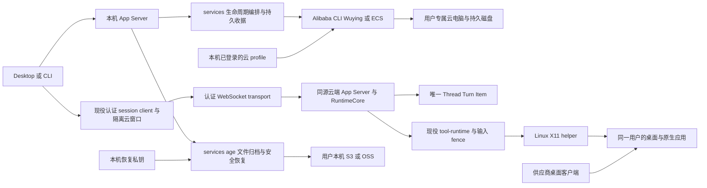

# Lime Cloud：BYOC 持久桌面方案与执行计划

状态：实施中，完整 Cloud 产品尚未验收。事实核对日期：2026-11-11。

### 将文件归档恢复到新云电脑（2026-11-11）

- 上一轮分类为 progress：已确认下载链真实 Electron、最终认证进程和 GUI 基础壳。root 本轮写集仅现有 Cloud 协议与归档服务、App Server 连接清理和分块、Desktop Main 归档入口、备份页、五语言、生成物和定向证据；Provider、CLI/TUI、Skills、发布和其他同期文件保持只读。
- 新云电脑的认证 App Server 为单次恢复生成临时 age 密钥。本机验证原密文 SHA-256 和 age 完整性后进行流式重新加密，不写本机明文；上传只携带目标临时公钥对应的密文，不发送原备份路径或恢复私钥。云端同连接按顺序接收分块，提交前取消、断开、超时清理，提交后状态未知需核对原目录。
- 目标仅允许用户 home 下新建 `lime-restored-<名称>`，校验和解包复用现役服务；Linux/macOS/Windows 恢复发布使用系统不覆盖操作，拒绝已有目录（包括空目录）。仅保存文件，不自动执行文件、恢复审批或断言登录可迁移。root 确认仍沿 Desktop Main → 同源本机和认证远程 App Server → 同一归档 owner，无新服务、端口或共享云账号。
- 验证退出条件：原身份不能解开重新加密的传输、错误摘要和篡改不发布、目标不覆盖、跨连接拒绝与断线回收；真实 Electron 备份页和源/目标进程验证后仍需实际用户对象存储、ECS 重建与新桌面应用读回。本轮不购买等待中的实例，不把本机模拟目标算作整机恢复通过。
- 已通过 Rust schema/生成客户端同步、Renderer 与 Electron 类型、定向 ESLint、五语言键集一致及 Cloud 设置/窗口 41 项现有回归；`test:contracts` 的协议、命令和其他检查通过，末项 `docs:boundary` 拒绝同期已在 Git 索引中的 `internal/exec-plans/release-v1.174.0-plan.json`，保留他人发布写集。原始日志位于 `.lime/qc/cloud-archive-restore-20261111/`。完整实机验收仍为 4/8。
- 最终 Renderer 构建、归档 Rust 回归 13 项和目标名称变更后重新确认的组件回归通过。真实 stdio/认证 WebSocket 联测和定向 Electron 共用 App Server SHA-256 `18f8e9f30c22616fc4f335c854ea9ca4dee739c56ffec70ac0b82ec73491f7d4`；验证跨连接拒绝、断线清理、错误摘要和篡改拒绝、已有目录不覆盖，以及从设置页把选中文件恢复到目标用户目录。证据 `process-summary.json`、`electron-summary.json` 和 `electron-restore-light.png`，阿里云元数据与文件选择结果使用显式夹具，目标为同机独立进程。
- 保留两次定向 Electron 失败：首轮选择器定位错误，第二轮发现更改目标名称后确认状态未重置，修正后最终重跑通过。通用 smoke 首轮 `noInvokeErrors` 失败；使用最终 Renderer、同一 App Server 和隔离 Electron 用户目录复验通过 24/24，覆盖重载和三个视口，证据 `shell-recheck/summary.json`。复验通过不表示已定位首轮 IPC 问题。
- 用户确认已完成阿里云浏览器授权，沿已有自有账号连接，不重复授权。释放前先证明同一份备份可恢复：验证原始摘要与解密完整性，在新桌面读回选定文件并记录结果；仍需明确用户知晓范围外数据会随原盘删除。文件归档验证不等于整盘备份，未完成跨实例验收前不启用服务端定时释放。
- 下一刀实机退出条件：用本轮源码构建并校验 Linux x64 guest；旧机用合成文件、原生应用和待排除的合成凭据演练，关闭应用后导出归档，再对旧机 StopCharging。新机从用户模板单独核价、购买并装配，用同一份备份验证文件与排除项，原生应用读回后才释放旧机。验证原盘确实已删除、新机仍可读回；若恢复失败则保留原盘，不以两个同机 App Server 或历史 guest 包替代。用户对象存储和账单分别核验，不为等待模型或存储配置保留收费机器。

### 云电脑加密备份直接保存到本机（2026-11-11）

- 写集为 Cloud 归档协议、现役 App Server 的连接边界与暂存、Desktop Main 的原生保存、既有备份页及五语言、生成物与事实源。复用现役认证连接和 age 导出，属于 Lime 自有 BYOC，未新增服务器、外网端口或云账号。
- 「备份」选择运行中的云电脑后，用云机文件路径、相对文件清单与 age 公钥导出，最多选 4 GiB。云端响应只返回当前认证连接的归档 ID、摘要和分块；断开、显式关闭或 30 分钟到期回收暂存。Main 在原生保存对话框选定的目录校验密文后发布，已有文件不覆盖，失败不留下目标文件。
- 最终 App Server 构建、contracts、Renderer/Electron 类型检查与定向 ESLint 已通过。`.lime/qc/cloud-archive-download-20261111/process-summary.json` 记录 5 项同源进程检查，包含跨连接拒绝、断线回收、未认证 loopback 拒绝、篡改不落盘及本机私钥恢复。
- 同一 App Server 制品的 Electron 定向门禁通过备份页操作、取消保存不写文件、校验并保存私有密文、使用本机私钥恢复且默认跳过敏感文件。证据为同目录 `electron-summary.json`；真实 preload/IPC、stdio 与认证 WebSocket，供应商元数据和保存路径使用显式夹具，没有创建 ECS。保留首轮测试把资源 `exists` 字段误作成功断言的记录 `electron-gate.log`；按现役合同改验 `status` 后通过。
- 通用 GUI smoke 首轮 23/24，唯一异常为 `report_frontend_debug_log` IPC，未捕获到 Cloud 命令失败；使用隔离 Electron 用户目录和最终 App Server 制品复验 24/24，通过重载与三个视口。保留 `gui-smoke.log`、原始结构化证据与 `shell-recheck/summary.json`；复验未重现异常，不声称已定位或修复日志 IPC 的根因。
- 架构责任 root 已确认依赖方向保持 Desktop Main → 现役认证 App Server → age 归档服务。此切片解决「旧云机 → 本机密文」；新云机恢复、备份与释放的联动仍未验收，整体验收 4/8（50%）。

### 对象存储归档传输（2026-11-11）

- 本轮写集为现役 `cloud_archive_service/transfer.rs`、定向回归、本计划及 `.lime/qc/cloud-s3-20261111/`。继续复用本机 App Server 与用户配置的 rclone，未新增依赖、服务或权限；其余同期改动保持只读。
- 上传仍使用经 SHA-256 和 age 文件头校验的私有暂存副本。实测 rclone 1.73.3 的单文件 `copyto` 拒绝 `--max-size`，移除冲突参数，由 Lime 暂存阶段执行大小限制。已存在的对象跳过并报未传输，不生成成功收据；实际测试覆盖相同内容、不同长度、相同长度但字节不同三种情况。该行为不等于存储端原子条件写入；不同客户端不应共用同一新备份键。
- 下载通过 `rclone cat` 流式写入本机私有暂存文件；写到字节上限后只再读一个字节判定是否超限，发现超限就终止传输。子进程必须成功退出，并通过摘要和文件头检查后，才发布到用户指定的新文件。
- 77 项 Cloud services 回归通过；现役 App Server 构建与独立导出/恢复进程通过。真实本机 SeaweedFS 4.13、S3 签名和 rclone 1.73.3 联测通过五组，包含上传字节独立读回、同键不覆盖、重启后下载、错误摘要/不存在的对象不发布，以及解密恢复并运行合成可执行文件。证据 `.lime/qc/cloud-s3-20261111/summary.json`。本轮没有使用用户桶、OSS 或另一台 Linux VM；未验证第三方登录或冷备后释放重购，整体验收仍为 4/8（50%）。

### Linux 锁屏诊断本地实测（2026-11-11）

- 当前 Linux helper 通过 38 项本地回归，包括执行中检测到锁屏后废止旧授权，以及解锁后拒绝复用旧授权。测试日志在 `.lime/qc/cloud-linux-lock-20261111/python-tests.log`。
- 使用通过 SHA-256 校验的 Ubuntu 24.04 ARM64 镜像，在隔离容器中运行真实 TigerVNC、Xfce、XInput 与 D-Bus。解锁时发现一个 Xfce Terminal 窗口；通过 Xfce 锁屏后返回 `linux_desktop_locked`，窗口列表为空；切换至不提供锁屏服务的隔离 D-Bus 后返回 `linux_desktop_lock_state_unavailable`，窗口列表仍为空。第一次夹具未给锁屏服务传递 `DISPLAY`，未计为通过；修正后证据在 `.lime/qc/cloud-linux-lock-20261111/desktop-session.log`。
- 本轮只追加验证证据与本计划，未修改产品源码、未创建云资源。容器结果未覆盖 PAM 人工解锁、现役 x64 guest 及 ECS 上的 App Server；仍待确认上轮 ECS 装配后适配器阻塞原因。完整实机验收仍为 4/8（50%）。

### ECS 自动装配实机联验（安装和首次连接通过，重连与输入仍待验证）

- root 继续持有 Cloud 装配服务、`electron/cloudGuest*`、`electron/native/linux` 及本计划的窄写集；其他 Provider、多模型、MCP、Skills、CLI/TUI、发布与无关改动保持只读，不启动子 Agent、不提交或建分支。
- 先只读核验用户 OAuth、共享网络和旧测试资源清理，再准备可信历史 Linux 包、摘要及精确清理脚本；重新核价后按已有授权购买一台专用 Ubuntu ECS，设置短期自动释放兜底，验证固定启动器、实际 TLS 上传、普通用户安装和认证任务/桌面连接。历史包只证明装配机制，不标作当前源码 Linux 新构建。
- 云管理凭据留在本机；原始安装 capability 与 guest token 不进入供应商脚本、收据、Renderer 或公开证据。测试安全组只允许当前出口 IPv4 `/32` 所需端口；不将该测试设置冒充产品自动放行。
- unknown 只检查原操作、不重复购买或上传。测试完成立即清理精确专用实例、磁盘、安全组与 keypair，保留共享网络；最终账单单独核验。整体 4/8（50%）口径保持，尚未验证的模型、第三方认证、对象存储和新环境恢复不计通过。
- 真实用户 OAuth 与广州共享网络核验成功；旧 UI、会话通道与快照测试实例均不存在。本轮原样核价 CNY 0.575699/小时，购买一台专用 Ubuntu 24.04 x64 ECS，独立确认加密系统盘并设置两小时自动释放兜底。首次规格读回未通过严格校验，只重查原购买操作后确认，未重复下单。桌面依赖准备通过，专用安全组仅允许本机出口 IPv4 `/32` 的 6080/8787。
- 当前本机管理二进制 `bb663d9ad685aa98c50bb9ee35b91c881cbcd4264077e3fb7a2558bd3a187089` 的 30 个相关源码与此前冻结清单一致。真实 Electron 验证确认界面、包选择回调、固定 Cloud Assistant 启动、钉住证书的 TLS 上传、普通用户安装、真实 macOS Keychain 保存连接、关闭临时服务、认证任务连接及 Linux `command/exec`。真实 noVNC 服务通过会话通道返回页面；未验证桌面画面或人工输入。包选择结果由显式回调提供，实际上传的是经 17 项清单文件及摘要校验的历史 1.173.0 Linux 包，未冒称本轮源码新构建。证据 `.lime/qc/cloud-runtime-live-20261111/electron-summary.json` 与 `installed-light.png`；首次云任务窗口截图仍在加载，只支持窗口建立及实际 IPC/命令证据。
- 真实 Electron 重开读回终态、已保存连接，未重新下发安装或上传；两次重开分别遇到隧道创建和远端连接失败，后续两次成功连接并执行普通用户命令，原因未定位。原生适配器默认 `disabled`；显式启用后得到 `blocked`，未确认具体锁屏或输入监视器原因，未关闭任何锁屏保护或扩大应用授权。保留 Electron 脚本自身的等待/提前断言失败，不能混作产品故障或宣称重连全绿。
- 云端只读诊断确认 Xvnc、Xfce、App Server 与查看器都在运行，任务与查看器只监听回环；临时安装阶段已 `finished`，上传包与临时 TLS 私钥已移除。StopCharging 查询一次失败，随后精确读回原实例 `Stopped`，未重发停止；已在北京时间 06:34 独立确认测试实例、系统盘、安全组及 keypair 不存在，保留共享网络。采购、服务诊断及清理摘要在同一证据目录；历史三台专用实例/系统盘的 6 次精确月账单查询未返回明细，不能据此推断零费用或结算完成。
- 本轮写集为本计划与忽略目录 `.lime/qc/cloud-runtime-live-20261111/` 的实机脚本及证据，未修改产品代码、Protected 写集或 Git 历史。装配及连接 owner 仍为 current；没有第二 runtime 或运营方账号。整体实机 4/8（50%）。下一刀先核对当前构建的 Linux guest 与新装配后原生适配器阻塞原因、正常锁屏后人工恢复路径；然后以专用 Provider 和用户对象存储完成真实任务与恢复，不为等待外部配置保留实例。

### 当前切片：ECS 装配接线

- 本地接线已实现：`runtime_install` 固定云助手启动器、`cloud_assistant` 共用提交/精确查询、协议及生成 schema/client、Main `CloudGuestInstallations`、原生包选择、TLS 校验、加密恢复、自动连接保存和五语言安装弹窗。root 继续持有本段窄写集；其余 Provider、多模型、MCP、Skills、CLI/TUI、Windows 发布与无关脏改动保护，不启子 Agent，不提交、推送或建分支。
- 令牌先交给现役 `ElectronSecureCredentialStore` 保存，随后关闭临时服务。关闭响应未知时保留已保存连接，仅继续关闭，不再次上传或覆盖令牌。查看器密码保留于加密安装记录，显式查看只打开 Main 原生对话框，不返回 Renderer。关闭弹窗继续后台安装；退出客户端中断本机传输，重开只显示原状态，显式恢复才查询原操作。
- 定向回归发现 safeStorage 状态原子替换可令已打开快照的 `nlink=0`，旧检查误报损坏；已允许已打开的无链接快照，继续拒绝多重硬链接，补实际并发写入/读取及硬链接拒绝测试。初轮 2 项失败保留于验证摘要；最终相关 9 文件 96 项、37 项 Linux 安装/归档/TLS/helper、3 项固定启动器验证通过。TLS 客户端测试使用真实监听和证书校验；服务安装子进程仍是显式夹具，不冒称云端安装。
- 同一 App Server 产物 `bb663d9ad685aa98c50bb9ee35b91c881cbcd4264077e3fb7a2558bd3a187089` 的真实 stdio 验证通过 3 组：单次固定启动与证书返回、真实进程重启恢复终态、丢失提交响应后按原标签查询且不重发。最初验证脚本误用远程客户端的关闭方法，已改为现役 sidecar 关闭方法；原失败单独保存，产品逻辑未因该脚本失败放宽。
- 真实 Electron 安装界面验证通过两项确认、原生选择回调到 Main/IPC/现役 Rust 请求、单次提交、原结果重读和窄屏弹窗。native picker 选择结果和供应商失败均为明确夹具，未创建云资源或执行 root 启动器；安装失败不会保存连接或显示就绪。截图已检查，窄屏结论只覆盖安装弹窗。具体结果与最终构建验证见 `.lime/qc/cloud-runtime-install-20261111/validation-summary.json`。
- 最终同产物 Electron 基础壳 smoke、Renderer/Electron 类型、完整 contracts、ESLint、格式与 diff 检查通过；Cloud 文案五语言各 234 键且键集一致。失败提示已按缺少桌面依赖与需恢复原操作分开；已保存凭据后的关闭未知不妨碍显式打开连接，并可继续原清理。原始失败和最终成功分别保留，不以重测通过冒称所有未知原因已修复。
- 架构责任 root 确认继续复用现役 App Server、runtime、工具和连接 owner；本切片为 Lime 自有 BYOC 装配（source-unavailable），不是复制上游私有 Cloud。新增组件均为 current；无新增 compat/deprecated 或第二业务后端。实际首轮 ECS 固定启动器/上传/系统用户/自动任务连接仍须实机联验，真实模型、第三方认证、用户对象存储与新环境恢复按既有第 4/5/6/8 组保持开放；整体仍为 4/8（50%），不表示可发布。
- 上轮为 progress，已修改原仓库安装/归档/临时 TLS 代码并取得 37 项 Python、2 项打包往返证据；本轮继续完整 Cloud 目标，不降低 8 组验收范围。
- root 认领 `services/cloud_desktop_service` 的固定运行包入口、共用云助手查询与收据的必要接线；Cloud 协议及生成物；`electron/cloudGuest*`、现役安全存储/云窗口的最小接线；Cloud 安装入口、五语言和对应回归。Provider、多模型、MCP、Skills、trace、CLI/TUI、Windows 发布及其他脏改动保护，不启动子 Agent。
- 固定 root 启动器只准备专属普通桌面用户与短期 systemd 安装服务，不将上传内容作为 root 执行。目标 IP 来自精确 ECS 响应，临时服务只绑定该私网网卡；不自动改安全组。云助手只返回结构化公证书和操作身份，原始 capability/guest token 不进入供应商 API 或普通收据。
- Main 用 native picker 选择可信本地 `.tar.gz`，读取相邻摘要收据并验证固定描述符；加密持久化临时 capability 与操作恢复信息，再启动后台装配。客户端只信任管理路径返回的公证书，正常验证目标 IP、拒绝重定向、屏蔽底层错误，凭据直接进入现役连接 owner。安装状态通过本机 Host 投影，Renderer 不读 token、文件路径或任意 endpoint。
- 预算 `budget:normal`，风险 P1；退出条件为 fixed launcher/持久 unknown/丢失响应恢复、Main TLS/私有恢复/自动连接保存、产品入口与相应 schema/contracts/类型/真实进程验证。云端实机、模型任务和其余整组验收仍单独核验；不把本地夹具计入整体完成数。架构责任 root。

### 当前切片：可信运行包安装与临时上传入口

- root 认领 `electron/native/linux/linux-guest.py`、同目录临时 bootstrap 与定向回归、`scripts/app-server/linux-guest-build.mjs` 的归档交付，以及本计划、既有架构/来源账本的相关段落。现役 Provider、MCP、Skills、trace、CLI/TUI、Windows 发布和无关脏改动只读，不启动子 Agent。
- 先交付可运行的 Linux 安装入口：构建输出同源运行包与摘要；受限解包复用现役安装器，验证压缩包、清单与完整文件白名单后才安装。普通用户执行；不将上传代码作为 root 执行，不新增 runtime owner。
- 临时 TLS 服务只接纳固定包、固定操作与 capability 的 SHA-256，证书由 guest 生成并经已认证的管理路径交付公证书。原始 capability 与 guest token 不进入云助手脚本/输出、普通收据或 Renderer。只提供状态、一次安装、安装后凭据交付和关闭，强制期限内退出，不成为常驻服务。
- 本切片先验证运行包安全解包与真实 TLS 传输边界；随后接云助手启动、Main 的证书校验/私有操作恢复和保存连接。未接线前不宣称购买后自动装配完成；不虚构已发布 Linux 下载 URL，不自动改安全组。本地包由用户明确选择可信来源，正式发布仍须走现役制品发布 owner。
- 风险 P1，预算 `budget:normal`。退出条件是安装入口与临时服务均有真实本地进程证据、拒绝路径和强制退出检查；云端装配、真实模型任务及完整产品验收分别记录。架构责任 root；本切片不改变整体 4/8（50%）。

原生 Linux x64 构建命令如下。输出目录必须不存在；相邻的 `.tar.gz` 和 `.tar.gz.json` 也不覆盖已有产物。目标机需已安装桌面依赖、为普通桌面用户启动 systemd user manager；运行包安装不创建系统用户。

```bash
node scripts/app-server/linux-guest-build.mjs --out "/tmp/lime-linux-guest"
python3 "/tmp/lime-linux-guest/install.py" install-archive \
  --archive "/tmp/lime-linux-guest.tar.gz" \
  --archive-sha256 <ARCHIVE_SHA256> \
  --manifest-sha256 <MANIFEST_SHA256> \
  --start
```

两个摘要取自可信构建输出的 `.tar.gz.json`；摘要验证的是选定内容的完整性，不替代制品来源信任。临时 TLS 入口的公证书必须由可信管理通道取得，客户端仍需验证证书与目标 IP；不得关闭 TLS 验证。此入口监听配置中的单一 IPv4 的 8787，正常 runtime 继续监听 loopback；安全组与云端接线尚未由本切片完成。

- 本地验证已通过：37 项 Python 安装/归档/TLS/helper 回归、2 项真实归档打包往返与无覆盖测试、定向 ESLint、脚本治理、语法与 diff 检查。证据 `.lime/qc/cloud-bootstrap-20261111/validation-summary.json`，原始成功输出为同目录 `python-tests.log` 与 `package-tests.log`。TLS 检查使用真实监听、证书验证、上传与安装子进程；子进程是明确的校验/合成凭据夹具，不安装桌面或执行模型。
- 新增空目录约束曾使符号链接测试在打开源文件前失败；已修正测试前置为独立私有空目录，保留原来的符号链接拒绝断言，未放宽产品检查。后续完整 37 项通过；此前失败单独记入验证摘要。
- 历史 Linux 实际运行包（126,874,659 bytes，版本 1.173.0）由新解包器以已记录压缩包/清单摘要只读校验，18 个文件与清单完全相符。该结果不证明新 Linux 构建、安装或运行；未执行旧二进制，临时展开目录已由验证工具清理。
- 实际写集为 7 个 Linux 安装/临时入口/归档构建及回归文件，以及本计划、来源账本、既有架构/命令与两份 README 的相关段落。复用唯一安装器、私有锁和现役 runtime，均为 current；无新增 compat/deprecated 或第二业务后端。没有改动 GUI/RPC/Provider 或创建云资源；因此本轮未重建 Rust、未跑 GUI 门禁，不将已有 GUI 证据升级为新装配验收。
- 下一刀仍由当前 root 接云助手的固定启动脚本与 Main 的可信公证书接收、私有操作恢复和连接保存；用户令牌不能借普通收据传递。完整产品保持 4/8（50%），目标继续 active；没有提交、推送或建分支。

## 目标、写集与退出条件

首版提供用户自付的 Linux 完整桌面、原生应用与 Computer Use。软件、文件和可保留的登录状态复用；运行期与持久状态分离。先走通阿里云，AWS、Google Cloud、Cloudflare、腾讯云保留待实现。用户已授权测试资源购买、必要装配和启停；无影和 ECS 专用测试资源已释放。本轮集中实机验收已完成原盘快照恢复与选定工具链保留；只做本地验证时不购买云资源。

本任务拥有 `services/cloud_desktop_service*`、`services/cloud_archive_service*`、`app-server-transport/websocket_auth`、必要协议/消费者接线、`electron/native/linux`、Cloud 设置组件、对应五语言和本计划。Provider、多模型、MCP、Skills、trace、Windows 发布和其他会话改动是保护写集；共享 manifest/锁文件只合并必要依赖。未经用户要求不提交、推送、建分支。

唯一主链保持 `Product Surface -> App Server JSON-RPC -> RuntimeCore -> Thread/Turn/Item`。云生命周期管理和桌面任务执行分开；不引入第二 runtime、转录 store 或 Codex 托管服务。退出条件包含真实远程任务、Linux 原生应用操作、接管撤销、保盘启停及云端备份恢复，不以设置页面或单元测试替代。

## 当前实现与来源

| 层 | current owner 与实现 | 验收边界 |
| --- | --- | --- |
| 生命周期 | `lime-services::cloud_desktop_service`；Wuying 与 ECS 核价/购买/绑定/查询/启停/快照/释放 | ECS 真实 Electron 模板购买、正常重启恢复、启停、快照创建/恢复和释放通过；最终账单仍待核验 |
| 协议 | `cloud/desktop`，沿现役 protocol、App Server、typed client、Electron JSONL bridge | 真实 stdio/WebSocket 边界、Cloud 购买与生命周期 Electron 链已验证；不证明模型 Turn |
| 凭据 | 官方 CLI 浏览器 OAuth 与独立私有配置；高级设置可选择已有本机 profile | 真实用户授权与重启保留通过；不读取或输出 profile 密钥，管理凭据不进入云 VM |
| 操作恢复 | 私有持久收据、排他文件锁、先落盘 unknown 再发请求、相同 operationId 不重发 | accepted 只表示受理；结果未知时查询原收据与资源，不自动重新购买 |
| 桌面执行 | `tool-runtime/computer_use` 发现 Linux 资源；Python X11 helper 使用现役权限/fence | ECS Xfce 的输入、截图、取消、锁屏拒绝、接管和撤销已实机通过；Wuying 镜像因锁屏状态服务缺失而 blocked |
| 远程认证 | 从 Codex `websocket-auth/src` 整目录复制到现役 transport；Bearer、JWT 与握手校验 | 非 loopback 无认证拒绝，带 Origin 拒绝；公网使用受保护 WSS 入口 |
| 管理/执行边界 | WebSocket processor 禁用本机云管理、恢复私钥、rclone 操作，只允许公钥导出 | 公共 JSON-RPC 和真实 stdio/WebSocket 进程边界已通过；云机远程任务未验收，Bearer 不是细粒度任务权限 |
| 加密归档 | `cloud_archive_service`：age X25519、公钥导出、校验值、受限解包、新目录恢复、rclone 加密文件传输 | 云端公钥导出、本机新目录恢复与恶意归档测试通过；用户对象存储和应用恢复未验收 |
| UI | Settings / Integrations / 云电脑，电脑与备份两页签，连接已有、模板购买弹窗和隔离远程任务窗口 | Linux 实机认证连接与命令执行、真实 Electron 模板购买/正常重启恢复通过；真实模型任务未验收 |
| 其他云 | 仅待实现标签 | 无可点击的假能力或空供应商适配层 |

源码基线：Lime `748e3c702502adf8cdc69fb9c0324cafbcec2bb2`；Codex `1885417cd45a8da5bfdeb7864a5380a7481d48f2`。认证整树收据与必要适配见 [复制账本](../refactor/cloud-desktop-copy-ledger.json) 和 [机器差异报告](../refactor/cloud-desktop-source-copy-report.json)。Linux helper、BYOC 控制和界面为 Lime 自有实现，登记 `source-unavailable`；不把 Codex 私有 Cloud 产品标成已复刻。

## 架构与安全边界

采用三个职责层：生命周期编排依赖资源合同；供应商适配处理云 API 与计费差异；桌面执行继续复用同源 App Server 与工具 owner。仅有阿里云真实适配时不提前建立四套空工厂、插件注册或通用云 SDK。



Desktop 已接入认证远程窗口并通过 Linux 实机部署、认证连接及本机权限隔离验证。通用 VM 的 Xfce/Xvnc/noVNC 装配、输入协调、旧 fence 拒绝和人工接管已实测；查看器经 SSH 隧道连接，仍是独立的明确入口。真实模型任务与完整浏览器/密钥库恢复分别验收，不由桌面连通推断。

云管理凭据、transport 身份、恢复私钥分用途。本机恢复私钥不发送到 VM；远程公钥导出不自动获得管理或恢复权限。运行中的云机仍持有被授权的工作明文和应用 token；备份加密不等于运行时隔离。同一 OS 用户下的多个 Agent 共享被攻陷的影响范围，不能用不同 Agent 名称声称安全隔离。

私有收据目录检查属主与权限；Unix open 使用 `O_NOFOLLOW/O_NONBLOCK/O_CLOEXEC`，open 后核验 regular file、属主、0600 与单硬链接。操作摘要不返回购买 spec、完整请求或凭据，仅含恢复所需的操作信息与资源标识。固定目录合同内损坏或身份不一致的收据失败关闭，不静默丢弃未知操作。

## 产品交互

- “电脑”显示云端名称、运行状态和当前可执行动作。资源 ID、profile 放入可展开详情；名称未知时显示未命名电脑。加载失败不显示误导空态。
- “添加电脑”复用一个可访问弹窗，分连接已有与购买无影；规格与磁盘放入次级展开区。关闭恢复焦点，关闭的弹窗不保留 modal 锁。
- 购买先核价并显示币种、运行小时价格和额外费用；报价到期自动禁用购买。勾选确认后才发单台、无 GPU、按量、无续费购买。同步 ref 防双击；请求发出后关闭重开仍只查原 operationId。
- 启停/快照/释放确认精确资源；除启动外需确认工作已保存。释放仅对已停止的按量 Wuying/ECS 展示，额外确认永久丢弃磁盘；ECS 说明保留盘和附属资源费用。accepted 不展示完成，过渡状态和已受理但尚未观察到目标状态的操作每 5 秒查询，后者自动观察最多 10 分钟，之后保留手动刷新。
- 释放受理或响应未知时只查询原收据；云端核验精确资源不存在后才显示已释放并移出活动列表，保留操作历史。查询失败就地显示错误并保留资源，不重发删除，也不宣称快照与共享资源费用已结束。
- 最近操作来自持久收据，默认展示 5 项，可展开到服务返回的最近 50 项，支持原编号查询。底层保留同 ID 不重发保证；当前不提供任意清除 unknown 收据的按钮。
- “备份”默认选择本机文件，也可显式选择运行中、已配置任务连接的云电脑。云端导出先加密，再由本机保存；恢复在本机读取私钥。归档成功显示尚未恢复验证，文件恢复成功仍需验证应用；不会以导出成功自动删除原资源。
- “从快照恢复”先输入原盘和快照编号并查询归属、可用性，变更目标即清除查询结果与确认。停机、保存工作、明确覆盖快照后修改且输入精确电脑 ID 才能回滚。创建受理不等于快照可用；恢复受理不等于应用恢复成功。
- 回滚未验证时保留原操作，关闭重开只查询该编号。启动进入桌面验证文件、应用和登录后，再从原收据明确记录用户验证；重启客户端后也可从最近操作查询并验证。不会自动把 Running 当作恢复完成。
- 浅色、深色、跟随系统共用现役语义 token；使用现役 Settings primitives，不新增卡片墙、营销摘要或另一套导航。文案覆盖五语言。

## 阿里云选型与真实测试

无影与普通 Linux VM 都保留在阿里云适配中。实际首条链路采用 Wuying Ubuntu 24.04 ASP 镜像，因为能立即得到完整桌面和官方查看端；ECS 更便于自主管理桌面/锁屏装配，但需要承担这部分工作。该选择只证明已走通的部分，不证明无影总体成本最低。

测试资源：广州区，4 vCPU / 8 GiB，80 GiB 系统盘，无数据盘、无 GPU、按量、无自动续费。当次 API 报价 CNY 0.754496 / 运行小时，存储、网络、快照等另计，不作为未来订单价格保证。

无影资源 ID、profile、重建参数及原始收据保存在本机私有 `~/.local/share/lime-cloud-test/`，不复制用户凭据到仓库。该无影测试机已释放。其后的普通 ECS 原生装配与验证见下方 Linux 切片，不复用已释放的无影 ID。

| 实测 | 结果与限制 |
| --- | --- |
| 完整 Linux 桌面 | 官方客户端可进入 Ubuntu 24.04 GNOME / X11，DISPLAY=:1，Python 3.12.3 |
| 停机后保盘 | StopCharging 后启动，成功读回 `~/lime-persistence-probe.txt` 中原验证标记 |
| 产品服务绑定与停机 | Live test 通过 `CloudDesktopService` 绑定同一真实资源并发出 StopCharging；最后 Describe 确认 Stopped |
| 费用状态 | API 未暴露实际 stoppedMode，`computeReleased=null`；只证明停机和保盘，未用账单实证计算停费 |
| Linux helper | 已装官方 `python3-xlib/python3-pil`；display 和 input monitor 可用，unlocked=false，readiness=blocked |
| 阻塞原因 | ASP 镜像缺 `org.gnome.Shell.ScreenShield`；`org.gnome.ScreenSaver.GetActive` 返回 ServiceUnknown。缺失不能当作 unlocked |
| 工具链 | 目前只有已测 Python；Node、Go、Java、GitHub/Railway/Cloudflare CLI 与浏览器认证复用未逐项验收 |
| 最终释放 | 按用户“30 分钟内复用则关机，否则释放”的最新授权，向精确测试机发出 DeleteDesktops；最终 Describe 返回 `Desktops: []`。快照与办公网络下的付费网络包查询均为空；本地保留 release 回执和重建参数 |
| 当前资源状态 | Released，系统盘随实例释放；未保留收费快照或网络包。历史已发生费用以供应商账单为准 |

测试资源策略：预计 30 分钟内确实复用时请求 StopCharging 并核对 Stopped；否则导出主要证据后释放。该策略已用于本次精确资源清理，没有配置自动计时执行器，不能声称客户端关闭后仍会自动释放。此测试机只需保留本地证据和可重建参数，用户选择丢弃其测试系统盘；产品用户的持久环境必须先完成可恢复备份，备份失败时保留原资源。30 分钟是本次操作偏好，不当作所有规格的成本平衡点。

ECS 如需让倒计时在 Lime 退出后仍生效，可使用用户账号的 [ModifyInstanceAutoReleaseTime](https://api.aliyun.com/api/Ecs/2014-05-26/ModifyInstanceAutoReleaseTime)。供应商最短为半小时、秒向下取整；恢复使用前必须取消并通过 `DescribeInstances.AutoReleaseTime` 确认撤销。该接口是定时删除而非按空闲判断，只适合已核验可恢复备份且明确授权的按量电脑；未通过新机恢复前不启用此选项。

下一次确需实机验收时，重新核价购买并验证桌面/锁屏装配，或依据证据转向通用 Linux VM；不通过禁用锁屏检查交付 Computer Use。集中验收后按上述 30 分钟策略收尾。

## 归档与恢复合同

日常复用保留持久盘；平台内恢复使用快照；低频跨设备文件冷存使用 age。三者不混为整机休眠。文件归档不保留 RAM、未保存工作、TCP 会话、设备绑定认证、任意 OS 安装或任意跨架构迁移。

释放后重建优先复用用户账号内的启动模板和可信 Linux 运行包：先核价，再新购并装配，使用新任务身份；工作文件从已验证的加密归档恢复。恢复私钥不进入新云机，恢复结果不覆盖已有文件、不自动运行代码。复用工具链与可导出的配置分别验收；设备绑定的浏览器或 CLI 登录失效时，要求在新机重新授权。

阿里云 ECS 的 [CreateImage](https://api.aliyun.com/api/Ecs/2014-05-26/CreateImage) 支持从系统盘快照制作自定义镜像；必须在释放前创建并通过 [DescribeImages](https://api.aliyun.com/api/Ecs/2014-05-26/DescribeImages) 确认可用。镜像可作为缩短装配时间的独立选项，默认只用不含用户凭据的基础环境，要求私有、加密并核对快照保留费用。镜像保存整个盘，不能套用文件归档的排除规则；当前尚未实机验证此选项。

默认排除已知登录资料、私钥和缓存路径；即使用户允许敏感文件，已知云管理目录、Lime 控制目录与恢复身份仍排除/拒绝。路径过滤不是通用秘密检测，任意重命名文件中的 token 无法保证被识别；用户需检查选择范围。应用须先关闭或静默化，不能把普通文件复制当作数据库在线一致性备份。

恢复校验可信密文 SHA-256、age 完整性、大小上限、manifest、路径与条目类型，只发布到新目录；Unix 文件仅恢复所有者执行位，不执行归档脚本、不恢复旧审批或 lease。相同用户目录内的文件恢复不证明 Chrome/keyring/设备认证可迁移。S3/OSS 使用本机已配置 rclone，要求 `.age`、可信导出摘要与合法 age 文件头，上传使用私有暂存副本，下载按字节限制写入。已通过本机真实 S3 兼容服务联测；尚无用户对象存储实机验收。age 归档不提供跨版本增量去重。

## 验证、缺口与完成口径

### 购买模板自动填写（实施中）

- 2026-11-10 用户要求继续减少购买步骤：默认用官方 CLI OAuth 打开浏览器授权，不要求客户复制 AccessKey；专用连接元数据、刷新令牌配置与工具安装目录位于 `cloud-desktops/auth/`，不进入 Renderer、云机、普通归档或操作收据。仅本机 transport 可调用 `connectAlibaba/readAlibabaConnection`，授权任务持跨进程租约，读取不会自动重启已中断登录。
- 同一负责人 root 接续前轮写集：仅新增该 services owner 的 auth/cli 子模块、连接与模板购买组件、Cloud 协议/生成物、五语言和测试；Provider、MCP、Skills、trace、发布热区保持只读。复用既有 lime-replication/lime-design-language 边界；阿里云 BYOC 属用户明确要求的 Lime 自有服务，不能复制 Codex 托管 Cloud/登录。
- 官方依据：`https://help.aliyun.com/zh/cli/oauth-credentials` 与 CLI v3.5.2 源码。首次账号管理员可能需安装 official-cli OAuth 应用并允许对应身份；该云端前置不能由 Lime 静默绕过。CLI 缺失时固定版本下载、验证 SHA-256，仅提取可执行文件到本机私有目录，不全局安装。
- 用户再次明确开源边界：不得把 Lime 运营方阿里云账号、SaaS 代理或跨账号委托作为产品使用前提。现役官方 CLI OAuth 仅授权用户自己的账号，没有 Lime 云账号参与。资源、付款、对象存储和可撤销权限全部由用户拥有；连接凭证仅留用户本机。
- 纠正候选方案口径：`https://help.aliyun.com/zh/ram/configure-oauth-for-alibaba-cloud-cli` 明确 `/internal/ram/usersts` 目前仅允许官方 CLI 应用使用；普通自建 Lime OAuth 应用不能直接当作官方 CLI 的云 API 凭证替代。RAM 管理员可在浏览器首次管理员授权时自动安装 official-cli；主账号不需再手工分配自己，普通 RAM 用户/角色仍遵守管理员分配。
- 非 CLI 的购买候选为用户自行登录官方 ROS 控制台并确认部署公开模板；只用用户账号和公开配置，不携带管理令牌。其快捷部署链接参数、模板发布和购买后自动管理仍需独立验证，不能把方案讨论标成已实现，也不能用当前 ECS 启动模板假装跨账号可共享的 ROS 模板。
- 用户截图暴露连接失败被一律误写成“CLI 应用权限”：现在区分连接状态读取失败与授权取消/失败；读取重试只读原状态，不重新授权。对应前端 35 项、services 49 项及协议/contracts 已通过；当前 Renderer 全量类型、更新后二进制与真实 Electron 门禁仍在执行，完整实机完成度继续为 4/8。
- 当前补验：完整 Renderer tsc 与 typed client 通过；泛型模板规格合并修复后 5 项定向购买回归再次通过，五语言各 182 键一致。证据汇总 `.lime/qc/cloud-auth-template-20261110/validation-summary.json`；其中 Gate A 是真实 React + 显式云接口夹具，不能替代官方 OAuth、收费购买和 Desktop Gate B。更新后的 App Server 构建与重新启动的完整 GUI smoke 仍在运行，未标完成。
- 开源账号边界复核：现役代码没有 Lime 运营方阿里云账号或自建 OAuth Client；用户通过阿里云官方 CLI 应用授权自己的身份。该边界已同步架构与命令事实源；不把 Lime 产品登录当作云资源授权。App Server 正式构建及 6 项 stdio/WebSocket 进程检查通过，证据 `process-summary.json`；完整 GUI smoke 的 24 项中 23 项通过，唯一失败为 `report_frontend_debug_log` 的 IPC 错误，证据 `.lime/qc/project-gates/cloud-auth-template-20261110-root-final/shell-01-electron-smoke/summary.json`，未标全绿。Cloud 定向 Electron 授权/模板/原操作恢复交互继续独立验证，不以显式 CLI 夹具替代真实 OAuth 或收费 API。
- Cloud 定向 Electron 交互已通过：真实 preload/IPC、当前 App Server 与显式 CLI OAuth/模板夹具完成自动核价、单次购买 unknown、整个进程重启后保持连接并恢复原操作；授权、读取模板与 RunInstances 均只有一次，console/page errors 为零。证据 `.lime/qc/cloud-auth-template-20261110/electron-summary.json` 及四张截图，二进制摘要与进程门禁一致。两次测试退出均按有界策略强制终止自身 Electron，因此仅证明进程终止后的恢复，不证明正常退出；首次测试在共享首次设置 helper 的瞬态按钮等待超时，保留 `/tmp/lime-cloud-auth-electron-final.log`，定向脚本改为观察实时首次设置状态后通过。官方浏览器 OAuth、收费购买、通用 smoke 错误与完整实机 4/8 缺口继续保留。
- 用户完成真实官方浏览器 OAuth，当前本机 App Server 返回 connected，证据 `live-oauth-summary.json`；专用私有配置与默认 CLI 配置隔离，未读取或输出令牌。随后在独立进程读取连接，并通过官方 STS 只比较测试资源账号归属，结果一致。真实云调用暴露全局区域缺失：CLI 在转发 API 的 RegionId 前先校验 `--region`，OAuth 配置没有默认区域时失败；同一身份加入 `--region` 后真实 DescribeLaunchTemplates 成功。统一 `call_cli` 已补齐两个参数，auth fixture 模拟该前置校验，49 项 services 回归通过（`/tmp/lime-cloud-auth-region-services.log`）。新二进制重建与产品内实测仍需续收，不能用修复前进程证据代表修复后代码。
- 按已有测试授权在用户账号中新增一份专用 Linux 启动模板，未购买实例；精确 ID 与归属只保存在本机私有测试 state，清理时沿原记录处理。第一次 App Server 重建遇到同期 `fuzzy_file_search` 与 manifest 尚未接齐导致的缺失依赖，未改动该保护写集；确认该依赖已由同期实现补齐后重建，日志 `/tmp/lime-cloud-auth-region-appserver-build2.log`。真实 Electron 无技术字段核价/购买/恢复脚本已准备，必须等待修复后二进制；本轮尚无收费购买或新的桌面实机验收。
- 2026-11-11 集中实机补验：区域修复后 App Server 重建通过；使用正式 `prepareElectronAppServerAssets` 冻结产物和运行闭包，摘要 `1cae08e189ab27e75e094edc419793c254b61bb18049a8f56a43e253618a4d1b`。同产物 6 项 stdio/WebSocket 检查、真实用户 OAuth 的重启保留、账号归属比较、模板读取与精确模板版本核价通过。真实 Electron 在用户自有账号完成模板选择、自动核价、明确费用确认、单次购买、正常退出重启恢复、StopCharging 和释放；技术字段输入为 0 项，各步骤 console/page errors 为零，退出均为 normal。证据 `.lime/qc/cloud-auth-template-20261110/live-{quote,purchase,recover,stop,release}-summary.json` 与对应截图/退出记录；未使用 Lime 云账号、凭据代理或 mock 云 API。
- 实测按量报价 CNY 0.575699/小时，系统盘实际加密已核验，创建后设置两小时自动释放兜底；只证明实例 provisioned，未安装桌面或执行模型 Turn。2026-11-11 00:15（北京时间）已独立核验实例、系统盘、快照、专用模板、安全组、云端 keypair 全部不存在，保留共享 VPC/VSwitch，证据 `live-cleanup-summary.json`。日账单接口查询成功但本次精确资源尚未返回条目（`live-billing-summary.json`），不解释为零费用或最终结算。
- 保留自动化失败边界：首次模板定位使用了过于精确的隐式 label，改为实际 combobox 后通过；首次购买测试在禁用收据按钮出现时过早读取并退出，独立核验无持久收据、无同名实例，确认前置检查未提交后修正等待条件，随后完成一次实际购买。清理脚本的只读查询参数 `SourceDiskId` 与 keypair PageSize=100 先失败，按官方 CLI help 修为 DiskId 与 50；原变更计划去重、只查询已删除对象后完成核验，没有重复删除请求。原始失败日志保留，不将其抹为首轮通过。
- 默认自动读取模板，单一模板自动选中并核价，多模板在选择后立即核价；支持区域显示名称和高级自定义区域，技术参数收在高级设置。切换账号/区域立即清空旧报价与确认；已提交购买继续沿原收据恢复。
- 用户补充要求：选择购买模板自动填写，默认入口不逐项要求网络、镜像和密钥 ID。负责人 root，P1；写集限 Cloud 协议、同 owner 的 ECS 模板模块、购买组件、五语言、对应测试和生成物。
- 复用阿里云 `DescribeLaunchTemplates` 与 `DescribeLaunchTemplateVersions`；只投影模板名称、编号和版本，选定版本仅提取现役 `EcsDesktopSpec` 字段，继续使用原核价、确认、购买和未知恢复状态机。模板不获得执行任意 UserData、密码或额外资源的入口。
- 模板读取不创建云资源；实际下单仍为单台按量、加密系统盘和现役安全合同。默认模板选择，手工字段收进高级设置；缺少模板或不适用 Linux 桌面时给出具体反馈，不静默改买另一规格。
- 退出条件：实际供应商模板合同、后端过滤与过期版本回归、自动填充/重新核价/确认交互、五语言、协议生成及真实 Electron 验证。旧购买门禁的结果不能覆盖新增模板入口。

### ECS 产品内购买（实施中）

- 上一目标回合分类为 progress：完成了快照实机证据复核、加密三态和冻结 Electron 验证；完整目标保持不变，本切片补上普通 Linux VM 只能外部购买的产品缺口，不等待模型/对象存储凭据才继续开发。
- 预算 `budget:normal`，风险 P1，负责人 root。窄写集为 Cloud 参数、同 owner 的 ECS 购买子模块与共享私有购买收据、购买表单、对应测试、五语言和必要生成文件；共享 App Server 接线只改必要分支。Provider、MCP、Skills、trace、CLI/TUI 和发布改动继续避让。
- 先核验现有交换机、安全组同 VPC、Ubuntu x86_64 镜像、无 GPU 规格与 SSH keypair；不创建或修改共享网络，不读取私钥。新购固定一台按量 VM、ESSD 系统盘、显式加密、公网按流量、无自动续费。支持的实际 API 以本轮官方元数据为准，证据目录 `.lime/qc/cloud-ecs-purchase-20261110/`。
- 同一报价须显式确认并在购买前再次核价；先持久 unknown，再发送带唯一 ClientToken 和操作标签的 RunInstances。响应丢失后只按原操作查询，不换编号重购；查询得到的资源需匹配原规格才能绑定。实例创建不等于桌面已经安装。
- 退出条件为后端故障/幂等/未知恢复回归、实际 JSON-RPC 边界、五语言和真实界面验证；集中实机购买与费用单独核对。测试资源继续遵循 30 分钟复用策略，无模型凭据时不保留收费机器等待。
- 实现已接入普通 ECS 购买、共享 `useCloudPurchase` 与确认组件。锁内只读预检失败返回明确 `notSubmitted + submitted=false`，重新报价需再次同意；任何已发送或通信中断仍保留原操作，不按一般异常重购。历史购买同报价永远去重，同名未决购买保持阻断；旧实例经精确释放核验后可用新报价重建。
- 当前最终 41 项生命周期/购买回归、27 项 React 组件回归、完整 Renderer 类型、typed client build、contracts 和五语言一致性已通过。新增释放后重购及 notSubmitted 语义均通过最终回归；真实进程与 Electron 门禁尚未结算，不能以旧二进制结果代替。本机高负载下中止重复类型/已漂移 Renderer 构建及超大 App Server 单测目标（未宣称通过），保留 `.lime/qc/cloud-ecs-purchase-20261110/interrupted-*.json`；改用当前二进制与真实公共 JSON-RPC 进程验证，并在产品源码稳定后顺序重跑 Renderer。窄屏和明暗 Gate A 证据位于 `.lime/qc/cloud-ecs-purchase-20261110/ui-summary.json`；只含显式供应商夹具，不计真实购买或模型任务。

### 集中实机验收切片（进行中）

- 负责人 root，风险 P1；沿现役本机 `cloud/desktop -> RuntimeCore -> Alibaba CLI` 操作真实测试磁盘。写集限快照根因修正、相关回归和本计划，其他产品模块保持保护写集。
- 重新报价：广州 ECS `ecs.c7.xlarge`，Ubuntu 24.04，4 vCPU / 8 GiB、80 GiB ESSD、公网按流量，当前 CNY 0.9833979/运行小时，流量与快照另计；报价不代替最终账单。
- 专用安全组仅允许操作者来源 SSH；桌面与远程 App Server 继续只监听 loopback。购买前记录 unknown 和唯一 ClientToken，结果未知时不换编号重购；设置两小时自动释放作为专用测试盘兜底，正常收尾仍按 30 分钟策略清理。
- 先验证真实快照创建、文件变更、原盘恢复和桌面应用读回；可复用此前冻结 Linux guest 产物，但必须记录摘要与旧源码边界，不将其当作本轮最新 Linux 构建。管理端使用本轮现役 App Server。
- 实机退出后核验实例、测试盘、快照、专用安全组与 keypair 清理；共享 VPC/VSwitch 不删除。不会因自动释放时间已设置而宣称费用结束。

### 真实快照恢复与环境保留（已取得实机证据）

- 本机管理端使用 manifest 固定的 `16ad0684ec931df6f536a61ca00f41bfc3ce2a8537a1a60d203798d37972978d` App Server；Linux guest 复用已冻结产物，压缩包 SHA-256 为 `537b5b70d8a74f9532e17e9c679f0cec9cc8aa0d6817cb4b123090b3fbb2d4d4`。后续其他进程替换本机 dev binary 已单独记录，不把它或加密展示补丁冒充实机使用版本。证据目录 `.lime/qc/cloud-live-snapshots-20261110/`。
- 真实 Electron 的 Cloud 页面经 preload/IPC、`cloud/desktop` 与实际 Alibaba API 完成停止、创建精确快照、启动、再次停止、原盘恢复和重启。快照后的文件改动确实消失，快照前已保存的原生桌面文件、工具版本和 guest transport token 摘要恢复一致；不是以 API accepted 或机器 Running 代替恢复验证。
- Python 3.12.3、Node 22.21.0、Go 1.22.2、Java 21、GitHub CLI 2.45.0、Wrangler 4.159.0 和原生 Chrome 157 已在保存基线、保盘启停、快照恢复后读回。Railway 官方二进制下载超时，未计入工具链通过；GitHub、Cloudflare 和 Provider 的真实第三方登录未验收。
- 原生 Chrome 使用独立本地测试账号，经真实桌面浏览器登录、启停和快照恢复后仍能访问已登录页面；cookie 数据库存在 `v11` 密文、明文列为空。Secret Service 解锁使用专用测试密码的显式模拟登录，不将密码存入无人值守服务；不据此声称真实第三方认证、任意密钥库迁移或无人值守解锁通过。证据 `browser-before.json`、`browser-restored.json`、`baseline.json`、`after-stop-start.json`、`after-restore.json`。
- Electron 退出后的原生 Linux CLI 认证读取和独立 WebSocket 客户端文件读回通过；没有模型回合。该新装 guest 的 Computer Use 为 `disabled`，未绕过策略将其写为 ready；第 2 组仍引用此前独立 helper 实机证据。界面上的恢复验证由获得授权的自动测试操作者在真实检查后记录，不冒称用户人工验收。
- 从真实 Cloud 页面发起 ECS 释放，私有原收据最终为 `released`、`requiresInspection=false`、`observedAfter.exists=false`。页面自动移除电脑并卸载弹窗，旧脚本继续等待弹窗中的 accepted 文案而超时；保留 `electron-release-failure.txt` 和截图，不把该脚本整体计为通过，不重发删除。清理结果与该等待断言分别记账。
- 最终独立查询确认专用实例、系统盘、快照、安全组和 keypair 均为空；共享 VPC/VSwitch 保留，证据 `cleanup-verified.json`。没有为等待本地测试继续保留收费测试机；历史账单仍需单独核对。
- 汇总复核为 `live-summary.json`，同时保留原始释放脚本失败和真实资源结果；不将两者合并成全绿断言。19:50 的只读 `QueryInstanceBill` 日账单查询成功，当前未返回本次精确实例/磁盘条目，证据 `live-billing.json`；不将空条目解释为零费用或最终结算。

### 快照加密状态展示（本地验证通过）

- 实机 `DescribeDisks` 与 `DescribeSnapshots` 返回测试盘和快照的 `Encrypted=false`，证据 `provider-encryption-observation.json`；不据此推断底层物理介质加密或 age 文件归档状态。
- 现役快照查询仅投影供应商显式布尔值，缺字段或异常类型显示无法确认；不把 ready 推断为加密，不输出 KMS key 引用。恢复弹窗提供已启用、未启用、无法确认三态，并在切换目标时清除旧状态。该补丁在实机释放后加入，不算新增实机安全验收。
- services 38 项、React 24 项、完整 Renderer 类型复核和 contracts 通过；五语言各 143 个 Cloud 键与插值一致。日志 `/tmp/lime-cloud-encryption-services.log`、`/tmp/lime-cloud-encryption-ui.log`、`/tmp/lime-cloud-encryption-types-recheck.log`、`/tmp/lime-cloud-encryption-contracts.log`。
- Gate A 的已加密/未加密/未知三态分别在浅色 1280×900 与深色 360×760 通过，共 6 个场景；覆盖无横向溢出、确认门控、单次提交、原操作恢复、焦点返回和 Esc。当前源码组件和翻译直接打包，CSS 复用此前编译的项目 Tailwind；已检查截图。证据 `.lime/qc/cloud-encryption-20261110/ui-summary.json`，不计云端或 Electron 验收。
- 首次完整 `verify:gui-smoke` 在 Renderer 编译结束时被输入摘要保护拒绝：并行进程在编译期间修改了其他源码。日志 `/tmp/lime-cloud-encryption-gui-smoke.log` 保留为失败，不放宽守卫或反复重跑共享产物。改在 `.lime/verification/cloud-encryption-20261110/frozen/` 的验证专用冻结副本构建；复制前、复制后与副本的 3,081 个 Renderer/Host 输入摘要一致，收据为同级 `snapshot.json`。副本只供验证，无产品开发或事后回写；复用的 sidecar/native 产物与本轮组件源码分别记账。
- 冻结副本的 Renderer、Electron Host 构建、Electron 类型检查通过；真实 Electron 基础壳 24/24，通过 preload/IPC、App Server 初始化、reload 与三个视口，所有错误及 mock fallback 计数为零。证据 `.lime/qc/project-gates/cloud-encryption-20261110-frozen-root/shell-01-electron-smoke/summary.json`，构建/启动日志分别为 `/tmp/lime-cloud-encryption-frozen-renderer.log`、`/tmp/lime-cloud-encryption-frozen-host.log`、`/tmp/lime-cloud-encryption-frozen-gui-smoke.log`。此次复验直接使用已记录 manifest 的 sidecar/native 产物，未重建 Rust/native，不冒称完整 wrapper、云端模型任务或新 Linux 构建通过。汇总见 `.lime/qc/cloud-encryption-20261110/validation-summary.json`。
- 后续实机组需要专用测试 Provider 和用户对象存储配置。当前本机 PATH 未发现 rclone；对象存储验收须先按用户选择配置工具与 remote，不复制未知账号凭据，也不为等待配置保留测试云机。

### 快照查询与原盘恢复切片（本地验证通过，真实恢复验收进行中）

- 预算 `budget:normal`，风险 P1，负责人 root。沿现役 `cloud/desktop -> RuntimeCore -> CloudDesktopService`；新增同 owner 的 `snapshots` 子模块，共用私有收据与跨进程操作锁。无新方法或第二 runtime。
- 写集：Cloud 参数、services 快照与收据模块、Cloud 恢复弹窗/原操作验证、现有资源操作与设置页、五语言、生成 schema/client、对应测试及本计划/架构/命令边界；避让 Provider、MCP、Skills、CLI/TUI 与发布改动。
- 官方 API 元数据确认 ECS 使用 ResetDisk，无影使用 ResetSnapshot；禁止以 ResetDesktops 或 RebuildDesktops 代替快照恢复。选定合同、URL、日期和原元数据 SHA 保存在 `.lime/qc/cloud-snapshots-20261110/provider-contracts.json`。
- 回滚必须停机，精确核对 profile/region/resource/disk/snapshot 和快照可用性，拒绝共享盘、安全锁、归属错误、计数/响应异常。覆盖快照后修改需独立确认。
- 先持久 unknown 再发送一次；同编号不重发，同资源未决恢复阻止换编号再次回滚、快照或释放。允许启停以进入桌面验证；API 返回、In_use、Running 均不能自动证明应用恢复。
- `readOperation` 查询创建快照的可用性或回滚后的供应商状态；`verifySnapshotRestore` 仅在精确电脑 Running 且用户明确确认应用/文件验证时记录 `verified + userConfirmed`，不冒称自动检测。客户端重启后由最近操作恢复该验证入口。
- 并发测试首次发现一次已有释放操作锁仍被占用；操作锁改为 Drop 显式解锁，并用存活的重复描述符回归验证。不通过等待重试或放宽锁规避互斥。
- 必跑 services、组件、五语言、Renderer/client 类型、定向 lint、schema/contracts、真实 stdio/WebSocket App Server 与 Electron 基础壳；本轮尚未新购云机，不把夹具或用户确认状态计入第 7 组实机通过。
- 当前通过：services 37 项（`/tmp/lime-cloud-snapshots-services-final3.log`）、React 20 项（`/tmp/lime-cloud-snapshots-ui-final3.log`）、完整 Renderer/client 类型、定向 ESLint、五语言各 139 键及插值、三份重新生成的 Cloud schema、contracts 和 `git diff --check`。最后合并收据扫描并加入 profile 别名拒绝后已重跑 services；同资源冲突不因更换本机 profile 别名而解除。
- 最终 App Server 同源构建通过（`/tmp/lime-cloud-snapshots-build-final.log`）。真实 stdio/WebSocket 进程 8 项通过，含快照可用查询、单次回滚、跨编号拒绝、重启恢复、显式用户验证、无影 ResetSnapshot、未知结果不重发及远程管理拒绝；证据 `.lime/qc/cloud-snapshots-20261110/process-summary.json`，供应商为显式 CLI 夹具，模型 unavailable，不能计作云盘或模型任务实测。
- Gate A：独立构建的当前弹窗在 Chrome 浅色 1280×900、深色 360×760 通过确认门控、单次提交、原收据查询、焦点返回、Esc 和无横向溢出；实际截图已检查，快照时间按本机时间显示。证据为本切片 `ui-summary.json`、`light-desktop.png`、`dark-narrow.png`，日志 `/tmp/lime-cloud-snapshots-visual-built.log`。此前 Vite 开发夹具冷启动超时，不计为通过，也不通过修改产品断言规避。
- 本切片 Electron 基础壳验证 24/24 通过，实际 IPC/App Server、重载与三视口检查均通过，错误和 mock 命中为零；证据 `.lime/qc/project-gates/cloud-snapshots-20261110-root/shell-01-electron-smoke/summary.json`，日志 `/tmp/lime-cloud-snapshots-gui-smoke.log`。不代替 Cloud 页面或真实快照恢复验收；此前间歇日志 IPC 问题仍未定位。
- 本地验证阶段 ECS 已只读询价：4 vCPU / 8 GiB、80 GiB ESSD、按公网流量计费，本次运行小时报价 CNY 0.9833979；流量和快照另计。记录 `next-ecs-quote.json`，没有据此购买，不作为未来价格或最终账单保证。


### ECS 释放产品化切片（代码与定向验证通过）

- 预算 `budget:normal`，风险 P1，负责人 root。沿现役 `Settings -> cloud/desktop -> RuntimeCore -> CloudDesktopService`，不增加 public method 或第二 runtime。
- 窄写集：生命周期与 receipts、CloudResourceActions/CloudDesktopsSettings、对应测试、五语言、协议注释及其生成描述、本计划与架构相关段落。此前改动继续保留，Provider/MCP/Skills/trace/Windows 发布不动。
- ECS 与 Wuying 均只释放已停止的按量资源；精确 ID、工作静默和丢弃确认必须齐全。ECS 使用 `DeleteInstance --Force false --TerminateSubscription false`，不强制停机、不退订包年包月、不删除共享依赖。
- 同一 operationId 只提交一次；其他编号不能绕过同资源未决释放。查询失败、畸形响应及矛盾计数保持未决，精确资源查无后才记录 released；保留盘、快照与网络费用不据此推断结束。
- 验证合同：services 供应商 CLI 夹具覆盖双供应商提交/恢复/错误边界，React 覆盖显隐与 ECS 危险说明/确认/未知恢复，协议生成、contracts、类型检查、Electron 基础壳；不为本地验证购买新机器。实机 ECS 产品删除仍需单独证据。
- 已通过 services 29 项、React 15 项、完整 Renderer 类型检查、typed client build、定向 ESLint、contracts、五语言各 123 个 Cloud 键与插值检查。六项新增 ECS/未决操作回归放入独立测试模块，生命周期与 receipts 继续为唯一 owner，无新增通用供应商工厂或 runtime。
- 当前 App Server 已重新构建；真实 stdio/WebSocket 进程 8 项通过，涵盖绑定、显式丢弃拒绝、单次非强制释放、跨编号阻断、重启保留收据、查询确认移出，以及未认证/远程本机管理权限拒绝。供应商 CLI 为显式夹具、模型 backend 为 unavailable，不能计作真实云删除或 Agent Turn。证据 `.lime/qc/cloud-ecs-release-20261110/process-summary.json`，日志 `/tmp/lime-cloud-ecs-release-real-rpc.log`。
- 同一当前二进制另经真实 stdio `cloud/desktop -> RuntimeCore -> Alibaba CLI` 只读查询，精确确认此前 ECS 与无影测试资源均为 `NotFound / exists=false`。这验证了新增 ECS inventory 计数校验与真实响应的接线，不执行删除或购买。证据 `live-absence-summary.json`；两份进程证据的二进制 SHA-256 一致。
- 完整 `verify:gui-smoke` 完成前端、Electron Host、原生资源构建，并进入真实 Electron/preload/IPC 与 App Server。首次 23/24，通过启动、重载和三个视口，但一次 `report_frontend_debug_log` IPC 失败导致 `noInvokeErrors` 失败；不能忽略。保留 `.lime/qc/project-gates/cloud-ecs-release-20261110-root/shell-01-electron-smoke/summary.json`。同一产物直接复测 24/24、所有错误计数为零，证据为相邻 `cloud-ecs-release-20261110-root-recheck/`，日志 `/tmp/lime-cloud-ecs-release-gui-recheck.log`。首次错误未保存原因正文，间歇问题尚待定位，不推测为已修复；本轮未修改共享日志或主 frame 信任边界。实际截图已检查，包含权限引导遮罩，不能据此宣称 Cloud 页或记忆页视觉验收。
- 历史测试资源的只读账单查询已成功：Billing API 需显式选择 `cn-hangzhou` endpoint，与资源所在广州区分别处理。2026-11-10 日账单当前返回 ECS CNY 0.3605785805、无影 CNY 0.3910658721；系统盘精确 ID 未返回独立条目。当日账单可能延迟，这些是查询时点的条目，不能宣称最终总额或空条目费用为零。仅保存精确测试资源的脱敏字段：`historical-billing.json`。
- 下一刀由当前 root 继续补快照状态与恢复；ECS 官方 CLI 合同为 `ResetDisk`，必须确认目标盘/来源快照归属和覆盖后续修改的授权。当前只核实 API，尚未实现或实机恢复，不以创建成功替代恢复验收。
- 本切片无新增 compat/deprecated 或第二 owner；沿已有服务和组件扩展，五语言同步。没有新建云资源，没有提交、推送或建分支；完整产品仍为 3/8 组通过（37.5%）。

### Desktop 远程窗口切片（回环验证通过）

- 主目标是同源云端 App Server 任务接入；预算 `budget:normal`，风险 P1，负责人 root。
- 写集：`electron/appServerHost.ts` 的连接接线、新增远程连接/窗口 owner、`main.ts` 最小窗口路由、preload/IPC、Cloud 连接表单、相关测试与五语言文案。保护现役 Provider、MCP、Skills、trace、Windows 发布与无关脏改动。
- 复用现役 `packages/app-server-client/src/remote.ts` 的认证 WebSocket 与同一 JSON-RPC 投影。独立窗口按精确资源隔离 Chromium partition、Host UI 持久化与事件；Main 按可信 webContents 映射路由，不接受 Renderer 指定 Host。
- BYOC 凭据按资源和 endpoint 隔离复用 `ElectronSecureCredentialStore`；不覆盖账号 Cloud slot，不向 Renderer 返回解密 token。云窗口不注册本机动态工具，不提供本机文件/浏览器/权限/凭据 IPC，远程 cwd 来自服务器。
- 远程断连不重放未知 mutation，不回退本机；显式重连清除旧连接动作 token。关闭云窗口只断开客户端，不停止云端任务或删除云机。
- `appServerHost.ts` 与 `main.ts` 已超过行数基线：本轮仅做选择、委托与守卫，新增职责进入独立模块；退出条件为定向连接/隔离回归、contracts、类型检查与真实 Electron 远程连接验证。云 VM、Linux helper、跨启停与云端恢复仍须分别实机验收。
- 本轮 7 个定向文件共 97 项通过；最后取消映射调整后 Host 与真实 WebSocket 相关 43 项复跑通过。完整 Renderer/Electron 类型检查、定向 ESLint、scripts governance、contracts 与 `git diff --check` 通过；五语言各 122 个 Cloud 键和插值一致。日志为 `/tmp/lime-cloud-remote-tests-final.log`、`/tmp/lime-cloud-remote-host-final2.log`、`/tmp/lime-cloud-remote-renderer-types-final.log`、`/tmp/lime-cloud-remote-lint-final2.log`、`/tmp/lime-cloud-remote-contracts-final2.log`。
- 真实 Electron 连接 gate 通过 8 项：safeStorage 仅返回 metadata、同一应用云窗口、认证 thread/start 与真实 command/exec、preload/原生 IPC 权限拒绝、Chromium 存储与事件隔离、断线卸载旧 UI、显式重连恢复同一 Thread，以及 Electron 完全退出后的独立客户端读回。证据 `.lime/qc/cloud-desktop-connection-20261110/summary.json`；入口 `node scripts/electron/lib/cloud-desktop-connection-gate.mjs <evidence-dir>`。
- gate 使用本机 macOS 回环上的当前 Rust App Server；外部测试 backend 只接纳 Thread，断言没有执行 Turn。它不证明云 VM、Linux helper、真实模型任务或 CLI 产品验收。基础壳 smoke 证据为 `.lime/qc/project-gates/cloud-remote-20261110-root/shell-01-electron-smoke/summary.json`。
- 实际 Electron 曾暴露 ws 可选 peer 被 Vite 打为空模块的问题；Host 构建固定使用 ws 自带 JS mask/UTF-8 实现，不安装原生依赖。连接/断线两张实际截图已检查；窄屏/暗色连接表单待验收。

### Linux 云端装配切片（安装、桌面与认证连接实机通过）

- 主目标：产出同源 Linux App Server、CLI、code-mode-host、V8 与 native helper 的可安装闭包，再验证受支持桌面的锁屏、接管和任务。预算 `budget:normal`，风险 P1，负责人 root。
- 窄写集：`scripts/app-server/` 内 Linux 构建/安装入口、`electron/native/linux/` 的装配与回归、现役 CLI 平台资源校验与必要接线、本计划。Provider/MCP/Skills/trace/Windows 发布维持保护写集。
- 普通 ECS 使用专用测试安全组与 SSH key；桌面和 App Server 只监听 loopback，经 SSH 隧道接入。云管理凭据不进入 VM、源码包或桌面；构建只传当前仓库明确的源码闭包，不传用户配置、日志或历史凭据。
- 先只读核价和检查资源；实例用于实际原生构建与集中验收。预计 30 分钟内复用则 StopCharging，否则取回产物/证据后释放测试盘；不将测试资源清理策略自动套到用户持久环境。
- 退出条件：Linux 可执行闭包、真实锁屏服务/输入监视、显式人工接管与恢复的失败路径，以及真实认证连接。未通过部分保持 blocked，不禁用锁屏检查，不以回环结果增加整组实机完成数。
- 在用户授权范围内新购广州 ECS，Ubuntu 24.04、8 vCPU / 16 GiB、160 GiB ESSD；当前报价约 CNY 1.9667958/运行小时，网络和保盘另计。该规格用于首次原生构建，不能作为运行桌面的最低资源要求。专用安全组只允许指定来源 SSH；所有桌面/App Server 端口实测均为 loopback。云侧原始收据位于本机私有 `~/.local/share/lime-cloud-test/linux-20261110/`。
- 同一 Cargo.lock 原生构建成功，三个二进制均通过真实 `ldd`；未关闭 V8 sandbox。产物为 dev profile，manifest SHA-256 为 `3092f809e7c6d7d123e8321744a1902461dca237a8aaa20b073fac0ccba79775`。可重建包已下载到上述私有目录的 `lime-linux-guest-1.173.0.tar.gz`，压缩包 SHA-256 为 `537b5b70d8a74f9532e17e9c679f0cec9cc8aa0d6817cb4b123090b3fbb2d4d4`；最终三个源码覆盖文件与本机现役源码逐项匹配。初始源码清单及其后覆盖收据分别保存，不把旧输入清单当最终源码。
- 真实普通用户安装验证通过，四个 systemd 用户服务自动启动。XRes 1.2、XTEST、原始输入监视和 `org.xfce.ScreenSaver.GetActive` 均可用；系统实际锁屏返回 true，helper 拒绝观察/操作；通过测试浏览器输入测试系统密码解锁后，需显式交还控制并重新授权。
- 实机暴露并修复三项接线根因：窗口 revision 必须符合共享非零 u64 合同；TigerVNC 的设置命令可能零退出却拒绝修改，必须配置允许项并逐项读回；Xfwm 的 active-window 属性可附加零字，仍需拒绝其他非零窗口。另对 Caps Lock 输入给出明确拒绝，避免写错大小写。18 项 Python 回归通过，日志 `/tmp/lime-cloud-linux-python-live-final.log`。
- helper 协议实机 7 项通过：原生系统授权、无 OS 输入锁拒绝、窗口观察/截图、点击/文本/组合键后应用文件读回、取消释放按键、执行中人工接管、交还后旧 fence/授权失效。证据 `.lime/qc/cloud-linux-guest-20261110/native-live-evidence/native-protocol-summary.json`；控制者是测试进程，授权点击由自动浏览器通过认证 noVNC 完成，不冒称人工验收或模型 Turn。
- 真实 Electron 云窗口实机 5 项通过：Main safeStorage 只返回 metadata、preload/IPC → 认证 WebSocket → Linux App Server → native 状态、云端 Python 执行、本机凭据/文件对话框/云管理拒绝，以及 Electron 完全退出后的独立客户端文件读回。证据 `electron-live-summary.json`，日志 `/tmp/lime-cloud-linux-electron-live-final.log`；均位于本切片证据目录。首次运行因真实桌面自动锁屏返回 blocked，正常解锁后通过，没有禁用锁屏。
- 通过现役本机 `cloud/desktop` 对精确 ECS 发出 StopCharging，供应商实际返回 `Stopped + StopCharging`，重启后四个服务自动恢复，token、manifest 与已保存文件完整读回；旧授权为空。原生 Linux `lime thread list --remote` 在 Electron 退出后认证读取成功，真实窗口重新授权和 `computerUse/revoke` 返回成功、剩余授权为零。证据为 `machine-evidence.json`、`after-reboot-status.json`、`cli-after-reboot.json`、`reboot-revoke.json`。只读 CLI 不计作真实 Agent 任务。
- 云端当前 stdio App Server 已用本机生成的公开 age recipient 导出选定文件；密文下载后通过本机当前 App Server 验证摘要并恢复到新目录，内容逐字匹配，合成 `.env` 与云管理目录被排除，私钥未进入 VM。证据 `archive-roundtrip.json`。尚未使用用户 S3/OSS，不证明 OS、浏览器登录、密钥库或任意应用恢复。
- Linux App Server 安装与认证连接退出条件已满足；真实模型任务需要用户选择并配置专用测试 Provider，尚未复制本机密钥。Secret Service 当前能启动，但持久 collection 初始化、解锁和 Provider 凭据跨启停仍未验收。后续真实任务、对象存储和快照恢复分别沿既有验收组推进。
- 最终按用户 30 分钟复用策略收尾：先由产品路径 StopCharging，核对停止后通过精确 ECS DeleteInstance 非强制释放测试机；供应商查询确认实例、随实例删除的系统盘、关联快照/EIP 均为空，专用安全组与云端 keypair 也已删除，共享 VPC/VSwitch 保留。证据 `cleanup-verified.json`；未因缺少模型配置持续保留收费计算。历史账单不由空资源查询推断。
- 本切片收尾验证：18 项 Python 回归、原生 Linux 同源构建/loader 检查、7 项 helper 实机、5 项 Electron 远程实机、加密文件往返、原生 CLI 认证读取、源码/产物摘要、定向 ESLint、scripts governance、docs 边界及 `git diff --check` 通过。前一切片已通过的完整 types/contracts 未因纯 Linux helper 和文档改动重复执行；没有新增 public method 或 Renderer 代码。

### 无影释放链路验证合同（此前切片）

- 预算 `budget:normal`，风险 P1，负责人 root；沿 `Cloud 设置 -> cloud/desktop -> RuntimeCore -> CloudDesktopService`，不改变 Thread/Turn/Item 或执行 runtime。
- 写集为 Cloud 协议、生命周期服务、资源操作与列表组件、五语言和生成 schema/client；避让 Provider、MCP、Skills、trace、Windows 发布改动。
- 用户手动选择已停止的按量无影，输入精确 ID 并确认丢弃磁盘数据；服务先落 unknown 收据，再仅向该 ID 发送一次 DeleteDesktops。未明确丢弃、状态错误或其他供应商在发请求前拒绝。
- accepted 只表示受理；仅在同 profile/region/ID 的 Describe 成功返回空数组后将原收据标记 released，并从活动绑定列表移出。网络错误或格式错误维持未知，不重发删除，不自动重购。
- 证据层为 services CLI fixture、公共 JSON-RPC、React 交互、contracts 和 Electron 基础壳；真实删除已有上一轮 API 证据，本轮不为验证删除购买实例。截图不计端到端完成。
- 必跑定向 services、组件、协议生成与 contracts；App Server 公共 JSON-RPC 和 Electron smoke 顺序执行，避免重叠重型构建。失败回写对应 owner 回归，不用放宽确认或伪造完成态修复。
- `receipts` 子模块集中私有存储，避免生命周期文件堆叠；拒绝身份不符、丢弃确认缺失或无核验依据的 released 收据。中断写入的残留临时文件不阻断后续结果落盘。
- 认证 CLI 回归发现 `AbsolutePathBuf::try_from` 会隐式展开相对路径，已在复制模块的秘密路径入口改用 `from_absolute_path_checked`；仅做该安全合同适配，未修改共享路径类型或上游测试，差异与哈希登记账本。
- 本轮没有后台定时器、备份后自动释放或快照自动清理；用户持久环境由操作者先验证备份后再明确选择丢弃原盘。保留快照与共享网络仍可收费，不能显示“全部费用归零”。

| 验证 | 当前证据 |
| --- | --- |
| services | 本轮 23 项云生命周期/安全归档测试通过，含单次释放、响应丢失恢复、精确丢弃确认、异常云响应与损坏收据拒绝；最后路径与临时文件调整后已重跑通过，日志 `/tmp/lime-cloud-release-services-final.log` |
| 认证 transport | 本轮 33 项认证与 WebSocket 握手测试通过：`/tmp/lime-cloud-release-transport-final.log`；上游 auth_tests 与源文件哈希一致。CLI 相对秘密路径回归暴露问题后已修复，两项 CLI 参数测试复跑通过：`/tmp/lime-cloud-release-websocket-args-final.log` |
| React | 本轮 11 项组件测试通过：`/tmp/lime-cloud-release-ui-final.log`；新增三项覆盖释放显隐、丢弃确认/重复点击/丢失响应恢复，以及失败查询保留资源、核验后移出。焦点断言等待 Radix 实际的关闭定时器；Cloud 目录 ESLint 0 error、2 项既有 Fast Refresh warning |
| 类型与协议 | 本轮 schema 已从 Rust 重新导出，只合并三份 Cloud 相关生成差异；typed client build、完整 renderer tsc、定向 Cloud tsc 与 contracts 通过。日志分别为 `/tmp/lime-cloud-release-renderer-types.log`、`/tmp/lime-cloud-release-ui-types.log`、`/tmp/lime-cloud-release-contracts-final.log` |
| App Server | 使用现役 V8 sandbox wrapper 顺序构建；公共 JSON-RPC 测试 1 项、CLI 参数测试 2 项及当前 app-server 二进制构建均通过。真实进程 7 项检查证明 stdio 本机绑定查询/丢弃确认拒绝、WebSocket 无 Bearer 拒绝/带认证握手，以及 list/release/restore 无本机权限；证据 `/tmp/lime-cloud-release-real-rpc-summary.json`。这没有执行云机任务或调用云 API |
| Electron | 本轮 `verify:gui-smoke` 通过：`.lime/qc/project-gates/cloud-release-20261110-root/shell-01-electron-smoke/summary.json`。证明真实 Electron/preload/IPC、当前 App Server 初始化、reload 和 3 个视口的基础壳；未覆盖 Cloud 页面购买/释放或远程任务 Gate B。日志 `/tmp/lime-cloud-release-gui-smoke.log` |
| 视觉与文案 | 本轮 Safari Gate A 核对浅色桌面与深色 360px 释放弹窗：危险说明、两个确认框、禁用态和关闭后焦点返回。只用临时 UI 夹具，无云端写操作，已停验收 server；五语言各 106 个 Cloud 键及插值一致 |
| Linux | 普通 ECS 的 Xfce、helper 协议输入/取消/接管/锁屏、真实 Electron 认证连接与停机重启已通过；真实模型 Turn 未验收，详见 Linux 切片 |

最小复验入口：

```bash
npx vitest run "src/components/settings-v2/integrations/cloud-desktops/CloudDesktops.component.test.tsx"
npx tsc --noEmit --project "tsconfig.renderer.json"
npm run test:contracts
cargo test --offline --manifest-path "lime-rs/Cargo.toml" -p lime-services cloud_
python3 -m unittest discover -s "electron/native/linux" -p "test_*.py"
npm run verify:gui-smoke
```

剩余发布门槛：真实 Thread/Turn/Item 与原生应用模型任务、Electron 退出后的 CLI 任务、完整工具链和真实 Provider/第三方浏览器认证保留、用户对象存储与新环境应用恢复、产品购买界面链及实际账单。真实快照恢复和本轮 ECS 产品内释放证据见集中实机切片；释放脚本误判仍保留，不与独立清理核验混为一项全绿门禁。

此前无影释放切片的代码与定向验证已完成：后端 59 项、组件 11 项、真实进程边界 7 项检查、完整 renderer/typed client 类型检查、contracts 和 Electron 基础壳均通过。当前 ECS 扩展见上方独立切片；两次切片均不把之前通过供应商 API 清理 ECS 的收据当作产品内删除实机证据。未提交、推送或建分支。

首版完整产品按以下 8 组验收，只有整组通过才计入完成度：

| 验收组 | 当前结果 |
| --- | --- |
| 1. 既有云机启停、保盘与原文件读回 | 无影及普通 ECS 均实机通过；ECS 使用现役产品启停并验证服务/产物/token/文件跨启动，费用单独归第 8 组 |
| 2. Linux helper、锁屏拒绝、人工接管和撤销 | 普通 ECS 实机通过，含真实 helper 输入/截图/取消、锁屏拒绝、接管中断及公共协议撤销；测试进程与自动浏览器不计为模型任务 |
| 3. 同源 App Server 远程部署、认证连接和凭据边界 | Linux 真实部署及 Electron 认证连接实机通过；本机凭据与管理边界拒绝，Electron 退出后独立客户端与原生 CLI 认证读取通过 |
| 4. Desktop 与 Electron 退出后的 CLI 执行真实任务并投影同一 Thread/Turn/Item | 未完成；基础壳 smoke 不计入本组 |
| 5. Python/Node/Go/Java、CLI 与浏览器认证跨启停复用 | Python/Node/Go/Java、GitHub CLI、Wrangler、原生 Chrome 与本地测试账号跨启停/快照已验证；Railway 与真实第三方认证未通过整组验收 |
| 6. 云端文件加密归档、用户对象存储与新环境恢复 | 云机加密导出、密文下载及本机新目录恢复通过；用户对象存储与新环境应用恢复未验收 |
| 7. 快照创建和恢复后的桌面与应用验证 | 普通 ECS 实机通过：真实 Electron 产品链创建/恢复，桌面文件、原生浏览器本地测试账号与已测工具链读回；冻结 guest 和自动测试操作者边界见实机切片 |
| 8. 真实购买界面链、账单核对与资源成本说明 | 用户自有 OAuth、真实 Electron 模板购买/正常重启恢复/启停释放及精确资源清理已通过；最终账单仍未返回本次条目，整组未完成 |

分类：生命周期、归档、认证 transport、Cloud 设置、Desktop 远程窗口与 Linux guest 装配为 current 实现；云端真实模型任务及其余整组验收未完成；无新增 compat、deprecated 或第二 runtime。完整产品真实验收完成度为 4/8（50%）；这不是源码或 UI 完成比例，也不代表可发布。架构责任：当前 root，确认本文 owner 与依赖方向；不将图确认计为产品验收。

### 归档传输与文件恢复补齐（2026-11-11）

- 负责人 root；写集仅 `services/cloud_archive_service.rs`、同目录 `transfer` 子模块与回归、既有架构/命令文档及本计划。Provider、MCP、Skills、trace、CLI/TUI、发布与其他同期改动只读；未提交、推送、建分支或购买等待中的 VM。
- `transferArchive` 保持原 JSON-RPC，上传先在本机私有暂存副本上校验可信导出摘要和 age 文件头，再把该副本交给现役 rclone；修正仅扩展名判断及校验后重新打开原源文件的问题。下载校验通过才无覆盖发布，错误不投影工具原始输出、不自动重发。临时副本增加本机密文存储占用；文件头检查不能证明完整密文认证，`restoreVerified` 仍为 false。
- Unix 新目录恢复保留所有者执行位，权限只取 0700/0600，不还原 setuid/setgid、组/其他用户权限或执行归档。新环境中的脚本与普通应用文件可继续使用；这不等于 OS/浏览器密钥库或第三方登录恢复验收。
- 官方 OSS 研究：CLI v3.5.2 的 `cliext/ossutil/ossutil2.go` 证实 OAuth 可以由官方工具转换为本机短期凭据，Lime 无需运营账号；但该入口自动下载/更新独立 ossutil，安装路径由 `config.GetConfigPath()` 指向默认全局目录，专用 `--config-path` 只选择身份配置。`oss` 内置入口已明确废弃，未将其接为新产品传输实现；不以实验脚本代替现役服务。来源 `https://github.com/aliyun/aliyun-cli/tree/v3.5.2/cliext/ossutil` 与 `config/configuration.go`。
- 2026-11-11 再次只读查询精确测试实例/磁盘账单，仍无本次条目，`finalSettlement=false`；不据此推断零费用，不重复创建或清理已不存在的资源。
- 验证已通过：10 项定向归档回归、59 项完整 Cloud services 回归、App Server 重建与正式运行闭包冻结、同产物 7 项真实 stdio/认证 WebSocket 公共协议检查。冻结二进制 SHA-256 为 `c99c563a37d24fb586136494c00dfcd92c7eb21330559de43c3eebf2dc351837`，证据 `.lime/qc/cloud-archive-safety-20261111/`，构建/回归日志 `/tmp/lime-cloud-archive-safety-{services,all-cloud-services,appserver-build,process}.log`；4 个归档源文件摘要复核无漂移。
- 进程验证覆盖本机私有暂存换源、明文改名/错误摘要拒绝、损坏下载不发布、目标无覆盖、恢复后由操作者执行脚本与应用文件读回，以及认证远程客户端拒绝本机传输/私钥访问。使用显式 rclone 夹具与合成文件，没有真实对象存储、Electron、新 Linux VM、模型任务或第三方认证恢复；不扩大为 live 验收。
- 精确账单查询已改用官方新版 `DescribeInstanceBill`，按测试实例/系统盘 ID 查询当月计费项；两次请求均成功且无条目，结果 `billing-summary.json` 保持 `finalSettlement=false`。
- 完整验收仍为 4/8（50%）。本切片不改变第 4/5/6/8 组缺口，也不覆盖此前通用 GUI smoke 的日志 IPC 失败。current owner 保持归档服务与原 RPC；无新增 compat/deprecated、SDK 依赖或第二 runtime。

### 购买后的 Linux 桌面依赖准备（2026-11-11，本地验证完成）

- 负责人 root，预算 `budget:normal`，风险 P1。窄写集为 Cloud 服务的 `prepare` 子模块、现役收据/分发的必要接线、Cloud 协议及生成物、Cloud 设置中的准备入口、五语言、定向回归与既有架构/命令说明。其他同期脏改动只读，不启动子 Agent。
- 复用用户自己的 Alibaba OAuth/profile，通过官方 ECS `RunCommand` 下发固定脚本；无 SSH 私钥字段，不开放入站端口、不传本机凭据。只支持 Ubuntu 24.04 x64，显式确认后安装发行版桌面依赖，不修改软件源、锁屏策略或云账号授权。
- 退出条件：产品入口能发送一次准备请求、查询原执行结果、进程重启后恢复收据；未知结果阻止新编号重复执行，供应商原始输出不进入界面/收据。依赖完成不表示 Lime runtime 已安装或桌面可连接。未发布 Linux runtime 不使用猜测下载地址。
- 验证计划：固定脚本的无副作用失败路径、services 单次发送/精确查询/响应丢失恢复/敏感输出过滤、组件确认与恢复、schema/client/types/contracts 和 GUI smoke。未购买新 VM；本切片不增加整体 4/8 的实机完成数。
- 已通过 65 项完整 Cloud services、38 项 Cloud 组件回归、5 项固定 bootstrap 回归、typed client 构建、完整 Renderer 类型检查、contracts、五语言 199 个 Cloud 键一致性与定向 diff 检查。ESLint 无错误，保留一项既有 Fast Refresh warning。
- 标准 `verify:gui-smoke` 在 Renderer 编译期间检测到其他任务改写输入，按合同失败，不能算通过；原日志 `/tmp/lime-cloud-prepare-gui-smoke.log`。当前源码已冻结到 `.lime/qc/cloud-prepare-20261111/shell-snapshot/`，只用于验证，产品仍开发于原始目录。冻结了 6105 个源码/脚本文件，并逐项核对本任务 18 个文件与原目录一致；后续正式构建和进程证据单独记录。
- 当前 App Server 正式构建及运行闭包冻结通过；Renderer、Electron Host、桌面资源均由现役构建脚本生成。冻结二进制 SHA-256 为 `b02f94fe7935d87b7c552bd9c867965e2e338df0823aaf4d11f242fbe74418a5`，由进程门禁和 Electron 共用；不以旧归档切片产物证明新增准备动作。
- 同产物 6 项真实 stdio/认证 WebSocket 检查通过：安装同意拒绝、固定脚本摘要、单次发送、未决互斥、依赖状态与敏感输出过滤、进程重启恢复收据，以及远程拒绝本机云管理。证据 `.lime/qc/cloud-prepare-20261111/process-summary.json`，日志 `/tmp/lime-cloud-prepare-process.log`。显式本地 Alibaba CLI 夹具不调用供应商 API，也不实际安装系统包。
- 冻结源码的正式 Electron smoke 阶段通过，24/24 断言成功，覆盖真实 Electron/preload/IPC、同产物 App Server、重载与 3 个视口；证据 `.lime/qc/cloud-prepare-20261111/electron-smoke/summary.json`，日志 `/tmp/lime-cloud-prepare-frozen-gui-smoke.log`。此结果与原标准命令失败分别保留；不证明 Cloud 准备弹窗的真实云端安装、模型任务或完整桌面自动装配。
- 18 个源码文件在原目录与冻结目录复核无漂移，定向 `git diff --check` 通过。误纳入无关集成测试的旧 App Server 测试任务已终止，未完成、不得计通过；新增远程拒绝行为由上述真实认证进程验证。验证摘要 `.lime/qc/cloud-prepare-20261111/validation-summary.json`。
- 分类：准备动作接入现役 Cloud 服务、收据、协议与设置，均为 current；无新增 compat/deprecated、依赖或第二 runtime。此切片本地验证完成，整体仍为 4/8（50%）；运行包可信部署、用户会话、自动隧道/连接、真实模型任务与对象存储恢复保持开放，未提交、推送或新购云资源。

### 无 SSH 的 ECS 会话通道（2026-11-11，本地与受限通道实机验证完成）

- 上轮为 progress：完成准备动作的新二进制、6 项公共协议进程检查和冻结 Electron 24/24 验证，未关闭整体目标。本轮继续消除用户手工维护 SSH 隧道的步骤。
- root 认领 Cloud 服务的 `tunnel` 子模块、必要分发/协议/schema/client 接线、Cloud 设置中的临时桌面通道入口、五语言、定向回归和本计划。Provider/MCP/Skills/trace/CLI-TUI/发布与其他并行改动保持只读；不启动子 Agent。
- 采用用户现役 OAuth/profile 调用 ECS `StartTerminalSession`，仅支持实例本机的 8787/6080 两个固定端口；本机监听仅 `127.0.0.1`，产品不自动增加安全组入站规则。供应商会话 URL 与流内容只在后端内存中，不写收据或日志；不持久化临时本机端口，不自动重连或重放流量。
- 官方协议来源锁定 `aliyun/aliyun_assist_client@7f398b692b248dd91a64c8c2a98f476451ecb8e5`，Apache-2.0，路径 `agent/session/plugin/{client/client.go,message/message.go,portforward/portforward.go}`。Go 插件使用全网卡监听并记录会话 URL/输入，不直接执行它；Rust 实现只使用所需的端口转发 wire 合同，不引入第二 runtime 或任意终端入口。
- 退出条件：受限目标/本机监听、官方二进制帧与速率控制、流关闭/取消/有界资源、同资源复用、秘密不投影、公共 RPC 与设置入口验证。真实云隧道和后续安装/自动凭据连接分别记录，不以本地 WebSocket 夹具当云端实测。
- 初版通过完整 Cloud services 72 项、Cloud 组件 36 项、Renderer/client 类型与构建、contracts、五语言 207 个键一致性。新二进制的真实 stdio/认证 WebSocket 5 项与冻结 Electron smoke 24/24、Cloud 通道真实 Electron 3 项通过，正常退出成功、console/page errors 均为零；证据 `.lime/qc/cloud-tunnel-20261111/`。冻结源码只用于验证，产品直接修改原目录。
- 沿已有授权在用户 OAuth 账号中购买一台专用 Ubuntu ECS，核价 CNY 0.575699/小时，系统盘加密，创建时无入站规则。首次规格读回尚未稳定而拒绝，后续仅重查原购买操作，全部规格/归属校验通过，没有重复购买。实例设置两小时自动释放兜底，测试完成后仍主动清理，最终账单另核。
- 实机发现 `DescribeCloudAssistantStatus.OSType` 返回 `Linux`，原准备逻辑错误地要求 `linux`，因此在下发命令前以 `notSubmitted/submitted=false` 拒绝。root 对此前自有 `prepare.rs` 做字段值修正，测试夹具同步真实值并加入 Windows 拒绝覆盖；没有放宽目标身份、在线状态或系统安装授权。修复后重新编译、冻结并验证同产物，原失败日志单独保留，不能用修复前的桌面 smoke 代替最终产物验证。
- 真实固定依赖安装已到 `dependenciesReady`，仍不投影运行包或桌面 ready。空安全组、仅回环来源规则均收到官方 `InvalidOperation.SecurityGroupRuleDenied`，省略 `TargetServer` 也不改变限制；仅在专用测试组允许当前出口 IPv4 `/32` 的 6080/8787 后创建会话成功，没有公共通配来源，服务仍只绑定回环地址。官方文档明确入站规则检查；产品保留拒绝并提供五语言具体提示，不自动放行。此证据纠正“无需任何入站规则”的假设，不能扩大为用户无需设置即可连接。
- 官方真实帧观察到 1.00 状态、1.01 数据，均使用同一变量身份头且长度/时间戳完整；官方 Go parser 本身不拒绝 1.00。Rust 接受这两个当前供应商版本，未知版本继续拒绝；独立官方会话探针已取得 noVNC HTTP 数据，后续以现役 App Server 通道验证完整读回与关闭。流失败只记录固定诊断文本，不记录 URL、握手错误或数据。
- 最终同产物实机通过：`prepareEcsDesktop` 在真实 Ubuntu ECS 完成固定依赖安装；现役 `openEcsTunnel` 的两个固定通道分别读回 15212 字节 noVNC HTML、摘要一致，桌面通道同时读回两个静态资源，显式关闭后连接拒绝。两端服务均为明确的回环 HTTP 测试服务，不冒称 App Server 认证连接、真实桌面、Computer Use 或模型回合；证据 `live-summary.json`，日志 `/tmp/lime-cloud-tunnel-live-test5.log`。
- 修复后的最终验证为 Cloud services 72 项、Cloud 组件 37 项、类型/client/contracts/ESLint/version/schema 检查通过；同一冻结二进制 `5c418b49904e4ceac94a2f2539e2c8ae145481c6dbc22f1f173770127b0a0f5b` 完成准备 6 项、通道 5 项真实 stdio/认证 WS 检查、Electron 基础壳 24/24、Cloud 通道交互 4 项，正常退出且错误计数为零。最终截图已检查，窄屏证据只证明本弹窗，不扩大为整页响应式验收。五语言 Cloud 键更新为各 208 个，17 个自有源码文件与冻结目录摘要一致。
- 2026-11-11 03:14（北京时间）已独立确认专用实例、系统盘、安全组及 keypair 不存在，测试入站规则随专用安全组移除，保留共享 VPC/VSwitch；`live-cleanup-summary.json` 不代表最终账单已结清。最初失败、一次验证副本同步目录错误导致的构建中断及修复后结果分别保留，最终摘要 `.lime/qc/cloud-tunnel-20261111/validation-summary.json`。
- 本切片为 current，不新增 compat/deprecated、第二 runtime 或运营方云账号；没有提交、推送或创建分支。完整产品仍为 4/8（50%）。下一刀由当前 root 继续处理可信运行包部署、普通用户会话与任务自动连接；真实模型、第三方登录复用、用户对象存储与完整应用恢复继续按既有验收组核对。

### ECS 任务窗口自动连接（2026-11-11，本地集成验证完成）

- 主目标不变，整体仍为 4/8（50%）。本轮先补任务连接的临时端口持久化缺口；可信运行包自动部署、真实模型与对象存储验收继续开放。
- root 窄写集为 `cloudDesktopWindows`、专用 `cloudDesktopTaskTunnel`、连接配置类型、`secureCredentialStore` 的可选 transport 字段、`main.ts` 一处委托、连接表单、五语言、定向测试和相关架构/命令说明。保护 Provider、多模型、MCP、Skills、trace、CLI/TUI 和发布写集，不启动子 Agent。
- ECS 默认使用会话转发，首次只保存加密令牌、资源身份与固定 guest 服务目标；每次显式打开从本机现役 App Server 的 `cloud/desktop` 获取临时回环地址。云管理凭据不进入 guest，临时地址不进入凭据、窗口 namespace 或 Chromium partition；直接地址连接仍由同一 owner 负责。
- 显式重连先关闭原资源的 appServer 通道，再新建通道和认证连接；不会触碰 desktop 通道，不重放未知 mutation。普通状态读取/轮询不创建通道。初次连接失败关闭该任务通道；窗口关闭仍只断开客户端，其余空闲通道沿现有 15 分钟规则回收。
- 本切片为 Lime 自有 BYOC 集成（source-unavailable），不引入 Codex Cloud 控制面或新 runtime。退出条件为加密 transport 保存、不同端口下的稳定隔离、失效/错误地址拒绝、显式重连与安全组诊断、组件和真实 Electron/Main/现役 App Server 验证。尚未运行的检查不记通过。
- 定向测试两组分别为 4 文件 68 项、5 文件 69 项（包含重叠的连接组件，不相加）；Electron/Renderer 类型、typed client 构建、contracts、定向 ESLint 和 diff check 通过。五语言各 213 个 Cloud 键、键集与插值一致。验证涉及当前工作树，不代表其他并行写集归属。
- 冻结 Electron 基础壳 24/24、ECS 表单集成 3 项、原直接连接回归 8 项通过；表单证明真实 preload/IPC/Main/本机 App Server 及固定 8787 通道请求，供应商为显式拒绝夹具，不是实机成功连接。直接连接证明真实认证 WebSocket、command/exec、隔离、重连和 Electron 完全退出后的同一 Thread 读回，backend 为仅接纳 Thread 的 external 夹具，没有模型 Turn。
- 最终二进制 SHA-256 为 `5c418b49904e4ceac94a2f2539e2c8ae145481c6dbc22f1f173770127b0a0f5b`；本轮没有 Rust 业务修改，已逐项确认 Rust 源码与上轮该冻结二进制的源码快照一致。真实 Electron 截图已检查；窄屏结论只覆盖本弹窗。最终证据 `.lime/qc/cloud-task-connection-20261111/validation-summary.json`。
- 直接连接回归首轮在独立读回阶段返回 ECONNREFUSED；保留 `direct-first-failure.log`，增加仅诊断日志后同产物 8 项通过，最终原脚本也 8 项通过。该瞬态未再复现，原因尚未定位，不能以重测通过宣称已修复。一次诊断脚本生成使用了错误 cwd、未创建脚本且执行失败，已改用绝对路径；该次不计入通过项。
- current owner 仍为 Cloud 服务与现役 Desktop 连接/窗口/凭据模块，无 compat/deprecated 或第二 runtime。本轮未购买云资源，没有提交、推送、建分支；整体仍为 4/8（50%），不表示可发布。下一刀由当前 root 继续可信 Linux 运行包部署、普通用户会话与自动交付连接令牌；真实模型、第三方登录复用、对象存储及最终账单仍按第 4/5/6/8 组单独验收。

## 官方参考与事实边界

来源读取日期为 2026-11-10；公开文档不替代账号、镜像和账单实测。

- 2026-11-11 核对官方 ECS [RunCommand](https://www.alibabacloud.com/help/en/ecs/developer-reference/api-ecs-2014-05-26-runcommand)、[DescribeInvocationResults](https://www.alibabacloud.com/help/en/ecs/developer-reference/api-ecs-2014-05-26-describeinvocationresults) 与 CLI 3.5.2 的 `DescribeCloudAssistantStatus/DescribeInvocations` schema。准备安装属于 Lime 自有 BYOC 控制面，不复制 Codex 托管 Cloud，也不引入官方 Session CLI 的 URL/参数日志行为。

- [无影计费](https://www.alibabacloud.com/help/en/wuying-workspace/billing-overview)、[StartDesktops](https://www.alibabacloud.com/help/en/wuying-workspace/developer-reference/api-ecd-2020-09-30-startdesktops)、[StopDesktops](https://www.alibabacloud.com/help/en/wuying-workspace/developer-reference/api-ecd-2020-09-30-stopdesktops)、[DescribeDesktops](https://www.alibabacloud.com/help/en/wuying-workspace/developer-reference/api-ecd-2020-09-30-describedesktops)。StopCharging 释放计算的请求与实际账单分别核对；存储可能继续收费。
- [ECS 节省停机](https://www.alibabacloud.com/help/en/ecs/user-guide/economical-mode)、[镜像导出限制](https://www.alibabacloud.com/help/en/ecs/user-guide/export-a-custom-image)。OS 内关机不等于云侧节省停机，库存、磁盘和网络费用单独核对。
- [AgentBay 文档](https://www.alibabacloud.com/help/en/agentbay/)、[SDK session](https://github.com/agentbay-ai/wuying-agentbay-sdk/blob/36eedd88ad2176e419a0b6a77c7b486dab9851d6/docs/guides/common-features/basics/session-management.md)。目录持久化不等于整个 OS；白名单暂停不作为公开首版依赖。
- [AWS WorkSpaces 运行模式](https://docs.aws.amazon.com/workspaces/latest/adminguide/running-mode.html)、[Hetzner 计费](https://docs.hetzner.com/cloud/billing/faq/)。包月/停机计费各有合同，未实现适配。
- [TigerVNC](https://tigervnc.org/doc/Xvnc.html)、[noVNC](https://github.com/novnc/noVNC)、[XTest](https://www.x.org/releases/current/doc/xextproto/xtest.html)、[AT-SPI](https://gnome.pages.gitlab.gnome.org/at-spi2-core/libatspi/)。当前 Linux helper 不宣称提供 AT-SPI 语义能力。
- [Electron safeStorage](https://www.electronjs.org/docs/latest/api/safe-storage)、[age 格式](https://age-encryption.org/v1)、[restic 密钥](https://restic.readthedocs.io/en/stable/030_preparing_a_new_repo.html)。basic_text 不作为安全持久化后端；备份私钥遗失不能靠云账号恢复。
- [Codex Cloud environments](https://learn.chatgpt.com/docs/environments/cloud-environments)、[Remote connections](https://learn.chatgpt.com/docs/remote-connections)、[Grok Bot computers](https://docs.x.ai/grok-bot/computers)。只参考公开行为，不复制其托管服务。Meta “Muse”尚无充分官方证据，不据此推断架构。
