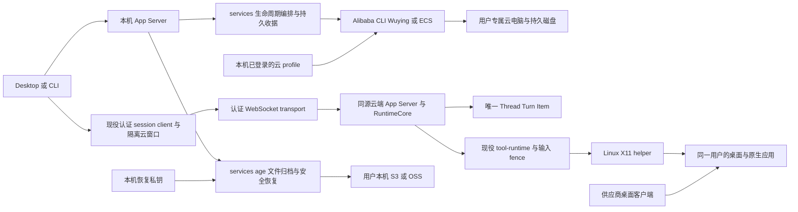

# Lime Cloud：BYOC 持久桌面方案与执行计划

状态：实施中，完整 Cloud 产品尚未验收。当前有效实机验收 3/8（37.5%），第 3 组的新下载安装路径已通过私有 OSS 真云复验，默认官方版本产物交付仍开放；下方历史 4/8 记录仅表示当时证据。事实核对日期：2026-11-12。

### 无模板账号自动准备购买方案（2026-11-12，实施中）

- 目标：首次使用只选择地域、完成浏览器授权和费用确认；Lime 自动发现 Ubuntu x86 桌面规格并准备网络。用户无需安装 CLI、填写 VPC/交换机/安全组/镜像/实例类型或提供 SSH 密钥。复用原购买模板及高级入口，不以连接切片证明完整 Cloud 已验收。
- root 窄写集：现役 `ecs` 下新增推荐与 ROS 网络准备模块及回归，根服务仅分发接线，`receipts` 仅校验与准备记录投影；`CloudDesktopParams` 增加准备动作并同步其 schema/generated client；购买 hook、模板组件及新推荐组件、定向回归、五语言 Cloud 键和既有架构/命令/本计划。保护 Main、Provider、聊天、权限、插件、TUI、发布和无关协议改动，不启子 Agent，不提交或建分支。原目录直接开发，不恢复冻结大副本。
- Verification Contract：root，P1，budget:normal。推荐查询、网络准备和付费采购分责：按供应商实际可用规格与价格推荐；明确同意准备网络后，固定 ROS 模板仅创建 VPC、交换机和无入站规则的安全组，无 VM、NAT、EIP 或供应商凭据。先持久 unknown，再单次 CreateStack；丢响应/重启只查原 stack name/标签，不重发。准备完成校验精确网络后，将 spec 交回原 quoteEcs/purchaseEcs，仍以有效报价和费用确认单次购买。
- 关闭/重开可发现同地域/profile 的原准备记录；失败、未知和回滚状态均明确展示，不静默另建网络。云端栈自动回滚只覆盖本次新建网络，不能触碰既有用户资源。选择器和报价不创建云资源。新增网络支持属于 Lime 自有 BYOC 差异，Codex 私有云不作为复制目标。
- 退出条件：无模板零技术字段填写、最小规格与真实价格、未知结果不重发、重启恢复、网络归属/无入站校验、失败回滚反馈与五语言回归通过；类型/contracts、原目录 GUI smoke、公共 RPC 与供应商只读合同分层记录。Architecture impact: minor，沿同一 Cloud service/receipt owner 与现有付费采购链，没有中心服务或第二 runtime；整体实机仍 3/8（37.5%）。
- 官方合同依据：2026-11-12 核对 [DescribeRecommendInstanceType](https://help.aliyun.com/zh/ecs/developer-reference/api-ecs-2014-05-26-describerecommendinstancetype)、[DescribeAvailableResource](https://help.aliyun.com/zh/ecs/developer-reference/api-ecs-2014-05-26-describeavailableresource)、[CreateStack](https://help.aliyun.com/zh/ros/developer-reference/api-ros-2019-09-10-createstack)、[GetStack](https://help.aliyun.com/zh/ros/developer-reference/api-ros-2019-09-10-getstack)、[ListStacks](https://help.aliyun.com/zh/ros/developer-reference/api-ros-2019-09-10-liststacks) 和 [ROS SecurityGroup](https://help.aliyun.com/zh/ros/developer-reference/aliyun-ecs-securitygroup)。沿现有真实 OAuth 完成推荐、镜像、规格与库存只读合同核实，无重新授权或云资源变更。库存首次误用另一 ECS API 的 InstanceNetworkType 参数，官方 CLI 拒绝；修正为 NetworkCategory 后查询通过，原失败与修正证据分别保存。
- 推荐查询顺序复用同一官方 CLI 配置，避免并发启动多个可能刷新 OAuth 的进程；只读发现有 240 秒总预算，超时不提交网络。费用确认与购买包预检继续由原购买 owner 处理，未改变其判定。
- 组件首次组合执行 37 项为 6 通过/31 失败，含新增断言对 undefined 的错误和原大文件首项超时后的 overlapping act 警告，不能作为产品通过。修正新增断言后独立新增组件 6/6 通过（该次尚有 act 环境警告，测试环境标记已补齐）；原购买专用 14 项另行执行为 12/14，两项仅报告原 5 秒测试超时，正在保留门槛定向复查，不修改生产等待或测试超时。
- 上述两项以原 5 秒门槛定向复查为 2/2 通过，原 12/14 结果保留；新增父组件购买流程 1/1 通过，证明无模板推荐沿原 hook、费用确认及运行包预检接入，未绕过购买前置。Host/HTTP bridge 的实际预算合同 3/3、定向 lint/格式检查通过。首轮预算测试误放 unit 层被 runner 拒绝，改用 contract 层后执行，不能将层级拒绝写成产品失败。
- 浏览器 Gate A 通过：原推荐组件、购买 hook/actions、API facade、五语言、生产 Vite aliases 与原 CSS；单次网络准备、失败报价沿原网络重查和独立费用同意通过。五语言 360px 深色无横向溢出，浅色准备/报价与窄屏深色截图已实际查看，页面与控制台错误均为零。这是显式 test-only Desktop JSONL bridge，不含 Electron、Rust、真实 OAuth 或云资源创建。
- ROS `ValidateTemplate` 实际成功，模板只有 VPC/VSwitch/SecurityGroup 三类资源、零参数；固定模板与摘要保存在本切片证据中，无 CreateStack 或其他资源变更。架构区十二张 Mermaid 实际渲染，两张新增完整图已视觉复核；责任 root 确认网络准备、只读恢复和独立核价继续由同一 Cloud service/receipt owner 负责，未知状态不会触发购买或第二份网络。
- 当前 schema 已由现役 Rust writer 成功生成，TypeScript client 按现役生成命令同步两项新 action。生成前启动的完整 contracts 已通过，仍须取得同步后的 contracts/类型检查终态。现存 App Server 二进制包含推荐入口但尚未包含修正的 NetworkCategory，已只读排除，未作为公共 RPC 通过证据；新构建复用现役 V8 resolver 并等待共享 target。
- 标准 GUI smoke 等待构建锁后，由现役脚本按三十分钟陈旧判定移除锁并进入 Vite；Renderer 构建随后报告 `exited with null`，聚合退出 1，未进入 Electron。没有手动删除锁、终止其他进程或修改门禁；日志没有信号细节，不能推断唯一原因或记通过。该结果与浏览器 Gate A 分开保留。两份 README 只补自动工具/推荐/网络与独立费用确认的当前用法，不将购买引导等同完整可用桌面。
- 同步后的完整 `test:contracts` 与生成客户端 build 已取得退出 0。十七项本轮源码/测试摘要复核无漂移，相关 README/文档链接与定向 diff 检查通过。本切片汇总为 `.lime/qc/cloud-purchase-preparation-20261112/validation-summary.json`，状态仍为 inProgress；Renderer/Node 类型检查、Rust 六项网络准备回归和新 App Server 公共 RPC 尚待终态，继续复用原运行会话，不重复启动或抢占其他 owner。
- 低门槛后续验收仍包括供应商连接规则的安装引导、默认官方 guest 分发、原真云上传提前停止，以及完整桌面/真实模型任务。新网络默认无入站规则，不能据网络准备或核价通过推断 Session Manager/桌面已可连接；不以购买引导关闭这些缺口。current owner 扩展及 test-only 验证，无新增 compat/deprecated、中心服务或第二 runtime，完整 Cloud 实机仍为 3/8（37.5%）。

### 首次使用由 Lime 准备工具与验证授权（2026-11-12，实施中）

- 上轮为 progress：真云传输阶段提前停止的失败与资源清理均有证据，新启动期退出观察已通过无云预检，根因未定位。本轮用户进一步明确所有 Computer Use/其他工具和云端依赖应由 Lime 操作，用户只负责授权；缺少阿里云 CLI 时也必须引导至可用，不能要求用户手动准备环境或抄写凭据。
- 已确认现役 `auth/cli.rs` 可自动下载、核对固定官方归档并安装到 Lime 私有目录，但构造时缓存的 `self.cli` 不会跟随首次安装更新；同一服务实例后续调用仍可能执行缺失的旧路径，新增的授权后验证必须能在原异步任务内使用刚安装的工具。现役 App Server 每次请求创建服务，不能把跨 RPC 成功当成同一服务实例更新的证据；该边界由 Rust 实例级回归验证。另授权命令成功后直接显示 connected，没有实际身份连通性验证。不把这些接线与就绪缺口当作此前真云退出的根因。
- root 窄写集：`cloud_desktop_service.rs` 的 CLI 委托、`auth.rs`/`auth/cli.rs`/对应回归、现有 `AlibabaConnection.tsx` 及独立组件回归、五语言 `settings.cloudDesktop` 键、本计划和既有命令/架构说明。原 CLI 执行体移到既有 `auth/cli.rs` owner，根服务由 808 行减至 758 行，普通调用仍先核对 connected；没有第二执行体或平行 runtime。保护协议/schema/client、Main、Provider、聊天、权限、插件、TUI、发布与无关翻译，不启子 Agent、不提交或建分支。
- Verification Contract：root，P1，budget:normal。动态选择已安装的受管官方 CLI，原实例无需重建；浏览器授权完成后进入 verifying，使用原私有配置调用只读 STS，实际身份有效才进入 connected。验证失败提供固定提示与显式重试，复用原授权；进行中/重启读取不重新打开浏览器。新增状态沿现有 data 投影，不新增平行 authority 或任意 Shell 安装入口。
- 退出条件：先补首次安装后原实例调用、授权验证与失败重试回归；组件覆盖准备/授权/验证/失败/恢复与五语言；运行定向 Rust/组件、类型/contracts、原目录 GUI smoke 和真实公共 RPC 分层验证。现有官方工具下载本身仍按固定来源/摘要/大小边界执行，不修改全局 PATH、不采集用户密钥。Architecture impact: minor，Lime 自有 BYOC 必要适配；沿用已读 lime-design-language 的设置/状态结构，不存在可复制的 Codex 私有供应商授权实现。完整 Cloud 仍为 3/8（37.5%）。
- 低门槛原则：首次使用由 Lime 准备工具、读取现有环境并验证连接，用户只完成供应商必须的授权及明确费用确认。准备、授权、验证和安装分别显示真实阶段；关闭面板后从原状态接续。不能把登录成功当作环境就绪，不能用静默重新授权、重新下单或要求手动填写凭据来恢复失败。
- 组件修复前 7 项按预期失败；修复后连接 7 项及原购买 14 项共 21/21 通过。Rust 最初以基线名启动，但共享锁等待期间已修改源码，不能称为修复前失败证据；继续原 handle 等待，不重启或抢锁。完整 contracts、定向 lint/格式、五语言键和定向 diff 检查通过。浏览器首轮因 test-only Vite 缺少现役 workspace alias 而构建失败，未到业务断言；原失败保留，后续复用生产 resolve 合同验证。
- 只读审查进一步确认 `private_open(false)` 可创建缺失文件，因此复用验证前必须先核对原配置存在，防止凭据丢失后生成空配置并陷入重试。增加明确重启恢复、非法身份与凭据丢失回归；凭据缺失时显式连接启动新授权，不伪造可复用状态。该修复不是此前真云提前停止的根因。
- 浏览器第二轮 Gate A 通过：原连接组件、原 API facade、生产 workspace resolve、五语言 settings 与完整原 CSS；显式 test-only JSONL bridge 验证准备→授权→验证→失败→重试→连接、实际连接前不选 profile、不重复提交。五语言与 360px 深色无横向溢出，浅色进度和深色失败截图已实际查看；页面/控制台错误均为零，验证前后十项产品输入摘要一致。架构区十张 Mermaid 实际渲染，新增授权时序单独留图。该证据不经过 Electron、Rust 或真实 OAuth，不能替代 Gate B。
- 完整 Renderer/Node 类型检查通过。沿最新已授权私有 OAuth 配置，官方固定版本 CLI 的只读 `sts GetCallerIdentity` 实际成功，身份结构满足验证合同；公开证据只保存布尔结果，未输出账号或凭据、未重新授权、未新购资源。这只证明供应商命令合同，不等于产品连接链已通过。新增缺失配置修复后继续原目录完整 Cloud 服务回归与新 App Server 构建。
- 低门槛剩余缺口：当前无可用购买模板的账号仍需高级规格与既有网络，尚未实现新账号的自动推荐和网络准备；默认官方 guest 分发、真云上传阶段提前停止及完整桌面/模型验收也仍开放。本轮连接切片不能表述为“仅授权即可完成全部购买与使用”。金额确认、备份可恢复验证与保留成本说明继续是必要的用户决策。
- 原目录标准 `verify:gui-smoke` 已执行，等待其他进程持有的 Renderer 构建锁 20 分钟后按现役合同超时退出 1，未进入 Renderer 构建或 Electron。没有删除锁、终止其他 owner、重跑或以 Gate A 代替通过；日志 `gui-smoke.log` 保留。首次时序截图受容器宽度裁切，另对原已渲染 SVG 取得 2375×4710 完整截图并实际复核，保留两份图及独立说明，不修改产品图来迎合截图。
- 新 App Server 首次构建由 root 直接调用 Cargo，遗漏仓库现役 V8 环境，V8 默认归档 URL 返回 404，退出 101；原 `app-server-build.log` 保留。后续明确复用 `scripts/lib/rusty-v8-artifacts.mjs::resolveRustyV8CargoEnv`，不修改依赖、构建规则或恢复大副本，单独记录 `app-server-build-retry.log`。该失败属于验证命令接线，不是 Cloud 产品错误。
- 正确 V8 环境下的新 App Server 构建通过。真实 stdio 的 initialize/initialized 与 `cloud/desktop` 验证通过：准备/授权/验证、验证前拒绝普通云调用、验证失败固定投影、原 profile 显式重试、验证中实际终止并重启 App Server、重启后两次被动读取保持中断且不执行 CLI，最后显式复用授权验证成功并读取模板。configure 仅 1 次、STS 3 次（失败、被中断、完成），无资源操作收据；身份及凭据未投影。两次 App Server 收尾分别 10 ms/7 ms。这里使用显式合成 CLI，不是新浏览器 OAuth、Electron 或真云产品验收；CLI 动态路径的同一服务实例语义仍由独立 Rust 回归证明。
- 最新完整 Cloud 服务回归 118 项，117 通过、1 失败；10 项授权回归及 CLI 解包回归均通过，包括新增凭据丢失恢复。唯一失败是原隧道测试在 2 秒内未观察到本地供应商夹具 pending 文件，尚未到取消行为断言；另一个通过的隧道场景有后台 `HandshakeIncomplete` panic 日志，不能声称零异常。只对失败项定向复查，保留完整原失败，不扩大超时或修改范围外隧道 owner，不用定向通过改写整轮结果。
- Architecture impact: minor，责任 root 已结合完整时序图确认：状态、私有 OAuth、工具准备及验证继续由现役 `auth` owner 持有；根 CLI 调用委托同一进程执行边界，普通请求仍要求 connected。分类为 current 修复与 test-only 证据，无新增 compat/deprecated、依赖或第二 runtime。未提交、推送、建分支或发布，未新增云资源；整体维持 3/8（37.5%），标准 GUI 与真云缺口保持开放。
- 原隧道失败项已从同一份刚编译的测试二进制定向复查，复用仓库 `withRustTestConfig`/`resolveRustTestEnv` 隔离，1.24 秒通过，验证前后测试二进制摘要一致、六项本轮产品源码无漂移。没有延长 2 秒门槛或改写测试；尚未确认首次超时的根因，不把整轮 117/118 改成通过。原 Cargo 定向复查仍等待另一构建锁，取得上述可复核结果后，仅核对并 SIGTERM 本轮重复等待的 Cargo PID 41954；不终止其他 owner、不修改锁。独立结果和取消原因分别留证。
- 本轮汇总 `.lime/qc/cloud-onboarding-20261112/validation-summary.json`。收尾核对六项产品源码及五语言新增 Cloud 键与验证输入一致；文档边界与定向 diff 检查通过。当前结论为连接切片功能证据通过、完整 Cloud 与标准门禁未闭合，下一刀继续降低无模板账号购买门槛并闭合稳定桌面装配，不将本轮证明扩大为全部工具、真实模型或全链路完成。

### 真云接续的原请求与错误轨迹（2026-11-12，真云未通过，资源已清理）

- 上轮为 progress：现役等待/原操作接续的本地跨进程验证通过，真云实际进入 waiting 后转 needsAttention，底层错误未被测试驱动保存；单台实例及关联资源已清理，原失败不得覆盖。本轮先补齐诊断合同，不猜测原因或盲目改产品。
- root 窄写集仅 `.lime/qc/cloud-agent-trace-live-20261112/`、小型冻结验证闭包、本机私有测试状态及本计划。产品 Main、Cloud 服务/安装、协议/schema/client、Provider、聊天、权限、插件、TUI、发布暂只读；查明根因后再单独登记必要产品补丁。无子 Agent，不提交、推送或建分支。
- Verification Contract：root，P1，budget:normal。原公共 RPC 的请求/安全字段/原操作编号、CLI 的精确实例/云助手状态、错误与 sidecar 退出必须记录。RPC 原始错误、CLI 失败输出及 OAuth 保留在本机 0700/0600 私有目录；仓库只交付允许字段与脱敏结论。包装器只转发官方 CLI，不重试或改变参数。验证前先用已释放实例的只读 inspect 与故意缺失的本地操作验证记录链，不创建云资源。
- 新真云复验沿既有采购、装配、启停和精确释放授权，复用原开发包与已验证管理二进制；授权元数据/CLI 配置仅在本机私有闭包复用，不再次 OAuth。若重现 needsAttention，仅保留最长 60 秒诊断窗口：先核对原准备编号确为 waiting/submitted=false/无执行 ID，才由测试操作者显式批准同一安装编号接续一次。unknown/已提交不进入该接续分支，不重购补证；初始错误与恢复结果分别保存。所有退出路径仍精确清理并独立核对库存。
- Architecture impact: none（test-only 诊断与交互驱动）。不把包装器、测试恢复决定或冻结二进制写入产品入口；完整 Cloud 仍为 3/8（37.5%）。
- 前置已通过：新隔离状态无资源，真实 App Server/官方 CLI 的只读成功与预期失败可留证；真实 Electron `readOperation` 到达 Rust owner 后取得预期本地缺失收据错误，正常退出 88 ms。最终小型构建为 129 项输入/5 项输出，采购前与真云后摘要均通过。现有 STS 实际到期后，官方普通身份查询沿原 profile 自动刷新，同账号核对通过，无新增 OAuth；私有分发匿名 403、完整下载摘要和现役规范描述解析均通过。
- 新单次采购实例 `i-7xv8v1cvpdshufu2gf3x`，原操作 `bb3e9ccf-c313-45aa-b0fa-7581fa1c6968`，报价 CNY 0.575699/小时（不含其他费用）。采购首次只读检查失败一次，沿原编号查询后为 provisioned，未重新购买。准备操作 `b08f1934-5930-442f-a0b2-81260971263d` 直接取得 accepted，后续 dependenciesReady；本次云助手首次检查已在线，没有观察到 waitingForAgent，不用于关闭此前真云等待分支。
- 原安装 `85aa845e-22d6-4b26-80cd-11e95b89d8cc` 已完成准备、启动并进入 uploading，随后状态查询收到 `cloud desktop windows are stopping`，未进入桌面或 RFB 验证。准备/启动查询未出现原 RPC 失败，原始堆栈已保存在本机私有目录；尚无发生停止之前的 Main 生命周期轨迹，不能把该文案当作停止根因。最终 Electron code=0、signal=null、239 ms 正常退出只证明收尾终态，不解释提前停止；原失败报告与 checks=[] 保留，不放宽判定或再采购补证。
- 本次 finally 的现役产品 stop/release 成功，原释放操作 `7bba8d94-8e39-4948-8d9c-2725281717b6` 只读接续为 released，无官方 CLI 兜底释放。实例、系统盘、专用安全组及本轮登记 OSS 对象/空桶均清理；独立完整分页查询广州六类库存为零，共享 VPC/VSwitch 保留，私有 state 四阶段为 released-and-cleaned。最终账单未证明。
- 收尾发现 test-only trace 原先读取客户端不存在的直接 `code/data` 字段，现按实际 `AppServerRequestError.response.error` 保存原始响应至私有文件，公开轨迹仅保留数字码；不反填原失败的缺失字段。新增真实只读验证通过，应用错误实际为 `-32000`。首次驱动误期望 `-32600` 的失败单独保留，未修改产品协议或错误合同。最小无 Cloud、无窗口 Electron 对照持续 210 秒，显式关闭后正常退出 503 ms，未复现提前停止；相同冻结窗口/安装 owner 与真实本机 App Server 的无云对照另行记录，不推断完整生产 Main。
- 官方自动刷新已轮换 refresh token，因此最新授权仍保留在本轮 0700/0600 私有目录作为下次复用来源，避免删除唯一有效的新凭据；未覆盖原共享授权或向仓库复制凭据。证据汇总 `.lime/qc/cloud-agent-trace-live-20261112/`，本轮仅 test-only 与计划变更，无产品补丁、协议/依赖/第二 runtime，完整 Cloud 仍为 3/8（37.5%）。
- 相同冻结 Main、Cloud 窗口/安装 owner 与真实本机 Rust App Server 的无云对照持续 214 秒，未调用云接口，显式关闭后 code=0、signal=null、512 ms；退出调用栈与 before-quit/will-quit/quit 均已记录，没有使用 app.exit 或强退。该对照也未复现提前停止，不能证明真云上传阶段没有问题。后续实际使用的 test-only Main 已接入启动期生命周期观察，驱动在主动收尾前标记来源；原始退出调用栈留在私有文件，公开证据只保存事件/阶段/时间。新入口实际构建并经真实 Electron/本机 App Server 预检通过，云请求为零，原退出行为保持，正常退出 268 ms；不反填本轮失败的缺失事件，之后实机必须重新冻结构建。源码收尾比较发现范围外 `electron/electronRuntime.ts` 漂移，未覆盖；真云与长时间对照证据只对应原冻结输入，未宣称最新全仓或完整生产 Main。文档边界、窄范围 diff、测试驱动语法与凭据/签名精确比对检查通过，未重复无改动的全量产品门禁。

### 新机云助手等待与原操作接续（2026-11-12，本地通过，真云接续未通过，资源已清理）

- 上轮为 progress：小型冻结复验确认 Running 不能证明云助手已在线，安装前置检查拒绝后，同一实例稍后为 true/Linux；资源已清理，完整 Cloud 保持 3/8（37.5%）。本轮修复等待与恢复，不以增加采购次数或盲目重试 unknown 规避问题。
- root 窄写集：现役 `cloud_desktop_service/prepare.rs` 及其回归、`receipts.rs` 的提交前严格持久化、`cloudGuestInstallations.ts` 与独立等待回归、Desktop 状态类型、现有进度组件/回归、五语言 Cloud 键及本计划/相关架构与命令说明。保护 Main、协议/schema/generated client、Provider、聊天、权限、插件、TUI、发布与其他 Cloud owner；不启子 Agent、不提交、推送或建分支。
- Verification Contract：root，P1，budget:normal。服务端以 waitingForAgent 记录已授权但尚未下发的原准备操作；readOperation 只读检查就绪，不能提交安装。现役安装 owner 确认原编号、目标、submitted=false 与实际就绪后，沿同一 prepare 请求接续；服务器再次核验并严格持久化 unknown，才发送一次 RunCommand。unknown/accepted 只能查询，重启和取消等待保留原身份。等待不占长 RPC，不改 timeout 或建立新 runtime。
- 退出条件：离线等待、只读变在线、同一 ID 单次提交、丢响应/重启不重复提交、伪造等待收据拒绝和写盘失败零提交；GUI 提供五语言等待提示和真实阶段/原计时。定向 Rust/Host/组件、类型/contracts、GUI smoke 与风险匹配的真实 Electron 分层记录，未执行或因并行输入失效不计通过。先本地稳定回归，再判断是否具备真云复验条件。
- 本切片是 Lime 自有 BYOC 差异，Codex 私有云装配不是复制目标；沿已读 lime-design-language 的现有进度结构，不新设计页面。Architecture impact: minor，责任 root；同一服务/安装/收据 owner 增加明确等待状态，无新增供应商凭据 owner、中心服务或第二业务后端。
- 本地回归：现役 Cloud services 112/112、Host/组件五文件 43/43、完整 contracts、定向 lint、Electron/Renderer 类型及原目录新编号 GUI smoke 均通过。Rust baseline 首次误用 package 名、修正后编译中止，未执行修复前断言，不计为失败证明；Host 修复前的三项等待断言按预期失败。正式 Rust 结果复用同一 target，不扩建历史验证副本。
- 真实 Chrome Gate A 通过等待说明、原计时、关闭/重开、显式接续、五语言和 360px 深色；原截图已实际复核。首次测试页 favicon 404 被严格判失败，补齐测试页后页面/控制台零错误。架构文档 BYOC 之后的十张现有 Mermaid 均可离线解析/渲染；修改的首次安装时序图另以完整宽度截图复核，原窄视口裁剪图不作为完整图证据。
- 独立真实 Electron 通过现役 preload/IPC、原安装与本机加密 owner、新构建 Rust App Server 公共 JSON-RPC：窗口关闭后 Main 继续只读等待；完整进程重启仅恢复原意图，显式接续后原准备编号先落 durable unknown，再单次 RunCommand，安装编号与 createdAt 保持。两次原生退出分别 193/125ms，safeStorage/preload/page/console 错误均零；供应商为显式本地夹具，止于 guest 启动前，不冒充真云或完整 Gate B。首轮驱动误用 sandbox 配置导致 preload 拒绝，第二轮错误要求退出后仍显示 busy waiting；均保留失败，改驱动匹配现役窗口及 needsAttention 恢复合同，没有修改产品护栏。
- root 于 2026-11-12 确认 minor 架构图中的只读观察、同编号接续、严格写盘与取消/重启边界；current owner 直接扩展，无新 compat/deprecated 或第二 runtime。既有授权下扩展 test-only 写集至 `.lime/qc/cloud-agent-readiness-live-20261112/`、约两 MB 的小型冻结闭包与本机私有测试状态。先核对新管理二进制构建摘要、原 Linux 测试包全部文件和现役安装脚本，复验采购/装配/真实 RFB 与精确清理；不恢复历史大副本，不复制大包，不重复授权、不重发 unknown，也不将旧冻结 Linux core 记为本轮全量 Linux 构建。
- 真云前置：129 文件、2,255,230 字节的小型闭包构建后取得 128 项输入/5 项输出的完整性收据；新管理二进制 SHA-256 为 `110745762b66b976c5d6251553a97be0fa210463ffc6b3ab38b60a8b46195fec`，来自本轮实际 Rust 构建与标准 smoke。复用 138,547,424 字节 Linux 开发包，18 项文件/白名单/摘要及现役三份 Linux 脚本逐字节通过，无新增大包副本。私有 OSS 匿名 403、完整下载摘要和真实选择器的规范 `.tar.gz.json` 校验均通过；签名期限按实际签发时限记录，不以 STS 到期时间冒充 URL 期限。
- 单次采购 `ecs.c7.large`，原报价 CNY 0.575699/小时（不含网络、快照与密钥等）；首次只读采购核验失败一次，沿原编号恢复，没有重购。实例 `i-7xvd8jxwy0ev5h20zq1m` 经本轮新管理服务与原安装 owner 实际进入 `waitingForAgent`，随后转为 `needsAttention/CLOUD_INSTALL_RECOVERY_REQUIRED`；原准备收据仍为明确未提交的 waiting，未取得 RunCommand 或 guest 装配/桌面证据。驱动没有保存当时底层 RPC 错误，不能断言唯一原因；后续独立只读 true/Linux 不能改写此前失败。Electron 正常退出 153ms，页面/控制台错误为空；本轮不继续采购碰运气，下一刀须先为测试驱动保存原请求/收据的脱敏轨迹与私有错误，再验证显式原操作接续。
- 产品清理的原释放收据返回 `IncorrectInstanceStatus.Initializing` 并保持 unknown，未自动重发；官方 CLI 按精确实例、标签与磁盘身份兜底释放，独立核对不存在后，经公共 RPC 只读接续原释放编号为 released。原失败与恢复分别保留，兜底不计产品生命周期通过。OSS 对象与空桶已删除，北京时间 15:43:16 独立完整分页确认广州 ECS、磁盘、快照、私有镜像、无影和 EIP 六类库存均零，专用安全组不存在，共享 VPC/VSwitch 保留；本轮私有 state 的 phase/ecsPhase/sgPhase/ossPhase 均为 released-and-cleaned，最终账单未核实。
- 本地汇总 `.lime/qc/cloud-agent-readiness-20261112/validation-summary.json`；真云独立汇总 `.lime/qc/cloud-agent-readiness-live-20261112/validation-summary.json`。冻结闭包中 117 项非证据源码在收尾时仍与原目录相同，外部二进制摘要守卫保留。该轮归类 progress，完整 Cloud 仍为 3/8（37.5%）；没有新增兼容层、废弃入口、中心服务或第二 runtime，没有提交、推送、建分支或发布，保护的并行写集保持原样。

### 桌面画面与连接终态的独立核验（2026-11-12，本地通过，真云启动前拒绝，资源已清理）

- 上轮为 progress：真实慢加载反馈已修复、四次实机报告和失败边界完整保留，测试资源已释放。本轮继续完整目标，先修正影响后续真云验收的观察合同：RFB 认证不等于首帧绘制，全部 TCP 计数不等于 RFB WebSocket 的连接数，不用错误的成功/失败判断决定产品改动或重复购买。
- root 窄写集仅 `.lime/qc/cloud-desktop-transport-20261112/`、本机私有临时目录和本计划。产品源码及 Main、Provider、聊天、权限、插件、TUI、发布 owner 只读，不启动子 Agent、不提交或建分支。复用现役窗口、查看组件、preload/IPC 与认证 App Server；上游 noVNC 为固定版本公开资产，RFB 服务及供应商响应为明确测试夹具，不冒充 Linux 桌面或真云。
- Verification Contract：root，P1，budget:normal。通过真实 Electron + 原 owner，观察实际 noVNC RFB 握手、首帧之前/之后的像素、只读模式、iframe 卸载后的 WebSocket 关闭及独立任务 `thread/list`；分别记录 HTTP 保活连接、RFB 连接和原生退出，不修改生产 timeout 或用强退记通过。退出条件为错误观察可被可控复现纠正、当前 owner 的边界可复验，以及最小 Electron 和 Cloud 窗口的正常退出/失败有明确终态。发现产品根因才扩展对应窄写集并先补回归。
- Architecture impact: none（验证范围），责任 root。不会以本地 RFB 服务器、画面合成或旧 core 二进制关闭真实模型任务、第三方登录、Linux guest 或完整 Cloud Gate B；完整实机仍 3/8（37.5%）。
- 官方 npm 固定 noVNC 1.3.0 归档 232,559 字节，经 registry SHA-512 和独立 SHA-256 核对，只解出 48 项 core/vendor/许可证文件到私有目录，无产品依赖安装。原窗口/查看器/IPC 与真实认证本机 Rust `thread/list` 通过：服务器发送首帧前，RFB 已 connected、canvas 320×240、像素全零；显式发送后像素、可见尺寸与截图均通过。收起后 RFB 从 1 降至 0，6 条 HTTP 保活仍在，新 `thread/list` 返回成功；正常退出 140 ms，页面/控制台/preload 错误为空。
- 首轮 RFB 夹具错误假定客户端颜色位移而断开，按 noVNC 实际 SetPixelFormat 修正，原失败保留；第二轮像素读回通过，但截图发现夹具容器高度为零，不能记作可见画面通过。修正测试容器尺寸并加入可见 bounds 断言后，最终合成蓝色帧截图已实际查看。三次均正常退出（167/189/140 ms），不能据此改写此前真云退出失败或证明完整 Main。
- 本地证据证明此前真云的全部 TCP 零值判定不足。沿既有实机授权扩展 `.lime/qc/cloud-desktop-transport-live-20261112/` 和独立私有 state；先构建及核对清理入口，再以同一已验证小规格仅购一台重新复验。复用原 138,547,424 字节归档，不复制或重新压缩大包；新对象、新操作编号及安装身份与旧已清理测试隔离。直接观察实际 RFB WebSocket 关闭、首帧可见像素及新的任务 RPC，HTTP 保活只记录、不要求为零；正常退出与资源清理仍是独立必需终态，不能通过修正判定放宽它们。真实模型/第三方认证和全产品验收不在该窄复验内。
- 120 项输入、17 项输出的小型构建及采购前摘要核验通过；同账号、私有 OSS 匿名 403、完整下载字节/摘要和单次采购均通过。首次采购状态读取失败后只查询原 operationId，未再次购买。采购期间范围外 `packages/app-server-client/src/generated/protocol-types.ts` 改变，Electron 启动前的原摘要守卫拒绝执行，检查组为空；没有实际安装或本轮真云 RFB 证据。失败与收尾指纹保持原样，不能以本地成功代替本轮真云通过。
- 自动 finally 中产品清理调用返回错误；原释放收据记录供应商 `IncorrectInstanceStatus.Initializing`，保持 unknown 而不自动重发。沿精确实例身份通过官方 CLI 兜底释放并独立核对实例、磁盘和专用安全组不存在，随后只读查询原释放编号已接续为 released，不能覆盖初始失败。OSS 对象和空桶删除成功，广州六类资源完整分页均为零，共享 VPC/VSwitch 保留；私有 state 为 `released-and-cleaned`，最终账单仍未证明。官方兜底不算产品生命周期通过；不重复采购或重发已清理资源的变更。
- 本轮为 progress，仅修改 test-only 观察与证据、已有执行计划，产品源码无新增变更；完整 Cloud 实机保持 3/8（37.5%）。后续先用约 1.72 MB 的实际构建依赖闭包建立小型冻结验证输入并重新构建、逐项核验，保留原输入/输出守卫；不恢复历史大副本、不覆盖并行源码，也不宣称冻结产物代表后续最新工作树。稳定输入和清理入口核验完成前不再创建云资源。

### 按需查看的真实 Linux 桌面复验（2026-11-12，局部证据已重建，整轮失败，资源已清理）

- root 在前述授权及用户确认清理结束后，扩展窄写集到 `.lime/qc/cloud-desktop-viewer-live-20261112/`、本计划与本机私有测试目录；产品源码保持只读，不启动子 Agent、不提交或建分支。目标为同一查看 owner 经真实 Session Manager 通道显示 noVNC/RFB 的 Linux 桌面，默认收起和退出不影响云任务的边界独立记录，不以夹具通过提升完整 Cloud 验收。
- 先检查包、构建小型 Electron 驱动和清理入口，再创建私有 OSS 分发与单台广州 ECS。已有冻结开发包逐项校验摘要及 18 文件白名单；其中安装脚本较旧，测试产物仅替换现役安装脚本并更新清单，二进制继续使用有记录的冻结开发版本，不宣称当前全量 Linux 源码已构建或正式发布。签名 URL、OAuth/STS、安装能力和桌面口令仅保存在本机私有状态，不进入仓库证据或 Renderer URL。
- Verification Contract：root，P1，budget:normal。单次采购意图和原操作 ID 先持久化；实时核价，Ubuntu x64、加密 ESSD、无 SSH 密码/密钥，专用安全组仅允许当前操作者 `/32` 的固定服务端口。安装前取消并读回供应商释放期限；测试完成或遇阻塞后停止并释放精确实例/盘/专用安全组，删除本轮 OSS 对象与 bucket，再独立读回六类库存。共享 VPC/VSwitch 保留，不为等待开发保留收费实例；unknown 只查原操作，不重购补证。
- Architecture impact: none（验证范围）。root 确认仍使用原 App Server、窗口、安装、凭据与供应商通道 owner；新增内容均为 test-only。真实模型任务、第三方登录、完整 Main 退出与完整 Cloud Gate B 保持独立未完成项，完整实机维持 3/8（37.5%）。
- 本机启动探针正常退出 0（59 ms）；首次探针在退出后调用 Playwright 的 `process()`，是驱动错误，不计通过，修正为预先保存 child 后重新运行。138,547,424 字节测试包全部 18 个文件、白名单和冻结安装脚本逐字节通过，私有 OSS 匿名 GET 403、签名完整下载和摘要通过。测试不导出签名、OAuth/STS 或桌面口令到仓库。包内脚本按测试启动时摘要冻结，不将后续并行源码变化混入该包的验收。
- 官方只读查询确认既有广州交换机和选定 `ecs.c7.large` 有库存，实时产品报价 CNY 0.575699/小时。单次购买返回 accepted，首次精确规格重查失败；只读核对当时实例已 Running、各规格无差异，随后沿原操作再查成为 provisioned，未重发购买。保留首次失败及独立恢复证据；临时两小时释放期限先设定并核对，安装前经现役取消命令和原操作收据确认已清除。当前正经原 Main 安装 owner、真实云助手和 Session Manager 准备/下载，不提前声明桌面通过。
- 实际安装在约 205 秒内完成，临时 installation 通道 closed，认证 guest 的真实 `thread/list` 可见。首次桌面冷加载在驱动 60 秒内未出现密码框，保留失败；独立 HTTP 200 探针确认真实 noVNC HTML 且无 X-Frame-Options/CSP 拒绝。第二次沿同一已完成安装重开，已认证并出现真实 Xfce 桌面，但驱动误读不存在的 `_rfb_connection_state` 而失败，不能计整体通过；改用可见 RFB 连接状态及实际 `viewOnly` 属性，不放宽模式断言。
- 真云慢加载暴露现役查看组件在通道 ready 后过早撤掉等待提示。本轮必要产品修复仅追加 `CloudDesktopViewer.tsx` 及其 component test：复用五语言既有提示，持续至 iframe load。初次回归 17/18，新增的 iframe error 断言失败；浏览器 iframe 加载失败不提供该事件合同，移除不可依赖的路径，保留真实 load 回归及既有连接失败/显式重试。未改 Main/供应商/runtime 权限或导航合同。Architecture impact 仍为 none；验证新增定向回归、真实 Electron 查看和标准 GUI smoke，冻结 core/测试 bootstrap 边界保持不变。
- 最终组件回归 17/17、两文件 ESLint 与 Prettier 通过。第三次真云驱动因未限定 `role=status` 范围，同时命中查看器加载与窗口连接状态而失败；仅修正驱动 selector 后第四次确认加载提示可见、真实 noVNC 页面约 14.3 秒可交互，RFB 认证、只读模式及 iframe 无 parent/自身 bridge、Node 隔离通过。第四次复用已完成安装，安装状态读取 14 ms，不能替代首次 205,439 ms 的实际装配耗时；四次均沿同一实例和安装编号，没有重购或重复装配。
- 第四次收起已卸载 iframe 并归还焦点，但 30 秒内 desktop 通道的 `activeConnections` 仍为 4，未满足驱动的零连接断言；收起后的新 `thread/list` 没有执行。该计数包含全部转发 TCP 流，不能据此断定 RFB WebSocket 未关闭，也不能宣布收起验收通过。随后 Electron 在 20 秒内未正常退出，只终止本轮测试进程，保留 `failed`；原生退出问题仍未闭合。
- 已实际查看第二次和第四次截图：第二次可见 Xfce 桌面，第四次虽已认证且 canvas 为 1920×1080，截图仍为黑屏。因此原驱动中“canvas 尺寸非零即已显示桌面”的结论不足，最终摘要明确否定该推断，不将第四次记作完整可视桌面通过。noVNC 的 `/package.json` 404 两条控制台消息及收起时图片请求中止均保留；不能声称本轮零控制台错误。后续需要直接观察 RFB socket 关闭、可见帧及独立任务 RPC，不能用全部 HTTP 连接数或 canvas 尺寸代替。
- 产品清理驱动误等待 start/stop 不提供的 `outcome=stopped`，实际停机已独立读回；该驱动失败保留，不重复提交停机。按精确名称、tag 和 ID 经官方 CLI 释放本轮实例、盘及专用安全组，并独立核对不存在；此为测试资源兜底清理，不作为产品生命周期验收。OSS 对象和空桶删除后，验证 helper 未展开 SDK 异常导致首轮误判；按官方 `unwrap()` 仅只读复查取得 `NoSuchBucket`，未再次提交删除。完整分页查询广州六类库存全部为零，共享 VPC/VSwitch 保留；私有 state 整体、ECS 与 OSS 阶段均为 `released-and-cleaned`。最终账单未证明，不扩大为全账号零费用。
- 原目录标准 `npm run verify:gui-smoke` 已执行，Renderer 构建约 2 分 17 秒后因输入变化被现役摘要守卫拒绝，退出 1，Electron 未启动；保留日志和 invalid 构建收据，不绕过守卫、不恢复大副本。120 项窄构建输入的收尾检查发现四项范围外 Host/client 源码漂移，查看组件仍匹配其构建输入；证据只适用于已记录的编译快照，不宣称最新全仓验证。没有覆盖并行 Main、Provider、聊天、权限、插件、TUI 或发布改动。
- 最终完整 Renderer 类型检查退出 2，诊断位于范围外账号/OEM、插件与聊天接线，未覆盖修改这些 owner；原始 `renderer-typecheck.log` 保留，不记全仓类型通过，也不伪造此前基线。两文件最终 lint/格式、文档边界和定向 diff 检查通过。加载反馈复用原文案及 owner，保持 KISS/DRY；没有引入新的连接 authority 或依赖。
- 证据目录 `.lime/qc/cloud-desktop-viewer-live-20261112/`，包含四次实际报告、截图、构建输入、`failure-analysis.json`、清理与库存、回归及标准 GUI smoke 日志。历史三次失败保持原样，最终报告未改为通过。本轮为 progress，current 仅有查看器加载反馈修复，新增脚本与证据为 test-only；无新增 compat/deprecated、依赖、服务端或第二 runtime，不提交、推送、建分支或发布。完整 Cloud 实机仍为 3/8（37.5%）。

### 小型冻结输入的桌面复验（2026-11-12，真云未通过，资源已清理）

- 上轮为 progress，真云启动前因并行生成协议漂移被拒绝，资源已清理。本轮 root 只认领 `.lime/qc/cloud-desktop-stable-live-20261112/`、对应小型验证快照与私有 state、本计划；产品源码及 Main、协议、Provider、聊天、权限、插件、TUI、发布 owner 保持只读，不启子 Agent、不提交或建分支。
- Verification Contract：root，P1，budget:normal。按上一小构建的实际闭包冻结原目录源码并保留相同相对路径，增加现有 `pnpm-lock.yaml` 和驱动等摘要，共 129 项、2,255,782 字节；构建前逐项匹配原目录。只链接已有依赖和钉住的二进制，不复制大运行包、不恢复整仓副本。首次驱动误列不存在的 npm lock 导致本地失败，保留日志，按仓库实际 pnpm lock 修正后才进入冻结构建。
- 退出条件：冻结源码重新构建并通过原输入/输出守卫，受控修改必须被守卫拒绝且恢复后复验通过；管理身份及清理入口先验，再仅以一台专用测试机验证实际 Xfce 首帧、RFB 关闭、独立任务 RPC 与正常原生退出，finally 精确清理并分页读回。源码漂移只报告，不覆盖并行 owner；旧失败报告不改绿。
- Architecture impact: none（test-only），责任 root。验证仍复用原窗口/安装/查看/IPC owner 与认证 App Server，Linux core 沿用已记录的冻结 dev 包；不证明最新全仓、公开分发、模型任务或第三方登录，不改变完整 Cloud 3/8（37.5%）口径。
- 冻结构建 128 项输入、5 项输出通过；源码和输出各一项受控漂移均被原摘要断言拒绝，逐字节恢复后复验通过。额外 1 项仅用于原运行包信息记录，共 129 项冻结文件。授权、包内两份 installer 与现役源码、完整归档摘要和空资源清理入口通过。私有 OSS 首次上传连接中断，先只读证明原对象不存在，才向同一桶/同一 key 以禁止覆盖方式接续一次；匿名 403 与完整下载 138,547,424 字节、摘要通过，未另建桶绕过未知状态。
- 首次冻结真云单次采购成功，真实 Electron 启动且正常退出 52 ms；安装前 `CLOUD_INSTALL_PACKAGE_INVALID` 拒绝，检查组为空。根因为测试 state 使用 `install-source.private.json`，不满足 `selectCloudGuestSource` 的 `.tar.gz.json` 原合同；尚未发生 guest 装配。使用同一冻结现役 parser 本地复核，错误文件名拒绝、规范归档 JSON 文件名及实际三项摘要接受，未修改产品校验或放宽安全边界。首次辅助归档核验误用源码文件名的 `StopIteration` 也单独保留，按现役 staging 的 `install.py/bootstrap.py` 名称修正后通过。自动清理终态独立记录，原失败不覆盖。
- 首次冻结测试的产品释放收据同样记录供应商 Initializing 拒绝并保持 unknown，最终精确官方兜底与 OSS 清理、六类分页库存均通过；随后只读查询原释放已为 released。原 Electron、pipeline、失败、资源收据及私有 state 已封存。第二次复验复用同一份已核验的小型冻结构建，单独记录 `attempt2/` 和私有状态；先修正清单路径并通过现役 parser，再按已授权规格复验，不改动产品源码或新建源码副本。任何新的产品缺陷保持失败，不通过再次换编号购买掩盖。
- 第二次实际下载清单、128 项输入/5 项输出及摘要在购买前再次通过，单次采购后进入真实 preparing；现役云助手前置校验返回 `notSubmitted/submitted=false`，提示需要已连接的 Linux 云助手，没有下发安装命令或装配 runtime。后续精确实例只读状态为 `true/Linux`，说明需要核验新机 Running 与云助手可用之间的等待；首次状态原始响应未捕获，不能断言某个瞬时底层原因。真实 Electron 退出为 0/null、97 ms，尚未创建桌面窗口，不将其记作真实 RFB、Cloud 窗口或历史退出问题通过。
- 第二次首次产品清理及官方兜底均失败，原报告保留；先只读核对精确 ID、名称、采购 tag、Stopped 和无锁，再沿现役产品入口完成此前尚未提交的释放。独立官方读取确认实例、磁盘和专用安全组不存在，原本地释放收据为 released；OSS 对象/空桶清理已验证。最终分页核对五类为零，无影首次读取失败保留，只复查该失败类别后同样为零。`pipeline-summary.json` 仍为 failed/requires-inspection，最终恢复单独记录 `cleanup-recovery-summary.json`，不覆盖原失败。
- 收尾时外部 App Server 二进制及两份 client dist 被并行构建替换，原二进制摘要守卫拒绝新的公共 RPC；没有改 pin 或恢复大二进制。最终资源证明来自独立官方只读查询与已完成的原收据，不声称再次公共 RPC 成功。129 项冻结文件和 5 项输出仍逐字节一致，只证明记录的编译快照；当前原目录及新外部二进制不属于本轮通过范围。
- 汇总 `.lime/qc/cloud-desktop-stable-live-20261112/validation-summary.json`。本切片为 progress，current 产品 owner 未修改，所有新增驱动/快照均为 test-only，无新增 compat/deprecated、依赖、服务端或 runtime；未提交、推送、建分支或发布。完整 Cloud 保持 3/8（37.5%），最终账单开放。本轮不再采购；下一刀在现役安装 owner 补明确的云助手就绪等待及可恢复进度，等待期间只读、不重复准备/安装，unknown 继续查原编号，然后补针对性回归和稳定产物下的真实桌面复验。

### 桌面查看的真实 Electron 隔离验证（2026-11-12，局部验证完成）

- 上轮为 progress：默认收起侧栏、本地回归、Gate A 和基础壳 smoke 已通过；新查看命令与子框架导航事件仍缺真实 Electron 证据。本轮 root 首先只认领 `.lime/qc/cloud-desktop-viewer-electron-20261112/` 及本计划，产品 owner、Main 主文件、Provider、聊天、权限、插件、TUI、发布和外部云资源只读，不启子 Agent、不提交或建分支。
- Verification Contract：root，P1，budget:normal。直接打包原始 Cloud 窗口/查看 owner、真实 preload 与 IPC；查看页面和供应商桌面请求为明确本地夹具。验证默认无桌面流、展开/收起、可信窗口资源、跨 Origin bridge 隔离、实际子框架导航/重定向拒绝及原生退出，逐项记录真实进程边界；不以基础壳通过、iframe load 或夹具画面代替 RFB/真云验收。并只读查询原测试地域的六类云库存，结果不得扩张为全账号零费用。
- 退出条件：真实导航和查看连接结果可复核；若出现缺陷，先记录失败及根因，再追加对应现役 owner 的窄修复与回归。完整 Cloud 维持 3/8（37.5%），未验证的认证、真实画面、模型、第三方登录及完整退出保持开放。
- 首次六类只读查询均被官方 CLI 的 `invalid_grant` 拒绝，不能借历史清理记录宣称当前无资源。用户明确选择“现在配合重新授权”后，复用原专用测试 profile 启动官方浏览器 OAuth，正常退出 0；原始授权输出仅写本机私有测试目录，凭据不进入仓库证据。授权后独立查询广州区 ECS、磁盘、快照、私有镜像、无影桌面与 EIP 全部为零且分页完整；仅限该地域六类资源，不代表全账号零费用或最终账单。
- 并行清理移除了 `.lime/qc` 中的本轮及历史产物，已暂停写入并核对六个关键产品文件摘要，均未变化。用户确认“清理已结束，可以重建本轮证据”后，仅重建本轮小型夹具，不恢复历史源码/构建副本。此前首次功能运行还存在测试轮询参数错误：`ElectronApplication.evaluate` 首参是 Electron namespace，误作数组起点可能接受旧拦截事件；不承认该次整体通过，重建时修正为第二参数，并将 Chromium 在导航事件前拒绝本机文件与 Main 导航钩子分别断言。原始失败文件已被清理，不谎称仍保留；审阅结论见本轮 `prior-attempt-review.json`。
- 重建后的驱动和独立库存查询均退出 0。六组真实 Electron 检查通过：默认零画面请求、云窗口本机管理权限拒绝、展开的真实 IPC/隔离画面流、子框架导航与重定向拒绝、可信资源绑定，以及收起后的 socket 关闭、焦点归还与远端投影保留。页面、preload 和非预期控制台错误均为空；本机文件由 Chromium 在 Main 导航事件前拒绝，单独记录为预期安全错误。进程在 238 ms 内正常退出；已实际查看 `electron-viewer.png`。本轮约 1.4 MB 构建产物仅包含小型验证夹具，不恢复历史副本。
- 证据目录 `.lime/qc/cloud-desktop-viewer-electron-20261112/`：`electron-summary.json`、`inventory.json`、`build-receipt.json`、`prior-attempt-review.json` 和 `validation-summary.json`。该验证直接使用原 factory、窗口/凭据/连接 owner、preload/IPC 与本机认证 Rust App Server 的真实 `thread/list`；Main 路由、供应商响应及桌面页/WebSocket 是显式测试夹具。它不证明完整生产 Main、noVNC/RFB、真实 guest/供应商通道、模型任务或完整 Cloud Gate B，也不关闭此前完整 Main 的原生退出诊断。历史证据被清理的事实不因本轮重建而改变。
- Architecture impact: none。root 确认本轮仅补测试证据和执行记录，产品 current owner、协议及运行时结构不变；新增内容均为 test-only，未新增 compat/deprecated 入口或第二 runtime。完整 Cloud 实机验收保持 3/8（37.5%）。

### 云会话内按需查看远程桌面（2026-11-12，本地回归、Gate A 与基础 Electron smoke 通过，真云画面开放）

- 用户补充：默认不显示远程桌面，点击后可查看。现役设置页已有固定 ECS desktop 通道，但云会话窗口只显示任务，缺少该入口。本切片沿同一可信窗口资源接入可收起侧栏，默认不建立桌面流；隐藏时卸载查看器，云任务与供应商机器生命周期不变。查看与接管分离，不启动 human-control、不撤销或伪造 AI grant，桌面密码继续通过现役 Main 原生显示，不写入 URL、Renderer 或日志。
- root 窄写集为 `CloudWindowBoundary`、新的云桌面查看组件及测试、`cloudDesktopConnection` typed gateway/类型、`cloudDesktopWindows` 的窗口绑定单个查看命令、固定 desktop 通道解析、`cloudWindowPolicy`/`ipcChannels` 精确 allowlist 与对应测试、五语言相关 Cloud 键和现有命令/架构/本计划。Main 主文件、Provider、聊天、权限 owner、插件、TUI、Rust 协议/runtime、发布及云资源只读，不启子 Agent、不提交或建分支。已有 Cloud owner 只做上述接线的最小补丁，保留此前及并行改动。
- Verification Contract：root，P1，budget:normal。默认零查看请求与 iframe，显式展开才打开固定回环桌面通道；资源来自可信云窗口，不接受 Renderer 自选资源或任意 URL。校验响应及端点后使用沙箱隔离查看器；迟到结果不能复活已收起/卸载的查看器，错误使用五语言固定提示，密码仅在用户单独点击后交原 Main 显示。组件、真实通道夹具、preload/Host 合同、类型和 Gate A 分别验证；Electron/真实云画面需独立 Gate B，不以 iframe load 宣称 RFB 已连接。完整 Cloud 仍 3/8（37.5%）。
- 导航隔离的必要窄补丁另包含原本干净的 `cloudDesktopWindowFactory.ts` 和新对应测试：Main 按 webContents 登记精确查看 Origin，子页面导航及重定向不得进入产品 Origin、本机文件或任意地址；该状态仅用于 Electron 导航拒绝，不是第二任务或云连接 authority。
- 首轮 63 项回归有一项 jsdom 未实现 `iframe.referrerPolicy` 属性反射；保留失败日志，改查真实 DOM 属性，真实 Chrome 继续核验反射值。修正后组件 16/16、Main 与导航 22/22，通过组覆盖此前固定通道和 preload 后合计 73 项有效回归。完整 Electron 类型、云桌面范围 Renderer 类型、contracts、五语言 391 个 Cloud 键和格式通过。首次完整 Renderer 检查遇到并行聊天模块导出错误，未修改该 owner；其导入已由并行进程修复，最终完整检查另行执行。
- 原组件、API/bridge、共享端点校验、五语言及完整 CSS 的静态构建，真实 Chrome 五语言验证默认零查看请求/iframe/socket、展开单次连接、跨 Origin 沙箱无法读取 parent/自身 bridge、密码单独请求且不在 URL、收起后的真实夹具 socket 关闭与焦点归还、迟到成功不复活、固定失败提示与显式重试；十二项产品输入前后摘要一致，零页面错误，查看页请求不携带 Referer。浅色宽屏、360px 深色与查看时序图已实际检查。桌面页和 socket 是明确测试夹具，不证明 noVNC/RFB 认证、真实 guest 画面、Electron 导航钩子或人工接管。
- 最终完整 Renderer 类型检查退出 0。原目录 `npm run verify:gui-smoke` 退出 0，真实 Electron 的壳、preload/IPC、App Server JSON-RPC 初始化、重载、设置页和三视口布局共 24 项断言通过，零页面、IPC、preload、旧命令或 mock fallback 错误。运行编号 `standalone-shell-01-20261112044301-4031`；该 smoke 没有展开云桌面，不作为新查看命令、Electron 子框架导航钩子、RFB 或真云画面的验收，也不关闭此前独立原生退出诊断。
- Architecture impact: minor。root 确认只扩展现役 Cloud 窗口的本机查看能力与导航拒绝，连接、凭据、安装、输入授权和 canonical 任务仍归原 owner；命令与架构正文、查看时序同步。实现归 current，新增夹具和证据归 test-only；无新增 compat/deprecated、依赖、公共任务协议、服务端或第二 runtime。源差异对照本切片开始时快照，避让其他并行改动；五语言仅认领八个 Cloud 键。汇总 `.lime/qc/cloud-desktop-viewer-20261112/validation-summary.json`，完整 Cloud 实机仍 3/8（37.5%），真实桌面查看与人工接管需下一轮独立验证。

### 重连期间的任务视图隔离（2026-11-12，本地回归与 Gate A 通过，完整桌面门禁开放）

- 上轮为 progress：原生退出样本的 Chromium 线程池等待栈已定位，低负载及完整门禁仍开放。本轮核对云端模型任务入口；模型配置沿现役远端 JSON-RPC，隧道重连亦已重新解析供应商通道，不新增模型配置或连接 authority。
- 发现 Renderer 竞态：重连仍在等待时，状态轮询若先返回 connected，旧查询缓存和审批视图会在清理前重新挂载；重连返回 disconnected 也会无条件刷新，组件卸载后的迟到成功仍尝试刷新页面。root 窄写集为原 `CloudWindowBoundary`、新对应组件回归、五语言单个失败提示键、现有命令/架构和本计划。Main、Provider、聊天、权限、插件、TUI、协议及发布只读，不启子 Agent、不购买云资源或递交代码。
- Verification Contract：root，P1，budget:normal。先补回归证明竞态，再将重连中的任务视图保持隔离到明确连接成功并刷新；失败提供可重试的固定文案，卸载后迟到结果不影响新页面。退出条件为旧实现失败、新实现回归/五语言/类型与合同通过，风险匹配 Gate A 和原目录 GUI smoke 结果分别记录；完整 Cloud 仍为 3/8（37.5%）。证据 `.lime/qc/cloud-reconnect-renderer-20261112/`。
- 原实现六项回归为 5 失败、1 通过；修复后新增边界共 9/9 通过。相邻连接文件首项超过默认 5 秒后出现连续 act 失败，保留原日志；迁移其中要求展示错误原文的旧断言，以单次 30 秒测试预算独立复跑后 10/10 通过，未修改产品等待预算。定向 ESLint、三个产品/回归 TSX 格式、五语言 383 个 Cloud 键及完整 contracts 通过。
- 原组件、API/bridge、五语言 settings 与完整 index/colors CSS 以 Vite 静态构建，真实 Chrome 五语言逐项验证提前 connected 轮询、重复点击拒绝、disconnected 不刷新、失败后轮询不能恢复旧审批、键盘重试清错、安全组/普通失败固定提示，以及成功仅刷新一次读取新状态；零页面错误和未完成请求，前后十项原产品输入摘要一致。浅色宽屏、360px 深色和新增重连时序图均已实际查看。该 Gate A 不证明 Electron IPC、真实云隧道或模型任务。
- 原目录 GUI smoke 构建中输入摘要发生变化，保存差异后，通过命令与 stdout 文件双重核对只停止本轮 Vite PID 16804；原 finally 失效收据并释放锁，命令退出 1，Electron 未启动。后来另一构建替换共享收据，原测试夹具误要求它永久保持 invalid 的断言已被否定并修正；不改他人锁或收据，不将另一构建归入本轮。完整 Renderer 类型检查退出 0；高负载下耗时增加，未修改系统配置或终止其他任务。汇总 `validation-summary.json`。
- Architecture impact: minor。root 确认只修复现役 Renderer 的重连隔离和失效结果，原连接、凭据、审批及 canonical 任务 owner 不变；命令和架构正文、重连时序已同步。分类为 current 修复与 test-only 证据，无新增 compat/deprecated、依赖、协议或第二 runtime。完整 Cloud 实机仍为 3/8（37.5%）。

### 原生退出的进程与环境隔离（2026-11-12，定位到 Chromium 线程池收尾，门禁未闭合）

- 上轮为 progress：回收确认 current 修复、本地回归及 Gate A 已通过，完整 Electron 门禁仍开放。本轮继续原生退出根因，先验证最小程序与测试观察方式，不把 `quit` 事件当作进程终态，也不使用 `app.exit` 或强退作为产品修复。
- root 窄写集为 `.lime/qc/cloud-native-exit-isolation-20261112/` 与本计划；Main、现役退出 owner、依赖、Provider、聊天、权限、插件、TUI 和发布只读。不启子 Agent，不新购或修改云资源，不提交、推送、建分支或发布。
- Verification Contract：root，P1，budget:normal。以当前 Electron 42.3.3 的最小 CJS 为对照，分别隔离 userData、精简继承环境，独立观察 child exit/close、PID 和必要原生堆栈；仅在证据定位到现役根因后才扩大产品写集。退出条件是复现边界和根因层结论可复核，未定位时保留开放，不能以最小程序结果替代完整 Cloud Gate B。完整实机维持 3/8（37.5%）。
- 七个隔离对照中，精简环境且不创建窗口的最小程序正常退出；创建并加载窗口、只创建未加载窗口、禁用硬件加速、继承或精简环境的窗口程序仍有停滞。先关闭窗口的对照最终退出 0，但父级已触发 20 秒观察超时且只读 PID 为 zombie，不能记作按时退出通过。系统 8 个逻辑核心，期间 load average 从约 127 变动至 182；未终止其他工作负载或修改优先级。
- 原始对照报告保留。第二轮采样器超时没有生成样本，其中夹具将缺少数值退出码误标为 0、将迟到自然退出标为 passed；独立 `comparison-review.json` 明确拒绝这两类成功结论。后续夹具已修正失败分类，负载变化后的同一窗口对照仍未正常退出，不把观察超时当作程序已结束或据此重启旧句柄。
- 官方同版本符号包 125,681,112 字节，其 SHA-256 与 GitHub Release API 的 digest 一致；只在归档内流式读取符号，未安装或升级依赖。原本地冻结壳停滞样本、当前框架及符号 MODULE 的 UUID 均为 `4C4C4447-5555-3144-A1A0-C7FE26A14BE6`，35 个框架地址全部解析成功。主线程实际为 `BrowserMainRunnerImpl::Shutdown -> BrowserMainLoop::ShutdownThreadsAndCleanUp -> TaskTracker::CompleteShutdown -> WaitableEvent::Wait`，另一个线程停在 `_pthread_set_properties_self`。该样本已进入 Chromium 线程池收尾，不能再把它归因于仍等待 Lime 的安装 RPC。
- [Electron #55647](https://github.com/electron/electron/issues/55647) 的高负载退出报告具有相同等待栈，但其 Electron/系统版本不同，只作为触发假设的外部佐证；本轮未识别具体未完成任务，也未证明最早真云退出失败与此同因。[#52582](https://github.com/electron/electron/issues/52582) 描述的 `usleep` 栈与本样本不同，不据此选择升级或强退。下一步需低负载下的相同对照及真实 Main 退出验证；不关闭原生退出、全仓 smoke 或 Cloud Gate B 缺口。
- Architecture impact: none。责任 root 确认仅新增 test-only 诊断证据和计划记录，现役产品 owner、依赖、协议、架构和权限均未变；无新增 compat/deprecated 或 runtime。汇总 `.lime/qc/cloud-native-exit-isolation-20261112/validation-summary.json`，完整 Cloud 仍为 3/8（37.5%）。

### 回收确认与当前资源状态绑定（2026-11-12，本地回归与 Gate A 通过，完整桌面门禁开放）

- 上轮为 progress：安装本机 RPC 等待已可取消，原生退出与因并行修改失效的全仓 smoke 仍开放。本轮核对闲置成本控制；现役供应商定时回收已经真云验收，但窗口关闭不代表 Agent、CLI 或原生应用空闲，不新增据此自动停机的危险推断。
- 定位现役确认缺陷：定时释放弹窗已勾选后，后台更新期限、电脑或镜像列表时，原勾选未失效，撤销请求还会读取刷新后的新期限。root 窄写集为现役 `CloudScheduledRelease.tsx`、原组件回归、五语言单个 Cloud 提示键、现有架构/命令与本计划；Main、Rust/App Server、协议/schema、Provider、聊天、权限、插件、TUI 与发布只读。不启子 Agent，不提交、推送、建分支或变更云资源。
- Verification Contract：root，P1，budget:normal。先补回归证明旧确认在期限/电脑/镜像/可用性变化后不可提交，再将同一现役弹窗的确认绑定精确显示上下文；未知操作保留原编号并允许只读查询，不因新状态自动生成另一项云变更。沿已读 `lime-design-language` 的现有结构，BYOC 为 Lime 自有差异，不复制 Codex 私有 Cloud 服务。
- 退出条件：新回归在修复前失败、修复后通过，覆盖期限更换/移除、电脑身份、镜像消失后重新出现、父级暂时禁用与未知收据接续；五语言、定向类型/lint/contracts、真实界面与原目录 smoke 的实际终态分别记录。完整实机仍为 3/8（37.5%），不以组件或本地供应商夹具提高整组口径。证据目录 `.lime/qc/cloud-release-confirmation-20261112/`。
- 原实现运行新增回归为 7 失败、原 5 项通过；修复后定时释放、镜像与云端引导三文件 31/31 通过，ESLint 通过。确认绑定当前资源/期限/镜像/可用性，后台刷新后状态即使恢复也不复活旧同意；原未知收据依然可以查询。五语言 Cloud 键各 382 个一致，新提示均存在；未改权限或其他翻译键。
- 原目录 smoke 再次观察到构建输入摘要变化，保存 `gui-smoke-drift.json` 与活进程归属后只 SIGTERM 本轮 Vite PID 26742，命令退出 1，收据 invalid，原 finally 释放锁；未启动 Electron，不记通过。三次浏览器开发服务器尝试均在挂载前超时，未执行业务断言、无页面错误，失败摘要与脚本分别保留。第三次已限定原五语言 settings namespace、等待 HTTP commit 并记录未完成的 CSS/Radix 等请求；未证明某个 namespace 或产品 owner 是唯一原因，没有继续盲目增加预算。
- 夹具随后以 Vite 静态打包同一原组件、原五语言 settings 与原 `index.css`/`colors.css`，只替换 test-only 启动和 props/request capture，不修改产品或缩减 CSS。真实 Chrome 的五语言期限变化、旧同意失效、原显示期限、Escape 焦点归还、重新打开后单次提交新期限、unknown 在父级禁用后仍查原编号，以及镜像消失再出现不复活同意，共六组通过；零页面错误、零未完成请求，验证前后六项产品输入摘要一致。浅色宽屏及 360px 深色截图已实际复核，弹窗无横向溢出。该 Gate A 不证明完整 App 初始化、Electron IPC、供应商或原生退出。
- 完整 Renderer 类型、完整 contracts、定向 ESLint、两个产品 TSX 格式、五语言 Cloud 键与新增提示、文档边界和定向 diff 检查通过。八张架构 Mermaid 在真实 Chrome 渲染，定时释放时序新增确认说明已视觉复核。仅修改现有文档相关段落，不重排其他 owner 的整页格式。
- Architecture impact: minor。责任 root 于 2026-11-12 确认弹窗上下文只是当前 Renderer 的确认状态，供应商事实、原操作和授权仍由现役 owner 持有；架构与命令合同同步了失效及只读接续边界。分类为 current 修复及 test-only 证据，无新增 compat/deprecated、依赖或第二 runtime。汇总 `validation-summary.json`；未新购或修改云资源、提交、推送、建分支或发布。完整实机维持 3/8（37.5%）；原生退出、稳定输入下的全仓 smoke、正式 guest 分发及真实模型/登录等整组缺口仍开放。

### 安装异常后的退出诊断与 RPC 等待取消（2026-11-12，功能验证通过，原生退出未闭合）

- 延续私有 OSS 与镜像恢复切片的两次退出停滞。原记录均不改写；`needsAttention/busy=false` 证明当时安装 job 已结束，不能直接推断安装取消或退出 owner 的根因。root 首先只认领 `.lime/qc/cloud-shutdown-20261112/` 与本计划，产品代码和现有冻结壳只读，避让 Main、Provider、聊天、权限、插件、TUI 和发布写集；不新购云资源、不启子 Agent、不提交或建分支。
- Verification Contract：root，P1，budget:normal。隔离用户目录、显式本地供应商与 TLS 夹具、真实 Electron/preload/IPC/现役公共 App Server；观察收尾响应丢失、原操作接续及在途安装退出，保留 before-quit/will-quit、进程终态和失败阶段。先取得可控复现，再决定现役 owner 的最小修复，不用强制退出或超时吞错冒充根因修复。
- 退出条件：异常状态与正常状态的退出结果可复核；若发现产品缺陷，则补根因层回归和真实 Electron，重新核对原操作编号及凭据保存、无重复准备/安装；若尚不能复现，明确保留真云根因未知及后续诊断范围。没有真实云机或模型测试，不调整完整产品 3/8 口径。
- 真实冻结壳在隔离的合成 `needsAttention` 与 `complete` 记录下均复现退出停滞；事件已经到达 `will-quit/quit`，窗口为空。进一步不加载 Lime 的最小 Electron CJS 程序，在无调试器且停用 GPU 的对照中也停滞；普通 CJS 对照等待 45 秒仍无进程终态。原生堆栈、stdout/stderr 与各阶段保留，不能据此宣称某个 Cloud owner 是根因，也不改用 `app.exit` 掩盖该现象。原真云两次失败仍为未知。
- 另定位到可独立复现的安装生命周期缺陷：`stop()` 的 abort 未终止准备/启动/查询 RPC 以及隧道开关的本机等待。追加窄写集为 `cloudGuestInstallations.ts`、`cloudGuestUploadTunnel.ts`、新 `cloudGuestRequest.ts` 与独立 shutdown 回归、原隧道回归及既有架构/命令说明。保护 Main/App Server owner 和并行写集；无公共协议、schema、依赖或用户文案变化，不新增第二 runtime。取消只停止本机等待，原供应商意图仍由原收据追踪，不自动重新提交。
- 新五场景回归在修复前的只读冻结安装 owner 上全部按预期失败，修复后通过；覆盖不返回的准备、启动、查询与隧道开关、迟到成功/失败、原 operationId/createdAt、凭据单次保存及显式接续不重发。已完成阶段在退出中断本地隧道清理时保持 complete。扩展安装/隧道/窗口/退出测试共 60 项通过，Electron 类型、完整 contracts、定向 ESLint/Prettier、文档边界通过。初次测试文件语法与缺少 Buffer 导入导致的失败保留。
- 从原仓库现役源码按生产 Vite 配置构建 Main，五项输入构建前后无漂移；Renderer/preload/资产与原生 Rust 二进制复用已核验冻结版本，不宣称最新全仓编译。真实 Main/preload/IPC/App Server 在显式本地供应商与钉住证书 TLS 夹具下通过三项功能断言：在途准备退出保存原身份，冷启动只查原操作，显式接续完成准备与单次 runtime 启动，下载响应丢失后不重复下载，凭据保存及 finish 完成。准备与 runtime 各下发一次，下载和凭据读取各一次，原 operationId/createdAt 保持；safeStorage 调用和 Renderer 错误均为零，仅首次调用原生文件选择器。
- 同次真实 Electron 验证第一次在途退出到达 before-quit/will-quit/quit 后，Main 仍未在 15 秒内退出，只 SIGKILL 该专用测试进程，按失败保留；第二次接续完成后正常退出，code=0、signal=null、2735 ms。结果 `functional-passed-native-exit-failed`，完整 Gate B 不记通过。首次夹具只等 busy=false、误将 preparing 当终态的失败报告保留；改为明确终态判定后才得到上述功能结果，没有因此修改产品实现。
- 原目录 `npm run verify:gui-smoke` 首次在 Renderer 构建 7 分 34 秒后，因并行输入变动被摘要守卫拒绝，未进入 Electron；日志 `gui-smoke.log` 保留。第二次构建再次观察到 2817 项 Renderer 输入摘要变动，最新变化位于其他 owner 的 Workspace 文件；保存开始/当前摘要与进程归属后，只 SIGTERM 本轮 Vite PID 83210，原构建入口正常执行 finally，收据为 invalid、锁已释放，命令退出 1。没有修改锁或终止其他构建；两次均不记 smoke 通过，待输入稳定后重验，不能用冻结壳替代原命令。证据为 `gui-smoke-retry{,-drift,-stop}`。八张现有 Mermaid 已在真实 Chrome 渲染；安装时序新增取消等待 Note 已视觉复核。`current-main-recovered.png` 实际只展示权限引导壳，不能作为安装面板或可见安装完成的截图证据，功能结论来自公共 IPC 与原收据读回。
- 收尾文档边界和定向 diff 检查通过；产品源码与回归文件格式通过。扩大到三份文档整文件的格式检查命中其他段落的既有表格/空行差异，`document-format-audit.json` 确认均不与本轮新增段落或时序图重叠；不批量重排并行文档，完整警告保留在 `final-format.log`。
- 架构责任 root 确认继续复用现役安装/凭据/隧道 owner；取消仅终止本机等待，不能推断云操作已取消，也不引入强退兜底或第二 runtime。分类为 current 修复与 test-only 证据，无新增 compat/deprecated；本轮未购买或修改云资源，完整 Cloud 实机仍为 3/8（37.5%）。汇总 `.lime/qc/cloud-shutdown-20261112/validation-summary.json`，五项 Main 构建输入已重新核对一致。本切片下一刀为原生退出与全仓 smoke 的独立闭合，不以已有功能断言覆盖失败。

### 私有 OSS 与镜像冷恢复串联（2026-11-12，验证及清理完成）

- 本轮 root 认领 `.lime/qc/cloud-integrated-recovery-20261112/`、独立私有测试 state、本计划、两份 README 的恢复段与现有架构图的恢复说明；Cloud 产品代码和冻结壳只读，避让聊天、Provider、权限、插件、TUI 与发布写集。不启子 Agent，不提交、推送、建分支或发布。
- Verification Contract：root，P1，budget:normal。复用已核验原生 release、现役本机 App Server 和 Electron/Main 安装/归档 owner。新建独立私有测试桶，源机与目标机顺序采购，最多一台运行；仅合成文件和测试连接身份，不上传真实第三方登录、用户恢复私钥或云管理凭据。原编号一次提交，unknown 只查询，不换编号重试。
- 退出条件：源云机导出 age 密文，经现役公共 RPC 上传私有 OSS；停机冷快照生成加密私有镜像，保护释放原实例及盘；按精确镜像采购目标机，无运行包重新安装，重建连接并证明旧任务身份失效；下载原 OSS 密文，Main 本地重加密后恢复到目标新目录，验证内容/权限、凭据排除及原生应用读回。最后精确清理两台实例/盘、镜像、快照、专用安全组、登记对象和空桶，独立读回。真实第三方登录、模型任务和最终账单仍独立验收，不以合成验证关闭整组。
- 独立私有桶、原运行包上传/签名/匿名拒绝及摘要验证通过。源 ECS 单次采购为 CNY 0.575699/小时、80 GiB 加密系统盘，无 SSH 密钥/密码；仅专用安全组对当前操作者 `/32` 放行供应商准入端口。两小时兜底先设置读回，再按产品要求显式撤销后装配，不能声称安装期间该兜底仍有效。
- 首次安装在收尾确认时进入 `needsAttention`，本机凭据已保存。原失败报告保留；只读认证连接核对云端原生 release 摘要一致，bootstrap 仍为 `installed`。显式 `resumeInstallation` 沿原 operationId/createdAt 完成收尾，没有重新选包、准备或安装。前两次测试 Electron 退出停滞，分别仅终止专用测试进程；根因尚未定位，不记正常退出。完成收尾后的后两次 Electron 正常退出，safeStorage 调用与页面错误为零。
- 源机原生应用断言首轮失败报告保留，后续不重建合成文件，显式唤醒桌面后从既有文件复验；原生 Zenity 与 Computer Use 发现通过。Main 沿现役公钥导出保存 838 字节 age 密文，原恢复私钥为本机 0600 文件；现役公共 RPC/rclone 上传后，独立 SDK 核对对象 private/AES256。
- 冷快照 100% 且加密、镜像私有未共享且可用；现役公共 RPC 绑定该镜像保护释放源实例及系统盘，并独立核对不存在。随后仅从该精确镜像购买一台目标机，原环境和 release 保留。首次重连被供应商安全组拒绝；两家公网 IP 查询确认出口变化，只更新专用组原来的两条精确规则至当前 `/32`，不增规则、不开放 SSH 或全网。沿原 operationId/createdAt 显式继续，完成无包重连和连接凭据轮换。
- 重连完成后测试 Electron 在旧令牌验证阶段关闭，首份报告保留，原因尚未定位；一次后续验证进程随会话中断，缺少终态报告，不能记通过。确认原进程已不存在、重连状态为 complete 且 OSS 下载/恢复尚未提交后，只检查原连接，不再次重连或安装。最终真实 Electron 六项通过：旧源令牌 HTTP 401、两类连接身份变化、原文件与 release 摘要相同、公共 RPC 下载原 OSS 密文、Main 本机重加密后在新机恢复三个文件、0600/0700 与敏感目录排除、脚本和 Zenity 读回、Computer Use 发现及远端管理精确拒绝。正常退出，safeStorage/picker/页面与控制台错误均为零；证据 `target-existing-summary.json`。
- 两台实例/盘、加密镜像、快照和专用安全组已精确清理；广州六类库存独立查询为零，共享网络保留。OSS 清理首次因 STS 剩余不足两分钟而拒绝；到期后刷新返回 `invalid_grant`，均未提交删除。官方浏览器回调页面成功不等于 CLI 已保存配置，首次命令退出失败；后续一次等待回调的命令被明确终止，沿同一 profile 重新完成官方流程，CLI 保存成功并核验账号未变。随后仅删除两个登记对象和空桶，独立读回不存在；没有 purge、生产桶变更或新的云资源。原始错误与回调/CLI 证据边界保留。
- 两个官方账单接口对 42 个精确测试资源 ID 核对一致，共 58 条当月明细，税前累计 CNY 8.9935413240。该数包含旧切片，不能与旧汇总相加；OSS/KMS/聚合和延迟费用、实付与最终结算仍未证明。私有 source state 的整体、ECS 和 OSS 阶段均为 `released-and-cleaned`，target 的 ECS 阶段亦已清理。完整实机维持 3/8（37.5%），不以合成文件关闭真实登录或模型验收。
- 现有架构新增第八张镜像与选定文件组合恢复时序，两份 README 补复用安装环境、凭据轮换与本机恢复私钥边界。八图已在 Chrome 实际渲染，新增图已视觉复核，26 项 Cloud 产品源码与冻结壳逐字节一致；这是文档及源码一致性证明，不替代整组验收。

### 原生桌面中日韩字体（2026-11-12，本地回归通过，实机渲染待验）

- 真实目标 Linux 截图 `target-linux-desktop.png` 显示 Zenity 的中文正文为缺字方框；文件摘要和脚本读回正确，说明文件恢复成功不能代表文字显示正常。
- root 新增窄写集仅为现役 `prepare/desktop.sh`、对应 Python 回归、本计划、架构与命令的依赖说明；其他产品源码及冻结壳只读。不新购云资源、不更新运行包或冒称既有截图验证了字体修复。
- 复用 Ubuntu 24.04 签名系统包，在固定装配清单加入 `fonts-noto-cjk`，继续只安装缺失包、复用已有依赖、不全量升级。退出条件为缺字体的既有桌面会补齐、已备齐桌面不会调用 apt、Python 与 Rust 准备合同通过；更新后的实机文字渲染仍须另行验证。此为 Lime Linux BYOC 必要适配，不存在可复制的 Codex 私有 guest 装配源码。
- Python 准备回归 12/12、Rust `cloud_desktop_service::prepare::tests` 6/6 通过，含原操作恢复、明确系统包同意、依赖状态拒绝及 24 KiB 云助手命令边界；新 Python 用例覆盖仅缺字体时补齐、再次准备不调用 apt。Ubuntu 官方 noble 包目录确认该包存在。shell 语法与定向 diff 检查通过，无新依赖版本、协议/schema 或 Renderer 行为变更，未重跑全量 GUI/Rust 门禁。
- 首次 Rust 测试命令把 package/filter 误放在 `--` 之后，扩展到反向依赖；确认本轮 cargo PID 后仅终止该测试，原日志保留，不记通过。修正为现役 `test:rust:unit -p lime-services` 的定向入口后六项通过；排队等待其他 App Server 构建期间未终止或修改其他进程。
- 现役 Cloud 输入的 26 项源码再次与冻结 Electron 壳一致，真实恢复证据仍对应已核验 release；本次字体准备补丁不在该冻结 App Server 内，不能以旧截图或六项真云恢复代替补丁的实机渲染。八张 Mermaid 再次实际渲染，冷恢复时序已视觉复核，明确云助手临时服务与 Main 认证重连/保存的职责。文档检查首次误把 Cloud 折叠段落后的本地化导航纳入比较，已限定到实际 Cloud 段落，原失败日志保留。

### 私有分发、新下载真云装配与合成 OSS 往返（2026-11-12，验证及清理完成）

- 上轮为 progress：供应商原生到期、原收据重启恢复及精确清理已真云通过。本轮继续完整目标，避免将已有云测试授权错误收窄为只能等待用户手工给地址；不使用生产桶或公开发布。root 认领本切片 `.lime/qc/cloud-private-distribution-20261112/`、私有测试 state 和既有计划；产品源码、Provider、聊天、插件、权限和发布继续只读，不启动子 Agent，不递交 Git 变更。
- Verification Contract：root，P1，budget:normal。在同一用户自有测试账号与广州区创建随机命名的独立私有 OSS 测试桶，限定标准低成本存储、私有 ACL、加密与测试前缀的一天过期规则；只有已冻结校验的 Linux release 包和合成测试文件。使用官方 OSS SDK 的 V4/短期 STS，SDK 仅装入私有测试 venv，记录确切版本及包摘要，不新增产品依赖，不向 guest 下发云管理凭据。
- 先只读刷新官方浏览器身份、核对同账号、工具/101998413 字节运行包与原摘要，持久化精确桶名及单次变更意图再创建。异常或超时只查询原桶/原对象，不换名称重购。验证 ACL 私有、匿名访问拒绝、限时签名下载及摘要后，再沿现役 Main 自定义可信描述和安装 owner 执行真实装配；签名 URL 只进私有描述和 Main 加密状态，日志、Renderer、管理 RPC 与普通证据不保存原值。
- 退出条件：私有 OSS 上传/下载完整性和临时权限边界真实读回；新云机通过现役安装服务实际拉取并验证原包，重启连接和固定 Linux helper 可用。只在该链证据齐全后调整第 3 组；真实模型、真实第三方登录、完整用户 OSS 应用恢复及最终账单仍独立验收。测试结束精确删除已登记对象，再用空桶删除（禁止 purge），并查询桶和本轮实例/盘/安全组确实不存在；共享网络和其他桶不变。权限明确拒绝时保存脱敏事实，不新建账号、授权角色或绕过。
- 私有桶真实创建后已核验同账号、广州区、Standard/LRS、private ACL、AES256 和专用前缀一天过期；单次上传 101998413 字节原生 release 包。匿名 GET 被拒绝，签名 Range 与完整下载的字节数和 SHA-256 均通过；签名只写私有描述，没有用户资料或云管理凭据上传。首次预检误读 SDK 异常链，沿官方 `unwrap()` 修正后只读复验成功，原失败保留。
- 新专用 ECS 经现役公共 RPC 单次购买，核价 CNY 0.575699/小时，80 GiB 加密盘，无 SSH 密钥/密码。供应商两小时释放兜底先设置读回；当前产品会拒绝任何未撤销期限下的装配与隧道，故沿产品撤销并确认后开始验收，不能声称测试期间该兜底仍生效。阿里云端口转发准入仅对本轮专用安全组放行当前网络 `/32` 的 6080/8787，无 SSH；云机服务仍须验证绑定回环，不能将安全组规则与公网服务混为一谈。
- 两次管理预检分别因测试父目录默认 0755、测试配置错误追加而拒绝，均在采购前发生。只修正私有验证目录和精确末尾追加，保留原配置私有备份与失败日志；产品安全门禁不变。17 项 Cloud 相关源码与已验证冻结壳逐字节一致；正在执行真实 Electron/Main 的高级自定义描述安装、认证连接与完整重启复验，结果未取得前维持 3/8。
- 首次实机安装在约三分钟内经历准备、启动、传输、保存、完成，原生 release 的 manifest 摘要与冻结值一致。前两轮验证误把公共 RPC helper 抛出的预期远端管理拒绝当成失败；原脚本、报告与截图保留，改为断言精确 `-32600` 拒绝文案后，原安装环境的认证命令、原生终端 Computer Use 发现、Session Manager noVNC 及两次完整 Electron 重启复验通过。没有再次选择包、准备依赖或安装；safeStorage 调用、页面/控制台错误均为零，两进程正常退出。
- 追加验证仅认领同目录 `oss-roundtrip.mjs` 与现有专用 OSS 清理脚本：沿现役本机公共 RPC 的 age/rclone owner，向本桶独立登记的合成 `.age` 对象单次上传、下载并解密至新本机目录。恢复私钥只在私有测试目录；不使用真实用户备份，不新增产品上传或创建桶接口。清理白名单精确扩展为运行包和该合成对象，未知对象仍阻止清理、禁止 purge；该合成往返不冒充新云机应用/登录恢复。ECS 验收完成即先清理，桶在往返后清理。
- 合成往返的 3 项真实公共 RPC 验证通过：本机生成私有恢复身份并导出 695 字节 age 密文，现役 OAuth/rclone 上传与下载原对象，按可信摘要核验后解密至新目录。两个文件字节一致，普通文件为 0600、可执行文件为 0700；恢复私钥及云管理凭据均未上传。SDK 独立读回备份对象为 private/AES256。该证据补齐真实 OSS 传输与本机合成恢复，不关闭第 6 组的完整云端应用/身份恢复。
- ECS、系统盘与专用安全组已精确删除；独立查询广州区 ECS、盘、快照、私有镜像、无影及 EIP 六类为零，共享网络保留。随后只删除已登记的运行包与合成密文两个对象，再删除空桶，并读回桶不存在；没有 purge、其他桶变更或客户数据。私有 state 的 ECS/OSS owner 与整体阶段均为 `released-and-cleaned`。
- 清理后的账单核对覆盖 36 个精确测试资源 ID、57 条明细，两个官方接口税前累计均为 CNY 8.8806548680。此为扩大范围后的当月累计，不能加到先前 CNY 8.8355082569 或旧汇总；不包含本次 OSS 桶费用的完整核对，未返回实付字段，也不代表延迟费用或最终结算完成。
- README 中英文入口、现有命令与架构事实同步私有签名来源、过期不重发、age/服务端加密与管理身份边界；新增第七张选定文件备份/私有 OSS/目标恢复时序图。图描述现役合同，完整云端真实应用和登录恢复另验。沿 current owner 和唯一 runtime 验证，无产品源码、协议、依赖或发布变更，不重复全量 Rust/Electron 门禁；真实 Electron 及公共 RPC 验证边界见上述报告。无新增 compat/deprecated、Go 中心服务、提交、推送、分支或公开发布；完整实机仍为 3/8（37.5%）。
- 汇总 `.lime/qc/cloud-private-distribution-20261112/validation-summary.json` 保留首次失败综合报告，并分别引用实际安装完成阶段、修正断言后的 5 项既有环境复验、3 项 OSS 合成往返和独立清理读回。七张 Mermaid 已实际 Chrome 渲染并逐张复核，相关链接/语法、文档差异及 17 项 Cloud 原目录/冻结壳源码一致性通过；纯文档和测试验证不冒充完整 Cloud 产品交付。

### 供应商定时释放真云复验（2026-11-12，验收与资源清理完成）

- 上轮为 progress：六图与定时释放本地集成、进程恢复和 UI 已验证。正式 guest 分发位置仍待提供，先推进不依赖运行包的真实定时释放。root 持有本切片 `.lime/qc/cloud-scheduled-release-live-20261112/` 验证脚本/证据、既有计划、架构图与两份 README 的云电脑段；产品源码、Provider、聊天、插件、权限和发布写集只读；不启子 Agent，不提交或发布。
- Verification Contract：root，P1，budget:normal。沿用户已有购买、装配与清理授权，广州区单台专用按量 ECS、80 GiB 加密系统盘、实时核价小于 CNY 1/小时；无 SSH 密钥/密码或入站规则。先核对原账号存量，采购只提交原编号一次。设两小时测试兜底，停机后显式撤销兜底并读回，再通过现役公共 RPC 创建冷快照、私有镜像和约 32 分钟后的供应商计划。关闭 App Server 后独立观察真实到期，不以 API 受理或本机计时合成 released。
- 退出条件：同资源盘/快照/私有镜像均精确核验；原计划撤销和重启读取；到期实例及随实例删除的系统盘确实不存在；保留镜像/快照证明不随原机释放，再按测试授权精确清理本次镜像、快照及安全组并读回。未知采购/提交不更换编号或重复下发；任一步失败先保存脱敏事实、执行已授权清理，不重购补证。只使用空白测试系统，不传用户数据、真实应用凭据或现成电脑备份。
- 真云到期结果只补本切片证据，不关闭运行包分发、真实模型、第三方认证、OSS 或完整镜像恢复的未决项，不增加整组 3/8 完成数。费用和最终结算另行核对。
- 初次只读预检成功后，验证脚本误用了不存在的 `session.dispose`，退出失败；实际没有遗留进程或新云资源。改用现役 `sidecar.close` 后原预检再次通过。广州 ECS/盘/快照/私有镜像为零；之后只购买一台测试机，实际核价 CNY 0.575699/小时、80 GiB 加密盘，无 SSH 密钥/密码/入站规则，两小时兜底已读回。现役公共 RPC 与本轮同一钉住 Rust 二进制执行。
- 账单审计发现上轮 recheck 从旧脚本再次带入 `Data.Items.Item`，而实际合同为 `Data.Items` 数组，所以上轮“空明细”证据无效。已保留原脚本/报告于 `cloud-scheduled-release-20261112/before-billing-parser-fix/`，解析改为显式数组断言，不能以缺失字段兜底空列表。旧 OAuth 配置查询失败后，沿本轮已核验的同 profile 独立授权文件只读复查原精确资源；4 条明细税前 CNY 1.5583741019（含一条零价镜像项），未取得实付或最终结算。对应汇总和旧切片证据已标注更正，未把失败查询记成零费用；其他资源另行核对。
- 单次采购已通过现役公共 RPC 完成停机，供应商为 `Stopped + StopCharging`；原两小时兜底经新撤销接口读回清除。加密冷快照和未共享私有镜像真实就绪后，单次设置 `2026-11-11T23:40:00Z`（北京时间 11 月 12 日 07:40）释放，供应商期限读回一致。App Server 正常关闭，独立只读采样均无专用 App Server 进程；07:40:09 首次查询实例不存在，随后确认原系统盘不存在、快照加密且私有镜像仍可用。新 App Server 经公共 RPC 读取原计划为 `released`，活动绑定已退休，没有调用主动 DeleteInstance 代替原生到期。
- 扩大只读账单范围至 11 份测试 state 与此前精确资源清单，涵盖本次实例、盘、快照和镜像，34 个资源 ID 的 34 次请求取得 54 条明细，税前 CNY 8.8355082569。释放与清理后于 `2026-11-11T23:44:32Z` 再查，范围及金额相同；先前结果保留于本轮 `before-final-billing-audit/`。该金额是合并范围的当月累计，不能再与旧汇总相加；无产品过滤，仍不能涵盖缺少这些资源 ID 的聚合费用、KMS、延迟出账或最终实付。PaymentAmount/CashAmount 均未返回。
- 第二官方接口 `QueryInstanceBill` 已对上述 34 个 ID 在内存中过滤交叉核对，54 条计费项、税前 CNY 8.8355082569 与逐 ID 接口一致。实际 `DescribeInstanceBill` 为 `Data.Items[]`，旧 `QueryInstanceBill` 为 `Data.Items.Item[]`，分别显式校验结构，不能将一个接口的解析器照搬到另一个。未保存原账户响应、无关条目或账号元数据；实付字段仍未返回。
- 文档增量写集仅为既有 `README.md`、`README.zh-CN.md` 云安装段、`architecture.md` 总图及本计划：中文入口的旧公网 IP/8787 要求已改为现役 HTTPS 拉包、Session Manager 与同版本预检；英文入口保持英文，两份均说明镜像中的敏感登录资料。总图从约 3900px 收至 1550px，逐步状态保留于既有流程/时序图。六张 Mermaid 已在隔离 Chrome 实际渲染并逐张复核，链接与语法通过；图文更新不计实机完成数。
- 本次镜像、快照与专用安全组已精确删除并读回不存在；北京时间 07:43:48 再次独立查询广州区 ECS、云盘、快照、私有镜像、无影和弹性公网 IP，六类存量均为零，共享 VPC/VSwitch 保留。此结论限于测试地域和所列资源，不表示历史费用结清。本轮没有用户数据或真实第三方凭据，原预检退出错误和账单解析失败证据均保留。
- 汇总入口为 `.lime/qc/cloud-scheduled-release-live-20261112/validation-summary.json`。本轮六图实际渲染/视觉复核、五份文档的相关链接与语法、16 项 Cloud 源码及语言投影一致性均通过；第二账单接口在清理后再次核对，54 条明细及税前金额仍一致。产品沿既有 current owner，未新增 compat/deprecated、依赖、中心服务或第二 runtime，遵循 KISS/DRY 和职责边界；其他并行改动保留，未提交、推送、建分支或发布。本轮归类 progress，完整实机维持 3/8（37.5%），下一刀为已冻结运行包的可信分发与新下载路径真云装配。

### 停机保留后的供应商定时回收（2026-11-12，本地集成验证完成）

- root 窄写集：现役 Cloud 生命周期、定时释放子模块、操作收据与其测试，Cloud 协议及生成物，资源行回收控件、五语言和已有文档。保留聊天、Provider、插件及权限的并行修改；不启子 Agent，不提交或发布。
- Verification Contract：root，P1，budget:normal。用户确认已停机的按量 ECS、同资源可用私有镜像及丢弃镜像之后的数据，再以持久原操作提交一次 `ModifyInstanceAutoReleaseTime`。阿里云独立执行，不依赖 Lime 或 guest 常驻调度。正常使用必须先撤销并读取供应商确认；unknown 仅查询原操作，不能自动重发、延长截止或覆盖已有计划。
- 原生 API 最短为半小时且秒归零，因此生成至少 31 分钟后的整分钟 UTC 截止并显示确切时间，不承诺精确 30 分钟。官方文档明确到期释放不受 DeletionProtection 保护，且不是“仅停机时释放”；用户必须知晓在控制台启动也不会自动取消。备份只在设定计划时核验，期间仍可被外部管理者删除，不能承诺到期二次核验。
- 不引入 OOS/RAM 执行角色或云管理凭据下发。OOS 可以执行条件流程，但执行角色、取消终态和权限合同尚未真云验证，不作为当前实现。后台自动判断空闲不在本切片冒充完成。
- 退出条件：无备份/运行中/包年/锁定/已有计划拒绝；原操作单次提交与重启恢复；撤销读回确认；未决计划防变更绕过；异常时间失败关闭；五语言/协议/schema/contracts/类型/定向测试及 GUI 验证；同步架构图、流程图和时序图。真云定时到期释放单独验收，不增加 3/8 计数。
- 官方事实源（2026-11-12 读取）：[ModifyInstanceAutoReleaseTime](https://help.aliyun.com/zh/ecs/developer-reference/api-ecs-2014-05-26-modifyinstanceautoreleasetime)、[释放实例](https://help.aliyun.com/zh/ecs/user-guide/release-an-instance)。正式包 HTTPS 分发仍等待用户指定测试上传位置，已有异步问题不重复发送。
- 增量写集：现役 `useCloudDesktopSetup`、`CloudDesktopSetupDialog` 和原组件测试，投影期限与未决回收操作，阻止引导页直接启动/连接/安装并提示管理入口；`account.rs` 仅补公共 JSON-RPC 的远端管理拒绝测试。没有改变 App Server 管理授权 owner。
- 本地进展：首次 related 入口展开至十个包，等待共享 Cargo 锁时已中断，改用 services 定向门禁；首轮新测试 2/5 通过，其余因夹具缺少现役私有镜像收据的完整证明而失败，补齐夹具后 Cloud 服务 107/107 通过。新增腐败收据、未观察生效的空期限和任务入口拒绝回归继续验证。首次组件测试有四项使用了错误按钮标签，修正为现役文案后 36 项通过，补引导后 49 项通过。记录初次错误，不将其伪装为生产缺陷或真云证据。
- 官方 [DescribeInstances](https://help.aliyun.com/zh/ecs/developer-reference/api-ecs-2014-05-26-describeinstances) 将 AutoReleaseTime 示例写为分钟格式 `2017-12-10T04:04Z`，不能按设置接口的秒格式直接比较。现役解析统一成整分钟 UTC，测试夹具也改为官方分钟精度；畸形值继续失败关闭。
- 最终 Cloud services 110/110、认证远端管理拒绝 1/1 通过；新管理动作继续仅本机可用。引导用例补真正刷新后，首次用了错误的“刷新”标签而失败，修正为“刷新状态”后 13/13 通过。六文件 lint、生产 Renderer 类型、client 构建、完整 contracts、五语言各 381 个 Cloud 键及插值、六张 Mermaid 与链接通过。定向 rustfmt 只处理本轮 Cloud 写集；`account.rs` 现有非本轮格式差异保持原样。
- 首次独立 Electron 已通过设定、进程重启、入口阻断和撤销读回，最后启动步骤因测试错误查找不存在的“保存工作”复选框而停止；启动原交互只要求填写资源 ID。原脚本、三项已执行断言、日志和截图保留在 `.lime/qc/cloud-scheduled-release-20261112/before-result-ui-fix/`，未记完整通过。实际截图发现撤销确认后标题/表单随资源状态切回设定，并继续显示历史提交诊断；现役弹窗已固定本次操作语义，确认后仅展示结果和关闭，历史诊断保留于收据、不再冒充当前错误。原组件回归加强后 49/49 通过，最终 Renderer 与桌面复验继续执行。
- 原目录基础 smoke 23/24，唯一失败是 `report_frontend_debug_log` 的调用错误，未修改护栏；完整新 Rust 构建已成功。冻结壳完整构建最后因仅复制前端/Host 输入而缺少 Rust workspace 报错，未记成功；随后从实际新构建的二进制以现役显式 source 参数装配资源，不在冻结目录开发产品或重新编译虚假的 Rust 闭包。修正结果展示前的冻结壳 24/24 通过，最终展示改动另行重建并复验。首次重复 rpath 工具输出由既有并发恢复逻辑处理，没有关闭校验。
- 最终 Renderer 构建、生产类型、49 项组件、lint/格式与六图/五语言均通过；新编号 `cloud-scheduled-release-result-final-20261112` 的真实基础壳为 24/24。独立 Electron 四项链路全部通过，供应商设定/撤销各一次、启动一次，无采购/安装/删除请求；两次完整进程正常退出，页面/控制台错误和 safeStorage 调用为零，没有 mock-keychain 参数。基础壳沿通用启动器的 mock-keychain 参数不用于免钥匙串结论。App Server SHA-256 `316224c062fe443dbd62ab516f8289c4891824879894aa009d2231215493c36e` 来自本轮实际新构建，最终 Renderer SHA-256 `0236c704df8242f8a789113fbc408196ef9f05407d2cf69f8f5f6a317c91b702`；11 项 Cloud 产品源码逐字节、五语言 Cloud 键逐项与验证副本一致，共 16 项。
- 最终浅色及 360px 深色截图已实际复核，撤销结果只显示原操作语义和关闭按钮；窄屏证据仅覆盖本次弹窗及云端引导，不宣称整个设置页移动端通过。汇总 `.lime/qc/cloud-scheduled-release-20261112/validation-summary.json`。该次账单空明细因解析字段错误已作废，后续真实复核取得原构建机 4 条明细、税前 CNY 1.5583741019，详见上方更正；本轮本地集成没有新购或改变云资源。架构责任 root 确认六图、供应商/凭据边界和原操作恢复；沿现役 owner 直接扩展，无新增 compat/deprecated、中心服务或第二 runtime，保持 KISS/DRY 和职责边界。完整实机继续为 3/8（37.5%）；正式分发、新下载真云安装、真实模型/第三方认证/OSS 往返、完整镜像身份恢复、后台空闲判断及最终账单仍开放。原生定时到期的后续真云结果见本页顶部。

### 购买前核对正式运行包（2026-11-12，本地集成验证完成）

- 上轮为 progress：冻结源码的 Linux 原生 release 编译、真实公共 RPC、归档取回与独立完整性核验完成，本轮实例/盘/安全组/keypair 已释放。当前公开版本没有 guest 资产，不能让首次用户买完收费电脑才发现安装包不可用；正式 HTTPS 分发仍需用户指定测试上传位置，不擅自选择生产桶或公开发布。
- root 窄写集：现役 `cloudGuestRelease` 与测试、`CloudDesktopWindows` 的只读 Host 检查及定向测试、Host 请求/结果类型和 API facade、`PurchaseEcs` 与组件回归、原购买 hook 的过期报价保护、五语言对应 Cloud 键及已有 README/架构/命令/本计划。Provider、插件、Canvas、Windows 权限、Rust 协议/Cloud 服务、发布工作流只读。不启子 Agent，不提交、推送、建分支或发布。
- Verification Contract：root，P1，budget:normal。主链为现役 ECS 购买确认 → Main 精确版本描述与官方包 HEAD 检查 → 原 `useCloudPurchase` 单次采购；检查不创建安装意图、云资源或任务，Renderer 不传版本/URL，不返回签名地址。只检查官方描述与对象可访问性，实际字节和摘要仍由云机下载核验。
- 默认不增加购买步骤；缺包/错误才解释安装阻断，用户可明确选择购买后接入已有环境或自定义可信包，不根据镜像 ID 推断已安装。检查等待使用原购买 busy 状态；重复点击、卸载/关闭、检查期间报价过期均不得下单。unknown 采购只查询原编号，不重新检查运行包或重发。
- 退出条件：官方 HEAD 身份/重定向/长度与共享时限、错误过滤、Host 无资源读操作与无存储/无云变更、组件成功/失败/显式选择/迟到响应/报价过期、五语言/类型/lint/contracts、真实 Electron 及图文同步。证据 `.lime/qc/cloud-purchase-release-preflight-20261112/`；正式上传、真实供应商安装和完整模型/恢复验收独立记录，当前仍为 3/8（37.5%）。此为 Lime BYOC 自有差异，沿现役设计与质量 skill，不复制 Codex 私有 Cloud。
- 本轮继续收口上述写集，并更新已有 README、架构与命令说明：职责图标明 Main 的只读预检，流程图补齐阻断/明确自备环境/报价再核对分支，时序图在首次采购前加入描述 GET 与包 HEAD。复用现有解析器、购买 owner 和操作收据，没有新建中心服务或第二套状态机。架构责任 root 确认现役边界，图文核验不计实机完成数。
- 初次定向命令误指不存在的 `vitest.config.unit.ts`，测试未启动；改用仓库实际 `vite.config.ts` 后三文件 44 项通过，覆盖 Main 无凭据预检、官方来源/长度拒绝、缺包不下单、明确自备环境、重复点击、原操作查询、报价过期及卸载后迟到响应。完整类型/合同与真实 Electron 继续验证，不把这次组件结果写为真云通过。
- 验证发现空 SSH 密钥的 ECS 模板虽能自动核价，却无法在报价过期后点击重新核价；现役 `PurchaseActions` 的必填校验已仅排除可选 `keyPairName`，其他字段校验不变。扩展原模板组件用例，先保留按钮禁用的失败日志，再验证重新核价、旧费用确认清除和重新确认后单次采购。追加窄写集为该按钮 owner 与原组件测试，不新增依赖或文案。
- 扩大至五文件首次为 85/87 通过；两个释放用例被未配置的 `readReleaseBackup` Host 夹具错误抢先显示 alert，已补固定的无备份元数据响应，不修改释放产品代码或隐藏错误。Electron 与完整生产类型检查、contracts 已通过；原目录 `verify:gui-smoke` 在 Renderer 构建结束时因输入变化被守卫拒绝，未记为通过。最终 GUI 验证使用仅供验证的冻结副本，原目录仍是产品唯一修改位置；所有前置日志保留在本轮证据目录。
- 八文件 108 项回归通过；五语言各 361 个 Cloud 键及插值、BYOC 五张 Mermaid 与链接、定向格式/lint/diff、冻结 Renderer/Host/client 构建和 Electron/完整生产类型均通过。第一轮冻结壳 smoke 通过，独立真实 Electron 六项通过，包含缺包零采购收据、GET/HEAD 等待时零采购、原操作 unknown/接续、浅色与窄屏深色、正常重启与单次供应商提交。官方 HTTP 与供应商 CLI 均为显式本地夹具，使用已有钉住 Rust 二进制，不证明新 Rust 构建、公开分发或真实云采购；没有 mock-keychain flag，safeStorage 三方法拦截调用为零，两个进程正常退出，console/page errors 为空。
- 截图复核发现重试检查时仍展示上一次缺包错误。已在现役 `PurchaseEcs` 开始新检查时清除旧阻断提示，并增加组件与真实 Electron 的等待态负向断言；最终 108 项复验通过。修正前的六项 Electron、源码冻结、构建和截图保留在 `before-ui-clear/`，最终 Renderer、生产类型和 Electron 按新源码另验，不用旧截图证明新源码。
- 最终 Renderer 重建、完整生产类型、108 项组件/Main 回归、定向 lint/格式均通过；新运行编号 `cloud-release-preflight-ui-final-20261112` 的冻结壳 smoke 为 24/24，独立无 mock-keychain 的真实 Electron 六项复验通过，两次正常退出、safeStorage 调用零且 console/page errors 为空。最终截图已实际复核，等待态不再保留过期错误。沿用旧 smoke 编号的一次命令只返回历史结果，未计入最终通过；最终摘要同时检查 smoke/桌面证据晚于最终 Renderer 构建。
- 原目录 16 项相关产品源码逐字节、五语言 Cloud 键逐项与冻结副本一致，共 21 项。收尾全域指纹发现范围外 `useAgentChatWorkspaceSceneRuntime.tsx` 并行变化，已保存 `source-drift.json`；没有覆盖该文件，也不将冻结 GUI 或类型结果扩大为该并行修改的验证。预检、购买与安装 owner 继续为 current，无新增 compat/deprecated、依赖、中心服务或第二 runtime；没有新购云资源、提交、推送、建分支或发布。
- 汇总 `.lime/qc/cloud-purchase-release-preflight-20261112/validation-summary.json`。本轮为 progress，完整真云仍为 3/8（37.5%）；下一刀是指定正式 guest 的 HTTPS 分发位置并复验真实供应商下载/安装。真实模型、第三方登录、用户 OSS 往返、完整镜像身份恢复、30 分钟自动策略及独立调度和最终账单继续开放，不以本地夹具关闭这些缺口。

### 正式 Linux 运行包构建与发布资产核验（2026-11-12，冻结源码原生构建验证完成，测试资源已清理）

- 上轮为 progress：采购到精确新机设置主链已通过本地集成验证。本轮继续完整目标，核对公开发布资产及 Linux 交付。公开 `v1.174.0` 指向 `84fe17268e3467f01300eea08805494be84f32d9`，已有 Linux CLI 正式包，尚无 guest 资产；API 返回的可信 SHA-256 与大小保存于 `.lime/qc/cloud-linux-release-20261112/official-release-source.json`。公开二进制不包含当前未提交的 Cloud/其他并行源码，不能据此宣称当前工作树已发布或构建通过。
- root 窄写集：`linux-guest-build.mjs` 及定向测试、已有 README/命令/架构/本计划；发布与 Provider、插件、Canvas、Windows、权限、Cloud 管理服务写集只读。补手动 `--profile dev|release`，确保 Cargo 参数、输出目录及 guest manifest 使用同一模式；保留默认 dev 和现有下载参数，不创建第二 staging/runtime。不启子 Agent、不提交、推送、建分支或公开上传。
- Verification Contract：root，P1，budget:normal。Current 主链为本机 Linux 构建 CLI → Cargo 同源 binaries → 现役 `stageLinuxGuest` → loader/版本/native/manifest/归档 → 现役 guest verifier。新增参数不是任务协议，不改变供应商或凭据边界。退出条件：参数无副作用拒绝、release/dev 模式一致、官方公开资产摘要/字节数/解包白名单、真实 Linux loader/CLI/App Server/native 与现役归档验证、合同/文档；新下载真云安装与公开产物交付继续独立验收。
- 证据目录 `.lime/qc/cloud-linux-release-20261112/`。Linux x64 容器经 QEMU 运行；正式资产来自已发布固定 revision，当前 guest 脚本来自原目录冻结副本。需分别记录来源与验证边界，不能用版本号一致冒充当前 Rust 同源构建。完整 Cloud 实机保持 3/8（37.5%）。
- Node 参数与归档回归 5/5、定向 lint、contracts 通过。官方 Linux CLI 资产的 API SHA-256、107,837,055 字节与 17 个普通文件已独立核验；当前手动 release 入口和正式发布 staging 均完成 loader、版本、manifest 与归档校验，两条入口生成相同的 18 项文件清单。正式形状归档 106,336,312 字节，SHA-256 `ce56e4949b16501b1b1df70cb846b006f51f84ad5ee94c8631a7911a80a0a0c3`；包内六个二进制/动态库逐字节匹配公开资产。
- 真实 Linux x64 App Server `initialize`、`thread/list`、`modelProvider/list` 通过并正常退出 0；隔离用户目录、禁用网络且无 DISPLAY 时当前 native helper 返回 blocked、退出 0。这只是固定公开二进制与当前 staging 的平台证据，Cargo 是显式编译夹具，未编译当前 Rust，也未发布 guest 或完成真云安装。首次元数据 suffix 断言与首次直接执行安全解包文件的权限错误均保留；后者改为执行独立逐字节核对的 staging 文件，没有修改安全解包的私有权限或重新压缩大包。
- 沿既有云测试授权，在用户账号下专用按量 ECS 构建当前源码，8 核 16 GiB、160 GiB 加密系统盘的只读核价为 CNY 1.9667958/小时；测试机设置两小时自动释放，验证后已主动精确清理。冻结 4,183 项最小构建依赖源文件及摘要，不包含 `.git`、依赖缓存、用户目录、凭据或私钥；现存并行 Rust 改动只读纳入冻结输入，不能称为隔离 Cloud 补丁。证据 `.lime/qc/cloud-native-release-20261112/`。首次采购被历史安装收据校验在本地阻断，已确认精确名称无实例且原采购收据不存在，没有用新操作编号重复下单；保留原历史收据并隔离测试 app data。
- Architecture impact: major。root 于 2026-11-12 确认本轮主链图、首次装配三图及命令入口：BYOC 由 Main Host 通过认证 WebSocket 直接进入用户云机的同源 App Server，受管 Cloud 租户网关是独立规划，不是首版 BYOC 的依赖。手动 release 与发布 staging 共用现役实现，开发者构建不发布；控制与任务凭据继续分离。三张 Mermaid、相对链接、五语言各 358 个键与占位符、22 项冻结输入一致性、脚本目录治理和定向 diff 检查通过。两个改动脚本的格式通过；四份已有文档的整页格式检查仍有范围外漂移，保留 `format-check.log`，不重排无关内容。
- 专用构建机已由原操作编号创建一台，真实加密系统盘与两小时自动释放时间独立读回通过。4,183 项源码已在普通构建用户下安全解包并逐项核对，959 份公开 crate 只在与当前 Cargo.lock 的 SHA-256 一致时传入私有构建缓存；无云凭据、私钥或本机工作目录上传。隔离后的第一次采购响应未被夹具记录，后续确认精确名称无实例且原收据仍不存在，再沿同一编号取得已创建收据；不推测该次未提交的具体供应商原因，最终计费与清理独立核验。
- 原生 Cargo release 编译完成，真实耗时 22 分 31 秒。原云助手外层任务却返回 `Terminated/Stopped + ClientRestarted`、没有 ExitCode，具体重启原因未定；首次慢速官方工具链安装的 `Failed/143` 也保留。确认 cargo/rustc 均已结束后，同机、同冻结源码沿钉住 SSH 独立运行未修改的产品构建入口，复用编译缓存，最终正常退出 0。该独立成功不改写原云助手异常，证据 `provider-terminal-detail.json`、`native-independent-build.json` 和完整构建日志。
- 原生包、现役安全解包、全部源文件摘要、隔离 HOME/config 的 CLI 版本及真实 stdio `initialize/thread/list/modelProvider/list/cloud/desktop(listResources)` 均通过，App Server 正常退出 0。前置验证 gate 拒绝、首次缺失错误堆栈与测试脚本误用不存在的 `list` 动作均保留；按当前协议修正验证脚本后通过，没有为夹具改产品或放宽解包权限。仅使用 unavailable backend，不证明模型任务、安装后的桌面或 Computer Use。
- 取回 recheck 归档 101,998,413 字节，SHA-256 `1c700e52d605c42dd7434c42e4726fa773c7a0fe854d509fa6516765d727dd6c`，manifest SHA-256 `4182a35986d0fa25dcba29386b2970992dafd050e27fbdea56740ee49b49a737`。本机独立核对 18 项文件白名单、每项字节/摘要和六个 Linux x64 ELF 头全部通过。两个输出目录的 manifest 和文件内容一致，不将不同归档顶层目录及元数据造成的压缩包摘要差异解释为二进制差异。取回后立即沿原生命周期精确释放，独立读回实例/系统盘/专用安全组/密钥对均为零，保留共享网络；无快照、镜像或 OSS 桶创建。
- 最终源文件复核仅有 9 项受保护的并行 TUI 文件变化，Cloud 构建输入仍与冻结副本一致；本次产物不证明后续 TUI 修改或整个最新工作树。对本次实例和系统盘的两项精确账单查询暂未返回明细，保持 `finalSettlement=false`，不推断零费用。最终摘要见 `.lime/qc/cloud-native-release-20261112/validation-summary.json`。
- 本轮为 progress。现役构建、staging、App Server 与 Cloud 服务继续为 current，无新增 compat/deprecated、第二 runtime 或 Go 中心服务。未上传公开资产、发布、提交、推送或建分支；完整 Cloud 有效实机仍 3/8（37.5%）。下一刀为正式 guest 可访问 HTTPS 分发与新下载安装链真云复验；模型/第三方登录、用户指定 OSS 往返、镜像恢复身份、30 分钟策略与独立调度及最终计费继续开放。
- 架构文档补充状态保留与释放流程、数据位置和敏感备份边界，明确文件备份异机读回与私有镜像可用性两种保护条件，避免将 30 分钟偏好画成已实现的自动调度。BYOC 章节共五张 Mermaid（含首次装配架构、流程、时序及管理/释放图）与相对链接通过语法检查；根 README 已链接该边界。文档核验不计入产品实机完成数，责任 root。

### 购买后接续设置（2026-11-12，本地集成验证完成）

- 主目标继续为完整 BYOC 持久桌面。本切片修正购买后仅回到清单、需重新寻找新机的断点，并迁移旧默认文件选择断言。root 窄写集：`AddCloudDesktop`、`useCloudPurchase`、精确采购收据投影、`CloudDesktopSetupDialog`/hook 和对应测试、五语言 Cloud 键及已有 README/架构/命令/本计划；保护 Provider、插件、Canvas、Windows、权限与发布写集。不启子 Agent，不提交、推送或建分支。
- Verification Contract：负责人 root，P1，budget:normal。现役主链为购买 UI → `cloud/desktop` 原采购/查询收据 → 原绑定与 inspect/本机连接元数据 → 精确新机设置 → 原安装或重连确认。新增状态仅为当前引导的选中资源，不持久化第二套供应状态，不根据任意镜像 ID 推测运行环境。
- 预期行为：仅原 operationId、原已确认规格/名称、实例与加密系统盘核验一致的 `provisioned` 收据进入下一步；unknown 保持原采购查询，查询后核验成功也可接续。Pending/Starting 只读观察，Stopped 仍明确确认启动；Running 后用户选择首次安装或已有环境重连，保持原系统安装/保存工作确认，不自动调用安装、轮换或再次购买。
- 退出条件：错配收据拒绝接续、同名不同账号/地域资源隔离、启动中只读轮询与失败恢复、安装/重连确认、卸载迟到响应、五语言、相关组件/类型/lint/contracts、风险匹配真实 Electron 及架构/流程/时序图一致。Evidence Layers：组件与 GUI trace 必需；任务 transcript/release artifact 不适用，本切片不修改任务 runtime 或发布产物。预检 21 项中 1 项过期测试失败保留于上一证据目录，不恢复旧主入口。
- 证据目录 `.lime/qc/cloud-purchase-handoff-20261112/`。新资源真实采购、默认包公开分发和新下载真云安装未在本切片验收；完整 Cloud 实机仍 3/8（37.5%）。沿已读 lime-design-language 与质量 skill，为 Lime 自有 BYOC 差异，不复制 Codex 私有 Cloud；架构责任 root。
- 最终 5 文件 52 项定向回归通过，包含原操作/规格/加密盘证明错配拒绝、清单暂未包含目标、同 ID 跨账号隔离、启动轮询、状态读取失败保留目标及明确刷新、安装/重连确认和卸载后迟到响应。首次安装过期的主文件选择断言迁移至当前版本安装按钮；初始 21 项中该一项失败保留在 `.lime/qc/cloud-guest-release-20261112/setup-purchase-precheck.log`，未恢复旧入口。最终 lint 零警告、5 个产品 owner 的定向 TypeScript 语义检查、contracts、三张 Mermaid、五语言各 358 个 Cloud 键/占位符及相关 diff 检查通过。
- 从当前原目录冻结一致的 Renderer/client/Host/资源重新构建，Electron 类型通过；冻结壳通用 GUI smoke 24/24。定向真实 Electron 4 组行为通过：采购 unknown 留在原弹窗，原编号查询核验后选中新机并移交焦点；Starting 只读观察至 Running；安装/重连均保留显式同意；完整重启后读取相同编号及 createdAt，临时选中状态清除。供应商夹具 `RunInstances` 恰好一次，安装/启动/释放指令均为零。两次退出均为 `0/null`，三个 safeStorage 方法抛错且调用为零，无 mock-keychain 参数，页面/控制台错误均为零。六张浅色/窄屏深色截图已实际检查，窄屏结论只覆盖引导和确认弹窗，背景 Composer 挤压不计整页响应式通过。
- 最终 18 项原目录/冻结副本源码比较通过（13 个相关文件及五语言 Cloud 键）；产品修改始终位于原目录。冻结 App Server 摘要 `7e645d976cd6a58f581d5f7fdff929d35321c8ceda25b4666b5df711567135ca`，沿既有 Cloud 产物，未重新构建或验收其他并行 Rust 改动。本切片未更改协议或 runtime；完整仓库 `verify:local`/全量 Renderer 类型未重跑，原因是验证限定当前窄写集且工作树存在大量其他并行修改。实际验证命令与边界见 `validation-summary.json`；真实供应商、公开产物及真云安装仍开放。
- Architecture impact: major。责任开发者 root 于 2026-11-12 确认架构/流程/时序图的新采购上下文移交、精确资源身份、单一持久 owner、原操作查询和用户确认边界；无新协议、依赖或第二 runtime，现役实现为 current，无新增 compat/deprecated owner。本轮为 progress，无云资源新购/变更、公开上传、发布、提交、推送或分支操作。下一刀继续正式 guest 产物与新下载真实供应商复验，再补模型、第三方登录、OSS 往返与可恢复备份释放自动化；不将 30 分钟偏好实现为未经恢复证明的定时删除。

### 版本匹配的 guest 发布与默认安装（2026-11-12，本地集成验证完成，发布接线已准备）

- 上轮为 progress：已完成输入框云端引导及安装进度的本地集成验证。本轮继续完整 Cloud 目标，补齐用户仍需手动找运行包的产品缺口；不将已有 3/8 实机证据扩大为完整完成。
- root 窄写集：现役 guest artifact/installation/Cloud 窗口接线及测试、私有 Host 安装来源类型、安装弹窗与测试、五语言对应键、guest build/package/release staging、`.github/workflows/release.yml` 的 Linux guest 附件和发布依赖顺序、`scripts/electron/lib/release-workflow-cloud-guest-guard.mjs` 与既有发布守卫/测试的最小接线、既有架构/命令/本计划及 README 的 Cloud 使用段落。其他 Provider、插件、Canvas、Windows、权限、schema 和发布逻辑避让；不启动子 Agent，不提交、推送或建分支。
- 默认安装由 Main 读取当前应用精确版本的官方 guest 描述；Renderer 只发送 release/file 来源，不接收或提供下载 URL。首次系统安装仍需用户明确同意；官方产物缺失或描述不合法时在任何云变更前失败关闭。自定义可信文件放入高级入口，保留原生文件选择与原操作恢复。
- Main 仅从仓库元数据对应的 GitHub 精确版本资产读取不超过 8 KiB 的描述，重定向最多三次且只接受官方资产域名，总预算 20 秒；校验包名、字节数、SHA-256、manifest SHA-256 和精确包 URL。网络错误只投影固定代码，不泄漏签名重定向地址。下载源与摘要仍先加密持久化，大包经云机 HTTPS 获取。
- 发布流程复用 Linux CLI 的同源 release 二进制和已有 native 资源 owner，公共 staging 与手动构建共用，不在云机编译或引入第二 runtime。guest 压缩包和描述文件不覆盖既有 release 资产；本轮只准备工作流，没有执行发布或上传。
- 风险 P1，本地退出条件：描述身份/大小/重定向/错误过滤、缺包零云变更、无本地路径的持久恢复、release staging/loader/manifest/解包、默认/自定义 UI、五语言、类型/contracts、真实 Electron 与文档一致性。首轮 6 文件 75 项回归通过，最终相关门禁见下；公开发布和真云安装仍不在通过范围。证据 `.lime/qc/cloud-guest-release-20261112/`。
- 架构责任 root，BYOC 为 Lime 自有差异，沿既有 lime-design-language；仍由现役 Main 安装 owner 及 Rust Cloud owner 负责，current，无新增兼容 runtime。正式公开产物 URL 与新传输真云复验尚未完成，闲置策略、真实模型/第三方登录/OSS 与最终账单继续开放。
- [当前三张架构/流程/时序图](../aiprompts/architecture.md#云端入口与首次装配)已补齐 Main 读取描述、缺包零云变更、显式重试和高级文件来源；命令合同同步默认/自定义入口及发布依赖，README 的 Cloud 段落改为当前使用方式并链接三类事实源。获取版本信息期间提供可访问的等待反馈并阻止重复提交。安装弹窗最终 7 项、描述/发布守卫 67 项、定向 lint、完整 Renderer/Node 与 Electron 类型、版本一致性、contracts 和 30 项原目录/验证副本一致性检查已通过；最后新增等待反馈另经当前编译选项的定向 TypeScript 语义检查。三张 Mermaid、五语言各 355 个 Cloud 键及占位符、README 更新后的文档边界、导航锚点与定向 diff 检查通过。
- 公共 staging 通过 Python `-B` 禁止校验导入产生清单外缓存；原生归档往返额外验证实际文件集合等于 manifest 白名单。该 Linux x64 容器门禁在本机经 QEMU 运行，以既有摘要固定的 dev 二进制验证打包接线，不代表本轮 release-profile 编译、公开发布或真云安装。
- 当前 Renderer、typed client、Host、Electron 类型和桌面资源均从核对一致的冻结壳重新构建，基础 Electron smoke 24/24 通过。独立默认安装/恢复验证 6 组通过：第一次合成版本描述 404 时零云变更、零文件选择，显式重试后成功；两个完整重启保持 operationId/createdAt，准备与 runtime 各一次、下载 POST 一次，恢复不再读取描述，任务连接加密保存且临时安装通道 closed。三个进程均正常退出，picker/safeStorage/页面错误/控制台错误为零，未使用 mock-keychain flag。实际编译 App Server 发出的三份固定 Python 与当前源码一致，Base64 24,076/24,576 字节。八张真实截图已检查，窄屏证明仅覆盖引导/安装弹窗，背景设置页挤压未计为整页响应式通过。
- 上述 Electron 使用显式合成供应商 CLI、合成官方描述和本机 TLS；仅重定向物理 socket，生产证书钉住与固定身份检查保留。它不证明真实 GitHub 资产已发布、供应商 WSS 转发、真云大包下载或 Computer Use。冻结 App Server 摘要沿既有 Cloud 产物，不代表其他并行 Rust 改动已重新构建或验收；最终 30 项相关源码核对继续通过。
- Linux staging、loader、CLI 版本、压缩包与现役安装器解包/清单断言均完成，产物 128,703,837 字节、18 个文件。首个外层脚本因运行中被当前 root 修改，完成断言后尾部解析 exit 2；该日志保留为失败，不以生成的 passed 摘要代替进程成功。随后固定脚本在只读、无网络 Linux x64 容器重新核对同一归档、已解包文件、当前 Python、loader 与 CLI，exit 0；本机另独立核对归档摘要、清单摘要和全部文件字节/白名单通过。证据 `native-stage.log`、`native-stage-final.log`、`archive-allowlist-summary.json`。
- 初轮 Vitest 守卫误用 Node runner、Electron 测试类型与 Buffer lint 失败均保留原日志，分别经正确 runner、类型修正和显式导入后的检查通过。最终汇总 `validation-summary.json`；原目录标准 GUI 入口未重新声明通过，GUI 结论仅限上述源码一致的冻结壳。本轮为 progress，无云资源新购/变更、上传、发布、提交、推送或分支；完整实机仍 3/8（37.5%）。
- Architecture impact: major。责任开发者 root 于 2026-11-12 确认三张图的安装/凭据 owner、唯一 App Server/runtime、控制与大包分离和 guest 先于应用发布的依赖方向；该确认不代表公开发布或真云验收。

### 输入框云端引导与安装进度（2026-11-12，本地集成验证完成）

- 用户要求切换云端即进入电脑选择、购买和安装引导，并提前说明长耗时。本轮接入现役 `ComposerUtilityBar -> CloudDesktopSetupDialog`，无 Git 项目也可进入；不改变 local/worktree 状态、不自动提交或迁移本机草稿，已有连接打开独立 Cloud 窗口。云端窗口不借用本机管理身份。
- 购买默认进入现有模板/浏览器授权流程；只在 ECS `provisioned` 收据后返回电脑列表，unknown 保留原操作。停机电脑复用 `CloudResourceActions` 的启动确认与收据，不复制生命周期状态机。无影保留现有手动任务连接，ECS 复用 `CloudRuntimeInstallation`，已有环境/镜像恢复可通过 `CloudTaskConnection` 进入无运行包的重连。
- 安装前说明可能需要数十分钟、由用户账号计费；进度来自真实安装阶段及 Main 持久 createdAt，不伪造百分比或剩余时间。关闭面板后保持 Lime 运行可继续，重启后明确继续原操作。完成安装不等于真实任务与 Computer Use 已验收。
- root 窄写集：上述 Composer/Cloud 引导与测试、首页 `EmptyStateComposerPanel` 的执行位置接线与测试、现役购买回调和启动呈现的最小适配、安装进度/createdAt 投影、五语言相关键及既有架构/本计划；其他并行 Provider、插件、Canvas、Windows、权限与发布配置避让，不启动子 Agent，不提交或建分支。
- 此为用户指定的 Lime BYOC 差异。现有 REA `internal/research/codex-desktop-rea/report.md` 证明 Composer local/cloud 动作；公开 Codex 的 App Server/runtime 是核心基线，私有 Cloud 服务与 Desktop 引导源码不可复制，不能将本轮自有组件声称为 Codex 同名源码。沿 `.codex/skills/lime-design-language/SKILL.md` 复用现役布局、语义 token 和弹窗。
- 架构责任 root；已更新[云端入口与首次装配的架构图、流程图和时序图](../aiprompts/architecture.md#云端入口与首次装配)，确认单一 runtime、凭据边界和控制/大包分离。图表确认不代表产品验收。
- 风险 P1，退出条件为无 Git 云端入口、空/错误/部分失败、启动/安装/已有连接、卸载迟到响应、阶段/耗时恢复、五语言、相关回归、类型/contracts、真实 Electron 与可见交互检查。正式 guest 分发 URL、新传输真云复验、模型任务、第三方登录、OSS 与自动回收仍开放，完整实机保持 3/8（37.5%）。
- 本轮 119 项不同组件/Main 回归通过：原引导、Composer、进度、安装、资源管理等 102 项，加上首页 17 项；最后首页与 Composer 两文件 35 项复验通过。资源管理原 31 项首次受 5 秒超时影响发生级联失败，单 worker、20 秒用例上限复验全部通过；两份原日志均保留。定向 lint 零警告、contracts、三张 Mermaid 语法、五语言各 350 个 Cloud 键和占位符通过。Rust 固定启动命令最新 7 项与真实 stdio/认证 WS 6 项通过，后者仍使用显式供应商夹具，不是真云采购。证据目录 `.lime/qc/cloud-artifact-download-20261111/`。
- 真实 Electron 首轮发现首页上层仍按本机 projectId 隐藏执行位置菜单；在原目录 `EmptyStateComposerPanel` 移除该限制，并在此 owner 增加回归。保留 `pre-home-fix-onboarding-electron-*` 失败证据；修复后的原始产品 24 文件逐字节、五语言 Cloud 键逐项与验证副本一致，共 29 项。副本只用于冻结构建，最新 Renderer 构建通过，Host/client/Electron 类型/桌面资源使用此前同源通过结果；未覆盖并行修改。
- 独立引导/安装恢复 Electron 验证通过：真实 Main/preload/IPC/Rust 公共协议，三个完整进程均正常退出，操作编号及 createdAt 跨重启不变；固定准备、runtime 启动和 TLS 下载 POST 均只提交一次，连接加密保存，临时安装通道关闭。无 mock-keychain 参数，safeStorage 调用、页面错误和控制台错误均为零。实际解码编译 App Server 发出的三份 Python 源与原目录一致，Base64 命令 24,108/24,576 字节；继续保留大小守卫。六张浅色/窄屏深色、准备/未知/完成截图已实际检查。汇总 `onboarding-electron-summary.json`，日志 `onboarding-electron-gate-final.log`。
- 上述安装验证显式使用合成供应商 CLI，并将 Main 的物理 socket 重定向到本机 TLS 夹具，生产 CA pin、证书验证与固定远端身份检查保留；不证明供应商 WSS 字节转发、真云大包下载或 Computer Use。完整实机保持 3/8（37.5%），本轮未购买或改变云资源；现役 owner 均为 current，未增加兼容 runtime 或中心服务。
- 最终完整 `npm run typecheck` 通过，日志 `onboarding-typecheck-home-final.log`；首页补丁后的冻结壳基础 smoke 24/24 通过，包含真实 IPC、重载及三个视口，日志 `onboarding-home-entry-shell-smoke.log`。最终 29 项源码一致性、定向 diff 检查及首页格式检查通过；汇总 `onboarding-validation-summary.json`。基础 smoke 沿用通用启动器的 mock-keychain flag；免钥匙串结论仅由上述独立无该 flag 的引导/安装恢复验证支持。
- 本机 16 GiB 内存曾发生严重交换压力；首轮完整类型检查主动中断（exit 143），后续串行复验通过。标准原目录 `npm run verify:gui-smoke` 在 Renderer 构建期间因输入变化被守卫拒绝，不能记为通过；本轮 GUI 证据来自与原目录相关源码核对一致的冻结壳。所有中断、源码漂移和首页入口失败日志保留，不以最终通过覆盖前置失败。

### 大运行包由云机拉取（2026-11-11，实施中）

- 架构复核继续以 Codex 的 App Server/daemon/远程连接为基线，同一 Lime 核心部署在用户持久桌面；云供应商只拥有资源供应。Codex 托管容器缓存不替代长期磁盘、应用和登录恢复。北京时间 22:11 官方 CLI 重新核对全部 49 份专用记录唯一地域广州，六类库存仍为零；证据 `.lime/qc/cloud-resource-user-audit-20261111/inventory-20261111T141153Z.json`，只读核对无新购。
- 上轮为 progress：真实限速链路证明 128 MB 包无法在安装时限内上传，原测试实例、盘和专用 SG 均已释放，广州六类存量为零。本轮先实现新传输及回归，不创建云资源，不以此前 TLS 握手成功当安装通过。
- root 窄写集为现役 Cloud artifact/installation/upload/Main 原生 picker、对应测试、Linux bootstrap 及测试、既有打包入口、五语言安装说明/组件及既有架构/命令/本计划。保护 Provider、插件、Windows 与其他并行权限/翻译改动；不启动子 Agent、不提交或建分支。BYOC 自有差异，不复制 Codex 私有 Cloud；GUI 继续沿已读 lime-design-language 的现有弹窗。
- 原生选择可信 `.tar.gz.json` 描述文件，含预期大小、包摘要、manifest 摘要及 HTTPS 下载地址；URL 仅存在 Main 加密状态和钉住证书的 TLS 请求体，不进入 Renderer 或云管理收据。云机以桌面用户下载，DNS 一次解析后只连接已核验的公网地址，每次重定向重新检查、始终验证 TLS、不携带控制能力或环境代理；下载大小/摘要和现役 manifest/解包校验全部通过后才安装。下载意图先持久化，丢失响应/重启只查原状态，禁止重复下发。
- 小于等于 8 MiB 的可信本地包保留已有上传；较大本地包在云端依赖准备之前拒绝并说明需要下载描述文件，避免重复十分钟失败。打包入口可从明确的公开已发布 URL 生成同一描述文件，不猜 URL 或发布产物；受保护对象 URL 可由用户自己的安全分发流程提供，不借此扩张 OSS 写权限。
- 风险 P1，budget:normal。退出条件：真实字节下载与摘要/长度/manifest 拒绝、SSRF/DNS 重绑定/重定向拒绝、控制能力与 URL 不进入管理收据/状态/日志、只提交一次且原操作恢复、取消/过期清理、Main/组件/打包/Python/Rust 固定命令闭包/公开协议/类型/contracts/五语言与真实 Electron。架构责任 root；尚无真实可用产物 URL 或新实机证据，整组保持 3/8（37.5%）。
- 新下载代码使原 Zlib 固定包触发真实 Rust 24 KiB 守卫，保留首轮失败。采用 workspace 已有 `bzip2 0.4.4`，仅增加 services 依赖边及 lockfile 对应项，不更新版本；guest 使用标准库 `bz2`，保留原上限、AST 等价和完整解码往返验证。root 确认既有架构图的产物下载边及原 owner，未创建第二 runtime。

### 安装隧道真实供应商复验（2026-11-11，发现大文件传输阻塞，资源已清理）

- 上轮为 progress：北京时间 21:28 再次只读查询测试账号广州区，ECS、无影、云盘、快照、私有镜像、EIP 六类存量均为零；证据 `.lime/qc/cloud-keyless-purchase-20261111/cloud-inventory-user-20261111T132805Z-recheck.json`。没有新购或云变更。
- 本轮沿已有明确采购、装配与释放授权，单台短期 ECS，实时核价小于 CNY 1/小时、80 GiB 加密系统盘、两小时自动释放兜底。新私有 state 为 `~/.local/share/lime-cloud-test/install-tunnel-live-20261111/state.json`；空 SSH KeyPair，不生成密码、不开放 SSH。专用 SG 只允许当前出口 `/32` 的既有 6080/8787 要求，共享 VPC/VSwitch 保留。
- root 窄写集为 `.lime/qc/cloud-install-tunnel-live-20261111/` 验证脚本/证据及本计划；现役产品、Provider、插件、Windows 与其他并行改动只读。沿 lime-design-language 既有安装入口；BYOC 自有差异，无 Codex 私有 Cloud 复制，不新增 runtime。冻结壳与 App Server 摘要沿上一安装隧道切片，运行前重新比对原目录 17 个输入。
- 退出条件：真实供应商 WSS 转发到 `.2:8787` 的证书钉住安装、安装与重建后 installation 通道 closed、单次采购/原操作恢复、无包重建及旧 token 撤销、持久文件/runtime/native 应用复用、safeStorage 调用零、正常 Electron 退出。无 socket 重定向或供应商夹具；既有可信 guest 包不是本轮全量 Linux 源码构建。任何结果后精确释放实例/盘/专用 SG 并独立读回，不为缺模型或 OSS 保留机器，不以该窄切片替代真实模型、第三方登录、OSS 和最终结算。
- 前置原目录五语言文件因并行权限文案变动导致整文件摘要守卫拒绝；逐 Cloud 键核对一致，其余 12 个输入逐字节一致，未覆盖并行改动。首次购买在本地扫描旧测试运行收据时失败；同一操作 ID 无采购收据、云端精确同名及地域实例数为零，确认未下单后保留原意图与全部旧历史，仅将现有浏览器授权复制到新的私有测试数据目录。之后仅创建一台 ECS，实时报价 CNY 0.575699/小时，80 GiB 加密盘，无 SSH 密钥或密码，自动释放读回为北京时间 23:37；有公网 IP，不宣称无公网 IP 的整链验收。
- 真实 Electron 自动准备依赖后，经真实 Session Manager 到 `.2:8787` 完成钉住证书的 TLS 上传握手；一次只读云助手探针观察到 `receiving` 和 6,291,456 字节。官方客户端固定来源 `agent-session-plugin-client-client.go` 与现役 Rust wire 均默认 200 Ki bits/s，128,709,766 字节包按该速率需约 83.8 分钟，超过单请求 10 分钟和安装服务 30 分钟期限。实机随后返回 `needsAttention`；不能把“进入 uploading”当作安装成功，也不能靠延长等待或绕过供应商速率修正设计。完整安装、无包重建、旧凭据撤销、重启和 native 复用本轮均未执行。Electron 正常退出、控制台/页面错误为空、已拦截的 safeStorage 调用为零；失败截图已实际复核。
- 资源清理脚本首次遗漏 `workSaved`，第二次确认串遗漏 `:discard-data`，均在产品前置校验拒绝、没有释放收据；补齐现役合同后使用原释放操作 ID，未重复采购或云端删除。北京时间 21:52 精确实例、系统盘和专用 SG 已读回不存在；21:54 再次官方 CLI 只读核对测试账号广州区 ECS、无影、云盘、快照、私有镜像和 EIP 六类均为零。共享网络保留，没有新建 KeyPair、快照或镜像。
- 账单范围增加本轮一台 ECS/系统盘：49 份专用记录、28 个资源 ID。首次一块盘查询未完成，保留 `first-billing-summary.json`，仅重查该 ID 后全量查询状态完整；两个账单接口仍各返回 46 条旧范围明细，税前 CNY 7.1436177805 一致。本轮新资源没有明细不能解释为零费用，实付、全产品费用与最终结算仍未确认。证据汇总 `.lime/qc/cloud-install-tunnel-live-20261111/validation-summary.json`。
- 本轮是 progress：真实供应商证据推翻当前自动安装可用性，因此第 3 组不继续计为整组通过，当前有效完成度为 3/8（37.5%）。历史部署、认证和重连证据保留。下一刀应把大运行包改为云端拉取可信发布产物或明确授权对象存储中的产物，验证 size/SHA-256/manifest 后无覆盖安装，Session Manager 只承载控制和短期凭据；此路径尚未实现或发布，不能以猜测下载 URL、额外慢速上传通道或提高默认限速替代。先完成新传输设计及本地回归，再考虑下一次真实采购。现役产品只读，本轮仅新增 test-only 验证与执行记录，无新增 compat/deprecated、第二 runtime、提交、推送或分支。

账单口径更正（2026-11-11）：旧审计脚本误按 `Data.Items.Item` 读取实际为数组的
`Data.Items`，本计划此前“未返回条目/明细”的记录不能作为账单为空的证据。重新按精确资源
查询 8 份本机测试 state 中的 10 台 ECS 和 10 块系统盘，20 次只读请求均成功，取得 34 条明细，
该次税前金额 `CNY 4.2843636620`；未返回实付字段，不能写为已支付金额。汇总不含无影、
快照、镜像或 KMS 等费用，仍不是最终结算或全部测试费用。证据
`.lime/qc/cloud-keyless-purchase-20261111/billing-corrected-summary.json`；后续账单复核使用同目录
`billing-recheck.mjs`，原脚本/报告仅保留作错误审计记录。云端库存查询与账单解析独立，之前
确认实例/盘已释放、广州区五类存量为零的结论不受影响。

### 测试资源账单范围补齐（2026-11-11，只读对账完成，最终结算仍开放）

- 上轮为 progress：安装隧道完成本地集成验证。本轮核对第 5/8 组剩余事实，桌面准备只负责固定桌面依赖，不以强制预装所有语言/CLI 替代复用用户环境；Railway 与真实第三方授权仍未验收。只写本计划及 `.lime/qc/cloud-billing-scope-20261111/` 的只读审计与证据，保护全部产品/Provider/插件/Windows 写集，不启动子 Agent、不提交或建分支。
- 发现此前“10 台 ECS”仅覆盖八份 state，遗漏早期 Linux 编译机；现将专用测试根目录的早期实例、盘和无影采购/生命周期收据一并核对。48 份记录去重得到 11 台 ECS、11 块盘、2 份快照、1 个私有镜像及 1 台无影，共 26 个精确资源 ID。累计数量表述据此纠正；之前测试账号广州区六类存量均为零的供应商查询独立有效，不受计数范围影响。
- 官方 CLI `DescribeInstanceBill` 不带 ProductCode 限制，对全部 26 个已记录资源分别查询，26 次成功；取得 46 条计费项明细。再沿官方 `QueryInstanceBill` 核对结算字段；该 API 无 InstanceID 入参，只在内存保留上述精确 ID 的行，不落库或输出账号信息与无关账单。一次查询得到同样的 46 条测试明细，逐资源的税前原价/应付金额与第一接口一致。
- 当前返回金额为 ECS `CNY 6.7525519084`、无影（gws）`CNY 0.3910658721`，合计税前 `CNY 7.1436177805`。两个接口均未返回 PaymentAmount/CashAmount，不能写成实际支付或最终结算。11 块盘、2 份快照与 1 个镜像没有单独精确 ID 明细，不代表零费用；KMS 或其他不以这些 ID 计费的条目仍不在本审计内。
- 汇总 `.lime/qc/cloud-billing-scope-20261111/validation-summary.json`；两个供应商查询、逐资源 Decimal 复核和补充范围都已保存，历史 4.28 元记录保留其原查询范围。无新购、云变更、主机安装或产品代码变化；仅格式/证据校验，不重复 Rust/Electron 门禁。第 4/5/6/8 组仍未整组通过，完整实机保持 4/8（50%）；真实模型任务、用户第三方登录、用户 OSS 往返和最终全产品结算仍需各自实际证据，不因本轮对账进展标记完成。

### 安装流量复用认证隧道（2026-11-11，本地集成验证完成）

- 上轮为 progress：首次安装自动准备依赖已完成本地验证，20:26 测试地域六类资源存量均为零。本轮继续减少购买后的网络前置条件，不新购或修改云资源；模型/第三方登录、用户 OSS 和完整账单仍独立验收。
- root 窄写集为现役 Cloud 安装/隧道服务及对应测试、Cloud channel 协议和生成物、Linux 固定 launcher/bootstrap 及测试、Main 安装上传/隧道与测试、五语言安装网络说明和既有架构/命令/本计划。其他并行插件、翻译、Provider、Windows tool-runtime 及发布文件只读，不启子 Agent、不提交或建分支。
- 风险 P1，budget:normal。复用现有 Session Manager，仅新增固定 installation 通道，目标为远端 127.0.0.2:8787，与既有 App Server 127.0.0.1:8787 隔离，复用已有供应商端口要求。核对既有真云证据后纠正“通道免除入站规则”的假设：阿里云仍检查安全组，不能宣称无需规则；本切片只去掉云机公网 IP 与公网监听依赖，不自动变更安全组。临时安装 TLS 仅监听固定回环，客户端仍验证来自云助手的证书与固定回环身份；动态本机端口不持久化，恢复只查原操作，再建立短期通道，不重复安装/上传。云管理凭据和恢复私钥不进入云机，不建立第二 runtime。
- 此为 Lime 自有 BYOC 差异，Codex 托管 Cloud source-unavailable，沿既有安装弹窗与 lime-design-language，不另造购买或授权页面。退出条件：不依赖公网 IP/监听、固定端口与精确资源、伪造 tunnel endpoint/证书拒绝、安全组阻断的准确提示、失败与取消关闭通道、原操作重启恢复和单次上传、Python/Rust/Main/组件/types/contracts/五语言和真实 Electron。本地供应商/网络夹具不计真云通道验收，完整实机保持 4/8（50%）。架构责任 root。
- 最终 Rust Cloud 119 项、受影响 Main/组件回归 51 项、Python 启动器 4 项与 bootstrap 14 项、公开 stdio/认证 WebSocket 6 项、真实 Electron 3 项及冻结 GUI smoke 24 项通过；真实 Ubuntu 24.04 amd64 隔离容器证明 127.0.0.1 与 127.0.0.2 的同端口独立收发。完整 Renderer/Node、Electron 类型、contracts、lint、Prettier、五语言各 324 个 Cloud 键与插值检查通过。本切片 5 个 Rust 文件按仓库 edition 2021 的定向 rustfmt 通过；全 crate 格式检查被既存协议/归档文件问题阻断，未批量格式化无关文件，保留失败及首次误用 edition 2024 的日志。
- 新构建 App Server 与 code-mode-host 已按现役资源流程冻结，摘要分别为 `6724943c67634f243f5549b2777643c43e98c4b030f20f7815cb863e72fa516e`、`db022d40d32894c5d8a1d442a82c734927b44316cb5187969b308f200a7d7ec5`。五个正式壳编译阶段与 smoke 均零退出，原目录本切片 17 个产品/测试/生成文件与验证快照逐字节一致。未执行原目录 `verify:gui-smoke` 命令，冻结快照构建与 smoke 不冒称该原命令通过或无关并行变更已验收。
- 真实 Electron 经 Main/preload/IPC/新 App Server，三次正常退出 `0/null`；只选包一次，准备/运行命令各一次，installation 会话两次，真实证书钉住的 TLS PUT 一次。两次恢复沿原操作读取，两个传输阶段结束均从公开协议读回 installation 通道 closed；凭据加密保存且未进入 Renderer，三个 safeStorage 方法均改为抛错且调用为零，无 mock-keychain 参数。认证远端 WebSocket 创建 installation 通道被本机 transport 边界拒绝，供应商调用没有增加。
- 四张安装截图已实际复核；首轮成功测试在 Renderer 轮询赶上 Main 前截取 unknown 状态，保留 `first-*`，最终定向重跑等待可见 needsAttention 与可用继续按钮后再次通过。480px 深色仅证明安装弹窗无横向溢出且操作可见；背景固定设置侧栏压缩内容，不代表整个设置壳的窄屏验收。其余前置失败（错误 Vitest/Python 路径、旧地址字段负向夹具、rotation 通道夹具及残留 Rust 地址函数）均保留，不以最后通过覆盖原记录。
- 用户再次询问开通短信后，于北京时间 20:59 用真实官方 CLI 只读确认测试账号广州区 ECS、无影、云盘、快照、私有镜像和弹性公网 IP 六类存量均为零，8 份测试 state 地域均为广州；证据 `.lime/qc/cloud-keyless-purchase-20261111/cloud-inventory-user-2059-recheck.json`。本切片无新购或云变更，历史费用仍可能延迟出账。
- 汇总 `.lime/qc/cloud-install-tunnel-20261111/validation-summary.json`。本轮归类 progress；现役安装/准备/隧道 owner 均为 current，无新增 compat/deprecated、依赖或第二 runtime。供应商 CLI 为显式夹具；Electron 仅将物理连接重定向到本地 TLS，保留 CA/身份验证，因此不证明真实阿里云的新目标转发或无公网 IP 安装，Rust wire tests 独立覆盖帧与字节转发。架构责任 root 确认沿同一 App Server 与固定 Linux 服务边界；真实模型任务、第三方登录复用、用户 OSS 往返和最终全产品账单仍开放，完整实机保持 4/8（50%）。未提交、推送或建分支。

### 首次安装自动准备桌面依赖（2026-11-11，本地集成验证完成）

- 上轮为 progress：无 SSH 模板购买的本地集成验证收尾，19:49 实时查询测试地域六类资源为零。剩余真实模型/第三方登录、用户 OSS 和最终账单不以本轮局部验证替代；不新购云资源。
- 当前首次安装要求用户先单独准备依赖，再选择运行包。本轮 root 认领 `electron/cloudGuestInstallations.ts`、对应测试、Host 安装请求/状态类型、`CloudRuntimeInstallation` 及组件测试、五语言和既有架构/命令/本计划；其他并行插件、Provider、Windows tool-runtime 和发布文件保持只读。不启动子 Agent，不提交、推送或建分支。
- 复用原生包选择和同一加密安装记录，显式系统包安装确认后，先调用既有 `prepareEcsDesktop`，仅在原准备收据验证 `dependenciesReady` 后启动运行包上传。准备与启动各持久化单次提交意图；重启/断线后沿原编号查询，状态读取不下发安装，准备失败不启动运行包，重建连接不安装依赖。原安装记录没有新增准备授权时保持原恢复语义。
- 风险 P1，`budget:normal`；Lime 自有 BYOC 差异、上游托管 Cloud source-unavailable。沿 `lime-design-language` 的现有对话框/语义状态，用户明确知晓管理员系统包安装；无新公共 RPC、依赖或第二 runtime。架构责任 root，现役 Main 只编排已有准备与启动 owner，云身份及恢复私钥不进入云机。
- 退出条件：缺少系统包授权/取消选包无提交、准备到安装单次执行、准备失败/畸形归属拒绝、两个阶段丢失响应与进程重启不重发、准备与上传分别有界、原重建连接行为、组件/类型/contracts/五语言与真实 Electron。供应商使用显式本地 CLI 夹具；真实云装配不计通过，完整实机仍为 4/8（50%）。
- 用户询问开通短信后，于北京时间 20:26 再次用真实官方 CLI 只读确认测试账号广州区 ECS、无影、云盘、快照、私有镜像及弹性公网 IP 六类存量均为零；8 份测试 state 地域均为广州。证据 `.lime/qc/cloud-keyless-purchase-20261111/cloud-inventory-user-confirmed.json`。无影查询沿现役 `2020-09-30 --force` 合同，保留未指定该合同的前置失败；没有新购或修改云资源。该结论限于测试地域和上述资源类别，历史费用仍可能延迟出账。
- 最终受影响回归 44 项、真实 Electron 3 项和冻结正式壳 GUI smoke 24 项通过；完整 Renderer/Node 与 Electron 类型、contracts、lint、格式、五语言各 324 个 Cloud 键和插值一致性通过。原目录 8 个产品文件与只读验证快照逐字节一致，六个壳构建/验证阶段均零退出；本切片未执行原 `verify:gui-smoke` 命令，不能把冻结壳检查冒称该原命令通过。复用上轮已冻结 App Server，SHA-256 `9e958b0dd24e81d698eadc1faebd8f7947cf6e1bd64034feb7d62bc3e4210a06`，本轮没有 Rust 改动或重编，不证明并行 Windows/tool-runtime 变更。
- 真实 Electron 经 Main/preload/IPC/App Server 与本地显式 CLI、TLS 夹具，连续三次正常退出 `0/null`；系统包授权后仅选包一次，丢失准备响应后重启只查原编号，准备就绪才启动一次 runtime，真实钉住证书的 TLS 只 PUT 一次，上传响应丢失再重启后读取已安装状态、加密保存连接并结束临时服务。三个 safeStorage 方法均改为抛错且调用为零，无 mock-keychain 参数，页面/控制台错误为空。浅色确认、准备中和窄屏深色完成截图已实际检查；窄屏断言只覆盖安装弹窗，不证明整个设置外壳适合窄屏。
- 保留首轮按钮旧标签/共享测试对象、测试 mock 推断类型及错误 `tsconfig.app.json` 命令的失败；最终正确配置与回归均通过。定向 Electron 首轮未同步 Node 内置模块的 ESM 命名导出，导致 HTTPS 重定向夹具未生效；第二轮遇到首次权限提示消失与按钮检查的竞争。原脚本/日志/截图分别保留为 `first-*`、`second-*`，只修正夹具同步及消失控件观察，第三轮完整通过，未为夹具修改产品网络校验或云资源。
- 汇总 `.lime/qc/cloud-install-prepare-20261111/validation-summary.json`。本轮归类 progress；current 安装 owner 继续编排既有准备与运行入口，无新增 compat/deprecated、第二 runtime 或依赖。其他并行插件/翻译/Windows 改动保持原样，未提交、推送或建分支。真实用户模型任务、第三方认证复用、用户 OSS 往返和最终全产品账单仍开放，完整实机保持 4/8（50%）。

### 无 SSH 密钥对的模板购买（2026-11-11，本地集成验证完成）

- 上轮为 progress：保留私有镜像后的保护释放完成本地集成验证，19:00 只读查询确认测试账号广州区五类资源均为零。本轮继续减少客户购买步骤，不新购或修改云资源。
- 现役 ECS 任务与桌面已有阿里云会话管理器通道，购买和启动模板仍强制要求 SSH KeyPair，导致无 SSH 模板不能核价。沿原购买 owner 将空 `keyPairName` 明确解释为不配置 SSH 密钥；供应商请求省略该参数，不引入密码或入站规则。有密钥时保留精确校验；无密钥时也严格核验实例未绑定其他密钥。
- root 窄写集：`ecs.rs`、`ecs/purchase.rs`、`ecs/templates.rs`、对应 ECS 测试、`useCloudPurchase.ts`、购买界面/测试、五语言及现有架构/命令/本计划。保护 Provider、其余 Cloud 归档/连接实现、发布与无关脏改动。风险 P1，`budget:normal`，Lime BYOC 自有差异，无可复制的 Codex 托管 Cloud；无新协议、依赖或第二 runtime，不启子 Agent、不提交或建分支。
- 退出条件：有/无密钥的模板核价与单次购买、供应商参数省略、原收据重启恢复、异常密钥归属拒绝、五语言、类型/contracts、真实公开 App Server 与 Electron 购买界面。供应商调用仅使用显式本地 CLI 夹具；真实无密钥购买不计通过，完整 Cloud 仍为 4/8（50%）。架构责任 root，仍由同一 App Server 管理购买事实。
- 最终 Rust Cloud 119 项、前端组件 47 项、公开 stdio/认证 WebSocket 5 项、定向真实 Electron 3 项及冻结 GUI smoke 24 项通过；类型、contracts、lint、格式与五语言各 322 个 Cloud 键一致性通过。真实 Electron 两次正常退出 `0/null`，原账号和同一购买收据跨重启恢复，`RunInstances` 仅一次，不查询密钥对、不发送 SSH 密钥或密码参数；系统盘加密仍精确核验，safeStorage 调用为零，没有 mock-keychain 参数。购买确认、unknown 和恢复截图已实际检查。
- 原 `verify:gui-smoke` 因并行插件/agent 文案在编译期间改变输入，被新鲜度检查正确拒绝，不能记为通过。随后只读复制一致的 Renderer/Host 快照，五个构建阶段通过；首轮资源装配因缺少 `Cargo.lock` 失败，保留日志，补齐原锁文件用于原生库版本解析后，仅续跑装配和 smoke。没有重编 Rust、修改构建守卫或覆盖并行文件。冻结 App Server SHA-256 `9e958b0dd24e81d698eadc1faebd8f7947cf6e1bd64034feb7d62bc3e4210a06`；汇总 `.lime/qc/cloud-keyless-purchase-20261111/validation-summary.json` 保留全部失败及边界，不证明无关并行改动。
- 用户再次询问开通短信后，于北京时间 19:49 用真实官方 CLI 3.5.2 只读复核测试账号广州区：ECS、无影、云盘、快照、私有镜像及弹性公网 IP 六类资源总数均为零；8 份测试 state 的地域均为广州。证据 `.lime/qc/cloud-keyless-purchase-20261111/cloud-inventory-user-recheck.json` 记录精确测试资源与 CLI 摘要。本轮没有新购或修改云资源；当前存量为零不代表历史费用结清，也不扩大为全地域或其他产品审计。此前账单数组解析错误及当前 ECS 税前约 4.28 元的更正见计划顶端。
- 本轮归类 progress：现役购买 owner 直接支持空密钥规格，复用原模板/收据/认证链，没有新增依赖、第二 runtime 或 compat/deprecated owner。其他并行插件、agent 文案和 Windows tool-runtime 改动保持原样；未提交、推送或创建分支。完整实机仍为 4/8（50%），真实模型、第三方认证、用户 OSS 往返和最终全产品账单继续开放。

### 保留私有镜像后释放原机（2026-11-11，本地集成验证完成）

- 上轮为 progress：完成真实受管环境重连与零钥匙串调用核验，并清理两台测试机及盘。本轮只读复核冷恢复测试账单，4 次精确查询仍无条目，不推断零费用或最终结清。模型 Provider 与 OSS 测试位置已请求专用配置，继续处理不依赖这些输入的产品缺口。
- 当前文件备份保护释放要求先恢复到另一台电脑，不能表达用户指定的“备份后先释放，日后再恢复”。本轮在现役 `release` 请求增加可选私有镜像操作引用；删除前重新验证该操作、精确原机系统盘、可用加密快照及未共享私有镜像，将证明和释放意图一同持久化。读取、unknown、重复请求和客户端重启不重发删除；验证失败不静默降级为丢弃数据。
- root 窄写集：Cloud 协议/生成物、现役生命周期和镜像/收据 owner、资源释放 UI、五语言、定向 Rust/组件/公共协议/Electron 验证及本计划/既有架构命令文档。生命周期函数从 940 行主文件移入领域子模块，避免继续堆叠。风险 P1、`budget:normal`；BYOC 自有差异，source-unavailable，无第二 runtime、Provider 修改或云凭据复制，不启子 Agent、不提交或建分支。
- 退出条件：必须绑定同一 profile/地域/实例/系统盘、镜像/快照均实时可用且私有加密、同编号不重复删除、原证明重启可恢复、损坏证明和失败查询阻止删除、UI 明确保留镜像/快照仍可收费且尚未验证恢复、五语言/schema/client/contracts/类型和真实 Electron。真实云端保护释放单独核验，未通过不计整组完成；完整 Cloud 保持 4/8（50%）。架构责任 root，仍由同一 App Server 独占释放与镜像事实。
- 用户询问连续开通短信后，按原测试账号重新读取广州区全量存量：ECS、无影、云盘、快照与私有镜像均为零，时间 `2026-11-11T10:39:46Z`。原无影查询未指定服务版本/force，被官方 CLI 本地 metadata 拒绝；沿现役合同指定 `2020-09-30 --force` 后成功，未调用云变更。证据 `final-cloud-inventory.json`；全部本机 state 的测试地域均为广州。短信为历史测试创建通知，不以未结算账单推断零历史费用；本轮未新购资源。
- 最终 Cloud services 113 项、释放相关前端 53 项、公开 stdio/认证 WebSocket 5 项、真实 Electron 4 项和通用 GUI smoke 24/24 通过；正式 App Server/Host/Renderer 构建、类型、contracts、lint、格式和五语言键一致性通过。冻结 App Server SHA-256 `3fe9f30ffff0afe0624e91b6fa7dc53e65c52b29e8425a740ad8ad03f4510c62`，证据 `.lime/qc/cloud-image-release-20261111/validation-summary.json`。
- 镜像预检明确失败返回 `notSubmitted + submitted=false`，不下发删除且清除镜像/丢弃确认；重新明确确认后可提交新操作。提交丢失响应保留原镜像证明与 unknown 收据，同编号和新编号均不能重复删除。真实 Electron 正常重启后读取原 released 收据，保留镜像仍可列；两次退出均为 `0/null`、页面错误为空、三个 safeStorage 方法改为抛错且调用为零，没有 mock-keychain。1280×760 浅色、520×760 深色及重启截图已实际检查，窄屏无横向页面溢出，仅证明本页控件可达。
- 保留两次定向 Electron 前置失败：手动读取收据与设置页刷新竞争操作锁，以及将包含时间戳的状态节点误作精确文字匹配。仅修正测试侧被拒绝的只读观察与定位，未改变产品释放逻辑、未重放删除；原脚本、日志和失败截图分别保留为 `first-*`、`second-*`。通用 smoke 的既有 mock-keychain 参数不用于免钥匙串结论。
- 北京时间 19:00 再次只读查询原测试账号广州区 ECS、无影、云盘、快照和私有镜像，五类均为 0，证据 `cloud-inventory-recheck.json`。本切片全部新生命周期变更使用显式本地 CLI 夹具，未新购、删除或修改云资源；未宣称本轮真实云端保护释放通过。现役 owner 为 current，无新增 compat/deprecated 或第二 runtime，未提交、推送或建分支。真实模型、第三方认证复用、用户 OSS 往返与最终账单仍开放，完整 Cloud 保持 4/8（50%）。

### 镜像/已有环境的连接重建与凭据轮换（2026-11-11，真云合成重连切片验证完成）

- 上轮为 progress：真云合成冷恢复通过并已精确清理。本轮 root 持有现役 `runtime_install`、Linux guest/bootstrap、Cloud 协议与生成物、Main 安装/连接 owner、任务连接/安装弹窗及五语言、定向测试和既有架构/命令/本计划；其余工作树保留，尤其同期 `runtime/thread_read/tests/shutdown.rs` 只读。不启子 Agent、不提交或建分支。
- 风险 P1，`budget:normal`。复用现有云助手固定启动器和一次性 TLS，增加无需运行包/旧令牌的连接重建模式：精确用户 ECS + 显式已保存工作确认；只允许已安装、普通用户持有的受管 runtime 与服务。新令牌和 VNC 凭据由云机生成，重启受管桌面/任务服务以关闭旧连接和旧授权；密钥仅经钉住证书的短期 TLS 进入 Main 加密 owner，不进入供应商收据或 Renderer。不修改云安全组。
- 同一操作先持久化后提交；状态读取不下发重置，丢失响应只查询原操作/原 TLS 状态，不能重新轮换或重复启动。Main 阻止未完成状态下手工覆盖、删除和打开旧连接。现有安装和连接 owner 复用，未引入第二 runtime 或任意凭据复制接口；此为 Lime BYOC 差异，Codex 托管 Cloud source-unavailable。
- UI 沿既有任务连接入口：ECS 默认使用本机云身份建立连接，无需粘贴 token 或选择运行包；首次安装仍走现役安装入口。确认明确会重启桌面并撤销旧连接，继续提供原操作恢复、打开连接和忘记本机连接。按 lime-design-language 保持现有设置对话框密度，五语言一致。
- 退出条件：非法/未受管目标拒绝、普通用户和文件/服务边界、真实 TLS 单次轮换与旧凭据失效、未知结果/进程重启恢复、Main 不泄漏密钥、组件/公共协议/contracts/类型和真实 Electron；真云另验，不用夹具证明真实镜像重连。架构责任 root 确认依赖仍为 GUI→Main→本机 App Server→固定云助手→普通用户短期 TLS，完成度保持 4/8（50%）。
- Linux guest 30 项、固定启动器 4 项、Cloud services 107 项通过，包含真实 TLS 子进程、单次轮换、证书/身份、密钥不入状态、原服务不重装、停止人工接管和中断不重放。Main 使用真实本机加密文件验证精确连接替换、旧连接/手工覆盖拦截、重启恢复和已有直连状态在变更前拒绝；组件清理 ECS 手工 token 入口，补资源切换与旧异步结果隔离。首次 Python 夹具的私有中间目录、macOS 临时目录规范路径和配置目录注入缺失均保留失败日志，修正后通过。
- 第一台专用 ECS 的首次安装返回 unknown，尚未上传运行包。独立查询未发现对应云助手调用；官方 CLI 文档和服务端 DryRun 复现表明限制为 Base64 后 24 KiB，原实现只检查原始命令。现役命令在压缩前移除固定源码的独立注释，并对三份源码做 AST 等价验证，按编码后长度守门；同时支持官方 CLI AI 模式的 `error_code/request_id`，仍只投影受限错误码与请求 ID。原 unknown 收据保留，第一台实例及系统盘已独立确认释放。
- 替代测试机的原采购也返回 unknown，精确标签查询为空、账号/规格 DryRun 通过。仅本次测试沿官方 ClientToken 幂等合同人工恢复原请求一次，全部原始参数与 ClientToken 保持一致，没有创建替代订单；随后现役 readOperation 确认一台加密系统盘实例并设置两小时自动释放。`original-purchase-recovery.json` 单独记录这次人工测试恢复，不把它算作产品自动恢复或单次提交通过。复用专用安全组与 keypair，实际核价 CNY 0.575699/小时，最终清理另验。
- 最终 App Server SHA-256 为 `6eab1b05dd0f8adb4daf312d1225cb6c3934308e6edbbaea6c2f57b055991711`。定向前端/Host 5 文件 46 项、Linux guest 30 项、固定启动器 4 项、Cloud services 107 项通过，显式 live Rust 测试仍 ignored；schema/client/contracts、Electron/Renderer 类型、五语言、产品写集格式及 lint 通过。同一产物的真实 stdio/认证 WebSocket 4 项、通用 Electron 壳 24/24 通过；通用壳的 mock-keychain 参数不作为免钥匙串证据。
- 真实 macOS Electron/Main/preload/IPC→公开 App Server→专用 Linux ECS 的 4 项行为断言均执行通过：使用既有可信 guest 安装并写入合成文件；无需运行包或 token 重建连接并轮换任务/VNC 凭据，旧任务 token 返回 HTTP 401；新云窗口读回相同文件与 runtime manifest 摘要、启动原生终端且 Computer Use ready，人工接管服务保持 inactive；实际 Session Manager 桌面通道返回 noVNC HTTP 200。没有 mock-keychain 参数，三个系统 safeStorage 方法改为抛错且调用为零，正常退出、pageErrors/consoleErrors 均通过。`live-reconnected.png` 已检查，只作为云窗口已连接的图像证据，原生应用可用由 RPC/Computer Use 行为断言支持。
- 原 `live-summary.json` 因夹具仅定义 4 项却要求 5 项而报告 failed，日志未出现 catch/runtime 失败。原脚本、日志与失败报告均保留，修正计数并补显式执行错误标志；`live-audit-summary.json` 逐项只读核对实际 4 项、正常退出与零钥匙串调用，不重放安装/轮换，也不声称修正后夹具已重新实跑。原始失败状态不覆盖为通过。
- 两台专用 ECS 及其系统盘均已释放；专用安全组/keypair 已删除，共用网络保留。最后独立只读查询再次确认 2 台实例、2 块系统盘和专用网络/密钥资源均为零，证据 `cleanup-summary.json`、`cleanup-readback.json`；未等待最终账单结清，不将资源释放写为账单已验收。
- 汇总 `.lime/qc/cloud-reconnect-20261111/validation-summary.json`。本轮为 progress，现役 owner 为 current，无第二 runtime 或新 compat/deprecated 入口，未提交、推送或建分支。真实重建验证使用新安装的既有受管 runtime，未在本轮重复镜像采购/恢复；上轮冷恢复与本轮重建仍是分立证据，真实模型回合、第三方认证复用和用户 OSS 往返未验收，完整 Cloud 实机保持 4/8（50%）。

### 释放原盘后的私有镜像冷恢复实测（2026-11-11，合成桌面切片验证完成）

- 上轮为 progress。本轮 root 窄写集为本计划与忽略目录 `.lime/qc/cloud-cold-restore-20261111/` 的测试脚本/证据，产品源码先只读。复用现有用户 OAuth、现役 App Server `d845dc99…112c9` 与已核实摘要的 Linux 1.174.0 运行包，不复制本机 Provider、云管理凭据或恢复私钥到测试机；不启子 Agent、不提交或建分支。
- 风险 P1，预算 `budget:normal`；沿既有购买与测试清理授权创建一台专用合成 Ubuntu 24.04 ECS，单机核价上限 CNY 1/小时，设置两小时供应商自动释放期限；原实例及盘删除后才购买恢复实例。只保留本次精确快照/镜像到恢复验证结束，最终删除专用实例、盘、快照、镜像、安全组及 keypair，共享网络保持原状。
- 退出条件：现役产品准备/安装桌面，安装真实 Python/Node/Go/Java、venv 与合成全局工具/桌面数据；停机加密快照→产品私有镜像→原实例/盘独立确认不存在→产品镜像购买→原生应用和工具读回→精确资源清理。新机身份连接需独立验证，不能把 imageReady 或 Cloud Assistant 文件校验称为桌面/登录恢复。
- 当前只读 preflight 已确认现有交换机容量、用户身份与原 Ubuntu 镜像可用；尚未记实机通过项，完整 Cloud 验收仍为 4/8（50%）。证据 `preflight.json`。
- 实际核价 CNY 0.575699/小时并只发送一次源机购买。首次自动释放设置未成功，独立读回为空后使用单独审计键补设，两小时期限已由供应商精确读回；原购买按原 operation 确认加密系统盘，没有替代订单。此前间歇性 CLI 查询失败原因仍未确定，未用再次购买掩盖；原始失败保留。
- 现役产品桌面准备和真实 Electron 安装/首次连接通过，固定启动器、TLS 上传、普通用户、认证任务与 noVNC 均实机可用；原生文件选择结果为显式回调，所选 Linux 运行包摘要独立核实。没有 mock-keychain 参数，三个 safeStorage 方法改为抛错且调用为零，正常退出、console/page errors 均通过。工具基准、冷镜像、原盘释放与恢复尚在执行，证据 `source-electron-summary.json`。
- Python 3.12.3、Node 18.19.1、Go 1.22.2、Java 21、venv 和合成全局工具已建立基准；原生终端、Zenity 与 Computer Use 发现通过，截图已检查。该次重开复验的 Electron 正常关闭超过夹具 7 秒等待，保留失败摘要，不把桌面行为通过扩大为整轮全绿。首个快照脚本误从通用 inspect 读取购买专属字段，发送前断言失败；改为精确 DescribeDisks 核对归属/类型/加密后，实际停机快照成功。
- 真云私有镜像已创建一次，但原产品只接受 `IsSelfShared="false"`，供应商实测返回 `"False"`，因此严格校验失败并保留原收据。root 将窄写集扩展至现役 `images.rs` 与其回归：仅该官方字符串字段按 ASCII 大小写解析 false，拒绝 true、缺失、布尔值与带空格的非法内容；其余身份/加密/来源校验不变。原操作只读恢复，未重复 CreateImage，当前重新构建与验证中。
- 修正后的 Cloud services 105 项、正式 App Server 构建、Rust 格式和 diff 检查通过。新产物 SHA-256 `a94a391a98f82139d6d2bc0eeb9761e75e6fde2ad14b0ce76baaccf65d82225c` 的公开 stdio/认证 WebSocket 5 项通过；真云按原 operation 恢复到 imageReady，仍为 private/encrypted。现役 release 已删除源实例和系统盘，精确独立查询均不存在；删除后现役镜像列表仍可选择该镜像，开始按原购买 owner 创建恢复机。
- 恢复机沿现役 quote/purchase 创建且独立读回加密盘与自动释放期限，没有重新准备依赖、上传 guest 或安装工具。独立对比恢复前基准，Python/Node/Go/Java、合成全局工具、venv 与桌面文件摘要完全一致；四项桌面/任务用户服务均 active。真实 Electron 5 项通过，原生终端与 Zenity 在新机打开原文件，Computer Use ready，noVNC 可用，截图已检查；无 mock-keychain、safeStorage 调用为零、正常退出与 console/page errors 均通过。
- 新机身份尚不是自动恢复：验收仅对本次合成桌面，在确认原机已释放且目标来自精确镜像后，由现役本机加密 owner 在内存读取原连接，再经现役 Main `saveEcsTunnel` 显式重接；token 未进入云助手、证据或命令参数，没有新建任意资源凭据复制接口。自动身份绑定/轮换、真实第三方登录、真实模型任务和用户 OSS 往返仍开放；不把此合成重接当成一键身份恢复。完整验收保持 4/8（50%），当前清理本次专用资源。
- 本次两台专用实例及系统盘、私有镜像、加密快照、安全组与 keypair 已全部精确确认不存在，共享 VPC/交换机保留。`validation-summary.json` 汇总 105 项 Rust、正式构建、公开进程边界、真实源/目标桌面与逐字节基准对比；原机正常退出超时和其余前置失败均保留，不将此切片写为全绿或整体验收完成。current owner 继续为现役 Cloud 服务、购买/收据和 Main 加密连接，无新增 compat/deprecated 或第二 runtime；未提交、推送或创建分支。
- 下一刀由 root 继续完善私有镜像恢复后的身份绑定与轮换体验，再沿已授权范围核验真实模型、第三方登录与用户指定 OSS；不为等待这些输入保留收费云机。最终账单独立记录，完整 Cloud 仍为 4/8（50%）。
- 清理后对本次两台实例/系统盘执行 4 次精确只读月账单查询，均未返回明细；`billing-summary.json` 保持 finalSettlement=false，不能据此推断零费用或已结清。

### 加密系统快照到用户私有镜像（2026-11-11，本机链路验证完成）

- 上轮为 progress：桌面依赖复用、两项缺包修复与最终本地集成验证已完成。本轮 root 窄写集为现役 Cloud 服务的 `images` 子模块、必要分发/收据/协议/schema/client 接线、备份页系统镜像与购买镜像选择、五语言、定向回归及既有架构/命令/本计划。其他写集保留，不启子 Agent、不提交或建分支。
- 固定 `CreateImage` 只接受本机已记录为可用的停机 ECS 系统盘快照，重新核对精确快照、加密和可用性，用户必须明确同意整盘保留登录资料。先持久 unknown，ClientToken 与操作标签稳定，重启只查原镜像；不自动分享、导出或删除原盘、快照、镜像。不以 API 受理代替冷恢复成功。
- 镜像查询不依赖原实例/系统盘存在；仅列用户自有且带本功能标签、来源为加密系统快照的 Ubuntu x86_64 镜像。购买继续走原 `quoteEcs/purchaseEcs`，不增加 runtime 或另一套购买状态机。网络、规格及金额仍由原购买确认负责。
- 退出条件：真实公开协议、单次提交/unknown/重启/精确查询/敏感输出过滤与远程管理拒绝，组件异步/上下文切换/确认/原购买接线、五语言/schema/contracts/类型检查和 Electron。原盘释放后的新机桌面与全局工具读回独立实测后才可关闭完整冷恢复缺口。当前整体实机仍为 4/8（50%）。
- 来源为官方 ECS SDK `a7cff1209c59f8e9a5a2a3f0a00d600acc204193` 的 CreateImage、DescribeImages、DescribeSnapshots 及响应结构；读取摘要保存在 `.lime/qc/cloud-system-image-20261111/provider-contracts.json`。此为 Lime 自有 BYOC 差异，source-unavailable，不复制 Codex 托管 Cloud。
- 最终串行 Cloud services 104 项与正式 App Server 构建通过，二进制 SHA-256 `d845dc99254d1c7f21df17a6680ab17f33f7980907645ae24b611f859ea112c9`；同产物真实 stdio/认证 WebSocket 5 项通过，包含公开协议生成快照、整盘同意、响应丢失后不重发、重启且原 VM/盘不可查询时恢复精确镜像，以及远程管理拒绝。供应商为显式本地 CLI 夹具，不计真云恢复。
- 最终相关前端 46 项、schema/client/contracts、生产 Renderer 类型、Electron 类型、定向 ESLint/Prettier、五语言 300 键与插值一致性及 diff 检查通过。正式 `npm run verify:gui-smoke` 包含构建链并通过 24/24；独立真实 macOS Electron 4 项通过，覆盖整盘确认、现役购买表单选镜像且不自动购买、1280×760 浅色与 520×760 深色控件可达/无页面横向溢出/Esc、正常重启恢复原收据。后者没有 mock-keychain 参数，3 个 safeStorage 方法全部改为抛错且实际调用为零，两次退出均为 `0/null`，页面错误为空；通用壳仍使用既有 mock-keychain 参数，不能独自证明免钥匙串。
- 截图复核发现共用收据将镜像的待应用验证标记误写为“文件已恢复到新目录”；已在现役投影按镜像动作排除该文件恢复提示，补真实请求形状的组件和 Electron 负向断言，最终构建、46 项回归和两组 Electron 均基于修正后源码。最终三张截图已实际检查，宽窄购买截图明确展示所选镜像；仅证明本切片控件，不扩大为整个设置壳的窄屏验收。
- 保留原失败：根 `tsconfig.json` 包含全仓既有测试类型错误；初版 Rust 103 项通过后，新增第 9 项镜像测试触发冻结输入摘要拒绝，最终重新测试/构建并核对摘要；Electron 夹具在备份页查找“添加电脑”超时；补验命令误指不存在的 `vitest.config.ts` 而未执行。后两项只修正夹具导航和实际配置入口，不为夹具修改产品。空启动模板夹具补齐供应商 `PageNumber`，保留原证据与截图发现，不把前置失败改写为通过。
- 执行计划整页 Prettier 检查因既有多处表格对齐和无关空行未通过，差异已只读检查并保留 `plan-format-check.log`；未为本轮重排整篇历史计划。产品写集格式检查和 `git diff --check` 均通过，该文档检查不写为全绿。
- 汇总 `.lime/qc/cloud-system-image-20261111/validation-summary.json`。本轮为 progress，现役 owner 均为 current，无新增 compat/deprecated、第二 runtime 或云账号；没有提交、推送、建分支或创建云资源。架构责任 root 确认继续复用 Cloud 服务/收据及原购买 owner。下一刀用专用合成 Linux 桌面实测加密冷快照→私有镜像→释放原实例与盘→按镜像购买→桌面/全局工具读回→精确清理；恢复身份重接、真实第三方登录和模型任务仍须独立核验，完整真云验收保持 4/8（50%）。

### 复用已准备的 Linux 桌面依赖（2026-11-11，本地集成验证完成）

- 上轮为 no progress：只复核并汇报已完成的免钥匙串切片，没有改变剩余验收的下一步。本轮从用户要求跨启停复用环境出发，修正准备脚本无条件执行 apt 的行为；root 窄写集为 `prepare/desktop.sh`、同目录 Python 回归、本计划和既有命令文档，风险 P1、预算 `budget:normal`。其他既有改动保留，不启动子 Agent、不提交或创建分支。
- 固定脚本先查询 dpkg 中既有清单的配置状态并检查可执行文件、noVNC 页面及 Python 模块。依赖齐全直接返回现有 ready 标记，不访问软件源、不争用 apt 锁、不因安装所需的剩余空间阈值拒绝现有可用桌面。缺包时只安装缺失或未配置完成的项；不接受用户脚本、软件源或新增包名。
- 安装后再次检查包与运行依赖；包状态响应异常、损坏的既有依赖都失败关闭，不把 apt 零退出当就绪，不自动升级包来掩盖异常。RPC、收据、云助手单次提交和 unknown 恢复 owner 保持不变，旧操作不会因脚本更新重新发送。
- 验证退出条件为真实准备脚本的重复执行/缺包/无效查询/安装后失败回归、Rust 准备与 Cloud services、最终 App Server 的公共协议与重启恢复证据；可用 Linux 容器另验实际 dpkg 和 Python 模块探针。没有通过的检查不记完成。
- 第一轮新装 Ubuntu 24.04 amd64 容器返回 `dependencyCheckFailed`，没有计入通过。官方 `tigervnc-common` 文件清单及 `1.13.1+dfsg-2build2` 包的 `postinst` 证实 `vncconfig` 由该包通过 alternatives 注册；旧清单在 `--no-install-recommends` 下没有显式安装该必需包。已补 `tigervnc-common`，不改 native helper、不手造命令别名；追加包齐全但命令缺失的拒绝回归，完整实测仍在继续。
- 第二轮完整安装后，独立探针确认包清单全部配置完成、noVNC 页面与 Python 模块可用，仅缺 `gdbus`；本轮同样失败，原日志保留在 `linux-container-verified.log`。官方 Noble 文件清单确认该命令归 `libglib2.0-bin`，已将该包加入固定清单并覆盖两种命令缺失的拒绝路径。后续复用这一隔离测试镜像补装缺项，不重下全部包；测试脚本冻结产品准备脚本并记录摘要，避免运行期间源码漂移。此测试镜像不是用户备份或产品恢复能力。
- Rust 准备 6 项通过；Cloud 并行回归为 94 通过、1 项通道关闭断言失败，原 `rust-cloud-verified.log` 保留。该测试已等待任务退出，不能据此归因为未 await 关闭。单项串行复查和整组串行隔离的 95 项均通过，尚未确定并行失败根因，没有修改 tunnel 或延长超时；补包后的最终源码另行构建和复验，不使用补包前产物证明最终源码。
- 最终固定清单的 Python 回归 11 项、准备 Rust 6 项和串行 Cloud services 95 项通过，正式 App Server 构建及运行闭包冻结通过。二进制 SHA-256 `019bb6a5cb22b81fe3a2c3dd1ce678287eb962ed9cc121995330ec102f57c0e6`；同产物真实 stdio/认证 WebSocket 7 项通过，包含跨版本保留原脚本摘要、只查原操作不重发，以及远程不能调用本机云管理。供应商为显式本地夹具，不计云端安装或模型任务。
- Ubuntu 实测从上述真实完整安装的纯测试镜像续跑，最终脚本补装 `libglib2.0-bin` 后第一次 ready；将容器内 apt 替换为失败 stub，第二次仍 ready，完整包版本/状态清单及 sources 摘要均不变。准备脚本摘要与最终 App Server 内嵌源码一致；`linux-container-summary-current.json` 明确记录使用 prepared 测试镜像，不冒称全新最终清单 ECS 装配、桌面会话或整机恢复。专用容器已清理，无工作机包安装或新增云资源。
- 最终定向 diff 与 shell 语法检查通过；本切片未改变 GUI、RPC Schema 或 Host，不为已有免钥匙串行为重跑整套 Electron。独立无 mock-keychain 的真实 Electron 证据仍以恢复密钥/OSS 切片为准。汇总 `.lime/qc/cloud-prepare-reuse-20261111/validation-summary.json` 保留所有前置失败、串行补验与验证边界；现役 owner 为 current，无 compat/deprecated 或第二 runtime，未提交、推送或创建分支。
- 首轮夹具在失败后清理了容器且仅留末尾日志，诊断不足；后续夹具保留逐项探针、可复用的纯测试镜像与原失败摘要。首次 ARM 缓存镜像缺桌面包、Docker daemon DNS 拉取失败、首个 x64 Python 引导因 DNS 退出 100 均为前置环境失败，未计入产品成功。Canonical 根文件系统经官方摘要校验；慢速串行下载已明确中止并按 Range 续传，最终 SHA-256 匹配，没有因观察超时重复启动云资源。
- 该切片只减少重复安装与环境漂移，不等于完整 OS/全局工具的归档恢复。真实模型任务、Railway/第三方登录、用户 OSS 往返及最终账单继续按原口径核验，完整实机保持 4/8（50%）；私有冷备镜像仍是候选，未实现、不计入现有恢复能力。
- 完整目标的下一项实现缺口是释放系统盘后的环境重建，不能只等待 Provider/OSS 输入：当前文件归档不会恢复全局工具，现有快照回滚又要求原盘仍在。下一刀继续由 root 增加已完成且加密的 ECS 系统盘快照到用户私有镜像的固定创建/精确查询，再接入现役自有镜像核价与购买；必须实测原盘释放后的新机桌面/工具读回，才可声明整机冷恢复。镜像整盘可能含登录状态，不能套用文件归档的敏感路径排除保证，不能自动分享或导出；身份重接仍归 Main/现役 App Server。
- 已核对官方 `aliyun/alibaba-cloud-sdk-go@a7cff1209c59f8e9a5a2a3f0a00d600acc204193/services/ecs/create_image.go`：`CreateImage` 声明 `SnapshotId`、`ClientToken`、`Tag` 和返回 `ImageId`；当前 `ecs.rs::validate_ecs_inventory` 已接受 `ImageOwnerAlias=self`。这些只是实施依据，未发出创建请求、未新增镜像能力或扩大实机完成数。

### 阿里云浏览器身份直接连接 OSS（2026-11-11，本机链路验证完成）

- 上轮为 progress。本轮从用户减少配置步骤的要求出发，补齐对象存储需另配 rclone remote 的缺口；root 认领 `cloud_desktop_service/oss`、受限工具安装与 OAuth STS 读取的必要接线、归档传输的命令注入、Cloud 协议/生成物、独立 OSS 表单及备份页最小接线、五语言、相应测试和既有架构/命令说明。保护 Provider、多模型、MCP、Skills、CLI/TUI、发布及其他无关改动，不启子 Agent，不提交或建分支。
- 已只读核对官方 Alibaba CLI v3.5.2：OAuth 通过官方 `exchangeFromOAuth` 换取 STS 并由 `GetCredential` 写回同一私有配置；不存在 `configure export` 命令。官方 OSS wrapper 可复用这些凭据，但工具缓存固定落入全局 `~/.aliyun`，因此本切片不调用该 wrapper，也不改 HOME。
- 现有明确管理的用户 OAuth profile（0600、属主一致）只读探针已成功列出 2 个 OSS 桶；临时 STS 仅在进程内转交真实 rclone，未持久化、未保留桶名、未写入桶。证据 `.lime/qc/cloud-oss-oauth-20261111/read-only-probe.json`。这证明接线可行，不等于用户已选择测试桶或对象存储往返验收。
- 实现合同：本机 `cloud/desktop` 读取连接元数据并列桶；用户选桶、地域和新对象键后，复用现役 age 摘要/私有暂存/无覆盖发布的传输链。临时 STS 只交给固定版本、摘要校验的私有 rclone；不进入参数、Renderer、普通配置、收据、日志或云电脑，不转交 OAuth refresh token。不继承其他账号的 rclone/AWS 配置，目标只允许已验证地域对应的官方 OSS HTTPS endpoint。
- rclone 按需安装到 Lime 私有目录并复用，固定 1.73.3 与官方发布 SHA-256；不修改 PATH 或全局配置。只有普通已配置 remote 继续使用既有 rclone 入口，两者复用同一个归档传输 owner。AWS/GCP/Cloudflare/腾讯云电脑适配仍不实现。
- 验证退出条件：身份/权限/过期与错误过滤、子进程凭据边界、工具包摘要/无覆盖/重用、列桶与 age 传输，公共 stdio/认证 WebSocket 拒绝、组件异步/上下文清理/单次提交、五语言/schema/client/contracts 和真实 Electron。用户真实桶写入仍需指定测试位置；整体实机保持 4/8（50%）。本切片为用户指定的 Lime BYOC 差异，source-unavailable，不引入上游托管 Cloud 或第二 runtime。
- root 已确认更新后的 BYOC 架构图：本机 OSS 身份 owner 刷新临时 STS，并向现役归档 owner 注入受限命令；认证 WebSocket 不获得本机云管理能力，Renderer 不接收密钥。新代码属于 current，没有新增兼容 owner 或依赖。
- 实施中发现默认 30 秒请求预算短于首次工具准备与归档传输的后端上限；追加窄写集为现役 Host timeout、共享 client 的归档预算、current bridge 的同一预算投影及定向测试。六项 timeout/command-exec 回归通过；其他命令预算和 fallback 保持原 owner。
- 初步验证：95 项 Rust Cloud services 回归、42 项 Cloud/恢复密钥/OSS 组件测试通过；五语言新增 18 个键一致，定向 ESLint 与 Prettier 通过。凭据相关 38 项中首次有 1 项原子读写测试超过 5 秒，单 worker 定向复验同一测试通过，未改超时或实现；其余 37 项首次通过。协议生成、最终类型/合同与真实 Electron 列桶仍在执行，不将这些初步结果标为对象存储实机往返通过。
- 最终验证：schema/生成客户端无漂移，Renderer/Electron 类型、client/Host/Renderer 构建、contracts、定向 lint/格式与 diff 检查通过；最终组件复验 42 项、归档/command-exec timeout 6 项、Electron Host 38 项通过。新 App Server SHA-256 `a36a902755d4e3e58dc74f14b6dca22cc880b705c343f96fe83c66db3e2b09f1`，经正式资源 helper 冻结动态库与兄弟运行文件，不使用旧二进制证明新源码。
- 公共 stdio 与认证 WebSocket 进程验证 4 项通过：外部 profile 拒绝、非法桶先验拒绝、重启后仅投影连接元数据与过期 STS 拒绝、两个 OSS 动作远程拒绝。真实 macOS Electron/Main/preload/IPC/stdio 使用既有官方 OAuth 成功列出 2 个用户桶，产品私有工具安装与逐次摘要核验可用，地域变化清理旧桶选择，原 rclone 入口仍可用，正常退出 `0/null`。没有 mock-keychain 参数，safeStorage 调用为零、pageErrors 为零、未复制凭据或写入桶。
- 同一新 App Server 与最终界面通用壳门禁 24/24，包含真实 IPC、重载和三个视口。该通用脚本沿用既有 mock-keychain flag；免钥匙串结论只由上述独立无该 flag 的真实列桶验证支持。列桶截图已检查，桶控件遮罩，未保留桶名。证据 `.lime/qc/cloud-oss-oauth-20261111/validation-summary.json`、`process-summary.json`、`electron-summary.json` 与 `electron-shell-smoke/summary.json`。
- 保留前置失败：直接 Cargo 构建漏用仓库 V8 制品解析器导致默认公开下载 URL 404，改用现有 `resolveRustyV8CargoEnv` 后构建成功，未更改依赖。两次 Electron 脚本因下拉框 label 包含选项而定位超时，均未进入列桶；改为定位字段标题及其控件后通过，未为测试修改产品行为。用户真实对象上传/下载/解密往返、Windows/Linux 安装器运行仍未验证；完整 Cloud 保持 4/8（50%），不以列桶代替第 6 组通过。

### 远程任务与退出桌面后的 CLI 接续（2026-11-11，本地集成验证完成）

- 主目标继续保持用户自付的持久 Linux 完整桌面；本轮补齐远程任务主链的本地进程证据。root 只修改既有 `scripts/electron/lib/cloud-desktop-connection-gate.mjs` 和本计划，证据写入 `.lime/qc/cloud-runtime-task-20261111/`。Provider、多模型、CLI/TUI 与其他产品源码保持只读，不启子 Agent，不提交或建分支。
- 将原仅接纳 Thread 的 external 测试后端替换为现役 runtime，使用隔离的本机 HTTP 模型响应和合成凭据，从真实 Cloud Electron 窗口执行工具 Turn；服务重启后读回原 canonical Thread/Turn/Item，再完全退出 Electron，用真实 `lime exec resume --remote` 接续同一 Thread。
- 退出条件：真实认证 WebSocket、Main/preload/IPC、runtime/provider/tool、持久化、GUI 可见结果、原 Thread 在 CLI 的第二个 Turn 和最终公共协议读回一致；保留原连接隔离、断线与显式重连断言。只调用公共协议，不直接写数据库或伪造完成事件。受控模型与回环服务不计入真实模型、云机或用户对象存储整组验收，整体保持 4/8（50%）。
- 独立构建真实 `lime` CLI 成功；复用上轮 App Server 及动态库闭包，2,804 个 Rust 源文件/清单摘要与构建快照一致，Renderer 和 Main 产物新鲜度均通过。App Server 摘要继续为 `c0752fdb40b8f4ab380e1fb0ec846239ce871ef2dc08c2f6cfa39f0325390d06`；本轮没有 Rust/Provider/CLI 产品源码修改。
- 真实进程门禁通过 9 项。Cloud 窗口的模型工具写入文件并显示完成结果；App Server 重启及显式重连后，原 Thread/Turn/Item 完整相等。Electron 正常退出 `0/null` 后，真实远程 CLI 读取第一个文件，再通过模型工具写入第二个文件；CLI 的 `thread show` 与独立公共协议读回的两个 Turn 及全部 canonical Item 完整相等。
- CLI JSONL 沿用 Codex `exec/src/event_processor_with_jsonl_output.rs` 的局部 `item_N` 标识，不能把它误判为持久 Item ID；已分别核对开始/完成的局部标识一致、工具输出/退出状态相同，以及 `thread show` 返回的 canonical 标识。没有为测试改写 CLI 协议。
- `pageErrors=0`。两条 Main console error 均来自明确验证本机 dialog/shell 能力拒绝的负向请求，未发现其他 console error。连接结果与断线恢复截图已实际检查；语法、Prettier、脚本治理、diff 检查通过。证据 `.lime/qc/cloud-runtime-task-20261111/validation-summary.json` 和 `attempt-2/`。此门禁使用既有通用启动器的 mock-keychain flag，免钥匙串结论仍只由下节独立的无该 flag 真实验证证明。
- 首次尝试被通用新鲜度检查引向共享 target 的 App Server 重编，已精确终止该次 Cargo，命令退出 1，尚未进入产品断言；原日志保留。后续先核对源码摘要与 Host/Renderer 产物，再显式复用独立冻结 runtime，真实门禁退出 0；没有把中止构建记为通过或产品缺陷修复。
- 最新精确账单脚本查询失败，保留脱敏失败日志；随后对同一已释放专用实例的一次只读诊断返回 `Success`，没有取得可用于最终结算的明细。未保留原始供应商输出，初次失败具体原因未确定，最终账单继续开放。没有重新购买、保留收费云机或改变用户云资源。
- 本轮归类 progress：增强现役门禁并补齐真实 Electron/runtime/CLI 跨进程接线证据；现役 owner 与备份安全边界不变，无 compat/deprecated 或第二 runtime。完整 Cloud 实机仍为 4/8（50%）；下一刀需要指定测试 Provider、真实第三方登录及用户对象存储配置，按既有第 4/5/6/8 组分别验收。

### 备份页创建本机恢复密钥（2026-11-11，本地集成验证完成）

- 上一目标回合仅复核已有免钥匙串实现与精确账单，没有改变剩余验收的下一步，归为 no progress。本轮补齐实际产品缺口：用户无需预先用 age-keygen 生成恢复身份，在现役备份页选择本机新文件即可生成并自动填写公钥。
- root 窄写集：现役归档服务的 `identity` 子模块、必要分发/Cloud 参数及生成物、远程拒绝回归、`CloudRecoveryKey` 与备份页的最小接线、五语言、定向组件测试和既有架构/命令说明。本切片是用户指定的 Lime BYOC 差异，不复刻 Codex 私有 Cloud；没有新增 runtime、云账号、依赖或系统钥匙串调用。其他同期 TUI、permission-owner guard 与发布改动只读，不启动子 Agent、提交或建分支。
- 验证合同：本机原生保存对话框 → 同一 `cloud/desktop.createArchiveIdentity` → `services/cloud_archive_service` → 受限临时文件 → 无覆盖发布。返回值只含 `identityFile` 与 `recipient`，私钥不进入 JSON、Renderer、日志或云机；远程 WebSocket 继续被本机管理边界拒绝。用户选定位置保存的是恢复私钥文件，必须另存离线副本，云账号不能找回遗失私钥。
- 退出条件：生成密钥后的真实 age 导出/解密恢复、原文件与符号链接保留、私钥归档拒绝、取消与重复点击、错误输出过滤、五语言/schema/client/contracts、真实公共协议与 Electron 备份页。尚未执行项不计通过；架构责任 root 确认沿用现役文件加密和 App Server owner，主链与 Thread/Turn/Item 不变。
- 首轮组件测试因新增夹具误写公钥字段中文名，5 项定位失败、3 项通过；已按现役文案修正夹具，未改变产品字段语义。修正后密钥/归档组件 8 项、Cloud 设置及购买组件 36 项、归档服务 18 项通过；完整 contracts、Renderer 类型、typed client 构建、定向 ESLint、格式和 diff 检查通过。五语言各 264 个 Cloud 键，键集与插值一致。证据 `.lime/qc/cloud-recovery-key-20261111/`。
- 标准 `verify:gui-smoke` 的 Renderer、client、Electron 类型和 Host 构建通过；App Server 编译期间共享 target 中的 fingerprint/incremental 目录消失，写文件返回 ENOENT、Cargo 101，标准命令退出 1，没有执行 Electron 阶段。保留 `gui-smoke.log`；改用独立 `build-target` 构建成功，正式 helper 冻结运行闭包，二进制 SHA-256 为 `c0752fdb40b8f4ab380e1fb0ec846239ce871ef2dc08c2f6cfa39f0325390d06`。2,804 个 Rust 源文件/清单摘要复核无漂移；产品源码仍直接修改原目录，没有修改共享缓存或其他任务。
- 同一冻结产物通过 4 项真实 stdio/认证 WebSocket 检查：创建私有身份、无覆盖、后端重启后真实 age 解密恢复、远程客户端拒绝创建本机身份。真实 macOS Electron/Main/preload/IPC 和备份页通过 7 项检查，包含加密凭据保存及正常重启读回、密钥生成/公钥填写、导出/解密恢复、同路径拒绝覆盖与重启后恢复。未使用 `--use-mock-keychain`，测试进程把 3 个 safeStorage 方法改为抛错，调用计数为零；两次正常退出均为 `0/null`、页面错误为空。原生保存对话框的路径选择是明确回调夹具，其余现役 IPC/App Server/文件加密真实执行。
- 首次 Electron 夹具误将 macOS 原生高度与 DOM 高度视为相等，第二次请求高度被当前屏幕工作区限制；均未执行产品检查。随后两次选择器分别命中设置搜索框、无法精确匹配包含选项的隐式 label，均保留原失败证据；按现役 select/option 合同修正夹具后 7 项通过，未据此修改产品代码。最终使用真实窗口 1280×760 与 520×760，保留现役最小尺寸 480×600；截图已检查，窄屏仅证明本页控件可达、无横向页面溢出，不作为整个设置壳的响应式验收。同产物通用 Electron 壳 24/24 通过，退出 0、错误计数均为零，覆盖启动、重载、现役 IPC/App Server、设置及 3 个窗口尺寸；证据 `electron-shell-smoke/summary.json`，不覆盖标准命令构建阶段的原失败。此通用壳脚本使用既有 mock-keychain flag，免钥匙串结论只由上述未使用该 flag 的 7 项定向检查证明。
- 本切片继续复用现役归档服务和唯一 Cloud RPC，新后端与组件均为 current；没有新增 compat/deprecated、第二 runtime 或第三方依赖。恢复身份只返回公钥与文件位置，私钥不进入 Renderer、云机、日志或普通归档；Windows 使用当前用户 ACL 的实现仍待真实 Windows 平台验证。
- 对象存储测试配置已向用户询问，专用 Provider 仍未收到选择；不为等待配置保留收费实例，完整实机验收保持 4/8（50%）。

### 免钥匙串密码的本机凭据与通道并发（2026-11-11）

- 用户明确要求避免截图中的“Lime Safe Storage”系统钥匙串密码框。root 接续原写集，并仅增加 `localCredentialEncryption`、Main 加密注入、现役凭据存储的后端识别、权限验证回归和五语言相关文案；其他任务与 Provider、CLI/TUI、发布文件保持只读，不启动子 Agent、不提交或建分支。
- macOS/Linux 默认采用 Node AES-256-GCM，随机 256 位文件密钥与逐次随机 nonce。密钥位于本机 `credentials/encryption-key.v1`，目录 0700、文件 0600，拒绝符号链接、多重硬链接、权限/所有者异常及损坏长度；Windows 继续使用系统 DPAPI。密钥与密文的安全边界依赖本机用户文件权限；同一用户权限的进程可读取密钥。现役云归档始终排除 `credentials`，不新增后台、凭据 IPC 或云账号。
- 连接令牌、安装恢复与释放备份记录复用同一加密注入。旧钥匙串密文保留并拒绝自动解密或迁移，原连接需显式重新保存；读取旧状态不自动购买、装配或弹出密码框。阿里云官方 CLI 的浏览器 OAuth 与私有配置保持原 owner，云管理令牌不进入本机加密 IPC 或云机。
- 收尾安全写集增加现役归档服务及其测试的最小修改：`encryption-key.v1` 始终按控制文件排除，包含敏感文件也不放行。归档服务 14 项复验通过，含用户直接把 `credentials` 选为归档根时，密钥仍不导出/恢复、普通文件可往返。未改变 age 加密、归档协议或传输 owner，证据 `archive-key-exclusion.log`。
- 同轮修复 `tunnel` 持全局锁等待 `inspect/StartTerminalSession` 的阻塞问题：全局表只登记通道创建任务，同一资源/通道的并发等待共享一次调用；最后一个等待者取消时终止未完成的 CLI 创建。其他通道读、开、关可独立进行；关闭后的旧创建结果按代际拒绝。未证明这是前轮间歇查看器失败的根因，不据此宣称实机重连问题已解决。
- Cloud services 82 项、授权购买组件 5 项、Host 全组 54 项及权限 UI 17 项通过；追加悬空链接与旧密文保留后，本机加密 14 项和权限 Host 13 项复验通过。真实 Node 子进程可重读；篡改、不安全密钥与旧记录均按边界拒绝。Renderer/Host 构建、Electron 类型、定向 ESLint、格式、五语言和完整 contracts 通过。证据 `.lime/qc/cloud-tunnel-concurrency-20261111/`。
- 真实 macOS Electron 定向通过：未使用 `--use-mock-keychain`，测试进程内将 `safeStorage` 的探测/加密/解密方法全部改为抛错，实际 Main/preload/IPC 仍完成权限验证、加密保存合成凭据、正常退出、重启读回。系统存储调用计数为零，页面错误为零，两次退出均为 `0/null`，Main SHA-256 为 `382839bdc223192aa30e64fb0d31a455c547fd83076177c017b15c766b726ff1`；未上传用户凭据、未创建云资源。证据 `local-credential-electron-summary.json` 与 `local-storage-light.png`；截图已检查。
- 通用 GUI smoke 仍为 23/24，唯一失败是 `report_frontend_debug_log` 的 IPC 调用；布局、重载、真实 App Server 及其余检查通过，不标为全绿。证据 `.lime/qc/project-gates/standalone-shell-01-20261111030942-5483/shell-01-electron-smoke/summary.json`。首轮集成保留两项夹具失败（篡改偏移触及 header、Vitest URL 非 file 协议），首次层级选择被 runner 拒绝而未执行；首次 Electron 重启因首次引导按钮短暂禁用后消失而超时，改为按实时按钮状态等待后通过。原失败文件保留，不将其归为产品故障已修复。
- 架构责任 root 已确认仍为 Desktop Main → 同一加密文件 owner、App Server → 同一通道/runtime owner；新增后端为 current，未新增长期 compat/deprecated 入口。此切片不扩大云资源操作授权，不使用真实用户凭据作夹具，完整产品实机仍为 4/8（50%）。
- 接续只读复核：`validation-summary.json` 登记的 10 个源码文件摘要均与当前工作树一致，继续沿用已通过的定向验证，不重复计算测试次数。北京时间 2026-11-11 11:21 再查询两台已释放测试机及系统盘，共 4 次精确账单请求成功，仍未返回条目；`billing-summary.json` 保持 `finalSettlement=false`，不推断零费用，不重新购买等待中的云机。真实模型所需专用 Provider 配置仍未收到用户选择，用户对象存储配置亦未确定，完整验收保持 4/8（50%）。

### 当前源码 Linux guest 与跨实例恢复实测（2026-11-11）

- root 接续原测试订单，仅持有本计划和忽略目录 `.lime/qc/cloud-cross-instance-20261111/` 内的测试脚本与证据；其他现存脏改动保持只读，不启子 Agent、不提交或建分支。沿用户已完成的阿里云官方浏览器授权操作，不重复登录或购买原构建机。
- 原构建机严格读回确认：单台按量、加密系统盘，报价 CNY 1.9667958/小时，曾配置供应商自动释放时间为北京时间 11:07。首次购买读回未完成后只检查原操作，未重新下单。SSH 仅允许本机出口 IPv4 `/32`；主机公钥经精确 Cloud Assistant 操作取回并钉住，禁止跳过主机身份校验。原机现已由真实产品的备份保护释放链删除，实例、系统盘、安全组和 keypair 均独立确认不存在。
- 原生构建使用公开 `v1.174.0`、固定 commit `3dae44361b87bce493a1917de33d91e3f73b8077`，与本机 HEAD 一致；Cloud 归档/恢复及 Linux guest 相关源码没有本机差异。构建作为普通用户运行，不上传本机云凭据、恢复私钥或工作目录。Rust 1.95.0 构建及动态库闭包检查完成，供应商独立读回 `Success/0`；128,709,766 字节运行包已通过钉住主机身份的 SSH 下载，压缩包和相邻收据摘要均独立匹配。证据 `native-build-status.json`、`guest-retrieval-summary.json`。
- 构建缓存只传入 955 份与固定源码锁文件逐项匹配的公开 crate，另两份由 Cargo 获取。Rust 编译器通过官方清单摘要校验后预取；精确确认原慢速下载进程后终止，供应商读回原构建 `Failed/143`，再以独立操作在原机续建，原操作记录保留。Linux V8 的两个公开缓存文件也已独立校验摘要；本机首次预取超时和云端预取 SSH 退出 255 分别保留，文件校验通过不等于这些调用全程成功。额外上传的 957 个固定 registry 元数据和两个公开 Git revision 的离线缓存未应用，不计作离线构建通过。
- 接续时本机产物已被其他任务更新；后续验证固定本机 App Server SHA-256 `71368e3b45038a4e67e431e18744998a9e24950e8209ed81ef42c9fa3f6a44fe`，保存在本轮忽略证据目录的独立 runtime。未覆盖共享产物或重建其他任务写集。两台 ECS 均通过真实 Electron 确认、固定 Cloud Assistant 启动器、钉住证书的 TLS 上传、普通用户安装和 macOS safeStorage 保存连接；重启后复用连接、认证命令执行、Computer Use 原生终端发现、查看器通道与 noVNC HTTP 读取均有最终成功证据。
- 原机普通用户在真实 Zenity 中打开合成工作文件；关闭应用后由备份页导出 age 密文并保存本机。独立本机解密恢复三个文件、核对摘要，确认合成 `.env` 和 `.ssh` 均排除，再只发送一次 StopCharging 并确认 Stopped。证据 `cross-backup-summary.json`、`cross-backup-linux-desktop.png`。
- 恢复目标由用户 OAuth 单独核价 CNY 0.575699/小时，购买一台较小 ECS，独立读回加密系统盘与自动释放期限；首次严格读回未通过后只查询原购买操作，没有重新下单。安全组仅放行本机出口 IPv4 `/32` 的测试端口。通过同一备份页把原密文在本机重新加密后恢复到另一台 ECS，原恢复私钥未发送云端。
- 新机文件摘要、设置、所有者执行位与敏感路径排除均通过；显式执行合成检查脚本并在真实 Zenity 中打开恢复文件，Computer Use 返回 ready。随后通过真实释放弹窗输入原机 ID、明确保存/丢弃原盘/应用验证，保持“跳过备份保护”未勾选；Main 校验原密文与目标存在后只提交一次原机释放。原收据 `released`、供应商精确查询和 `inspect` 的 `NotFound/exists=false` 均确认原机消失；重启 Electron 后新机仍返回同一文件摘要，备份关联证据保留。证据 `cross-restore-summary.json`、`cross-finalize-summary.json`、`cross-restore-linux-desktop.png`、`cross-verified-release-confirmation.png`，截图已实际检查。
- 保留前置失败：启动壳节点存在性等待超时、备份来源下拉框的测试定位错误，以及把资源终态误写成 `Released` 的测试断言。后者发生在实际删除成功之后，仅续查原收据并完成读回，未重复恢复或释放。首次原生检查因桌面锁屏返回 blocked；系统自身的 `xfce4-screensaver-command --deactivate` 后返回 ready，没有关闭锁屏保护。目标机首次查看器通道请求和正常退出失败；原测试 Electron 经精确 PID/父子关系核对后清理，原通道状态已查询，后续重启复验打开/读取/关闭与正常退出成功，首次错误根因仍未定位。
- 清理完成：两台专用实例、系统盘、安全组和 keypair 均读回不存在，保留共享 VPC/VSwitch，以及本机密文、私有恢复身份和证据。目标安全组首次删除失败后先确认实例/盘消失、组仍存在且没有实例/网卡引用，再清理该精确组和尚未请求删除的 keypair；未重复删除实例。原始失败与最终结果分别保留为 `target-cleanup.log`、`target-cleanup-readback.json`、`target-cleanup-summary.json`。四次精确资源月账单查询未返回明细，不推断零费用或最终结算。完整汇总 `.lime/qc/cloud-cross-instance-20261111/summary.json`。
- 本轮为跨实例文件恢复切片实测通过，相关 owner 仍为 current；没有新增 compat/deprecated、第二 runtime 或运营方账号。真实模型任务、完整第三方登录、用户对象存储与最终账单仍未验收，完整 Cloud 验收保持 4/8（50%）。本轮没有产品源码变更，因此不以这些冻结产物的实机结果代替当前并行工作树的全量门禁，也不把文件恢复称作整盘或任意登录状态恢复。

### 验证备份后释放原电脑（2026-11-11）

- 上轮分类为 progress：已补齐恢复进程、最终 Electron 及 GUI 证据。此轮写集为 Cloud Desktop Main、备份页、释放对话框、桥接类型、五语言、定向测试及 Cloud 文档。Provider、CLI/TUI、发布与其余共享热区不动。
- 下载成功的密文由 Main 加密持久记录，按原机分槽。恢复时可关联原机，只有另一台机器成功恢复同摘要才写入目标；不能通过切换同一机器的 CLI profile 充当异机。最新下载替代此前记录。独立恢复仍可使用。
- 原机停机后，释放弹窗优先使用匹配记录，要求用户明确确认已在新桌面应用里打开文件、无后续更改且理解原盘删除。Main 重读本机密文校验摘要，查询恢复目标仍存在，再沿原 App Server `release` 发送。提交前失败可安全纠正；发送后状态不明仍只查原收据。无备份时仍可明确选择丢弃原盘。
- 架构责任 root：现役认证连接和 safeStorage owner 持有本机归档证据，App Server 独占云生命周期与操作收据。该项为 current 的 Lime BYOC 功能，无可复制的 Codex 托管 Cloud 源码；没有新协议、独立服务或定时释放。退出条件包括真实 Electron 链路、实际 ECS 跨实例恢复及受保护释放；本地测试不增加完整产品 4/8 的验收组计数。
- 初步验证：Cloud 定向 59 项与最终关联/释放定向 43 项通过（两组重叠，不相加）；覆盖重启读回、本机备份篡改、同机 profile 别名、目标缺失、显式应用确认及丢失提交响应。Renderer 与 Electron 类型、ESLint、`test:contracts` 和五语言 12 个新增键一致性通过。Electron 通用门禁与两独立 App Server 的定向夹具证据目录为 `.lime/qc/cloud-backup-release-20261111/`。
- 最终定向 Electron 6 项通过，使用真实 Electron/preload/IPC、本机 stdio 及两个独立的认证 WebSocket guest，沿实际界面下载、异机恢复、关联凭据并检查原机停机。篡改同长度密文时未下发删除；恢复原密文后只发出一次原机删除，目标文件仍一致。云生命周期与保存对话框使用显式夹具，未验证真实原生应用、ECS 或自动释放。证据 `electron-summary-final.json` 与 `electron-release-light.png`。保留两次前置失败，分别为下拉选择器和探测连接过早关闭。
- 通用门禁的 Renderer 与 Electron Host 构建成功；同期开启的 rusqlite 依赖改动使 App Server 重建在 `backup_service.rs` 的 `DatabaseName` 导入处失败，未修改并行写集。使用已验证 App Server 运行本轮冻结界面，通用门禁 23/24，唯一失败是日志 IPC `report_frontend_debug_log`；按定向 Electron 的证据独立记账。只读复查旧测试实例和磁盘的账单，6 次查询无返回条目，仍不能核定实付费用。证据 `gui-smoke.log`、`shell-recheck/summary.json`、`billing-recheck-summary.json`。

### 将文件归档恢复到新云电脑（2026-11-11）

- 上一轮分类为 progress：已确认下载链真实 Electron、最终认证进程和 GUI 基础壳。root 本轮写集仅现有 Cloud 协议与归档服务、App Server 连接清理和分块、Desktop Main 归档入口、备份页、五语言、生成物和定向证据；Provider、CLI/TUI、Skills、发布和其他同期文件保持只读。
- 新云电脑的认证 App Server 为单次恢复生成临时 age 密钥。本机验证原密文 SHA-256 和 age 完整性后进行流式重新加密，不写本机明文；上传只携带目标临时公钥对应的密文，不发送原备份路径或恢复私钥。云端同连接按顺序接收分块，提交前取消、断开、超时清理，提交后状态未知需核对原目录。
- 目标仅允许用户 home 下新建 `lime-restored-<名称>`，校验和解包复用现役服务；Linux/macOS/Windows 恢复发布使用系统不覆盖操作，拒绝已有目录（包括空目录）。仅保存文件，不自动执行文件、恢复审批或断言登录可迁移。root 确认仍沿 Desktop Main → 同源本机和认证远程 App Server → 同一归档 owner，无新服务、端口或共享云账号。
- 验证退出条件：原身份不能解开重新加密的传输、错误摘要和篡改不发布、目标不覆盖、跨连接拒绝与断线回收；真实 Electron 备份页和源/目标进程验证后仍需实际用户对象存储、ECS 重建与新桌面应用读回。本轮不购买等待中的实例，不把本机模拟目标算作整机恢复通过。
- 已通过 Rust schema/生成客户端同步、Renderer 与 Electron 类型、定向 ESLint、五语言键集一致及 Cloud 设置/窗口 41 项现有回归；`test:contracts` 的协议、命令和其他检查通过，末项 `docs:boundary` 拒绝同期已在 Git 索引中的 `internal/exec-plans/release-v1.174.0-plan.json`，保留他人发布写集。原始日志位于 `.lime/qc/cloud-archive-restore-20261111/`。完整实机验收仍为 4/8。
- 最终 Renderer 构建、归档 Rust 回归 13 项和目标名称变更后重新确认的组件回归通过。真实 stdio/认证 WebSocket 联测和定向 Electron 共用 App Server SHA-256 `18f8e9f30c22616fc4f335c854ea9ca4dee739c56ffec70ac0b82ec73491f7d4`；验证跨连接拒绝、断线清理、错误摘要和篡改拒绝、已有目录不覆盖，以及从设置页把选中文件恢复到目标用户目录。证据 `process-summary.json`、`electron-summary.json` 和 `electron-restore-light.png`，阿里云元数据与文件选择结果使用显式夹具，目标为同机独立进程。
- 保留两次定向 Electron 失败：首轮选择器定位错误，第二轮发现更改目标名称后确认状态未重置，修正后最终重跑通过。通用 smoke 首轮 `noInvokeErrors` 失败；使用最终 Renderer、同一 App Server 和隔离 Electron 用户目录复验通过 24/24，覆盖重载和三个视口，证据 `shell-recheck/summary.json`。复验通过不表示已定位首轮 IPC 问题。
- 用户确认已完成阿里云浏览器授权，沿已有自有账号连接，不重复授权。释放前先证明同一份备份可恢复：验证原始摘要与解密完整性，在新桌面读回选定文件并记录结果；仍需明确用户知晓范围外数据会随原盘删除。文件归档验证不等于整盘备份，未完成跨实例验收前不启用服务端定时释放。
- 下一刀实机退出条件：用本轮源码构建并校验 Linux x64 guest；旧机用合成文件、原生应用和待排除的合成凭据演练，关闭应用后导出归档，再对旧机 StopCharging。新机从用户模板单独核价、购买并装配，用同一份备份验证文件与排除项，原生应用读回后才释放旧机。验证原盘确实已删除、新机仍可读回；若恢复失败则保留原盘，不以两个同机 App Server 或历史 guest 包替代。用户对象存储和账单分别核验，不为等待模型或存储配置保留收费机器。

### 云电脑加密备份直接保存到本机（2026-11-11）

- 写集为 Cloud 归档协议、现役 App Server 的连接边界与暂存、Desktop Main 的原生保存、既有备份页及五语言、生成物与事实源。复用现役认证连接和 age 导出，属于 Lime 自有 BYOC，未新增服务器、外网端口或云账号。
- 「备份」选择运行中的云电脑后，用云机文件路径、相对文件清单与 age 公钥导出，最多选 4 GiB。云端响应只返回当前认证连接的归档 ID、摘要和分块；断开、显式关闭或 30 分钟到期回收暂存。Main 在原生保存对话框选定的目录校验密文后发布，已有文件不覆盖，失败不留下目标文件。
- 最终 App Server 构建、contracts、Renderer/Electron 类型检查与定向 ESLint 已通过。`.lime/qc/cloud-archive-download-20261111/process-summary.json` 记录 5 项同源进程检查，包含跨连接拒绝、断线回收、未认证 loopback 拒绝、篡改不落盘及本机私钥恢复。
- 同一 App Server 制品的 Electron 定向门禁通过备份页操作、取消保存不写文件、校验并保存私有密文、使用本机私钥恢复且默认跳过敏感文件。证据为同目录 `electron-summary.json`；真实 preload/IPC、stdio 与认证 WebSocket，供应商元数据和保存路径使用显式夹具，没有创建 ECS。保留首轮测试把资源 `exists` 字段误作成功断言的记录 `electron-gate.log`；按现役合同改验 `status` 后通过。
- 通用 GUI smoke 首轮 23/24，唯一异常为 `report_frontend_debug_log` IPC，未捕获到 Cloud 命令失败；使用隔离 Electron 用户目录和最终 App Server 制品复验 24/24，通过重载与三个视口。保留 `gui-smoke.log`、原始结构化证据与 `shell-recheck/summary.json`；复验未重现异常，不声称已定位或修复日志 IPC 的根因。
- 架构责任 root 已确认依赖方向保持 Desktop Main → 现役认证 App Server → age 归档服务。此切片解决「旧云机 → 本机密文」；新云机恢复、备份与释放的联动仍未验收，整体验收 4/8（50%）。

### 对象存储归档传输（2026-11-11）

- 本轮写集为现役 `cloud_archive_service/transfer.rs`、定向回归、本计划及 `.lime/qc/cloud-s3-20261111/`。继续复用本机 App Server 与用户配置的 rclone，未新增依赖、服务或权限；其余同期改动保持只读。
- 上传仍使用经 SHA-256 和 age 文件头校验的私有暂存副本。实测 rclone 1.73.3 的单文件 `copyto` 拒绝 `--max-size`，移除冲突参数，由 Lime 暂存阶段执行大小限制。已存在的对象跳过并报未传输，不生成成功收据；实际测试覆盖相同内容、不同长度、相同长度但字节不同三种情况。该行为不等于存储端原子条件写入；不同客户端不应共用同一新备份键。
- 下载通过 `rclone cat` 流式写入本机私有暂存文件；写到字节上限后只再读一个字节判定是否超限，发现超限就终止传输。子进程必须成功退出，并通过摘要和文件头检查后，才发布到用户指定的新文件。
- 77 项 Cloud services 回归通过；现役 App Server 构建与独立导出/恢复进程通过。真实本机 SeaweedFS 4.13、S3 签名和 rclone 1.73.3 联测通过五组，包含上传字节独立读回、同键不覆盖、重启后下载、错误摘要/不存在的对象不发布，以及解密恢复并运行合成可执行文件。证据 `.lime/qc/cloud-s3-20261111/summary.json`。本轮没有使用用户桶、OSS 或另一台 Linux VM；未验证第三方登录或冷备后释放重购，整体验收仍为 4/8（50%）。

### Linux 锁屏诊断本地实测（2026-11-11）

- 当前 Linux helper 通过 38 项本地回归，包括执行中检测到锁屏后废止旧授权，以及解锁后拒绝复用旧授权。测试日志在 `.lime/qc/cloud-linux-lock-20261111/python-tests.log`。
- 使用通过 SHA-256 校验的 Ubuntu 24.04 ARM64 镜像，在隔离容器中运行真实 TigerVNC、Xfce、XInput 与 D-Bus。解锁时发现一个 Xfce Terminal 窗口；通过 Xfce 锁屏后返回 `linux_desktop_locked`，窗口列表为空；切换至不提供锁屏服务的隔离 D-Bus 后返回 `linux_desktop_lock_state_unavailable`，窗口列表仍为空。第一次夹具未给锁屏服务传递 `DISPLAY`，未计为通过；修正后证据在 `.lime/qc/cloud-linux-lock-20261111/desktop-session.log`。
- 本轮只追加验证证据与本计划，未修改产品源码、未创建云资源。容器结果未覆盖 PAM 人工解锁、现役 x64 guest 及 ECS 上的 App Server；仍待确认上轮 ECS 装配后适配器阻塞原因。完整实机验收仍为 4/8（50%）。

### ECS 自动装配实机联验（安装和首次连接通过，重连与输入仍待验证）

- root 继续持有 Cloud 装配服务、`electron/cloudGuest*`、`electron/native/linux` 及本计划的窄写集；其他 Provider、多模型、MCP、Skills、CLI/TUI、发布与无关改动保持只读，不启动子 Agent、不提交或建分支。
- 先只读核验用户 OAuth、共享网络和旧测试资源清理，再准备可信历史 Linux 包、摘要及精确清理脚本；重新核价后按已有授权购买一台专用 Ubuntu ECS，设置短期自动释放兜底，验证固定启动器、实际 TLS 上传、普通用户安装和认证任务/桌面连接。历史包只证明装配机制，不标作当前源码 Linux 新构建。
- 云管理凭据留在本机；原始安装 capability 与 guest token 不进入供应商脚本、收据、Renderer 或公开证据。测试安全组只允许当前出口 IPv4 `/32` 所需端口；不将该测试设置冒充产品自动放行。
- unknown 只检查原操作、不重复购买或上传。测试完成立即清理精确专用实例、磁盘、安全组与 keypair，保留共享网络；最终账单单独核验。整体 4/8（50%）口径保持，尚未验证的模型、第三方认证、对象存储和新环境恢复不计通过。
- 真实用户 OAuth 与广州共享网络核验成功；旧 UI、会话通道与快照测试实例均不存在。本轮原样核价 CNY 0.575699/小时，购买一台专用 Ubuntu 24.04 x64 ECS，独立确认加密系统盘并设置两小时自动释放兜底。首次规格读回未通过严格校验，只重查原购买操作后确认，未重复下单。桌面依赖准备通过，专用安全组仅允许本机出口 IPv4 `/32` 的 6080/8787。
- 当前本机管理二进制 `bb663d9ad685aa98c50bb9ee35b91c881cbcd4264077e3fb7a2558bd3a187089` 的 30 个相关源码与此前冻结清单一致。真实 Electron 验证确认界面、包选择回调、固定 Cloud Assistant 启动、钉住证书的 TLS 上传、普通用户安装、真实 macOS Keychain 保存连接、关闭临时服务、认证任务连接及 Linux `command/exec`。真实 noVNC 服务通过会话通道返回页面；未验证桌面画面或人工输入。包选择结果由显式回调提供，实际上传的是经 17 项清单文件及摘要校验的历史 1.173.0 Linux 包，未冒称本轮源码新构建。证据 `.lime/qc/cloud-runtime-live-20261111/electron-summary.json` 与 `installed-light.png`；首次云任务窗口截图仍在加载，只支持窗口建立及实际 IPC/命令证据。
- 真实 Electron 重开读回终态、已保存连接，未重新下发安装或上传；两次重开分别遇到隧道创建和远端连接失败，后续两次成功连接并执行普通用户命令，原因未定位。原生适配器默认 `disabled`；显式启用后得到 `blocked`，未确认具体锁屏或输入监视器原因，未关闭任何锁屏保护或扩大应用授权。保留 Electron 脚本自身的等待/提前断言失败，不能混作产品故障或宣称重连全绿。
- 云端只读诊断确认 Xvnc、Xfce、App Server 与查看器都在运行，任务与查看器只监听回环；临时安装阶段已 `finished`，上传包与临时 TLS 私钥已移除。StopCharging 查询一次失败，随后精确读回原实例 `Stopped`，未重发停止；已在北京时间 06:34 独立确认测试实例、系统盘、安全组及 keypair 不存在，保留共享网络。采购、服务诊断及清理摘要在同一证据目录；历史三台专用实例/系统盘的 6 次精确月账单查询未返回明细，不能据此推断零费用或结算完成。
- 本轮写集为本计划与忽略目录 `.lime/qc/cloud-runtime-live-20261111/` 的实机脚本及证据，未修改产品代码、Protected 写集或 Git 历史。装配及连接 owner 仍为 current；没有第二 runtime 或运营方账号。整体实机 4/8（50%）。下一刀先核对当前构建的 Linux guest 与新装配后原生适配器阻塞原因、正常锁屏后人工恢复路径；然后以专用 Provider 和用户对象存储完成真实任务与恢复，不为等待外部配置保留实例。

### 当前切片：ECS 装配接线

- 本地接线已实现：`runtime_install` 固定云助手启动器、`cloud_assistant` 共用提交/精确查询、协议及生成 schema/client、Main `CloudGuestInstallations`、原生包选择、TLS 校验、加密恢复、自动连接保存和五语言安装弹窗。root 继续持有本段窄写集；其余 Provider、多模型、MCP、Skills、CLI/TUI、Windows 发布与无关脏改动保护，不启子 Agent，不提交、推送或建分支。
- 令牌先交给现役 `ElectronSecureCredentialStore` 保存，随后关闭临时服务。关闭响应未知时保留已保存连接，仅继续关闭，不再次上传或覆盖令牌。查看器密码保留于加密安装记录，显式查看只打开 Main 原生对话框，不返回 Renderer。关闭弹窗继续后台安装；退出客户端中断本机传输，重开只显示原状态，显式恢复才查询原操作。
- 定向回归发现 safeStorage 状态原子替换可令已打开快照的 `nlink=0`，旧检查误报损坏；已允许已打开的无链接快照，继续拒绝多重硬链接，补实际并发写入/读取及硬链接拒绝测试。初轮 2 项失败保留于验证摘要；最终相关 9 文件 96 项、37 项 Linux 安装/归档/TLS/helper、3 项固定启动器验证通过。TLS 客户端测试使用真实监听和证书校验；服务安装子进程仍是显式夹具，不冒称云端安装。
- 同一 App Server 产物 `bb663d9ad685aa98c50bb9ee35b91c881cbcd4264077e3fb7a2558bd3a187089` 的真实 stdio 验证通过 3 组：单次固定启动与证书返回、真实进程重启恢复终态、丢失提交响应后按原标签查询且不重发。最初验证脚本误用远程客户端的关闭方法，已改为现役 sidecar 关闭方法；原失败单独保存，产品逻辑未因该脚本失败放宽。
- 真实 Electron 安装界面验证通过两项确认、原生选择回调到 Main/IPC/现役 Rust 请求、单次提交、原结果重读和窄屏弹窗。native picker 选择结果和供应商失败均为明确夹具，未创建云资源或执行 root 启动器；安装失败不会保存连接或显示就绪。截图已检查，窄屏结论只覆盖安装弹窗。具体结果与最终构建验证见 `.lime/qc/cloud-runtime-install-20261111/validation-summary.json`。
- 最终同产物 Electron 基础壳 smoke、Renderer/Electron 类型、完整 contracts、ESLint、格式与 diff 检查通过；Cloud 文案五语言各 234 键且键集一致。失败提示已按缺少桌面依赖与需恢复原操作分开；已保存凭据后的关闭未知不妨碍显式打开连接，并可继续原清理。原始失败和最终成功分别保留，不以重测通过冒称所有未知原因已修复。
- 架构责任 root 确认继续复用现役 App Server、runtime、工具和连接 owner；本切片为 Lime 自有 BYOC 装配（source-unavailable），不是复制上游私有 Cloud。新增组件均为 current；无新增 compat/deprecated 或第二业务后端。实际首轮 ECS 固定启动器/上传/系统用户/自动任务连接仍须实机联验，真实模型、第三方认证、用户对象存储与新环境恢复按既有第 4/5/6/8 组保持开放；整体仍为 4/8（50%），不表示可发布。
- 上轮为 progress，已修改原仓库安装/归档/临时 TLS 代码并取得 37 项 Python、2 项打包往返证据；本轮继续完整 Cloud 目标，不降低 8 组验收范围。
- root 认领 `services/cloud_desktop_service` 的固定运行包入口、共用云助手查询与收据的必要接线；Cloud 协议及生成物；`electron/cloudGuest*`、现役安全存储/云窗口的最小接线；Cloud 安装入口、五语言和对应回归。Provider、多模型、MCP、Skills、trace、CLI/TUI、Windows 发布及其他脏改动保护，不启动子 Agent。
- 固定 root 启动器只准备专属普通桌面用户与短期 systemd 安装服务，不将上传内容作为 root 执行。目标 IP 来自精确 ECS 响应，临时服务只绑定该私网网卡；不自动改安全组。云助手只返回结构化公证书和操作身份，原始 capability/guest token 不进入供应商 API 或普通收据。
- Main 用 native picker 选择可信本地 `.tar.gz`，读取相邻摘要收据并验证固定描述符；加密持久化临时 capability 与操作恢复信息，再启动后台装配。客户端只信任管理路径返回的公证书，正常验证目标 IP、拒绝重定向、屏蔽底层错误，凭据直接进入现役连接 owner。安装状态通过本机 Host 投影，Renderer 不读 token、文件路径或任意 endpoint。
- 预算 `budget:normal`，风险 P1；退出条件为 fixed launcher/持久 unknown/丢失响应恢复、Main TLS/私有恢复/自动连接保存、产品入口与相应 schema/contracts/类型/真实进程验证。云端实机、模型任务和其余整组验收仍单独核验；不把本地夹具计入整体完成数。架构责任 root。

### 当前切片：可信运行包安装与临时上传入口

- root 认领 `electron/native/linux/linux-guest.py`、同目录临时 bootstrap 与定向回归、`scripts/app-server/linux-guest-build.mjs` 的归档交付，以及本计划、既有架构/来源账本的相关段落。现役 Provider、MCP、Skills、trace、CLI/TUI、Windows 发布和无关脏改动只读，不启动子 Agent。
- 先交付可运行的 Linux 安装入口：构建输出同源运行包与摘要；受限解包复用现役安装器，验证压缩包、清单与完整文件白名单后才安装。普通用户执行；不将上传代码作为 root 执行，不新增 runtime owner。
- 临时 TLS 服务只接纳固定包、固定操作与 capability 的 SHA-256，证书由 guest 生成并经已认证的管理路径交付公证书。原始 capability 与 guest token 不进入云助手脚本/输出、普通收据或 Renderer。只提供状态、一次安装、安装后凭据交付和关闭，强制期限内退出，不成为常驻服务。
- 本切片先验证运行包安全解包与真实 TLS 传输边界；随后接云助手启动、Main 的证书校验/私有操作恢复和保存连接。未接线前不宣称购买后自动装配完成；不虚构已发布 Linux 下载 URL，不自动改安全组。本地包由用户明确选择可信来源，正式发布仍须走现役制品发布 owner。
- 风险 P1，预算 `budget:normal`。退出条件是安装入口与临时服务均有真实本地进程证据、拒绝路径和强制退出检查；云端装配、真实模型任务及完整产品验收分别记录。架构责任 root；本切片不改变整体 4/8（50%）。

原生 Linux x64 构建命令如下。输出目录必须不存在；相邻的 `.tar.gz` 和 `.tar.gz.json` 也不覆盖已有产物。目标机需已安装桌面依赖、为普通桌面用户启动 systemd user manager；运行包安装不创建系统用户。

```bash
node scripts/app-server/linux-guest-build.mjs --out "/tmp/lime-linux-guest"
python3 "/tmp/lime-linux-guest/install.py" install-archive \
  --archive "/tmp/lime-linux-guest.tar.gz" \
  --archive-sha256 <ARCHIVE_SHA256> \
  --manifest-sha256 <MANIFEST_SHA256> \
  --start
```

两个摘要取自可信构建输出的 `.tar.gz.json`；摘要验证的是选定内容的完整性，不替代制品来源信任。临时 TLS 入口的公证书必须由可信管理通道取得，客户端仍需验证证书与目标 IP；不得关闭 TLS 验证。此入口监听配置中的单一 IPv4 的 8787，正常 runtime 继续监听 loopback；安全组与云端接线尚未由本切片完成。

- 本地验证已通过：37 项 Python 安装/归档/TLS/helper 回归、2 项真实归档打包往返与无覆盖测试、定向 ESLint、脚本治理、语法与 diff 检查。证据 `.lime/qc/cloud-bootstrap-20261111/validation-summary.json`，原始成功输出为同目录 `python-tests.log` 与 `package-tests.log`。TLS 检查使用真实监听、证书验证、上传与安装子进程；子进程是明确的校验/合成凭据夹具，不安装桌面或执行模型。
- 新增空目录约束曾使符号链接测试在打开源文件前失败；已修正测试前置为独立私有空目录，保留原来的符号链接拒绝断言，未放宽产品检查。后续完整 37 项通过；此前失败单独记入验证摘要。
- 历史 Linux 实际运行包（126,874,659 bytes，版本 1.173.0）由新解包器以已记录压缩包/清单摘要只读校验，18 个文件与清单完全相符。该结果不证明新 Linux 构建、安装或运行；未执行旧二进制，临时展开目录已由验证工具清理。
- 实际写集为 7 个 Linux 安装/临时入口/归档构建及回归文件，以及本计划、来源账本、既有架构/命令与两份 README 的相关段落。复用唯一安装器、私有锁和现役 runtime，均为 current；无新增 compat/deprecated 或第二业务后端。没有改动 GUI/RPC/Provider 或创建云资源；因此本轮未重建 Rust、未跑 GUI 门禁，不将已有 GUI 证据升级为新装配验收。
- 下一刀仍由当前 root 接云助手的固定启动脚本与 Main 的可信公证书接收、私有操作恢复和连接保存；用户令牌不能借普通收据传递。完整产品保持 4/8（50%），目标继续 active；没有提交、推送或建分支。

## 目标、写集与退出条件

首版提供用户自付的 Linux 完整桌面、原生应用与 Computer Use。软件、文件和可保留的登录状态复用；运行期与持久状态分离。先走通阿里云，AWS、Google Cloud、Cloudflare、腾讯云保留待实现。用户已授权测试资源购买、必要装配和启停；无影和 ECS 专用测试资源已释放。本轮集中实机验收已完成原盘快照恢复与选定工具链保留；只做本地验证时不购买云资源。

本任务拥有 `services/cloud_desktop_service*`、`services/cloud_archive_service*`、`app-server-transport/websocket_auth`、必要协议/消费者接线、`electron/native/linux`、Cloud 设置组件、对应五语言和本计划。Provider、多模型、MCP、Skills、trace、Windows 发布和其他会话改动是保护写集；共享 manifest/锁文件只合并必要依赖。未经用户要求不提交、推送、建分支。

唯一主链保持 `Product Surface -> App Server JSON-RPC -> RuntimeCore -> Thread/Turn/Item`。云生命周期管理和桌面任务执行分开；不引入第二 runtime、转录 store 或 Codex 托管服务。退出条件包含真实远程任务、Linux 原生应用操作、接管撤销、保盘启停及云端备份恢复，不以设置页面或单元测试替代。

## 当前实现与来源

| 层 | current owner 与实现 | 验收边界 |
| --- | --- | --- |
| 生命周期 | `lime-services::cloud_desktop_service`；Wuying 与 ECS 核价/购买/绑定/查询/启停/快照/释放 | ECS 真实 Electron 模板购买、正常重启恢复、启停、快照创建/恢复和释放通过；最终账单仍待核验 |
| 协议 | `cloud/desktop`，沿现役 protocol、App Server、typed client、Electron JSONL bridge | 真实 stdio/WebSocket 边界、Cloud 购买与生命周期 Electron 链已验证；不证明模型 Turn |
| 凭据 | 官方 CLI 浏览器 OAuth 与独立私有配置；高级设置可选择已有本机 profile | 真实用户授权与重启保留通过；不读取或输出 profile 密钥，管理凭据不进入云 VM |
| 操作恢复 | 私有持久收据、排他文件锁、先落盘 unknown 再发请求、相同 operationId 不重发 | accepted 只表示受理；结果未知时查询原收据与资源，不自动重新购买 |
| 桌面执行 | `tool-runtime/computer_use` 发现 Linux 资源；Python X11 helper 使用现役权限/fence | ECS Xfce 的输入、截图、取消、锁屏拒绝、接管和撤销已实机通过；Wuying 镜像因锁屏状态服务缺失而 blocked |
| 远程认证 | 从 Codex `websocket-auth/src` 整目录复制到现役 transport；Bearer、JWT 与握手校验 | 非 loopback 无认证拒绝，带 Origin 拒绝；公网使用受保护 WSS 入口 |
| 管理/执行边界 | WebSocket processor 禁用本机云管理、恢复私钥、rclone 操作，只允许公钥导出 | 公共 JSON-RPC 和真实 stdio/WebSocket 进程边界已通过；云机远程任务未验收，Bearer 不是细粒度任务权限 |
| 加密归档 | `cloud_archive_service`：age X25519、公钥导出、校验值、受限解包、新目录恢复、rclone 加密文件传输 | 源云机导出、真实私有 OSS 往返、新云机新目录恢复、权限/排除及原生应用读回已用合成文件串联通过；真实第三方登录恢复未验收 |
| UI | Settings / Integrations / 云电脑，电脑与备份两页签，连接已有、模板购买弹窗和隔离远程任务窗口 | Linux 实机认证连接与命令执行、真实 Electron 模板购买/正常重启恢复通过；真实模型任务未验收 |
| 其他云 | 仅待实现标签 | 无可点击的假能力或空供应商适配层 |

源码基线：Lime `748e3c702502adf8cdc69fb9c0324cafbcec2bb2`；Codex `1885417cd45a8da5bfdeb7864a5380a7481d48f2`。认证整树收据与必要适配见 [复制账本](../refactor/cloud-desktop-copy-ledger.json) 和 [机器差异报告](../refactor/cloud-desktop-source-copy-report.json)。Linux helper、BYOC 控制和界面为 Lime 自有实现，登记 `source-unavailable`；不把 Codex 私有 Cloud 产品标成已复刻。

## 架构与安全边界

采用三个职责层：生命周期编排依赖资源合同；供应商适配处理云 API 与计费差异；桌面执行继续复用同源 App Server 与工具 owner。仅有阿里云真实适配时不提前建立四套空工厂、插件注册或通用云 SDK。



Desktop 已接入认证远程窗口并通过 Linux 实机部署、认证连接及本机权限隔离验证。通用 VM 的 Xfce/Xvnc/noVNC 装配、输入协调、旧 fence 拒绝和人工接管已实测；任务与查看器可复用现役阿里云会话管理器通道，查看器仍是独立的明确入口。真实模型任务与完整浏览器/密钥库恢复分别验收，不由桌面连通推断。

云管理凭据、transport 身份、恢复私钥分用途。本机恢复私钥不发送到 VM；远程公钥导出不自动获得管理或恢复权限。运行中的云机仍持有被授权的工作明文和应用 token；备份加密不等于运行时隔离。同一 OS 用户下的多个 Agent 共享被攻陷的影响范围，不能用不同 Agent 名称声称安全隔离。

私有收据目录检查属主与权限；Unix open 使用 `O_NOFOLLOW/O_NONBLOCK/O_CLOEXEC`，open 后核验 regular file、属主、0600 与单硬链接。操作摘要不返回购买 spec、完整请求或凭据，仅含恢复所需的操作信息与资源标识。固定目录合同内损坏或身份不一致的收据失败关闭，不静默丢弃未知操作。

## 产品交互

- “电脑”显示云端名称、运行状态和当前可执行动作。资源 ID、profile 放入可展开详情；名称未知时显示未命名电脑。加载失败不显示误导空态。
- 输入框的执行位置菜单可直接进入云端引导，不依赖 Git 项目。引导复用“添加电脑”弹窗，默认进入 ECS 模板购买，也可切换无影或连接已有电脑；规格与磁盘放入次级展开区。关闭恢复焦点，关闭的弹窗不保留 modal 锁。
- 购买先核价并显示币种、运行小时价格和额外费用；报价到期自动禁用购买。勾选确认后才发单台、无 GPU、按量、无续费购买。同步 ref 防双击；请求发出后关闭重开仍只查原 operationId。
- 启停/快照/释放确认精确资源；除启动外需确认工作已保存。释放仅对已停止的按量 Wuying/ECS 展示，额外确认永久丢弃磁盘；ECS 说明保留盘和附属资源费用。accepted 不展示完成，过渡状态和已受理但尚未观察到目标状态的操作每 5 秒查询，后者自动观察最多 10 分钟，之后保留手动刷新。
- 释放受理或响应未知时只查询原收据；云端核验精确资源不存在后才显示已释放并移出活动列表，保留操作历史。查询失败就地显示错误并保留资源，不重发删除，也不宣称快照与共享资源费用已结束。
- 最近操作来自持久收据，默认展示 5 项，可展开到服务返回的最近 50 项，支持原编号查询。底层保留同 ID 不重发保证；当前不提供任意清除 unknown 收据的按钮。
- “备份”默认选择本机文件，也可显式选择运行中、已配置任务连接的云电脑。云端导出先加密，再由本机保存；恢复在本机读取私钥。归档成功显示尚未恢复验证，文件恢复成功仍需验证应用；不会以导出成功自动删除原资源。
- “从快照恢复”先输入原盘和快照编号并查询归属、可用性，变更目标即清除查询结果与确认。停机、保存工作、明确覆盖快照后修改且输入精确电脑 ID 才能回滚。创建受理不等于快照可用；恢复受理不等于应用恢复成功。
- 回滚未验证时保留原操作，关闭重开只查询该编号。启动进入桌面验证文件、应用和登录后，再从原收据明确记录用户验证；重启客户端后也可从最近操作查询并验证。不会自动把 Running 当作恢复完成。
- 浅色、深色、跟随系统共用现役语义 token；使用现役 Settings primitives，不新增卡片墙、营销摘要或另一套导航。文案覆盖五语言。

## 阿里云选型与真实测试

无影与普通 Linux VM 都保留在阿里云适配中。实际首条链路采用 Wuying Ubuntu 24.04 ASP 镜像，因为能立即得到完整桌面和官方查看端；ECS 更便于自主管理桌面/锁屏装配，但需要承担这部分工作。该选择只证明已走通的部分，不证明无影总体成本最低。

测试资源：广州区，4 vCPU / 8 GiB，80 GiB 系统盘，无数据盘、无 GPU、按量、无自动续费。当次 API 报价 CNY 0.754496 / 运行小时，存储、网络、快照等另计，不作为未来订单价格保证。

无影资源 ID、profile、重建参数及原始收据保存在本机私有 `~/.local/share/lime-cloud-test/`，不复制用户凭据到仓库。该无影测试机已释放。其后的普通 ECS 原生装配与验证见下方 Linux 切片，不复用已释放的无影 ID。

| 实测 | 结果与限制 |
| --- | --- |
| 完整 Linux 桌面 | 官方客户端可进入 Ubuntu 24.04 GNOME / X11，DISPLAY=:1，Python 3.12.3 |
| 停机后保盘 | StopCharging 后启动，成功读回 `~/lime-persistence-probe.txt` 中原验证标记 |
| 产品服务绑定与停机 | Live test 通过 `CloudDesktopService` 绑定同一真实资源并发出 StopCharging；最后 Describe 确认 Stopped |
| 费用状态 | API 未暴露实际 stoppedMode，`computeReleased=null`；只证明停机和保盘，未用账单实证计算停费 |
| Linux helper | 已装官方 `python3-xlib/python3-pil`；display 和 input monitor 可用，unlocked=false，readiness=blocked |
| 阻塞原因 | ASP 镜像缺 `org.gnome.Shell.ScreenShield`；`org.gnome.ScreenSaver.GetActive` 返回 ServiceUnknown。缺失不能当作 unlocked |
| 工具链 | 目前只有已测 Python；Node、Go、Java、GitHub/Railway/Cloudflare CLI 与浏览器认证复用未逐项验收 |
| 最终释放 | 按用户“30 分钟内复用则关机，否则释放”的最新授权，向精确测试机发出 DeleteDesktops；最终 Describe 返回 `Desktops: []`。快照与办公网络下的付费网络包查询均为空；本地保留 release 回执和重建参数 |
| 当前资源状态 | Released，系统盘随实例释放；未保留收费快照或网络包。历史已发生费用以供应商账单为准 |

测试资源策略：预计 30 分钟内确实复用时请求 StopCharging 并核对 Stopped；否则导出主要证据后释放。该策略已用于本次精确资源清理，没有配置自动计时执行器，不能声称客户端关闭后仍会自动释放。此测试机只需保留本地证据和可重建参数，用户选择丢弃其测试系统盘；产品用户的持久环境必须先完成可恢复备份，备份失败时保留原资源。30 分钟是本次操作偏好，不当作所有规格的成本平衡点。

ECS 如需让倒计时在 Lime 退出后仍生效，可使用用户账号的 [ModifyInstanceAutoReleaseTime](https://api.aliyun.com/api/Ecs/2014-05-26/ModifyInstanceAutoReleaseTime)。供应商最短为半小时、秒向下取整；恢复使用前必须取消并通过 `DescribeInstances.AutoReleaseTime` 确认撤销。该接口是定时删除而非按空闲判断，只适合已核验可恢复备份且明确授权的按量电脑；未通过新机恢复前不启用此选项。

下一次确需实机验收时，重新核价购买并验证桌面/锁屏装配，或依据证据转向通用 Linux VM；不通过禁用锁屏检查交付 Computer Use。集中验收后按上述 30 分钟策略收尾。

## 归档与恢复合同

日常复用保留持久盘；平台内恢复使用快照；低频跨设备文件冷存使用 age。三者不混为整机休眠。文件归档不保留 RAM、未保存工作、TCP 会话、设备绑定认证、任意 OS 安装或任意跨架构迁移。

释放后重建优先复用用户账号内的启动模板和可信 Linux 运行包：先核价，再新购并装配，使用新任务身份；工作文件从已验证的加密归档恢复。恢复私钥不进入新云机，恢复结果不覆盖已有文件、不自动运行代码。复用工具链与可导出的配置分别验收；设备绑定的浏览器或 CLI 登录失效时，要求在新机重新授权。

阿里云 ECS 的 [CreateImage](https://api.aliyun.com/api/Ecs/2014-05-26/CreateImage) 支持从系统盘快照制作自定义镜像；必须在释放前创建并通过 [DescribeImages](https://api.aliyun.com/api/Ecs/2014-05-26/DescribeImages) 确认可用。镜像作为缩短装配时间的独立选项，要求私有、加密并核对快照保留费用；保存整个盘及登录资料必须明确同意，不能套用文件归档的排除规则。真云合成桌面的镜像冷恢复已验证工具链与文件保留，真实第三方认证仍需独立验收。

默认排除已知登录资料、私钥和缓存路径；即使用户允许敏感文件，已知云管理目录、Lime 控制目录与恢复身份仍排除/拒绝。路径过滤不是通用秘密检测，任意重命名文件中的 token 无法保证被识别；用户需检查选择范围。应用须先关闭或静默化，不能把普通文件复制当作数据库在线一致性备份。

恢复校验可信密文 SHA-256、age 完整性、大小上限、manifest、路径与条目类型，只发布到新目录；Unix 文件仅恢复所有者执行位，不执行归档脚本、不恢复旧审批或 lease。相同用户目录内的文件恢复不证明 Chrome/keyring/设备认证可迁移。S3/OSS 使用本机已配置 rclone，要求 `.age`、可信导出摘要与合法 age 文件头，上传使用私有暂存副本，下载按字节限制写入。已通过本机真实 S3 兼容服务联测和用户自有私有 OSS 的源云机→新云机合成文件恢复；任意用户应用和真实登录状态仍须独立验收。age 归档不提供跨版本增量去重。

## 验证、缺口与完成口径

### 购买模板自动填写（实施中）

- 2026-11-10 用户要求继续减少购买步骤：默认用官方 CLI OAuth 打开浏览器授权，不要求客户复制 AccessKey；专用连接元数据、刷新令牌配置与工具安装目录位于 `cloud-desktops/auth/`，不进入 Renderer、云机、普通归档或操作收据。仅本机 transport 可调用 `connectAlibaba/readAlibabaConnection`，授权任务持跨进程租约，读取不会自动重启已中断登录。
- 同一负责人 root 接续前轮写集：仅新增该 services owner 的 auth/cli 子模块、连接与模板购买组件、Cloud 协议/生成物、五语言和测试；Provider、MCP、Skills、trace、发布热区保持只读。复用既有 lime-replication/lime-design-language 边界；阿里云 BYOC 属用户明确要求的 Lime 自有服务，不能复制 Codex 托管 Cloud/登录。
- 官方依据：`https://help.aliyun.com/zh/cli/oauth-credentials` 与 CLI v3.5.2 源码。首次账号管理员可能需安装 official-cli OAuth 应用并允许对应身份；该云端前置不能由 Lime 静默绕过。CLI 缺失时固定版本下载、验证 SHA-256，仅提取可执行文件到本机私有目录，不全局安装。
- 用户再次明确开源边界：不得把 Lime 运营方阿里云账号、SaaS 代理或跨账号委托作为产品使用前提。现役官方 CLI OAuth 仅授权用户自己的账号，没有 Lime 云账号参与。资源、付款、对象存储和可撤销权限全部由用户拥有；连接凭证仅留用户本机。
- 纠正候选方案口径：`https://help.aliyun.com/zh/ram/configure-oauth-for-alibaba-cloud-cli` 明确 `/internal/ram/usersts` 目前仅允许官方 CLI 应用使用；普通自建 Lime OAuth 应用不能直接当作官方 CLI 的云 API 凭证替代。RAM 管理员可在浏览器首次管理员授权时自动安装 official-cli；主账号不需再手工分配自己，普通 RAM 用户/角色仍遵守管理员分配。
- 非 CLI 的购买候选为用户自行登录官方 ROS 控制台并确认部署公开模板；只用用户账号和公开配置，不携带管理令牌。其快捷部署链接参数、模板发布和购买后自动管理仍需独立验证，不能把方案讨论标成已实现，也不能用当前 ECS 启动模板假装跨账号可共享的 ROS 模板。
- 用户截图暴露连接失败被一律误写成“CLI 应用权限”：现在区分连接状态读取失败与授权取消/失败；读取重试只读原状态，不重新授权。对应前端 35 项、services 49 项及协议/contracts 已通过；当前 Renderer 全量类型、更新后二进制与真实 Electron 门禁仍在执行，完整实机完成度继续为 4/8。
- 当前补验：完整 Renderer tsc 与 typed client 通过；泛型模板规格合并修复后 5 项定向购买回归再次通过，五语言各 182 键一致。证据汇总 `.lime/qc/cloud-auth-template-20261110/validation-summary.json`；其中 Gate A 是真实 React + 显式云接口夹具，不能替代官方 OAuth、收费购买和 Desktop Gate B。更新后的 App Server 构建与重新启动的完整 GUI smoke 仍在运行，未标完成。
- 开源账号边界复核：现役代码没有 Lime 运营方阿里云账号或自建 OAuth Client；用户通过阿里云官方 CLI 应用授权自己的身份。该边界已同步架构与命令事实源；不把 Lime 产品登录当作云资源授权。App Server 正式构建及 6 项 stdio/WebSocket 进程检查通过，证据 `process-summary.json`；完整 GUI smoke 的 24 项中 23 项通过，唯一失败为 `report_frontend_debug_log` 的 IPC 错误，证据 `.lime/qc/project-gates/cloud-auth-template-20261110-root-final/shell-01-electron-smoke/summary.json`，未标全绿。Cloud 定向 Electron 授权/模板/原操作恢复交互继续独立验证，不以显式 CLI 夹具替代真实 OAuth 或收费 API。
- Cloud 定向 Electron 交互已通过：真实 preload/IPC、当前 App Server 与显式 CLI OAuth/模板夹具完成自动核价、单次购买 unknown、整个进程重启后保持连接并恢复原操作；授权、读取模板与 RunInstances 均只有一次，console/page errors 为零。证据 `.lime/qc/cloud-auth-template-20261110/electron-summary.json` 及四张截图，二进制摘要与进程门禁一致。两次测试退出均按有界策略强制终止自身 Electron，因此仅证明进程终止后的恢复，不证明正常退出；首次测试在共享首次设置 helper 的瞬态按钮等待超时，保留 `/tmp/lime-cloud-auth-electron-final.log`，定向脚本改为观察实时首次设置状态后通过。官方浏览器 OAuth、收费购买、通用 smoke 错误与完整实机 4/8 缺口继续保留。
- 用户完成真实官方浏览器 OAuth，当前本机 App Server 返回 connected，证据 `live-oauth-summary.json`；专用私有配置与默认 CLI 配置隔离，未读取或输出令牌。随后在独立进程读取连接，并通过官方 STS 只比较测试资源账号归属，结果一致。真实云调用暴露全局区域缺失：CLI 在转发 API 的 RegionId 前先校验 `--region`，OAuth 配置没有默认区域时失败；同一身份加入 `--region` 后真实 DescribeLaunchTemplates 成功。统一 `call_cli` 已补齐两个参数，auth fixture 模拟该前置校验，49 项 services 回归通过（`/tmp/lime-cloud-auth-region-services.log`）。新二进制重建与产品内实测仍需续收，不能用修复前进程证据代表修复后代码。
- 按已有测试授权在用户账号中新增一份专用 Linux 启动模板，未购买实例；精确 ID 与归属只保存在本机私有测试 state，清理时沿原记录处理。第一次 App Server 重建遇到同期 `fuzzy_file_search` 与 manifest 尚未接齐导致的缺失依赖，未改动该保护写集；确认该依赖已由同期实现补齐后重建，日志 `/tmp/lime-cloud-auth-region-appserver-build2.log`。真实 Electron 无技术字段核价/购买/恢复脚本已准备，必须等待修复后二进制；本轮尚无收费购买或新的桌面实机验收。
- 2026-11-11 集中实机补验：区域修复后 App Server 重建通过；使用正式 `prepareElectronAppServerAssets` 冻结产物和运行闭包，摘要 `1cae08e189ab27e75e094edc419793c254b61bb18049a8f56a43e253618a4d1b`。同产物 6 项 stdio/WebSocket 检查、真实用户 OAuth 的重启保留、账号归属比较、模板读取与精确模板版本核价通过。真实 Electron 在用户自有账号完成模板选择、自动核价、明确费用确认、单次购买、正常退出重启恢复、StopCharging 和释放；技术字段输入为 0 项，各步骤 console/page errors 为零，退出均为 normal。证据 `.lime/qc/cloud-auth-template-20261110/live-{quote,purchase,recover,stop,release}-summary.json` 与对应截图/退出记录；未使用 Lime 云账号、凭据代理或 mock 云 API。
- 实测按量报价 CNY 0.575699/小时，系统盘实际加密已核验，创建后设置两小时自动释放兜底；只证明实例 provisioned，未安装桌面或执行模型 Turn。2026-11-11 00:15（北京时间）已独立核验实例、系统盘、快照、专用模板、安全组、云端 keypair 全部不存在，保留共享 VPC/VSwitch，证据 `live-cleanup-summary.json`。日账单接口查询成功但本次精确资源尚未返回条目（`live-billing-summary.json`），不解释为零费用或最终结算。
- 保留自动化失败边界：首次模板定位使用了过于精确的隐式 label，改为实际 combobox 后通过；首次购买测试在禁用收据按钮出现时过早读取并退出，独立核验无持久收据、无同名实例，确认前置检查未提交后修正等待条件，随后完成一次实际购买。清理脚本的只读查询参数 `SourceDiskId` 与 keypair PageSize=100 先失败，按官方 CLI help 修为 DiskId 与 50；原变更计划去重、只查询已删除对象后完成核验，没有重复删除请求。原始失败日志保留，不将其抹为首轮通过。
- 默认自动读取模板，单一模板自动选中并核价，多模板在选择后立即核价；支持区域显示名称和高级自定义区域，技术参数收在高级设置。切换账号/区域立即清空旧报价与确认；已提交购买继续沿原收据恢复。
- 用户补充要求：选择购买模板自动填写，默认入口不逐项要求网络、镜像和密钥 ID。负责人 root，P1；写集限 Cloud 协议、同 owner 的 ECS 模板模块、购买组件、五语言、对应测试和生成物。
- 复用阿里云 `DescribeLaunchTemplates` 与 `DescribeLaunchTemplateVersions`；只投影模板名称、编号和版本，选定版本仅提取现役 `EcsDesktopSpec` 字段，继续使用原核价、确认、购买和未知恢复状态机。模板不获得执行任意 UserData、密码或额外资源的入口。
- 模板读取不创建云资源；实际下单仍为单台按量、加密系统盘和现役安全合同。默认模板选择，手工字段收进高级设置；缺少模板或不适用 Linux 桌面时给出具体反馈，不静默改买另一规格。
- 退出条件：实际供应商模板合同、后端过滤与过期版本回归、自动填充/重新核价/确认交互、五语言、协议生成及真实 Electron 验证。旧购买门禁的结果不能覆盖新增模板入口。

### ECS 产品内购买（实施中）

- 上一目标回合分类为 progress：完成了快照实机证据复核、加密三态和冻结 Electron 验证；完整目标保持不变，本切片补上普通 Linux VM 只能外部购买的产品缺口，不等待模型/对象存储凭据才继续开发。
- 预算 `budget:normal`，风险 P1，负责人 root。窄写集为 Cloud 参数、同 owner 的 ECS 购买子模块与共享私有购买收据、购买表单、对应测试、五语言和必要生成文件；共享 App Server 接线只改必要分支。Provider、MCP、Skills、trace、CLI/TUI 和发布改动继续避让。
- 先核验现有交换机、安全组同 VPC、Ubuntu x86_64 镜像、无 GPU 规格与 SSH keypair；不创建或修改共享网络，不读取私钥。新购固定一台按量 VM、ESSD 系统盘、显式加密、公网按流量、无自动续费。支持的实际 API 以本轮官方元数据为准，证据目录 `.lime/qc/cloud-ecs-purchase-20261110/`。
- 同一报价须显式确认并在购买前再次核价；先持久 unknown，再发送带唯一 ClientToken 和操作标签的 RunInstances。响应丢失后只按原操作查询，不换编号重购；查询得到的资源需匹配原规格才能绑定。实例创建不等于桌面已经安装。
- 退出条件为后端故障/幂等/未知恢复回归、实际 JSON-RPC 边界、五语言和真实界面验证；集中实机购买与费用单独核对。测试资源继续遵循 30 分钟复用策略，无模型凭据时不保留收费机器等待。
- 实现已接入普通 ECS 购买、共享 `useCloudPurchase` 与确认组件。锁内只读预检失败返回明确 `notSubmitted + submitted=false`，重新报价需再次同意；任何已发送或通信中断仍保留原操作，不按一般异常重购。历史购买同报价永远去重，同名未决购买保持阻断；旧实例经精确释放核验后可用新报价重建。
- 当前最终 41 项生命周期/购买回归、27 项 React 组件回归、完整 Renderer 类型、typed client build、contracts 和五语言一致性已通过。新增释放后重购及 notSubmitted 语义均通过最终回归；真实进程与 Electron 门禁尚未结算，不能以旧二进制结果代替。本机高负载下中止重复类型/已漂移 Renderer 构建及超大 App Server 单测目标（未宣称通过），保留 `.lime/qc/cloud-ecs-purchase-20261110/interrupted-*.json`；改用当前二进制与真实公共 JSON-RPC 进程验证，并在产品源码稳定后顺序重跑 Renderer。窄屏和明暗 Gate A 证据位于 `.lime/qc/cloud-ecs-purchase-20261110/ui-summary.json`；只含显式供应商夹具，不计真实购买或模型任务。

### 集中实机验收切片（进行中）

- 负责人 root，风险 P1；沿现役本机 `cloud/desktop -> RuntimeCore -> Alibaba CLI` 操作真实测试磁盘。写集限快照根因修正、相关回归和本计划，其他产品模块保持保护写集。
- 重新报价：广州 ECS `ecs.c7.xlarge`，Ubuntu 24.04，4 vCPU / 8 GiB、80 GiB ESSD、公网按流量，当前 CNY 0.9833979/运行小时，流量与快照另计；报价不代替最终账单。
- 专用安全组仅允许操作者来源 SSH；桌面与远程 App Server 继续只监听 loopback。购买前记录 unknown 和唯一 ClientToken，结果未知时不换编号重购；设置两小时自动释放作为专用测试盘兜底，正常收尾仍按 30 分钟策略清理。
- 先验证真实快照创建、文件变更、原盘恢复和桌面应用读回；可复用此前冻结 Linux guest 产物，但必须记录摘要与旧源码边界，不将其当作本轮最新 Linux 构建。管理端使用本轮现役 App Server。
- 实机退出后核验实例、测试盘、快照、专用安全组与 keypair 清理；共享 VPC/VSwitch 不删除。不会因自动释放时间已设置而宣称费用结束。

### 真实快照恢复与环境保留（已取得实机证据）

- 本机管理端使用 manifest 固定的 `16ad0684ec931df6f536a61ca00f41bfc3ce2a8537a1a60d203798d37972978d` App Server；Linux guest 复用已冻结产物，压缩包 SHA-256 为 `537b5b70d8a74f9532e17e9c679f0cec9cc8aa0d6817cb4b123090b3fbb2d4d4`。后续其他进程替换本机 dev binary 已单独记录，不把它或加密展示补丁冒充实机使用版本。证据目录 `.lime/qc/cloud-live-snapshots-20261110/`。
- 真实 Electron 的 Cloud 页面经 preload/IPC、`cloud/desktop` 与实际 Alibaba API 完成停止、创建精确快照、启动、再次停止、原盘恢复和重启。快照后的文件改动确实消失，快照前已保存的原生桌面文件、工具版本和 guest transport token 摘要恢复一致；不是以 API accepted 或机器 Running 代替恢复验证。
- Python 3.12.3、Node 22.21.0、Go 1.22.2、Java 21、GitHub CLI 2.45.0、Wrangler 4.159.0 和原生 Chrome 157 已在保存基线、保盘启停、快照恢复后读回。Railway 官方二进制下载超时，未计入工具链通过；GitHub、Cloudflare 和 Provider 的真实第三方登录未验收。
- 原生 Chrome 使用独立本地测试账号，经真实桌面浏览器登录、启停和快照恢复后仍能访问已登录页面；cookie 数据库存在 `v11` 密文、明文列为空。Secret Service 解锁使用专用测试密码的显式模拟登录，不将密码存入无人值守服务；不据此声称真实第三方认证、任意密钥库迁移或无人值守解锁通过。证据 `browser-before.json`、`browser-restored.json`、`baseline.json`、`after-stop-start.json`、`after-restore.json`。
- Electron 退出后的原生 Linux CLI 认证读取和独立 WebSocket 客户端文件读回通过；没有模型回合。该新装 guest 的 Computer Use 为 `disabled`，未绕过策略将其写为 ready；第 2 组仍引用此前独立 helper 实机证据。界面上的恢复验证由获得授权的自动测试操作者在真实检查后记录，不冒称用户人工验收。
- 从真实 Cloud 页面发起 ECS 释放，私有原收据最终为 `released`、`requiresInspection=false`、`observedAfter.exists=false`。页面自动移除电脑并卸载弹窗，旧脚本继续等待弹窗中的 accepted 文案而超时；保留 `electron-release-failure.txt` 和截图，不把该脚本整体计为通过，不重发删除。清理结果与该等待断言分别记账。
- 最终独立查询确认专用实例、系统盘、快照、安全组和 keypair 均为空；共享 VPC/VSwitch 保留，证据 `cleanup-verified.json`。没有为等待本地测试继续保留收费测试机；历史账单仍需单独核对。
- 汇总复核为 `live-summary.json`，同时保留原始释放脚本失败和真实资源结果；不将两者合并成全绿断言。19:50 的只读 `QueryInstanceBill` 日账单查询成功，当前未返回本次精确实例/磁盘条目，证据 `live-billing.json`；不将空条目解释为零费用或最终结算。

### 快照加密状态展示（本地验证通过）

- 实机 `DescribeDisks` 与 `DescribeSnapshots` 返回测试盘和快照的 `Encrypted=false`，证据 `provider-encryption-observation.json`；不据此推断底层物理介质加密或 age 文件归档状态。
- 现役快照查询仅投影供应商显式布尔值，缺字段或异常类型显示无法确认；不把 ready 推断为加密，不输出 KMS key 引用。恢复弹窗提供已启用、未启用、无法确认三态，并在切换目标时清除旧状态。该补丁在实机释放后加入，不算新增实机安全验收。
- services 38 项、React 24 项、完整 Renderer 类型复核和 contracts 通过；五语言各 143 个 Cloud 键与插值一致。日志 `/tmp/lime-cloud-encryption-services.log`、`/tmp/lime-cloud-encryption-ui.log`、`/tmp/lime-cloud-encryption-types-recheck.log`、`/tmp/lime-cloud-encryption-contracts.log`。
- Gate A 的已加密/未加密/未知三态分别在浅色 1280×900 与深色 360×760 通过，共 6 个场景；覆盖无横向溢出、确认门控、单次提交、原操作恢复、焦点返回和 Esc。当前源码组件和翻译直接打包，CSS 复用此前编译的项目 Tailwind；已检查截图。证据 `.lime/qc/cloud-encryption-20261110/ui-summary.json`，不计云端或 Electron 验收。
- 首次完整 `verify:gui-smoke` 在 Renderer 编译结束时被输入摘要保护拒绝：并行进程在编译期间修改了其他源码。日志 `/tmp/lime-cloud-encryption-gui-smoke.log` 保留为失败，不放宽守卫或反复重跑共享产物。改在 `.lime/verification/cloud-encryption-20261110/frozen/` 的验证专用冻结副本构建；复制前、复制后与副本的 3,081 个 Renderer/Host 输入摘要一致，收据为同级 `snapshot.json`。副本只供验证，无产品开发或事后回写；复用的 sidecar/native 产物与本轮组件源码分别记账。
- 冻结副本的 Renderer、Electron Host 构建、Electron 类型检查通过；真实 Electron 基础壳 24/24，通过 preload/IPC、App Server 初始化、reload 与三个视口，所有错误及 mock fallback 计数为零。证据 `.lime/qc/project-gates/cloud-encryption-20261110-frozen-root/shell-01-electron-smoke/summary.json`，构建/启动日志分别为 `/tmp/lime-cloud-encryption-frozen-renderer.log`、`/tmp/lime-cloud-encryption-frozen-host.log`、`/tmp/lime-cloud-encryption-frozen-gui-smoke.log`。此次复验直接使用已记录 manifest 的 sidecar/native 产物，未重建 Rust/native，不冒称完整 wrapper、云端模型任务或新 Linux 构建通过。汇总见 `.lime/qc/cloud-encryption-20261110/validation-summary.json`。
- 后续实机组需要专用测试 Provider 和用户对象存储配置。当前本机 PATH 未发现 rclone；对象存储验收须先按用户选择配置工具与 remote，不复制未知账号凭据，也不为等待配置保留测试云机。

### 快照查询与原盘恢复切片（本地验证通过，真实恢复验收进行中）

- 预算 `budget:normal`，风险 P1，负责人 root。沿现役 `cloud/desktop -> RuntimeCore -> CloudDesktopService`；新增同 owner 的 `snapshots` 子模块，共用私有收据与跨进程操作锁。无新方法或第二 runtime。
- 写集：Cloud 参数、services 快照与收据模块、Cloud 恢复弹窗/原操作验证、现有资源操作与设置页、五语言、生成 schema/client、对应测试及本计划/架构/命令边界；避让 Provider、MCP、Skills、CLI/TUI 与发布改动。
- 官方 API 元数据确认 ECS 使用 ResetDisk，无影使用 ResetSnapshot；禁止以 ResetDesktops 或 RebuildDesktops 代替快照恢复。选定合同、URL、日期和原元数据 SHA 保存在 `.lime/qc/cloud-snapshots-20261110/provider-contracts.json`。
- 回滚必须停机，精确核对 profile/region/resource/disk/snapshot 和快照可用性，拒绝共享盘、安全锁、归属错误、计数/响应异常。覆盖快照后修改需独立确认。
- 先持久 unknown 再发送一次；同编号不重发，同资源未决恢复阻止换编号再次回滚、快照或释放。允许启停以进入桌面验证；API 返回、In_use、Running 均不能自动证明应用恢复。
- `readOperation` 查询创建快照的可用性或回滚后的供应商状态；`verifySnapshotRestore` 仅在精确电脑 Running 且用户明确确认应用/文件验证时记录 `verified + userConfirmed`，不冒称自动检测。客户端重启后由最近操作恢复该验证入口。
- 并发测试首次发现一次已有释放操作锁仍被占用；操作锁改为 Drop 显式解锁，并用存活的重复描述符回归验证。不通过等待重试或放宽锁规避互斥。
- 必跑 services、组件、五语言、Renderer/client 类型、定向 lint、schema/contracts、真实 stdio/WebSocket App Server 与 Electron 基础壳；本轮尚未新购云机，不把夹具或用户确认状态计入第 7 组实机通过。
- 当前通过：services 37 项（`/tmp/lime-cloud-snapshots-services-final3.log`）、React 20 项（`/tmp/lime-cloud-snapshots-ui-final3.log`）、完整 Renderer/client 类型、定向 ESLint、五语言各 139 键及插值、三份重新生成的 Cloud schema、contracts 和 `git diff --check`。最后合并收据扫描并加入 profile 别名拒绝后已重跑 services；同资源冲突不因更换本机 profile 别名而解除。
- 最终 App Server 同源构建通过（`/tmp/lime-cloud-snapshots-build-final.log`）。真实 stdio/WebSocket 进程 8 项通过，含快照可用查询、单次回滚、跨编号拒绝、重启恢复、显式用户验证、无影 ResetSnapshot、未知结果不重发及远程管理拒绝；证据 `.lime/qc/cloud-snapshots-20261110/process-summary.json`，供应商为显式 CLI 夹具，模型 unavailable，不能计作云盘或模型任务实测。
- Gate A：独立构建的当前弹窗在 Chrome 浅色 1280×900、深色 360×760 通过确认门控、单次提交、原收据查询、焦点返回、Esc 和无横向溢出；实际截图已检查，快照时间按本机时间显示。证据为本切片 `ui-summary.json`、`light-desktop.png`、`dark-narrow.png`，日志 `/tmp/lime-cloud-snapshots-visual-built.log`。此前 Vite 开发夹具冷启动超时，不计为通过，也不通过修改产品断言规避。
- 本切片 Electron 基础壳验证 24/24 通过，实际 IPC/App Server、重载与三视口检查均通过，错误和 mock 命中为零；证据 `.lime/qc/project-gates/cloud-snapshots-20261110-root/shell-01-electron-smoke/summary.json`，日志 `/tmp/lime-cloud-snapshots-gui-smoke.log`。不代替 Cloud 页面或真实快照恢复验收；此前间歇日志 IPC 问题仍未定位。
- 本地验证阶段 ECS 已只读询价：4 vCPU / 8 GiB、80 GiB ESSD、按公网流量计费，本次运行小时报价 CNY 0.9833979；流量和快照另计。记录 `next-ecs-quote.json`，没有据此购买，不作为未来价格或最终账单保证。


### ECS 释放产品化切片（代码与定向验证通过）

- 预算 `budget:normal`，风险 P1，负责人 root。沿现役 `Settings -> cloud/desktop -> RuntimeCore -> CloudDesktopService`，不增加 public method 或第二 runtime。
- 窄写集：生命周期与 receipts、CloudResourceActions/CloudDesktopsSettings、对应测试、五语言、协议注释及其生成描述、本计划与架构相关段落。此前改动继续保留，Provider/MCP/Skills/trace/Windows 发布不动。
- ECS 与 Wuying 均只释放已停止的按量资源；精确 ID、工作静默和丢弃确认必须齐全。ECS 使用 `DeleteInstance --Force false --TerminateSubscription false`，不强制停机、不退订包年包月、不删除共享依赖。
- 同一 operationId 只提交一次；其他编号不能绕过同资源未决释放。查询失败、畸形响应及矛盾计数保持未决，精确资源查无后才记录 released；保留盘、快照与网络费用不据此推断结束。
- 验证合同：services 供应商 CLI 夹具覆盖双供应商提交/恢复/错误边界，React 覆盖显隐与 ECS 危险说明/确认/未知恢复，协议生成、contracts、类型检查、Electron 基础壳；不为本地验证购买新机器。实机 ECS 产品删除仍需单独证据。
- 已通过 services 29 项、React 15 项、完整 Renderer 类型检查、typed client build、定向 ESLint、contracts、五语言各 123 个 Cloud 键与插值检查。六项新增 ECS/未决操作回归放入独立测试模块，生命周期与 receipts 继续为唯一 owner，无新增通用供应商工厂或 runtime。
- 当前 App Server 已重新构建；真实 stdio/WebSocket 进程 8 项通过，涵盖绑定、显式丢弃拒绝、单次非强制释放、跨编号阻断、重启保留收据、查询确认移出，以及未认证/远程本机管理权限拒绝。供应商 CLI 为显式夹具、模型 backend 为 unavailable，不能计作真实云删除或 Agent Turn。证据 `.lime/qc/cloud-ecs-release-20261110/process-summary.json`，日志 `/tmp/lime-cloud-ecs-release-real-rpc.log`。
- 同一当前二进制另经真实 stdio `cloud/desktop -> RuntimeCore -> Alibaba CLI` 只读查询，精确确认此前 ECS 与无影测试资源均为 `NotFound / exists=false`。这验证了新增 ECS inventory 计数校验与真实响应的接线，不执行删除或购买。证据 `live-absence-summary.json`；两份进程证据的二进制 SHA-256 一致。
- 完整 `verify:gui-smoke` 完成前端、Electron Host、原生资源构建，并进入真实 Electron/preload/IPC 与 App Server。首次 23/24，通过启动、重载和三个视口，但一次 `report_frontend_debug_log` IPC 失败导致 `noInvokeErrors` 失败；不能忽略。保留 `.lime/qc/project-gates/cloud-ecs-release-20261110-root/shell-01-electron-smoke/summary.json`。同一产物直接复测 24/24、所有错误计数为零，证据为相邻 `cloud-ecs-release-20261110-root-recheck/`，日志 `/tmp/lime-cloud-ecs-release-gui-recheck.log`。首次错误未保存原因正文，间歇问题尚待定位，不推测为已修复；本轮未修改共享日志或主 frame 信任边界。实际截图已检查，包含权限引导遮罩，不能据此宣称 Cloud 页或记忆页视觉验收。
- 历史测试资源的只读账单查询已成功：Billing API 需显式选择 `cn-hangzhou` endpoint，与资源所在广州区分别处理。2026-11-10 日账单当前返回 ECS CNY 0.3605785805、无影 CNY 0.3910658721；系统盘精确 ID 未返回独立条目。当日账单可能延迟，这些是查询时点的条目，不能宣称最终总额或空条目费用为零。仅保存精确测试资源的脱敏字段：`historical-billing.json`。
- 下一刀由当前 root 继续补快照状态与恢复；ECS 官方 CLI 合同为 `ResetDisk`，必须确认目标盘/来源快照归属和覆盖后续修改的授权。当前只核实 API，尚未实现或实机恢复，不以创建成功替代恢复验收。
- 本切片无新增 compat/deprecated 或第二 owner；沿已有服务和组件扩展，五语言同步。没有新建云资源，没有提交、推送或建分支；完整产品仍为 3/8 组通过（37.5%）。

### Desktop 远程窗口切片（回环验证通过）

- 主目标是同源云端 App Server 任务接入；预算 `budget:normal`，风险 P1，负责人 root。
- 写集：`electron/appServerHost.ts` 的连接接线、新增远程连接/窗口 owner、`main.ts` 最小窗口路由、preload/IPC、Cloud 连接表单、相关测试与五语言文案。保护现役 Provider、MCP、Skills、trace、Windows 发布与无关脏改动。
- 复用现役 `packages/app-server-client/src/remote.ts` 的认证 WebSocket 与同一 JSON-RPC 投影。独立窗口按精确资源隔离 Chromium partition、Host UI 持久化与事件；Main 按可信 webContents 映射路由，不接受 Renderer 指定 Host。
- BYOC 凭据按资源和 endpoint 隔离复用 `ElectronSecureCredentialStore`；不覆盖账号 Cloud slot，不向 Renderer 返回解密 token。云窗口不注册本机动态工具，不提供本机文件/浏览器/权限/凭据 IPC，远程 cwd 来自服务器。
- 远程断连不重放未知 mutation，不回退本机；显式重连清除旧连接动作 token。关闭云窗口只断开客户端，不停止云端任务或删除云机。
- `appServerHost.ts` 与 `main.ts` 已超过行数基线：本轮仅做选择、委托与守卫，新增职责进入独立模块；退出条件为定向连接/隔离回归、contracts、类型检查与真实 Electron 远程连接验证。云 VM、Linux helper、跨启停与云端恢复仍须分别实机验收。
- 本轮 7 个定向文件共 97 项通过；最后取消映射调整后 Host 与真实 WebSocket 相关 43 项复跑通过。完整 Renderer/Electron 类型检查、定向 ESLint、scripts governance、contracts 与 `git diff --check` 通过；五语言各 122 个 Cloud 键和插值一致。日志为 `/tmp/lime-cloud-remote-tests-final.log`、`/tmp/lime-cloud-remote-host-final2.log`、`/tmp/lime-cloud-remote-renderer-types-final.log`、`/tmp/lime-cloud-remote-lint-final2.log`、`/tmp/lime-cloud-remote-contracts-final2.log`。
- 真实 Electron 连接 gate 通过 8 项：safeStorage 仅返回 metadata、同一应用云窗口、认证 thread/start 与真实 command/exec、preload/原生 IPC 权限拒绝、Chromium 存储与事件隔离、断线卸载旧 UI、显式重连恢复同一 Thread，以及 Electron 完全退出后的独立客户端读回。证据 `.lime/qc/cloud-desktop-connection-20261110/summary.json`；入口 `node scripts/electron/lib/cloud-desktop-connection-gate.mjs <evidence-dir>`。
- gate 使用本机 macOS 回环上的当前 Rust App Server；外部测试 backend 只接纳 Thread，断言没有执行 Turn。它不证明云 VM、Linux helper、真实模型任务或 CLI 产品验收。基础壳 smoke 证据为 `.lime/qc/project-gates/cloud-remote-20261110-root/shell-01-electron-smoke/summary.json`。
- 实际 Electron 曾暴露 ws 可选 peer 被 Vite 打为空模块的问题；Host 构建固定使用 ws 自带 JS mask/UTF-8 实现，不安装原生依赖。连接/断线两张实际截图已检查；窄屏/暗色连接表单待验收。

### Linux 云端装配切片（安装、桌面与认证连接实机通过）

- 主目标：产出同源 Linux App Server、CLI、code-mode-host、V8 与 native helper 的可安装闭包，再验证受支持桌面的锁屏、接管和任务。预算 `budget:normal`，风险 P1，负责人 root。
- 窄写集：`scripts/app-server/` 内 Linux 构建/安装入口、`electron/native/linux/` 的装配与回归、现役 CLI 平台资源校验与必要接线、本计划。Provider/MCP/Skills/trace/Windows 发布维持保护写集。
- 普通 ECS 使用专用测试安全组与 SSH key；桌面和 App Server 只监听 loopback，经 SSH 隧道接入。云管理凭据不进入 VM、源码包或桌面；构建只传当前仓库明确的源码闭包，不传用户配置、日志或历史凭据。
- 先只读核价和检查资源；实例用于实际原生构建与集中验收。预计 30 分钟内复用则 StopCharging，否则取回产物/证据后释放测试盘；不将测试资源清理策略自动套到用户持久环境。
- 退出条件：Linux 可执行闭包、真实锁屏服务/输入监视、显式人工接管与恢复的失败路径，以及真实认证连接。未通过部分保持 blocked，不禁用锁屏检查，不以回环结果增加整组实机完成数。
- 在用户授权范围内新购广州 ECS，Ubuntu 24.04、8 vCPU / 16 GiB、160 GiB ESSD；当前报价约 CNY 1.9667958/运行小时，网络和保盘另计。该规格用于首次原生构建，不能作为运行桌面的最低资源要求。专用安全组只允许指定来源 SSH；所有桌面/App Server 端口实测均为 loopback。云侧原始收据位于本机私有 `~/.local/share/lime-cloud-test/linux-20261110/`。
- 同一 Cargo.lock 原生构建成功，三个二进制均通过真实 `ldd`；未关闭 V8 sandbox。产物为 dev profile，manifest SHA-256 为 `3092f809e7c6d7d123e8321744a1902461dca237a8aaa20b073fac0ccba79775`。可重建包已下载到上述私有目录的 `lime-linux-guest-1.173.0.tar.gz`，压缩包 SHA-256 为 `537b5b70d8a74f9532e17e9c679f0cec9cc8aa0d6817cb4b123090b3fbb2d4d4`；最终三个源码覆盖文件与本机现役源码逐项匹配。初始源码清单及其后覆盖收据分别保存，不把旧输入清单当最终源码。
- 真实普通用户安装验证通过，四个 systemd 用户服务自动启动。XRes 1.2、XTEST、原始输入监视和 `org.xfce.ScreenSaver.GetActive` 均可用；系统实际锁屏返回 true，helper 拒绝观察/操作；通过测试浏览器输入测试系统密码解锁后，需显式交还控制并重新授权。
- 实机暴露并修复三项接线根因：窗口 revision 必须符合共享非零 u64 合同；TigerVNC 的设置命令可能零退出却拒绝修改，必须配置允许项并逐项读回；Xfwm 的 active-window 属性可附加零字，仍需拒绝其他非零窗口。另对 Caps Lock 输入给出明确拒绝，避免写错大小写。18 项 Python 回归通过，日志 `/tmp/lime-cloud-linux-python-live-final.log`。
- helper 协议实机 7 项通过：原生系统授权、无 OS 输入锁拒绝、窗口观察/截图、点击/文本/组合键后应用文件读回、取消释放按键、执行中人工接管、交还后旧 fence/授权失效。证据 `.lime/qc/cloud-linux-guest-20261110/native-live-evidence/native-protocol-summary.json`；控制者是测试进程，授权点击由自动浏览器通过认证 noVNC 完成，不冒称人工验收或模型 Turn。
- 真实 Electron 云窗口实机 5 项通过：Main safeStorage 只返回 metadata、preload/IPC → 认证 WebSocket → Linux App Server → native 状态、云端 Python 执行、本机凭据/文件对话框/云管理拒绝，以及 Electron 完全退出后的独立客户端文件读回。证据 `electron-live-summary.json`，日志 `/tmp/lime-cloud-linux-electron-live-final.log`；均位于本切片证据目录。首次运行因真实桌面自动锁屏返回 blocked，正常解锁后通过，没有禁用锁屏。
- 通过现役本机 `cloud/desktop` 对精确 ECS 发出 StopCharging，供应商实际返回 `Stopped + StopCharging`，重启后四个服务自动恢复，token、manifest 与已保存文件完整读回；旧授权为空。原生 Linux `lime thread list --remote` 在 Electron 退出后认证读取成功，真实窗口重新授权和 `computerUse/revoke` 返回成功、剩余授权为零。证据为 `machine-evidence.json`、`after-reboot-status.json`、`cli-after-reboot.json`、`reboot-revoke.json`。只读 CLI 不计作真实 Agent 任务。
- 云端当前 stdio App Server 已用本机生成的公开 age recipient 导出选定文件；密文下载后通过本机当前 App Server 验证摘要并恢复到新目录，内容逐字匹配，合成 `.env` 与云管理目录被排除，私钥未进入 VM。证据 `archive-roundtrip.json`。尚未使用用户 S3/OSS，不证明 OS、浏览器登录、密钥库或任意应用恢复。
- Linux App Server 安装与认证连接退出条件已满足；真实模型任务需要用户选择并配置专用测试 Provider，尚未复制本机密钥。Secret Service 当前能启动，但持久 collection 初始化、解锁和 Provider 凭据跨启停仍未验收。后续真实任务、对象存储和快照恢复分别沿既有验收组推进。
- 最终按用户 30 分钟复用策略收尾：先由产品路径 StopCharging，核对停止后通过精确 ECS DeleteInstance 非强制释放测试机；供应商查询确认实例、随实例删除的系统盘、关联快照/EIP 均为空，专用安全组与云端 keypair 也已删除，共享 VPC/VSwitch 保留。证据 `cleanup-verified.json`；未因缺少模型配置持续保留收费计算。历史账单不由空资源查询推断。
- 本切片收尾验证：18 项 Python 回归、原生 Linux 同源构建/loader 检查、7 项 helper 实机、5 项 Electron 远程实机、加密文件往返、原生 CLI 认证读取、源码/产物摘要、定向 ESLint、scripts governance、docs 边界及 `git diff --check` 通过。前一切片已通过的完整 types/contracts 未因纯 Linux helper 和文档改动重复执行；没有新增 public method 或 Renderer 代码。

### 无影释放链路验证合同（此前切片）

- 预算 `budget:normal`，风险 P1，负责人 root；沿 `Cloud 设置 -> cloud/desktop -> RuntimeCore -> CloudDesktopService`，不改变 Thread/Turn/Item 或执行 runtime。
- 写集为 Cloud 协议、生命周期服务、资源操作与列表组件、五语言和生成 schema/client；避让 Provider、MCP、Skills、trace、Windows 发布改动。
- 用户手动选择已停止的按量无影，输入精确 ID 并确认丢弃磁盘数据；服务先落 unknown 收据，再仅向该 ID 发送一次 DeleteDesktops。未明确丢弃、状态错误或其他供应商在发请求前拒绝。
- accepted 只表示受理；仅在同 profile/region/ID 的 Describe 成功返回空数组后将原收据标记 released，并从活动绑定列表移出。网络错误或格式错误维持未知，不重发删除，不自动重购。
- 证据层为 services CLI fixture、公共 JSON-RPC、React 交互、contracts 和 Electron 基础壳；真实删除已有上一轮 API 证据，本轮不为验证删除购买实例。截图不计端到端完成。
- 必跑定向 services、组件、协议生成与 contracts；App Server 公共 JSON-RPC 和 Electron smoke 顺序执行，避免重叠重型构建。失败回写对应 owner 回归，不用放宽确认或伪造完成态修复。
- `receipts` 子模块集中私有存储，避免生命周期文件堆叠；拒绝身份不符、丢弃确认缺失或无核验依据的 released 收据。中断写入的残留临时文件不阻断后续结果落盘。
- 认证 CLI 回归发现 `AbsolutePathBuf::try_from` 会隐式展开相对路径，已在复制模块的秘密路径入口改用 `from_absolute_path_checked`；仅做该安全合同适配，未修改共享路径类型或上游测试，差异与哈希登记账本。
- 本轮没有后台定时器、备份后自动释放或快照自动清理；用户持久环境由操作者先验证备份后再明确选择丢弃原盘。保留快照与共享网络仍可收费，不能显示“全部费用归零”。

| 验证 | 当前证据 |
| --- | --- |
| services | 本轮 23 项云生命周期/安全归档测试通过，含单次释放、响应丢失恢复、精确丢弃确认、异常云响应与损坏收据拒绝；最后路径与临时文件调整后已重跑通过，日志 `/tmp/lime-cloud-release-services-final.log` |
| 认证 transport | 本轮 33 项认证与 WebSocket 握手测试通过：`/tmp/lime-cloud-release-transport-final.log`；上游 auth_tests 与源文件哈希一致。CLI 相对秘密路径回归暴露问题后已修复，两项 CLI 参数测试复跑通过：`/tmp/lime-cloud-release-websocket-args-final.log` |
| React | 本轮 11 项组件测试通过：`/tmp/lime-cloud-release-ui-final.log`；新增三项覆盖释放显隐、丢弃确认/重复点击/丢失响应恢复，以及失败查询保留资源、核验后移出。焦点断言等待 Radix 实际的关闭定时器；Cloud 目录 ESLint 0 error、2 项既有 Fast Refresh warning |
| 类型与协议 | 本轮 schema 已从 Rust 重新导出，只合并三份 Cloud 相关生成差异；typed client build、完整 renderer tsc、定向 Cloud tsc 与 contracts 通过。日志分别为 `/tmp/lime-cloud-release-renderer-types.log`、`/tmp/lime-cloud-release-ui-types.log`、`/tmp/lime-cloud-release-contracts-final.log` |
| App Server | 使用现役 V8 sandbox wrapper 顺序构建；公共 JSON-RPC 测试 1 项、CLI 参数测试 2 项及当前 app-server 二进制构建均通过。真实进程 7 项检查证明 stdio 本机绑定查询/丢弃确认拒绝、WebSocket 无 Bearer 拒绝/带认证握手，以及 list/release/restore 无本机权限；证据 `/tmp/lime-cloud-release-real-rpc-summary.json`。这没有执行云机任务或调用云 API |
| Electron | 本轮 `verify:gui-smoke` 通过：`.lime/qc/project-gates/cloud-release-20261110-root/shell-01-electron-smoke/summary.json`。证明真实 Electron/preload/IPC、当前 App Server 初始化、reload 和 3 个视口的基础壳；未覆盖 Cloud 页面购买/释放或远程任务 Gate B。日志 `/tmp/lime-cloud-release-gui-smoke.log` |
| 视觉与文案 | 本轮 Safari Gate A 核对浅色桌面与深色 360px 释放弹窗：危险说明、两个确认框、禁用态和关闭后焦点返回。只用临时 UI 夹具，无云端写操作，已停验收 server；五语言各 106 个 Cloud 键及插值一致 |
| Linux | 普通 ECS 的 Xfce、helper 协议输入/取消/接管/锁屏、真实 Electron 认证连接与停机重启已通过；真实模型 Turn 未验收，详见 Linux 切片 |

最小复验入口：

```bash
npx vitest run "src/components/settings-v2/integrations/cloud-desktops/CloudDesktops.component.test.tsx"
npx tsc --noEmit --project "tsconfig.renderer.json"
npm run test:contracts
cargo test --offline --manifest-path "lime-rs/Cargo.toml" -p lime-services cloud_
python3 -m unittest discover -s "electron/native/linux" -p "test_*.py"
npm run verify:gui-smoke
```

剩余发布门槛：真实 Thread/Turn/Item 与原生应用模型任务、Electron 退出后的 CLI 任务、完整工具链和真实 Provider/第三方浏览器认证保留、用户对象存储与新环境应用恢复、产品购买界面链及实际账单。真实快照恢复和本轮 ECS 产品内释放证据见集中实机切片；释放脚本误判仍保留，不与独立清理核验混为一项全绿门禁。

此前无影释放切片的代码与定向验证已完成：后端 59 项、组件 11 项、真实进程边界 7 项检查、完整 renderer/typed client 类型检查、contracts 和 Electron 基础壳均通过。当前 ECS 扩展见上方独立切片；两次切片均不把之前通过供应商 API 清理 ECS 的收据当作产品内删除实机证据。未提交、推送或建分支。

首版完整产品按以下 8 组验收，只有整组通过才计入完成度：

| 验收组 | 当前结果 |
| --- | --- |
| 1. 既有云机启停、保盘与原文件读回 | 无影及普通 ECS 均实机通过；ECS 使用现役产品启停并验证服务/产物/token/文件跨启动，费用单独归第 8 组 |
| 2. Linux helper、锁屏拒绝、人工接管和撤销 | 普通 ECS 实机通过，含真实 helper 输入/截图/取消、锁屏拒绝、接管中断及公共协议撤销；测试进程与自动浏览器不计为模型任务 |
| 3. 同源 App Server 远程部署、认证连接和凭据边界 | 冻结当前源码的原生 release 编译、公共 RPC、摘要校验及私有 OSS 新下载路径真云安装已通过；真实 Electron 的认证连接、原生终端 Computer Use 发现、noVNC、精确远端管理拒绝和两次完整重启恢复均通过。签名未进入 Renderer/管理收据，恢复不重新安装。默认同版本官方产物交付仍开放，不计整组通过 |
| 4. Desktop 与 Electron 退出后的 CLI 执行真实任务并投影同一 Thread/Turn/Item | 本机受控模型的真实 Electron/runtime/远程 CLI 双 Turn 及重启投影一致已验证；真实云机 Provider 与模型任务未验收，基础壳 smoke 不计入本组 |
| 5. Python/Node/Go/Java、CLI 与浏览器认证跨启停复用 | Python/Node/Go/Java、GitHub CLI、Wrangler、原生 Chrome 与本地测试账号跨启停/快照已验证；Railway 与真实第三方认证未通过整组验收 |
| 6. 云端文件加密归档、用户对象存储与新环境恢复 | 云机导出→公共 RPC/age/rclone→真实私有 OSS→新云机三文件恢复已串联通过，含内容/0600/0700、敏感目录排除、脚本、Zenity 和 Computer Use 读回。加密冷快照→私有镜像→保护释放原实例/盘→按镜像购买→原编号无包重连已真云通过，任务与桌面身份轮换，旧任务令牌 HTTP 401；原运行包和文件摘要一致。此前工具链/venv/合成全局工具保留证据继续有效，真实第三方登录状态恢复仍未验收 |
| 7. 快照创建和恢复后的桌面与应用验证 | 普通 ECS 实机通过：真实 Electron 产品链创建/恢复，桌面文件、原生浏览器本地测试账号与已测工具链读回；冻结 guest 和自动测试操作者边界见实机切片 |
| 8. 真实购买界面链、账单核对与资源成本说明 | 用户自有 OAuth、真实 Electron 模板购买/正常重启恢复/启停释放及精确清理已通过；原生定时释放、保留镜像/快照及新 App Server 读取原 released 收据已真云验证。组合恢复测试后广州区六类存量为零，本轮专用 OSS 桶与两个对象已清理；42 个精确测试资源 ID 的 58 条明细经两个官方接口核对，税前当月累计 CNY 8.9935413240，包含旧切片且不能与旧汇总相加。OSS、快照/KMS 等完整计费、延迟条目、实付和最终结算仍待核对，整组未完成 |

分类：生命周期、归档、认证 transport、Cloud 设置、Desktop 远程窗口与 Linux guest 装配为 current 实现；私有源自动安装大包传输已真云通过，默认官方产物交付、云端真实模型任务及其余整组验收未完成；无新增 compat、deprecated 或第二 runtime。完整产品当前有效实机验收完成度为 3/8（37.5%）；这不是源码或 UI 完成比例，也不代表可发布。架构责任：当前 root，确认本文 owner 与依赖方向；不将图确认计为产品验收。

### 归档传输与文件恢复补齐（2026-11-11）

- 负责人 root；写集仅 `services/cloud_archive_service.rs`、同目录 `transfer` 子模块与回归、既有架构/命令文档及本计划。Provider、MCP、Skills、trace、CLI/TUI、发布与其他同期改动只读；未提交、推送、建分支或购买等待中的 VM。
- `transferArchive` 保持原 JSON-RPC，上传先在本机私有暂存副本上校验可信导出摘要和 age 文件头，再把该副本交给现役 rclone；修正仅扩展名判断及校验后重新打开原源文件的问题。下载校验通过才无覆盖发布，错误不投影工具原始输出、不自动重发。临时副本增加本机密文存储占用；文件头检查不能证明完整密文认证，`restoreVerified` 仍为 false。
- Unix 新目录恢复保留所有者执行位，权限只取 0700/0600，不还原 setuid/setgid、组/其他用户权限或执行归档。新环境中的脚本与普通应用文件可继续使用；这不等于 OS/浏览器密钥库或第三方登录恢复验收。
- 官方 OSS 研究：CLI v3.5.2 的 `cliext/ossutil/ossutil2.go` 证实 OAuth 可以由官方工具转换为本机短期凭据，Lime 无需运营账号；但该入口自动下载/更新独立 ossutil，安装路径由 `config.GetConfigPath()` 指向默认全局目录，专用 `--config-path` 只选择身份配置。`oss` 内置入口已明确废弃，未将其接为新产品传输实现；不以实验脚本代替现役服务。来源 `https://github.com/aliyun/aliyun-cli/tree/v3.5.2/cliext/ossutil` 与 `config/configuration.go`。
- 2026-11-11 再次只读查询精确测试实例/磁盘账单，仍无本次条目，`finalSettlement=false`；不据此推断零费用，不重复创建或清理已不存在的资源。
- 验证已通过：10 项定向归档回归、59 项完整 Cloud services 回归、App Server 重建与正式运行闭包冻结、同产物 7 项真实 stdio/认证 WebSocket 公共协议检查。冻结二进制 SHA-256 为 `c99c563a37d24fb586136494c00dfcd92c7eb21330559de43c3eebf2dc351837`，证据 `.lime/qc/cloud-archive-safety-20261111/`，构建/回归日志 `/tmp/lime-cloud-archive-safety-{services,all-cloud-services,appserver-build,process}.log`；4 个归档源文件摘要复核无漂移。
- 进程验证覆盖本机私有暂存换源、明文改名/错误摘要拒绝、损坏下载不发布、目标无覆盖、恢复后由操作者执行脚本与应用文件读回，以及认证远程客户端拒绝本机传输/私钥访问。使用显式 rclone 夹具与合成文件，没有真实对象存储、Electron、新 Linux VM、模型任务或第三方认证恢复；不扩大为 live 验收。
- 精确账单查询已改用官方新版 `DescribeInstanceBill`，按测试实例/系统盘 ID 查询当月计费项；两次请求均成功且无条目，结果 `billing-summary.json` 保持 `finalSettlement=false`。
- 完整验收仍为 4/8（50%）。本切片不改变第 4/5/6/8 组缺口，也不覆盖此前通用 GUI smoke 的日志 IPC 失败。current owner 保持归档服务与原 RPC；无新增 compat/deprecated、SDK 依赖或第二 runtime。

### 购买后的 Linux 桌面依赖准备（2026-11-11，本地验证完成）

- 负责人 root，预算 `budget:normal`，风险 P1。窄写集为 Cloud 服务的 `prepare` 子模块、现役收据/分发的必要接线、Cloud 协议及生成物、Cloud 设置中的准备入口、五语言、定向回归与既有架构/命令说明。其他同期脏改动只读，不启动子 Agent。
- 复用用户自己的 Alibaba OAuth/profile，通过官方 ECS `RunCommand` 下发固定脚本；无 SSH 私钥字段，不开放入站端口、不传本机凭据。只支持 Ubuntu 24.04 x64，显式确认后安装发行版桌面依赖，不修改软件源、锁屏策略或云账号授权。
- 退出条件：产品入口能发送一次准备请求、查询原执行结果、进程重启后恢复收据；未知结果阻止新编号重复执行，供应商原始输出不进入界面/收据。依赖完成不表示 Lime runtime 已安装或桌面可连接。未发布 Linux runtime 不使用猜测下载地址。
- 验证计划：固定脚本的无副作用失败路径、services 单次发送/精确查询/响应丢失恢复/敏感输出过滤、组件确认与恢复、schema/client/types/contracts 和 GUI smoke。未购买新 VM；本切片不增加整体 4/8 的实机完成数。
- 已通过 65 项完整 Cloud services、38 项 Cloud 组件回归、5 项固定 bootstrap 回归、typed client 构建、完整 Renderer 类型检查、contracts、五语言 199 个 Cloud 键一致性与定向 diff 检查。ESLint 无错误，保留一项既有 Fast Refresh warning。
- 标准 `verify:gui-smoke` 在 Renderer 编译期间检测到其他任务改写输入，按合同失败，不能算通过；原日志 `/tmp/lime-cloud-prepare-gui-smoke.log`。当前源码已冻结到 `.lime/qc/cloud-prepare-20261111/shell-snapshot/`，只用于验证，产品仍开发于原始目录。冻结了 6105 个源码/脚本文件，并逐项核对本任务 18 个文件与原目录一致；后续正式构建和进程证据单独记录。
- 当前 App Server 正式构建及运行闭包冻结通过；Renderer、Electron Host、桌面资源均由现役构建脚本生成。冻结二进制 SHA-256 为 `b02f94fe7935d87b7c552bd9c867965e2e338df0823aaf4d11f242fbe74418a5`，由进程门禁和 Electron 共用；不以旧归档切片产物证明新增准备动作。
- 同产物 6 项真实 stdio/认证 WebSocket 检查通过：安装同意拒绝、固定脚本摘要、单次发送、未决互斥、依赖状态与敏感输出过滤、进程重启恢复收据，以及远程拒绝本机云管理。证据 `.lime/qc/cloud-prepare-20261111/process-summary.json`，日志 `/tmp/lime-cloud-prepare-process.log`。显式本地 Alibaba CLI 夹具不调用供应商 API，也不实际安装系统包。
- 冻结源码的正式 Electron smoke 阶段通过，24/24 断言成功，覆盖真实 Electron/preload/IPC、同产物 App Server、重载与 3 个视口；证据 `.lime/qc/cloud-prepare-20261111/electron-smoke/summary.json`，日志 `/tmp/lime-cloud-prepare-frozen-gui-smoke.log`。此结果与原标准命令失败分别保留；不证明 Cloud 准备弹窗的真实云端安装、模型任务或完整桌面自动装配。
- 18 个源码文件在原目录与冻结目录复核无漂移，定向 `git diff --check` 通过。误纳入无关集成测试的旧 App Server 测试任务已终止，未完成、不得计通过；新增远程拒绝行为由上述真实认证进程验证。验证摘要 `.lime/qc/cloud-prepare-20261111/validation-summary.json`。
- 分类：准备动作接入现役 Cloud 服务、收据、协议与设置，均为 current；无新增 compat/deprecated、依赖或第二 runtime。此切片本地验证完成，整体仍为 4/8（50%）；运行包可信部署、用户会话、自动隧道/连接、真实模型任务与对象存储恢复保持开放，未提交、推送或新购云资源。

### 无 SSH 的 ECS 会话通道（2026-11-11，本地与受限通道实机验证完成）

- 上轮为 progress：完成准备动作的新二进制、6 项公共协议进程检查和冻结 Electron 24/24 验证，未关闭整体目标。本轮继续消除用户手工维护 SSH 隧道的步骤。
- root 认领 Cloud 服务的 `tunnel` 子模块、必要分发/协议/schema/client 接线、Cloud 设置中的临时桌面通道入口、五语言、定向回归和本计划。Provider/MCP/Skills/trace/CLI-TUI/发布与其他并行改动保持只读；不启动子 Agent。
- 采用用户现役 OAuth/profile 调用 ECS `StartTerminalSession`，仅支持实例本机的 8787/6080 两个固定端口；本机监听仅 `127.0.0.1`，产品不自动增加安全组入站规则。供应商会话 URL 与流内容只在后端内存中，不写收据或日志；不持久化临时本机端口，不自动重连或重放流量。
- 官方协议来源锁定 `aliyun/aliyun_assist_client@7f398b692b248dd91a64c8c2a98f476451ecb8e5`，Apache-2.0，路径 `agent/session/plugin/{client/client.go,message/message.go,portforward/portforward.go}`。Go 插件使用全网卡监听并记录会话 URL/输入，不直接执行它；Rust 实现只使用所需的端口转发 wire 合同，不引入第二 runtime 或任意终端入口。
- 退出条件：受限目标/本机监听、官方二进制帧与速率控制、流关闭/取消/有界资源、同资源复用、秘密不投影、公共 RPC 与设置入口验证。真实云隧道和后续安装/自动凭据连接分别记录，不以本地 WebSocket 夹具当云端实测。
- 初版通过完整 Cloud services 72 项、Cloud 组件 36 项、Renderer/client 类型与构建、contracts、五语言 207 个键一致性。新二进制的真实 stdio/认证 WebSocket 5 项与冻结 Electron smoke 24/24、Cloud 通道真实 Electron 3 项通过，正常退出成功、console/page errors 均为零；证据 `.lime/qc/cloud-tunnel-20261111/`。冻结源码只用于验证，产品直接修改原目录。
- 沿已有授权在用户 OAuth 账号中购买一台专用 Ubuntu ECS，核价 CNY 0.575699/小时，系统盘加密，创建时无入站规则。首次规格读回尚未稳定而拒绝，后续仅重查原购买操作，全部规格/归属校验通过，没有重复购买。实例设置两小时自动释放兜底，测试完成后仍主动清理，最终账单另核。
- 实机发现 `DescribeCloudAssistantStatus.OSType` 返回 `Linux`，原准备逻辑错误地要求 `linux`，因此在下发命令前以 `notSubmitted/submitted=false` 拒绝。root 对此前自有 `prepare.rs` 做字段值修正，测试夹具同步真实值并加入 Windows 拒绝覆盖；没有放宽目标身份、在线状态或系统安装授权。修复后重新编译、冻结并验证同产物，原失败日志单独保留，不能用修复前的桌面 smoke 代替最终产物验证。
- 真实固定依赖安装已到 `dependenciesReady`，仍不投影运行包或桌面 ready。空安全组、仅回环来源规则均收到官方 `InvalidOperation.SecurityGroupRuleDenied`，省略 `TargetServer` 也不改变限制；仅在专用测试组允许当前出口 IPv4 `/32` 的 6080/8787 后创建会话成功，没有公共通配来源，服务仍只绑定回环地址。官方文档明确入站规则检查；产品保留拒绝并提供五语言具体提示，不自动放行。此证据纠正“无需任何入站规则”的假设，不能扩大为用户无需设置即可连接。
- 官方真实帧观察到 1.00 状态、1.01 数据，均使用同一变量身份头且长度/时间戳完整；官方 Go parser 本身不拒绝 1.00。Rust 接受这两个当前供应商版本，未知版本继续拒绝；独立官方会话探针已取得 noVNC HTTP 数据，后续以现役 App Server 通道验证完整读回与关闭。流失败只记录固定诊断文本，不记录 URL、握手错误或数据。
- 最终同产物实机通过：`prepareEcsDesktop` 在真实 Ubuntu ECS 完成固定依赖安装；现役 `openEcsTunnel` 的两个固定通道分别读回 15212 字节 noVNC HTML、摘要一致，桌面通道同时读回两个静态资源，显式关闭后连接拒绝。两端服务均为明确的回环 HTTP 测试服务，不冒称 App Server 认证连接、真实桌面、Computer Use 或模型回合；证据 `live-summary.json`，日志 `/tmp/lime-cloud-tunnel-live-test5.log`。
- 修复后的最终验证为 Cloud services 72 项、Cloud 组件 37 项、类型/client/contracts/ESLint/version/schema 检查通过；同一冻结二进制 `5c418b49904e4ceac94a2f2539e2c8ae145481c6dbc22f1f173770127b0a0f5b` 完成准备 6 项、通道 5 项真实 stdio/认证 WS 检查、Electron 基础壳 24/24、Cloud 通道交互 4 项，正常退出且错误计数为零。最终截图已检查，窄屏证据只证明本弹窗，不扩大为整页响应式验收。五语言 Cloud 键更新为各 208 个，17 个自有源码文件与冻结目录摘要一致。
- 2026-11-11 03:14（北京时间）已独立确认专用实例、系统盘、安全组及 keypair 不存在，测试入站规则随专用安全组移除，保留共享 VPC/VSwitch；`live-cleanup-summary.json` 不代表最终账单已结清。最初失败、一次验证副本同步目录错误导致的构建中断及修复后结果分别保留，最终摘要 `.lime/qc/cloud-tunnel-20261111/validation-summary.json`。
- 本切片为 current，不新增 compat/deprecated、第二 runtime 或运营方云账号；没有提交、推送或创建分支。完整产品仍为 4/8（50%）。下一刀由当前 root 继续处理可信运行包部署、普通用户会话与任务自动连接；真实模型、第三方登录复用、用户对象存储与完整应用恢复继续按既有验收组核对。

### ECS 任务窗口自动连接（2026-11-11，本地集成验证完成）

- 主目标不变，整体仍为 4/8（50%）。本轮先补任务连接的临时端口持久化缺口；可信运行包自动部署、真实模型与对象存储验收继续开放。
- root 窄写集为 `cloudDesktopWindows`、专用 `cloudDesktopTaskTunnel`、连接配置类型、`secureCredentialStore` 的可选 transport 字段、`main.ts` 一处委托、连接表单、五语言、定向测试和相关架构/命令说明。保护 Provider、多模型、MCP、Skills、trace、CLI/TUI 和发布写集，不启动子 Agent。
- ECS 默认使用会话转发，首次只保存加密令牌、资源身份与固定 guest 服务目标；每次显式打开从本机现役 App Server 的 `cloud/desktop` 获取临时回环地址。云管理凭据不进入 guest，临时地址不进入凭据、窗口 namespace 或 Chromium partition；直接地址连接仍由同一 owner 负责。
- 显式重连先关闭原资源的 appServer 通道，再新建通道和认证连接；不会触碰 desktop 通道，不重放未知 mutation。普通状态读取/轮询不创建通道。初次连接失败关闭该任务通道；窗口关闭仍只断开客户端，其余空闲通道沿现有 15 分钟规则回收。
- 本切片为 Lime 自有 BYOC 集成（source-unavailable），不引入 Codex Cloud 控制面或新 runtime。退出条件为加密 transport 保存、不同端口下的稳定隔离、失效/错误地址拒绝、显式重连与安全组诊断、组件和真实 Electron/Main/现役 App Server 验证。尚未运行的检查不记通过。
- 定向测试两组分别为 4 文件 68 项、5 文件 69 项（包含重叠的连接组件，不相加）；Electron/Renderer 类型、typed client 构建、contracts、定向 ESLint 和 diff check 通过。五语言各 213 个 Cloud 键、键集与插值一致。验证涉及当前工作树，不代表其他并行写集归属。
- 冻结 Electron 基础壳 24/24、ECS 表单集成 3 项、原直接连接回归 8 项通过；表单证明真实 preload/IPC/Main/本机 App Server 及固定 8787 通道请求，供应商为显式拒绝夹具，不是实机成功连接。直接连接证明真实认证 WebSocket、command/exec、隔离、重连和 Electron 完全退出后的同一 Thread 读回，backend 为仅接纳 Thread 的 external 夹具，没有模型 Turn。
- 最终二进制 SHA-256 为 `5c418b49904e4ceac94a2f2539e2c8ae145481c6dbc22f1f173770127b0a0f5b`；本轮没有 Rust 业务修改，已逐项确认 Rust 源码与上轮该冻结二进制的源码快照一致。真实 Electron 截图已检查；窄屏结论只覆盖本弹窗。最终证据 `.lime/qc/cloud-task-connection-20261111/validation-summary.json`。
- 直接连接回归首轮在独立读回阶段返回 ECONNREFUSED；保留 `direct-first-failure.log`，增加仅诊断日志后同产物 8 项通过，最终原脚本也 8 项通过。该瞬态未再复现，原因尚未定位，不能以重测通过宣称已修复。一次诊断脚本生成使用了错误 cwd、未创建脚本且执行失败，已改用绝对路径；该次不计入通过项。
- current owner 仍为 Cloud 服务与现役 Desktop 连接/窗口/凭据模块，无 compat/deprecated 或第二 runtime。本轮未购买云资源，没有提交、推送、建分支；整体仍为 4/8（50%），不表示可发布。下一刀由当前 root 继续可信 Linux 运行包部署、普通用户会话与自动交付连接令牌；真实模型、第三方登录复用、对象存储及最终账单仍按第 4/5/6/8 组单独验收。

## 官方参考与事实边界

来源读取日期为 2026-11-10；公开文档不替代账号、镜像和账单实测。

- 2026-11-11 核对官方 ECS [RunCommand](https://www.alibabacloud.com/help/en/ecs/developer-reference/api-ecs-2014-05-26-runcommand)、[DescribeInvocationResults](https://www.alibabacloud.com/help/en/ecs/developer-reference/api-ecs-2014-05-26-describeinvocationresults) 与 CLI 3.5.2 的 `DescribeCloudAssistantStatus/DescribeInvocations` schema。准备安装属于 Lime 自有 BYOC 控制面，不复制 Codex 托管 Cloud，也不引入官方 Session CLI 的 URL/参数日志行为。

- [无影计费](https://www.alibabacloud.com/help/en/wuying-workspace/billing-overview)、[StartDesktops](https://www.alibabacloud.com/help/en/wuying-workspace/developer-reference/api-ecd-2020-09-30-startdesktops)、[StopDesktops](https://www.alibabacloud.com/help/en/wuying-workspace/developer-reference/api-ecd-2020-09-30-stopdesktops)、[DescribeDesktops](https://www.alibabacloud.com/help/en/wuying-workspace/developer-reference/api-ecd-2020-09-30-describedesktops)。StopCharging 释放计算的请求与实际账单分别核对；存储可能继续收费。
- [ECS 节省停机](https://www.alibabacloud.com/help/en/ecs/user-guide/economical-mode)、[镜像导出限制](https://www.alibabacloud.com/help/en/ecs/user-guide/export-a-custom-image)。OS 内关机不等于云侧节省停机，库存、磁盘和网络费用单独核对。
- [AgentBay 文档](https://www.alibabacloud.com/help/en/agentbay/)、[SDK session](https://github.com/agentbay-ai/wuying-agentbay-sdk/blob/36eedd88ad2176e419a0b6a77c7b486dab9851d6/docs/guides/common-features/basics/session-management.md)。目录持久化不等于整个 OS；白名单暂停不作为公开首版依赖。
- [AWS WorkSpaces 运行模式](https://docs.aws.amazon.com/workspaces/latest/adminguide/running-mode.html)、[Hetzner 计费](https://docs.hetzner.com/cloud/billing/faq/)。包月/停机计费各有合同，未实现适配。
- [TigerVNC](https://tigervnc.org/doc/Xvnc.html)、[noVNC](https://github.com/novnc/noVNC)、[XTest](https://www.x.org/releases/current/doc/xextproto/xtest.html)、[AT-SPI](https://gnome.pages.gitlab.gnome.org/at-spi2-core/libatspi/)。当前 Linux helper 不宣称提供 AT-SPI 语义能力。
- [Electron safeStorage](https://www.electronjs.org/docs/latest/api/safe-storage)、[age 格式](https://age-encryption.org/v1)、[restic 密钥](https://restic.readthedocs.io/en/stable/030_preparing_a_new_repo.html)。basic_text 不作为安全持久化后端；备份私钥遗失不能靠云账号恢复。
- [Codex Cloud environments](https://learn.chatgpt.com/docs/environments/cloud-environments)、[Remote connections](https://learn.chatgpt.com/docs/remote-connections)、[Grok Bot computers](https://docs.x.ai/grok-bot/computers)。只参考公开行为，不复制其托管服务。Meta “Muse”尚无充分官方证据，不据此推断架构。
