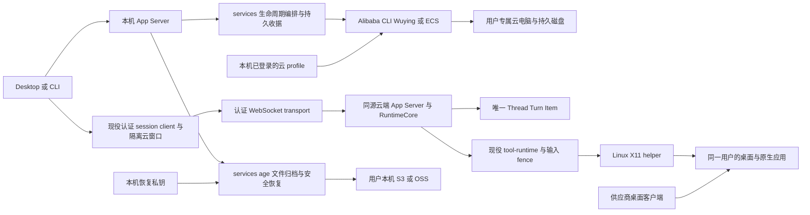

# Lime Cloud：BYOC 持久桌面方案与执行计划

状态：实施中，完整 Cloud 产品尚未验收。当前有效完整实机验收 4/8（50%）；第 3 组的默认官方包自动私有 OSS 分发、真实云机安装、认证任务连接与桌面展开／收起已通过。充值后的新一轮已验证真实模型、同盘启停及重启后原会话 CLI 接续；原生 Computer Use、正常 Electron 退出、最新 Linux 包和敏感身份恢复仍待完成。本轮资源状态以本节最新收据为准，历史轮次的清理不能证明本轮已清理。事实核对日期：2026-11-13。

### 当前交付顺序：核心链路优先（2026-11-13，用户明确收敛范围）

- 最终 App Server 构建自然完成（16 分 40 秒），冻结产物 SHA-256 `4f1b2b9887e491ab3b91ae682dae1a08db3b25c638206df78bf2a715b4f6fa6d`，五项原产品输入无漂移。真实公共 RPC 已越过旧摘要失败，随后在网络归属检查拒绝：官方精确 GetStack 的 `DELETE_COMPLETE` 响应为 `Tags: []`。追加原 `network.rs`／原回归最小修复：仅对已验证且身份不变的原栈允许空标签删除读回，仍逐项验证三项资源全部删除及原物理 ID；错误标签、未验证原栈或保留资源继续阻断。夹具同步真实供应商响应并增加未验证删除拒绝；格式及定向 diff 检查通过，新增标准回归与后端复验未执行。没有新购；按相邻任务资源协调要求，将后续 8 项 services 回归与一次 warm App Server 增量链接登记到统一协调线程，等待窗口，不额外启动重编译。
- 23:00 续接只读核验：原实例／系统盘、专用 VPC／VSwitch／安全组均独立查无；原镜像仍为自有、未共享、Available，唯一系统盘映射加密且源快照与原保存收据一致。未创建新网络或购买意图。两个 test-only 探针分别误假设 `IsSelfShared` 为布尔值、`snapshotId` 位于父收据顶层，均在断言处退出；按供应商实际字符串类型与 `releaseImage.snapshotId` 修正后，直接校验同一份最新响应通过，没有改产品校验或重发云变更。证据为私有 `independent-before-restore.json`。
- 摘要修复已通过标准领域测试 17/17，以及真实 `preserve_order` 依赖的精确产品模块回归 2/2；旧计算与排序结果不一致已复现。最终现役 App Server 增量构建仍在原 `-j 1` 任务中编译，不新增冷 target 或全量门禁；构建完成后先通过公共 RPC 核验原收据与旧网络已删除，随后才准备新网络和独立核价恢复。相邻任务提出资源协调后已暂缓新增编译；所询问 PID 90992 已自然结束，PID 92187 的日志归 `.lime/release-v1.176.0-gui-smoke.log`，不是本轮 Owner，未停止任何该类进程。
- 22:02 按已授权的相邻任务资源协调，将精确核对父链的本轮 Cargo 进程树 `SIGSTOP` 保留进度，窗口到 22:15；未处理他人进程，组件测试此前已自然完成 9/9。轻量只读公共 RPC 在网络发现前暴露原保存收据校验失败：新构建启用 `serde_json/preserve_order` 后，`hibernation::digest` 重建外层 JSON 的字段顺序改变，而原实机收据使用排序后的摘要。原私有收据的所有语义字段及排序摘要均独立核对一致。窄写集追加原 `hibernation.rs` 和原回归，统一递归排序再计算摘要；不修改收据、不接受第二摘要格式、不降低校验。标准 `preserve_order` 回归与修复后公共 RPC 待窗口后执行，未创建新网络／实例，完整实机仍 4/8（50%）。
- 网络删除后重建修复的标准领域回归已完成：`npm run test:rust:unit -- -p lime-services cloud_desktop_service::ecs::network::tests` 7/7、exit 0，包含保留资源／删除身份变化／归属错误阻断及新操作单次准备；没有购买实例。当前 App Server 增量构建沿共享 warm target 排队，不终止其他任务、不另建冷 target。退出诊断中 unavailable 后端一次真实 `app.quit` 以 0 退出，但 runtime 后端仍观察到 `quit` 事件后进程未结束；已增加不附加 Main inspector 的 test-only 驱动，继续定位，不能据一次成功关闭缺口。产品退出代码未改；完整实机仍 4/8（50%）。
- 本次继续认领原 Cloud 的 `ecs/network.rs` 与原回归的删除后重建切片，以及本计划／原架构说明；保持已有推荐／入站规则变更，其他并行写集只读。Verification Contract：P1，budget:normal，Architecture impact: minor，责任 root。真实网络已删后旧收据仍阻断重建；仅在原栈账号／region／ID／name／tag 均匹配、三项固定资源逐项为 `DELETE_COMPLETE` 且物理身份不变后记录 `networkDeleted`，设置入口投影为 `notPrepared`，新显式操作方可准备网络；保留或未知资源继续阻断，旧编号不重放。先验证领域回归，再构建现役 App Server 复验原公共入口；没有在验证完成前购买新实例。
- 本轮资源收尾已完成：原实例及其系统盘独立查询均为零；专用 ROS 栈 `DELETE_COMPLETE`，随后 VPC／VSwitch／安全组独立查询均为零；原私有 OSS 安装包分发由现役 owner 读回 `cleaned`。保留一份已核实 private／encrypted／ready 的系统镜像及其源快照，有持续存储费，不称为零费用或全部云数据删除。证据为私有 `preservation-state.json`、`provider-cleanup-state.json` 和 `distribution-cleanup.private.json`，与本轮唯一原意图绑定；旧 unknown 采购和其他 profile 未动。
- 已通过现役 `hibernateEcs` 父收据跑通停止 → 加密冷快照 → 私有系统镜像 → 释放原机／盘，原始镜像包含整个系统与原 Provider 状态，但尚未证明新环境中的敏感身份可用。后续两次恢复检查均在付款意图之前因 `Cannot verify current public IPv4 address` 拒绝，未发起第二台收费实例；同一 Rust 依赖的独立诊断确认 ipify 连接拒绝、另两个来源返回 200，外部读回的两地址一致。该诊断不代替实际 App Server 的采购前检查，不绕过防火墙保护或伪造短期网络证明。专用网络现已清理，后续须先重新准备网络、形成新规格与报价，不能重用本轮已删除的网络编号。
- 原生授权实机记录：普通唤醒后 native 发现真实 Xfce 与 Zenity 窗口；通过原加密凭据 owner 在可见 Chrome 中认证 noVNC，真实 `computerUse/setup` 显示 Linux 应用授权窗口并请求用户实际点击。90 秒内未取得授权，随后屏幕回到锁屏状态，helper 拒绝为目标身份变化；未发布 grant。收尾独立读回 `AcceptKeyEvents=0`、`AcceptPointerEvents=0`，原 marker 完整；截图为私有 `native-desktop-current.png`。该结果只证明窗口可达，不能记为 Computer Use 操作通过。
- 当前源码的组件 7/7、native 定向 15/15、OAuth 配置锁 3/3 标准 Rust、Command 当前模块 15/15 及旧实现敏感性回归已完成，定向 ESLint 与 diff 检查通过。标准 App Server Cargo 和 GUI smoke 分别运行超过 1 小时／30 分钟仍在编译，按核心优先收敛，仅结束精确核对根命令、父链与成员的本轮进程组；两命令终态均 exit 130，不计通过，其他 Cargo／Agent 保留。没有重新发起冷构建。当前源码与新 Linux 制品、正常 Electron 退出、原生操作、镜像后真实模型／第三方登录恢复及最终账单仍有验收缺口，完整实机保持 4/8（50%）。
- 本次续接窄写集追加修改前干净的 `CloudDesktopViewer.tsx` 与原组件回归；共享 runtime／Provider／协议及 Linux helper 保持只读。沿已读取的 `lime-design-language`，此为用户明确要求的 BYOC 必要适配：固定 `view_only=true` 会阻断用户点击真实 Linux 授权弹窗，故客户端允许发送输入，云端默认禁用键鼠及 consent／人工租约、互斥锁与 fence 继续拥有最终输入权限。未新增布局、文案、依赖、授权 authority 或平行实现。Verification Contract：P1，budget:normal，Architecture impact: minor，责任 root；组件 7/7、现役 Linux native 模块 15/15 通过，GUI smoke 的取消终态见上文。完整 Linux suite 的历史 58 项不冒充本次定向 15 项结果。root 已确认原查看器／native owner 边界及同步后的输入授权时序图；源码均为 current，新增驱动与诊断仅 test-only，无 compat／deprecated 或第二 runtime。
- 保盘启停已沿原 Cloud 公共 RPC 及原操作收据实测：停止至 `computeReleased=true` 为 22,533 ms，启动至 Running 为 10,283 ms；启动提交约 32 秒后原认证 App Server 和 marker 均读回成功。未重新购买、下载、安装或更换令牌；真实 `lime exec --remote … resume` 在原 Thread 中使用原云端 Provider 凭据返回 `LIME_CLOUD_CLI_RESUMED`，canonical Turn completed、CLI exit 0。该计时仅代表本次实例和网络，不承诺普遍时延；证据为私有 `lifecycle-state.json` 与 `after-restart-thread.private.json`。
- 正常 Electron 退出仍未通过：真实 Main／preload IPC／远端 Thread 历史已显示并截图，`app.close()` 和 SIGTERM 未结束，仅对精确核对父链的本轮 Electron 使用 SIGKILL 后确认退出。首次 CLI 接续被旧云端未结束 Turn 拒绝；后续成功包含云机重启，不能称为正常退出后无重启的连续接续。旧失败与 `electron-quit-observation.json` 均保留。
- Command 校验修复的当前源码模块及原测试共 15/15 通过，独立 rustc harness 直接引用产品文件，依赖精确匹配现有 App Server 编译参数；同一新回归在旧 HEAD 校验器上准确失败为 `tool_output_without_start`。标准 Cargo 定向目标构建阶段取消、exit 130；不把模块 harness 当作标准 Cargo 或新 Linux 制品验证。OAuth 配置锁的标准 Rust 定向测试 3/3、exit 0，已完成，不重跑冷构建。
- 本轮续接的最小写集新增现役 `app-server/src/runtime/tool_lifecycle.rs` 与原 `tool_lifecycle_tests.rs`，其修改前工作树为干净；Agent／runtime 其他并行写集保持只读。Verification Contract：P1，budget:normal，Architecture impact: minor，责任 root。真实 Linux v1.175.0 的统一命令启动项使用原始调用 ID，且在 metadata 明确携带 `exec_command_call_id`；校验器却只从顶层字段或 `item_` 前缀取 ID，导致已经执行的命令输出被报 `tool_output_without_start`。独立 `command/exec` 已读回模型创建的真实 marker，不能继续将模型的失败报告解释为“命令没有执行”。修复消费明确 metadata，缺省保留 canonical item 原 ID；不放宽审批、输出归属或终态校验，不重写原失败 Turn。回归覆盖真实原始 ID、输出、相同项终态、异项输出拒绝与终态后输出拒绝，Rust 定向测试待完成。
- 18:42 本轮云机安装完成，认证 App Server 连接与 Linux/Python 命令通过；安装包仍是公开 v1.175.0。启用 native 后真实状态为 `linux_desktop_locked`，Xfce 查询确认 screensaver active；未跳过 OS 授权或伪造 grant。本轮取消自动释放后曾运行计费，随后已完成本节记录的加密保存及精确清理；不沿用上一轮“已清理”作为本轮证据。
- 18:05 充值后只读核对：国内站尾号 8819 可用现金与余额 CNY 149.29，资金门槛阻塞解除。用户指定模型的 Responses API 已真实返回 `LIME_CLOUD_MODEL_OK`；密钥只经关闭终端回显的 stdin 进入请求内存，未写入仓库、脚本或参数。真实云端模型、Electron 退出后的 CLI 接续仍待验证，不以该直连请求计为第 4 组通过。
- 本轮沿现役 App Server 单次提交新采购，2 核 4 GiB、80 GiB 加密系统盘，报价 CNY 0.461/小时，公网流量与其他独立计费项另计；原 unknown 购买的 profile、编号和收据保持原状。专用网络与官方安装包私有 OSS 分发均已准备成功。验证驱动位于 `.lime/qc/cloud-core-recharge-20261113/`，私有收据与运行状态位于用户数据目录；不创建第二 runtime，不提交、推送、建分支或启动子 Agent。
- 官方 v1.175.0 Linux 包的 App Server 不含新模型交付方法；不能把该包记作最新工作树交付接口已通过。首次安装准备明确 `notSubmitted`：验证驱动提前设置的测试实例定时释放触发现役“取消并核实截止后才能使用”保护。该拒绝未发送安装命令；仅取消本轮测试截止并精确读回后再继续，不删除或覆盖原失败证据。完整产品实机验收保持 4/8。
- 实机发现并行 CLI 调用会立即返回授权配置锁竞争，连接授权收据保持 `connectionPreparing`，桌面安装按原操作进入 `needsAttention`。窄补丁为 `auth/credential_window.rs` 与 `auth/cli.rs`：仅对真实 `WouldBlock` 异步等待最多 60 秒，取得锁后才启动一次 CLI；其他 IO 错误立即失败，取消等待释放本次文件句柄，不重放供应商请求。新增取消等待、释放后获取与 IO 错误回归，定向 Rust 测试正在共享构建锁后排队，尚未计为通过。既有收据不篡改；专用测试安全组经精确空入站、相同出口与原供应商幂等键核对后执行一次管理恢复，再由现役原收据读取核实，不能把该管理恢复记为产品自动安装无人工干预通过。
- 用户已亲自完成国内站浏览器授权，继续使用该 connected 连接无需再确认账号尾号。此前 17:32 独立 STS 和余额查询成功，尾号 8819、可用现金／余额 CNY 99.29、信用为零；17:33 有效代金券为零张，当时不足新开按量 ECS 的现金加有效券 CNY 100 门槛。该资金阻塞已由本轮充值解除，旧查询仅作历史证据。
- 本轮只修复该阻塞在产品中的恢复指引。窄写集为原 `ecs/purchase.rs`、原 `tests/ecs_purchase/dry_run.rs`、`CloudDesktopPrimitives.tsx`、独立资金拒绝组件回归、五语言 Cloud 的一个新键及现有架构／本计划；前三个产品输入与前轮快照一致，五语言仅 14 个其他命名空间的并行键有漂移，逐键保持后最小合并一个 Cloud 键。Verification Contract：P1，budget:normal，Architecture impact: minor，责任 root。供应商类型化错误只随明确 notSubmitted 的结果投影，界面只有 outcome／submitted／requiresInspection 均一致才提示补款或切换账号；unknown 继续原收据恢复。只执行该路径 Rust／组件必要回归，不扩展基础壳矩阵。
- 采购网络与资金恢复的两份组件测试共 34/34、定向 lint、文档边界及定向 diff 通过，格式化只针对实际两个 TSX／两个 Rust 文件。唯一 Rust 定向测试仍运行：session 86803、Cargo PID 78102（parent 77965），只读进程与共享 artifact lock 已确认存活，没有退出结论，不重启或启动第二份冷构建。证据 `.lime/qc/cloud-purchase-core-readiness-20261113/validation-summary.json`，九项直接产品输入已登记；本轮新后端公共入口／Electron 验证和真实云模型任务仍未完成，不将组件通过计为整组验收。用户资金选择与原真实模型／第三方身份选择继续待回复，不为等待输入购买收费机器。
- 阻塞审计：前述定向 Cargo 连续确认存活但未开始编译；按用户核心优先要求，仅结束精确核对父链的本轮等待 Cargo，session 86803 终态 exit 1，原父／子进程均已退出，没有触碰其他任务。不能把主动取消称为测试通过或断言失败，新后端与公共入口验证仍未完成。同一真实模型交付选择在至少三个既有目标回合保持待答复，采购资金又已获实时供应商证据；独立必要修复和可运行回归已收尾，继续完整实机必须等待用户补款／账号选择及指定模型连接，不通过反复静态检查、新夹具或重购制造进度。目标进入 blocked，收到输入后接续原状态；原 unknown 采购和原 profile 保留，不宣称整个 Cloud 已交付。
- 4/8 只表示下方八组完整实机验收的通过率，不表示源码仅完成一半。首要交付为国内目标账号 → 单次购买 → 自动装配 → 真实模型任务与原生 Computer Use → Electron 退出后的 CLI 同会话接续 → 保盘停机／重启后继续。随后验证敏感登录状态的加密备份与新环境恢复；账单结清按供应商出账时间独立核对。
- 用户要求先完成全部核心链路，再处理细节。停止扩大浏览器矩阵、基础壳复验、固定快照和全量构建；核心链路改动只执行针对阻断点的必要验证。自动闲置停机继续保持未开放，不能绕过原统一活动准入或共享文件的并行协作约束。
- 原 `runtime.rs`／`processor/account.rs` 写集继续保护。当前本机 active 元数据实读仍为国内站授权的 connected profile、账号尾号 8819；目标账号和真实模型／第三方测试身份的既有问题尚无答复，不重复询问、不自动重开 OAuth、不用旧账号重购。
- 本轮新后端构建被其他 Cargo 任务占有的 artifact lock 阻塞；已核对本轮 Node 父链及专用日志 FD，只结束自己的等待 Cargo，包装器 exit 1。没有结束其他构建、清缓存或启动第二份冷构建；新并发修复仍只有领域 195 通过，新的公共入口／Electron 复验保持未完成。

### 启停只读查询的并发锁语义（2026-11-13，实施中）

- 新固定输入 Renderer 取得有效 ready 收据，Host／preload／client／类型与资源构建通过。真实 Electron 首轮已证明设置页禁用、关闭重开、reload 与完全退出重启恢复原 stop；终态查询失败时截图出现“Another cloud desktop change is in progress”，而原磁盘收据已是 lifecycleVerified，页／console errors 均为零。实际失败为读取锁竞争，不以放宽 5 秒断言或重复运行冒充解决。
- root 追加窄写集：本任务原 `cloud_desktop_service/receipts.rs`、`lifecycle/inspection.rs`、原 `tests/lifecycle.rs`、现有架构的生命周期说明及本计划。修改前这些文件均与本轮冻结摘要一致；共享 runtime／processor account、协议／账号／Provider／其他 UI 与发布继续只读。产品只改原目录，冻结源码继续只作验证，不回写；不启子 Agent、不递交 Git。
- Verification Contract：P1，budget:normal，Architecture impact: minor，责任 root。变更继续严格持有原操作锁；只读 readOperation 在锁竞争时返回校验后的原持久记录，inspect 可仅读取资源但不得改写收据，取得锁后才执行核验写入。锁文件／权限错误、损坏收据不能当作普通竞争吞掉。先运行新增回归复现，再完成领域测试与适用公共入口验证；新后端必须重新构建和登记来源，旧管理制品不证明新实现。原 10 项 Cloud service 摘要及固定 Rust 副本仅代表修复前输入，不将其解释成新后端来源。真云仍 4/8（50%），其他真实账号／模型／备份／账单与共享准入缺口开放。
- 修复前新增并发回归实际失败（10 通过／2 失败），修复后 `npm run test:rust:unit -- -p lime-services cloud_desktop_service` exit 0，195 通过／0 失败／2 项既有 live ignored，111.71 秒。原标准前端 ready 收据已完成，原工具 session 丢失但构建进程已退出，仅按收据与日志记录完成，不编造工具 exit code。
- 继续仅在原目录构建新后端，现役 `prepareElectronAppServerAssets` 输出到本轮冻结目录的构建产物位置；固定 Renderer／Host 来源与新后端来源分别登记，冻结 Rust 源码不打补丁。构建前后保存原 Rust 输入、Cloud 全部输入、7 项 UI／保护输入和新二进制摘要；原管理制品及首轮失败保留。此轮不重开 OAuth、重复查询余额或采购，国内 CN 账号尾号 8819 与 13:00 的历史余额证据不代表已切换用户目标账号。

### 设置页恢复的固定输入桌面验证（2026-11-13，标准前端构建通过，后端并发问题已复现）

- 上轮修复设置页未决启停的安装／连接准入，62 项组件、8 组实际浏览器行为通过，属于 progress；标准 Renderer 被移动输入守卫拒绝，当前补丁尚无 Electron 通过结论。本轮原 7 项直接产品输入再次与前轮摘要一致，保留原 failed／invalid 记录。
- root 窄写集仅本计划及 `.lime/qc/cloud-settings-electron-recovery-20261113/` 的 test-only 快照、脚本和证据。产品源码、共享 runtime／processor account、账号／Provider／协议／发布及其他并行写集只读；快照仅作固定输入验证，禁止在其中开发或回写产品。不启子 Agent、不递交 Git，不发起 OAuth、账务查询、采购或实际云变更。
- Verification Contract：P1，budget:normal，Architecture impact: none。从当前原目录捕获新快照，运行原标准 Renderer 收据流程并新构建 Host／preload／client，保留摘要及入口守卫；管理 App Server／Code Mode Host 仅在 Cloud service 输入匹配既有有效证据时复用，明确不等于完整 Rust 重建。以真实 Electron／preload IPC／cloud/desktop／磁盘收据／设置及引导 UI 复验 unknown stop、入口禁用、关闭重开、reload、进程重启、原编号核验及新显式 start 单次提交。供应商为明确离线 CLI 夹具，不计真云验收；完整 Cloud 继续 4/8（50%），目标账号、真实模型／第三方认证／账单及共享活动准入接线开放，goal 保持 active。

### 设置页未决启停的连接准入（2026-11-13，组件／浏览器通过，当前桌面门禁开放）

- 用户再次提醒国内／国际站差异后，只读复核原私有授权摘要：12:59 的官方 CN 浏览器授权已成功，仍为账号尾号 8819；13:00 的可用现金 CNY 99.29 仅是历史快照，不认定为目标账号或实时余额，不重复 OAuth、采购或真实云查询。原 unknown 采购必须沿原 profile／原编号恢复。
- 上轮固定输入的真实 Electron 恢复场景已有新证据，属于 progress。继续核对原设置页发现，任务连接、安装与桌面入口的 running 仅依赖独立实例状态，未接入原启停收据的等待条件；实例仍显示 Running 时，unknown stop 仍可开放新连接或安装。
- root 窄写集：本任务原 `CloudDesktopsSettings.tsx` 的三处 running 接线、新增独立 `CloudDesktops.lifecycle-recovery.component.test.tsx`、本计划及 `.lime/qc/cloud-setup-electron-recovery-20261113/` 聚合证据。原设置组件摘要与上轮一致；其余产品输入、共享 runtime／processor account、授权／Provider／协议／发布只读。沿用 `lime-design-language` 的现役设置结构，此为 Lime 自有 BYOC 差异，不复制上游托管 Cloud，不启子 Agent、不递交 Git。
- Verification Contract：P1，budget:normal，Architecture impact: none。复用现役 isWaitingForState 与原持久收据，不增加 authority、状态副本、依赖或文案。独立组件验证 accepted／unknown start／stop 下拒绝安装、任务连接与桌面变更，旧收据不因时间失效，原收据终态后恢复，其他 profile 同资源编号不误拦截；继续记录标准 GUI 门禁与实际可执行验证的边界。完整真云仍 4/8（50%），目标账号、真实模型／第三方认证／账单及共享活动准入接线继续开放。
- 已实施：设置页由同一 running 投影连接任务、安装与桌面三处消费者，额外等待原 isWaitingForState 终态；原对话框的只读状态及恢复入口继续可用。独立回归先取得 5 项行为失败／1 项账号隔离通过，修复后 6/6；扩展原设置／安装／连接四个组件文件合计 62/62。首轮测试文案 locator 不匹配、首次扩展命令包含不存在的测试文件均保留，不计行为失败或通过。
- 当前真实 Chrome Gate A 8/8，通过宽屏浅色／390 窄屏深色下四种未决启停组合：检查安装同意后仍禁用、任务重建禁用、桌面禁用，沿原 operationId 查询核验后桌面恢复；调用仅 listResources／inspect／readOperation 与 installationStatus，变更为零。页面错误零、无横向溢出，两张截图已目视复核。Host／供应商为明确合成夹具，不代替 Electron、真实云或模型任务。
- 定向语法／语义／全局／编译选项诊断、ESLint、Prettier 与 diff／文档边界通过；定向类型不冒充整仓 typecheck。正式 `npm run verify:gui-smoke` 完成 8,336 模块及约 4 分钟 Renderer 编译后，被原输入摘要守卫以 `Renderer build inputs changed during compilation` 拒绝，exit 1、收据 invalid，未进入 Electron；没有关闭守卫、伪造收据或将上轮固定旧输入的通过移用于新补丁。此后仅将新三处接线的一处 JSX 按 Prettier 收为单行，未改变行为；最终原组件摘要与 Gate A 一致。
- 证据 `.lime/qc/cloud-setup-electron-recovery-20261113/settings-validation-summary.json`；原固定诊断恢复与本次补丁分开记录。受保护 runtime／processor account 及其余四项 Cloud UI 输入保持原字节，十项 Cloud service 输入保持此前验证摘要；自有测试／浏览器／Vite／标准构建均已终态，无新 OAuth、采购或真实资源变更。KISS／DRY／SOLID 复用现役 owner 和原收据，不新增状态、配置、兼容路径或第二 runtime；分类为 current 与 test-only，架构影响 none。完整实机仍 4/8（50%），goal 保持 active；当前标准桌面门禁、账号及其他真云缺口继续开放。

### 固定输入的 Cloud 桌面恢复验证（2026-11-13，诊断产物行为通过，标准构建未通过）

- 续跑：上一轮得到明确的前端未就绪终态证据，为 progress；本轮读回工作树与原失败日志，宿主负载约 45，RootRouter 转换超过四分钟，尚无业务失败证据。沿同一窄写集从冻结源码执行标准 Renderer 构建，保留输入漂移与入口摘要守卫，改由 Electron 直接加载其构建产物，避免将 dev server 就绪与业务恢复混为一个门禁；不复制旧 Renderer，不改冻结产品源码或全局构建规则。
- 标准构建于 07:49Z 开始，工具句柄 30797 沿原句柄取得 exit 1 终态，已回收。日志完成 8,335 模块转换、进入 gzip 计算后报 `npx vite build --base ./ exited with null`；脚本未记录 signal，不能推断具体信号或 OOM。原 build receipt 为 invalid，不手动改成 ready。一秒运行中采样仅证明当时执行 JavaScript、峰值约 3.1 GB。原 test-only runner 保留 bundled 的有效收据要求，另以显式 emitted-diagnostic 模式核对原 invalid 收据、2,794 项输入摘要与写出 283 文件的前后 SHA，不将诊断模式视为标准构建通过。显式本地供应商夹具独立合同探针 exit 0，四次离线调用覆盖 unknown stop、StopCharging 与 start；不计产品或真云验收。
- 上轮补齐重开引导的原启停恢复，并取得 98 项组件与 13 组浏览器证据，属于 progress；标准 Electron 构建受移动工作树影响退出，不能用旧基础壳证据替代本修复的桌面验证。
- root 窄写集仅本计划与 `.lime/qc/cloud-setup-electron-recovery-20261113/` 的 test-only 脚本、固定源码和证据。产品源码、共享 runtime／processor account、账号／Provider／发布及其他并行写集只读；不启子 Agent，不递交 Git，不发起 OAuth、采购或实际云资源变更。
- Verification Contract：P1，budget:normal，Architecture impact: none。固定当前原仓库源码逐文件摘要，快照仅用于验证，禁止在其中开发或回写产品。实际 Electron／preload／IPC／cloud/desktop／持久收据与 UI 使用同一资源和原操作编号；供应商为显式本地 CLI 夹具。覆盖关闭／重开引导、主窗口刷新及进程重启后的恢复，终态前不开放新变更或连接，终态后恢复下一步；另尝试固定输入的标准桌面壳检查。
- 不把本地供应商夹具计为真云验收，第 4／5／6／8 组及统一活动准入合并窗口继续开放，完整实机仍 4/8（50%）。真实模型／第三方测试身份与目标国内账号问题不重复询问，也不读取其凭据。
- 再次核对本机 active 与对应 connection 元数据，均为 connected、国内站新 profile、账号尾号 8819、地域 cn-guangzhou。国内浏览器重授权已于 12:59 成功；余额仅引用 13:00 的 CNY 99.29 历史快照，不作为实时余额。新授权仍是同一账号，不能据此声称已切换到用户所指的有资金账号；本轮没有 OAuth、账务查询、采购或真实供应商调用，原 unknown 采购及原 profile 保留。
- 固定 11,096 个源码／资源文件，副本逐文件摘要零漂移。复制期间原目录三项无关 TUI 输入发生变化，完整记录在 snapshot.json；不声明全仓单一时间点快照。冻结源码的 Electron main／preload／client 构建与桌面资产复制均 exit 0。复用已校验管理 App Server／Code Mode Host，十项 Cloud service 输入与其此前有效验证一致；未全量重建 Rust，不声明全部 Rust 源码与制品一一对应。
- 已准备真实 Electron 恢复 runner，隔离 userData／config／agent root 与显式本地 CLI 夹具，不改 HOME、不读取真实凭据。首轮 Vite 句柄实际 exit 143，Electron 只显示启动壳；第二轮是 test-only Vite 子路径导出错误；修正脚本后第三轮虽 App Server ready，前端仍未进入主界面。隔离生成缓存后的第四／五轮均在依赖准备阶段超时；诊断日志显示源码仍在解析／转换，未据此断言产品根因或账号授权失败。全部失败保留，不关闭构建漂移守卫、不用旧壳结果替代本修复门禁。
- 前五轮未进入 Cloud 场景，调用与变更均为零；第六轮已通过真实 IPC bind 和 unknown stop，但测试使用不存在的旧首页 selector，停在设置页等待 Composer 超时，不能认定为产品恢复失败。修正 test-only runner 为现役首页入口后，第七轮 exit 0、10 项检查通过：真实 Electron／preload IPC／App Server／持久收据／UI，关闭重开、页面 reload、同隔离根完全退出再启动均恢复原 stop；原收据未决时磁盘 SHA 与 createdAt 保留，显式本地状态推进后核验 lifecycleVerified／computeReleased，再由新显式确认提交 start。stop／start 各一次，40 条 Cloud IPC 记录，page／console errors 均为零。
- 第七轮仅使用固定源码标准失败构建已写出的 file URL 产物，283 文件前后无漂移；没有伪造 ready，不计标准 GUI smoke、完整当前 Rust 重建、模型任务或真实供应商验收。三张宽／窄视口截图已实际复核，无横向溢出。原七项直接输入均在本轮设置页补丁前再次匹配，冻结源码不改写；管理 App Server／Code Mode Host 摘要保持原值。全部自有 Electron／Vite／构建句柄已终态；证据 `.lime/qc/cloud-setup-electron-recovery-20261113/validation-summary.json` 保留各次失败和标准构建限制。本验证切片只有 test-only 与计划变更，没有新产品 owner 或 runtime；后续设置页新补丁须有独立证据，不借用固定旧输入的通过。完整实机维持 4/8（50%），goal 保持 active。

### 重开云端引导恢复原启停（2026-11-13，组件／浏览器通过，桌面门禁开放）

- 再次只读核对现役托管配置：官方 OAuth / CN、connected、账号尾号 8819，active 与对应 connection 元数据一致；余额仅引用 13:00 的 CNY 99.29 历史快照，不重复 OAuth 或采购，不据站点判断它必然是用户目标账号。旧 unknown 采购继续绑定原 profile／原编号。
- 上轮启停收据核验属于 progress。本轮发现重开引导仅对十分钟内 accepted start 隐藏启动，unknown 或较旧未决操作仍会提供新意图入口；原操作恢复尚未接入重开后的动作组件。
- root 窄写集：同任务的 `useCloudDesktopSetup`、`CloudDesktopSetupDialog`、`CloudResourceActions`、`cloudDesktopData`、`CloudDesktopsSettings` 的最小投影接线、对应聚焦组件回归及本计划。共享 runtime／processor account、Account 授权实现、协议／Provider／发布和其他并行改动只读。验证产物仅写 `.lime/qc/cloud-setup-lifecycle-recovery-20261113/`，不启子 Agent、不递交 Git。
- Verification Contract：P1，budget:normal，Architecture impact: none；沿现役持久收据投影，不增加业务状态 owner。原未决启停按完整资源身份匹配、无时间失效，只恢复 readOperation；未知停机阻止连接／安装。先复现、后定向组件／五语言／类型与 lint 检查，再执行 GUI smoke。自有 BYOC 是 Lime 保留差异，不复制 Codex 托管账号或云服务；完整实机保持 4/8（50%）。
- 已实施：由原 `cloudDesktopData` 统一选择精确 profile／region／provider／resource 的未决启停，移除引导的十分钟失效判断；重开恢复原操作编号，动作组件只提供查询，未核验停机不开放连接／安装。设置页同样允许读取原操作，并等待收据的 lifecycleVerified 后恢复下一步；独立实例状态不能替代原收据终态。复用五语言已有 unknown／accepted／查询文案，无新协议、依赖或第二 runtime。
- 新回归先复现 4 失败／4 通过，最终五个未变输入组件文件 67 项通过，设置文件修订现有等待断言后 31/31 通过，合计 98 项。旧引导夹具补全真实收据必有的 operationId；超过千行的设置测试仅更新原场景，不叠加新场景。首次设置复验先出现 5 秒超时，随后 act 重叠造成 26 失败，失败日志保留；宿主负载超过 44，仅测试命令使用 30 秒超时后全过，不修改生产重试或测试断言。定向 ESLint、diff 与 docs boundary 通过。
- 真实 Chrome Gate A 共 13 组通过：桌面浅色／窄屏深色的 accepted／unknown 启停恢复、键盘操作、原编号单次查询和五语言，无页面错误、溢出或供应商变更；已目视复核窄屏原收据与宽屏未知停机两张截图。Host／供应商明确为合成夹具，不等同于 Electron 或真云。
- 标准 GUI smoke 编译期间整体输入摘要已变化，保留两份摘要后仅终止本任务 Vite 子进程，正式 exit 1，未进入 Electron；不能计为桌面通过或把旧 24/24 移植到本修复。整仓 typecheck 在移动工作树／高负载下超过 13 分钟后仅终止本任务进程，exit 143，无全量通过结论；改用定向源文件诊断，结果以证据摘要为准。本轮 Cloud 最终输入及共享 runtime／processor account 摘要未变，未覆盖并行修改，也不盲目重跑整仓构建。
- 证据 `.lime/qc/cloud-setup-lifecycle-recovery-20261113/`。分类为 current 与 test-only，无新增 compat／deprecated；DRY 复用一个收据选择函数，权限及持久状态仍归原服务。无新 OAuth、云采购、资源变更或 Git 递交；模型／第三方认证／最终账单与共享活动准入窗口继续开放，完整实机仍 4/8（50%），goal 保持 active。

### 启停原收据核验与重复意图拦截（2026-11-13，本地与公共链路验证通过）

- 上轮实际 Zenity／人工 helper 锁交接与国内账号核对属于 progress。本轮沿现役 Cloud 生命周期检查发现：`readOperation` 对 start／stop 直接返回旧收据，不核对目标状态；持久冲突检查也未覆盖这两类未决操作。用户重开界面或独立 Host 换编号时可再次提交，unknown 不能通过仅刷新收据退出。
- root 窄写集：本任务现役 Cloud service 的 `inspect_operation` 路由、`lifecycle.rs` 与其核验／测试子模块、`receipts.rs` 两处最小接线、`tests.rs` 注册、原 hibernation worker，以及 `CloudResourceActions` 的终态判断和既有定向回归；本计划与架构同步，证据 `.lime/qc/cloud-lifecycle-reconciliation-20261113/`。保留这些文件已有同任务改动；共享 runtime／processor account、协议、Provider、其他 UI 与发布只读，不启子 Agent、不递交 Git。
- Verification Contract：P1，budget:normal，Architecture impact: minor，责任 root。先复现真实 CLI 进程边界下原收据不推进／新编号重复提交，再沿原 profile、region、resource 只读核验并持久化 lifecycleVerified；未到目标、资源缺失、供应商读取失败保持原未决状态。已核验仅证明所记录实例状态，ECS computeReleased 与无影不可读模式分别保留，不把 Stopped 自动解释成停止全部收费。
- 退出条件：跨进程重启、账号 profile 别名、新编号拦截、原操作单次提交、缺失／错误读回／损坏收据、hibernation 子操作推进和 UI 读取原操作后可继续；执行隔离 Rust 领域回归、组件回归、适用公共 JSON-RPC／GUI 门禁与文档检查，明确环境及证据边界。自动空闲停机仍待原统一准入接线，真实模型／第三方登录／最终结算仍开放，完整实机保持 4/8（50%）。
- 两个新回归在原实现均失败，证据保留于 `before-rust.log`。首轮修复后领域回归 186 通过／3 失败／2 条既有 live ignored；两项旧夹具分别缺少合法 start 收据字段、启动后未核验就开始下一轮恢复，已补齐必要行为。第三项隧道取消测试在并行运行中按全局表下标读取已被其他资源清理的记录；独立运行通过，根因是测试观察对象错误。追加窄写集仅为这三份回归；取消测试在请求已实际启动后取得原 task 的 AbortHandle，再确认真实任务终态，不以表项缺失充当进程退出，生产隧道实现保持只读。
- UI 不再把 accepted 加上单独状态采样当作原操作完成；打开的启停确认面板每 1.5 秒读取同一编号，终态、关闭或读取错误停止自动查询，错误仍可沿原编号手动恢复。手动查询与自动查询共用同一 busy guard，未增加字段输入或授权步骤。中间回归 189 项领域、14 项组件及真实 stdio 重启、标准 Electron 基础壳均通过；文案复核发现既有 verified 专指用户确认恢复后的文件／应用，因此启停改用 lifecycleVerified 和独立五语言结果／历史标签，不借用人工恢复的证据语义。追加写集仅为现有五语言 settings.json 的 Cloud 结果键，其他文案保持；最终回归仍须针对该修正后的输入完成。
- 恢复入口检查补齐：公共 inspect 在存在同一原 profile／region／resource 的未决启停时，持原操作锁复用本次精确供应商查询记录核验，不增加供应商查询，也不允许新 profile 的状态替代原账号证据。无相符未决操作仍沿原 inspect；内部生命周期检查不递归触发恢复。未决启停与环境保存均保留在历史恢复入口中，不受最近 50 条截断限制。新增三个领域回归覆盖资源刷新、profile 隔离与历史截断；公共 stdio 场景补入重启后普通资源查询自动核验，随后读取原收据不再查询或重发供应商。
- 当前输入最终结果：Cloud 领域 192 通过／2 条既有 live ignored，组件 19/19（含五语言），真实 App Server 公共 stdio 1/1；默认 Standard Electron smoke exit 0、基础壳 24/24 断言通过，覆盖 preload／IPC／现役 App Server、重载与三视口。Rustfmt、定向 diff、ESLint、五语言 JSON 和文档边界通过。公共测试的供应商 CLI 为明确本地进程夹具；Electron 证明基础壳，不代替真实云模型、实际付费启停或整组 Cloud Gate B。中间失败和此前输入的通过保留，最终证据仅以 `current-rust.log`、`public-current-summary.json`、`gui-smoke-current.log` 与当前源码摘要为准。
- 证据 `.lime/qc/cloud-lifecycle-reconciliation-20261113/validation-summary.json`；当前产品输入在验证期间保持原摘要，受保护 runtime／processor account 与本轮开始时一致。架构原生命周期说明及同源启停时序已同步，责任 root；KISS／DRY 沿原 Cloud owner、操作锁、持久收据和公共 RPC，无新增配置、依赖、兼容实现或第二 runtime。所有本轮测试进程已结束，无新 OAuth、采购、云资源变更、发布或 Git 递交。完整 Cloud 实机仍为 4/8（50%），自动空闲停机及原共享准入接线继续开放。

### Linux 授权弹窗响应人工接管（2026-11-13，本地与隔离验证通过）

- 上轮补齐精确账单的维度核对及官方结算时效，属于 progress。共享 runtime／account 接线窗口仍未获得答复，本轮不修改这些文件，也不重复 OAuth、采购或模型／第三方登录。独立核对 native 的输入互斥发现：managed 授权弹窗持有 desktop.lock 后，显示循环只检查 RPC canceled，不检查后来出现的 human-control latch；人工接管可等到其 10 秒期限失败，弹窗却继续等待最多 90 秒。
- root 窄写集为此前干净的 `electron/native/linux/linux-native-host.py`、`test_linux_native_host.py`、本计划及现有架构的 managed consent 说明；`.lime/qc/cloud-consent-takeover-20261113/` 保存证据。guest／bootstrap、共享 runtime／protocol／Account／Provider／UI／发布只读，不启子 Agent、不递交 Git。
- Verification Contract：P1，budget:normal，Architecture impact: minor，责任 root。沿现役人工 latch／desktop.lock／fence／native setup owner，先复现“取得 OS lease 的边界出现接管”和“弹窗打开后请求接管”两个行为；修复后不得发布应用授权，实际弹窗终止并 wait 后才禁用 VNC、释放输入锁，保留人工 latch。既有取消、拒绝、VNC 读回失败与输入 fence 不放宽，不新增机器冻结协议、自动停机开关、配置或第二 runtime。
- 退出条件：定向失败／通过回归、完整 Linux Python suite、隔离 Ubuntu 的实际 Zenity 子进程取消及 VNC 键鼠禁用／锁交接。容器结果明确 amd64 仿真与测试接线范围，不计完整 Cloud 实机分子；新 helper 的当前源码不由旧已发布 guest 包代替验收。共享活动准入、OOS 与整组第 4／5／6／8 仍开放，4/8（50%）。
- 两个新增回归先在原实现独立失败；现役 helper 仅增加取得锁后的二次检查与弹窗等待时的人工 latch 检查，保留原 finally 的 terminate／wait／kill、VNC 写入读回和失败关闭合同。修复后完整 Linux Python suite 58/58 通过，未新增依赖、协议、配置或第二 owner。
- 复用固定 Ubuntu 24.04 amd64 测试镜像，在 aarch64 Docker host 上仿真，非 root、无网络、无 capabilities，仅只读挂载本轮 helper 与证据脚本。实际启动现役 guest 的 Xvnc、真实 Zenity 窗口和独立人工接管 helper；目标发现／snapshot 是明确合成 seam，systemd、App Server、ECS 与模型任务未运行。窗口确已映射后发起接管，约 1.354 秒获得控制；真实弹窗 terminate／wait 均发生在原输入锁内，随后读回键鼠为 0，再由人工 helper 取得原锁读回为 1；SIGTERM 停止人工 helper 后实际键鼠为 0，人工 latch 保留、consent latch 清理、应用授权为空。
- 证据 `.lime/qc/cloud-consent-takeover-20261113/validation-summary.json`，原始失败、58 项日志和实际进程时序分别保留。guest／bootstrap／runtime／processor account 的原摘要未变，测试容器已退出并移除；架构原 managed consent 段已同步，责任 root。当前 helper 摘要不同于上轮重连 probe 的固定输入，上轮结果只对其旧输入成立，不借用旧包证明当前完整云链路。完整实机仍为 4/8（50%），无采购、云资源变更或 Git 递交。
- 用户指出国内／国际账号差异后再次只读核对：国内站浏览器重新授权已完成，现役 OAuth CN profile 与 connected 状态一致，账号尾号 8819；2026-11-13 13:00（Asia/Shanghai）余额证据为可用现金 CNY 99.29。不能把国际站余额套入国内账号，也不因重复收到提示再次 OAuth 或重购；原 unknown 采购继续沿原编号检查。

### 独立空闲准入接线协调与精确结算查询（2026-11-13，只读审计完成，接线待合并窗口）

- 上轮 guest 重连实现、67 项定向回归及真实 VNC 隔离验证完成，属于 progress。本轮先核对跨任务提交／准备／后台清理／人工接管／保存的原子准入：不能复用会取消任务的 shutdown，也不能用 CPU／心跳或未覆盖的计数器启用自动停机。
- 完整接线需要共享 `runtime.rs` 的 RuntimeCore 活动准入和 `processor/account.rs` 的归档／模型交付占用；两文件有已核对的独立并行改动。已按仓库并行协作规则发出最小合并窗口确认，尚未获得答复，不通过错误 owner、全局单例或孤立计数器绕过该接线。此处确认与目标阿里云账号／模型连接／第三方测试身份的既有问题分别记录，不重复 OAuth 或采购。
- 等待期间 root 窄写集为本计划及 `.lime/qc/cloud-settlement-audit-20261113/` 的只读审计代码／脱敏证据；原 Cloud／Account／Provider／runtime／协议／UI／发布仅只读。Verification Contract：P1，budget:normal，Architecture impact: none；沿新 CN profile 通过 STS 验证与两次原生构建私有状态的账号摘要完全一致，才查询精确资源账单，不跨账号、不读取模型凭据、不做云变更或 Git 递交。
- 新核对的官方 BssOpenApi 元数据声明 `CashAmount`、`PaymentAmount` 与 `OutstandingAmount`，但此前 `IsBillingItem=true` 的实际行缺失这些字段。下一步在同一精确实例与账期使用实例汇总维度 `IsBillingItem=false`，完整分页且 Decimal 汇总，缺字段保持未知；实付／结清与当前账期仍可补出延迟项分别表达，不把应付或账户汇总归为某轮实付。仅核销得到实际证据的范围，完整实机继续 4/8（50%）。
- 实际查询已完成：新 CN profile 的 STS 账号摘要与两份原生构建状态完全一致；两台精确实例的汇总查询各一页一行、分页完整。当前应付分别 CNY 1.3034741 与 1.019628989，后者较此前 0.933398589 增加 0.0862304；实例维度同样缺失实付、现金支付和未结清字段，不能认定切换汇总维度即可证明支付完成。计费项再核对结果见本轮脱敏证据，不与历史审计金额相加。
- 官方 `QuerySettleBill` 明确：当月数据仅供参考、最终账单次月 2 日 12 点后可查，消耗与账单存在约 5 小时更新延迟；当前未结清状态的还款也在次月出账时更新。此接口可按账单号查结算，但没有精确实例筛选；实例实际响应又没有可关联的账单号。本轮未为推断实例实付去拉取或归摊整个账号结算数据。当前 November 账期不能据这些证据判为最终结清，第 8 组继续开放；接口合同源与 SHA-256 保存在 `official-api-contract-final.json`。

待合并窗口后的准入实施合同（设计，尚未作为产品能力启用）：

| 原 owner 与补丁点 | 必须成立的行为与验证 |
| --- | --- |
| `RuntimeCore` 的统一活动准入 | 原 Arc 状态随 RuntimeCore clone 共享；准入在模型协调、压缩和输入准备之前取得。冻结检查与新准入互斥；在同一锁顺序内核验 canonical Queued／Accepted／Running／WaitingAction，不以另建任务数据库复制状态。用屏障控制的并发提交验证“准入获胜则不冻，冻结获胜则拒绝新工作”。 |
| Turn driver 与 `ExecutionProcessServer` | 活动租约进入实际拥有执行的 task／进程 owner，保留至 backend drain／进程退出与输出清理结束；不能随 RPC 返回、Turn 提前终态或取消请求立即释放。分别覆盖后台 shell、command/exec 和取消中延迟退出。 |
| scheduled worker、Computer Use 和保存 | 自动任务 claim 前准入，原 claim 恢复语义保留；CU 租约覆盖 owned task 与实际 helper 清理，人工接管／consent 由同一机器输入锁原子核验；archive 的 spawn_blocking 持有原占用直到真实完成，模型交付／安装／保存同样覆盖。不能只统计 RPC 或面向 UI 的 current。 |
| 原 Cloud owner 与 durable freeze | 绑定精确策略／代次／boot identity，先私有原子落盘并 fsync 再确认冻结；缺探针、坏状态、重启或身份不符均拒绝停机。重启不因本地租约到期自动解冻；沿原 OOS 父／子执行编号核对终态与 ECS，再由原控制面授权恢复准入，防止迟到停机打断新任务。 |
| 阿里云 OOS 与产品引导 | 只在用户账号内承接持续触发与固定步骤，guest 不持有云管理凭据；使用原意图／ClientToken 恢复未知操作，显式非强制 StopCharging 并独立读回计算释放。自动释放仍受原备份可恢复性与授权约束；未完成全部准入接线和公共链路验证前不开放自动省钱开关。 |


### Linux guest 凭据重连保留桌面会话（2026-11-13，本地与隔离桌面验证完成，实机开放）

- 用户国内／国际站疑问已重新核对：现有真实重授权为官方 OAuth / CN，账号尾号 8819，新 profile 的只读余额证据为 CNY 99.29；不能把站点或重新授权成功当成已切换到用户目标账号。账号选择问题尚未答复，本轮不重复 OAuth、不采购、不重发旧 unknown。
- root 窄写集为此前干净的 `electron/native/linux/linux-guest.py`、`test_linux_guest_reconnect.py`、现有架构 guest 凭据说明、本计划，以及 `.lime/qc/cloud-guest-reconnect-20261113/` 的隔离证据。bootstrap、runtime_install、协议、Account、Provider、UI、发布与其他并行写集只读，不启子 Agent、不递交 Git。
- Verification Contract：P1，budget:normal，Architecture impact: minor，责任 root。现役安装引导／镜像恢复 -> Electron `CloudGuestInstallations.reconnectRuntime` -> 公共 `cloud/desktop` 固定云助手启动 -> guest `reconnect_credentials`；复用原 token、viewer 密码、安装锁、包完整性和原收据 owner，无新配置或协议。保留 `workSaved` 授权，任务 App Server 停止仍会终止其进程组，不宣称全部应用保留；display／Xfce 及由其启动的应用应保留，人工接管授权继续撤销。
- 退出条件：先用行为回归证明原重连停止 display／session，再仅停止 task／viewer／human 通道，轮换并 fsync 原私有凭据，仅启动 task／viewer；依赖在需要时补齐 display／session。运行原 Python guest／bootstrap／launcher 定向回归与 Rust runtime_install bundle 长度／AST／解码检查；隔离 prepared Ubuntu 容器实测 TigerVNC 密码文件重读、旧 viewer 连接断开及桌面应用存续，不冒充真实 systemd／ECS／模型任务。证据记录 Docker amd64 仿真、源摘要和实际进程边界，完整实机仍 4/8（50%）。GUI／runtime 业务事件及 read model 不变，本切片无需重复 GUI smoke；未执行的完整云验收继续开放。
- 原回归先取得 2 通过／1 失败，明确原 `stop` 包含 display／session。修复后仅停止 human／viewer／task，原凭据验证、不可变 release、排他锁与 fsync 保持；任务依赖启动缺失桌面后，通过原有有界 `wait_display` 等待就绪，调用原已验包 helper 的 `vnc_input(False)`，确认关闭键鼠后才启动 viewer。helper 被强制结束后也不依赖其 finally 成功，失败路径保持 viewer 停止，不清除人工接管 latch。
- 最终 Python guest／bootstrap／native suite 为 56/56，固定 launcher 为 4/4；原 Rust runtime_install 为 7/7、exit 0，覆盖 `workSaved`、单次提交、原编号恢复、包 AST 等价与 BZip2 解码。固定样本 Base64 命令为 24,504／24,576 字节；与 Rust 样本字节数一致的 100 组独立合成身份／摘要采样最大 24,544，零越界，仅作为当前输入采样而非普遍上界证明。生产长度拒绝保护保留，后续 bundle 增长必须继续执行此门禁。
- Ubuntu 24.04 的真实 TigerVNC 1.13.1／websockify 0.10.0／Xfce 进程验证通过：旧受管 WebSocket／RFB 连接断开、旧密码拒绝、新密码认证成功；Xvnc／Xfce 及由 Xfce autostart 启动的 xmessage PID 均存续。另在重连前实际启用两类 VNC 输入，重连后读回均为零，原合成人工接管 latch 字节保持。最终运行三份直接输入摘要前后一致；系统服务控制及 task／human 服务为显式测试 seam，不冒充真实 systemd、App Server 任务、ECS 或用户登录资料恢复。
- Docker host 为 aarch64，运行 linux/amd64 仿真，网络关闭、非 root、无 capabilities、无用户 home／凭据／Docker socket 挂载。前两次夹具未识别 QEMU 前缀进程、第三次原生应用准备超过 25 秒，均保留失败证据；修正识别及有界准备等待后，最终固定输入 probe exit 0。观察到的约 4.5 秒仅为此隔离仿真重连，不作为真实云机提速承诺。
- root 确认现有架构 guest 描述及镜像恢复时序与单一 owner 一致，KISS／DRY 复用现役服务、依赖与 native guard，未增加配置、协议、供应商或第二 runtime。docs boundary、Python AST 与窄 diff 检查通过，三个只读受保护输入摘要保持。证据 `.lime/qc/cloud-guest-reconnect-20261113/validation-summary.json`；仅修改原 guest／回归及既有架构／计划，无新采购、云变更、Git 递交或遗留测试容器。当前本机元数据仍连接新 CN profile、尾号 8819，目标账号未确认；完整实机维持 4/8（50%），goal 保持 active。

### 空闲准入入口核对与授权公共回归续跑（2026-11-13，本地核对及回归完成，独立控制待接入）

- 上轮真实国内站重授权成功并取得新 profile 的身份／余额证据，属于 progress；是否为用户目标账号仍待确认，本轮不重复打开 OAuth 或采购。窄写集为已有 `cloud_alibaba_authorization_jsonrpc.rs`、本计划和 `.lime/qc/cloud-alibaba-rpc-20261113/` 的验证产物；共享 runtime／协议／Account／Provider／UI／发布只读，不启动子 Agent，不递交 Git。
- 现役 `RuntimeCoreState.shutting_down` 是退出状态，`session_shutdown.rs::shutdown` 会逐个取消非终态 Turn，再关闭 session；它不具备“仅当空闲时冻结”的语义，不可复用作空闲停机。`agent_turn_is_active` 包含 Queued，不能只统计 Running。
- 已确认以下现役入口，后续准入必须覆盖整个起始区间以及实际 worker／进程终态，不能用 RPC 返回或客户端断开代替占用释放：

| 工作来源 | 现役入口与占用事实 | 停机冻结必须覆盖的边界 |
| --- | --- | --- |
| Turn、队列、Goal／内部续接 | `runtime/turn_execution.rs::start_turn_inner_with_context`、`runtime/thread_queue.rs::add_thread_queue_submission`；Turn 在模型协调、自动压缩、输入准备之后才进入锁内准入 | 在准备或排队之前持有统一占用，直至真实 driver 终态；已入队工作也阻止停机 |
| 独立命令和后台终端 | `processor/command_exec.rs` 直接调用 `CommandExecServer::exec_cancellable`；`execution_process.rs` 持有注册进程及最终快照 | 会话退出标志没有覆盖命令入口；须在启动前原子取得占用，并在实际进程退出后释放，不能只看聊天终态 |
| Computer Use 与用户接管 | `runtime/computer_use.rs` 校验活跃 Turn；`tool-runtime/computer_use/state.rs::execute` 将执行移入 owned task 持有 OS 租约 | 取消请求或删除可见租约后 helper 可能仍在退出；须等待其取消／回收完成，并覆盖人工接管与租约获取 |
| 自动任务 | `scheduled_task_worker.rs` 在扫描 claim 后独立 `tokio::spawn`，经 `execute_started_automation_job` 进入原 runtime | 不能仅在 JSON-RPC ingress 冻结；claim 到身份解析及执行的间隙也需要统一准入，失败时须保留原 claim 恢复语义 |
| 加密导出与恢复 | `processor/cloud_archive_download.rs::prepare`、`cloud_archive_restore.rs::finish` 使用 `spawn_blocking`，已有 permit 持有到 worker 结束 | 恢复 finish 已从可见 current 中取出任务后仍在解密／写入，不能把 current 为空当作空闲；禁止中断敏感备份或恢复 |
| 模型交付、安装与保存 | `runtime/account.rs` 将模型交付委托原 Provider owner，其余 Cloud 操作进入原 Cloud service；认证远端只开放原归档／模型子集 | 新空闲控制不能放宽云管理凭据边界；本机控制面、云助手安装及原保存操作也必须遵守同一机器代次／冻结合同 |

- 核对结果要求采用同一现役 owner 下的原子占用与持久冻结；单独增加全局计数器、两次孤立采样、复用退出动作或只拦 RPC 都会遗漏当前生产入口。本轮不在并行变更的 `runtime.rs`、`processor/account.rs` 或协议中夹写，也不暴露尚无完整消费者的自动省钱开关；独立云端空闲控制仍未实现／验收。
- 授权公共 Rust 目标曾因编译中断而未完成。本轮复用原仓库当前 warm Cargo target，精确调用 `cargo test --manifest-path lime-rs/Cargo.toml -p app-server --test cloud_alibaba_authorization_jsonrpc -j 2 -- --nocapture`，不带会扩展目标范围的 `--tests`。沿现役隔离配置／凭据与 V8 环境解析器执行同步子进程，未使用旧二进制替代当前源码编译；原三个场景编译并执行 3/3 通过，exit 0，关闭此前公共 Rust 目标未运行的缺口。历史中断及原有失败保留。
- 补充第四个真实 stdio 场景：夹具预置带合法请求摘要的 ECS unknown 采购收据，进程重启后从合成账号 A 切到 B，再经公共 `readOperation` 验证仍用 A 的原 profile／区域／原操作标签查询；库存为空仍保持 unknown，活跃连接仍为 B。使用同一原请求／操作编号重放零新增 CLI 调用，原收据字节保持；CLI 只允许两轮 configure／STS 及一次 DescribeInstances，任何真实采购命令均拒绝。该证据覆盖有效收据的产品恢复路径，不冒称真实付费提交丢失响应或完整云供应验收。
- 最终同一精确目标 4/4 通过，exit 0；六个直接输入摘要运行前后一致，未声称整个并行工作树冻结。证据为 `.lime/qc/cloud-alibaba-rpc-20261113/warm-public-summary.json` 和 `warm-public-recovery-summary.json` 及各自完整日志。产品代码、协议、GUI 与依赖无改动，不重复整仓／GUI／供应商门禁；新增代码为 test-only，没有第二 runtime 或 compat。Architecture impact: none，root 确认原 owner 不变；完整实机仍 4/8（50%），目标账号确认、真实模型／第三方登录复用与恢复／最终结算、独立空闲控制继续开放，goal 保持 active。

### 国内站重新授权实测（2026-11-13，授权成功，目标账号待确认）

- 用户再次要求重新授权并区分国内／国际站。本轮经现役 `cloud/desktop` 公共入口显式发起一次国内站授权，终态 `connected`；新 profile 的官方 CLI 配置核验为 `OAuth / CN`，独立 STS 验证仍为账号尾号 8819。不能把重新授权成功表述为已切换到另一账号。
- 使用新 profile 只读查询国内账务接口，确认有人民币可用现金；完整余额核验记录仅在本机私有目录，不将旧余额继续充作实时结果，也不将“有资金”等同于满足新按量 ECS 的开通条件。已询问用户是否为其目标国内账号，未据此自动充值、采购或替换旧采购意图。
- 本轮写集仅现有执行计划、`.lime/qc/cloud-alibaba-rpc-20261113/domestic-reauthorize.mjs` 的显式 live 核验脚本与本机私有证据。Cloud 产品、Account／Provider／协议／UI 只读；未更改产品代码，不启动子 Agent，不进行 Git 递交。
- 证据等级：真实本机 App Server stdio -> 公共 `cloud/desktop` -> 现役 Cloud OAuth -> 官方 CLI；身份与余额由新 profile 独立读取。使用已有管理产物 SHA-256 `b505bb1d690288cc6f81ca6417cc95de71856e90662d0c68c8ed3e1a122ea82a`，运行前后摘要一致，不冒称本轮重新构建或 Electron Gate B。两项命令退出 0；新增采购和云资源变更均为零。私有结果位于 `~/.local/share/lime-domestic-reauthorization-20261113/`，无 Token、完整账号或原始账务响应进入仓库。
- 本轮实证关闭“最新重授权失败”的当前阻塞，历史失败记录保留；“是否为目标账号”继续开放。完整 Cloud 实机仍 4/8（50%），真实模型、第三方认证复用／恢复、最终结算及独立空闲控制的验收范围不变，goal 保持 active。

### 保存环境的阶段等待与独立空闲控制调研（2026-11-13，本地验证完成，独立调度待实现）

- 上轮固定产物公共客户端三场景通过并取得旧产物敏感性证据，属于 progress；新 Rust 公共目标的独立编译未完成，原失败不覆盖。本轮继续降低等待与持续费用，不自动重新授权、不查询旧余额或采购。
- root 窄写集：现役 `hibernation/worker.rs`、原测试的供应商 pending 夹具与新增 `tests/polling.rs`、架构中原保存流程说明、本计划；test-only 证据 `.lime/qc/cloud-idle-control-20261113/`。`hibernation.rs`／生命周期／镜像／收据等现有 owner、共享协议、Account、Provider、UI、TUI 和发布只读，不启子 Agent、不递交 Git。
- Verification Contract：P1，budget:normal，Architecture impact: minor，责任 root。已核验的阶段立即接续；只有供应商仍未完成时保留有界轮询，绝不通过省略停机、快照、镜像或精确释放核验提速。沿原父／子收据、操作互斥、取消与 unknown 恢复，不改变授权或 UI 合同。通过同一推进器注入等待事件验证就绪阶段零等待、pending 快照／镜像等待后只查询不重发、等待中取消保留原盘与已创建备份；随后运行原保存与完整 Cloud 领域回归。
- 云端独立空闲调度仍需 runtime 活动／命令／人工接管／保存状态及停机前原子冻结合同。先核对官方 OOS TimerTrigger、执行角色、取消／原执行恢复和条件探针，不把固定时间释放、OS 内关机或客户端倒计时充作自动空闲停机。公开文档和模板仅用于调研，不自动创建 OOS／RAM 或向 guest 下发云凭据；完整实机仍 4/8（50%）。
- 官方事实来源：2026-11-13 获取的 [TimerTrigger 文档](https://help.aliyun.com/zh/oos/user-guide/acs-timertrigger)、[OOS 2019-06-01 API 元数据](https://api.aliyun.com/meta/v1/products/oos/versions/2019-06-01/api-docs.json)，以及官方 [oos-templates 固定 revision](https://github.com/aliyun/oos-templates/tree/0e4decb4dae4f3d5f1ac1326a845e43324d78443)。四份定时停止／命令执行原子模板均核对 Git blob 与 SHA-256，仓库元数据没有许可证，只保留研究证据，不复制到产品。
- 调研结论：`StartExecution` 支持直接传 `TemplateContent`、原 `ClientToken` 和标签，可省去“先手动创建模板”的步骤，但需用户账号自己的 OOS 执行角色。官方 `ACS-ECS-ScheduleToStopInstances` 不检查 Lime 活动，调用 StopInstance 原子动作时未传 `stoppedMode`，其默认值为空；因此它不能直接作为已保证空闲且节省计算费的实现。Lime 后续流程须明确请求 `StoppedMode=StopCharging`、非强制关机，并独立读回原实例停止与计算释放状态，保盘及其他费用照常说明。
- 取消合同：TimerTrigger 每次创建子执行，父执行返回 Waiting 不证明其子执行已撤销；`CancelExecution` 成功响应只有 RequestId。必须沿原父／子编号使用 `ListExecutions`（显式 IncludeChildExecution，默认 false）和完整分页核对终态，不能猜测存在 `GetExecution` API，也不能把取消成功响应当作旧 StopInstance 不会再发生的证明。原执行未知只查原意图，不换编号提交第二套计划；源码中的 ClientToken 参数不能单独证明服务端幂等时限或允许安全重放。
- 本次 API 元数据将 `CancelExecution.operationType` 标为 read，但其行为会改变外部执行状态；后续接入仍按状态变更处理授权，不能因该注解将取消纳入只读查询。该结论只针对已采集版本，执行时仍需复核当前接口合同。
- 后续实施合同：现役 Cloud owner 负责唯一策略／原操作／模板摘要；OOS 仅承担用户账号内的持续触发与已授权固定步骤。guest 的 App Server 必须原子核验 canonical Turn、命令／子任务、Computer Use 接管与保存占用，并绑定策略编号、运行代次和 boot identity 冻结新任务准入；仅凭 CPU、桌面窗口关闭、心跳消失或两个孤立的空闲采样不够。探针缺失、重启、身份或代次不符时保持原机。停机请求可能发出后，不允许仅因本地租约超时恢复准入；先证明旧父／子执行终止并核对 ECS，再允许原机使用，避免迟到的旧执行关掉新任务。该活动与准入边界、RAM 最小权限和完整 OOS 执行尚未实现／实机验收，不能提前开放自动省钱开关；后续自动释放仍受可恢复备份及原数据授权约束。
- 实施结果：原推进器返回 Complete／Advanced／Pending 三种内部结果；已核验并持久推进的阶段立即衔接，只有原供应商操作仍在处理时等待 3 秒。等待函数是同一推进器的可注入依赖，无新产品配置、协议、后台 runtime 或第二采购／保存 owner。原授权、父／子收据、租约、取消与释放前核验均保留，不将减少固定等待表述为供应商操作或云启动时间的普遍承诺。
- 回归证据：初始三个新增场景在未优化的推进器上取得 1 通过／2 失败，失败分别为就绪阶段多余等待和核验后误等下一阶段；同一测试缝下修复后原保存测试合计 15/15 通过。首轮完整 Cloud 为 203 通过／2 项既有 live ignored；为补齐停止和释放的 Pending 分支，再新增第四个事件驱动场景，最终完整领域日志为 204 通过／0 失败／2 ignored。四个新增场景覆盖所有阶段的等待、原变更仅一次和等待中取消；未用缩短测试定时器代替真实流程。旧轮 20 秒观察失败仍保留，不据此宣称其完整根因已被证明。
- 最终原命令 `npm run test:rust:unit -- -p lime-services --target-dir ".lime/qc/cloud-start-readiness-20261113/frozen/source/lime-rs/target" cloud_` 的终态日志已核对，包含最终四场景及原后台 worker；工具刷新后原 session 句柄缺失，外层 runner exit code 未直接取回，未因此重启已完成测试。独立 ps 确认原 Cargo／测试进程均不存在，证据只陈述实际日志结果。原源码直接修改，仅复用旧 target，没有修改冻结副本。
- 格式、窄 diff、文档边界与原保存时序图语法检查通过；语法不冒充图像渲染。三个最终直接输入摘要、四个只读领域 owner 摘要复核通过，不称全树冻结；本轮没有 UI／协议或依赖变更，未重复 GUI／contracts／真云门禁。minor 架构责任 root 确认原 owner 及立即推进／待完成轮询边界，新增内容仅 current 与 test-only，无 compat／deprecated、中心账号或第二 runtime，无 Git 递交或供应商状态变更。证据 `.lime/qc/cloud-idle-control-20261113/validation-summary.json`；完整实机仍 4/8（50%），目标账号、上一切片 Rust 公共目标、真实模型／第三方认证／最终结算和独立空闲调度继续开放，goal 保持 active。

### 阿里云授权公共入口联验（2026-11-13，固定产物公共客户端通过，Rust 目标未完成）

- 上轮账号脱敏与请求代次修复属于 progress；真实国内账号仍待用户就绪，不自动启动 OAuth 或重购。本轮补齐新 auth 经真实 stdio App Server 的证据，避免继续只证明领域组件与已有管理产物。
- root 窄写集：新增 `app-server/tests/cloud_alibaba_authorization_jsonrpc.rs`、本计划和 `.lime/qc/cloud-alibaba-rpc-20261113/` 的 test-only 证据。现役阿里云产品代码只读；Lime 产品 Account／连接／Web 授权测试、Provider／协议／生成物／UI／TUI／发布与其他并行写集只读。现存 `cloud_web_*` 属于 Lime 产品账号，不能用它们代替 BYOC 阿里云验证。不启子 Agent，不递交 Git。
- Verification Contract：P1，budget:normal，Architecture impact: none。实际新 App Server 二进制 -> stdio 初始化 -> `cloud/desktop` -> RuntimeCore -> 原 Cloud auth -> 显式本机 CLI 夹具 -> 私有元数据 -> 公共脱敏投影。验证授权前不出现尾号、固定 CN、验证后显示、进程重启零重授权、切换替换身份及原 profile 继续可用；旧元数据与原 unknown 只读保持、不泄漏完整身份与凭据。夹具不打开浏览器、不访问真实供应商，不将此结果增加完整实机 4/8 的分子。
- 构建使用本任务已有 `.lime/qc/cloud-start-readiness-20261113/frozen/source/lime-rs/target`，源码仍来自原仓库，不修改冻结副本或抢占其他构建。退出条件为定向公共 stdio 回归、格式与文档检查，明确当前源码与已编译产物的范围；目标账号及真实 OAuth 继续开放。
- 隔离、无依赖的 Cargo 选择实验确认 `--tests --test <target>` 会执行两个集成目标，不能把原 integration runner 当成精确定向。核对父链与日志 FD 后，仅中断本任务宽选 Cargo，exit 1 不计通过；改用现役 `withRustTestConfig`／`resolveRustTestEnv`／V8 环境解析器执行精确 `cargo test --test cloud_alibaba_authorization_jsonrpc`，临时配置与凭据隔离直到同步子进程结束。未修改共享 runner 或其他构建，实验结果不计入产品回归数量。
- 独立 Cargo 在并行内存压力下持续编译 App Server，尚未运行测试；只中断父链与 FD 再次核实的自有进程，exit 1，不记通过。Rust 新目标的编译／运行继续开放；首轮宽选、精确定向和既有完整领域回归的超时失败均保留，不用后续局部通过覆盖。
- 补充生产 `app-server-client` -> 真实 stdio -> `cloud/desktop` 的独立联验，固定使用另一进程已构建的本机产物 SHA-256 `610a253a0cf5f0526ff0c5dd5cb9b5830c4769fb01f217241976dd26d07e9f60`，复制到隔离目录后核对摘要与四份原生运行库。首次副本缺少动态库在启动即失败，补齐原运行库后，三个合成场景全部通过：验证后脱敏尾号／进程重启零重授权／切换后旧 profile 继续原账号模板查询；失败验证跨重启只读且显式重试不重复 configure；旧元数据及无关 unknown 文件字节保持。旧管理产物 `f1ef4e8…52c3` 在同一场景因尾号缺失按预期失败，证明此断言有区分能力。unknown 场景只证明无关文件字节不变，不代替真实采购恢复。
- 证据等级为固定产物 App Server integration；不是本轮 Cargo 编译成功、完整移动源码构建、Electron Gate B、真实 OAuth 或供应商验收。新 Rust 回归未完成；本轮产品源码、协议、GUI 和依赖均未改，不重复 GUI／contracts。最终格式、定向 diff、文档门禁和四个直接产品输入摘要复核通过，架构影响 none；current owner 只读，新增内容均为 test-only，无 compat／deprecated／第二 runtime。目标账号登录、真实模型／第三方认证／最终结算与独立空闲调度仍开放，完整 Cloud 实机仍 4/8（50%），goal 保持 active。

### 国内站与实际账号确认（2026-11-13，本地实现已验证，新后端联验及实际切换开放）

- 用户要求区分阿里云国内／国际站并使用有资金的国内账号。原 CN 账号尾号 8819 的历史余额与新授权失败已有独立证据，不能据此认定用户目标账号、自动重开登录或重购。本轮先修复现役连接投影仅显示“已连接”、无法确认实际身份的问题。
- root 窄写集：原 `cloud_desktop_service/auth.rs`、其授权回归与新增身份回归子模块，原 `AlibabaConnection.tsx`／组件回归，五语言 `settings.cloudDesktop.alibaba*` 的连接文案、本计划及现有架构中的授权说明／时序。保留原 `credential_window` 接线、其他 Cloud 和五语言并行改动；Account／Provider／协议／生成物／聊天／TUI／发布只读。不启子 Agent，不递交 Git。
- Verification Contract：P1，budget:normal，Architecture impact: minor，责任 root。当前官方 OAuth 固定 CN，不因计算地域或账务端点推断站点，不新增未经验证的国际站购买入口。显式显示国内站及 STS 验证生成的四位账号尾号，只持久化脱敏值，不投影完整身份或凭据。缺少尾号的原连接显示未知并引导重新授权，原 profile 的资源管理与 unknown 恢复保持可用；切换清空旧选择／报价的原 owner 不变。
- 退出条件：授权前／验证失败不投影尾号；成功和重启保持脱敏身份；旧元数据可读且读取零云调用；新旧账号不混用；组件覆盖切换、旧记录、错误／不匹配 profile、五语言与禁止自动登录。执行领域／组件回归、类型、定向格式、Gate A 与标准 GUI smoke，分层记录。无真实 OAuth、云 API 状态变更或采购，不提升完整实机 4/8（50%）。
- 已接入 STS 脱敏尾号与国内站标识，旧记录未记录身份时明确提示重新授权，不修改原 profile、资源与采购收据。新增两个延迟读取回归先复现失败：旧成功结果会重新选中旧账号，旧失败会覆盖新授权。现役组件通过请求代次忽略迟到结果，最终 21/21 组件回归通过，保留修复前 19 通过／2 失败记录；无新状态 owner 或生产重试。
- 授权领域 14/14 通过。完整 Cloud 扩展回归 199 通过、1 项既有后台保存测试超过其 20 秒观察时限、2 项既有 live 测试 ignored；同一源码和测试程序单独运行该测试为 1/1 通过，10.96 秒，不修改测试时限或保存实现，不将独立复测覆盖为整轮全绿。机器同期存在约 14 GiB swap 使用，只能记录资源争用事实，不据此断言超时根因已关闭。
- 完整类型、contracts、定向 lint／格式与文档门禁通过。Gate A 在当前 Renderer／Host facade 使用显式合成 JSON-RPC 身份，验证两种主题／视口、五语言、键盘切换、新身份替换、旧记录未知和窄屏无溢出，页面错误零；三张截图已实际复核。原冷加载导航超时保留，沿同一服务重验通过，不冒充真实 OAuth 或 Desktop Gate B。
- 初次标准 GUI 构建启动后发现并修复上述竞态，输入已过期；核对进程父链与专用日志 FD 后仅结束本轮 Vite 子进程，包装器 exit 1，未记通过、未结束其他构建。最终源码标准 GUI smoke 已重新排队，结果待回填。证据 `.lime/qc/cloud-account-identity-20261113/`；十个直接输入摘要已登记，未声明全仓冻结。
- 最终前端构建已完成，原生资源、Desktop Host 构建及 Electron 类型均通过；官方后续阶段触发 App Server／code-mode-host 的完整冷编译，仍未取得 Electron 实际启动的终态。完整 Renderer／Node 类型检查通过后另以最终两个组件输入运行语法、语义、全局及编译选项诊断，全部通过，补足竞态修复后的类型证据。旧控制二进制只做摘要存在性核对，未用于冒充新授权代码或完成本轮桌面验证。
- 完整冷编译存在共享资源争用，核对 Cargo 父链和专用 stderr 后只中断本轮子进程，保留构建缓存与其他构建，标准整体命令 exit 1，不能记通过。Desktop 基础链路改用原管理产物：独立核对原 App Server 和 code-mode-host 摘要，经现役显式 `sourceBinary` 制品接口准备；读取当前 Renderer 收据证明 2794 项输入已就绪，再执行原 `scripts/electron/smoke.mjs`。此结果只覆盖最终 Renderer／Host 与已有管理产物的基础壳，不证明新 auth 后端集成、真实浏览器授权或账号切换；后者仍开放。
- 基础壳最终 exit 0、24/24，真实 Electron／preload／IPC／App Server 初始化、重载、设置和三个视口通过，全部错误及 mock fallback 断言为零。证据 `project-gates/cloud-account-identity-baseline-20261113/shell-01-electron-smoke/summary.json`，明确使用已校验管理产物，不覆盖标准整命令 exit 1，不升级为本轮新 auth 的公共 RPC／真实账号集成通过。已关闭 Gate A 自有 Vite 与浏览器，两个被中断的自有构建均已终态，无新采购或真实授权。
- 本切片为 Lime BYOC 保留的自有服务差异，不复制被排除的 Codex 托管 Cloud。root 确认 minor 架构中的单一 CLI／auth owner、脱敏投影、旧资源恢复及请求代次边界；KISS／DRY／SOLID 沿原 owner 增加可缺省尾号，无新依赖、中心账号、第二 runtime、compat 或 deprecated 路径。原 `credential_window` 与无关并行写集保留，十项直接输入最终摘要一致；最终证据 `.lime/qc/cloud-account-identity-20261113/validation-summary.json`。目标国内账号、新后端公共入口联验、真实模型／第三方认证／最终账单继续开放，完整实机仍 4/8（50%），goal 保持 active。

### ECS 供应商采购预检（2026-11-13，本地验证通过，真云验证开放）

- 上轮取得国内账号、有效券和授权失败的终态证据，属于 progress；目标账号登录仍待用户就绪，不自动重新发起授权、不查询旧余额或重购。本轮推进真实采购前的供应商检查，避免已知业务条件错误只有在付费请求后才被发现。
- root 窄写集：原 `services/cloud_desktop_service/auth/cli.rs`、新增其 `error` 子模块、根服务内旧诊断解析的迁出与原诊断回归、`ecs/purchase.rs`、原 `tests/ecs_purchase.rs` 和嵌套 DryRun 回归、架构中原购买段落及本计划；test-only 证据 `.lime/qc/cloud-ecs-dry-run-20261113/`。上述原 Cloud 输入仍与此前固定源码字节一致；保留并行脏改动，Provider／Account／协议／UI／TUI／发布及其他热区只读，不启子 Agent、不递交 Git。
- Verification Contract：P1，budget:normal，Architecture impact: minor，责任 root。官方 `RunInstances DryRun=true` 不创建实例，成功检查通过非零退出和精确 `DryRunOperation` 表达。原 CLI 进程边界保留类型化、白名单供应商错误；禁止对完整错误文本做 contains 判断。相同资源规格、加密、计费与操作标签只构造一次，DryRun 不携带真实购买 ClientToken，避免不同请求共用幂等 token；真实提交才写 durable unknown 并带原 ClientToken，仍只提交一次。
- 退出条件：通过检查后单次真实提交、规格一致、预检不写采购收据；余额／权限／库存拒绝、伪造／含混诊断、零退出假成功均明确 notSubmitted；预检后报价或网络证明过期拒绝；真实提交失败仍 unknown，跨重启原编号不重复预检或购买；原 Cloud 领域回归、格式与文档门禁通过。不执行云 DryRun 或收费采购，不用本地夹具宣称新账号或真云验收，完整实机继续 4/8（50%）。
- 首轮完整领域回归为 194 通过、2 失败、2 项既有 live 测试 ignored。新增窄写集为原 `ecs/preflight/tests.rs`：保留无效网络证明时包括 DryRun 在内的零采购接口断言，并区分有效采购的一次 DryRun 与一次真实提交。实现补在只读核价／库存后、DryRun 前再次验证原报价和网络证明；DryRun 后仍保留同样检查，不能靠放宽旧断言掩盖边界。原夹具同时按实际操作标签／ClientToken 核对 durable 收据顺序，支持不同操作编号。
- 已沿现役购买 owner 接入官方 DryRun；普通调用继续由原字符串诊断接口投影，进程执行仍只有一个 owner，凭据锁、45 秒超时和输出上限保持原合同。诊断解析迁到 `auth/cli/error.rs`，拒绝重复 JSON 字段／别名、冲突行和非白名单值；只把类型化供应商错误码交给采购判断。真实购买参数与预检共用一次构造，不增加协议、UI、依赖或凭据副本。此为 Lime BYOC 自有供应商边界，未复制仓库规则排除的 Codex 托管 Cloud 服务。
- 新增 7 项行为回归先在旧实现全部失败，初版接入后 7/7 通过；另新增 2 项解析边界回归。第一次运行因嵌套测试路径错误停在编译，修正后才取得有效行为失败，原日志均保留。完整回归发现上述两处问题并修复后，正式 `npm run test:rust:unit -- -p lime-services --target-dir ".lime/qc/cloud-start-readiness-20261113/frozen/source/lime-rs/target" cloud_` exit 0，196 通过、0 失败、2 项既有外网／真实 OSS 授权测试 ignored；不把重复执行计为不同用例。
- 共享 target 被其他 App Server 构建持有，本轮两次排队的完整回归均只终止自己的 Cargo 子进程，exit 1 不计通过；中间复用已成功编译的同一测试程序取得 194/2 的真实失败，二进制与所选输入摘要均未漂移。最终复用本任务此前空闲的独立 target，从原仓库最新源码构建和测试；仅复用构建输出，没有修改冻结副本业务源码或其他进程。最终所选 8 项 Cloud 输入摘要复核、rustfmt、定向 diff、文档边界和原购买时序 Mermaid 解析均通过；语法解析不冒充图像渲染。
- root 确认 minor 架构与购买时序符合唯一 CLI／采购 owner、先预检后 durable unknown、原编号恢复及凭据边界。证据 `.lime/qc/cloud-ecs-dry-run-20261113/validation-summary.json`。分类为 current 与 test-only，无新增 compat／deprecated／第二 runtime。未执行实际供应商 DryRun、收费采购、重新授权或新 GUI／公共 RPC 门禁，不能把本地夹具当成真云验证；本轮内部实现不改变协议与现役 UI 状态合同。目标国内账号、真实模型任务、第三方认证恢复、完整费用与独立空闲调度仍开放，完整实机维持 4/8（50%），goal 保持 active。

### 国内账号重新授权与延迟账单核对（2026-11-13，新授权未完成，账号切换开放）

- 用户再次要求核对国内／国际站并重新授权。本轮只接续现役 `cloud/desktop connectAlibaba`，显式使用官方 CLI 的 CN 浏览器 OAuth；原 active 状态实读为 `failed/authorizationFailed` 后才发起一次新连接，当前为 `authorizing`。旧 profile、资源归属与 unknown 采购记录保留，不读取其他用户凭据、不修改原采购结论、不重复购买。浏览器新建官方 RAM 登录标签，当前页面被其他操作切换，CUA 保护拒绝点击；已请用户在新标签完成目标国内账号授权，尚不能声称切换成功。
- 2026-11-13T01:59:18Z 的只读检查再次证实原账号为国内站、尾号 8819，可用现金与可用余额均 CNY 99.39、信用额度为零，有效代金券成功查询为零张。官方国内站新开按量 ECS 的现金加代金券门槛为 CNY 100，该账号当时差 CNY 0.61；不能称为账号无资金、误用国际站或用户目标账号。账务 API 使用杭州端点，不代表站点或计算地域切换。此前代金券失败与新成功调用同时存在 API 版本和重试参数差异，不能归因为单一参数。
- 最新延迟账单已完整分页，两个原生构建实例及各自原系统盘仍不存在。`cloud-model-live-20261113` 四行税前应付合计 CNY 1.3034741，其中计算 0.9413325、系统盘 0.26964、公网 0.0925016、镜像 OS 为零；`cloud-archive-native-20261113` 三行合计 CNY 0.933398589，其中计算 0.722372109、系统盘 0.21102648、镜像 OS 为零。后者尚未观察到公网项不代表免费；本次结果不与旧审计相加。响应缺少实付和未结清字段，仍未证明最终结算，第 8 组继续开放。
- root 窄写集：本计划、`.lime/qc/cloud-lifecycle-audit-20261113/` 的既有只读审计摘要与 `.lime/qc/cloud-account-reauth-cn-20261113/` 的 test-only 授权接续脚本／白名单证据；产品 Cloud／Account／Provider／协议／UI／发布与其他并行热区只读。财务原始响应和 OAuth 配置仅在本机私有目录，不进入仓库。Verification Contract：P1，budget:normal；Architecture impact: none。无新云资源、Git 递交或第二 runtime，完整实机仍 4/8（50%）。
- 本轮新授权于 02:07:11Z 开始，02:12:15Z 返回 `failed/authorizationFailed`，仍未获得新账号，不将页面已打开当作授权成功，旧链接不能作为有效授权接续。当前需要用户完成目标国内账号的官方登录；用户就绪后再发起新连接，不后台循环重启授权。账号验证脚本已准备并通过语法检查，只有 active 为 connected 且 profile 为 CN 时才允许调用只读 STS／余额／有效券接口；尚未执行，不能宣称新身份或新余额已验证。只读审计脚本与授权脚本语法、摘要一致性、定向 diff、文档边界均通过，原始云采购零次；产品源码无变更，不重复完整 GUI／Rust 门禁。

### 首次装配的软件包索引锁等待（2026-11-13，本地验证通过，真云复验开放）

- 上轮为 progress：证实原授权属于国内站、现金余额为 CNY 99.47，并核实官方开通按量 ECS 的 100 元现金／代金券门槛；目标账号仍待用户确认，新授权失败、原 unknown 采购保留。本轮不重购、不重复索取账号或模型／第三方登录选择，继续独立安装可靠性切片。
- root 窄写集：原仓库 `lime-rs/crates/services/src/cloud_desktop_service/prepare/desktop.sh`、同目录 `test_desktop_prepare.py`、本计划与 `.lime/qc/cloud-apt-lock-20261113/` test-only 证据。上述准备器原始工作树干净；Account／Provider／协议／Electron／UI／TUI／发布及其他并行改动只读，不启子 Agent、不递交 Git。Verification Contract：P1，budget:normal，Architecture impact: none，责任 root。
- 已有证据证明 `DPkg::Lock::Timeout` 不覆盖 `apt-get update` 的 lists 锁。修复在原准备器使用同一种 POSIX 记录锁等待现有索引锁释放，上限 60 秒；不读取锁文件内容、不创建／删除／截断它、不终止系统更新。APT 仍自行取得权威锁，索引更新与安装均只执行一次，真实错误不重试；已备齐环境继续不接触 APT 或其锁。极短的探测到 APT 启动间竞争仍由 APT 自身拒绝，不关闭锁保护。
- 退出条件：真实子进程持锁／释放、超时与非锁错误、缺失锁不创建、预备环境跳过及失败输出边界回归；已有 Ubuntu 镜像内复现旧行为并验证修复，不修改宿主包管理器或 GoodVision 容器；原 Rust 准备合同、24 KiB 命令限制、shell 与文档检查通过。没有真云新样本不提高完整实机 4/8（50%），不将 arm64 容器当作 x64 云桌面验收。
- 已在原准备器实现：只在需要安装依赖时等待现有 lists 锁，使用与 APT 相同的非阻塞 POSIX 记录锁及 monotonic 截止时间，最多 60 秒；缺失锁不创建，链接与非争用错误失败关闭。探测结束关闭描述符，APT 继续自行加锁；没有更改系统更新、包源、配置、屏幕锁或日常唤醒路径。此为 Lime BYOC 自有差异，未找到可复制的 Codex 托管 guest 装配源码；KISS／DRY：沿原准备器、失败码、授权和收据 owner，无新 runtime／依赖／协议。
- 原测试 12 项，新增覆盖后初次 16 项中 5 项因缺少等待实现失败，修复后 16/16 通过；补充软件包命令失败不重试的边界后，最终 macOS 与离线 Ubuntu x86_64 均 17/17 通过，重复平台不重复计入不同用例。真实子进程持锁／释放、超时仍保留持锁进程、非争用错误只尝试一次且不泄漏原异常、缺失文件与 symlink、准备完成跳过锁等待均已覆盖。
- 实际 APT 离线探针在 Ubuntu arm64 及本机模拟的 x86_64 容器均先复现旧脚本 `packageInstallFailed`，修复后等待锁释放并只执行一次 `apt-get update`，状态继续到 ready。只读挂载产品源码、网络禁用、真实索引更新使用空包源，install 和依赖后检查为显式夹具、实际安装包数为零；只证明锁行为，不证明完整装配、桌面或云启动耗时。首个容器驱动漏传 `-i`，Python 未收到脚本却 exit 0，该记录标为无效证据；修正后必须同时验证实际 JSON 结果和退出码，旧失败保留。
- Rust `npm run test:rust:unit -- -p lime-services cloud_desktop_service::prepare::tests` 8/8 通过，覆盖固定新脚本提交、命令大小、原编号单次提交、未知结果重启恢复、授权和失败输出拒绝；shell 语法及定向 diff 检查通过。未改 GUI／Host／协议，不重复前轮固定源码 24/24 桌面壳门禁，也不把前轮成功扩张为本修复真云通过。证据 `.lime/qc/cloud-apt-lock-20261113/`；本轮无云资源变更、全局安装、Git 递交或新增 compat/deprecated owner，完整实机仍 4/8（50%）。目标国内账号、开通条件及真实模型／第三方登录选择保持待核对，不重复下单或读取其凭据。

### 可用路径的固定输入桌面验证与启停基线（2026-11-13，固定桌面通过，启停尚无样本）

- 上轮为 progress：已修改原 hook 并完成先失败后通过的 21 项回归、完整类型和真实浏览器验收；标准 GUI smoke 因输入摘要漂移失败，原失败保持有效。本轮先验证固定源码，再测量真云合成环境的保盘启停，不等待模型连接或第三方登录选择，不据此关闭第 4／5／6 组。
- root 窄写集：本计划、`.lime/qc/cloud-start-readiness-20261113/` 的 test-only 固定副本／脚本／证据，以及本机私有的后续测试状态；原产品源仅只读复制，Account／Provider／MCP／TUI／发布等并行写集只读。Verification Contract：P1，budget:normal，Architecture impact: none。复制严格代码／资源白名单，排除环境文件、用户数据、凭据和生成输出；逐文件验证复制期间与副本摘要，依赖按原锁文件复用，隔离构建输出。
- 退出条件：固定输入的标准桌面壳验证取得真实终态，两个 Cloud 提速输入与原目录保持一致，副本零改写业务源码；真云测试继续使用既有授权、单次采购、固定运行包、自动释放兜底和精确清理，记录启动到 Running／认证任务握手／首条命令以及停止到计算释放的分段耗时。没有实测的阶段不填推测秒数，不保留收费实例等待输入。完整实机仍 4/8（50%）。
- 固定副本已完成 10,101 个文件的逐文件复制核验，复制期间及副本均零摘要漂移；隔离 Cargo 缓存采用 APFS clone，正式 clone 句柄 exit 0。标准 GUI smoke 已在副本运行，原目录业务源码保持只读。真云性能使用已发布且校验过的默认 Linux 包建立独立基线，不将其标成最新内部模型／归档包；测试复用现役安装、加密凭据、认证任务连接与公共 command/exec，不建立第二 runtime。全部准备、脚本构建和账号／报价检查先于采购；单次采购与 finally 精确清理使用本轮独立私有状态，不覆盖旧资源记录。
- 快照装配发现两项 test-only 遗漏：被 Git 忽略但构建必需的 `.cargo/config.toml`，及 Rust `include_bytes/include_str` 引用的 `extensions/` 资源闭包。首次快照构建因缓存锁被本进程精确终止，第二次因缺资源 exit 1，均保留失败日志且不算 Gate B；补充 1+25 个原字节文件与独立摘要收据，第三次标准验证继续使用显式隔离 target。原始 10,101 文件及补充后 10,127 文件均未漂移，两个原目录 hook 输入仍一致；未修改快照业务源码。
- 真云计时已完成测试准备，软件包在采购前准备实测 44.143／46.185 秒；实际默认包 106,595,589 字节，摘要 `2be878d3a45b444158ce1bffb24bf65b41a1e0459618824c298c1b7f400ac05e`，与最新内部包分开。首次明确 `notSubmitted`，独立实例库存为零且分发清理；第二次在采购前原网络只读查询失败，未发采购；第三次 RunInstances 返回 `InvalidAccountStatus.NotEnoughBalance`，现役收据保持 unknown。按精确名称与正确 `lime-operation` 标签均查无实例，分发已 cleaned；不把查无库存篡改为产品收据已终态，也不换编号重购。软件准备不是开机时间，本轮启停样本为零；已异步请求补充测试账号余额，其余本地验证继续。报价 CNY 0.461／小时是供应商报价，附属费用另计，不代表实付或最终结算。证据 `lifecycle-result.json`、`insufficient-balance-inspection.json`、两份原失败 attempt 与原私有记录均保留，完整实机仍 4/8（50%）。
- 用户指出国内／国际站及账号选择需重新核对，前述充值请求已撤回。白名单检查当前官方 CLI 的 `oauth_site_type=CN`，STS 身份与浏览器国内站当前账号一致，尾号 8819；该事实不能证明这是用户所指的有资金账号，也不能据余额错误推断为国际站。现役 `connectAlibaba` 已显式发起一次新的 CN 浏览器授权，保留旧 profile、旧资源与 unknown 采购记录；等待用户在官方页面选择正确账号完成授权后，再核对新身份／站点及账户可用条件。新账号不能复用旧账号网络或操作编号，测试采购仍在身份确认和原资源核查之后。证据 `account-site-inspection.json`；不保存 Cookie、认证口令或 OAuth 秘密到仓库。
- 本次重新授权真实终态为 `failed/authorizationFailed`，没有取得新账号身份，不标记切换成功、不再采购。浏览器新增官方 RAM 登录标签；Chrome 当前页面持续被其他操作切换，CUA 的操作保护拒绝点击／切换，未执行新账号登录或授权确认。当前失败会话不能当作仍有效的授权，需要接续时先读取原状态再显式发起新的连接。最初原账号 `QueryAccountBalance` 因使用该 API 不支持的广州端点未取得有效结果；按照官方 CLI 端点元数据改用 `cn-hangzhou`／`business.aliyuncs.com` 后成功，同一国内账号可用现金和可用余额均为 CNY 99.47，信用额度为零。不能继续表述为账号无资金，也不能把账务地域当作国内／国际站选择。后续购买确认应有可核对的站点与账号身份，避免只有“已授权”而误用旧 profile。
- 官方[自定义购买 ECS 文档](https://help.aliyun.com/zh/ecs/user-guide/create-an-instance-by-using-the-wizard)明确要求：中国站开通按量 ECS 时，现金余额和代金券总值不得小于人民币 100.00 元。当前现金低于门槛 0.53 元，与 `InvalidAccountStatus.NotEnoughBalance` 相符；有效代金券查询未成功，不据此声称代金券为零或认定唯一根因。国内站身份已有证据，新授权没有成功；已向用户核对尾号 8819 是否目标账号，核对及开通条件解决前不重购。原 unknown 采购及其精确库存检查保持原样，恢复测试前仍需先核对原操作。白名单证据 `account-balance-inspection.json` 和 `ecs-account-condition-docs.json`，原始财务响应与 OAuth 数据仅在本机私有目录。
- 第三次固定输入 `npm run verify:gui-smoke` 正式 exit 0，真实 Electron／preload／IPC／App Server、重载、设置及三个响应式尺寸共 24/24 通过，页面／控制台／preload／invoke／mock fallback 错误均零；证据 `frozen-gui-smoke-r3-terminal.json` 与 `frozen/source/.lime/qc/project-gates/standalone-shell-01-20261113013133-85688/shell-01-electron-smoke/summary.json`。已实际查看 1280×800 截图，不将全部截图称为已目视。前两次快照失败、原目录输入漂移失败均保留；本次证明固定源码的桌面壳，不证明整个移动工作树、真实模型、云启停或 Codex 像素一致。
- smoke 结束后重新逐文件核对 10,127 项原始及补充摘要，固定副本漂移为零；原目录两个 Cloud hook 输入仍与验证摘要一致，证据 `frozen-source-final-check.json`。没有修改快照业务源码，本轮新写入仅为既有计划、test-only 证据和本机私有测试状态；未提交 Git。启停实测仍零样本、完整 Cloud 仍 4/8（50%）；下一刀先确认目标国内账号及开通条件，再核对原 unknown 采购，完成合成环境启停／握手／首命令测量，保持单次提交和精确清理。

### 缩短可用路径与避免无关云机阻塞（2026-11-13，定向／浏览器通过，桌面壳门禁未通过）

- 用户新增验收重点：点击到任务可执行的时间、单次实际费用及失败后的人工步骤同时优化。首次装配、保盘启动、镜像冷恢复分别测量，不把供应商 Running 当作任务 ready，不承诺未经实测的启动秒数。准备尽量前移到计费前，日常唤醒复用原安装、环境及授权；既有 30 分钟偏好与安全备份／释放边界保留。
- 性能口径：首次装配分别记录采购前准备、采购／开机、依赖、包传输、安装和认证任务 ready；保盘唤醒分别记录启动提交、Running、原服务握手和第一条命令成功；冷恢复另外记录镜像采购及身份轮换。停止计时以供应商确认停止及计算释放为终点，存储费用继续单列。远程桌面展开、Computer Use 发现及真实模型首项分别测量，不阻塞普通任务连接或混称一个“启动时间”。
- 成本／体验策略：默认使用推荐规格和已有资源，先复用运行中连接；短时离开按原授权停机保盘，预计 30 分钟内继续使用优先保留环境；长期闲置走已经恢复验证的加密备份或私有镜像后释放。无明确预算不维持常开预热机；自动缓存仅处理可信公共软件包，不把用户认证装入通用镜像。后续真云性能采样可使用合成桌面及现有固定包，无需等待模型 Key／第三方真实登录，但不能代替第 4／5／6 组。
- 当前 hook 会检查全部绑定云机，再等整个 `Promise.all` 完成才公布状态；即使界面仅显示已购买目标，无关云机仍在关键路径。root 窄写集为 `src/components/cloud/useCloudDesktopSetup.ts`、新增同 owner 组件回归及本计划；原引导组件、Account／Provider／插件／聊天／TUI／发布与其他脏写集只读。预算 budget:normal，风险 P1，Architecture impact: none；仍为原 Renderer 只读投影，无协议、依赖或第二 runtime。
- 退出条件：目标模式只检查精确目标；列表模式的已完成结果能独立显示并连接，顺序保持绑定清单顺序；刷新保留既有行，迟到请求、资源切换和卸载不能覆盖新上下文；原释放保护和安装／模型交付授权不变。先用未完成 Promise 复现原行为，再执行定向回归、类型／lint、Gate A 和标准 GUI smoke。完整实机仍 4/8（50%）；本地延迟隔离不代替真云启动时间测量。
- 同轮只读隔离探针另确认 Ubuntu 的 `apt-get update` 不因 `DPkg::Lock::Timeout` 等待 lists 锁：arm64 容器返回 100，约 0.851 秒；该证据只证明包管理器语义，不是 x64 云机安装失败。首次基础镜像无 Python、amd64 无网络探针超时均未计为复现成功。该安装竞争需在原准备 owner 单独修复与回归，不扩大本次 hook 写集，不用全量升级或终止系统更新规避。
- 实施已完成：已选目标只执行一次清单读取及目标的两项检查；列表中每台完整检查后独立公布结果，刷新期间保留其他旧行，按清单顺序合并且按完整资源身份匹配。原代际守卫继续覆盖清单读取、异步检查和 React 状态提交。没有自动启动、安装、凭据交付或额外云资源变更。
- 新回归先复现 4 失败／2 通过，修复后与原引导／设置购买接续合计 3 文件 21 项通过；完整 Renderer／Node 类型检查、定向 ESLint、格式、diff 与文档门禁通过。真实 Chrome Gate A 在 1280×900 浅色、390×844 深色分别验证目标独立检查、列表部分就绪及键盘连接，额外验证迟到结果的原列表顺序，两张截图已实际复核。首轮界面夹具误写按钮文案，改读现役翻译后通过，没有改产品文案或放宽断言；related 初轮因整图分析成本终止，exit 143 不计通过，正式具名回归保留前后完整日志。
- 标准原目录 GUI smoke 已终态 exit 1：Renderer 编译完成约 10 分 18 秒后，总输入摘要变化，现役构建守卫拒绝发布 ready 收据；未进入 Electron 交互阶段，不算 Gate B。收尾复核本切片两个输入摘要均未变；按修改时间得到 AppPageContent、设置 sections 和五语言文件等候选，原收据仅有总摘要，不能据此逐文件认定字节变更或归因。保留 `gui-smoke-failed.log` 与 `renderer-drift-observation.json`，不盲目重跑移动工作树，不覆盖这些并行写集。
- 当前证据 `.lime/qc/cloud-start-readiness-20261113/validation-summary.json`；Vite、测试浏览器、隔离测试容器及全部本轮验证进程已结束，无云采购、云变更或 Git 递交，完整实机仍为 4/8（50%）。下一刀由 root 准备仅用于验证的固定输入完成桌面壳检查，再在固定合成云环境实测保盘启动／任务握手／首条命令与停止释放计算的时间；无需等待真实模型或第三方登录选择，不把局部时间证据计为第 4／5／6 整组通过。生产实现仅在原仓库变更，固定副本不作为产品开发目录。

### 最新 Linux 运行包与原生归档验收（2026-11-13，原生验证通过，测试资源已清理）

- 继续降低使用门槛：默认用户只做必要授权与费用确认，工具、网络、安装及连接由 Lime 准备。此次交付验证包含 Railway／敏感根过滤修复的原生 Linux 包，复用同一台临时构建机完成 Railway 安装文件跨启停检查；真实第三方认证与模型任务仍等待前面的选择，不读取相关用户凭据。
- root 窄写集：本计划、`.lime/qc/cloud-archive-native-20261113/` 的 test-only 构建／验收脚本和独立私有状态。Account、插件、聊天、Provider、TUI、发布及其他并行产品写集只读，不启子 Agent、不递交 Git。Verification Contract：P1，budget:normal；现役产品源只读冻结，依赖锁文件和官方公开工具摘要核对后才采购，复用原供应商授权／网络，单次新意图、独立状态、自动释放兜底和精确清理。
- 旧构建闭包已有无关并行漂移和删除，不能把旧包或仅替换两个文件的旧源码包当成当前整树。重新从原仓库冻结构建闭包，不在快照内开发；构建输入漂移和产物范围单独记录。退出条件：原生 ELF／loader、manifest、公共 stdio 的真实加密导出／恢复／拒绝路径，Railway 同一安装文件跨停机重启，取回验包后释放实例／系统盘／专用安全组。Architecture impact: none，沿原产品构建及归档 owner；不提高完整实机 4/8（50%）的分子，除非整组合同独立满足。
- 原仓库重新冻结 4,088 个文件，排除旧闭包中已删除的 22 个文件，依赖锁文件与构建 owner 未变，复用此前已校验的 965 个公开依赖包及官方工具归档。原生 `release` 冷编译约 23 分 49 秒；构建后再次逐文件核对，全部冻结产品输入保持原摘要。收尾原目录的 11 个 TUI／测试支持文件已有并行漂移，归档 owner 未变，不把冻结验证扩张为移动工作树或当前整树通过。
- 已取回内部 `1.175.0` 验证包，103,313,027 字节；原生三个 ELF／loader、版本、18 文件 manifest 和本机独立归档检查通过，零额外文件、链接或路径越界。该包包含最新归档过滤修复，与此前已发布的默认同版本包不同，尚未公开发布或替换默认分发；包、manifest、源码和摘要关系见 `.lime/qc/cloud-archive-native-20261113/native-artifact-retrieved.json`。
- 真实 Linux 公共 stdio 的模型接收方 prepare／read 经两个独立进程保持原回执，不含用户模型 Key 或推理；归档公共 RPC 完成四次真实 age 导出／恢复及七类行为检查。默认排除 Railway；显式敏感授权可恢复三个合成 Railway 配置；直接敏感根、根符号链接、云管理／Lime 控制状态、恢复私钥及篡改密文拒绝均通过。仅使用合成文件，不替代认证 WebSocket／Electron 模型任务、真实第三方登录或恢复后的有效会话。
- 官方 Railway `5.71.1` 在同一原生 x64 实例安装、运行及帮助探针通过；经现役 Cloud 公共接口观察到 `Stopped`／`computeReleased=true`，保盘费用仍存在。重新启动后内核 boot ID 改变，二进制摘要、inode、mtime、权限和版本完全一致，未重装、未执行 login。启动前按产品合同取消本轮释放期限，启动后立即恢复原期限并独立读回；SSH 继续钉住原认证主机密钥。
- 首次准备明确失败于系统自动更新持有 dpkg 锁，退出 100；原失败与命令编号保留，随后同机带有界锁等待的独立准备完成，没有重购或重放未知操作。原生编译仅有既有 TUI 警告，没有编译错误；本轮没有修改产品实现、协议、依赖或 UI，不重复完整 GUI／contracts。KISS／DRY：沿原构建、归档和生命周期 owner，无第二 runtime 或中心托管账号。
- 取回并验包后已经产品接口停止／释放，独立查询确认精确实例、原加密系统盘和专用安全组不存在；复用网络保留。本轮未创建快照、镜像、OSS 桶或软件分发对象。费用记录的初版 test-only `diskNetworkKmsExtra` 标签不准确，原记录保留，`cost-clarification.json` 明确当前 ¥1.509／小时报价包含所选系统盘，公网、快照和 KMS 另计。
- 释放后同账号按精确实例查询当月账单，一页完整返回零行；这是延迟出账观察，不是免费、实付或最终结算。原始账单响应仅保存在本机私有目录。整组第 4／5／6／8 仍开放，完整实机维持 4/8（50%）；下一刀在前述模型连接／第三方登录选择到达后使用本轮固定包继续真实任务与会话恢复，不因无关 TUI 漂移重复构建，不保留收费实例等待输入。

### Railway 工具链预检与归档过滤修复（2026-11-13，本地通过，真实登录开放）

- 上轮完成只读费用审计并取得新的计费口径证据，属于 progress。本轮继续第 5／6 组中此前 Railway 下载未完成的缺口；先在本机准备官方发布归档，复用已有 Docker Linux 环境检查兼容性及持久目录，不购买收费 VM 等待用户授权。
- root 窄写集：本计划、`.lime/qc/cloud-toolchain-live-20261113/` 的 test-only 归档、预检脚本与隔离测试目录。产品 Cloud／runtime／工具安装 owner 只读，Account／插件／聊天／Provider／TUI／发布等并行写集保持只读。Verification Contract：P2，budget:normal；官方 HTTPS release API 固定版本、资产字节数和 SHA-256，安全检查归档后才执行。无本机用户 home、凭据、Docker socket 或云管理身份挂载到容器。
- 首个候选为官方 `railwayapp/cli` 的 `v5.71.1`，Linux x64 GNU 包 9,161,023 字节，发布摘要 `8a9455a4c96ced0f6da87882fa63e112a956a05a2e2d498a9135e780d3a7bd56`；此版本固定后不跟随 latest 漂移。容器预检只证明 Linux 执行及文件持久性，若使用 amd64 仿真必须明确记录，不代替真实云机启停、第三方 OAuth 或恢复后的登录读回。
- 已另行询问用户准备使用哪个第三方专用测试账号进行登录，明确不发送密码／Token；这与仍未答复的模型连接选择分别记录。用户未完成必要登录／敏感备份授权前，不读取或迁移真实认证资料。Architecture impact: none；独立预检、脚本语法与文档检查通过后更新证据边界，完整实机仍为 4/8（50%）。
- 官方固定 tag 的 `src/config.rs` 确认生产／staging／dev 登录资料存入 `.railway/config*.json`；现役默认排除只覆盖 `railway`，且 `collect` 只判断相对路径，直接选敏感目录为根会丢失过滤上下文。本轮追加窄写集为此前干净的 `services/src/cloud_archive_service.rs`、其 `tests.rs`，以及架构中现役归档边界的一段说明；先用真实 age 导出／恢复回归复现，再修复完整源路径判断和 `.railway` 排除，不新增协议、依赖或第二凭据 owner。风险调整为 P1，Architecture impact: minor；真实用户认证与原始凭据仍不读取。
- Railway 官方归档已完整取得并核对发布摘要，安全解包仅含一个 21,124,824 字节的 x64 ELF；官方配置源码也与固定 tag 的 Git blob SHA 一致。Ubuntu 24.04 GNU loader、版本和登录帮助通过，两次独立、无网络、无 capabilities 的非 root 容器复用同一个安装文件，摘要、inode、mtime 未变，没有挂载本机 home、凭据或 Docker socket。Docker engine 为 aarch64，实际使用 amd64 仿真；此结果不替代原生云机或真实登录恢复，剩余本轮容器为零。
- 原 Docker 拉取因 daemon 的 DNS `::1` 不可用而失败，未修改系统配置。测试准备改由主机 HTTPS 获取官方 `library/ubuntu:24.04` 索引及固定 amd64 manifest，校验 config、单一压缩层 SHA 与解压 rootfs diffID 后导入本机临时测试镜像；保留来源和所有摘要，不作为产品镜像或云验收。无需新云资源、全局 CLI 安装或第三方 Token。
- 新增真实 age 往返回归先复现两个失败：默认导出多带三份 Railway 配置、直接选择 `.aliyun` 根可绕过控制状态过滤。首轮修复后 20 项归档回归通过；进一步符号链接根回归又独立复现失败，最终同时检查原选定根与 canonical 实际源路径。`.railway` 默认排除，仅显式敏感导出可恢复三个合成配置；云管理目录和 Lime 控制状态不论敏感选项均排除。原恢复私钥叶文件回归改用普通混合目录，继续证明密钥独立于目录名被过滤；已知控制目录整根另由新测试明确拒绝。
- 最终 `npm run test:rust:unit -- -p lime-services cloud_` 退出 0，187 项通过、2 项既有 live 条件测试 ignored；新增三个回归均通过。初始 related 自动扩展十个 crate 后仅终止本任务测试树，exit 143，不计通过；改用隔离配置的明确领域测试，原失败日志保留。无新 ABI、协议、UI 文案或 runtime，按风险执行领域回归、文档、语法及定向 diff，不重复整仓 GUI。架构责任 root，沿现役自有 BYOC 归档 owner 修复，没有复制 Codex 私有 Cloud 或增加兼容路径。
- 证据 `.lime/qc/cloud-toolchain-live-20261113/validation-summary.json`；本轮产品写集仅归档实现／回归及对应架构／计划，其他并行写集保留，无 Git 递交、云资源新购或真实登录操作。上一轮同源 Linux `guest.tar.gz` 早于本次过滤修复，不能证明或部署为本修复的 Linux 验收产物；后续实机须使用包含本修复的重新构建包。模型连接选择及第三方测试登录仍待用户，完整 Cloud 实机保持 4/8（50%）。

### 当前测试资源费用与附属成本核对（2026-11-13，只读审计完成，最终结算开放）

- 上轮原生 Linux 包验证、独立验包与精确清理取得新证据，属于 progress；真实模型连接选择仍待用户回复。本轮独立推进第 8 组，只读核对同账号、精确测试实例／系统盘／专用分发桶的当前月账单与广州区资源存量，不读取模型 Key，不购买或删除资源。
- root 窄写集：本计划、`.lime/qc/cloud-cost-audit-20261113/` 的 test-only 只读审计与私有账单响应；其他产品、Account、插件、聊天、Provider、TUI 和发布写集只读。Verification Contract：P2，budget:normal；复用已校验官方 CLI 与原 OAuth，先验证账号摘要，依据现存私有状态和专用分发收据建立精确 allowlist，再查询新版 `DescribeInstanceBill`。原始账单仅保存在本机私有目录，证据只投影资源类型、币种、金额及覆盖范围。
- 退出条件：API 分页完整性、精确 ID 匹配、金额字段与币种、账期及统计口径均可核实；区分未出账、零金额、累计应付、现金支付及最终结算。缺少历史原始证据或共享账号费用不能归到本轮，资源为空也不推断零费用。无产品代码变化，执行脚本语法、定向 diff 与文档门禁，不重复全仓 GUI／Rust；Architecture impact: none，完整实机仍 4/8（50%）。
- 当前五份保留测试状态及其分发收据建立 14 个精确资源的 allowlist：五个实例、五个系统盘、四个专用软件分发桶。`DescribeInstanceBill` 已完整查询 2026-11 账期，四个实例有 16 行计费项，税前累计应付 CNY `0.335014650`，其中计算 `0.207378954`、系统盘 `0.119653296`、公网流量 `0.0079824`；最新原生构建机尚无账单。系统盘计费归在 ECS 实例 ID 下，按盘 ID 查询无行不能理解为磁盘免费，也不把累计应付称为已支付或最终总额。
- 当前同规格只读 `DescribePrice` 明细核对：8 核／16 GiB、160 GiB 构建规格的 CNY `1.509`／小时报价包含计算 `1.173` 和系统盘 `0.336`；公网按流量的预估项为零不代表实际流量免费。该核对纠正“计算报价再另计全部存储”的口径；客户的现役 ECS 文案已将公网、快照及 KMS 与停机保盘费用分开，无需修改产品或重复核价采购。
- 账户级 OSS 明细六行、税前累计 CNY `0.8936295204`，快照一行 CNY `0.0035042324`；计费 ID 不对应当前四个专用桶／精确测试实例，不归到本轮费用。KMS 暂无计费行，不等于免费。另保留供应商按产品汇总的舍入值和支付／未结字段，但不与上述精确明细或旧审计相加；本机现存证据目录已无此前 42 资源原始审计，不将旧汇总冒充当前独立复核。
- 独立只读确认广州区实例、磁盘、快照、私有镜像、EIP、NAT 网关六类存量均为零；现役公共 RPC `listOssBuckets` 返回的供应商列表中，四个精确专用分发桶均不存在。账号另有两个非本轮桶，未读取对象或更改；复用网络保留，不声称其他地域或整个账号资源为空。
- 原始失败保留：账单 API 不支持广州 endpoint，改用官方帮助中的杭州入口；新版 `DescribeInstanceBill` 的 `Items` 是数组，初版 test-only 解析按旧结构失败；NAT 查询每页上限为 50，初次 100 被拒绝；本地帮助的搜索参数不能与 `--help` 同时使用。均只影响只读测试脚本，没有变更云状态或产品放宽校验。证据 `.lime/qc/cloud-cost-audit-20261113/validation-summary.json`；原始响应仅存本机私有目录。最终结算、最新构建机延迟出账和第 4／5／6 组仍开放，完整实机维持 4/8（50%）。

### 低门槛真实模型验收准备（2026-11-13，原生包验证通过，测试资源已清理）

- 用户闭环：首次使用者从 Cloud 入口开始，仅完成供应商授权、费用确认和指定模型密钥交付授权；Lime 自动准备工具、规格、网络、运行包及连接。安装进度必须反映真实阶段，失败恢复沿原操作，不要求用户手动安装 CLI、上传包或重新填写 API Key。
- 门槛验收：默认路径手填技术字段为零，不要求终端、AccessKey、SSH 私钥、Bucket、运行包地址或开发环境；已有有效云授权直接复用，已有模型连接只做单目标交付授权。准备尽量在付费采购前完成；费用区分计算、保盘、网络、快照及 KMS，不把关机或生命周期规则表述成零费用或精确清理。必要授权、费用确认和数据覆盖／丢弃确认不能用“自动化”省略。
- root 本轮窄写集：本计划、`.lime/qc/cloud-model-live-20261113/` 的 test-only 构建与验收脚本、私有测试状态；产品代码及 Account／插件／聊天／Provider／TUI／发布等并行写集只读。不启子 Agent，不进行 Git 递交。
- Verification Contract：root，P1，budget:normal。先在本机准备严格白名单源码、Cargo.lock 校验的公开依赖和工具归档，固定输入摘要后才采购临时原生 Linux x64 构建机；复用原账号授权及网络，重新核价，持久化单次采购编号，设置并独立读取自动释放兜底。管理凭据、用户配置和模型密钥不得进入源码包或构建机。
- 原生构建使用现役 `scripts/app-server/linux-guest-build.mjs`，不在快照内修改产品实现；取回后检查包摘要、ELF／loader、版本、manifest 和公共协议。观测中断先查原进程／原操作，不重复启动或购买；结束后精确清理本轮实例、系统盘及专用传输对象，保留用户资源与复用网络。
- 用户尚未回复前轮模型连接选择，因此暂不读取或交付模型密钥、不产生依赖该授权的推理费用。独立构建准备继续，不为等待输入保留收费实例。只有真实模型任务及 Desktop 退出后的独立 CLI 延续满足 canonical Thread／Turn／Item 合同，才能关闭第 4 组；整体仍 4/8（50%）。Architecture impact: none（test-only），责任 root。
- 本机已冻结并核验 4,045 个源码输入、965 个公开依赖包和四个原生工具归档。原生构建临时采用广州 8 核／16 GiB、160 GiB 加密系统盘，运行小时报价 CNY 1.509（包含该规格系统盘；公网流量、快照及 KMS 另核对）；供应商自动释放时间已独立读回，系统盘确认随实例删除。仅新增本轮专用 SSH 安全组并限制操作者 IPv4 `/32`，不改复用网络或发送云管理／模型凭据。
- 先前原始失败均保留：官方 Rust 编译器归档下载超时后，单独从公开镜像获取并核对官方 SHA；自动释放首次遇到资源尚不可见，随后只查原实例并核对供应商分钟精度；测试归档带入 macOS 元数据、USTAR 长路径失败及源码白名单漏一份编译期模型目录，均修正 test-only 准备脚本后沿同一实例继续。新增目录文件直接来自原仓库，原有 4,044 个输入字节未变，没有在快照中开发业务代码；Account／插件并行漂移单独记录，产物不冒称冻结整个当前工作树。
- 本机现有 App Server 已用独立数据目录验证新模型准备／读取接口及两进程相同回执，二进制快照 SHA 稳定；不需要额外重编、不打开用户 Provider 或读取实际模型密钥。Linux 包已沿现役原生入口完成构建、staging、验包和真实公共 stdio 两进程验证；重启后读取同一准备回执，没有用户模型 Key 或推理请求。
- 最终 Linux x64 包为 103,101,010 字节，SHA-256 `6c7243dbc49156eef22be89eba0a6d03b06e31f85e9ad776fa2681a7dff498cf`；manifest 的 18 个文件、三个 ELF／loader／版本检查及本机独立归档安全检查通过。该 `1.175.0` 是本轮内部同源验收产物，未公开发布，不能与旧官方默认包混同，也不证明整个并行工作树已冻结。
- 实际链接首次缺少 `libxdo-dev`，只在同一临时构建机补齐后复用缓存续跑；最终 wrapper exit 0，构建和原生验证完成标记均已观察到。三个最终 ELF 没有 libxdo 动态依赖，不据此增加产品桌面运行依赖。最后约 56 秒仅为缓存链接续跑，不能当作完整冷构建耗时；原始失败和完整日志保留。
- 取回并独立验包后立即走原精确资源的 stop／release，实例、加密系统盘与本轮专用安全组均由独立查询确认不存在，私有状态为 `released-and-cleaned`；复用 VPC／VSwitch 保留。最终账单未核实，不以资源清理推断费用为零。汇总 `.lime/qc/cloud-model-live-20261113/validation-summary.json`；本轮无产品代码、依赖或 Git 递交。
- 下一刀仍为已授权模型连接的单目标交付、真实云窗口模型任务与 Electron 退出后的独立 CLI 延续；用户尚未选择连接，不读取 Key，不为等待输入保留收费 VM。第 4／5／6／8 组保持开放，完整实机仍为 4/8（50%），goal 保持 active。

### 设置页购买接续与最低操作门槛（2026-11-13，本地验证完成）

- 用户目标：新用户仅处理供应商授权、费用确认及必要数据授权。当前聊天入口已复用购买后接续，但设置页仍默认手填绑定，购买成功也只刷新清单。本切片将设置页默认切到现役购买路径，并把精确核验的新机移交同一 `CloudDesktopSetupDialog`，不新建向导或持久供应状态。
- root 窄写集：`CloudDesktopsSettings`、`AddCloudDesktop` 的触发器 ref、`CloudDesktopSetupDialog` 的初始资源接线、对应组件回归、已有架构与本计划；其他 Account、Provider、插件、聊天、TUI、发布和五语言文件只读。现有文案复用五语言键，不新增依赖或协议，不采购收费资源，不启子 Agent，不做 Git 递交。
- Verification Contract：root，P1，budget:normal。现役购买 UI → 原 `cloud/desktop` 采购或原收据查询 → 已核验资源 → 同一只读 inspect/连接状态引导 → 原安装或重连授权。unknown 不接续、不重购；清单延迟不丢失精确新机，账号/地域隔离保留。仅 UI 选中状态与触发器焦点归 Renderer；启动、安装及模型凭据交付不能因本切片自动执行。
- 退出条件：设置页无需先切购买页；核验完成才自动进入新机设置，unknown 沿原编号查询；原安装同意仍必需；关闭回到添加触发器，重开不会沿用旧采购结果；相关组件、类型/lint、Gate A、标准 GUI smoke 与文档检查分别报告。Architecture impact: minor，沿用既有 owner/架构图补入口，无新增 runtime。完整 Cloud 实机维持 4/8（50%），模型连接与第三方专用测试登录选择仍待前轮回复。
- 实施结果：设置页默认打开 ECS 购买，继续复用浏览器授权、模板／推荐、运行包准备及费用确认；只有现役收据完整核验后才卸载已完成购买会话并移交精确新机。引导初次打开显式聚焦继续设置标题，关闭恢复添加入口焦点，重开为新购买会话；unknown 的原会话和编号不重置。设置页关闭文案复用既有五语言“关闭”，不显示无关的返回本地／管理同页入口。
- 最终四文件 63 项回归通过；定向 lint 零警告、格式及定向 diff 检查通过。完整 `npm run typecheck` 通过，随后焦点／测试夹具小改经最终五个文件的语义、语法、全局与编译选项诊断通过；标准 `npm run verify:gui-smoke` 在原目录完成 Renderer、Desktop Host、Electron 类型、sidecar／native 资源构建及真实 Electron 初载、重载与三视口，退出 0。不以通用 smoke 代替本切片真实供应商或 Cloud Gate B。
- Gate A 通过两组完整交互（1280×900 浅色、390×844 深色）与五语言默认购买入口：可见技术输入为零、费用未确认不可购买、未知结果只读原编号、核验后聚焦新机、未授权不可安装、关闭与重开不会重购。真实 computed style 验证弹窗背景及文本对比，四张最终截图已复核；仅显式 Renderer／Host／JSON-RPC 夹具，无云账号、凭据或真实供应商请求。证据 `.lime/qc/cloud-settings-handoff-20261113/validation-summary.json`。
- 原失败保留：初次命令重复传入 runner 自带 worker 参数；旧引导夹具仍使用已退役的包可用性检查，已迁移至现役准备与报价网络证明；新夹具遗漏版本／桌面能力并错误按 Portal 顺序选择嵌套弹窗，均修正测试而未放宽产品检查。首次实质回归证明新开弹窗会抢走标题焦点，产品已在原 `onOpenAutoFocus` 修复。额外语义检查发现旧 mock 泛型含构造签名，已明确 `() => void`。浏览器初轮缺本地默认 Playwright 浏览器，改用现有 Chrome；首次冷加载超时后沿同一 Vite 服务重验，最终保留 sandbox。早期截图遗漏主题样式，仅行为证据有效，补齐现役主题入口后重新计算颜色和截图；不将早期截图记为视觉通过。
- 架构责任 root 已核对现役架构、流程与时序图的双入口、单一采购／安装 owner 和用户授权边界；均为 current，无新增 compat／deprecated、中心服务或第二 runtime。本轮无新采购、云 API 状态变更、全局安装或 Git 递交，Vite 与测试浏览器均已结束。完整实机仍 4/8（50%）；模型任务、真实第三方登录的启停／备份恢复和最终费用结算继续开放，不重复索取前轮选择。

### 剩余整组验收与最新延迟账单复核（2026-11-13，只读审计完成，最终结算开放）

- 上轮设置页接续已交付并经 63 项回归、Gate A 和标准 Electron smoke 验证，属于 progress。本轮依当前实现重审第 4／5／6／8 组，不以新 UI、合成模型或合成登录替代真实整组验收；前轮模型连接与专用第三方测试服务选择尚未收到回复，不读取真实 Key、Cookie 或登录资料，不新购资源等待输入。
- root 窄写集：本计划与 `.lime/qc/cloud-final-audit-20261113/` 的 test-only 只读审计；模型交付、Provider、Account、插件、聊天、TUI、发布与既有 Cloud 产品代码只读。Verification Contract：P2，budget:normal；只查询两个精确原生构建实例的当月账单及精确实例／系统盘存在性，复用原 OAuth 与摘要钉住的 CLI，分页完整且原始响应仅保存在私有目录。没有新实例、盘、网络、桶或推理请求。
- 退出条件：延迟计费区分无行、已出账应付、现金支付及最终结算；不重复累加旧审计或扩展到其他账号资源。依据现役 owner、最新原生产物和实际证据记录剩余闭环及其依赖，不把可推断或等待用户的要求判为完成。Architecture impact: none；完整实机仍 4/8（50%）。
- 同账号、2026-11 账期的精确分页查询取得新出账证据：`cloud-model-live-20261113` 四行，税前应付 CNY `1.2224645`，计算 `0.9413325`、系统盘 `0.26964`、公网 `0.011492`、镜像 OS `0`。使用 Decimal 按币种和实例汇总，不与旧审计相加；响应未提供支付、现金支付、信用支付及未结金额，不能把应付称为实付或结清。`cloud-archive-native-20261113` 仍零行，仅为当前尚未观察到计费记录，不表示免费；两者 `finalSettlement=false`。
- 独立精确查询确认两台原生构建实例及各自原系统盘均不存在；不扩大为整个账号、其他地域或历史所有附属资源已清空。原始供应商响应保存在本机私有目录，仓库仅有金额字段白名单、资源身份及分页结果。本轮无云状态变更、无新采购、无模型密钥读取或推理费用。
- 当前原仓库七个模型交付／归档／Linux 装配输入与最新原生包对应 manifest 的摘要一致，仅证明这七个 owner 输入，没有全工作树冻结声明。默认已公开同版本包与最新内部验证包仍明确区分；本轮无已证实产品缺陷，不重复构建或修改 UI。
- 整组第 4 仍需用户指定连接的真实云模型任务及 Electron 退出后的独立 CLI 同 Thread／Turn／Item；第 5 需专用第三方真实认证跨启停；第 6 需授权后的真实认证经加密备份或镜像恢复并读回有效会话；第 8 需延迟账单、附属成本归属、实付及最终结算。前述两项选择保持待回复，不重复索取、不读取凭据，也不保留收费实例等待。分类仅 current 既有实现与 test-only 审计，无 compat／deprecated 或第二 runtime，完整实机仍 4/8（50%）。
- 审计与 Decimal 汇总脚本已运行成功，结果见 `.lime/qc/cloud-final-audit-20261113/financial-summary.json`；沿现役购买、安装、连接和生命周期 owner，KISS／DRY 不新增中心服务、产品依赖或凭据副本。脚本语法、定向 diff 与文档门禁结果记录在同目录 `validation-summary.json`；本轮没有产品代码变更，不重跑完整 GUI／Rust，也不借用上一轮 smoke 提升本轮证据等级。

### 最低使用门槛与持续费用验收标准（2026-11-13）

- 默认路径由 Lime 读取有效授权并复用；缺少 CLI 时由私有工具准备器下载和校验。首次用户只处理供应商授权、费用确认及必要的数据授权，不要求终端、开发环境、AccessKey、SSH 私钥、Bucket 或运行包地址。高级字段收起；授权有效时不重复登录，失败沿原操作恢复，不重购。
- 默认推荐依据所选地域的实时库存和报价，选择满足完整 Linux 桌面的有效候选；现役推荐为 2 核／4 GiB、无 GPU、非抢占按量实例。大规格原生构建机仅用于研发验收，不作为客户默认规格，不把有限候选报价称为全云最低价。
- 本机工具、运行包缓存和分发尽量在付费采购前准备；购买后显示真实下载、安装和连接阶段。已有软件及登录环境沿持久磁盘或已验证恢复路径复用，默认不为每个任务重装或重新购买。桌面默认收起，用户需要时才建立查看通道。
- 短期复用可停机并明确计算、保盘及附属资源的剩余费用；长期不用先保存环境并验证可恢复，再释放原计算资源。30 分钟是用户偏好，不能按窗口关闭推断任务空闲，也不能把它当作所有规格的成本平衡点。备份失败保留原资源，客户端退出后的调度能力单独验收。
- 金额统一区分计算、磁盘、网络、备份／快照与 KMS；无法核实的项目标为另计或待核对。用户自有云账号直接付费，现有 Rust App Server、工具与持久化 owner 复用，不要求 Lime 运营中心运行池或新建第二 runtime。
- 上述条目作为完成标准，不增加实机验收分子。已取得的购买、自动装配、桌面显隐证据沿原记录；真实模型任务、第三方认证跨启停／新机恢复及完整费用仍须分别关闭，不能用“零填写”文案替代验证。

### 启停速度、费用与等待体验的优化合同（2026-11-13，设计与测量）

- 目标按优先级为：数据和授权可恢复、点击到首条有效命令的时间、实际总费用、人工步骤。单台 BYOC 采用运行中复用、停止计算保留磁盘、已验证保存后释放三种资源形态；停机只保留文件与已落盘授权，不保证内存、运行中原生应用或尚未保存工作。供应商内存休眠如需接入必须另测恢复语义、资格与费用，不能将当前私有镜像归档称作内存休眠。
- 首次装配：官方工具、软件包下载／摘要校验、区域网络／报价与连接预检尽量在创建计费实例前完成。可信通用软件可缓存；用户凭据、浏览器 Profile、模型 Key 与恢复私钥不得进入通用镜像。预装公共基础镜像应在后续有独立维护和实测收益后再实现，不以建设常开池作为首版前置条件。
- 日常唤醒：复用原实例／磁盘／系统服务和任务凭据；不下载运行包、不运行 apt、不重新采购。Running、认证 App Server ready、首条命令成功及 Computer Use ready 分开观测；云助手与网络控制通道可能成为关键路径，按实测定位，不能通过跳过认证、开放公网端口或绕过权限提速。多个云机逐台公布可用状态，单目标检查不等待无关资源。
- 交互：用户明确选择云端后，在其已授权计费范围内开始唤醒；等待期间保留草稿、项目上下文与原操作编号，允许继续编辑及离开页面。提示当前阶段、已等待时间、可恢复失败与下一步；没有统计样本时不编造倒计时或进度百分比。只在认证连接与真实任务探针成功后允许发送；不因云端未就绪改在本机执行。桌面画面默认收起，查看时才加载查看通道；Computer Use 工具则仍需验证对应桌面会话就绪。
- 空闲与成本：空闲依据 Agent 回合、命令／子任务、人工接管和正在进行的保存，不依据窗口是否关闭。预计 30 分钟内复用优先停机保盘是用户偏好；该值不是统一计价临界点，也不是到点无条件释放。长期保存决策比较保盘费与归档／快照费、转换／恢复流量、KMS／请求费、每次重建开销及等待成本。差价为正时，粗略经济临界时长为转换与恢复固定成本除以每小时存储差价；费用未完整核实时只展示分项，不自动声称最低价。
- 保存与释放：先确认工作已保存，再保存加密备份或专用加密镜像、验证异机恢复与身份轮换，最后释放原计算和明确授权的原磁盘；保存失败保留原资源。云端独立调度、客户端退出后的空闲判断、自动 stop 与自动释放尚需各自实现和验收，不将仅由客户端倒计时或供应商固定释放截止替代为空闲策略。默认不为未经同意的预测唤醒持续付费；定时预热只有明确时间／预算授权时启用。
- 性能报告：首次装配、保盘唤醒和归档重建分别记录分段时间及实际成本；少量样本只报样本值和中位数，不宣称 P95 或普遍秒开。停止以供应商确认 Stopped 且 computeReleased 为计时终点，保盘与附属费用继续显示。本轮先收集同一合成实例的重复启停基线，不用模型／登录选择阻断性能测试，也不据此增加完整验收 4/8 的分子。

### 单目标模型连接授权复用（2026-11-13，本地验证通过，真云验收开放）

- 目标：用户选择本机已有连接和一个已连接云电脑，确认密钥交付后即可复用；普通配置导出继续不含真实密钥。不迁移云管理身份、浏览器 Cookie 或整个凭据库，不需要中心代理在线。
- root 窄写集：Provider service 新增 `connection` 子模块，凭据 owner 仅增加可恢复的保留身份写入；core 新增专用传输回执表；Cloud action、RuntimeCore／AppDataSource／processor 最小接线及生成物；Main 新增模型交付编排与 Renderer 私有 action 守卫；原 Cloud 设置增加连接选择入口、五语言和对应回归。既有 Cloud 持续改动接续，Account／插件／聊天／TUI／发布等并行写集只读；不启子 Agent、不进行 Git 递交。
- Verification Contract：root，P1，budget:normal。`cloud_desktop_connection` -> Main -> 本机 `cloud/desktop sealModelConnection` -> 认证远端 `prepare/apply/readModelConnection` -> RuntimeCore -> 原 Provider／credential owner。目标生成十分钟一次性 age X25519 recipient；只有精确、已启用 Provider／Key 被封装，交付协议只传公钥、密文及非敏感回执，Renderer 只见选项与固定状态。回执使用独立 DB 表，Provider／Key／route generation／完成状态同事务提交；保留 secret 身份使跨存储中断可沿原编号恢复，已完成或过期不能再导入，不覆盖目标已有 Provider。
- Happy Path：选择连接并授权，目标准备公钥、本机封装、远端导入、发布模型目录更新；配置是否可用仍由原模型目录／Provider 测试负责。失败显示固定可恢复状态，未知先读取原操作，必要时只重送原密文，不换编号另建；本机 seal 对 Renderer 原始 JSONL 和远端关闭。密钥不经过普通导出、日志、请求明文字段或新网关。
- 必跑：领域回归、公共 JSON-RPC／认证远端边界、Host 与组件定向测试、协议生成/contracts、类型与风险匹配 GUI；真云需要包含此功能的同源 Linux guest，不使用旧官方包证明新能力。Architecture impact: major（新增跨层授权数据流），架构／时序在同一写集更新，责任 root；本轮本地验证不增加实机 4/8（50%）分子。
- 原版核对：Codex 公开 App Server 的 Provider 配置不提供用户 BYOC 单连接密钥交付；Codex 私有 Cloud 亦被仓库规则排除。本切片为 Lime 多 Provider／BYOC 保留差异，沿原 JSON-RPC 和 Provider owner 实现，不声称是上游源码复刻。
- 已实现：十分钟一次性接收方、只封装一个启用 Key、48 KiB 源配置上限、独立 SQLite 回执、保留凭据身份与同事务导入；新建自定义 Provider，不覆盖云端现有配置。Main 加密持久保存原编号／原密文，完成响应丢失时只读恢复，完成或过期后清除本机密文；远端和 Renderer 原始 JSONL 都不能执行本机 seal。云端仅沿原模型目录刷新，不产生推理请求。
- 新增恢复保护：交付未确认时 `save`／`saveEcsTunnel`／`delete`／`reconnectRuntime` 拒绝改变任务连接，避免原目标身份丢失；五语言就地引导展开复用区域、继续原操作。反向也禁止在安装／轮换未结束时启动模型交付。完成／过期后恢复正常操作，不放宽目标令牌校验。相关 Main 真实本地存储／连接 owner 回归覆盖原凭据不变、零云请求及解除保护；未决交付时远端长期不可达仍需保留原连接，不能把本机经过十分钟当作目标已清理的证明。
- 最终领域 6/6、原凭据 4/4（另 1 项真实解锁 keyring 测试 ignored）、公共 JSON-RPC 2/2、Main／窗口／私有边界 24/24、组件 24/24，通过的不同用例共 60。公共入口实际经过 JSONL 与认证 WebSocket、Provider／SQLite／凭据 owner：删除源凭据并重建目标服务后，目标凭据及同一回执仍可读，一个导入 Key，推理请求为零。该夹具在本机单进程内运行，不冒充两台机器或独立 CLI。
- 公共测试首轮引用私有 transport 模块导致仅测试编译失败；第二轮错误读取 JSON-RPC 响应层级使 ciphertext 为 null，协议按类型拒绝。已修正测试，保留 `rust-rpc.log`／`rust-rpc-r2.log`，第三轮及增强源凭据删除断言后的 `rpc-settled.log` 均通过，未调整生产校验或超时。完整 contracts、Renderer／Node 类型、定向 lint、文档边界和窄写集 diff 检查通过。
- 最终 Gate A 使用原安装／连接 UI、Provider API、Host facade 与 CSS，加显式 test-only Host／Provider 夹具；五语言、1280px 浅色／360px 深色、键盘明确授权、原操作恢复、固定错误、连接更改保护与窄屏无溢出通过，页面／控制台错误为零。截图复核发现恢复状态误用不存在的操作编号翻译键，已改为复用原键，并扩展五语言未知状态与浏览器翻译键泄漏断言；修正后截图和两张架构／时序图已实际查看。10 个直接输入哈希在运行前后保持一致，不称为全仓冻结。
- 标准 `verify:gui-smoke` 退出 0，真实 Electron／preload／IPC／App Server 初始化、重载、设置及三视口，24/24、错误／mock fallback 均零。最新基础壳证据 `standalone-shell-01-20261112211410-20226/shell-01-electron-smoke/summary.json`；构建后模型选项分隔符从中点收敛为斜线，并复用已有操作编号翻译，其最终样式由组件与 Gate A 复验，不把基础壳提升为模型交付的真实 Electron／真云端到端证据。
- 证据 `.lime/qc/cloud-model-transfer-20261113/validation-summary.json`。root 确认 major 架构图与时序中的唯一 Provider owner、认证与凭据边界、恢复保护及 Desktop／CLI 共同存储合同。KISS／DRY／SOLID：沿原 Provider、凭据、目录、Host 和认证任务 transport，无新依赖、中心账号、中心代理或第二 runtime。分类 current 与 test-only，无新增 compat／deprecated；保护 Account、插件、聊天、TUI、发布与无关热区，保留并行改动。本轮无云资源采购、启停、清理或 Git 递交。
- 实际补充写集为 `electron/cloudModelConnections*`、`cloudDesktopWindows*`、`CloudRuntimeInstallation*`、`CloudModelConnection*`、五语言 `settings.cloudDesktop.modelShare*`、该公共 RPC 测试、既有架构／命令／README 和本计划；前述 Provider／DB／协议接线继续归本切片，其余并行写集只读。下一刀由 root 准备包含本功能的同源原生 Linux x64 guest，沿既有授权验证真实云窗口与独立 CLI 模型任务，再推进第三方认证和备份／费用验收；官方旧 1.175.0 包不含本功能，不能作为替代。完整 Cloud 实机仍 4/8（50%），goal 保持 active。

### 云窗口首次模型连接引导（2026-11-13，本地验证通过，真实模型任务未验收）

- 目标：避免云机已连接却缺少模型时让用户自行排查。云窗口自动读取自己的现役模型目录，未配置聊天模型时直接引导到原 Provider 设置；已有配置不重复引导，离开设置后重新检查。检查仅投影配置状态，不发推理请求、不表示真实模型任务已成功。
- root 窄写集：新增 `src/components/cloud/CloudModelSetupNotice.tsx` 及组件回归，`src/App.tsx` 仅接入该提示；五语言 `settings.cloudDesktop.modelSetup*` 键、本计划。现有 Provider／Account／连接／runtime／CLI／发布实现只读；保留并行脏改动，不启子 Agent，不递交 Git。
- Verification Contract：root，P2，budget:normal。沿现役 `model/list` 和模型更新 notification 读取远端配置；本机窗口不查询、不显示；失败显示固定提示与重试，不渲染服务端错误。返回设置、窗口恢复焦点或目录变更时重新读取，迟到请求和卸载不得覆盖当前状态。通过现有导航守卫进入模型设置，不增加配置表单、凭据导出、云管理能力或第二 runtime。
- 退出条件：组件的本机／缺模型／已有模型／媒体模型／失败重试／通知竞争／卸载／导航守卫／五语言回归；类型、定向 lint、浏览器 Gate A 与标准 GUI smoke 分层记录。Architecture impact: minor，延用 Cloud 隔离 transport 与原 Provider owner；不将本轮引导计为第 4 组真实模型任务验收，整体仍 4/8（50%）。
- 已接入现役 App 主内容区；本机与设置页不挂载观察器，云窗口通过原 API 的完整分页、canonical capability snapshot 与显隐合同投影是否缺少聊天模型。检查不读取凭据、不发推理请求、不创建云资源。重试、返回设置、恢复焦点和 `model/list/updated` 都复用同一 owner；较旧请求不能覆盖新的状态，后端异常只展示固定文案。
- 定向 20/20（组件 16、RootRouter 4）、完整 Renderer／Node 类型、定向 ESLint、五语言和 diff 检查通过。真实 Chrome Gate A 五语言 360px 深色、1280px 浅色、键盘导航、草稿保留、返回重查、失败重试、目录通知刷新、媒体模型拒绝与本机零查询通过；页面／控制台错误均零。两张截图已实际查看。首次夹具误用非法 capability source，第二次硬编码错误的刷新按钮名称；原失败收据保留，修正夹具后最终通过，未调整产品错误处理或超时。
- 标准原目录 `npm run verify:gui-smoke` 退出 0；真实 Electron／preload／IPC／App Server、Renderer 重载、设置和三个视口通过，证据 `standalone-shell-01-20261112202353-85398/shell-01-electron-smoke/summary.json`。该基础壳不覆盖真实云窗口模型配置或模型 Turn；Gate A 仅使用显式 Host／JSONL 夹具。汇总 `.lime/qc/cloud-model-setup-20261113/`，记录 13 个直接输入哈希；不将其冒称全仓源码冻结。
- KISS／DRY：复用原 Provider 设置、模型目录和导航守卫；无新表单、依赖、协议、runtime 或凭据同步路径。分类为 current 和 test-only，没有新增 compat／deprecated。实际追加写集为本节列出的组件、App 五行接线、五语言五键、README 中本能力说明与本计划；其余并行写集保持只读。没有购买、启停、清理或提交资源，没有 Git 递交。下一刀仍为安全授权后的单目标模型连接复用与真实云端 Desktop／CLI 任务，第 4／5／6／8 组缺口继续开放，整体实机仍 4/8（50%）。

### 默认自动分发的完整桌面验收（2026-11-13，通过，完整产品仍实施中）

- 用户目标：降低费用、填写、安装和恢复门槛；复用已有有效浏览器授权，购买前由 Lime 完成官方包缓存与私有分发，用户不提供包地址、Bucket 或密钥。
- 本轮 root 接续上轮 Cloud 写集；先只读核对已有资源已清理、同账号授权有效与当前源码构建，再使用一台 ECS 验证默认安装、真实桌面展开／收起、原操作恢复和精确清理。Cloud 以外 Account、插件、Provider、聊天、TUI 与发布的并行改动只读，不启子 Agent，不递交 Git。
- Verification Contract：root，P1，budget:normal。单次采购前先完成本机准备，保留原操作编号，不因未知结果重购；安装测试窗口最多 25 分钟，终止时沿精确原资源释放实例和盘。软件包专用对象和桶走现役清理 owner，用户备份不在清理范围。不得以分发回归替代真实云机安装或完整 Cloud Gate B。
- 首轮证据目录 `.lime/qc/cloud-default-distribution-live-20261113/`；采购前只读确认授权有效且账号一致，无新浏览器授权。每轮只创建一台测试机，前轮清理后才开始第二轮。
- 首轮实机：当前原目录 Rust App Server 构建通过，生产输入无漂移；构建期间只有两个未参与二进制编译的插件 integration test 变化，单独记录。真实 Main 默认分发 34.462 秒完成，完成后才以 CNY 0.461/小时报价采购；官方 106,595,589 字节包全部下载，安装 216.586 秒进入 complete，凭据保存成功，原生退出正常。随后 test-only driver 的 `evaluate` 回调错误引用 Node 进程变量，桌面检查未执行；保留 failed 终态，不归因为产品安装故障。现役产品精确释放实例／系统盘，原分发意图已 cleaned。
- 已定位并修正 test-only 回调参数传递，三个通道先在无 Node 闭包变量的独立上下文预检通过。第二轮使用独立目录 `.lime/qc/cloud-default-distribution-live-r2-20261113/` 和新持久意图，先确认首轮资源清理。首次准备因并行插件源码漂移失败关闭，未采购；复用缓存重新构建后生产输入无漂移。另一次准备只因首轮失败留下的空目录返回 EEXIST，改用可重复目录准备，仍以 `wx` 防止覆盖意图；未删除或覆盖原记录。
- 第二轮完整链路通过：真实 Main 自动分发准备 43.154 秒，完成后才单次采购；无需自定义包、用户填写存储参数、SSH 密钥或新浏览器授权。官方包完整接收 106,595,589 字节，安装 210.945 秒完成并保存连接；临时安装通道关闭，正常安装已清理原分发。默认隐藏桌面时无 desktop 隧道；点击展开后真实 Xfce 画面与只读 RFB 认证通过，iframe 无自身／父 bridge 及 Node；收起关闭真实 RFB WebSocket、恢复焦点，任务通道保持且重新执行认证 `thread/list` 成功。截图已实际查看，原生退出 460 ms、exit 0。
- 两轮实例和系统盘均经现役产品释放并独立读取不存在；软件包专用对象与空桶通过原精确分发 owner 清理，用户备份与复用网络不在清理范围。报价 CNY 0.461/小时，存储／流量与最终结算未在本轮核实，不将报价当作实付。
- 本轮产品文件仅修正 `README.md`、`README.zh-CN.md` 中过时的购买前准备描述并说明桌面显隐；源码与脚本改动限 test-only 验收驱动及本计划。文档边界、定向 diff 检查通过。复用现役 Cloud、安装、分发和连接 owner，无新依赖、中心账号、兼容层或第二 runtime；完整实机更新为 4/8（50%）。最小 Main 和 `thread/list` 投影不覆盖完整生产 Main、真实模型任务、CLI 延续或真实第三方登录；既有全仓 GUI 输入漂移失败仍保留，未冒称本轮通过。

### 用户 OSS 自动分发与低门槛默认路径（2026-11-13，实施中）

- 目标：在付费 VM 采购前自动准备用户账号内的软件包分发，无需填写 bucket、包地址或密钥；只有授权与费用确认需要用户操作。
- root 窄写集：新增 Main 私有 Cloud action 守卫与回归，`appServerHost.handleJsonLines` 仅增加全批输入前置守卫；现役 `services/cloud_desktop_service/oss` 的软件包分发子模块、Cloud 协议必要 action 与生成物、Main 分发状态及原购买／安装接线、定向回归、本计划和既有架构／命令说明。保留已存在的 Account／Connection 改动，Provider、聊天、TUI、Skills、发布与无关文案只读；不启子 Agent，不进行 Git 递交。
- Verification Contract：root，P1，budget:normal。Renderer 原始多行／batch／notification 都不得调用私有分发动作；Main 保留直接请求能力，远端沿原 local-control 守卫拒绝管理动作。STS、签名 URL 不进入 Renderer 或普通记录；同一账号／地域／版本绑定同一持久操作，unknown 不另建资源。仅精确删除自身软件包对象与空桶，生命周期作为离线兜底，不能代替精确清理。
- 退出条件：领域与私有边界回归、协议生成与 contracts、类型、定向 UI／Host 验证与真实 OSS 往返；默认真云安装须独立验证。沿用公开包缓存与原安装 owner，不引入中心账号或第二 runtime；完整实机仍为 3/8（37.5%）。
- 已接入当前默认购买与首次安装来源：购买前 Main 复核官方缓存，并调用现役 Rust OSS owner 自动创建专用私有分发；阶段进入 `distributing`，用户不输入存储参数。正常安装终止后按精确资源释放引用，最后一个有效引用结束后删除原对象与空桶。公开软件包与 `.age` 用户备份维持各自边界。
- V4 直接使用现有 `sha2` 与 workspace `hmac`，没有新工具或 SDK；固定参考 Alibaba SDK revision `d3474aa038242301669f48b1f08d1b15cdf7c324` 的 wire 合同与公开向量。单次流式 PUT、Content-MD5、SSE AES256、完整回读 SHA256、私有对象与最多两小时且不超 STS 的 GET 签名；一天对象与未完成分块过期规则在上传前设置并读回。正常删除与离线异步过期分别记录，不将一天规则冒称精确清理。
- 首轮真实完整包测试在签名阶段因旧会话临近过期返回固定授权失败，原精确桶与对象已清理。已补当前 Cloud `auth/cli` 最小接线与独立 `credential_window`：所有受管 CLI 调用共享配置凭据锁，任务窗口不足时仅使缓存有效期失效，仍由原官方 CLI 刷新和保存 OAuth／STS；不复制长期令牌、不新开浏览器。该窄写集属于现役 Cloud 授权 owner，未修改并行 Account 模块。
- 第二轮产品 OSS owner 真云复验通过：官方 1.175.0 的 106,595,589 字节，SHA256 `2be878d3a45b444158ce1bffb24bf65b41a1e0459618824c298c1b7f400ac05e`；准备 38.243 秒，重复 prepare 复用同一原编号，签名 GET 完整回读一致，匿名 HTTP 403，结束精确清理确认。无 VM，原失败证据保留；这是本机到 OSS 的产品领域验证，不能当作云机速度、Desktop Gate B 或整组验收。
- Cloud 领域 166/166、忽略的显式网络验收 2 项；新 Main 编排／Host／购买轮询 37/37、原安装／窗口／私有 helper 54/54，通过。Main 原始 Host 入口的整批拒绝与直接 Main 请求集成断言通过；早期完整 Host 42/43 的唯一失败为范围外插件等待预算断言，未修改该 owner。完整 contracts 已通过一次。
- 标准 App Server lib 测试先因 V8 默认下载地址 404 失败；复用已固定 SHA 的官方 V8 缓存后，仍因并行插件模块的语法及可见性错误不能编译。保留日志，不修改无关插件，不把私有 helper 测试升级为远端真实拒绝证据。当前等待原目录标准 GUI 与最终类型／浏览器证据闭合，完整实机仍为 3/8（37.5%）。证据 `.lime/qc/cloud-runtime-distribution-20261113/`。

### 购买前完整本机准备与镜像恢复减负（2026-11-13，实施中）

- 目标：先把官方包完整获取和校验放在收费 VM 购买前；从已有系统镜像恢复时直接复用环境。用户不填写包地址或本机路径，准备失败不下单；本机缓存是默认 OSS 分发的必要输入，不将缓存本身冒称已解决云机慢下载。
- root 本轮窄写集：`electron/cloudGuestRelease.ts`、新增同 owner 的 `cloudGuestReleaseCache.ts` 及回归、`cloudDesktopWindows.ts` 的缓存接线／退出、原 Desktop Host 连接请求与返回类型、`PurchaseEcs` 和原 API facade、独立准备轮询 helper、相关组件回归、五语言一个新提示与本计划／既有架构／命令文档。Account、Provider、Rust、完整 Main、聊天、TUI、Skills、发布及无关翻译只读；不启子 Agent、不提交、推送或建分支。
- Verification Contract：root，P1，budget:normal。准确版本与官方描述绑定可信字节、SHA-256；受限重定向、私有缓存目录、非跟随文件打开、完整写入后才报告字节，失败临时文件清理，退出中止本机下载。重复点击共享原进程任务，读状态不启动副作用；重启或再次安装重新读取官方描述并复核缓存，损坏自动修复。等待中当前上下文、费用同意或报价失效不能采购，完整准备后才取得原六十秒网络证明。
- 从镜像恢复仍由原精确镜像核价与采购 owner 执行，略过新包准备不略过网络预检、报价与费用授权。普通首次安装继续双端完整性校验，不把本机验证代替云机校验，不绕过大包会话限制。默认云机仍访问官方 URL，自动 OSS 分发、Main 私有签名请求边界及精确清理接线继续开放。
- 退出条件：分块计数、截断／超量／摘要错误、缓存篡改、目录链接、重启复用与退出取消回归；组件等待与已满仍校验、到期／卸载拒绝购买、镜像恢复无新包检查；类型、contracts、定向 lint、五语言与 GUI 分层证据。Architecture impact: minor，root 确认新缓存从属原 Main 连接／安装 owner，无新 runtime、云账号或依赖；完整实机仍为 3/8（37.5%），本轮不购买 VM。
- 已接入原默认购买与安装来源，准备阶段不调用云 API、不访问密钥库、不生成采购编号。原快速 `checkRuntimeRelease` 保留给现有可用性消费者；新准备仅输出固定版本、阶段和实际字节。镜像恢复仍按精确镜像重新核价并确认费用，不要求新包。KISS/DRY：同一个缓存 owner 供购买和安装消费；软件包、管理身份与敏感备份职责分离。
- 最终准备／Main Host／轮询 24/24、购买／镜像恢复／设置／窗口 68/68、安装／退出／云助手等待 33/33，通过的不同用例合计 125；官方来源解析另 29/29 已通过。首轮组件 73/75 的两个失败分别为旧文案否定断言和恢复仍预期一次 HEAD，按新的实际行为更新后回归通过；首次 Electron 类型检查发现合并 action 的联合类型未完全收窄，已拆成独立请求分支。保留失败口径，不改超时、隔离条件或采购守卫。
- 真实官方 1.175.0 完整包本机准备通过：106,595,589 字节、SHA-256 `2be878d3a45b444158ce1bffb24bf65b41a1e0459618824c298c1b7f400ac05e`，本轮测得 7.324 秒；再次按新读取的官方描述复核缓存 0.661 秒，零归档下载请求。两个归档请求包含原官方下载和受限重定向；此为本机网络观测，不是云机速度。原驱动一次缺少非直接依赖 esbuild，改用仓库现役 Vite；另一次误把描述文件的资产重定向计入包下载，导致驱动断言失败，修正计数后取得独立最终记录，未修改产品以适配验证。
- 五语言 Cloud 463 个键及插值合同通过，原购买组件／API／CSS 的真实 Chrome Gate A 五语言 360px 深色、下载字节、满额仍校验、完成后网络预检与单次购买通过，页面／控制台错误均零。初次夹具将三处独立 status 当作唯一元素，且缺 favicon；只修正夹具定位与空 favicon，原失败保留。最终浅色与日文窄屏截图已实际查看；架构、流程、时序三图已实际渲染并查看，缓存明确位于本机边界内。
- 最终 Electron、Renderer／Node 类型、完整 contracts、定向 ESLint／Prettier 通过；初次 ESLint 拒绝 NodeJS 全局类型命名，已使用局部结构类型。标准原目录 `verify:gui-smoke` 退出 0，真实 Electron／preload／IPC／App Server、重载及三个视口通过，全部错误计数为零，证据 `standalone-shell-01-20261112190709-21360/shell-01-electron-smoke/summary.json`。该壳验证不代替 Cloud 页面或真云端到端安装。
- 汇总 `.lime/qc/cloud-runtime-preparation-20261113/`，13 项本轮产品／回归输入及 Gate A 的完整直接输入分别保存摘要；这不是全部仓库源码冻结证明。没有购买 VM、创建 OSS 或修改云资源，没有 Git 递交。分类均为 current 与 test-only，无新增 compat/deprecated、第二 runtime、中心账号或依赖；完整 Cloud 实机仍为 3/8（37.5%），自动 OSS 分发、签名边界与清理、默认真云安装和原第 4/5/6/8 组缺口继续开放，不将本机下载成功提高实机分子。

### 默认交付减负与真实下载进度（2026-11-13，实施中）

- 目标：默认路径不要求用户找运行包、填下载地址、准备 CLI 或存储参数。先在没有收费 VM 的情况下验证复用用户原授权的临时对象分发，再决定产品接线；现役供应商会话通道对大包有速率和请求预算限制，不能把 106 MB 官方包改为本机直接上传。自动 OSS 缓存尚未实现或创建，不以方案描述代表产品完成。
- root 窄写集：原 Linux bootstrap、Main 安装进度校验与加密记录、Desktop Host 状态类型、原进度组件、相关回归及五语言 Cloud 键；现役 OSS owner 先只读验证，若合同成立再登记具体实现写集。Account、Provider、完整 Main、聊天、TUI、Skills、发布及无关翻译保持只读；不启子 Agent、不进行 Git 递交。
- Verification Contract：root，P1，budget:normal。guest 按实际接收字节报告进度；Main 将总量绑定原可信 artifact，拒绝越界、非整数、回退及身份错配。进度仅表示传输，未校验完成不得表示安装成功；重连不报告运行包进度。UI 显示实际字节和传输比例，错误或进程退出保留最后有效记录，恢复只查询原操作，不重发 download。
- 退出条件：分块／截断／摘要失败、非法或回退进度、重启读取和原操作恢复的回归；五语言、类型、contracts、标准 GUI smoke 分层记录。对象分发能力探针不得创建 VM，不输出 STS 或签名 URL；若创建测试对象，先记录精确身份，结束核对清理。Architecture impact: minor，仍为现役 bootstrap、安装和 OSS owner，无中心服务或第二 runtime；整体实机维持 3/8（37.5%）。
- 真实字节进度已接入：`cloudGuestProgress.ts` 重建两个白名单数值并绑定原 artifact；原安装加密记录保存最后有效值，退出／恢复不清零。分块接收与截断 Python 17/17，Main／组件 25/25，相邻安装／退出／等待云助手／窗口 45/45 通过；五语言 360px 深色、满额仍安装、失败保持进度和只读重开 Gate A 通过，页面与控制台错误均零。Electron 类型、完整 Renderer／Node 类型、完整 contracts 与定向 lint 退出 0。原安装时序图已渲染并实际查看，root 确认状态与凭据 owner 不变。标准 GUI smoke 正在现役原目录构建，不拿浏览器投影代替 Electron。
- 现役 App Server 沿原 OAuth 调用 `listOssBuckets` 成功，固定 SHA 的 rclone 1.73.3 由原准备器自动安装；零 VM。独立新测试意图验证：rclone 建桶需要在 remote 配置中将 `NO_CHECK_BUCKET=false`，地域约束使用 `oss-<region>`，不能仅用同名命令行 flag 覆盖原 remote 环境。首轮上传失败仅记录 created 阶段，未保留细分诊断；补充私有诊断后第二轮捕获 NoSuchBucket，随后一次建桶捕获 InvalidLocationConstraint。没有反推首轮错误码；各轮均独立核对原桶不存在。
- 正确配置的小对象验证通过：私有桶、SSE AES256 请求、限时签名 GET、下载原文一致、匿名 GET 403、精确删除对象及空桶。原官方 CLI 内置 `oss lifecycle` 可沿相同 OAuth 配置设置并读回 `runtime/` 前缀一天对象过期和一天未完成分块过期规则；该子命令拒绝 `--retry-times`，保留失败，移除不适用参数后通过。不把旧 `oss` 帮助中的全局参数列表视为每个子命令的可执行合同；后续产品应优先核对同 CLI `ossutil api` 的当前合同，避免依赖已弃用入口。
- 完整官方 1.175.0 发布包在无 VM 情况下完成真实 OSS 往返：106,595,589 字节，上传 22.650 秒、下载 9.459 秒，SHA-256 与已发布包一致，匿名 403、一天过期规则读回通过。测试桶与对象均已精确清理，签名和 STS 没有进入仓库证据或 Renderer。证据 `.lime/qc/cloud-runtime-cache-20261113/oss-official-artifact.json`；这是本机到 OSS 的能力验证，不代表云机速度或默认购买路径已通过。
- 默认自动缓存仍待接线，未新增产品 OSS 创建接口。下一刀沿 Main 官方来源解析、现役 OSS service 与原购买／安装 owner 实现：购买前自动准备已完整校验的官方包，准备完成后才执行 60 秒网络预检和付费采购；安装时仅交付短期只读 URL。先补 Main 原始 JSONL 对私有分发动作的过滤，不能让 Renderer 直接获取签名；操作记录必须能按原编号核对 unknown，不能换编号建另一份桶。固定一天自动过期只覆盖软件包专用前缀，用户敏感备份继续走原 age／加密镜像边界。该接线、默认真云安装和完整产品仍未完成，不增加 3/8 分子。
- 同 CLI 的 `ossutil api list-buckets` 只读探针失败：外部 ossutil 不接受 `--config-path`，不能按内置 OSS 的受管 OAuth 合同直接拼接。只输出固定命令／退出码，不输出原始供应商数据；只读复核现存 ossutil 文件创建时间为 2026-11-10，未将它冒称本轮私有安装或修改。产品接线须先解决受管身份、固定工具及私有目录合同，不能退回用户默认配置或把 STS 放进参数。对象生命周期的 Days=1 是供应商异步过期规则，不是精确 24 小时删除保证；正常安装后的精确清理及失败／退出后的兜底需分别实现。
- 标准 `verify:gui-smoke` 首轮退出 0：真实 Electron／preload／IPC／App Server 初始化、重载、三种视口及设置检查通过，证据 `standalone-shell-01-20261112183516-99280`；这不是云端安装进度或真实模型整组 Gate B。视觉复核发现原生 progress 默认绿色，已按原浏览器下载控件的做法指定浅暗中性色，最终五语言 Gate A、组件 10/10、格式通过，截图已实际查看。最终标准 GUI 退出 1：Vite 编译后输入摘要变化，被守卫拒绝，未进入 Electron；最终 Gate A 的 11 项输入在原目录仍无漂移。不改守卫、不重刷收据，不把样式修正前通过冒称最终全仓通过。

### 默认安装的安全诊断与原操作恢复（2026-11-13，实施中）

- 目标仍是降低用户使用门槛：用户完成必要授权和费用确认，Lime 负责工具准备、购买、安装及恢复。上轮默认官方包安装到达 downloading 后只留下统一恢复提示，本轮先补可复核的故障分类，不能推断下载源、隧道或供应商故障，也不以盲目重试掩盖问题。
- root 窄写集：`electron/cloudGuestUpload.ts`、`electron/cloudGuestInstallations.ts`、共享 Desktop Host 安装状态类型、对应传输／恢复／窗口夹具回归及本计划和既有命令／架构说明。已有 downloading/installing 改动继续保留；Account、Provider、完整 Main、聊天、TUI、Skills、发布及翻译不在写集。不启子 Agent，不提交、推送或建分支。
- Verification Contract：root，P1，budget:normal。安装传输仅输出固定 route／reason 和有效 HTTP 状态码，不携带原始异常、cause、地址、证书、头或响应正文。原私有加密记录保存安全分类，被动读取无副作用，显式恢复继续原操作；隧道关闭失败不能覆盖原传输诊断。恢复取得有效进度后清除旧诊断，不额外授权、重发购买或重发 download。
- 验证：真实本地 TLS/HTTP 失败分类及过期／取消边界；跨实例读取、原操作恢复、prepare/start/download 单次提交；相关窗口及退出回归、完整类型／contracts、标准 GUI smoke 和风险匹配的 Electron 证据。下一台付费实机只在固定新产物、无资源预检和恢复回归闭合后启动，结束精确清理。Architecture impact: minor，扩展原安装 owner，无新 runtime、依赖或供应商控制面；完整 Cloud 实机仍为 3/8（37.5%）。
- 安装相关七文件 71/71 通过；新增实际 30 秒请求超时及在途取消后，传输最终 4/4 通过。跨重启恢复用例还模拟通道关闭失败，原 HTTP 分类仍可读，prepare/start/download 均仅一次。Electron 完整类型、定向 lint／格式及完整 contracts 退出 0。首轮测试命令多传 `--maxWorkers` 与 runner 固定值冲突，尚未运行测试即退出 1；修正调用后才取得上述结果，不修改 runner 或测试时限。
- 固定小 Main／原安装及窗口 owner 的 139 项输入与 15 项产物，无资源真实 Electron 启退通过（198 ms）；同一产物官方 1.175.0 运行包预检通过（退出 62 ms）。管理二进制继续固定前轮已验证产物及两份动态库，不宣称与全部并行 Rust 源码或完整生产 Main 等价。构建时 root 误启动重复的 test-only 构建，只对明确属于本轮的重复 PID 97037 发 SIGTERM；其退出 143 保留，验收使用原构建终态及逐项摘要核对。
- 新建独立测试意图，原已结束状态保持原样；沿原 OAuth／本机网络收据核对并重新核价，CNY 0.461／小时。仅购买一台按量实例，连接准备通过，正在沿默认官方发布包装配。测试驱动只有在固定诊断证明 `/status` 的连接／超时或指定临时 HTTP 状态、且原收据仍精确 `runtimeUploadReady` 时，才可显式恢复原操作一次；不能重新准备、启动或下单。结束后使用原采购身份精确清理，证据 `.lime/qc/cloud-install-diagnostics-20261113/`。
- 完整 Renderer／Node 类型检查退出 0；标准 GUI smoke 完成模块转换后被输入稳定性守卫拒绝，原因 `Renderer build inputs changed during compilation`，退出 1、未进入 Electron。本轮固定的 139 项输入在当前原目录逐项无漂移，不能因此推断完整 Renderer 的其他输入或唯一变动来源；保留标准失败，不刷新收据或重跑掩盖。
- 下载较长时，仅对本轮固定安装 UUID 的 `state.json` 阶段与 `runtime.tar.gz` 文件元数据做一次明确 test-only 云助手检查，十秒内从 34,078,575 增至 34,504,559 字节，阶段均为 receiving；未读配置、证书、令牌或归档正文，`KeepCommand=false`，未干预安装。此证据证明该时段有下载进展，不能证明完整包、桌面或某个网络故障；没有将测试侧检查加入产品任意 Shell 入口。
- 最终真云测试未通过：25 分钟安装测试窗口到期时仍为 downloading，未保存连接凭据，未进入任务连接／noVNC。prepare/start 各一次，无恢复或新安装重发；未观察到产品安装租约自行过期或本轮自发的 TLS／HTTP／连接错误，不能用这次慢下载解释前一轮统一错误的根因。Electron 正常退出 227 ms，原产品 stop/release 成功，独立查询原实例与一块系统盘均不存在。
- 收尾六类分页清点通过：广州 ECS、盘、快照、私有镜像、无影、EIP 均零，专用保留网络零挂载；无新 OSS。结论不覆盖其他地域／服务、延迟账单或最终结算。清理后真实 Electron 重启读取原加密状态，operationId 不变，needsAttention／`transportFailure={route:"/status",reason:"cancelled"}` 可读，零供应商请求，正常退出 212 ms。这里 cancelled 来自测试结束时主动退出，不能冒充自发连接故障；没有尝试恢复已释放资源。
- 汇总 `validation-summary.json`。139 项输入及 15 项产物在冻结副本均一致；原目录仅发现并行 zh-CN 翻译整文件变化，全部 `settings.cloudDesktop.*` 键仍一致，未覆写。下一刀改进默认官方包交付与真实字节进度，保持摘要验证、凭据边界和单次提交，不能要求用户手工找包或补无关账号。诊断／恢复切片验证通过，默认安装及完整产品仍未闭合，保持 3/8（37.5%）。

### 付费购买前的本机网络检查（2026-11-12，实施中）

- 上轮为 progress：修复单个公网地址源不可达，15 项领域回归与真实公网查询通过；默认 guest 安装尚未进入，测试机和盘已释放。本轮首先复核当前源码与工作树，不继承旧二进制或当前零资源的隐含结论。
- root 窄写集：Cloud 协议新增只读预检 action、现役 ECS preflight 子模块／购买提交守卫、共用报价标识校验、原 ECS 测试夹具与独立预检回归；现役购买 hook／进度投影／相关组件回归、五语言 Cloud 键、必要协议生成物与既有架构／命令／本计划。保护 Account、Provider、Main 主文件、聊天、TUI、Skills、发布及无关协议字段；不启子 Agent、不提交、推送或建分支。
- Verification Contract：root，P1，budget:normal。沿原公网发现 owner 查询，无云资源写入、不传云凭据、不向 Renderer 返回公网地址。预检绑定原有效 quoteId／精确 spec，完成后保存一分钟有效的本机私有检查记录，不修改不可变报价；购买在 durable unknown 之前及只读核价完成后均核对该记录。失败返回明确 notSubmitted，零采购；历史已有原收据的读取／重放不要求新的预检，不重发供应商请求。
- UI 在原费用同意后自动检查，不增加用户输入或确认；检查期间明确未购买，失败可沿原报价重试，账号／地域／规格／报价变化或卸载拒绝迟到结果。运行包绕过选项不能跳过网络检查。无影保留现有采购合同，不让 ECS 本机检查改变其行为。
- 退出条件：预检失败、过期／错配／损坏、报价过期、未知重放与单次副作用的领域和公共 RPC 证据；五语言、相关组件、类型、contracts、Gate A 和风险匹配的真实 Electron 分层记录。再以含本次修复的固定管理产物做无云预检，之后才按既有授权推进一台真云默认官方安装与精确清理。Architecture impact: minor，仍为原 Cloud 购买／连接 owner，不增加中心服务、云账号或第二 runtime；完整实机保持 3/8（37.5%）。
- 购买 hook、服务端守卫、私有记录、公共协议及五语言已接入。首轮相关组件 77/77，通过后修正失败文案仅承诺复用有效报价，独立新组件 22/22 通过；随后补齐费用同意撤回期间的迟到结果拒绝，正在验证最终 23 项。标准 Host／HTTP 预算合同 3/3、定向 lint 和格式检查通过。首轮 Cloud 大组件有既存 act 环境警告，保留原日志，不将警告写成零错误。
- 首轮新 Rust 预检用例 7/8：丢响应夹具立即被现役恢复查回 provisioned，未构造目标 unknown 状态；增加夹具中的资源暂不可见条件后重跑 Cloud 领域。不是削弱生产查询或将 provisioned 改判 unknown。公共 stdio 新增非法／缺失／错配报价、无检查记录零采购和零 CLI 请求验证；标准 integration runner 会选择所有测试目标，仅核对并终止本任务排队 Cargo，保留原退出，改用相同隔离配置与 V8 解析器运行单个具名 integration target。
- 现役 Rust writer 生成全部当前协议到本轮 test-only 目录，核对仅三个 schema 中增加预检分支，其他结构完全一致后同步原生成物；TypeScript 沿现役命令生成，未覆盖并行 Account／Connection 字段。完整 contracts 的协议、命令及其他前置门禁通过，最终 docs boundary 仍因范围外已索引的 `internal/exec-plans/readme-brand-refresh-20261112.md` 失败，未修改其文件或索引。标准 GUI smoke 在 Vite 构建阶段 `exited with null`，未进入 Electron，原日志缺少信号细节，不能推断唯一根因。
- 浏览器 Gate A 五语言、等待／失败／原报价重试／单次采购／未知只读恢复与 360px 深色无溢出通过，当前输入在各轮结束时摘要一致；最后费用撤回守卫增加后仍需取得对应最终证据。原时序图已实际渲染和查看，责任 root 确认同一 Cloud owner。所有边界和失败日志位于 `.lime/qc/cloud-purchase-preflight-20261112/`；本轮尚无云资源变更，没有为授权或构建等待保留收费 VM。完整类型、Cloud 领域、具名公共 RPC 与最终 Gate A 继续取真实终态，不将排队或局部通过记为完整实机通过。
- 费用同意撤回守卫后的独立新组件 23/23、最终五语言 Gate A 和定向 lint 通过，更新后的窄屏失败界面已实际查看。最终组合回归为 77/78，恢复首项仅报告原 5 秒超时；按相同 5 秒门槛隔离复查该项为 1/1、约 3.8 秒，保留组合失败而不改超时或冒称整套通过。第一轮完整类型检查退出 0，最后守卫后的完整类型仍在运行。验证后五语言整文件出现并行修改，本轮十五个 Cloud 新键仍保持原文；不覆写资源文件，不将冻结 Gate A 扩张为当前全部并行源码通过。
- 具名 RPC 首次在现役 V8 解析器下载当前锁定的 150.4.0 包时超时，尚未进入 Cargo；通过官方 GitHub asset API 取得同一归档 23,542,428 字节和 binding 39,895 字节，两个 SHA-256 同时匹配官方资产摘要与现役校验清单。只在 test-only 驱动的子进程范围指定已验证文件，仍调用原校验器；未修改依赖、全局配置、其他下载或缓存文件。Cloud 领域及公共 RPC 继续编译，未将网络失败、未执行或运行中记为通过；本轮仍无收费资源。
- 2026-11-13 续验：最终完整 TypeScript 检查退出 0；具名公共 RPC 退出 0，真实 stdio 用例 1/1，缺失预检时返回 notSubmitted，零 CLI／采购请求。Cloud 领域第一次重跑在测试执行前因 `icrate` 缺少 rlib 退出 101；确认共享产物已生成后沿原隔离 wrapper 重试，继续取得真实终态，不清理共享 target、不终止其他构建。
- 真云准备发现上轮私有测试目录已不存在，旧状态不能复用；当前应用仍有已连接的阿里云授权，先仅用官方 STS 核验身份，不复制令牌、不手写恢复收据，也不把旧清理报告当作当前资源清单。下一轮仅在测试身份、固定管理产物和只读资源核对闭合后才创建单台计费实例。授权存在不代表可以猜测账号归属；若缺少身份对应证据，保留采购未提交。
- 官方 STS 只读核验成功；ROS 查询找到与 `.lime/qc/cloud-managed-live-20261112/managed-network.json` 精确操作编号相同的原保留栈，状态 CREATE_COMPLETE。初次 test-only 查询误用 PageSize 100，被 API 拒绝；按现役产品的 50 修正后成功，未改产品或重建网络。含本轮预检的管理二进制与两个动态库已逐字复制并校验，独立 test-only 驱动沿当前应用原授权引用，不复制凭据；继续核对原栈输出／模板、推荐规格／报价与真实 Electron 无资源启动。证据目录 `.lime/qc/cloud-preflight-official-live-20261113/`；固定外部构建产物不冒称与全部并行 Rust 源码等价，当前仍无采购。
- Cloud 领域复验已退出 101：155 通过、4 失败、1 忽略；本轮新增预检 8/8 全部通过。四项失败均为现有异步夹具的截止时间超限；逐字固定同一测试二进制后按原门槛隔离复查 4/4 通过，不提高超时、不把整组原失败改写为全通过。Desktop 小 Main／原 Cloud owner 构建成功，135 项输入和 15 项产物逐项固定，真实 Electron 无资源预检继续取终态。
- 只读网络发现驱动误将内部推荐函数当成公共 action，公共协议明确拒绝、零采购；已停止该路线，没有为测试新增推荐 RPC。原网络只有供应商栈而缺少本机原收据，现役连接 owner 必须核对本机持久准备记录，不能仅凭云端标签接管。下一轮沿正常 `prepareEcsPurchase` 建立当前应用可追踪的专用网络，不手写旧收据、不修改旧保留网络；只有报价、网络预检、固定 Electron 启退闭合后才进入计费。

### 购买前预检与默认官方包真云复验（2026-11-13，采购通过，安装未闭合）

- root 沿上节窄写集继续；产品预检源码未再次变化。新增写入仅为本计划及 `.lime/qc/cloud-preflight-official-live-20261113/` 的明确 test-only 驱动、固定快照和脱敏证据。Account、Provider、完整 Main、聊天、TUI、Skills、发布及并行翻译保持原样；无 Git 递交、分支或新 runtime。
- 当前应用原 OAuth 经官方 STS 核对，并以先前保留 ROS 栈的精确操作编号确认测试账号归属。没有复制令牌或恢复缺失的私有测试目录。由于现役连接必须读取本机原准备收据，按正常产品入口准备一份专用网络，零技术字段输入；旧栈保持原样。新栈只含 VPC、交换机、安全组，没有 NAT、EIP 或计算实例。
- 含预检的管理二进制 SHA-256 为 `b4e3245a78effe8ac3c7a5c4001b35edae38779a3fef287dd9bb2973067a02bf`，两个必需动态库逐字固定。Desktop 小 Main／原 Cloud owner 的 135 项输入、15 项产物已核对并固定。真实 Electron 无资源启动／退出通过；同一固定程序调用现役官方发布探针成功，真实版本 1.175.0，零供应商资源请求，正常退出 143 ms。此边界不代表完整生产 Main 或全部并行源码通过。
- 首个采购意图在供应商只读库存检查阶段返回 `notSubmitted/submitted=false/requiresInspection=false`，无采购收据，独立标签／名称查询零实例。test-only 清理驱动误查询不存在的原收据，精确独立清理查询证明零资源；原失败保留。五项只读库存 API 随后全部通过，首次供应商错误原因为固定诊断，不能据此断言某个网络根因。
- 明确核实已知未提交后，保存第一份结束状态及结果，以新操作编号重新核价、重新执行真实购买前预检，原意图不重发。实际只购入一台 ECS，实时 CNY 0.461／小时，存储／流量及最终结算单列。加密盘／精确规格读回与原产品连接准备通过，没有 SSH 凭据、私有 OSS 包或全网入站规则。
- 官方同版本默认安装进入 preparing → launching → uploading → downloading，随后转为 needsAttention／CLOUD_INSTALL_RECOVERY_REQUIRED，尚未保存连接凭据，未进入任务连接或 noVNC。当前证据不足以区分 HTTP／TLS／Session Manager／响应校验的具体失败；不得将其写成已证实的下载源或网络根因。未重放安装、上传或新购第二台实际云机。Electron 正常退出 121 ms。
- 安装失败后，原产品 stop／release 与独立系统盘查询均通过；实例及系统盘确认不存在，专用网络保留复用，无新 OSS。最后六类资源分页清点另记当前终态，不将旧清单冒充当前账号／全地域证明。证据含 `run-live-attempt-two.log`、固定快照中的 `electron-summary.json`／`pipeline-summary.json`、`resource-cleanup.json`；私有失败细节仅保存在工作区外的私有测试目录。
- 下一刀先补安全的安装传输故障分类／观测，使用本地夹具确认诊断不会包含 endpoint、证书、Authorization、响应正文或凭据，再沿原操作验证恢复；未定位前不盲目新购。真实模型任务、第三方认证、用户对象存储完整恢复和最终账单仍开放。架构责任 root，沿现役安装／连接 owner，完整实机保持 3/8（37.5%），本轮为 progress。
- 收尾只读分页清点通过：广州 ECS、盘、快照、私有镜像、无影、EIP 六类均为零；本轮实例和一块加密系统盘独立核实不存在，当前专用网络零实例挂载。范围仅广州和原测试资源，不含其他地域／服务或延迟账单。150 项固定输入／产物及三个运行时文件摘要均未变化；原目录 Cloud 产品／测试输入保持稳定，五语言整文件的并行变更保留，十五个本轮新文案键未变化。定向 diff 检查通过，所有本轮运行会话已取得终态；汇总 `.lime/qc/cloud-preflight-official-live-20261113/validation-summary.json`。

### 同版本官方 guest 与连接地址源复验（2026-11-12，局部验证通过，默认安装实机开放）

- 上轮为 progress：备份恢复入口与精确镜像核价落地，69 项回归和最终 Gate A 通过，最终整树 GUI 因其他并行源码变化被守卫拒绝。本轮重新核对外部状态，公开 `v1.175.0` 已发布，现役 `probeCloudGuestRelease`／`selectCloudGuestRelease` 实际通过；之前 404 不再是当前阻塞，不能继续沿用旧结论。
- root 窄写集：本计划、必要的现役架构／命令说明，以及 `.lime/qc/cloud-official-release-live-20261112/` test-only 驱动和脱敏证据；产品先只读，发现实际缺陷才登记最小源码写集。避让 Account、Provider、Main 主文件、聊天、TUI、Skills 和发布；不启子 Agent、不递交 Git、不发布产物。官方产物为已存在的外部状态，本进程不上传或修改 Release。
- Verification Contract：root，P1，budget:normal。先通过现役解析器验证描述文件、精确版本、官方来源和包大小，独立校对 GitHub 资产摘要并完整下载校验 manifest。只有无云预检闭合后才考虑已有测试授权范围内的一台按量实例，复用原托管网络与已授权身份；购买前重新核价，durable intent、原操作读取和精确清理继续复用。真实默认安装不能注入私有 OSS 描述文件或把旧版包重命名。
- 退出条件：官方包真实字节、默认安装／认证远程连接、桌面显示和 CLI／任务链按实际达到层次记录；失败保留原意图与诊断，30 分钟内无后续用途则释放测试计算资源并独立核实盘，现有共享网络保留。第三方登录、真实模型任务、完整账单和当前未覆盖平台仍单独开放，不以版本下载可用计为整组完成。Architecture impact: none，使用现役发布解析和 Cloud owner。
- 官方完整包与 18 项 manifest 校验通过。两次原 OAuth 请求超时后，官方 CLI 源码及无凭据 Go／curl 探针确认固定端点可达；第三次沿原 profile 的身份核对和刷新成功，没有重新浏览器授权。早期诊断把缺失 refresh expiry 的零值当作过期，该值不能证明失效，已在脱敏证据中更正。原 helper 覆盖了首次私有日志，首次固定失败分类仍保留；现已按尝试保存错误，不补造首次原文。
- 共享二进制被其他构建替换，第一次 Electron 预检被原摘要守卫拒绝。未修改共享二进制；187 项小型验证输入／输出与新二进制、必需动态库分别冻结，独立核对摘要并重新通过真实 Electron 无资源预检、原身份／网络／报价。新二进制属于独立固定的外部构建产物，不宣称与全部当前脏 Rust 源码等价。
- 本轮只购买一台按量 ECS，实时 CNY 0.461／小时（保留存储、流量等费用另计）；采购成功后的连接预检因 `api.ipify.org` TCP 拒绝失败，尚未进入 guest 安装。原产品停机／释放成功，独立官方查询确认实例及加密系统盘不存在；没有重购、OSS 或新增网络，原托管网络保留，最终账单开放。
- 根因切片追加窄写集：现役 `ecs/access/rules.rs` 及其独立 `rules/tests.rs`、现有架构／命令的地址发现合同与本计划。只修复单个地址源不可达造成的可用性问题：固定三个 HTTPS 地址源，有界读取，必须取得两个一致的合法公网 IPv4；响应冲突、非法地址或超限仍拒绝配置。无凭据、无重定向、无全网规则，不扩展协议或供应商写入。本轮不再采购，定向回归与原函数无资源网络复验通过后仍保留默认安装实机缺口。Architecture impact: none，同一 Cloud 连接 owner。
- 原地址 owner 与完整新测试通过路径直接载入隔离 Cargo 验证，8/8 回归及精确原函数的真实 HTTPS 查询 1/1 通过，无云资源、无凭据或地址原文输出。覆盖断连、服务不可用、确认不足、冲突、非法／私网／超限、未知长度超限、截断、禁止重定向与两源一致后停止。首次隔离驱动因子模块路径误载入上一级测试而编译失败，明确指定测试路径后通过；初次图表渲染缺少 Playwright 预期浏览器，切换现有 Chrome 后通过并实际查看，没有安装新浏览器。
- 原 services 定向回归首先被范围外 `ServerRequest::ConnectionAuthorize` 的穷尽匹配缺项拒绝；未触碰该 owner。共享目标上的后续隔离任务等待构建锁，只终止核对过的本任务 Cargo，改用 test-only 独立 target；保留退出 143。检测到协议 owner 已补齐该匹配后，重新运行现役 services 连接领域回归，15/15 通过，公共网络用例默认忽略；保留首轮失败，不将其写成首次通过，也不将领域回归冒充公共 JSON-RPC 或真云安装验收。
- 原 services 的精确公共网络用例再次等待共享构建锁，核对完整参数后仅终止本任务的排队 Cargo，标准 wrapper 退出 1，不能记为通过。改用上述完整领域回归生成的实际测试程序，隔离配置并核对执行前后 SHA-256，直接运行同一精确忽略用例，1/1 通过；未调用云资源 API、读取凭据或输出公网地址。该直接执行与先前隔离 harness 的 1/1 分开记录，不重复累计为不同功能。
- 收尾独立只读分页查询广州区 ECS、盘、快照、私有镜像、无影与 EIP 均为零；原 ROS 栈、模板归属及安全组零挂载已核对，保留网络供复用。187 项冻结输入／输出无漂移；原目录 `appServerHost.ts`、client 协议生成物与 dist 已发生并行变化，具体清单见汇总，冻结小 Main 的预检不能扩张为当前完整 Main 通过。`docs:boundary` 仍因范围外已索引的 `readme-brand-refresh-20261112.md` 拒绝，未修改其 owner 或索引。
- 下一刀：将本机地址发现纳入付费采购前的产品只读预检，避免检查在计费后才失败；在含本次修复的固定管理产物下复验同版本官方 guest 默认安装。真实模型任务、第三方登录、真云恢复及最终账单继续独立验收，完整实机仍 3/8（37.5%）。本轮为 progress，current 根因修复及 test-only 证据，无新增兼容入口、中心服务、依赖或第二 runtime；未提交、推送、建分支或发布。
- 汇总 `.lime/qc/cloud-official-release-live-20261112/validation-summary.json`。连接时序图已实际渲染与查看，架构责任 root 确认仍由原连接 owner 完成地址核对和规则配置；格式与定向差异检查通过，最终两个产品／回归文件摘要保持一致。当前完整 Main、官方默认安装／桌面和未覆盖实机组继续开放，源码局部修复不提升整组完成度。

### 备份页直接恢复购买与精确镜像报价（2026-11-12，定向与 Gate A 通过，最终整树 GUI／真云恢复开放）

- 上轮为 progress：一次授权保存释放与公共 RPC、143 项领域回归和 Electron 基础壳通过。本轮只读发现私有镜像恢复仍藏在普通购买页，推荐／模板可用基础镜像覆盖用户的恢复选择，所选镜像还需手动再次核价。
- root 窄写集：新增备份恢复入口、现役 `PurchaseEcs`／`EcsSystemImages` 的恢复投影、`useCloudPurchase` 报价解析与陈旧结果保护、对应组件回归、五语言 Cloud 键、现有命令／架构／本计划与 README 的相关使用说明。Rust、Main、Account、Provider、聊天、TUI、发布及外部云资源只读，不启子 Agent、不递交 Git；不覆盖并行 owner。
- Verification Contract：root，P1，budget:normal。从备份进入复用原浏览器授权、模板／推荐网络准备和报价／购买 owner；用户选择经现役服务验证的私有加密镜像，恢复报价只允许精确镜像及不小于其系统盘大小。模板解析的基础报价不能作为恢复费用确认；应用镜像后重新核价并重新确认。只读发现不创建资源，未知购买仍只读原编号，不绕过运行包前置或最终购买授权。
- 退出条件：推荐／模板两路径均保留所选镜像；镜像、账号或地域变化使旧报价／确认失效，迟到响应和卸载不能提交；相关组件、类型、五语言、Gate A 与原目录 Electron 分层验证。完整实机维持 3/8；本轮是 Lime BYOC 必要适配，不冒称复制 Codex 私有 Cloud。Architecture impact: minor，沿同一购买 owner，无新协议、依赖或 runtime。
- 已接入备份页恢复入口，选择镜像后自动解析原模板／推荐网络并按精确镜像重新报价，系统盘不小于镜像大小；基础模板报价、错配 spec 和迟到上下文不能进入费用确认。账号／地域／镜像变化清除旧选择或费用同意。新机必须通过完整购买收据且实际观察到 Running，才开放原任务连接，仍需用户授权轮换凭据。
- 组件首轮 58/59 发现关闭后重开 unknown 购买会重挂载镜像选择、进而阻止读取原收据；已修复为提交后保留购买身份，查询不依赖重新选择镜像。最终六文件 69/69，通过后补加载提示的相关两文件 15/15；视觉复核再去掉恢复模式的普通新机说明，原恢复／购买两文件 24/24 通过。保留首轮失败；补验两次命令在错误文件过滤、重复 worker 参数处被 runner 拒绝，修正驱动后才执行，不算产品测试通过或失败。
- 原完整设置页、现役 API facade／CSS 的真实 Chrome Gate A 两轮通过：推荐与模板均核对精确镜像，费用同意随镜像变化失效，unknown 关闭重开只读原编号，零重复购买；五语言 360px 深色无横向溢出，页面／控制台错误为零。20 项完整输入前后摘要一致，最终浅色／窄屏截图和新增恢复时序图已实际查看。架构责任 root 确认同一购买 authority，无新增恢复 runtime；此为显式供应商与 Desktop JSONL 测试夹具，不证明 Electron 或真实云恢复。
- 五语言各 456 个 Cloud 键及插值合同一致，13 项源码／直接消费者摘要中仅最后的恢复说明显隐补丁发生预期变化；原 `source-manifest.json`、首轮浏览器证据保留，另存最终 manifest／浏览器结果。验证脚本曾误按嵌套字典读取扁平翻译文件而拒绝，按现役完整 key 过滤后校验通过，没有改产品数据以适配验证。
- 最终 Renderer／Node 类型检查、定向 ESLint／Prettier 与 diff 检查通过。标准原目录 GUI 首轮 Vite 报 `exited with null`，未进入 Electron，信号原因未报告；第二轮退出 0，真实 Electron／preload／IPC／App Server、重载及三个视口 24/24，错误计数为零，见 `standalone-shell-01-20261112142037-71072/shell-01-electron-smoke/summary.json`。该通过发生于最后说明显隐补丁之前，不能代替最终源码验证。
- 说明显隐补丁后的标准 GUI 完成 Vite 构建，但被 `Renderer build inputs changed during compilation` 守卫拒绝，聚合退出 1，未进入 Electron。构建中 2800 项整树输入摘要已观察到漂移，本轮 13 项 Cloud 输入保持不变；不修改门禁、停止其他 owner 或重复构建以碰运气。摘要观察脚本首轮误将文件计数当作列表，修正 test-only 观察后记录真实整树摘要，不把该驱动错误算为产品失败。最终整树 GUI 仍开放。
- `docs:boundary` 仍因范围外、已进入 Git 索引的 `internal/exec-plans/readme-brand-refresh-20261112.md` 退出 1；未触碰该 owner、索引或忽略规则。本轮没有新增协议／Main／runtime，不无理由重复 Rust 或完整 contracts；相关前置合同以此前实际结果为限。
- 汇总 `.lime/qc/cloud-image-restore-20261112/validation-summary.json`。本轮为 current 恢复入口／报价保护及 test-only 回归，无新增 compat/deprecated、中心账号、服务、依赖或第二 runtime；沿原购买／认证／任务连接 owner 实现 DRY 与职责分离。没有新购或变更真实云资源，没有 Git 递交；完整 Cloud 实机仍为 3/8（37.5%），默认同版本 guest 分发、真云保存恢复、真实模型任务及第三方登录验证继续开放。

### 保存环境后释放的一次授权流程（2026-11-12，本地与公共 RPC 验证通过，真云保存恢复开放）

- 上轮为 progress：启停交互与原目录 Electron 门禁通过。本轮将现役停机、加密冷快照、私有镜像验证和保护释放接成同一个可恢复操作，减少长期不用时的人工步骤；不新增云服务或把云管理凭据放到 guest。
- root 窄写集：Cloud 协议的两项 action、现役 services 中独立 `hibernation` 子模块、生命周期／镜像内部委托与收据互斥、Cloud 页面相应入口／回归／五语言新增键、生成的 Cloud schema/client 必要差异、现有架构／命令与本计划。Account／Provider／TUI／Main 主文件和发布保持只读；共享生成物仅按当前全部输入生成并检查差异，不覆盖并行字段，不启子 Agent、不执行 Git 递交或新购资源。
- Verification Contract：root，P1，budget:normal。初次明确授权工作已保存、保存整盘敏感资料及删除原机；父操作先持久化固定子操作身份，再复用原停机／快照／镜像／释放 owner。每个供应商写入仍先落原 unknown 收据；只查询已有子收据，不重发。活动父操作锁定同目标的其他变更，包括其他 profile 别名；只有其当前精确子操作可继续。备份不可用、额外磁盘、身份漂移或未知结果不得进入释放。
- 本机 App Server 内执行有界后台任务；关闭面板继续运行，进程退出后保留原操作供显式接续，读取不自动启动写入。取消只阻止尚未开始的后续步骤，不回滚已停机／已创建的备份；释放可能开始后禁止承诺取消。此流程是用户主动保存并释放，不冒充后台自动判断空闲或已完成独立调度。
- 退出条件：领域集成验证单次副作用、响应丢失／重启／互斥／取消和备份失败拒绝删除；协议生成、types/contracts、相关组件与真实 GUI 分层记录。真实供应商复验需单独证据，整体八组仍为 3/8（37.5%）。Architecture impact: minor，复用同一管理与凭据 owner，不增加运行时或依赖。
- 当前实现已接入：一次完整同意后自动发现系统盘，依次停机、保存加密快照、验证私有镜像并保护释放；只读轮询不重启 worker。关闭／重开保留原编号，App Server 退出后须显式原请求接续。取消只停止未来步骤；只有 durable 删除意图已存在时禁止取消，释放预检失败且未落删除意图时仍可停止后续步骤。活动父收据在最近 50 条之外仍可发现，跨 profile 别名不能绕过资源互斥。
- 完成弹窗由设置页列表外的单一 owner 持有，资源释放从列表移除、或历史刷新移除条目后仍展示最终结果，由用户主动关闭。未提交同意绑定当前目标与可用性；响应目标不匹配时不能显示接续／取消。保留存储等费用、整盘敏感信息、保持 Lime 运行和恢复后验证登录的说明，不将“省步骤”表述为零费用或已完成自动空闲判断。
- 最终前端组合首轮为 34/64，通过的三个文件保留；失败三个文件的首项触发原 5 秒超时，随后有 overlapping act／空 DOM 连锁失败。未修改超时、断言或产品输入，设置页独立 2/2、另外两文件单 worker 37/37 复查通过，合计 64 个不同用例已通过；原失败日志继续保留，不能写成首次整轮通过。完整 Renderer／Node typecheck、定向 ESLint／Prettier 与差异检查通过。
- 最终真实 Chrome Gate A 通过原组件和完整 CSS 的单次同意、原编号查询／接续、目标变化清除同意、关闭后焦点和五语言 360px 浅暗检查，页面／控制台错误为零；已实际查看完成窄屏与同意截图。设置页资源／历史刷新通过独立组件回归，不将独立组件 Gate A 冒充完整设置页或 Electron。两张新增 Mermaid 已实际渲染并视觉复核，流程与时序继续由原 Cloud owner 负责；架构责任 root 确认无新增生命周期 authority。
- 新公共 stdio 负向集成 1/1 通过：三项同意不完整均拒绝，缺失操作的取消／重复读取不创建收据。真实 App Server 两次进程成功验证中途退出、重启后两次读取无供应商调用、显式原请求继续、四项副作用各一次及终态 replay 零调用；两进程退出 0/null，二进制摘要前后一致。供应商为显式本地 CLI 夹具，没有真实云副作用，不计入实机分母。
- 当前 Cloud 领域回归 143/143 通过，含本次 12 项保存流程、原采购／网络／连接／快照／镜像／释放与通道回归；schema fixture 精确 target 1/1 通过，包含并行 Account 的当前生成字段，未覆盖其 owner。16 项最终产品／回归输入和五语言 Cloud 子集摘要复核一致，453 个键及插值合同一致。
- 完整 contracts 前置协议／client／命令／harness 等检查通过，末尾仍因范围外、已进入 Git 索引的 `internal/exec-plans/readme-brand-refresh-20261112.md` 违反 docs boundary 而退出 1；不修改该 owner、索引或忽略规则。测试驱动首次误将 `--tests` 扩成全量，已只停止本轮核实的子进程并改为精确 target；后续一次 runner 漏环境和一次图表驱动依赖解析失败均保留，修正仅限 test-only 驱动，不写成产品通过。
- 标准原目录 GUI smoke 最终退出 0，真实 Electron／preload／IPC／App Server、重载及三个视口 24/24 通过，错误计数为零；证据 `standalone-shell-01-20261112135120-3601/shell-01-electron-smoke/summary.json`。首次构建在本轮输入仍变化时被 freshness guard 拒绝，保留失败，最终固定输入后通过；基础壳门禁不等于真实云保存恢复或完整 Cloud Gate B。
- 汇总 `.lime/qc/cloud-hibernation-20261112/validation-summary.json`。本轮为 current 功能与 test-only 回归／证据，无新增 compat/deprecated、依赖、中心服务或第二 runtime，没有 Git 递交，未新购或变更真实云资源。设计采用现役生命周期／镜像 owner 的持久顺序编排；一次同意只覆盖原目标与原子操作，读取、重启与响应丢失不扩大授权。完整 Cloud 实机仍为 3/8（37.5%）；同版本默认运行包、真云保存恢复／第三方登录及空闲自动化继续开放，不用本地夹具填满实机分母。

### 日常启停减少技术输入（2026-11-12，局部验证通过）

- 主目标是降低使用门槛。自动准备 CLI／浏览器授权、实时报价与托管网络已经进入现役链路；本轮修正日常启动／停机仍需手输资源 ID 的摩擦。保留目标展示、显式启动确认与停机前保存工作确认，释放／快照的现有确认不扩张简化。
- root 窄写集：`CloudResourceActions.tsx`、原 `CloudDesktops.component.test.tsx` 的一项启停断言、独立生命周期组件回归、本计划与 `.lime/qc/cloud-lifecycle-friction-20261112/`。其余并行 Main／Rust／协议／账号／聊天／五语言翻译／发布文件只读；不启子 Agent、不新购或变更云资源、不递交 Git。
- Verification Contract：root，P1，budget:normal。沿用现役请求、精确 confirmation、operationId 和 unknown 收据，禁止以 UI 简化降低 App Server 最终授权。启停确认绑定打开时的资源和可操作状态；目标、状态或可用性变化时关闭未提交确认，重新打开后重新授权；已提交请求只查询原编号，不因变化重发。
- 退出条件：相关回归、类型／lint、五语言实际界面和标准 Electron smoke；组件不证明真实云启停、后台闲置判断或自动回收。此为 Lime 自有 BYOC 的必要交互适配，不冒称复制 Codex 私有 Cloud。Architecture impact: minor，无新增 owner、协议、依赖或 runtime；完整实机维持 3/8（37.5%）。
- ECS／无影启动不再要求输入 ID，停机只需确认工作已保存；原目标说明、确认串、单次提交和查询原收据继续复用。共享 `canExecute` 同时约束按钮和执行入口，资源四字段、供应商状态或父级可用性变化后关闭未提交确认，状态恢复也不复活旧同意。释放、快照与备份保护继续经过现役确认；未改 App Server 授权或供应商行为。
- 新回归在原实现 11 项失败；修改后相关四文件首轮 59/60，唯一失败是测试误选弹窗外同名禁用按钮，限定弹窗后该文件 11/11 通过，合计 60 个不同用例通过。原失败日志均保留。完整 Renderer／Node 类型、定向 ESLint／Prettier 和 diff 检查通过；没有因该纯 UI 切片重复运行协议生成或已知范围外失败的完整 contracts。
- 原组件和完整 CSS 的真实 Chrome Gate A 通过：启动无输入框，停机仅一个工作保存确认框；五语言 360px 深色无横向溢出，浅色启动／窄屏日语停机截图已实际查看，零页面及控制台错误。验证关闭后焦点返回、可用性变化关闭旧确认、重开清除同意，以及 unknown 只查原编号；八项产品输入摘要前后一致。供应商是显式 props 夹具，不执行真实云操作。
- 标准原目录 `verify:gui-smoke` 最终退出 0，真实 Electron／preload／IPC／App Server、重载和三个视口 24/24，错误计数为零；证据 `.lime/qc/project-gates/standalone-shell-01-20261112125155-94190/shell-01-electron-smoke/summary.json`。此为基础壳门禁，不代替 Cloud 实机链路。汇总 `.lime/qc/cloud-lifecycle-friction-20261112/validation-summary.json`，收尾三项原目录写集摘要一致；分类 current 修复和 test-only 回归，无新增 compat/deprecated、依赖、云资源或 Git 递交。完整验收仍为 3/8（37.5%），默认同版本运行包、真实云模型任务／第三方登录及闲置自动化继续开放。

### 安装过程的真实下载与安装阶段（2026-11-12，局部验证通过）

- 上轮为 progress：零技术字段采购、真实 guest/noVNC 与精确清理通过。本轮只读查询公开 `v1.175.0` 返回 404，现役精确版本默认安装／发布接线已存在，不能将旧版包改名当作正式交付。继续降低首次安装等待门槛，修正长时间只展示“获取、校验或安装”的不明确进度。
- root 窄写集为 `cloudGuestInstallations.ts`、对应独立 progress 回归、Host 安装状态类型、`CloudInstallationProgress` 及其回归、五语言安装阶段文案、本计划与 `.lime/qc/cloud-install-progress-20261112/`；Main 主文件、Provider、聊天、TUI、权限、Cloud 管理协议与发布配置只读，不启子 Agent、不递交 Git、不新购云资源。
- Verification Contract：root，P1，budget:normal。仅在现役已校验 operationId／expiresAt 的 guest `/status` 返回 receiving／installing 时投影新阶段；未收到确认前不推断下载已开始。状态仍加密持久化，重复状态不反复写盘；重开、退出与恢复保留原编号、原包摘要和原始时间，不重新读取版本或重复下发安装／下载。重连保留自身“更换凭据”阶段，不错误显示重新安装。
- 退出条件：下载／安装／失败与未知身份的回归、持久恢复与单次下载、五语言和可见进度、类型／合同、相关 GUI 证据与原始失败保存。此为 Lime BYOC 必要适配，沿现役安装 owner 和设计 skill，不冒充 Codex 私有 Cloud 源码；Architecture impact: minor，责任 root，未新增 owner、runtime 或外部副作用。完整八组验收保持 3/8（37.5%）。
- 五文件定向回归 47/47、完整 Renderer／Node 与 Electron 类型、定向 lint／格式和五语言 428 个 Cloud 键及占位符通过。首轮 45/47，两个新增夹具漏了现役启动收据的嵌套 artifact，修正夹具后通过；原失败保留，不把前置校验拒绝冒充下载身份的负向通过。回归独立覆盖读回的下载／安装阶段、停机中断后同编号接续、一次准备／启动／下载、真实失败不保存凭据和重连不显示重新安装。
- Gate A 原弹窗／进度／CSS 通过：真实 Chrome、五语言 360px 无横向溢出、浅色下载与窄屏深色安装、关闭重开保留原阶段／时间且仅调用状态读取。首次夹具缺少 favicon 的 404 保留为 `browser-first-summary.json`，补明确 data favicon 后页面与控制台错误为零；两张最终截图已实际查看。证据不包含真实 Electron／Rust／供应商或安装，不能覆盖上轮真云输入。
- 完整 contracts 的前置协议／client／命令等门禁通过，最后 docs boundary 仍因范围外已索引 `internal/exec-plans/readme-brand-refresh-20261112.md` 失败，没有改索引或对方 owner。标准原目录 GUI 最终退出 0，真实 Electron／preload／IPC／App Server、重载与三个视口 24/24 通过、错误计数为零；证据 `standalone-shell-01-20261112124021-40619/shell-01-electron-smoke/summary.json`，只证明基础壳，不替代真云安装或模型任务。
- 收尾发现五语言文件被并行增加 `settings.cloudAccount.invalidConfiguration`，停止写入并只读复核：逐文件在内存剔除该行后，SHA-256 与原验证摘要完全一致，证明本轮三阶段键及其余已验证内容未变；当前 428 个 Cloud 键与插值再次核对通过。未覆盖并行键、修改旧摘要或重跑无关业务。原始漂移及边界保存在 `source-drift-review.json`，最终汇总 `validation-summary.json`。分类 current 修复与 test-only 证据，无新增 compat/deprecated，完整验收仍为 3/8（37.5%）。

### 自动准备网络与完整桌面实机续验（2026-11-12，局部真云链路通过）

- 上轮为 progress：原目录连接/恢复修复、34 项 Rust、24 项前端及真实 stdio 恢复通过；完整 contracts 与标准 GUI 未闭合，整体实机仍为 3/8。本轮先认领 `.lime/qc/cloud-managed-live-20261112/`、私有测试 state 和本计划；产品 Main/Provider/聊天/权限/插件/发布只读。先准备驱动、固定输入和清理路径，再沿既有云测试授权进行单次低价 Linux 实测；未知结果只观察原操作，不重购。
- Verification Contract：root，P1，budget:normal。当前管理二进制 SHA-256 固定为 `986e6070a26b2f8c9b8e0a055dbf0d19c21ad2a9391e1cf8a99e5cf7c05908c1`，复用已验证的 138547424 字节 guest 包和最新浏览器授权，不另压大包、不公开发布、不重置 token。新流程需经过现役 prepareEcsPurchase/quoteEcs/purchaseEcs/prepareEcsConnection，单实例报价上限沿原测试范围 CNY 1.5/小时，存储和流量另核对；实际建议采用产品给出的最低有效价格，不手填技术规格。
- 原测试目录的无窗口 Main 在 uploading 时提前进入 stopping 的根因仍未确定。本轮复制的只是显式测试驱动，加入透明 quit 来源/driver-close 观察并保留原生退出行为；不得将安装进度、进程启动或夹具截图当作完整 Electron/真实模型任务通过。费用开始前完成局部构建与只读预检，真云失败即保存证据并释放实例/系统盘。
- 收尾保留本次 ROS 管理的 VPC/VSwitch/专用安全组供后续原购买复用；核对组无实例附加，不保留 VM、NAT 或 EIP。此为持久网络，不声称所有云对象消失；账单与最终结算独立验收。原共享 VPC/VSwitch 不改动。默认官方分发、真实模型/第三方认证及 8 组验收范围保持不变。
- 初次只读预检尝试以私有目录引用复用授权，现役服务拒绝符号链接目录，返回 `Cloud operation directory must be private and regular`；该安全边界按预期生效。已改为直接复用原授权 appData，不复制 refresh token、不放宽目录校验；初次失败保留，未提交任何云资源操作。
- 最终费用开始前，现有浏览器授权、当前管理二进制和 128 项冻结输入／5 项输出再次核验通过。新建的仅是约 2.26 MB 小型验证闭包，未复制大二进制；测试结束后摘要仍一致，128 项对应原目录文件也均未变化。第一次预检脚本在关闭应用后读取失效 dispatcher，第二次预检遇到测试 Main 启动失败，均保留原日志；增加私有完整错误记录后，最后一次 Electron 预检及真云运行通过，不将未复现写成此前根因已修复。
- 真实私有 OSS 分发通过：匿名访问 403、AES256、完整下载 138547424 字节及摘要一致。现役公共 RPC 自动发现规格、单次准备 ROS 网络、核价、单次采购及受限连接均通过，技术字段手工输入为零；本轮实际 `ecs.c6a.large` 报价 CNY 0.461/小时，存储和流量另计，只表示当时该地域报价，不是最低价保证或最终账单。
- 真实 Electron 经现役安装／连接 owner、认证 App Server、云助手与 Session Manager 完成新云机安装；新机 `waitingForAgent` 自动继续，没有人工恢复或重新采购。安装耗时 234603 ms，完成后临时 installation 通道关闭，连接密文保存成功。默认无桌面通道，点击后真实 noVNC/RFB 认证并显示 1920×1080 的非空 Xfce 画面，首次查看加载 20009 ms；只读模式、iframe 与父 bridge/Node 隔离均通过。
- 收起后真实 RFB WebSocket 1 开／1 关且零 socket 错误，焦点归还；独立 task 通道保持连接，并经新请求成功读取真实 guest `thread/list`。正常原生退出 0/null、430 ms，透明生命周期证明最后退出由测试驱动明确发起，本次没有提前 stopping。此前上传提前停止的历史根因仍开放；两条 noVNC 缺失版本信息的 404 为已登记预期错误，非预期控制台／页面／preload 错误为零。
- 最终产品精确释放实例和系统盘，并删除登记的 OSS 对象／空桶；独立只读确认原实例和盘不存在、原 ROS 身份／标签与 CREATE_COMPLETE 一致、专用安全组无实例。广州区 ECS、云盘、快照、私有镜像、无影、EIP 六类全分页计数均为零；OSS 另以 NoSuchBucket 读回。仅保留原 VPC／交换机／专用安全组供下次复用，不宣称所有云对象消失或历史费用结清。
- 证据 `.lime/qc/cloud-managed-live-20261112/`：`pipeline-summary.json`、`electron-summary.json`、`live-build-receipt.json`、`source-consistency.json`、`lifecycle-summary.json`、`inventory.json`、OSS 清理提交与独立读回，以及 `validation-summary.json`。已实际查看 `real-linux-desktop.png`；其外壳是显式最小测试投影，用于确认真实桌面画面，不作为完整产品视觉／UX 通过证据。完整生产 Main、真实模型任务、第三方登录、CLI 同 Thread/Turn/Item 及默认同版本官方 guest 发布均不在本次通过范围。
- 本轮为 progress，Architecture impact: none（test-only），责任 root；产品 current owner 未修改，无新增 compat/deprecated、中心服务、第二 runtime 或依赖，未递交 Git。当前复用已核验的旧版 1.174.0 guest 包，不以本次成功关闭默认官方分发或完整八组验收，整体保持 3/8（37.5%）。下一刀为同版本默认产物交付及真实模型／第三方登录的已登记独立验收；不重购实例等待输入，不重复请求已有授权。
- 收尾 `node --check`、定向 `git diff --check` 和证据引用／敏感字段检查通过。相关 `npm run docs:boundary` 仍因范围外、已进入索引的 `internal/exec-plans/readme-brand-refresh-20261112.md` 失败，保留 `docs-boundary.log`；没有修改该 owner、Git 索引或忽略规则。该失败与通过的真云切片分开报告，不宣称完整 contracts 或标准 GUI 已闭合。

### 安装时自动准备连接（2026-11-12，实施中）

- 主目标继续为降低首次使用费用与操作门槛。本轮只扩展现役 ECS connection owner、安装对话框、共享 action/timeout 接线、五语言及对应回归；不触碰 Main、Provider、聊天、权限、插件、TUI 或发布。Codex 私有 Cloud 不在复制范围，该能力为 Lime BYOC 必要适配。
- Verification Contract：root，P1，budget:normal。用户在安装或重连时授权配置连接；固定 HTTPS 来源核验当前公网 IPv4，仅操作已核验 ROS 原栈创建且只附加到目标实例的专用安全组。固定 TCP 8787/6080、当前 `/32`，不开放 SSH 或全网。新增两条规则核验后按登记 rule ID 清理旧规则；两个阶段先写 durable unknown，超时/重启只观察，不能重发或累积新地址。自定义网络不自动改动。
- 退出条件：首次安装无需填写 IP/端口；原栈、模板、实例、规则归属严格核验；公网地址异常、未管理网络、共享安全组及规则漂移不能触发写入；未知提交与重启不重发，地址轮换精确清理；安装引导明确授权、进度及恢复。先领域和组件测试，再同步协议/contracts、公共 RPC 与 GUI 门禁；没有真云证据时不调整整体 3/8。
- 上一切片 Rust 网络测试现已取得终态：6/6 通过，原 session 71525 exit 0；完整输出保存 `rust-network-result.log`。Renderer/Node typecheck 与新版 App Server 继续沿原会话等待，未重启或抢占其他进程。
- 当前验证：原测试二进制扩大 ECS 购买/模板相关回归 21/21 通过；新连接 helper 4/4 通过，安装组件整轮 7/8、首项原 5 秒超时，修正过滤参数后单项按原门槛复查 1/1 通过。错误过滤命令的层级拒绝与整轮失败均保留，不能合写为整轮通过。定向 lint 通过。
- 沿既有浏览器身份只读核对实际安全组响应形状，未创建/修改任何云资源或重新授权。真实返回 `IpProtocol=TCP`、`Priority` 为整数；实现与夹具已按此合同接受大小写及数字/字符串 1，仍严格限制固定端口、地址与规则 ID。依据 [AuthorizeSecurityGroup](https://help.aliyun.com/zh/ecs/developer-reference/api-ecs-2014-05-26-authorizesecuritygroup)、[RevokeSecurityGroup](https://help.aliyun.com/zh/ecs/developer-reference/api-ecs-2014-05-26-revokesecuritygroup) 及官方 CLI help 使用 `Permissions.N.*` 和精确 rule ID。没有把只读调用写成连接规则实机验收。
- 原 typecheck 最终发现推荐组件白名单对象强转的 TS2352；已改为显式构造经过类型核验的 `EcsDesktopSpec`，保留只允许业务字段的边界。原失败日志保留。新协议生成、当前 Rust/公共 RPC 与更新后类型检查尚需终态；原 GUI smoke 的 Vite 提前退出也未改记为通过。
- 初次连接 Gate A 的固定输入复查已通过，浅/深及 360px 五语言无溢出、零页面/控制台错误；两张 UI 与新增时序图已视觉复核，架构确认 root。首次因测试壳 favicon 404 失败，第二次输入摘要检测到补充观察预算保护时的源码变化，两份失败保留，没有放宽断言。预算保护新增回归后 helper 5/5 通过。
- 继续补齐原安装被安全组拦截的恢复入口：明确同意连接规则修复后先配置当前地址，再传递原 operationId 给原 `resumeInstallation`，不重新安装或换 Main 原操作。普通原操作查询不触发网络变更。五语言补恢复授权及操作/结果标签，避免操作记录出现原始技术 action；恢复组件与 Gate A 正在验证。
- 本轮继续收口同一窄写集。发现原网络重建实例时仍核验旧实例的缺陷，已将当前显式目标传入归属观察；原授权请求与摘要不变，新增 `observedResource` 经同 provider/profile/region 及独占网络核验后返回。公网地址不变零规则写入，变化后沿原登记 ID 精确轮换。新增重建回归和前端目标核验，当前 Rust/公共 RPC 与最终 Gate A 待终态；不会用旧二进制验证该修复。
- 原标准 GUI smoke 已取得退出 1：Vite 完成构建后输入摘要守卫发现编译期间工作树变化，未进入 Electron。保留 `connection-gui-smoke.log`，不修改门禁或表述为产品通过。管理员安装授权文案与恢复入口的前一轮 Gate A 退出 0，本轮 `observedResource` 修正后另跑固定输入验证。
- 当前 Rust 新连接 7/7、同一隔离测试二进制的网络与连接 13/13，helper 6/6、安装恢复组件 8/8、任务连接组件 10/10 通过。任务连接初次为 8/10，两个旧夹具未提供新增连接准备动作响应；迁移夹具后通过，原失败保留。schema/TypeScript 生成、client 构建、Renderer/Node 类型与定向 lint/格式通过，五语言 Cloud 键各 426 项及插值一致。公共 RPC 仍等最终新构建，不拿此前二进制替代。
- 实际视觉复核发现修复入口仍复用“不会自动修改安全组”的旧提示，已为此入口补准确的授权恢复说明及五语言，旧手工网络入口保持自身语义。最终 Gate A 通过安装顺序、原操作继续、五语言 360px 暗色安装和修复布局，页面/控制台错误为零；新修复截图及 1729×1191 时序图已实际查看，架构责任 root 确认原请求不可变与新实例独立核验边界。该证据仍不代表 Electron/真云通过。
- 第二次标准 GUI 在协议生成尚未稳定时启动，Vite 完成后输入守卫再次拒绝，日志 `connection-gui-final.log` 保留；本轮生成客户端也改变构建输入，未将失败推断为唯一外部原因。待协议/client/contracts 固定后再跑必要终验，不降低摘要检查或冒充 Gate B。
- 当前同一隔离 Rust 二进制原购买/模板/释放回归 21/21 通过，与网络/连接 13/13 合计 34/34。完整 contracts 的协议、client、命令及 harness 等检查通过，最终 docs boundary 因范围外已进入索引的 `internal/exec-plans/readme-brand-refresh-20261112.md` 失败；没有修改其文件、Git 索引或忽略规则来获取通过。生成后的标准 GUI 另取真实终态，完整 contracts 仍记失败。
- 最终新 App Server 构建通过，SHA-256 `986e6070a26b2f8c9b8e0a055dbf0d19c21ad2a9391e1cf8a99e5cf7c05908c1`。真实 stdio initialize/initialized 与 `cloud/desktop` 全部断言通过：CreateStack/Authorize 各一次、响应丢失、真实进程重启、新编号不重发、原网络重开、新实例独立核验并复用原规则；零额外 Authorize/Revoke、零 RunInstances。供应商 CLI 明确为本地夹具，两个公网地址 HTTPS 来源真实；不是浏览器 OAuth、Electron 或真云连接验收。最终进程关闭 4 ms，二进制摘要前后一致，见 `rpc-summary.json`。
- 协议稳定后的最后标准 GUI 在 Vite 子进程处 `exited with null`，未进入 Electron，精确终止信号没有报告；保留 `connection-gui-settled.log`，不推断根因或继续重复构建。当前写集 31 项摘要一致，五语言、格式/lint、定向 diff 检查通过；本轮没有真实云资源变更、新授权或 Git 递交。结论为此切片本地行为与公共 RPC 通过、完整 contracts/标准 GUI 未闭合，整体实机仍 3/8（37.5%）。下一刀仍为默认官方 guest 分发与真云新账号购买/装配，不把本地夹具通过计入实机分母。

### 无模板账号自动准备购买方案（2026-11-12，实施中）

- 目标：首次使用只选择地域、完成浏览器授权和费用确认；Lime 自动发现 Ubuntu x86 桌面规格并准备网络。用户无需安装 CLI、填写 VPC/交换机/安全组/镜像/实例类型或提供 SSH 密钥。复用原购买模板及高级入口，不以连接切片证明完整 Cloud 已验收。
- root 窄写集：现役 `ecs` 下新增推荐与 ROS 网络准备模块及回归，根服务仅分发接线，`receipts` 仅校验与准备记录投影；`CloudDesktopParams` 增加准备动作并同步其 schema/generated client；购买 hook、模板组件及新推荐组件、定向回归、五语言 Cloud 键和既有架构/命令/本计划。保护 Main、Provider、聊天、权限、插件、TUI、发布和无关协议改动，不启子 Agent，不提交或建分支。原目录直接开发，不恢复冻结大副本。
- Verification Contract：root，P1，budget:normal。推荐查询、网络准备和付费采购分责：按供应商实际可用规格与价格推荐；明确同意准备网络后，固定 ROS 模板仅创建 VPC、交换机和无入站规则的安全组，无 VM、NAT、EIP 或供应商凭据。先持久 unknown，再单次 CreateStack；丢响应/重启只查原 stack name/标签，不重发。准备完成校验精确网络后，将 spec 交回原 quoteEcs/purchaseEcs，仍以有效报价和费用确认单次购买。
- 关闭/重开可发现同地域/profile 的原准备记录；失败、未知和回滚状态均明确展示，不静默另建网络。云端栈自动回滚只覆盖本次新建网络，不能触碰既有用户资源。选择器和报价不创建云资源。新增网络支持属于 Lime 自有 BYOC 差异，Codex 私有云不作为复制目标。
- 退出条件：无模板零技术字段填写、最小规格与真实价格、未知结果不重发、重启恢复、网络归属/无入站校验、失败回滚反馈与五语言回归通过；类型/contracts、原目录 GUI smoke、公共 RPC 与供应商只读合同分层记录。Architecture impact: minor，沿同一 Cloud service/receipt owner 与现有付费采购链，没有中心服务或第二 runtime；整体实机仍 3/8（37.5%）。
- 官方合同依据：2026-11-12 核对 [DescribeRecommendInstanceType](https://help.aliyun.com/zh/ecs/developer-reference/api-ecs-2014-05-26-describerecommendinstancetype)、[DescribeAvailableResource](https://help.aliyun.com/zh/ecs/developer-reference/api-ecs-2014-05-26-describeavailableresource)、[CreateStack](https://help.aliyun.com/zh/ros/developer-reference/api-ros-2019-09-10-createstack)、[GetStack](https://help.aliyun.com/zh/ros/developer-reference/api-ros-2019-09-10-getstack)、[ListStacks](https://help.aliyun.com/zh/ros/developer-reference/api-ros-2019-09-10-liststacks) 和 [ROS SecurityGroup](https://help.aliyun.com/zh/ros/developer-reference/aliyun-ecs-securitygroup)。沿现有真实 OAuth 完成推荐、镜像、规格与库存只读合同核实，无重新授权或云资源变更。库存首次误用另一 ECS API 的 InstanceNetworkType 参数，官方 CLI 拒绝；修正为 NetworkCategory 后查询通过，原失败与修正证据分别保存。
- 推荐查询顺序复用同一官方 CLI 配置，避免并发启动多个可能刷新 OAuth 的进程；只读发现有 240 秒总预算，超时不提交网络。费用确认与购买包预检继续由原购买 owner 处理，未改变其判定。
- 组件首次组合执行 37 项为 6 通过/31 失败，含新增断言对 undefined 的错误和原大文件首项超时后的 overlapping act 警告，不能作为产品通过。修正新增断言后独立新增组件 6/6 通过（该次尚有 act 环境警告，测试环境标记已补齐）；原购买专用 14 项另行执行为 12/14，两项仅报告原 5 秒测试超时，正在保留门槛定向复查，不修改生产等待或测试超时。
- 上述两项以原 5 秒门槛定向复查为 2/2 通过，原 12/14 结果保留；新增父组件购买流程 1/1 通过，证明无模板推荐沿原 hook、费用确认及运行包预检接入，未绕过购买前置。Host/HTTP bridge 的实际预算合同 3/3、定向 lint/格式检查通过。首轮预算测试误放 unit 层被 runner 拒绝，改用 contract 层后执行，不能将层级拒绝写成产品失败。
- 浏览器 Gate A 通过：原推荐组件、购买 hook/actions、API facade、五语言、生产 Vite aliases 与原 CSS；单次网络准备、失败报价沿原网络重查和独立费用同意通过。五语言 360px 深色无横向溢出，浅色准备/报价与窄屏深色截图已实际查看，页面与控制台错误均为零。这是显式 test-only Desktop JSONL bridge，不含 Electron、Rust、真实 OAuth 或云资源创建。
- ROS `ValidateTemplate` 实际成功，模板只有 VPC/VSwitch/SecurityGroup 三类资源、零参数；固定模板与摘要保存在本切片证据中，无 CreateStack 或其他资源变更。架构区十二张 Mermaid 实际渲染，两张新增完整图已视觉复核；责任 root 确认网络准备、只读恢复和独立核价继续由同一 Cloud service/receipt owner 负责，未知状态不会触发购买或第二份网络。
- 当前 schema 已由现役 Rust writer 成功生成，TypeScript client 按现役生成命令同步两项新 action。生成前启动的完整 contracts 已通过，仍须取得同步后的 contracts/类型检查终态。现存 App Server 二进制包含推荐入口但尚未包含修正的 NetworkCategory，已只读排除，未作为公共 RPC 通过证据；新构建复用现役 V8 resolver 并等待共享 target。
- 标准 GUI smoke 等待构建锁后，由现役脚本按三十分钟陈旧判定移除锁并进入 Vite；Renderer 构建随后报告 `exited with null`，聚合退出 1，未进入 Electron。没有手动删除锁、终止其他进程或修改门禁；日志没有信号细节，不能推断唯一原因或记通过。该结果与浏览器 Gate A 分开保留。两份 README 只补自动工具/推荐/网络与独立费用确认的当前用法，不将购买引导等同完整可用桌面。
- 同步后的完整 `test:contracts` 与生成客户端 build 已取得退出 0。十七项本轮源码/测试摘要复核无漂移，相关 README/文档链接与定向 diff 检查通过。本切片汇总为 `.lime/qc/cloud-purchase-preparation-20261112/validation-summary.json`，状态仍为 inProgress；Renderer/Node 类型检查、Rust 六项网络准备回归和新 App Server 公共 RPC 尚待终态，继续复用原运行会话，不重复启动或抢占其他 owner。
- 低门槛后续验收仍包括供应商连接规则的安装引导、默认官方 guest 分发、原真云上传提前停止，以及完整桌面/真实模型任务。新网络默认无入站规则，不能据网络准备或核价通过推断 Session Manager/桌面已可连接；不以购买引导关闭这些缺口。current owner 扩展及 test-only 验证，无新增 compat/deprecated、中心服务或第二 runtime，完整 Cloud 实机仍为 3/8（37.5%）。

### 首次使用由 Lime 准备工具与验证授权（2026-11-12，实施中）

- 上轮为 progress：真云传输阶段提前停止的失败与资源清理均有证据，新启动期退出观察已通过无云预检，根因未定位。本轮用户进一步明确所有 Computer Use/其他工具和云端依赖应由 Lime 操作，用户只负责授权；缺少阿里云 CLI 时也必须引导至可用，不能要求用户手动准备环境或抄写凭据。
- 已确认现役 `auth/cli.rs` 可自动下载、核对固定官方归档并安装到 Lime 私有目录，但构造时缓存的 `self.cli` 不会跟随首次安装更新；同一服务实例后续调用仍可能执行缺失的旧路径，新增的授权后验证必须能在原异步任务内使用刚安装的工具。现役 App Server 每次请求创建服务，不能把跨 RPC 成功当成同一服务实例更新的证据；该边界由 Rust 实例级回归验证。另授权命令成功后直接显示 connected，没有实际身份连通性验证。不把这些接线与就绪缺口当作此前真云退出的根因。
- root 窄写集：`cloud_desktop_service.rs` 的 CLI 委托、`auth.rs`/`auth/cli.rs`/对应回归、现有 `AlibabaConnection.tsx` 及独立组件回归、五语言 `settings.cloudDesktop` 键、本计划和既有命令/架构说明。原 CLI 执行体移到既有 `auth/cli.rs` owner，根服务由 808 行减至 758 行，普通调用仍先核对 connected；没有第二执行体或平行 runtime。保护协议/schema/client、Main、Provider、聊天、权限、插件、TUI、发布与无关翻译，不启子 Agent、不提交或建分支。
- Verification Contract：root，P1，budget:normal。动态选择已安装的受管官方 CLI，原实例无需重建；浏览器授权完成后进入 verifying，使用原私有配置调用只读 STS，实际身份有效才进入 connected。验证失败提供固定提示与显式重试，复用原授权；进行中/重启读取不重新打开浏览器。新增状态沿现有 data 投影，不新增平行 authority 或任意 Shell 安装入口。
- 退出条件：先补首次安装后原实例调用、授权验证与失败重试回归；组件覆盖准备/授权/验证/失败/恢复与五语言；运行定向 Rust/组件、类型/contracts、原目录 GUI smoke 和真实公共 RPC 分层验证。现有官方工具下载本身仍按固定来源/摘要/大小边界执行，不修改全局 PATH、不采集用户密钥。Architecture impact: minor，Lime 自有 BYOC 必要适配；沿用已读 lime-design-language 的设置/状态结构，不存在可复制的 Codex 私有供应商授权实现。完整 Cloud 仍为 3/8（37.5%）。
- 低门槛原则：首次使用由 Lime 准备工具、读取现有环境并验证连接，用户只完成供应商必须的授权及明确费用确认。准备、授权、验证和安装分别显示真实阶段；关闭面板后从原状态接续。不能把登录成功当作环境就绪，不能用静默重新授权、重新下单或要求手动填写凭据来恢复失败。
- 组件修复前 7 项按预期失败；修复后连接 7 项及原购买 14 项共 21/21 通过。Rust 最初以基线名启动，但共享锁等待期间已修改源码，不能称为修复前失败证据；继续原 handle 等待，不重启或抢锁。完整 contracts、定向 lint/格式、五语言键和定向 diff 检查通过。浏览器首轮因 test-only Vite 缺少现役 workspace alias 而构建失败，未到业务断言；原失败保留，后续复用生产 resolve 合同验证。
- 只读审查进一步确认 `private_open(false)` 可创建缺失文件，因此复用验证前必须先核对原配置存在，防止凭据丢失后生成空配置并陷入重试。增加明确重启恢复、非法身份与凭据丢失回归；凭据缺失时显式连接启动新授权，不伪造可复用状态。该修复不是此前真云提前停止的根因。
- 浏览器第二轮 Gate A 通过：原连接组件、原 API facade、生产 workspace resolve、五语言 settings 与完整原 CSS；显式 test-only JSONL bridge 验证准备→授权→验证→失败→重试→连接、实际连接前不选 profile、不重复提交。五语言与 360px 深色无横向溢出，浅色进度和深色失败截图已实际查看；页面/控制台错误均为零，验证前后十项产品输入摘要一致。架构区十张 Mermaid 实际渲染，新增授权时序单独留图。该证据不经过 Electron、Rust 或真实 OAuth，不能替代 Gate B。
- 完整 Renderer/Node 类型检查通过。沿最新已授权私有 OAuth 配置，官方固定版本 CLI 的只读 `sts GetCallerIdentity` 实际成功，身份结构满足验证合同；公开证据只保存布尔结果，未输出账号或凭据、未重新授权、未新购资源。这只证明供应商命令合同，不等于产品连接链已通过。新增缺失配置修复后继续原目录完整 Cloud 服务回归与新 App Server 构建。
- 低门槛剩余缺口：当前无可用购买模板的账号仍需高级规格与既有网络，尚未实现新账号的自动推荐和网络准备；默认官方 guest 分发、真云上传阶段提前停止及完整桌面/模型验收也仍开放。本轮连接切片不能表述为“仅授权即可完成全部购买与使用”。金额确认、备份可恢复验证与保留成本说明继续是必要的用户决策。
- 原目录标准 `verify:gui-smoke` 已执行，等待其他进程持有的 Renderer 构建锁 20 分钟后按现役合同超时退出 1，未进入 Renderer 构建或 Electron。没有删除锁、终止其他 owner、重跑或以 Gate A 代替通过；日志 `gui-smoke.log` 保留。首次时序截图受容器宽度裁切，另对原已渲染 SVG 取得 2375×4710 完整截图并实际复核，保留两份图及独立说明，不修改产品图来迎合截图。
- 新 App Server 首次构建由 root 直接调用 Cargo，遗漏仓库现役 V8 环境，V8 默认归档 URL 返回 404，退出 101；原 `app-server-build.log` 保留。后续明确复用 `scripts/lib/rusty-v8-artifacts.mjs::resolveRustyV8CargoEnv`，不修改依赖、构建规则或恢复大副本，单独记录 `app-server-build-retry.log`。该失败属于验证命令接线，不是 Cloud 产品错误。
- 正确 V8 环境下的新 App Server 构建通过。真实 stdio 的 initialize/initialized 与 `cloud/desktop` 验证通过：准备/授权/验证、验证前拒绝普通云调用、验证失败固定投影、原 profile 显式重试、验证中实际终止并重启 App Server、重启后两次被动读取保持中断且不执行 CLI，最后显式复用授权验证成功并读取模板。configure 仅 1 次、STS 3 次（失败、被中断、完成），无资源操作收据；身份及凭据未投影。两次 App Server 收尾分别 10 ms/7 ms。这里使用显式合成 CLI，不是新浏览器 OAuth、Electron 或真云产品验收；CLI 动态路径的同一服务实例语义仍由独立 Rust 回归证明。
- 最新完整 Cloud 服务回归 118 项，117 通过、1 失败；10 项授权回归及 CLI 解包回归均通过，包括新增凭据丢失恢复。唯一失败是原隧道测试在 2 秒内未观察到本地供应商夹具 pending 文件，尚未到取消行为断言；另一个通过的隧道场景有后台 `HandshakeIncomplete` panic 日志，不能声称零异常。只对失败项定向复查，保留完整原失败，不扩大超时或修改范围外隧道 owner，不用定向通过改写整轮结果。
- Architecture impact: minor，责任 root 已结合完整时序图确认：状态、私有 OAuth、工具准备及验证继续由现役 `auth` owner 持有；根 CLI 调用委托同一进程执行边界，普通请求仍要求 connected。分类为 current 修复与 test-only 证据，无新增 compat/deprecated、依赖或第二 runtime。未提交、推送、建分支或发布，未新增云资源；整体维持 3/8（37.5%），标准 GUI 与真云缺口保持开放。
- 原隧道失败项已从同一份刚编译的测试二进制定向复查，复用仓库 `withRustTestConfig`/`resolveRustTestEnv` 隔离，1.24 秒通过，验证前后测试二进制摘要一致、六项本轮产品源码无漂移。没有延长 2 秒门槛或改写测试；尚未确认首次超时的根因，不把整轮 117/118 改成通过。原 Cargo 定向复查仍等待另一构建锁，取得上述可复核结果后，仅核对并 SIGTERM 本轮重复等待的 Cargo PID 41954；不终止其他 owner、不修改锁。独立结果和取消原因分别留证。
- 本轮汇总 `.lime/qc/cloud-onboarding-20261112/validation-summary.json`。收尾核对六项产品源码及五语言新增 Cloud 键与验证输入一致；文档边界与定向 diff 检查通过。当前结论为连接切片功能证据通过、完整 Cloud 与标准门禁未闭合，下一刀继续降低无模板账号购买门槛并闭合稳定桌面装配，不将本轮证明扩大为全部工具、真实模型或全链路完成。

### 真云接续的原请求与错误轨迹（2026-11-12，真云未通过，资源已清理）

- 上轮为 progress：现役等待/原操作接续的本地跨进程验证通过，真云实际进入 waiting 后转 needsAttention，底层错误未被测试驱动保存；单台实例及关联资源已清理，原失败不得覆盖。本轮先补齐诊断合同，不猜测原因或盲目改产品。
- root 窄写集仅 `.lime/qc/cloud-agent-trace-live-20261112/`、小型冻结验证闭包、本机私有测试状态及本计划。产品 Main、Cloud 服务/安装、协议/schema/client、Provider、聊天、权限、插件、TUI、发布暂只读；查明根因后再单独登记必要产品补丁。无子 Agent，不提交、推送或建分支。
- Verification Contract：root，P1，budget:normal。原公共 RPC 的请求/安全字段/原操作编号、CLI 的精确实例/云助手状态、错误与 sidecar 退出必须记录。RPC 原始错误、CLI 失败输出及 OAuth 保留在本机 0700/0600 私有目录；仓库只交付允许字段与脱敏结论。包装器只转发官方 CLI，不重试或改变参数。验证前先用已释放实例的只读 inspect 与故意缺失的本地操作验证记录链，不创建云资源。
- 新真云复验沿既有采购、装配、启停和精确释放授权，复用原开发包与已验证管理二进制；授权元数据/CLI 配置仅在本机私有闭包复用，不再次 OAuth。若重现 needsAttention，仅保留最长 60 秒诊断窗口：先核对原准备编号确为 waiting/submitted=false/无执行 ID，才由测试操作者显式批准同一安装编号接续一次。unknown/已提交不进入该接续分支，不重购补证；初始错误与恢复结果分别保存。所有退出路径仍精确清理并独立核对库存。
- Architecture impact: none（test-only 诊断与交互驱动）。不把包装器、测试恢复决定或冻结二进制写入产品入口；完整 Cloud 仍为 3/8（37.5%）。
- 前置已通过：新隔离状态无资源，真实 App Server/官方 CLI 的只读成功与预期失败可留证；真实 Electron `readOperation` 到达 Rust owner 后取得预期本地缺失收据错误，正常退出 88 ms。最终小型构建为 129 项输入/5 项输出，采购前与真云后摘要均通过。现有 STS 实际到期后，官方普通身份查询沿原 profile 自动刷新，同账号核对通过，无新增 OAuth；私有分发匿名 403、完整下载摘要和现役规范描述解析均通过。
- 新单次采购实例 `i-7xv8v1cvpdshufu2gf3x`，原操作 `bb3e9ccf-c313-45aa-b0fa-7581fa1c6968`，报价 CNY 0.575699/小时（不含其他费用）。采购首次只读检查失败一次，沿原编号查询后为 provisioned，未重新购买。准备操作 `b08f1934-5930-442f-a0b2-81260971263d` 直接取得 accepted，后续 dependenciesReady；本次云助手首次检查已在线，没有观察到 waitingForAgent，不用于关闭此前真云等待分支。
- 原安装 `85aa845e-22d6-4b26-80cd-11e95b89d8cc` 已完成准备、启动并进入 uploading，随后状态查询收到 `cloud desktop windows are stopping`，未进入桌面或 RFB 验证。准备/启动查询未出现原 RPC 失败，原始堆栈已保存在本机私有目录；尚无发生停止之前的 Main 生命周期轨迹，不能把该文案当作停止根因。最终 Electron code=0、signal=null、239 ms 正常退出只证明收尾终态，不解释提前停止；原失败报告与 checks=[] 保留，不放宽判定或再采购补证。
- 本次 finally 的现役产品 stop/release 成功，原释放操作 `7bba8d94-8e39-4948-8d9c-2725281717b6` 只读接续为 released，无官方 CLI 兜底释放。实例、系统盘、专用安全组及本轮登记 OSS 对象/空桶均清理；独立完整分页查询广州六类库存为零，共享 VPC/VSwitch 保留，私有 state 四阶段为 released-and-cleaned。最终账单未证明。
- 收尾发现 test-only trace 原先读取客户端不存在的直接 `code/data` 字段，现按实际 `AppServerRequestError.response.error` 保存原始响应至私有文件，公开轨迹仅保留数字码；不反填原失败的缺失字段。新增真实只读验证通过，应用错误实际为 `-32000`。首次驱动误期望 `-32600` 的失败单独保留，未修改产品协议或错误合同。最小无 Cloud、无窗口 Electron 对照持续 210 秒，显式关闭后正常退出 503 ms，未复现提前停止；相同冻结窗口/安装 owner 与真实本机 App Server 的无云对照另行记录，不推断完整生产 Main。
- 官方自动刷新已轮换 refresh token，因此最新授权仍保留在本轮 0700/0600 私有目录作为下次复用来源，避免删除唯一有效的新凭据；未覆盖原共享授权或向仓库复制凭据。证据汇总 `.lime/qc/cloud-agent-trace-live-20261112/`，本轮仅 test-only 与计划变更，无产品补丁、协议/依赖/第二 runtime，完整 Cloud 仍为 3/8（37.5%）。
- 相同冻结 Main、Cloud 窗口/安装 owner 与真实本机 Rust App Server 的无云对照持续 214 秒，未调用云接口，显式关闭后 code=0、signal=null、512 ms；退出调用栈与 before-quit/will-quit/quit 均已记录，没有使用 app.exit 或强退。该对照也未复现提前停止，不能证明真云上传阶段没有问题。后续实际使用的 test-only Main 已接入启动期生命周期观察，驱动在主动收尾前标记来源；原始退出调用栈留在私有文件，公开证据只保存事件/阶段/时间。新入口实际构建并经真实 Electron/本机 App Server 预检通过，云请求为零，原退出行为保持，正常退出 268 ms；不反填本轮失败的缺失事件，之后实机必须重新冻结构建。源码收尾比较发现范围外 `electron/electronRuntime.ts` 漂移，未覆盖；真云与长时间对照证据只对应原冻结输入，未宣称最新全仓或完整生产 Main。文档边界、窄范围 diff、测试驱动语法与凭据/签名精确比对检查通过，未重复无改动的全量产品门禁。

### 新机云助手等待与原操作接续（2026-11-12，本地通过，真云接续未通过，资源已清理）

- 上轮为 progress：小型冻结复验确认 Running 不能证明云助手已在线，安装前置检查拒绝后，同一实例稍后为 true/Linux；资源已清理，完整 Cloud 保持 3/8（37.5%）。本轮修复等待与恢复，不以增加采购次数或盲目重试 unknown 规避问题。
- root 窄写集：现役 `cloud_desktop_service/prepare.rs` 及其回归、`receipts.rs` 的提交前严格持久化、`cloudGuestInstallations.ts` 与独立等待回归、Desktop 状态类型、现有进度组件/回归、五语言 Cloud 键及本计划/相关架构与命令说明。保护 Main、协议/schema/generated client、Provider、聊天、权限、插件、TUI、发布与其他 Cloud owner；不启子 Agent、不提交、推送或建分支。
- Verification Contract：root，P1，budget:normal。服务端以 waitingForAgent 记录已授权但尚未下发的原准备操作；readOperation 只读检查就绪，不能提交安装。现役安装 owner 确认原编号、目标、submitted=false 与实际就绪后，沿同一 prepare 请求接续；服务器再次核验并严格持久化 unknown，才发送一次 RunCommand。unknown/accepted 只能查询，重启和取消等待保留原身份。等待不占长 RPC，不改 timeout 或建立新 runtime。
- 退出条件：离线等待、只读变在线、同一 ID 单次提交、丢响应/重启不重复提交、伪造等待收据拒绝和写盘失败零提交；GUI 提供五语言等待提示和真实阶段/原计时。定向 Rust/Host/组件、类型/contracts、GUI smoke 与风险匹配的真实 Electron 分层记录，未执行或因并行输入失效不计通过。先本地稳定回归，再判断是否具备真云复验条件。
- 本切片是 Lime 自有 BYOC 差异，Codex 私有云装配不是复制目标；沿已读 lime-design-language 的现有进度结构，不新设计页面。Architecture impact: minor，责任 root；同一服务/安装/收据 owner 增加明确等待状态，无新增供应商凭据 owner、中心服务或第二业务后端。
- 本地回归：现役 Cloud services 112/112、Host/组件五文件 43/43、完整 contracts、定向 lint、Electron/Renderer 类型及原目录新编号 GUI smoke 均通过。Rust baseline 首次误用 package 名、修正后编译中止，未执行修复前断言，不计为失败证明；Host 修复前的三项等待断言按预期失败。正式 Rust 结果复用同一 target，不扩建历史验证副本。
- 真实 Chrome Gate A 通过等待说明、原计时、关闭/重开、显式接续、五语言和 360px 深色；原截图已实际复核。首次测试页 favicon 404 被严格判失败，补齐测试页后页面/控制台零错误。架构文档 BYOC 之后的十张现有 Mermaid 均可离线解析/渲染；修改的首次安装时序图另以完整宽度截图复核，原窄视口裁剪图不作为完整图证据。
- 独立真实 Electron 通过现役 preload/IPC、原安装与本机加密 owner、新构建 Rust App Server 公共 JSON-RPC：窗口关闭后 Main 继续只读等待；完整进程重启仅恢复原意图，显式接续后原准备编号先落 durable unknown，再单次 RunCommand，安装编号与 createdAt 保持。两次原生退出分别 193/125ms，safeStorage/preload/page/console 错误均零；供应商为显式本地夹具，止于 guest 启动前，不冒充真云或完整 Gate B。首轮驱动误用 sandbox 配置导致 preload 拒绝，第二轮错误要求退出后仍显示 busy waiting；均保留失败，改驱动匹配现役窗口及 needsAttention 恢复合同，没有修改产品护栏。
- root 于 2026-11-12 确认 minor 架构图中的只读观察、同编号接续、严格写盘与取消/重启边界；current owner 直接扩展，无新 compat/deprecated 或第二 runtime。既有授权下扩展 test-only 写集至 `.lime/qc/cloud-agent-readiness-live-20261112/`、约两 MB 的小型冻结闭包与本机私有测试状态。先核对新管理二进制构建摘要、原 Linux 测试包全部文件和现役安装脚本，复验采购/装配/真实 RFB 与精确清理；不恢复历史大副本，不复制大包，不重复授权、不重发 unknown，也不将旧冻结 Linux core 记为本轮全量 Linux 构建。
- 真云前置：129 文件、2,255,230 字节的小型闭包构建后取得 128 项输入/5 项输出的完整性收据；新管理二进制 SHA-256 为 `110745762b66b976c5d6251553a97be0fa210463ffc6b3ab38b60a8b46195fec`，来自本轮实际 Rust 构建与标准 smoke。复用 138,547,424 字节 Linux 开发包，18 项文件/白名单/摘要及现役三份 Linux 脚本逐字节通过，无新增大包副本。私有 OSS 匿名 403、完整下载摘要和真实选择器的规范 `.tar.gz.json` 校验均通过；签名期限按实际签发时限记录，不以 STS 到期时间冒充 URL 期限。
- 单次采购 `ecs.c7.large`，原报价 CNY 0.575699/小时（不含网络、快照与密钥等）；首次只读采购核验失败一次，沿原编号恢复，没有重购。实例 `i-7xvd8jxwy0ev5h20zq1m` 经本轮新管理服务与原安装 owner 实际进入 `waitingForAgent`，随后转为 `needsAttention/CLOUD_INSTALL_RECOVERY_REQUIRED`；原准备收据仍为明确未提交的 waiting，未取得 RunCommand 或 guest 装配/桌面证据。驱动没有保存当时底层 RPC 错误，不能断言唯一原因；后续独立只读 true/Linux 不能改写此前失败。Electron 正常退出 153ms，页面/控制台错误为空；本轮不继续采购碰运气，下一刀须先为测试驱动保存原请求/收据的脱敏轨迹与私有错误，再验证显式原操作接续。
- 产品清理的原释放收据返回 `IncorrectInstanceStatus.Initializing` 并保持 unknown，未自动重发；官方 CLI 按精确实例、标签与磁盘身份兜底释放，独立核对不存在后，经公共 RPC 只读接续原释放编号为 released。原失败与恢复分别保留，兜底不计产品生命周期通过。OSS 对象与空桶已删除，北京时间 15:43:16 独立完整分页确认广州 ECS、磁盘、快照、私有镜像、无影和 EIP 六类库存均零，专用安全组不存在，共享 VPC/VSwitch 保留；本轮私有 state 的 phase/ecsPhase/sgPhase/ossPhase 均为 released-and-cleaned，最终账单未核实。
- 本地汇总 `.lime/qc/cloud-agent-readiness-20261112/validation-summary.json`；真云独立汇总 `.lime/qc/cloud-agent-readiness-live-20261112/validation-summary.json`。冻结闭包中 117 项非证据源码在收尾时仍与原目录相同，外部二进制摘要守卫保留。该轮归类 progress，完整 Cloud 仍为 3/8（37.5%）；没有新增兼容层、废弃入口、中心服务或第二 runtime，没有提交、推送、建分支或发布，保护的并行写集保持原样。

### 桌面画面与连接终态的独立核验（2026-11-12，本地通过，真云启动前拒绝，资源已清理）

- 上轮为 progress：真实慢加载反馈已修复、四次实机报告和失败边界完整保留，测试资源已释放。本轮继续完整目标，先修正影响后续真云验收的观察合同：RFB 认证不等于首帧绘制，全部 TCP 计数不等于 RFB WebSocket 的连接数，不用错误的成功/失败判断决定产品改动或重复购买。
- root 窄写集仅 `.lime/qc/cloud-desktop-transport-20261112/`、本机私有临时目录和本计划。产品源码及 Main、Provider、聊天、权限、插件、TUI、发布 owner 只读，不启动子 Agent、不提交或建分支。复用现役窗口、查看组件、preload/IPC 与认证 App Server；上游 noVNC 为固定版本公开资产，RFB 服务及供应商响应为明确测试夹具，不冒充 Linux 桌面或真云。
- Verification Contract：root，P1，budget:normal。通过真实 Electron + 原 owner，观察实际 noVNC RFB 握手、首帧之前/之后的像素、只读模式、iframe 卸载后的 WebSocket 关闭及独立任务 `thread/list`；分别记录 HTTP 保活连接、RFB 连接和原生退出，不修改生产 timeout 或用强退记通过。退出条件为错误观察可被可控复现纠正、当前 owner 的边界可复验，以及最小 Electron 和 Cloud 窗口的正常退出/失败有明确终态。发现产品根因才扩展对应窄写集并先补回归。
- Architecture impact: none（验证范围），责任 root。不会以本地 RFB 服务器、画面合成或旧 core 二进制关闭真实模型任务、第三方登录、Linux guest 或完整 Cloud Gate B；完整实机仍 3/8（37.5%）。
- 官方 npm 固定 noVNC 1.3.0 归档 232,559 字节，经 registry SHA-512 和独立 SHA-256 核对，只解出 48 项 core/vendor/许可证文件到私有目录，无产品依赖安装。原窗口/查看器/IPC 与真实认证本机 Rust `thread/list` 通过：服务器发送首帧前，RFB 已 connected、canvas 320×240、像素全零；显式发送后像素、可见尺寸与截图均通过。收起后 RFB 从 1 降至 0，6 条 HTTP 保活仍在，新 `thread/list` 返回成功；正常退出 140 ms，页面/控制台/preload 错误为空。
- 首轮 RFB 夹具错误假定客户端颜色位移而断开，按 noVNC 实际 SetPixelFormat 修正，原失败保留；第二轮像素读回通过，但截图发现夹具容器高度为零，不能记作可见画面通过。修正测试容器尺寸并加入可见 bounds 断言后，最终合成蓝色帧截图已实际查看。三次均正常退出（167/189/140 ms），不能据此改写此前真云退出失败或证明完整 Main。
- 本地证据证明此前真云的全部 TCP 零值判定不足。沿既有实机授权扩展 `.lime/qc/cloud-desktop-transport-live-20261112/` 和独立私有 state；先构建及核对清理入口，再以同一已验证小规格仅购一台重新复验。复用原 138,547,424 字节归档，不复制或重新压缩大包；新对象、新操作编号及安装身份与旧已清理测试隔离。直接观察实际 RFB WebSocket 关闭、首帧可见像素及新的任务 RPC，HTTP 保活只记录、不要求为零；正常退出与资源清理仍是独立必需终态，不能通过修正判定放宽它们。真实模型/第三方认证和全产品验收不在该窄复验内。
- 120 项输入、17 项输出的小型构建及采购前摘要核验通过；同账号、私有 OSS 匿名 403、完整下载字节/摘要和单次采购均通过。首次采购状态读取失败后只查询原 operationId，未再次购买。采购期间范围外 `packages/app-server-client/src/generated/protocol-types.ts` 改变，Electron 启动前的原摘要守卫拒绝执行，检查组为空；没有实际安装或本轮真云 RFB 证据。失败与收尾指纹保持原样，不能以本地成功代替本轮真云通过。
- 自动 finally 中产品清理调用返回错误；原释放收据记录供应商 `IncorrectInstanceStatus.Initializing`，保持 unknown 而不自动重发。沿精确实例身份通过官方 CLI 兜底释放并独立核对实例、磁盘和专用安全组不存在，随后只读查询原释放编号已接续为 released，不能覆盖初始失败。OSS 对象和空桶删除成功，广州六类资源完整分页均为零，共享 VPC/VSwitch 保留；私有 state 为 `released-and-cleaned`，最终账单仍未证明。官方兜底不算产品生命周期通过；不重复采购或重发已清理资源的变更。
- 本轮为 progress，仅修改 test-only 观察与证据、已有执行计划，产品源码无新增变更；完整 Cloud 实机保持 3/8（37.5%）。后续先用约 1.72 MB 的实际构建依赖闭包建立小型冻结验证输入并重新构建、逐项核验，保留原输入/输出守卫；不恢复历史大副本、不覆盖并行源码，也不宣称冻结产物代表后续最新工作树。稳定输入和清理入口核验完成前不再创建云资源。

### 按需查看的真实 Linux 桌面复验（2026-11-12，局部证据已重建，整轮失败，资源已清理）

- root 在前述授权及用户确认清理结束后，扩展窄写集到 `.lime/qc/cloud-desktop-viewer-live-20261112/`、本计划与本机私有测试目录；产品源码保持只读，不启动子 Agent、不提交或建分支。目标为同一查看 owner 经真实 Session Manager 通道显示 noVNC/RFB 的 Linux 桌面，默认收起和退出不影响云任务的边界独立记录，不以夹具通过提升完整 Cloud 验收。
- 先检查包、构建小型 Electron 驱动和清理入口，再创建私有 OSS 分发与单台广州 ECS。已有冻结开发包逐项校验摘要及 18 文件白名单；其中安装脚本较旧，测试产物仅替换现役安装脚本并更新清单，二进制继续使用有记录的冻结开发版本，不宣称当前全量 Linux 源码已构建或正式发布。签名 URL、OAuth/STS、安装能力和桌面口令仅保存在本机私有状态，不进入仓库证据或 Renderer URL。
- Verification Contract：root，P1，budget:normal。单次采购意图和原操作 ID 先持久化；实时核价，Ubuntu x64、加密 ESSD、无 SSH 密码/密钥，专用安全组仅允许当前操作者 `/32` 的固定服务端口。安装前取消并读回供应商释放期限；测试完成或遇阻塞后停止并释放精确实例/盘/专用安全组，删除本轮 OSS 对象与 bucket，再独立读回六类库存。共享 VPC/VSwitch 保留，不为等待开发保留收费实例；unknown 只查原操作，不重购补证。
- Architecture impact: none（验证范围）。root 确认仍使用原 App Server、窗口、安装、凭据与供应商通道 owner；新增内容均为 test-only。真实模型任务、第三方登录、完整 Main 退出与完整 Cloud Gate B 保持独立未完成项，完整实机维持 3/8（37.5%）。
- 本机启动探针正常退出 0（59 ms）；首次探针在退出后调用 Playwright 的 `process()`，是驱动错误，不计通过，修正为预先保存 child 后重新运行。138,547,424 字节测试包全部 18 个文件、白名单和冻结安装脚本逐字节通过，私有 OSS 匿名 GET 403、签名完整下载和摘要通过。测试不导出签名、OAuth/STS 或桌面口令到仓库。包内脚本按测试启动时摘要冻结，不将后续并行源码变化混入该包的验收。
- 官方只读查询确认既有广州交换机和选定 `ecs.c7.large` 有库存，实时产品报价 CNY 0.575699/小时。单次购买返回 accepted，首次精确规格重查失败；只读核对当时实例已 Running、各规格无差异，随后沿原操作再查成为 provisioned，未重发购买。保留首次失败及独立恢复证据；临时两小时释放期限先设定并核对，安装前经现役取消命令和原操作收据确认已清除。当前正经原 Main 安装 owner、真实云助手和 Session Manager 准备/下载，不提前声明桌面通过。
- 实际安装在约 205 秒内完成，临时 installation 通道 closed，认证 guest 的真实 `thread/list` 可见。首次桌面冷加载在驱动 60 秒内未出现密码框，保留失败；独立 HTTP 200 探针确认真实 noVNC HTML 且无 X-Frame-Options/CSP 拒绝。第二次沿同一已完成安装重开，已认证并出现真实 Xfce 桌面，但驱动误读不存在的 `_rfb_connection_state` 而失败，不能计整体通过；改用可见 RFB 连接状态及实际 `viewOnly` 属性，不放宽模式断言。
- 真云慢加载暴露现役查看组件在通道 ready 后过早撤掉等待提示。本轮必要产品修复仅追加 `CloudDesktopViewer.tsx` 及其 component test：复用五语言既有提示，持续至 iframe load。初次回归 17/18，新增的 iframe error 断言失败；浏览器 iframe 加载失败不提供该事件合同，移除不可依赖的路径，保留真实 load 回归及既有连接失败/显式重试。未改 Main/供应商/runtime 权限或导航合同。Architecture impact 仍为 none；验证新增定向回归、真实 Electron 查看和标准 GUI smoke，冻结 core/测试 bootstrap 边界保持不变。
- 最终组件回归 17/17、两文件 ESLint 与 Prettier 通过。第三次真云驱动因未限定 `role=status` 范围，同时命中查看器加载与窗口连接状态而失败；仅修正驱动 selector 后第四次确认加载提示可见、真实 noVNC 页面约 14.3 秒可交互，RFB 认证、只读模式及 iframe 无 parent/自身 bridge、Node 隔离通过。第四次复用已完成安装，安装状态读取 14 ms，不能替代首次 205,439 ms 的实际装配耗时；四次均沿同一实例和安装编号，没有重购或重复装配。
- 第四次收起已卸载 iframe 并归还焦点，但 30 秒内 desktop 通道的 `activeConnections` 仍为 4，未满足驱动的零连接断言；收起后的新 `thread/list` 没有执行。该计数包含全部转发 TCP 流，不能据此断定 RFB WebSocket 未关闭，也不能宣布收起验收通过。随后 Electron 在 20 秒内未正常退出，只终止本轮测试进程，保留 `failed`；原生退出问题仍未闭合。
- 已实际查看第二次和第四次截图：第二次可见 Xfce 桌面，第四次虽已认证且 canvas 为 1920×1080，截图仍为黑屏。因此原驱动中“canvas 尺寸非零即已显示桌面”的结论不足，最终摘要明确否定该推断，不将第四次记作完整可视桌面通过。noVNC 的 `/package.json` 404 两条控制台消息及收起时图片请求中止均保留；不能声称本轮零控制台错误。后续需要直接观察 RFB socket 关闭、可见帧及独立任务 RPC，不能用全部 HTTP 连接数或 canvas 尺寸代替。
- 产品清理驱动误等待 start/stop 不提供的 `outcome=stopped`，实际停机已独立读回；该驱动失败保留，不重复提交停机。按精确名称、tag 和 ID 经官方 CLI 释放本轮实例、盘及专用安全组，并独立核对不存在；此为测试资源兜底清理，不作为产品生命周期验收。OSS 对象和空桶删除后，验证 helper 未展开 SDK 异常导致首轮误判；按官方 `unwrap()` 仅只读复查取得 `NoSuchBucket`，未再次提交删除。完整分页查询广州六类库存全部为零，共享 VPC/VSwitch 保留；私有 state 整体、ECS 与 OSS 阶段均为 `released-and-cleaned`。最终账单未证明，不扩大为全账号零费用。
- 原目录标准 `npm run verify:gui-smoke` 已执行，Renderer 构建约 2 分 17 秒后因输入变化被现役摘要守卫拒绝，退出 1，Electron 未启动；保留日志和 invalid 构建收据，不绕过守卫、不恢复大副本。120 项窄构建输入的收尾检查发现四项范围外 Host/client 源码漂移，查看组件仍匹配其构建输入；证据只适用于已记录的编译快照，不宣称最新全仓验证。没有覆盖并行 Main、Provider、聊天、权限、插件、TUI 或发布改动。
- 最终完整 Renderer 类型检查退出 2，诊断位于范围外账号/OEM、插件与聊天接线，未覆盖修改这些 owner；原始 `renderer-typecheck.log` 保留，不记全仓类型通过，也不伪造此前基线。两文件最终 lint/格式、文档边界和定向 diff 检查通过。加载反馈复用原文案及 owner，保持 KISS/DRY；没有引入新的连接 authority 或依赖。
- 证据目录 `.lime/qc/cloud-desktop-viewer-live-20261112/`，包含四次实际报告、截图、构建输入、`failure-analysis.json`、清理与库存、回归及标准 GUI smoke 日志。历史三次失败保持原样，最终报告未改为通过。本轮为 progress，current 仅有查看器加载反馈修复，新增脚本与证据为 test-only；无新增 compat/deprecated、依赖、服务端或第二 runtime，不提交、推送、建分支或发布。完整 Cloud 实机仍为 3/8（37.5%）。

### 小型冻结输入的桌面复验（2026-11-12，真云未通过，资源已清理）

- 上轮为 progress，真云启动前因并行生成协议漂移被拒绝，资源已清理。本轮 root 只认领 `.lime/qc/cloud-desktop-stable-live-20261112/`、对应小型验证快照与私有 state、本计划；产品源码及 Main、协议、Provider、聊天、权限、插件、TUI、发布 owner 保持只读，不启子 Agent、不提交或建分支。
- Verification Contract：root，P1，budget:normal。按上一小构建的实际闭包冻结原目录源码并保留相同相对路径，增加现有 `pnpm-lock.yaml` 和驱动等摘要，共 129 项、2,255,782 字节；构建前逐项匹配原目录。只链接已有依赖和钉住的二进制，不复制大运行包、不恢复整仓副本。首次驱动误列不存在的 npm lock 导致本地失败，保留日志，按仓库实际 pnpm lock 修正后才进入冻结构建。
- 退出条件：冻结源码重新构建并通过原输入/输出守卫，受控修改必须被守卫拒绝且恢复后复验通过；管理身份及清理入口先验，再仅以一台专用测试机验证实际 Xfce 首帧、RFB 关闭、独立任务 RPC 与正常原生退出，finally 精确清理并分页读回。源码漂移只报告，不覆盖并行 owner；旧失败报告不改绿。
- Architecture impact: none（test-only），责任 root。验证仍复用原窗口/安装/查看/IPC owner 与认证 App Server，Linux core 沿用已记录的冻结 dev 包；不证明最新全仓、公开分发、模型任务或第三方登录，不改变完整 Cloud 3/8（37.5%）口径。
- 冻结构建 128 项输入、5 项输出通过；源码和输出各一项受控漂移均被原摘要断言拒绝，逐字节恢复后复验通过。额外 1 项仅用于原运行包信息记录，共 129 项冻结文件。授权、包内两份 installer 与现役源码、完整归档摘要和空资源清理入口通过。私有 OSS 首次上传连接中断，先只读证明原对象不存在，才向同一桶/同一 key 以禁止覆盖方式接续一次；匿名 403 与完整下载 138,547,424 字节、摘要通过，未另建桶绕过未知状态。
- 首次冻结真云单次采购成功，真实 Electron 启动且正常退出 52 ms；安装前 `CLOUD_INSTALL_PACKAGE_INVALID` 拒绝，检查组为空。根因为测试 state 使用 `install-source.private.json`，不满足 `selectCloudGuestSource` 的 `.tar.gz.json` 原合同；尚未发生 guest 装配。使用同一冻结现役 parser 本地复核，错误文件名拒绝、规范归档 JSON 文件名及实际三项摘要接受，未修改产品校验或放宽安全边界。首次辅助归档核验误用源码文件名的 `StopIteration` 也单独保留，按现役 staging 的 `install.py/bootstrap.py` 名称修正后通过。自动清理终态独立记录，原失败不覆盖。
- 首次冻结测试的产品释放收据同样记录供应商 Initializing 拒绝并保持 unknown，最终精确官方兜底与 OSS 清理、六类分页库存均通过；随后只读查询原释放已为 released。原 Electron、pipeline、失败、资源收据及私有 state 已封存。第二次复验复用同一份已核验的小型冻结构建，单独记录 `attempt2/` 和私有状态；先修正清单路径并通过现役 parser，再按已授权规格复验，不改动产品源码或新建源码副本。任何新的产品缺陷保持失败，不通过再次换编号购买掩盖。
- 第二次实际下载清单、128 项输入/5 项输出及摘要在购买前再次通过，单次采购后进入真实 preparing；现役云助手前置校验返回 `notSubmitted/submitted=false`，提示需要已连接的 Linux 云助手，没有下发安装命令或装配 runtime。后续精确实例只读状态为 `true/Linux`，说明需要核验新机 Running 与云助手可用之间的等待；首次状态原始响应未捕获，不能断言某个瞬时底层原因。真实 Electron 退出为 0/null、97 ms，尚未创建桌面窗口，不将其记作真实 RFB、Cloud 窗口或历史退出问题通过。
- 第二次首次产品清理及官方兜底均失败，原报告保留；先只读核对精确 ID、名称、采购 tag、Stopped 和无锁，再沿现役产品入口完成此前尚未提交的释放。独立官方读取确认实例、磁盘和专用安全组不存在，原本地释放收据为 released；OSS 对象/空桶清理已验证。最终分页核对五类为零，无影首次读取失败保留，只复查该失败类别后同样为零。`pipeline-summary.json` 仍为 failed/requires-inspection，最终恢复单独记录 `cleanup-recovery-summary.json`，不覆盖原失败。
- 收尾时外部 App Server 二进制及两份 client dist 被并行构建替换，原二进制摘要守卫拒绝新的公共 RPC；没有改 pin 或恢复大二进制。最终资源证明来自独立官方只读查询与已完成的原收据，不声称再次公共 RPC 成功。129 项冻结文件和 5 项输出仍逐字节一致，只证明记录的编译快照；当前原目录及新外部二进制不属于本轮通过范围。
- 汇总 `.lime/qc/cloud-desktop-stable-live-20261112/validation-summary.json`。本切片为 progress，current 产品 owner 未修改，所有新增驱动/快照均为 test-only，无新增 compat/deprecated、依赖、服务端或 runtime；未提交、推送、建分支或发布。完整 Cloud 保持 3/8（37.5%），最终账单开放。本轮不再采购；下一刀在现役安装 owner 补明确的云助手就绪等待及可恢复进度，等待期间只读、不重复准备/安装，unknown 继续查原编号，然后补针对性回归和稳定产物下的真实桌面复验。

### 桌面查看的真实 Electron 隔离验证（2026-11-12，局部验证完成）

- 上轮为 progress：默认收起侧栏、本地回归、Gate A 和基础壳 smoke 已通过；新查看命令与子框架导航事件仍缺真实 Electron 证据。本轮 root 首先只认领 `.lime/qc/cloud-desktop-viewer-electron-20261112/` 及本计划，产品 owner、Main 主文件、Provider、聊天、权限、插件、TUI、发布和外部云资源只读，不启子 Agent、不提交或建分支。
- Verification Contract：root，P1，budget:normal。直接打包原始 Cloud 窗口/查看 owner、真实 preload 与 IPC；查看页面和供应商桌面请求为明确本地夹具。验证默认无桌面流、展开/收起、可信窗口资源、跨 Origin bridge 隔离、实际子框架导航/重定向拒绝及原生退出，逐项记录真实进程边界；不以基础壳通过、iframe load 或夹具画面代替 RFB/真云验收。并只读查询原测试地域的六类云库存，结果不得扩张为全账号零费用。
- 退出条件：真实导航和查看连接结果可复核；若出现缺陷，先记录失败及根因，再追加对应现役 owner 的窄修复与回归。完整 Cloud 维持 3/8（37.5%），未验证的认证、真实画面、模型、第三方登录及完整退出保持开放。
- 首次六类只读查询均被官方 CLI 的 `invalid_grant` 拒绝，不能借历史清理记录宣称当前无资源。用户明确选择“现在配合重新授权”后，复用原专用测试 profile 启动官方浏览器 OAuth，正常退出 0；原始授权输出仅写本机私有测试目录，凭据不进入仓库证据。授权后独立查询广州区 ECS、磁盘、快照、私有镜像、无影桌面与 EIP 全部为零且分页完整；仅限该地域六类资源，不代表全账号零费用或最终账单。
- 并行清理移除了 `.lime/qc` 中的本轮及历史产物，已暂停写入并核对六个关键产品文件摘要，均未变化。用户确认“清理已结束，可以重建本轮证据”后，仅重建本轮小型夹具，不恢复历史源码/构建副本。此前首次功能运行还存在测试轮询参数错误：`ElectronApplication.evaluate` 首参是 Electron namespace，误作数组起点可能接受旧拦截事件；不承认该次整体通过，重建时修正为第二参数，并将 Chromium 在导航事件前拒绝本机文件与 Main 导航钩子分别断言。原始失败文件已被清理，不谎称仍保留；审阅结论见本轮 `prior-attempt-review.json`。
- 重建后的驱动和独立库存查询均退出 0。六组真实 Electron 检查通过：默认零画面请求、云窗口本机管理权限拒绝、展开的真实 IPC/隔离画面流、子框架导航与重定向拒绝、可信资源绑定，以及收起后的 socket 关闭、焦点归还与远端投影保留。页面、preload 和非预期控制台错误均为空；本机文件由 Chromium 在 Main 导航事件前拒绝，单独记录为预期安全错误。进程在 238 ms 内正常退出；已实际查看 `electron-viewer.png`。本轮约 1.4 MB 构建产物仅包含小型验证夹具，不恢复历史副本。
- 证据目录 `.lime/qc/cloud-desktop-viewer-electron-20261112/`：`electron-summary.json`、`inventory.json`、`build-receipt.json`、`prior-attempt-review.json` 和 `validation-summary.json`。该验证直接使用原 factory、窗口/凭据/连接 owner、preload/IPC 与本机认证 Rust App Server 的真实 `thread/list`；Main 路由、供应商响应及桌面页/WebSocket 是显式测试夹具。它不证明完整生产 Main、noVNC/RFB、真实 guest/供应商通道、模型任务或完整 Cloud Gate B，也不关闭此前完整 Main 的原生退出诊断。历史证据被清理的事实不因本轮重建而改变。
- Architecture impact: none。root 确认本轮仅补测试证据和执行记录，产品 current owner、协议及运行时结构不变；新增内容均为 test-only，未新增 compat/deprecated 入口或第二 runtime。完整 Cloud 实机验收保持 3/8（37.5%）。

### 云会话内按需查看远程桌面（2026-11-12，本地回归、Gate A 与基础 Electron smoke 通过，真云画面开放）

- 用户补充：默认不显示远程桌面，点击后可查看。现役设置页已有固定 ECS desktop 通道，但云会话窗口只显示任务，缺少该入口。本切片沿同一可信窗口资源接入可收起侧栏，默认不建立桌面流；隐藏时卸载查看器，云任务与供应商机器生命周期不变。查看与接管分离，不启动 human-control、不撤销或伪造 AI grant，桌面密码继续通过现役 Main 原生显示，不写入 URL、Renderer 或日志。
- root 窄写集为 `CloudWindowBoundary`、新的云桌面查看组件及测试、`cloudDesktopConnection` typed gateway/类型、`cloudDesktopWindows` 的窗口绑定单个查看命令、固定 desktop 通道解析、`cloudWindowPolicy`/`ipcChannels` 精确 allowlist 与对应测试、五语言相关 Cloud 键和现有命令/架构/本计划。Main 主文件、Provider、聊天、权限 owner、插件、TUI、Rust 协议/runtime、发布及云资源只读，不启子 Agent、不提交或建分支。已有 Cloud owner 只做上述接线的最小补丁，保留此前及并行改动。
- Verification Contract：root，P1，budget:normal。默认零查看请求与 iframe，显式展开才打开固定回环桌面通道；资源来自可信云窗口，不接受 Renderer 自选资源或任意 URL。校验响应及端点后使用沙箱隔离查看器；迟到结果不能复活已收起/卸载的查看器，错误使用五语言固定提示，密码仅在用户单独点击后交原 Main 显示。组件、真实通道夹具、preload/Host 合同、类型和 Gate A 分别验证；Electron/真实云画面需独立 Gate B，不以 iframe load 宣称 RFB 已连接。完整 Cloud 仍 3/8（37.5%）。
- 导航隔离的必要窄补丁另包含原本干净的 `cloudDesktopWindowFactory.ts` 和新对应测试：Main 按 webContents 登记精确查看 Origin，子页面导航及重定向不得进入产品 Origin、本机文件或任意地址；该状态仅用于 Electron 导航拒绝，不是第二任务或云连接 authority。
- 首轮 63 项回归有一项 jsdom 未实现 `iframe.referrerPolicy` 属性反射；保留失败日志，改查真实 DOM 属性，真实 Chrome 继续核验反射值。修正后组件 16/16、Main 与导航 22/22，通过组覆盖此前固定通道和 preload 后合计 73 项有效回归。完整 Electron 类型、云桌面范围 Renderer 类型、contracts、五语言 391 个 Cloud 键和格式通过。首次完整 Renderer 检查遇到并行聊天模块导出错误，未修改该 owner；其导入已由并行进程修复，最终完整检查另行执行。
- 原组件、API/bridge、共享端点校验、五语言及完整 CSS 的静态构建，真实 Chrome 五语言验证默认零查看请求/iframe/socket、展开单次连接、跨 Origin 沙箱无法读取 parent/自身 bridge、密码单独请求且不在 URL、收起后的真实夹具 socket 关闭与焦点归还、迟到成功不复活、固定失败提示与显式重试；十二项产品输入前后摘要一致，零页面错误，查看页请求不携带 Referer。浅色宽屏、360px 深色与查看时序图已实际检查。桌面页和 socket 是明确测试夹具，不证明 noVNC/RFB 认证、真实 guest 画面、Electron 导航钩子或人工接管。
- 最终完整 Renderer 类型检查退出 0。原目录 `npm run verify:gui-smoke` 退出 0，真实 Electron 的壳、preload/IPC、App Server JSON-RPC 初始化、重载、设置页和三视口布局共 24 项断言通过，零页面、IPC、preload、旧命令或 mock fallback 错误。运行编号 `standalone-shell-01-20261112044301-4031`；该 smoke 没有展开云桌面，不作为新查看命令、Electron 子框架导航钩子、RFB 或真云画面的验收，也不关闭此前独立原生退出诊断。
- Architecture impact: minor。root 确认只扩展现役 Cloud 窗口的本机查看能力与导航拒绝，连接、凭据、安装、输入授权和 canonical 任务仍归原 owner；命令与架构正文、查看时序同步。实现归 current，新增夹具和证据归 test-only；无新增 compat/deprecated、依赖、公共任务协议、服务端或第二 runtime。源差异对照本切片开始时快照，避让其他并行改动；五语言仅认领八个 Cloud 键。汇总 `.lime/qc/cloud-desktop-viewer-20261112/validation-summary.json`，完整 Cloud 实机仍 3/8（37.5%），真实桌面查看与人工接管需下一轮独立验证。

### 重连期间的任务视图隔离（2026-11-12，本地回归与 Gate A 通过，完整桌面门禁开放）

- 上轮为 progress：原生退出样本的 Chromium 线程池等待栈已定位，低负载及完整门禁仍开放。本轮核对云端模型任务入口；模型配置沿现役远端 JSON-RPC，隧道重连亦已重新解析供应商通道，不新增模型配置或连接 authority。
- 发现 Renderer 竞态：重连仍在等待时，状态轮询若先返回 connected，旧查询缓存和审批视图会在清理前重新挂载；重连返回 disconnected 也会无条件刷新，组件卸载后的迟到成功仍尝试刷新页面。root 窄写集为原 `CloudWindowBoundary`、新对应组件回归、五语言单个失败提示键、现有命令/架构和本计划。Main、Provider、聊天、权限、插件、TUI、协议及发布只读，不启子 Agent、不购买云资源或递交代码。
- Verification Contract：root，P1，budget:normal。先补回归证明竞态，再将重连中的任务视图保持隔离到明确连接成功并刷新；失败提供可重试的固定文案，卸载后迟到结果不影响新页面。退出条件为旧实现失败、新实现回归/五语言/类型与合同通过，风险匹配 Gate A 和原目录 GUI smoke 结果分别记录；完整 Cloud 仍为 3/8（37.5%）。证据 `.lime/qc/cloud-reconnect-renderer-20261112/`。
- 原实现六项回归为 5 失败、1 通过；修复后新增边界共 9/9 通过。相邻连接文件首项超过默认 5 秒后出现连续 act 失败，保留原日志；迁移其中要求展示错误原文的旧断言，以单次 30 秒测试预算独立复跑后 10/10 通过，未修改产品等待预算。定向 ESLint、三个产品/回归 TSX 格式、五语言 383 个 Cloud 键及完整 contracts 通过。
- 原组件、API/bridge、五语言 settings 与完整 index/colors CSS 以 Vite 静态构建，真实 Chrome 五语言逐项验证提前 connected 轮询、重复点击拒绝、disconnected 不刷新、失败后轮询不能恢复旧审批、键盘重试清错、安全组/普通失败固定提示，以及成功仅刷新一次读取新状态；零页面错误和未完成请求，前后十项原产品输入摘要一致。浅色宽屏、360px 深色和新增重连时序图均已实际查看。该 Gate A 不证明 Electron IPC、真实云隧道或模型任务。
- 原目录 GUI smoke 构建中输入摘要发生变化，保存差异后，通过命令与 stdout 文件双重核对只停止本轮 Vite PID 16804；原 finally 失效收据并释放锁，命令退出 1，Electron 未启动。后来另一构建替换共享收据，原测试夹具误要求它永久保持 invalid 的断言已被否定并修正；不改他人锁或收据，不将另一构建归入本轮。完整 Renderer 类型检查退出 0；高负载下耗时增加，未修改系统配置或终止其他任务。汇总 `validation-summary.json`。
- Architecture impact: minor。root 确认只修复现役 Renderer 的重连隔离和失效结果，原连接、凭据、审批及 canonical 任务 owner 不变；命令和架构正文、重连时序已同步。分类为 current 修复与 test-only 证据，无新增 compat/deprecated、依赖、协议或第二 runtime。完整 Cloud 实机仍为 3/8（37.5%）。

### 原生退出的进程与环境隔离（2026-11-12，定位到 Chromium 线程池收尾，门禁未闭合）

- 上轮为 progress：回收确认 current 修复、本地回归及 Gate A 已通过，完整 Electron 门禁仍开放。本轮继续原生退出根因，先验证最小程序与测试观察方式，不把 `quit` 事件当作进程终态，也不使用 `app.exit` 或强退作为产品修复。
- root 窄写集为 `.lime/qc/cloud-native-exit-isolation-20261112/` 与本计划；Main、现役退出 owner、依赖、Provider、聊天、权限、插件、TUI 和发布只读。不启子 Agent，不新购或修改云资源，不提交、推送、建分支或发布。
- Verification Contract：root，P1，budget:normal。以当前 Electron 42.3.3 的最小 CJS 为对照，分别隔离 userData、精简继承环境，独立观察 child exit/close、PID 和必要原生堆栈；仅在证据定位到现役根因后才扩大产品写集。退出条件是复现边界和根因层结论可复核，未定位时保留开放，不能以最小程序结果替代完整 Cloud Gate B。完整实机维持 3/8（37.5%）。
- 七个隔离对照中，精简环境且不创建窗口的最小程序正常退出；创建并加载窗口、只创建未加载窗口、禁用硬件加速、继承或精简环境的窗口程序仍有停滞。先关闭窗口的对照最终退出 0，但父级已触发 20 秒观察超时且只读 PID 为 zombie，不能记作按时退出通过。系统 8 个逻辑核心，期间 load average 从约 127 变动至 182；未终止其他工作负载或修改优先级。
- 原始对照报告保留。第二轮采样器超时没有生成样本，其中夹具将缺少数值退出码误标为 0、将迟到自然退出标为 passed；独立 `comparison-review.json` 明确拒绝这两类成功结论。后续夹具已修正失败分类，负载变化后的同一窗口对照仍未正常退出，不把观察超时当作程序已结束或据此重启旧句柄。
- 官方同版本符号包 125,681,112 字节，其 SHA-256 与 GitHub Release API 的 digest 一致；只在归档内流式读取符号，未安装或升级依赖。原本地冻结壳停滞样本、当前框架及符号 MODULE 的 UUID 均为 `4C4C4447-5555-3144-A1A0-C7FE26A14BE6`，35 个框架地址全部解析成功。主线程实际为 `BrowserMainRunnerImpl::Shutdown -> BrowserMainLoop::ShutdownThreadsAndCleanUp -> TaskTracker::CompleteShutdown -> WaitableEvent::Wait`，另一个线程停在 `_pthread_set_properties_self`。该样本已进入 Chromium 线程池收尾，不能再把它归因于仍等待 Lime 的安装 RPC。
- [Electron #55647](https://github.com/electron/electron/issues/55647) 的高负载退出报告具有相同等待栈，但其 Electron/系统版本不同，只作为触发假设的外部佐证；本轮未识别具体未完成任务，也未证明最早真云退出失败与此同因。[#52582](https://github.com/electron/electron/issues/52582) 描述的 `usleep` 栈与本样本不同，不据此选择升级或强退。下一步需低负载下的相同对照及真实 Main 退出验证；不关闭原生退出、全仓 smoke 或 Cloud Gate B 缺口。
- Architecture impact: none。责任 root 确认仅新增 test-only 诊断证据和计划记录，现役产品 owner、依赖、协议、架构和权限均未变；无新增 compat/deprecated 或 runtime。汇总 `.lime/qc/cloud-native-exit-isolation-20261112/validation-summary.json`，完整 Cloud 仍为 3/8（37.5%）。

### 回收确认与当前资源状态绑定（2026-11-12，本地回归与 Gate A 通过，完整桌面门禁开放）

- 上轮为 progress：安装本机 RPC 等待已可取消，原生退出与因并行修改失效的全仓 smoke 仍开放。本轮核对闲置成本控制；现役供应商定时回收已经真云验收，但窗口关闭不代表 Agent、CLI 或原生应用空闲，不新增据此自动停机的危险推断。
- 定位现役确认缺陷：定时释放弹窗已勾选后，后台更新期限、电脑或镜像列表时，原勾选未失效，撤销请求还会读取刷新后的新期限。root 窄写集为现役 `CloudScheduledRelease.tsx`、原组件回归、五语言单个 Cloud 提示键、现有架构/命令与本计划；Main、Rust/App Server、协议/schema、Provider、聊天、权限、插件、TUI 与发布只读。不启子 Agent，不提交、推送、建分支或变更云资源。
- Verification Contract：root，P1，budget:normal。先补回归证明旧确认在期限/电脑/镜像/可用性变化后不可提交，再将同一现役弹窗的确认绑定精确显示上下文；未知操作保留原编号并允许只读查询，不因新状态自动生成另一项云变更。沿已读 `lime-design-language` 的现有结构，BYOC 为 Lime 自有差异，不复制 Codex 私有 Cloud 服务。
- 退出条件：新回归在修复前失败、修复后通过，覆盖期限更换/移除、电脑身份、镜像消失后重新出现、父级暂时禁用与未知收据接续；五语言、定向类型/lint/contracts、真实界面与原目录 smoke 的实际终态分别记录。完整实机仍为 3/8（37.5%），不以组件或本地供应商夹具提高整组口径。证据目录 `.lime/qc/cloud-release-confirmation-20261112/`。
- 原实现运行新增回归为 7 失败、原 5 项通过；修复后定时释放、镜像与云端引导三文件 31/31 通过，ESLint 通过。确认绑定当前资源/期限/镜像/可用性，后台刷新后状态即使恢复也不复活旧同意；原未知收据依然可以查询。五语言 Cloud 键各 382 个一致，新提示均存在；未改权限或其他翻译键。
- 原目录 smoke 再次观察到构建输入摘要变化，保存 `gui-smoke-drift.json` 与活进程归属后只 SIGTERM 本轮 Vite PID 26742，命令退出 1，收据 invalid，原 finally 释放锁；未启动 Electron，不记通过。三次浏览器开发服务器尝试均在挂载前超时，未执行业务断言、无页面错误，失败摘要与脚本分别保留。第三次已限定原五语言 settings namespace、等待 HTTP commit 并记录未完成的 CSS/Radix 等请求；未证明某个 namespace 或产品 owner 是唯一原因，没有继续盲目增加预算。
- 夹具随后以 Vite 静态打包同一原组件、原五语言 settings 与原 `index.css`/`colors.css`，只替换 test-only 启动和 props/request capture，不修改产品或缩减 CSS。真实 Chrome 的五语言期限变化、旧同意失效、原显示期限、Escape 焦点归还、重新打开后单次提交新期限、unknown 在父级禁用后仍查原编号，以及镜像消失再出现不复活同意，共六组通过；零页面错误、零未完成请求，验证前后六项产品输入摘要一致。浅色宽屏及 360px 深色截图已实际复核，弹窗无横向溢出。该 Gate A 不证明完整 App 初始化、Electron IPC、供应商或原生退出。
- 完整 Renderer 类型、完整 contracts、定向 ESLint、两个产品 TSX 格式、五语言 Cloud 键与新增提示、文档边界和定向 diff 检查通过。八张架构 Mermaid 在真实 Chrome 渲染，定时释放时序新增确认说明已视觉复核。仅修改现有文档相关段落，不重排其他 owner 的整页格式。
- Architecture impact: minor。责任 root 于 2026-11-12 确认弹窗上下文只是当前 Renderer 的确认状态，供应商事实、原操作和授权仍由现役 owner 持有；架构与命令合同同步了失效及只读接续边界。分类为 current 修复及 test-only 证据，无新增 compat/deprecated、依赖或第二 runtime。汇总 `validation-summary.json`；未新购或修改云资源、提交、推送、建分支或发布。完整实机维持 3/8（37.5%）；原生退出、稳定输入下的全仓 smoke、正式 guest 分发及真实模型/登录等整组缺口仍开放。

### 安装异常后的退出诊断与 RPC 等待取消（2026-11-12，功能验证通过，原生退出未闭合）

- 延续私有 OSS 与镜像恢复切片的两次退出停滞。原记录均不改写；`needsAttention/busy=false` 证明当时安装 job 已结束，不能直接推断安装取消或退出 owner 的根因。root 首先只认领 `.lime/qc/cloud-shutdown-20261112/` 与本计划，产品代码和现有冻结壳只读，避让 Main、Provider、聊天、权限、插件、TUI 和发布写集；不新购云资源、不启子 Agent、不提交或建分支。
- Verification Contract：root，P1，budget:normal。隔离用户目录、显式本地供应商与 TLS 夹具、真实 Electron/preload/IPC/现役公共 App Server；观察收尾响应丢失、原操作接续及在途安装退出，保留 before-quit/will-quit、进程终态和失败阶段。先取得可控复现，再决定现役 owner 的最小修复，不用强制退出或超时吞错冒充根因修复。
- 退出条件：异常状态与正常状态的退出结果可复核；若发现产品缺陷，则补根因层回归和真实 Electron，重新核对原操作编号及凭据保存、无重复准备/安装；若尚不能复现，明确保留真云根因未知及后续诊断范围。没有真实云机或模型测试，不调整完整产品 3/8 口径。
- 真实冻结壳在隔离的合成 `needsAttention` 与 `complete` 记录下均复现退出停滞；事件已经到达 `will-quit/quit`，窗口为空。进一步不加载 Lime 的最小 Electron CJS 程序，在无调试器且停用 GPU 的对照中也停滞；普通 CJS 对照等待 45 秒仍无进程终态。原生堆栈、stdout/stderr 与各阶段保留，不能据此宣称某个 Cloud owner 是根因，也不改用 `app.exit` 掩盖该现象。原真云两次失败仍为未知。
- 另定位到可独立复现的安装生命周期缺陷：`stop()` 的 abort 未终止准备/启动/查询 RPC 以及隧道开关的本机等待。追加窄写集为 `cloudGuestInstallations.ts`、`cloudGuestUploadTunnel.ts`、新 `cloudGuestRequest.ts` 与独立 shutdown 回归、原隧道回归及既有架构/命令说明。保护 Main/App Server owner 和并行写集；无公共协议、schema、依赖或用户文案变化，不新增第二 runtime。取消只停止本机等待，原供应商意图仍由原收据追踪，不自动重新提交。
- 新五场景回归在修复前的只读冻结安装 owner 上全部按预期失败，修复后通过；覆盖不返回的准备、启动、查询与隧道开关、迟到成功/失败、原 operationId/createdAt、凭据单次保存及显式接续不重发。已完成阶段在退出中断本地隧道清理时保持 complete。扩展安装/隧道/窗口/退出测试共 60 项通过，Electron 类型、完整 contracts、定向 ESLint/Prettier、文档边界通过。初次测试文件语法与缺少 Buffer 导入导致的失败保留。
- 从原仓库现役源码按生产 Vite 配置构建 Main，五项输入构建前后无漂移；Renderer/preload/资产与原生 Rust 二进制复用已核验冻结版本，不宣称最新全仓编译。真实 Main/preload/IPC/App Server 在显式本地供应商与钉住证书 TLS 夹具下通过三项功能断言：在途准备退出保存原身份，冷启动只查原操作，显式接续完成准备与单次 runtime 启动，下载响应丢失后不重复下载，凭据保存及 finish 完成。准备与 runtime 各下发一次，下载和凭据读取各一次，原 operationId/createdAt 保持；safeStorage 调用和 Renderer 错误均为零，仅首次调用原生文件选择器。
- 同次真实 Electron 验证第一次在途退出到达 before-quit/will-quit/quit 后，Main 仍未在 15 秒内退出，只 SIGKILL 该专用测试进程，按失败保留；第二次接续完成后正常退出，code=0、signal=null、2735 ms。结果 `functional-passed-native-exit-failed`，完整 Gate B 不记通过。首次夹具只等 busy=false、误将 preparing 当终态的失败报告保留；改为明确终态判定后才得到上述功能结果，没有因此修改产品实现。
- 原目录 `npm run verify:gui-smoke` 首次在 Renderer 构建 7 分 34 秒后，因并行输入变动被摘要守卫拒绝，未进入 Electron；日志 `gui-smoke.log` 保留。第二次构建再次观察到 2817 项 Renderer 输入摘要变动，最新变化位于其他 owner 的 Workspace 文件；保存开始/当前摘要与进程归属后，只 SIGTERM 本轮 Vite PID 83210，原构建入口正常执行 finally，收据为 invalid、锁已释放，命令退出 1。没有修改锁或终止其他构建；两次均不记 smoke 通过，待输入稳定后重验，不能用冻结壳替代原命令。证据为 `gui-smoke-retry{,-drift,-stop}`。八张现有 Mermaid 已在真实 Chrome 渲染；安装时序新增取消等待 Note 已视觉复核。`current-main-recovered.png` 实际只展示权限引导壳，不能作为安装面板或可见安装完成的截图证据，功能结论来自公共 IPC 与原收据读回。
- 收尾文档边界和定向 diff 检查通过；产品源码与回归文件格式通过。扩大到三份文档整文件的格式检查命中其他段落的既有表格/空行差异，`document-format-audit.json` 确认均不与本轮新增段落或时序图重叠；不批量重排并行文档，完整警告保留在 `final-format.log`。
- 架构责任 root 确认继续复用现役安装/凭据/隧道 owner；取消仅终止本机等待，不能推断云操作已取消，也不引入强退兜底或第二 runtime。分类为 current 修复与 test-only 证据，无新增 compat/deprecated；本轮未购买或修改云资源，完整 Cloud 实机仍为 3/8（37.5%）。汇总 `.lime/qc/cloud-shutdown-20261112/validation-summary.json`，五项 Main 构建输入已重新核对一致。本切片下一刀为原生退出与全仓 smoke 的独立闭合，不以已有功能断言覆盖失败。

### 私有 OSS 与镜像冷恢复串联（2026-11-12，验证及清理完成）

- 本轮 root 认领 `.lime/qc/cloud-integrated-recovery-20261112/`、独立私有测试 state、本计划、两份 README 的恢复段与现有架构图的恢复说明；Cloud 产品代码和冻结壳只读，避让聊天、Provider、权限、插件、TUI 与发布写集。不启子 Agent，不提交、推送、建分支或发布。
- Verification Contract：root，P1，budget:normal。复用已核验原生 release、现役本机 App Server 和 Electron/Main 安装/归档 owner。新建独立私有测试桶，源机与目标机顺序采购，最多一台运行；仅合成文件和测试连接身份，不上传真实第三方登录、用户恢复私钥或云管理凭据。原编号一次提交，unknown 只查询，不换编号重试。
- 退出条件：源云机导出 age 密文，经现役公共 RPC 上传私有 OSS；停机冷快照生成加密私有镜像，保护释放原实例及盘；按精确镜像采购目标机，无运行包重新安装，重建连接并证明旧任务身份失效；下载原 OSS 密文，Main 本地重加密后恢复到目标新目录，验证内容/权限、凭据排除及原生应用读回。最后精确清理两台实例/盘、镜像、快照、专用安全组、登记对象和空桶，独立读回。真实第三方登录、模型任务和最终账单仍独立验收，不以合成验证关闭整组。
- 独立私有桶、原运行包上传/签名/匿名拒绝及摘要验证通过。源 ECS 单次采购为 CNY 0.575699/小时、80 GiB 加密系统盘，无 SSH 密钥/密码；仅专用安全组对当前操作者 `/32` 放行供应商准入端口。两小时兜底先设置读回，再按产品要求显式撤销后装配，不能声称安装期间该兜底仍有效。
- 首次安装在收尾确认时进入 `needsAttention`，本机凭据已保存。原失败报告保留；只读认证连接核对云端原生 release 摘要一致，bootstrap 仍为 `installed`。显式 `resumeInstallation` 沿原 operationId/createdAt 完成收尾，没有重新选包、准备或安装。前两次测试 Electron 退出停滞，分别仅终止专用测试进程；根因尚未定位，不记正常退出。完成收尾后的后两次 Electron 正常退出，safeStorage 调用与页面错误为零。
- 源机原生应用断言首轮失败报告保留，后续不重建合成文件，显式唤醒桌面后从既有文件复验；原生 Zenity 与 Computer Use 发现通过。Main 沿现役公钥导出保存 838 字节 age 密文，原恢复私钥为本机 0600 文件；现役公共 RPC/rclone 上传后，独立 SDK 核对对象 private/AES256。
- 冷快照 100% 且加密、镜像私有未共享且可用；现役公共 RPC 绑定该镜像保护释放源实例及系统盘，并独立核对不存在。随后仅从该精确镜像购买一台目标机，原环境和 release 保留。首次重连被供应商安全组拒绝；两家公网 IP 查询确认出口变化，只更新专用组原来的两条精确规则至当前 `/32`，不增规则、不开放 SSH 或全网。沿原 operationId/createdAt 显式继续，完成无包重连和连接凭据轮换。
- 重连完成后测试 Electron 在旧令牌验证阶段关闭，首份报告保留，原因尚未定位；一次后续验证进程随会话中断，缺少终态报告，不能记通过。确认原进程已不存在、重连状态为 complete 且 OSS 下载/恢复尚未提交后，只检查原连接，不再次重连或安装。最终真实 Electron 六项通过：旧源令牌 HTTP 401、两类连接身份变化、原文件与 release 摘要相同、公共 RPC 下载原 OSS 密文、Main 本机重加密后在新机恢复三个文件、0600/0700 与敏感目录排除、脚本和 Zenity 读回、Computer Use 发现及远端管理精确拒绝。正常退出，safeStorage/picker/页面与控制台错误均为零；证据 `target-existing-summary.json`。
- 两台实例/盘、加密镜像、快照和专用安全组已精确清理；广州六类库存独立查询为零，共享网络保留。OSS 清理首次因 STS 剩余不足两分钟而拒绝；到期后刷新返回 `invalid_grant`，均未提交删除。官方浏览器回调页面成功不等于 CLI 已保存配置，首次命令退出失败；后续一次等待回调的命令被明确终止，沿同一 profile 重新完成官方流程，CLI 保存成功并核验账号未变。随后仅删除两个登记对象和空桶，独立读回不存在；没有 purge、生产桶变更或新的云资源。原始错误与回调/CLI 证据边界保留。
- 两个官方账单接口对 42 个精确测试资源 ID 核对一致，共 58 条当月明细，税前累计 CNY 8.9935413240。该数包含旧切片，不能与旧汇总相加；OSS/KMS/聚合和延迟费用、实付与最终结算仍未证明。私有 source state 的整体、ECS 和 OSS 阶段均为 `released-and-cleaned`，target 的 ECS 阶段亦已清理。完整实机维持 3/8（37.5%），不以合成文件关闭真实登录或模型验收。
- 现有架构新增第八张镜像与选定文件组合恢复时序，两份 README 补复用安装环境、凭据轮换与本机恢复私钥边界。八图已在 Chrome 实际渲染，新增图已视觉复核，26 项 Cloud 产品源码与冻结壳逐字节一致；这是文档及源码一致性证明，不替代整组验收。

### 原生桌面中日韩字体（2026-11-12，本地回归通过，实机渲染待验）

- 真实目标 Linux 截图 `target-linux-desktop.png` 显示 Zenity 的中文正文为缺字方框；文件摘要和脚本读回正确，说明文件恢复成功不能代表文字显示正常。
- root 新增窄写集仅为现役 `prepare/desktop.sh`、对应 Python 回归、本计划、架构与命令的依赖说明；其他产品源码及冻结壳只读。不新购云资源、不更新运行包或冒称既有截图验证了字体修复。
- 复用 Ubuntu 24.04 签名系统包，在固定装配清单加入 `fonts-noto-cjk`，继续只安装缺失包、复用已有依赖、不全量升级。退出条件为缺字体的既有桌面会补齐、已备齐桌面不会调用 apt、Python 与 Rust 准备合同通过；更新后的实机文字渲染仍须另行验证。此为 Lime Linux BYOC 必要适配，不存在可复制的 Codex 私有 guest 装配源码。
- Python 准备回归 12/12、Rust `cloud_desktop_service::prepare::tests` 6/6 通过，含原操作恢复、明确系统包同意、依赖状态拒绝及 24 KiB 云助手命令边界；新 Python 用例覆盖仅缺字体时补齐、再次准备不调用 apt。Ubuntu 官方 noble 包目录确认该包存在。shell 语法与定向 diff 检查通过，无新依赖版本、协议/schema 或 Renderer 行为变更，未重跑全量 GUI/Rust 门禁。
- 首次 Rust 测试命令把 package/filter 误放在 `--` 之后，扩展到反向依赖；确认本轮 cargo PID 后仅终止该测试，原日志保留，不记通过。修正为现役 `test:rust:unit -p lime-services` 的定向入口后六项通过；排队等待其他 App Server 构建期间未终止或修改其他进程。
- 现役 Cloud 输入的 26 项源码再次与冻结 Electron 壳一致，真实恢复证据仍对应已核验 release；本次字体准备补丁不在该冻结 App Server 内，不能以旧截图或六项真云恢复代替补丁的实机渲染。八张 Mermaid 再次实际渲染，冷恢复时序已视觉复核，明确云助手临时服务与 Main 认证重连/保存的职责。文档检查首次误把 Cloud 折叠段落后的本地化导航纳入比较，已限定到实际 Cloud 段落，原失败日志保留。

### 私有分发、新下载真云装配与合成 OSS 往返（2026-11-12，验证及清理完成）

- 上轮为 progress：供应商原生到期、原收据重启恢复及精确清理已真云通过。本轮继续完整目标，避免将已有云测试授权错误收窄为只能等待用户手工给地址；不使用生产桶或公开发布。root 认领本切片 `.lime/qc/cloud-private-distribution-20261112/`、私有测试 state 和既有计划；产品源码、Provider、聊天、插件、权限和发布继续只读，不启动子 Agent，不递交 Git 变更。
- Verification Contract：root，P1，budget:normal。在同一用户自有测试账号与广州区创建随机命名的独立私有 OSS 测试桶，限定标准低成本存储、私有 ACL、加密与测试前缀的一天过期规则；只有已冻结校验的 Linux release 包和合成测试文件。使用官方 OSS SDK 的 V4/短期 STS，SDK 仅装入私有测试 venv，记录确切版本及包摘要，不新增产品依赖，不向 guest 下发云管理凭据。
- 先只读刷新官方浏览器身份、核对同账号、工具/101998413 字节运行包与原摘要，持久化精确桶名及单次变更意图再创建。异常或超时只查询原桶/原对象，不换名称重购。验证 ACL 私有、匿名访问拒绝、限时签名下载及摘要后，再沿现役 Main 自定义可信描述和安装 owner 执行真实装配；签名 URL 只进私有描述和 Main 加密状态，日志、Renderer、管理 RPC 与普通证据不保存原值。
- 退出条件：私有 OSS 上传/下载完整性和临时权限边界真实读回；新云机通过现役安装服务实际拉取并验证原包，重启连接和固定 Linux helper 可用。只在该链证据齐全后调整第 3 组；真实模型、真实第三方登录、完整用户 OSS 应用恢复及最终账单仍独立验收。测试结束精确删除已登记对象，再用空桶删除（禁止 purge），并查询桶和本轮实例/盘/安全组确实不存在；共享网络和其他桶不变。权限明确拒绝时保存脱敏事实，不新建账号、授权角色或绕过。
- 私有桶真实创建后已核验同账号、广州区、Standard/LRS、private ACL、AES256 和专用前缀一天过期；单次上传 101998413 字节原生 release 包。匿名 GET 被拒绝，签名 Range 与完整下载的字节数和 SHA-256 均通过；签名只写私有描述，没有用户资料或云管理凭据上传。首次预检误读 SDK 异常链，沿官方 `unwrap()` 修正后只读复验成功，原失败保留。
- 新专用 ECS 经现役公共 RPC 单次购买，核价 CNY 0.575699/小时，80 GiB 加密盘，无 SSH 密钥/密码。供应商两小时释放兜底先设置读回；当前产品会拒绝任何未撤销期限下的装配与隧道，故沿产品撤销并确认后开始验收，不能声称测试期间该兜底仍生效。阿里云端口转发准入仅对本轮专用安全组放行当前网络 `/32` 的 6080/8787，无 SSH；云机服务仍须验证绑定回环，不能将安全组规则与公网服务混为一谈。
- 两次管理预检分别因测试父目录默认 0755、测试配置错误追加而拒绝，均在采购前发生。只修正私有验证目录和精确末尾追加，保留原配置私有备份与失败日志；产品安全门禁不变。17 项 Cloud 相关源码与已验证冻结壳逐字节一致；正在执行真实 Electron/Main 的高级自定义描述安装、认证连接与完整重启复验，结果未取得前维持 3/8。
- 首次实机安装在约三分钟内经历准备、启动、传输、保存、完成，原生 release 的 manifest 摘要与冻结值一致。前两轮验证误把公共 RPC helper 抛出的预期远端管理拒绝当成失败；原脚本、报告与截图保留，改为断言精确 `-32600` 拒绝文案后，原安装环境的认证命令、原生终端 Computer Use 发现、Session Manager noVNC 及两次完整 Electron 重启复验通过。没有再次选择包、准备依赖或安装；safeStorage 调用、页面/控制台错误均为零，两进程正常退出。
- 追加验证仅认领同目录 `oss-roundtrip.mjs` 与现有专用 OSS 清理脚本：沿现役本机公共 RPC 的 age/rclone owner，向本桶独立登记的合成 `.age` 对象单次上传、下载并解密至新本机目录。恢复私钥只在私有测试目录；不使用真实用户备份，不新增产品上传或创建桶接口。清理白名单精确扩展为运行包和该合成对象，未知对象仍阻止清理、禁止 purge；该合成往返不冒充新云机应用/登录恢复。ECS 验收完成即先清理，桶在往返后清理。
- 合成往返的 3 项真实公共 RPC 验证通过：本机生成私有恢复身份并导出 695 字节 age 密文，现役 OAuth/rclone 上传与下载原对象，按可信摘要核验后解密至新目录。两个文件字节一致，普通文件为 0600、可执行文件为 0700；恢复私钥及云管理凭据均未上传。SDK 独立读回备份对象为 private/AES256。该证据补齐真实 OSS 传输与本机合成恢复，不关闭第 6 组的完整云端应用/身份恢复。
- ECS、系统盘与专用安全组已精确删除；独立查询广州区 ECS、盘、快照、私有镜像、无影及 EIP 六类为零，共享网络保留。随后只删除已登记的运行包与合成密文两个对象，再删除空桶，并读回桶不存在；没有 purge、其他桶变更或客户数据。私有 state 的 ECS/OSS owner 与整体阶段均为 `released-and-cleaned`。
- 清理后的账单核对覆盖 36 个精确测试资源 ID、57 条明细，两个官方接口税前累计均为 CNY 8.8806548680。此为扩大范围后的当月累计，不能加到先前 CNY 8.8355082569 或旧汇总；不包含本次 OSS 桶费用的完整核对，未返回实付字段，也不代表延迟费用或最终结算完成。
- README 中英文入口、现有命令与架构事实同步私有签名来源、过期不重发、age/服务端加密与管理身份边界；新增第七张选定文件备份/私有 OSS/目标恢复时序图。图描述现役合同，完整云端真实应用和登录恢复另验。沿 current owner 和唯一 runtime 验证，无产品源码、协议、依赖或发布变更，不重复全量 Rust/Electron 门禁；真实 Electron 及公共 RPC 验证边界见上述报告。无新增 compat/deprecated、Go 中心服务、提交、推送、分支或公开发布；完整实机仍为 3/8（37.5%）。
- 汇总 `.lime/qc/cloud-private-distribution-20261112/validation-summary.json` 保留首次失败综合报告，并分别引用实际安装完成阶段、修正断言后的 5 项既有环境复验、3 项 OSS 合成往返和独立清理读回。七张 Mermaid 已实际 Chrome 渲染并逐张复核，相关链接/语法、文档差异及 17 项 Cloud 原目录/冻结壳源码一致性通过；纯文档和测试验证不冒充完整 Cloud 产品交付。

### 供应商定时释放真云复验（2026-11-12，验收与资源清理完成）

- 上轮为 progress：六图与定时释放本地集成、进程恢复和 UI 已验证。正式 guest 分发位置仍待提供，先推进不依赖运行包的真实定时释放。root 持有本切片 `.lime/qc/cloud-scheduled-release-live-20261112/` 验证脚本/证据、既有计划、架构图与两份 README 的云电脑段；产品源码、Provider、聊天、插件、权限和发布写集只读；不启子 Agent，不提交或发布。
- Verification Contract：root，P1，budget:normal。沿用户已有购买、装配与清理授权，广州区单台专用按量 ECS、80 GiB 加密系统盘、实时核价小于 CNY 1/小时；无 SSH 密钥/密码或入站规则。先核对原账号存量，采购只提交原编号一次。设两小时测试兜底，停机后显式撤销兜底并读回，再通过现役公共 RPC 创建冷快照、私有镜像和约 32 分钟后的供应商计划。关闭 App Server 后独立观察真实到期，不以 API 受理或本机计时合成 released。
- 退出条件：同资源盘/快照/私有镜像均精确核验；原计划撤销和重启读取；到期实例及随实例删除的系统盘确实不存在；保留镜像/快照证明不随原机释放，再按测试授权精确清理本次镜像、快照及安全组并读回。未知采购/提交不更换编号或重复下发；任一步失败先保存脱敏事实、执行已授权清理，不重购补证。只使用空白测试系统，不传用户数据、真实应用凭据或现成电脑备份。
- 真云到期结果只补本切片证据，不关闭运行包分发、真实模型、第三方认证、OSS 或完整镜像恢复的未决项，不增加整组 3/8 完成数。费用和最终结算另行核对。
- 初次只读预检成功后，验证脚本误用了不存在的 `session.dispose`，退出失败；实际没有遗留进程或新云资源。改用现役 `sidecar.close` 后原预检再次通过。广州 ECS/盘/快照/私有镜像为零；之后只购买一台测试机，实际核价 CNY 0.575699/小时、80 GiB 加密盘，无 SSH 密钥/密码/入站规则，两小时兜底已读回。现役公共 RPC 与本轮同一钉住 Rust 二进制执行。
- 账单审计发现上轮 recheck 从旧脚本再次带入 `Data.Items.Item`，而实际合同为 `Data.Items` 数组，所以上轮“空明细”证据无效。已保留原脚本/报告于 `cloud-scheduled-release-20261112/before-billing-parser-fix/`，解析改为显式数组断言，不能以缺失字段兜底空列表。旧 OAuth 配置查询失败后，沿本轮已核验的同 profile 独立授权文件只读复查原精确资源；4 条明细税前 CNY 1.5583741019（含一条零价镜像项），未取得实付或最终结算。对应汇总和旧切片证据已标注更正，未把失败查询记成零费用；其他资源另行核对。
- 单次采购已通过现役公共 RPC 完成停机，供应商为 `Stopped + StopCharging`；原两小时兜底经新撤销接口读回清除。加密冷快照和未共享私有镜像真实就绪后，单次设置 `2026-11-11T23:40:00Z`（北京时间 11 月 12 日 07:40）释放，供应商期限读回一致。App Server 正常关闭，独立只读采样均无专用 App Server 进程；07:40:09 首次查询实例不存在，随后确认原系统盘不存在、快照加密且私有镜像仍可用。新 App Server 经公共 RPC 读取原计划为 `released`，活动绑定已退休，没有调用主动 DeleteInstance 代替原生到期。
- 扩大只读账单范围至 11 份测试 state 与此前精确资源清单，涵盖本次实例、盘、快照和镜像，34 个资源 ID 的 34 次请求取得 54 条明细，税前 CNY 8.8355082569。释放与清理后于 `2026-11-11T23:44:32Z` 再查，范围及金额相同；先前结果保留于本轮 `before-final-billing-audit/`。该金额是合并范围的当月累计，不能再与旧汇总相加；无产品过滤，仍不能涵盖缺少这些资源 ID 的聚合费用、KMS、延迟出账或最终实付。PaymentAmount/CashAmount 均未返回。
- 第二官方接口 `QueryInstanceBill` 已对上述 34 个 ID 在内存中过滤交叉核对，54 条计费项、税前 CNY 8.8355082569 与逐 ID 接口一致。实际 `DescribeInstanceBill` 为 `Data.Items[]`，旧 `QueryInstanceBill` 为 `Data.Items.Item[]`，分别显式校验结构，不能将一个接口的解析器照搬到另一个。未保存原账户响应、无关条目或账号元数据；实付字段仍未返回。
- 文档增量写集仅为既有 `README.md`、`README.zh-CN.md` 云安装段、`architecture.md` 总图及本计划：中文入口的旧公网 IP/8787 要求已改为现役 HTTPS 拉包、Session Manager 与同版本预检；英文入口保持英文，两份均说明镜像中的敏感登录资料。总图从约 3900px 收至 1550px，逐步状态保留于既有流程/时序图。六张 Mermaid 已在隔离 Chrome 实际渲染并逐张复核，链接与语法通过；图文更新不计实机完成数。
- 本次镜像、快照与专用安全组已精确删除并读回不存在；北京时间 07:43:48 再次独立查询广州区 ECS、云盘、快照、私有镜像、无影和弹性公网 IP，六类存量均为零，共享 VPC/VSwitch 保留。此结论限于测试地域和所列资源，不表示历史费用结清。本轮没有用户数据或真实第三方凭据，原预检退出错误和账单解析失败证据均保留。
- 汇总入口为 `.lime/qc/cloud-scheduled-release-live-20261112/validation-summary.json`。本轮六图实际渲染/视觉复核、五份文档的相关链接与语法、16 项 Cloud 源码及语言投影一致性均通过；第二账单接口在清理后再次核对，54 条明细及税前金额仍一致。产品沿既有 current owner，未新增 compat/deprecated、依赖、中心服务或第二 runtime，遵循 KISS/DRY 和职责边界；其他并行改动保留，未提交、推送、建分支或发布。本轮归类 progress，完整实机维持 3/8（37.5%），下一刀为已冻结运行包的可信分发与新下载路径真云装配。

### 停机保留后的供应商定时回收（2026-11-12，本地集成验证完成）

- root 窄写集：现役 Cloud 生命周期、定时释放子模块、操作收据与其测试，Cloud 协议及生成物，资源行回收控件、五语言和已有文档。保留聊天、Provider、插件及权限的并行修改；不启子 Agent，不提交或发布。
- Verification Contract：root，P1，budget:normal。用户确认已停机的按量 ECS、同资源可用私有镜像及丢弃镜像之后的数据，再以持久原操作提交一次 `ModifyInstanceAutoReleaseTime`。阿里云独立执行，不依赖 Lime 或 guest 常驻调度。正常使用必须先撤销并读取供应商确认；unknown 仅查询原操作，不能自动重发、延长截止或覆盖已有计划。
- 原生 API 最短为半小时且秒归零，因此生成至少 31 分钟后的整分钟 UTC 截止并显示确切时间，不承诺精确 30 分钟。官方文档明确到期释放不受 DeletionProtection 保护，且不是“仅停机时释放”；用户必须知晓在控制台启动也不会自动取消。备份只在设定计划时核验，期间仍可被外部管理者删除，不能承诺到期二次核验。
- 不引入 OOS/RAM 执行角色或云管理凭据下发。OOS 可以执行条件流程，但执行角色、取消终态和权限合同尚未真云验证，不作为当前实现。后台自动判断空闲不在本切片冒充完成。
- 退出条件：无备份/运行中/包年/锁定/已有计划拒绝；原操作单次提交与重启恢复；撤销读回确认；未决计划防变更绕过；异常时间失败关闭；五语言/协议/schema/contracts/类型/定向测试及 GUI 验证；同步架构图、流程图和时序图。真云定时到期释放单独验收，不增加 3/8 计数。
- 官方事实源（2026-11-12 读取）：[ModifyInstanceAutoReleaseTime](https://help.aliyun.com/zh/ecs/developer-reference/api-ecs-2014-05-26-modifyinstanceautoreleasetime)、[释放实例](https://help.aliyun.com/zh/ecs/user-guide/release-an-instance)。正式包 HTTPS 分发仍等待用户指定测试上传位置，已有异步问题不重复发送。
- 增量写集：现役 `useCloudDesktopSetup`、`CloudDesktopSetupDialog` 和原组件测试，投影期限与未决回收操作，阻止引导页直接启动/连接/安装并提示管理入口；`account.rs` 仅补公共 JSON-RPC 的远端管理拒绝测试。没有改变 App Server 管理授权 owner。
- 本地进展：首次 related 入口展开至十个包，等待共享 Cargo 锁时已中断，改用 services 定向门禁；首轮新测试 2/5 通过，其余因夹具缺少现役私有镜像收据的完整证明而失败，补齐夹具后 Cloud 服务 107/107 通过。新增腐败收据、未观察生效的空期限和任务入口拒绝回归继续验证。首次组件测试有四项使用了错误按钮标签，修正为现役文案后 36 项通过，补引导后 49 项通过。记录初次错误，不将其伪装为生产缺陷或真云证据。
- 官方 [DescribeInstances](https://help.aliyun.com/zh/ecs/developer-reference/api-ecs-2014-05-26-describeinstances) 将 AutoReleaseTime 示例写为分钟格式 `2017-12-10T04:04Z`，不能按设置接口的秒格式直接比较。现役解析统一成整分钟 UTC，测试夹具也改为官方分钟精度；畸形值继续失败关闭。
- 最终 Cloud services 110/110、认证远端管理拒绝 1/1 通过；新管理动作继续仅本机可用。引导用例补真正刷新后，首次用了错误的“刷新”标签而失败，修正为“刷新状态”后 13/13 通过。六文件 lint、生产 Renderer 类型、client 构建、完整 contracts、五语言各 381 个 Cloud 键及插值、六张 Mermaid 与链接通过。定向 rustfmt 只处理本轮 Cloud 写集；`account.rs` 现有非本轮格式差异保持原样。
- 首次独立 Electron 已通过设定、进程重启、入口阻断和撤销读回，最后启动步骤因测试错误查找不存在的“保存工作”复选框而停止；启动原交互只要求填写资源 ID。原脚本、三项已执行断言、日志和截图保留在 `.lime/qc/cloud-scheduled-release-20261112/before-result-ui-fix/`，未记完整通过。实际截图发现撤销确认后标题/表单随资源状态切回设定，并继续显示历史提交诊断；现役弹窗已固定本次操作语义，确认后仅展示结果和关闭，历史诊断保留于收据、不再冒充当前错误。原组件回归加强后 49/49 通过，最终 Renderer 与桌面复验继续执行。
- 原目录基础 smoke 23/24，唯一失败是 `report_frontend_debug_log` 的调用错误，未修改护栏；完整新 Rust 构建已成功。冻结壳完整构建最后因仅复制前端/Host 输入而缺少 Rust workspace 报错，未记成功；随后从实际新构建的二进制以现役显式 source 参数装配资源，不在冻结目录开发产品或重新编译虚假的 Rust 闭包。修正结果展示前的冻结壳 24/24 通过，最终展示改动另行重建并复验。首次重复 rpath 工具输出由既有并发恢复逻辑处理，没有关闭校验。
- 最终 Renderer 构建、生产类型、49 项组件、lint/格式与六图/五语言均通过；新编号 `cloud-scheduled-release-result-final-20261112` 的真实基础壳为 24/24。独立 Electron 四项链路全部通过，供应商设定/撤销各一次、启动一次，无采购/安装/删除请求；两次完整进程正常退出，页面/控制台错误和 safeStorage 调用为零，没有 mock-keychain 参数。基础壳沿通用启动器的 mock-keychain 参数不用于免钥匙串结论。App Server SHA-256 `316224c062fe443dbd62ab516f8289c4891824879894aa009d2231215493c36e` 来自本轮实际新构建，最终 Renderer SHA-256 `0236c704df8242f8a789113fbc408196ef9f05407d2cf69f8f5f6a317c91b702`；11 项 Cloud 产品源码逐字节、五语言 Cloud 键逐项与验证副本一致，共 16 项。
- 最终浅色及 360px 深色截图已实际复核，撤销结果只显示原操作语义和关闭按钮；窄屏证据仅覆盖本次弹窗及云端引导，不宣称整个设置页移动端通过。汇总 `.lime/qc/cloud-scheduled-release-20261112/validation-summary.json`。该次账单空明细因解析字段错误已作废，后续真实复核取得原构建机 4 条明细、税前 CNY 1.5583741019，详见上方更正；本轮本地集成没有新购或改变云资源。架构责任 root 确认六图、供应商/凭据边界和原操作恢复；沿现役 owner 直接扩展，无新增 compat/deprecated、中心服务或第二 runtime，保持 KISS/DRY 和职责边界。完整实机继续为 3/8（37.5%）；正式分发、新下载真云安装、真实模型/第三方认证/OSS 往返、完整镜像身份恢复、后台空闲判断及最终账单仍开放。原生定时到期的后续真云结果见本页顶部。

### 购买前核对正式运行包（2026-11-12，本地集成验证完成）

- 上轮为 progress：冻结源码的 Linux 原生 release 编译、真实公共 RPC、归档取回与独立完整性核验完成，本轮实例/盘/安全组/keypair 已释放。当前公开版本没有 guest 资产，不能让首次用户买完收费电脑才发现安装包不可用；正式 HTTPS 分发仍需用户指定测试上传位置，不擅自选择生产桶或公开发布。
- root 窄写集：现役 `cloudGuestRelease` 与测试、`CloudDesktopWindows` 的只读 Host 检查及定向测试、Host 请求/结果类型和 API facade、`PurchaseEcs` 与组件回归、原购买 hook 的过期报价保护、五语言对应 Cloud 键及已有 README/架构/命令/本计划。Provider、插件、Canvas、Windows 权限、Rust 协议/Cloud 服务、发布工作流只读。不启子 Agent，不提交、推送、建分支或发布。
- Verification Contract：root，P1，budget:normal。主链为现役 ECS 购买确认 → Main 精确版本描述与官方包 HEAD 检查 → 原 `useCloudPurchase` 单次采购；检查不创建安装意图、云资源或任务，Renderer 不传版本/URL，不返回签名地址。只检查官方描述与对象可访问性，实际字节和摘要仍由云机下载核验。
- 默认不增加购买步骤；缺包/错误才解释安装阻断，用户可明确选择购买后接入已有环境或自定义可信包，不根据镜像 ID 推断已安装。检查等待使用原购买 busy 状态；重复点击、卸载/关闭、检查期间报价过期均不得下单。unknown 采购只查询原编号，不重新检查运行包或重发。
- 退出条件：官方 HEAD 身份/重定向/长度与共享时限、错误过滤、Host 无资源读操作与无存储/无云变更、组件成功/失败/显式选择/迟到响应/报价过期、五语言/类型/lint/contracts、真实 Electron 及图文同步。证据 `.lime/qc/cloud-purchase-release-preflight-20261112/`；正式上传、真实供应商安装和完整模型/恢复验收独立记录，当前仍为 3/8（37.5%）。此为 Lime BYOC 自有差异，沿现役设计与质量 skill，不复制 Codex 私有 Cloud。
- 本轮继续收口上述写集，并更新已有 README、架构与命令说明：职责图标明 Main 的只读预检，流程图补齐阻断/明确自备环境/报价再核对分支，时序图在首次采购前加入描述 GET 与包 HEAD。复用现有解析器、购买 owner 和操作收据，没有新建中心服务或第二套状态机。架构责任 root 确认现役边界，图文核验不计实机完成数。
- 初次定向命令误指不存在的 `vitest.config.unit.ts`，测试未启动；改用仓库实际 `vite.config.ts` 后三文件 44 项通过，覆盖 Main 无凭据预检、官方来源/长度拒绝、缺包不下单、明确自备环境、重复点击、原操作查询、报价过期及卸载后迟到响应。完整类型/合同与真实 Electron 继续验证，不把这次组件结果写为真云通过。
- 验证发现空 SSH 密钥的 ECS 模板虽能自动核价，却无法在报价过期后点击重新核价；现役 `PurchaseActions` 的必填校验已仅排除可选 `keyPairName`，其他字段校验不变。扩展原模板组件用例，先保留按钮禁用的失败日志，再验证重新核价、旧费用确认清除和重新确认后单次采购。追加窄写集为该按钮 owner 与原组件测试，不新增依赖或文案。
- 扩大至五文件首次为 85/87 通过；两个释放用例被未配置的 `readReleaseBackup` Host 夹具错误抢先显示 alert，已补固定的无备份元数据响应，不修改释放产品代码或隐藏错误。Electron 与完整生产类型检查、contracts 已通过；原目录 `verify:gui-smoke` 在 Renderer 构建结束时因输入变化被守卫拒绝，未记为通过。最终 GUI 验证使用仅供验证的冻结副本，原目录仍是产品唯一修改位置；所有前置日志保留在本轮证据目录。
- 八文件 108 项回归通过；五语言各 361 个 Cloud 键及插值、BYOC 五张 Mermaid 与链接、定向格式/lint/diff、冻结 Renderer/Host/client 构建和 Electron/完整生产类型均通过。第一轮冻结壳 smoke 通过，独立真实 Electron 六项通过，包含缺包零采购收据、GET/HEAD 等待时零采购、原操作 unknown/接续、浅色与窄屏深色、正常重启与单次供应商提交。官方 HTTP 与供应商 CLI 均为显式本地夹具，使用已有钉住 Rust 二进制，不证明新 Rust 构建、公开分发或真实云采购；没有 mock-keychain flag，safeStorage 三方法拦截调用为零，两个进程正常退出，console/page errors 为空。
- 截图复核发现重试检查时仍展示上一次缺包错误。已在现役 `PurchaseEcs` 开始新检查时清除旧阻断提示，并增加组件与真实 Electron 的等待态负向断言；最终 108 项复验通过。修正前的六项 Electron、源码冻结、构建和截图保留在 `before-ui-clear/`，最终 Renderer、生产类型和 Electron 按新源码另验，不用旧截图证明新源码。
- 最终 Renderer 重建、完整生产类型、108 项组件/Main 回归、定向 lint/格式均通过；新运行编号 `cloud-release-preflight-ui-final-20261112` 的冻结壳 smoke 为 24/24，独立无 mock-keychain 的真实 Electron 六项复验通过，两次正常退出、safeStorage 调用零且 console/page errors 为空。最终截图已实际复核，等待态不再保留过期错误。沿用旧 smoke 编号的一次命令只返回历史结果，未计入最终通过；最终摘要同时检查 smoke/桌面证据晚于最终 Renderer 构建。
- 原目录 16 项相关产品源码逐字节、五语言 Cloud 键逐项与冻结副本一致，共 21 项。收尾全域指纹发现范围外 `useAgentChatWorkspaceSceneRuntime.tsx` 并行变化，已保存 `source-drift.json`；没有覆盖该文件，也不将冻结 GUI 或类型结果扩大为该并行修改的验证。预检、购买与安装 owner 继续为 current，无新增 compat/deprecated、依赖、中心服务或第二 runtime；没有新购云资源、提交、推送、建分支或发布。
- 汇总 `.lime/qc/cloud-purchase-release-preflight-20261112/validation-summary.json`。本轮为 progress，完整真云仍为 3/8（37.5%）；下一刀是指定正式 guest 的 HTTPS 分发位置并复验真实供应商下载/安装。真实模型、第三方登录、用户 OSS 往返、完整镜像身份恢复、30 分钟自动策略及独立调度和最终账单继续开放，不以本地夹具关闭这些缺口。

### 正式 Linux 运行包构建与发布资产核验（2026-11-12，冻结源码原生构建验证完成，测试资源已清理）

- 上轮为 progress：采购到精确新机设置主链已通过本地集成验证。本轮继续完整目标，核对公开发布资产及 Linux 交付。公开 `v1.174.0` 指向 `84fe17268e3467f01300eea08805494be84f32d9`，已有 Linux CLI 正式包，尚无 guest 资产；API 返回的可信 SHA-256 与大小保存于 `.lime/qc/cloud-linux-release-20261112/official-release-source.json`。公开二进制不包含当前未提交的 Cloud/其他并行源码，不能据此宣称当前工作树已发布或构建通过。
- root 窄写集：`linux-guest-build.mjs` 及定向测试、已有 README/命令/架构/本计划；发布与 Provider、插件、Canvas、Windows、权限、Cloud 管理服务写集只读。补手动 `--profile dev|release`，确保 Cargo 参数、输出目录及 guest manifest 使用同一模式；保留默认 dev 和现有下载参数，不创建第二 staging/runtime。不启子 Agent、不提交、推送、建分支或公开上传。
- Verification Contract：root，P1，budget:normal。Current 主链为本机 Linux 构建 CLI → Cargo 同源 binaries → 现役 `stageLinuxGuest` → loader/版本/native/manifest/归档 → 现役 guest verifier。新增参数不是任务协议，不改变供应商或凭据边界。退出条件：参数无副作用拒绝、release/dev 模式一致、官方公开资产摘要/字节数/解包白名单、真实 Linux loader/CLI/App Server/native 与现役归档验证、合同/文档；新下载真云安装与公开产物交付继续独立验收。
- 证据目录 `.lime/qc/cloud-linux-release-20261112/`。Linux x64 容器经 QEMU 运行；正式资产来自已发布固定 revision，当前 guest 脚本来自原目录冻结副本。需分别记录来源与验证边界，不能用版本号一致冒充当前 Rust 同源构建。完整 Cloud 实机保持 3/8（37.5%）。
- Node 参数与归档回归 5/5、定向 lint、contracts 通过。官方 Linux CLI 资产的 API SHA-256、107,837,055 字节与 17 个普通文件已独立核验；当前手动 release 入口和正式发布 staging 均完成 loader、版本、manifest 与归档校验，两条入口生成相同的 18 项文件清单。正式形状归档 106,336,312 字节，SHA-256 `ce56e4949b16501b1b1df70cb846b006f51f84ad5ee94c8631a7911a80a0a0c3`；包内六个二进制/动态库逐字节匹配公开资产。
- 真实 Linux x64 App Server `initialize`、`thread/list`、`modelProvider/list` 通过并正常退出 0；隔离用户目录、禁用网络且无 DISPLAY 时当前 native helper 返回 blocked、退出 0。这只是固定公开二进制与当前 staging 的平台证据，Cargo 是显式编译夹具，未编译当前 Rust，也未发布 guest 或完成真云安装。首次元数据 suffix 断言与首次直接执行安全解包文件的权限错误均保留；后者改为执行独立逐字节核对的 staging 文件，没有修改安全解包的私有权限或重新压缩大包。
- 沿既有云测试授权，在用户账号下专用按量 ECS 构建当前源码，8 核 16 GiB、160 GiB 加密系统盘的只读核价为 CNY 1.9667958/小时；测试机设置两小时自动释放，验证后已主动精确清理。冻结 4,183 项最小构建依赖源文件及摘要，不包含 `.git`、依赖缓存、用户目录、凭据或私钥；现存并行 Rust 改动只读纳入冻结输入，不能称为隔离 Cloud 补丁。证据 `.lime/qc/cloud-native-release-20261112/`。首次采购被历史安装收据校验在本地阻断，已确认精确名称无实例且原采购收据不存在，没有用新操作编号重复下单；保留原历史收据并隔离测试 app data。
- Architecture impact: major。root 于 2026-11-12 确认本轮主链图、首次装配三图及命令入口：BYOC 由 Main Host 通过认证 WebSocket 直接进入用户云机的同源 App Server，受管 Cloud 租户网关是独立规划，不是首版 BYOC 的依赖。手动 release 与发布 staging 共用现役实现，开发者构建不发布；控制与任务凭据继续分离。三张 Mermaid、相对链接、五语言各 358 个键与占位符、22 项冻结输入一致性、脚本目录治理和定向 diff 检查通过。两个改动脚本的格式通过；四份已有文档的整页格式检查仍有范围外漂移，保留 `format-check.log`，不重排无关内容。
- 专用构建机已由原操作编号创建一台，真实加密系统盘与两小时自动释放时间独立读回通过。4,183 项源码已在普通构建用户下安全解包并逐项核对，959 份公开 crate 只在与当前 Cargo.lock 的 SHA-256 一致时传入私有构建缓存；无云凭据、私钥或本机工作目录上传。隔离后的第一次采购响应未被夹具记录，后续确认精确名称无实例且原收据仍不存在，再沿同一编号取得已创建收据；不推测该次未提交的具体供应商原因，最终计费与清理独立核验。
- 原生 Cargo release 编译完成，真实耗时 22 分 31 秒。原云助手外层任务却返回 `Terminated/Stopped + ClientRestarted`、没有 ExitCode，具体重启原因未定；首次慢速官方工具链安装的 `Failed/143` 也保留。确认 cargo/rustc 均已结束后，同机、同冻结源码沿钉住 SSH 独立运行未修改的产品构建入口，复用编译缓存，最终正常退出 0。该独立成功不改写原云助手异常，证据 `provider-terminal-detail.json`、`native-independent-build.json` 和完整构建日志。
- 原生包、现役安全解包、全部源文件摘要、隔离 HOME/config 的 CLI 版本及真实 stdio `initialize/thread/list/modelProvider/list/cloud/desktop(listResources)` 均通过，App Server 正常退出 0。前置验证 gate 拒绝、首次缺失错误堆栈与测试脚本误用不存在的 `list` 动作均保留；按当前协议修正验证脚本后通过，没有为夹具改产品或放宽解包权限。仅使用 unavailable backend，不证明模型任务、安装后的桌面或 Computer Use。
- 取回 recheck 归档 101,998,413 字节，SHA-256 `1c700e52d605c42dd7434c42e4726fa773c7a0fe854d509fa6516765d727dd6c`，manifest SHA-256 `4182a35986d0fa25dcba29386b2970992dafd050e27fbdea56740ee49b49a737`。本机独立核对 18 项文件白名单、每项字节/摘要和六个 Linux x64 ELF 头全部通过。两个输出目录的 manifest 和文件内容一致，不将不同归档顶层目录及元数据造成的压缩包摘要差异解释为二进制差异。取回后立即沿原生命周期精确释放，独立读回实例/系统盘/专用安全组/密钥对均为零，保留共享网络；无快照、镜像或 OSS 桶创建。
- 最终源文件复核仅有 9 项受保护的并行 TUI 文件变化，Cloud 构建输入仍与冻结副本一致；本次产物不证明后续 TUI 修改或整个最新工作树。对本次实例和系统盘的两项精确账单查询暂未返回明细，保持 `finalSettlement=false`，不推断零费用。最终摘要见 `.lime/qc/cloud-native-release-20261112/validation-summary.json`。
- 本轮为 progress。现役构建、staging、App Server 与 Cloud 服务继续为 current，无新增 compat/deprecated、第二 runtime 或 Go 中心服务。未上传公开资产、发布、提交、推送或建分支；完整 Cloud 有效实机仍 3/8（37.5%）。下一刀为正式 guest 可访问 HTTPS 分发与新下载安装链真云复验；模型/第三方登录、用户指定 OSS 往返、镜像恢复身份、30 分钟策略与独立调度及最终计费继续开放。
- 架构文档补充状态保留与释放流程、数据位置和敏感备份边界，明确文件备份异机读回与私有镜像可用性两种保护条件，避免将 30 分钟偏好画成已实现的自动调度。BYOC 章节共五张 Mermaid（含首次装配架构、流程、时序及管理/释放图）与相对链接通过语法检查；根 README 已链接该边界。文档核验不计入产品实机完成数，责任 root。

### 购买后接续设置（2026-11-12，本地集成验证完成）

- 主目标继续为完整 BYOC 持久桌面。本切片修正购买后仅回到清单、需重新寻找新机的断点，并迁移旧默认文件选择断言。root 窄写集：`AddCloudDesktop`、`useCloudPurchase`、精确采购收据投影、`CloudDesktopSetupDialog`/hook 和对应测试、五语言 Cloud 键及已有 README/架构/命令/本计划；保护 Provider、插件、Canvas、Windows、权限与发布写集。不启子 Agent，不提交、推送或建分支。
- Verification Contract：负责人 root，P1，budget:normal。现役主链为购买 UI → `cloud/desktop` 原采购/查询收据 → 原绑定与 inspect/本机连接元数据 → 精确新机设置 → 原安装或重连确认。新增状态仅为当前引导的选中资源，不持久化第二套供应状态，不根据任意镜像 ID 推测运行环境。
- 预期行为：仅原 operationId、原已确认规格/名称、实例与加密系统盘核验一致的 `provisioned` 收据进入下一步；unknown 保持原采购查询，查询后核验成功也可接续。Pending/Starting 只读观察，Stopped 仍明确确认启动；Running 后用户选择首次安装或已有环境重连，保持原系统安装/保存工作确认，不自动调用安装、轮换或再次购买。
- 退出条件：错配收据拒绝接续、同名不同账号/地域资源隔离、启动中只读轮询与失败恢复、安装/重连确认、卸载迟到响应、五语言、相关组件/类型/lint/contracts、风险匹配真实 Electron 及架构/流程/时序图一致。Evidence Layers：组件与 GUI trace 必需；任务 transcript/release artifact 不适用，本切片不修改任务 runtime 或发布产物。预检 21 项中 1 项过期测试失败保留于上一证据目录，不恢复旧主入口。
- 证据目录 `.lime/qc/cloud-purchase-handoff-20261112/`。新资源真实采购、默认包公开分发和新下载真云安装未在本切片验收；完整 Cloud 实机仍 3/8（37.5%）。沿已读 lime-design-language 与质量 skill，为 Lime 自有 BYOC 差异，不复制 Codex 私有 Cloud；架构责任 root。
- 最终 5 文件 52 项定向回归通过，包含原操作/规格/加密盘证明错配拒绝、清单暂未包含目标、同 ID 跨账号隔离、启动轮询、状态读取失败保留目标及明确刷新、安装/重连确认和卸载后迟到响应。首次安装过期的主文件选择断言迁移至当前版本安装按钮；初始 21 项中该一项失败保留在 `.lime/qc/cloud-guest-release-20261112/setup-purchase-precheck.log`，未恢复旧入口。最终 lint 零警告、5 个产品 owner 的定向 TypeScript 语义检查、contracts、三张 Mermaid、五语言各 358 个 Cloud 键/占位符及相关 diff 检查通过。
- 从当前原目录冻结一致的 Renderer/client/Host/资源重新构建，Electron 类型通过；冻结壳通用 GUI smoke 24/24。定向真实 Electron 4 组行为通过：采购 unknown 留在原弹窗，原编号查询核验后选中新机并移交焦点；Starting 只读观察至 Running；安装/重连均保留显式同意；完整重启后读取相同编号及 createdAt，临时选中状态清除。供应商夹具 `RunInstances` 恰好一次，安装/启动/释放指令均为零。两次退出均为 `0/null`，三个 safeStorage 方法抛错且调用为零，无 mock-keychain 参数，页面/控制台错误均为零。六张浅色/窄屏深色截图已实际检查，窄屏结论只覆盖引导和确认弹窗，背景 Composer 挤压不计整页响应式通过。
- 最终 18 项原目录/冻结副本源码比较通过（13 个相关文件及五语言 Cloud 键）；产品修改始终位于原目录。冻结 App Server 摘要 `7e645d976cd6a58f581d5f7fdff929d35321c8ceda25b4666b5df711567135ca`，沿既有 Cloud 产物，未重新构建或验收其他并行 Rust 改动。本切片未更改协议或 runtime；完整仓库 `verify:local`/全量 Renderer 类型未重跑，原因是验证限定当前窄写集且工作树存在大量其他并行修改。实际验证命令与边界见 `validation-summary.json`；真实供应商、公开产物及真云安装仍开放。
- Architecture impact: major。责任开发者 root 于 2026-11-12 确认架构/流程/时序图的新采购上下文移交、精确资源身份、单一持久 owner、原操作查询和用户确认边界；无新协议、依赖或第二 runtime，现役实现为 current，无新增 compat/deprecated owner。本轮为 progress，无云资源新购/变更、公开上传、发布、提交、推送或分支操作。下一刀继续正式 guest 产物与新下载真实供应商复验，再补模型、第三方登录、OSS 往返与可恢复备份释放自动化；不将 30 分钟偏好实现为未经恢复证明的定时删除。

### 版本匹配的 guest 发布与默认安装（2026-11-12，本地集成验证完成，发布接线已准备）

- 上轮为 progress：已完成输入框云端引导及安装进度的本地集成验证。本轮继续完整 Cloud 目标，补齐用户仍需手动找运行包的产品缺口；不将已有 3/8 实机证据扩大为完整完成。
- root 窄写集：现役 guest artifact/installation/Cloud 窗口接线及测试、私有 Host 安装来源类型、安装弹窗与测试、五语言对应键、guest build/package/release staging、`.github/workflows/release.yml` 的 Linux guest 附件和发布依赖顺序、`scripts/electron/lib/release-workflow-cloud-guest-guard.mjs` 与既有发布守卫/测试的最小接线、既有架构/命令/本计划及 README 的 Cloud 使用段落。其他 Provider、插件、Canvas、Windows、权限、schema 和发布逻辑避让；不启动子 Agent，不提交、推送或建分支。
- 默认安装由 Main 读取当前应用精确版本的官方 guest 描述；Renderer 只发送 release/file 来源，不接收或提供下载 URL。首次系统安装仍需用户明确同意；官方产物缺失或描述不合法时在任何云变更前失败关闭。自定义可信文件放入高级入口，保留原生文件选择与原操作恢复。
- Main 仅从仓库元数据对应的 GitHub 精确版本资产读取不超过 8 KiB 的描述，重定向最多三次且只接受官方资产域名，总预算 20 秒；校验包名、字节数、SHA-256、manifest SHA-256 和精确包 URL。网络错误只投影固定代码，不泄漏签名重定向地址。下载源与摘要仍先加密持久化，大包经云机 HTTPS 获取。
- 发布流程复用 Linux CLI 的同源 release 二进制和已有 native 资源 owner，公共 staging 与手动构建共用，不在云机编译或引入第二 runtime。guest 压缩包和描述文件不覆盖既有 release 资产；本轮只准备工作流，没有执行发布或上传。
- 风险 P1，本地退出条件：描述身份/大小/重定向/错误过滤、缺包零云变更、无本地路径的持久恢复、release staging/loader/manifest/解包、默认/自定义 UI、五语言、类型/contracts、真实 Electron 与文档一致性。首轮 6 文件 75 项回归通过，最终相关门禁见下；公开发布和真云安装仍不在通过范围。证据 `.lime/qc/cloud-guest-release-20261112/`。
- 架构责任 root，BYOC 为 Lime 自有差异，沿既有 lime-design-language；仍由现役 Main 安装 owner 及 Rust Cloud owner 负责，current，无新增兼容 runtime。正式公开产物 URL 与新传输真云复验尚未完成，闲置策略、真实模型/第三方登录/OSS 与最终账单继续开放。
- [当前三张架构/流程/时序图](../aiprompts/architecture.md#云端入口与首次装配)已补齐 Main 读取描述、缺包零云变更、显式重试和高级文件来源；命令合同同步默认/自定义入口及发布依赖，README 的 Cloud 段落改为当前使用方式并链接三类事实源。获取版本信息期间提供可访问的等待反馈并阻止重复提交。安装弹窗最终 7 项、描述/发布守卫 67 项、定向 lint、完整 Renderer/Node 与 Electron 类型、版本一致性、contracts 和 30 项原目录/验证副本一致性检查已通过；最后新增等待反馈另经当前编译选项的定向 TypeScript 语义检查。三张 Mermaid、五语言各 355 个 Cloud 键及占位符、README 更新后的文档边界、导航锚点与定向 diff 检查通过。
- 公共 staging 通过 Python `-B` 禁止校验导入产生清单外缓存；原生归档往返额外验证实际文件集合等于 manifest 白名单。该 Linux x64 容器门禁在本机经 QEMU 运行，以既有摘要固定的 dev 二进制验证打包接线，不代表本轮 release-profile 编译、公开发布或真云安装。
- 当前 Renderer、typed client、Host、Electron 类型和桌面资源均从核对一致的冻结壳重新构建，基础 Electron smoke 24/24 通过。独立默认安装/恢复验证 6 组通过：第一次合成版本描述 404 时零云变更、零文件选择，显式重试后成功；两个完整重启保持 operationId/createdAt，准备与 runtime 各一次、下载 POST 一次，恢复不再读取描述，任务连接加密保存且临时安装通道 closed。三个进程均正常退出，picker/safeStorage/页面错误/控制台错误为零，未使用 mock-keychain flag。实际编译 App Server 发出的三份固定 Python 与当前源码一致，Base64 24,076/24,576 字节。八张真实截图已检查，窄屏证明仅覆盖引导/安装弹窗，背景设置页挤压未计为整页响应式通过。
- 上述 Electron 使用显式合成供应商 CLI、合成官方描述和本机 TLS；仅重定向物理 socket，生产证书钉住与固定身份检查保留。它不证明真实 GitHub 资产已发布、供应商 WSS 转发、真云大包下载或 Computer Use。冻结 App Server 摘要沿既有 Cloud 产物，不代表其他并行 Rust 改动已重新构建或验收；最终 30 项相关源码核对继续通过。
- Linux staging、loader、CLI 版本、压缩包与现役安装器解包/清单断言均完成，产物 128,703,837 字节、18 个文件。首个外层脚本因运行中被当前 root 修改，完成断言后尾部解析 exit 2；该日志保留为失败，不以生成的 passed 摘要代替进程成功。随后固定脚本在只读、无网络 Linux x64 容器重新核对同一归档、已解包文件、当前 Python、loader 与 CLI，exit 0；本机另独立核对归档摘要、清单摘要和全部文件字节/白名单通过。证据 `native-stage.log`、`native-stage-final.log`、`archive-allowlist-summary.json`。
- 初轮 Vitest 守卫误用 Node runner、Electron 测试类型与 Buffer lint 失败均保留原日志，分别经正确 runner、类型修正和显式导入后的检查通过。最终汇总 `validation-summary.json`；原目录标准 GUI 入口未重新声明通过，GUI 结论仅限上述源码一致的冻结壳。本轮为 progress，无云资源新购/变更、上传、发布、提交、推送或分支；完整实机仍 3/8（37.5%）。
- Architecture impact: major。责任开发者 root 于 2026-11-12 确认三张图的安装/凭据 owner、唯一 App Server/runtime、控制与大包分离和 guest 先于应用发布的依赖方向；该确认不代表公开发布或真云验收。

### 输入框云端引导与安装进度（2026-11-12，本地集成验证完成）

- 用户要求切换云端即进入电脑选择、购买和安装引导，并提前说明长耗时。本轮接入现役 `ComposerUtilityBar -> CloudDesktopSetupDialog`，无 Git 项目也可进入；不改变 local/worktree 状态、不自动提交或迁移本机草稿，已有连接打开独立 Cloud 窗口。云端窗口不借用本机管理身份。
- 购买默认进入现有模板/浏览器授权流程；只在 ECS `provisioned` 收据后返回电脑列表，unknown 保留原操作。停机电脑复用 `CloudResourceActions` 的启动确认与收据，不复制生命周期状态机。无影保留现有手动任务连接，ECS 复用 `CloudRuntimeInstallation`，已有环境/镜像恢复可通过 `CloudTaskConnection` 进入无运行包的重连。
- 安装前说明可能需要数十分钟、由用户账号计费；进度来自真实安装阶段及 Main 持久 createdAt，不伪造百分比或剩余时间。关闭面板后保持 Lime 运行可继续，重启后明确继续原操作。完成安装不等于真实任务与 Computer Use 已验收。
- root 窄写集：上述 Composer/Cloud 引导与测试、首页 `EmptyStateComposerPanel` 的执行位置接线与测试、现役购买回调和启动呈现的最小适配、安装进度/createdAt 投影、五语言相关键及既有架构/本计划；其他并行 Provider、插件、Canvas、Windows、权限与发布配置避让，不启动子 Agent，不提交或建分支。
- 此为用户指定的 Lime BYOC 差异。现有 REA `internal/research/codex-desktop-rea/report.md` 证明 Composer local/cloud 动作；公开 Codex 的 App Server/runtime 是核心基线，私有 Cloud 服务与 Desktop 引导源码不可复制，不能将本轮自有组件声称为 Codex 同名源码。沿 `.codex/skills/lime-design-language/SKILL.md` 复用现役布局、语义 token 和弹窗。
- 架构责任 root；已更新[云端入口与首次装配的架构图、流程图和时序图](../aiprompts/architecture.md#云端入口与首次装配)，确认单一 runtime、凭据边界和控制/大包分离。图表确认不代表产品验收。
- 风险 P1，退出条件为无 Git 云端入口、空/错误/部分失败、启动/安装/已有连接、卸载迟到响应、阶段/耗时恢复、五语言、相关回归、类型/contracts、真实 Electron 与可见交互检查。正式 guest 分发 URL、新传输真云复验、模型任务、第三方登录、OSS 与自动回收仍开放，完整实机保持 3/8（37.5%）。
- 本轮 119 项不同组件/Main 回归通过：原引导、Composer、进度、安装、资源管理等 102 项，加上首页 17 项；最后首页与 Composer 两文件 35 项复验通过。资源管理原 31 项首次受 5 秒超时影响发生级联失败，单 worker、20 秒用例上限复验全部通过；两份原日志均保留。定向 lint 零警告、contracts、三张 Mermaid 语法、五语言各 350 个 Cloud 键和占位符通过。Rust 固定启动命令最新 7 项与真实 stdio/认证 WS 6 项通过，后者仍使用显式供应商夹具，不是真云采购。证据目录 `.lime/qc/cloud-artifact-download-20261111/`。
- 真实 Electron 首轮发现首页上层仍按本机 projectId 隐藏执行位置菜单；在原目录 `EmptyStateComposerPanel` 移除该限制，并在此 owner 增加回归。保留 `pre-home-fix-onboarding-electron-*` 失败证据；修复后的原始产品 24 文件逐字节、五语言 Cloud 键逐项与验证副本一致，共 29 项。副本只用于冻结构建，最新 Renderer 构建通过，Host/client/Electron 类型/桌面资源使用此前同源通过结果；未覆盖并行修改。
- 独立引导/安装恢复 Electron 验证通过：真实 Main/preload/IPC/Rust 公共协议，三个完整进程均正常退出，操作编号及 createdAt 跨重启不变；固定准备、runtime 启动和 TLS 下载 POST 均只提交一次，连接加密保存，临时安装通道关闭。无 mock-keychain 参数，safeStorage 调用、页面错误和控制台错误均为零。实际解码编译 App Server 发出的三份 Python 源与原目录一致，Base64 命令 24,108/24,576 字节；继续保留大小守卫。六张浅色/窄屏深色、准备/未知/完成截图已实际检查。汇总 `onboarding-electron-summary.json`，日志 `onboarding-electron-gate-final.log`。
- 上述安装验证显式使用合成供应商 CLI，并将 Main 的物理 socket 重定向到本机 TLS 夹具，生产 CA pin、证书验证与固定远端身份检查保留；不证明供应商 WSS 字节转发、真云大包下载或 Computer Use。完整实机保持 3/8（37.5%），本轮未购买或改变云资源；现役 owner 均为 current，未增加兼容 runtime 或中心服务。
- 最终完整 `npm run typecheck` 通过，日志 `onboarding-typecheck-home-final.log`；首页补丁后的冻结壳基础 smoke 24/24 通过，包含真实 IPC、重载及三个视口，日志 `onboarding-home-entry-shell-smoke.log`。最终 29 项源码一致性、定向 diff 检查及首页格式检查通过；汇总 `onboarding-validation-summary.json`。基础 smoke 沿用通用启动器的 mock-keychain flag；免钥匙串结论仅由上述独立无该 flag 的引导/安装恢复验证支持。
- 本机 16 GiB 内存曾发生严重交换压力；首轮完整类型检查主动中断（exit 143），后续串行复验通过。标准原目录 `npm run verify:gui-smoke` 在 Renderer 构建期间因输入变化被守卫拒绝，不能记为通过；本轮 GUI 证据来自与原目录相关源码核对一致的冻结壳。所有中断、源码漂移和首页入口失败日志保留，不以最终通过覆盖前置失败。

### 大运行包由云机拉取（2026-11-11，实施中）

- 架构复核继续以 Codex 的 App Server/daemon/远程连接为基线，同一 Lime 核心部署在用户持久桌面；云供应商只拥有资源供应。Codex 托管容器缓存不替代长期磁盘、应用和登录恢复。北京时间 22:11 官方 CLI 重新核对全部 49 份专用记录唯一地域广州，六类库存仍为零；证据 `.lime/qc/cloud-resource-user-audit-20261111/inventory-20261111T141153Z.json`，只读核对无新购。
- 上轮为 progress：真实限速链路证明 128 MB 包无法在安装时限内上传，原测试实例、盘和专用 SG 均已释放，广州六类存量为零。本轮先实现新传输及回归，不创建云资源，不以此前 TLS 握手成功当安装通过。
- root 窄写集为现役 Cloud artifact/installation/upload/Main 原生 picker、对应测试、Linux bootstrap 及测试、既有打包入口、五语言安装说明/组件及既有架构/命令/本计划。保护 Provider、插件、Windows 与其他并行权限/翻译改动；不启动子 Agent、不提交或建分支。BYOC 自有差异，不复制 Codex 私有 Cloud；GUI 继续沿已读 lime-design-language 的现有弹窗。
- 原生选择可信 `.tar.gz.json` 描述文件，含预期大小、包摘要、manifest 摘要及 HTTPS 下载地址；URL 仅存在 Main 加密状态和钉住证书的 TLS 请求体，不进入 Renderer 或云管理收据。云机以桌面用户下载，DNS 一次解析后只连接已核验的公网地址，每次重定向重新检查、始终验证 TLS、不携带控制能力或环境代理；下载大小/摘要和现役 manifest/解包校验全部通过后才安装。下载意图先持久化，丢失响应/重启只查原状态，禁止重复下发。
- 小于等于 8 MiB 的可信本地包保留已有上传；较大本地包在云端依赖准备之前拒绝并说明需要下载描述文件，避免重复十分钟失败。打包入口可从明确的公开已发布 URL 生成同一描述文件，不猜 URL 或发布产物；受保护对象 URL 可由用户自己的安全分发流程提供，不借此扩张 OSS 写权限。
- 风险 P1，budget:normal。退出条件：真实字节下载与摘要/长度/manifest 拒绝、SSRF/DNS 重绑定/重定向拒绝、控制能力与 URL 不进入管理收据/状态/日志、只提交一次且原操作恢复、取消/过期清理、Main/组件/打包/Python/Rust 固定命令闭包/公开协议/类型/contracts/五语言与真实 Electron。架构责任 root；尚无真实可用产物 URL 或新实机证据，整组保持 3/8（37.5%）。
- 新下载代码使原 Zlib 固定包触发真实 Rust 24 KiB 守卫，保留首轮失败。采用 workspace 已有 `bzip2 0.4.4`，仅增加 services 依赖边及 lockfile 对应项，不更新版本；guest 使用标准库 `bz2`，保留原上限、AST 等价和完整解码往返验证。root 确认既有架构图的产物下载边及原 owner，未创建第二 runtime。

### 安装隧道真实供应商复验（2026-11-11，发现大文件传输阻塞，资源已清理）

- 上轮为 progress：北京时间 21:28 再次只读查询测试账号广州区，ECS、无影、云盘、快照、私有镜像、EIP 六类存量均为零；证据 `.lime/qc/cloud-keyless-purchase-20261111/cloud-inventory-user-20261111T132805Z-recheck.json`。没有新购或云变更。
- 本轮沿已有明确采购、装配与释放授权，单台短期 ECS，实时核价小于 CNY 1/小时、80 GiB 加密系统盘、两小时自动释放兜底。新私有 state 为 `~/.local/share/lime-cloud-test/install-tunnel-live-20261111/state.json`；空 SSH KeyPair，不生成密码、不开放 SSH。专用 SG 只允许当前出口 `/32` 的既有 6080/8787 要求，共享 VPC/VSwitch 保留。
- root 窄写集为 `.lime/qc/cloud-install-tunnel-live-20261111/` 验证脚本/证据及本计划；现役产品、Provider、插件、Windows 与其他并行改动只读。沿 lime-design-language 既有安装入口；BYOC 自有差异，无 Codex 私有 Cloud 复制，不新增 runtime。冻结壳与 App Server 摘要沿上一安装隧道切片，运行前重新比对原目录 17 个输入。
- 退出条件：真实供应商 WSS 转发到 `.2:8787` 的证书钉住安装、安装与重建后 installation 通道 closed、单次采购/原操作恢复、无包重建及旧 token 撤销、持久文件/runtime/native 应用复用、safeStorage 调用零、正常 Electron 退出。无 socket 重定向或供应商夹具；既有可信 guest 包不是本轮全量 Linux 源码构建。任何结果后精确释放实例/盘/专用 SG 并独立读回，不为缺模型或 OSS 保留机器，不以该窄切片替代真实模型、第三方登录、OSS 和最终结算。
- 前置原目录五语言文件因并行权限文案变动导致整文件摘要守卫拒绝；逐 Cloud 键核对一致，其余 12 个输入逐字节一致，未覆盖并行改动。首次购买在本地扫描旧测试运行收据时失败；同一操作 ID 无采购收据、云端精确同名及地域实例数为零，确认未下单后保留原意图与全部旧历史，仅将现有浏览器授权复制到新的私有测试数据目录。之后仅创建一台 ECS，实时报价 CNY 0.575699/小时，80 GiB 加密盘，无 SSH 密钥或密码，自动释放读回为北京时间 23:37；有公网 IP，不宣称无公网 IP 的整链验收。
- 真实 Electron 自动准备依赖后，经真实 Session Manager 到 `.2:8787` 完成钉住证书的 TLS 上传握手；一次只读云助手探针观察到 `receiving` 和 6,291,456 字节。官方客户端固定来源 `agent-session-plugin-client-client.go` 与现役 Rust wire 均默认 200 Ki bits/s，128,709,766 字节包按该速率需约 83.8 分钟，超过单请求 10 分钟和安装服务 30 分钟期限。实机随后返回 `needsAttention`；不能把“进入 uploading”当作安装成功，也不能靠延长等待或绕过供应商速率修正设计。完整安装、无包重建、旧凭据撤销、重启和 native 复用本轮均未执行。Electron 正常退出、控制台/页面错误为空、已拦截的 safeStorage 调用为零；失败截图已实际复核。
- 资源清理脚本首次遗漏 `workSaved`，第二次确认串遗漏 `:discard-data`，均在产品前置校验拒绝、没有释放收据；补齐现役合同后使用原释放操作 ID，未重复采购或云端删除。北京时间 21:52 精确实例、系统盘和专用 SG 已读回不存在；21:54 再次官方 CLI 只读核对测试账号广州区 ECS、无影、云盘、快照、私有镜像和 EIP 六类均为零。共享网络保留，没有新建 KeyPair、快照或镜像。
- 账单范围增加本轮一台 ECS/系统盘：49 份专用记录、28 个资源 ID。首次一块盘查询未完成，保留 `first-billing-summary.json`，仅重查该 ID 后全量查询状态完整；两个账单接口仍各返回 46 条旧范围明细，税前 CNY 7.1436177805 一致。本轮新资源没有明细不能解释为零费用，实付、全产品费用与最终结算仍未确认。证据汇总 `.lime/qc/cloud-install-tunnel-live-20261111/validation-summary.json`。
- 本轮是 progress：真实供应商证据推翻当前自动安装可用性，因此第 3 组不继续计为整组通过，当前有效完成度为 3/8（37.5%）。历史部署、认证和重连证据保留。下一刀应把大运行包改为云端拉取可信发布产物或明确授权对象存储中的产物，验证 size/SHA-256/manifest 后无覆盖安装，Session Manager 只承载控制和短期凭据；此路径尚未实现或发布，不能以猜测下载 URL、额外慢速上传通道或提高默认限速替代。先完成新传输设计及本地回归，再考虑下一次真实采购。现役产品只读，本轮仅新增 test-only 验证与执行记录，无新增 compat/deprecated、第二 runtime、提交、推送或分支。

账单口径更正（2026-11-11）：旧审计脚本误按 `Data.Items.Item` 读取实际为数组的
`Data.Items`，本计划此前“未返回条目/明细”的记录不能作为账单为空的证据。重新按精确资源
查询 8 份本机测试 state 中的 10 台 ECS 和 10 块系统盘，20 次只读请求均成功，取得 34 条明细，
该次税前金额 `CNY 4.2843636620`；未返回实付字段，不能写为已支付金额。汇总不含无影、
快照、镜像或 KMS 等费用，仍不是最终结算或全部测试费用。证据
`.lime/qc/cloud-keyless-purchase-20261111/billing-corrected-summary.json`；后续账单复核使用同目录
`billing-recheck.mjs`，原脚本/报告仅保留作错误审计记录。云端库存查询与账单解析独立，之前
确认实例/盘已释放、广州区五类存量为零的结论不受影响。

### 测试资源账单范围补齐（2026-11-11，只读对账完成，最终结算仍开放）

- 上轮为 progress：安装隧道完成本地集成验证。本轮核对第 5/8 组剩余事实，桌面准备只负责固定桌面依赖，不以强制预装所有语言/CLI 替代复用用户环境；Railway 与真实第三方授权仍未验收。只写本计划及 `.lime/qc/cloud-billing-scope-20261111/` 的只读审计与证据，保护全部产品/Provider/插件/Windows 写集，不启动子 Agent、不提交或建分支。
- 发现此前“10 台 ECS”仅覆盖八份 state，遗漏早期 Linux 编译机；现将专用测试根目录的早期实例、盘和无影采购/生命周期收据一并核对。48 份记录去重得到 11 台 ECS、11 块盘、2 份快照、1 个私有镜像及 1 台无影，共 26 个精确资源 ID。累计数量表述据此纠正；之前测试账号广州区六类存量均为零的供应商查询独立有效，不受计数范围影响。
- 官方 CLI `DescribeInstanceBill` 不带 ProductCode 限制，对全部 26 个已记录资源分别查询，26 次成功；取得 46 条计费项明细。再沿官方 `QueryInstanceBill` 核对结算字段；该 API 无 InstanceID 入参，只在内存保留上述精确 ID 的行，不落库或输出账号信息与无关账单。一次查询得到同样的 46 条测试明细，逐资源的税前原价/应付金额与第一接口一致。
- 当前返回金额为 ECS `CNY 6.7525519084`、无影（gws）`CNY 0.3910658721`，合计税前 `CNY 7.1436177805`。两个接口均未返回 PaymentAmount/CashAmount，不能写成实际支付或最终结算。11 块盘、2 份快照与 1 个镜像没有单独精确 ID 明细，不代表零费用；KMS 或其他不以这些 ID 计费的条目仍不在本审计内。
- 汇总 `.lime/qc/cloud-billing-scope-20261111/validation-summary.json`；两个供应商查询、逐资源 Decimal 复核和补充范围都已保存，历史 4.28 元记录保留其原查询范围。无新购、云变更、主机安装或产品代码变化；仅格式/证据校验，不重复 Rust/Electron 门禁。第 4/5/6/8 组仍未整组通过，完整实机保持 4/8（50%）；真实模型任务、用户第三方登录、用户 OSS 往返和最终全产品结算仍需各自实际证据，不因本轮对账进展标记完成。

### 安装流量复用认证隧道（2026-11-11，本地集成验证完成）

- 上轮为 progress：首次安装自动准备依赖已完成本地验证，20:26 测试地域六类资源存量均为零。本轮继续减少购买后的网络前置条件，不新购或修改云资源；模型/第三方登录、用户 OSS 和完整账单仍独立验收。
- root 窄写集为现役 Cloud 安装/隧道服务及对应测试、Cloud channel 协议和生成物、Linux 固定 launcher/bootstrap 及测试、Main 安装上传/隧道与测试、五语言安装网络说明和既有架构/命令/本计划。其他并行插件、翻译、Provider、Windows tool-runtime 及发布文件只读，不启子 Agent、不提交或建分支。
- 风险 P1，budget:normal。复用现有 Session Manager，仅新增固定 installation 通道，目标为远端 127.0.0.2:8787，与既有 App Server 127.0.0.1:8787 隔离，复用已有供应商端口要求。核对既有真云证据后纠正“通道免除入站规则”的假设：阿里云仍检查安全组，不能宣称无需规则；本切片只去掉云机公网 IP 与公网监听依赖，不自动变更安全组。临时安装 TLS 仅监听固定回环，客户端仍验证来自云助手的证书与固定回环身份；动态本机端口不持久化，恢复只查原操作，再建立短期通道，不重复安装/上传。云管理凭据和恢复私钥不进入云机，不建立第二 runtime。
- 此为 Lime 自有 BYOC 差异，Codex 托管 Cloud source-unavailable，沿既有安装弹窗与 lime-design-language，不另造购买或授权页面。退出条件：不依赖公网 IP/监听、固定端口与精确资源、伪造 tunnel endpoint/证书拒绝、安全组阻断的准确提示、失败与取消关闭通道、原操作重启恢复和单次上传、Python/Rust/Main/组件/types/contracts/五语言和真实 Electron。本地供应商/网络夹具不计真云通道验收，完整实机保持 4/8（50%）。架构责任 root。
- 最终 Rust Cloud 119 项、受影响 Main/组件回归 51 项、Python 启动器 4 项与 bootstrap 14 项、公开 stdio/认证 WebSocket 6 项、真实 Electron 3 项及冻结 GUI smoke 24 项通过；真实 Ubuntu 24.04 amd64 隔离容器证明 127.0.0.1 与 127.0.0.2 的同端口独立收发。完整 Renderer/Node、Electron 类型、contracts、lint、Prettier、五语言各 324 个 Cloud 键与插值检查通过。本切片 5 个 Rust 文件按仓库 edition 2021 的定向 rustfmt 通过；全 crate 格式检查被既存协议/归档文件问题阻断，未批量格式化无关文件，保留失败及首次误用 edition 2024 的日志。
- 新构建 App Server 与 code-mode-host 已按现役资源流程冻结，摘要分别为 `6724943c67634f243f5549b2777643c43e98c4b030f20f7815cb863e72fa516e`、`db022d40d32894c5d8a1d442a82c734927b44316cb5187969b308f200a7d7ec5`。五个正式壳编译阶段与 smoke 均零退出，原目录本切片 17 个产品/测试/生成文件与验证快照逐字节一致。未执行原目录 `verify:gui-smoke` 命令，冻结快照构建与 smoke 不冒称该原命令通过或无关并行变更已验收。
- 真实 Electron 经 Main/preload/IPC/新 App Server，三次正常退出 `0/null`；只选包一次，准备/运行命令各一次，installation 会话两次，真实证书钉住的 TLS PUT 一次。两次恢复沿原操作读取，两个传输阶段结束均从公开协议读回 installation 通道 closed；凭据加密保存且未进入 Renderer，三个 safeStorage 方法均改为抛错且调用为零，无 mock-keychain 参数。认证远端 WebSocket 创建 installation 通道被本机 transport 边界拒绝，供应商调用没有增加。
- 四张安装截图已实际复核；首轮成功测试在 Renderer 轮询赶上 Main 前截取 unknown 状态，保留 `first-*`，最终定向重跑等待可见 needsAttention 与可用继续按钮后再次通过。480px 深色仅证明安装弹窗无横向溢出且操作可见；背景固定设置侧栏压缩内容，不代表整个设置壳的窄屏验收。其余前置失败（错误 Vitest/Python 路径、旧地址字段负向夹具、rotation 通道夹具及残留 Rust 地址函数）均保留，不以最后通过覆盖原记录。
- 用户再次询问开通短信后，于北京时间 20:59 用真实官方 CLI 只读确认测试账号广州区 ECS、无影、云盘、快照、私有镜像和弹性公网 IP 六类存量均为零，8 份测试 state 地域均为广州；证据 `.lime/qc/cloud-keyless-purchase-20261111/cloud-inventory-user-2059-recheck.json`。本切片无新购或云变更，历史费用仍可能延迟出账。
- 汇总 `.lime/qc/cloud-install-tunnel-20261111/validation-summary.json`。本轮归类 progress；现役安装/准备/隧道 owner 均为 current，无新增 compat/deprecated、依赖或第二 runtime。供应商 CLI 为显式夹具；Electron 仅将物理连接重定向到本地 TLS，保留 CA/身份验证，因此不证明真实阿里云的新目标转发或无公网 IP 安装，Rust wire tests 独立覆盖帧与字节转发。架构责任 root 确认沿同一 App Server 与固定 Linux 服务边界；真实模型任务、第三方登录复用、用户 OSS 往返和最终全产品账单仍开放，完整实机保持 4/8（50%）。未提交、推送或建分支。

### 首次安装自动准备桌面依赖（2026-11-11，本地集成验证完成）

- 上轮为 progress：无 SSH 模板购买的本地集成验证收尾，19:49 实时查询测试地域六类资源为零。剩余真实模型/第三方登录、用户 OSS 和最终账单不以本轮局部验证替代；不新购云资源。
- 当前首次安装要求用户先单独准备依赖，再选择运行包。本轮 root 认领 `electron/cloudGuestInstallations.ts`、对应测试、Host 安装请求/状态类型、`CloudRuntimeInstallation` 及组件测试、五语言和既有架构/命令/本计划；其他并行插件、Provider、Windows tool-runtime 和发布文件保持只读。不启动子 Agent，不提交、推送或建分支。
- 复用原生包选择和同一加密安装记录，显式系统包安装确认后，先调用既有 `prepareEcsDesktop`，仅在原准备收据验证 `dependenciesReady` 后启动运行包上传。准备与启动各持久化单次提交意图；重启/断线后沿原编号查询，状态读取不下发安装，准备失败不启动运行包，重建连接不安装依赖。原安装记录没有新增准备授权时保持原恢复语义。
- 风险 P1，`budget:normal`；Lime 自有 BYOC 差异、上游托管 Cloud source-unavailable。沿 `lime-design-language` 的现有对话框/语义状态，用户明确知晓管理员系统包安装；无新公共 RPC、依赖或第二 runtime。架构责任 root，现役 Main 只编排已有准备与启动 owner，云身份及恢复私钥不进入云机。
- 退出条件：缺少系统包授权/取消选包无提交、准备到安装单次执行、准备失败/畸形归属拒绝、两个阶段丢失响应与进程重启不重发、准备与上传分别有界、原重建连接行为、组件/类型/contracts/五语言与真实 Electron。供应商使用显式本地 CLI 夹具；真实云装配不计通过，完整实机仍为 4/8（50%）。
- 用户询问开通短信后，于北京时间 20:26 再次用真实官方 CLI 只读确认测试账号广州区 ECS、无影、云盘、快照、私有镜像及弹性公网 IP 六类存量均为零；8 份测试 state 地域均为广州。证据 `.lime/qc/cloud-keyless-purchase-20261111/cloud-inventory-user-confirmed.json`。无影查询沿现役 `2020-09-30 --force` 合同，保留未指定该合同的前置失败；没有新购或修改云资源。该结论限于测试地域和上述资源类别，历史费用仍可能延迟出账。
- 最终受影响回归 44 项、真实 Electron 3 项和冻结正式壳 GUI smoke 24 项通过；完整 Renderer/Node 与 Electron 类型、contracts、lint、格式、五语言各 324 个 Cloud 键和插值一致性通过。原目录 8 个产品文件与只读验证快照逐字节一致，六个壳构建/验证阶段均零退出；本切片未执行原 `verify:gui-smoke` 命令，不能把冻结壳检查冒称该原命令通过。复用上轮已冻结 App Server，SHA-256 `9e958b0dd24e81d698eadc1faebd8f7947cf6e1bd64034feb7d62bc3e4210a06`，本轮没有 Rust 改动或重编，不证明并行 Windows/tool-runtime 变更。
- 真实 Electron 经 Main/preload/IPC/App Server 与本地显式 CLI、TLS 夹具，连续三次正常退出 `0/null`；系统包授权后仅选包一次，丢失准备响应后重启只查原编号，准备就绪才启动一次 runtime，真实钉住证书的 TLS 只 PUT 一次，上传响应丢失再重启后读取已安装状态、加密保存连接并结束临时服务。三个 safeStorage 方法均改为抛错且调用为零，无 mock-keychain 参数，页面/控制台错误为空。浅色确认、准备中和窄屏深色完成截图已实际检查；窄屏断言只覆盖安装弹窗，不证明整个设置外壳适合窄屏。
- 保留首轮按钮旧标签/共享测试对象、测试 mock 推断类型及错误 `tsconfig.app.json` 命令的失败；最终正确配置与回归均通过。定向 Electron 首轮未同步 Node 内置模块的 ESM 命名导出，导致 HTTPS 重定向夹具未生效；第二轮遇到首次权限提示消失与按钮检查的竞争。原脚本/日志/截图分别保留为 `first-*`、`second-*`，只修正夹具同步及消失控件观察，第三轮完整通过，未为夹具修改产品网络校验或云资源。
- 汇总 `.lime/qc/cloud-install-prepare-20261111/validation-summary.json`。本轮归类 progress；current 安装 owner 继续编排既有准备与运行入口，无新增 compat/deprecated、第二 runtime 或依赖。其他并行插件/翻译/Windows 改动保持原样，未提交、推送或建分支。真实用户模型任务、第三方认证复用、用户 OSS 往返和最终全产品账单仍开放，完整实机保持 4/8（50%）。

### 无 SSH 密钥对的模板购买（2026-11-11，本地集成验证完成）

- 上轮为 progress：保留私有镜像后的保护释放完成本地集成验证，19:00 只读查询确认测试账号广州区五类资源均为零。本轮继续减少客户购买步骤，不新购或修改云资源。
- 现役 ECS 任务与桌面已有阿里云会话管理器通道，购买和启动模板仍强制要求 SSH KeyPair，导致无 SSH 模板不能核价。沿原购买 owner 将空 `keyPairName` 明确解释为不配置 SSH 密钥；供应商请求省略该参数，不引入密码或入站规则。有密钥时保留精确校验；无密钥时也严格核验实例未绑定其他密钥。
- root 窄写集：`ecs.rs`、`ecs/purchase.rs`、`ecs/templates.rs`、对应 ECS 测试、`useCloudPurchase.ts`、购买界面/测试、五语言及现有架构/命令/本计划。保护 Provider、其余 Cloud 归档/连接实现、发布与无关脏改动。风险 P1，`budget:normal`，Lime BYOC 自有差异，无可复制的 Codex 托管 Cloud；无新协议、依赖或第二 runtime，不启子 Agent、不提交或建分支。
- 退出条件：有/无密钥的模板核价与单次购买、供应商参数省略、原收据重启恢复、异常密钥归属拒绝、五语言、类型/contracts、真实公开 App Server 与 Electron 购买界面。供应商调用仅使用显式本地 CLI 夹具；真实无密钥购买不计通过，完整 Cloud 仍为 4/8（50%）。架构责任 root，仍由同一 App Server 管理购买事实。
- 最终 Rust Cloud 119 项、前端组件 47 项、公开 stdio/认证 WebSocket 5 项、定向真实 Electron 3 项及冻结 GUI smoke 24 项通过；类型、contracts、lint、格式与五语言各 322 个 Cloud 键一致性通过。真实 Electron 两次正常退出 `0/null`，原账号和同一购买收据跨重启恢复，`RunInstances` 仅一次，不查询密钥对、不发送 SSH 密钥或密码参数；系统盘加密仍精确核验，safeStorage 调用为零，没有 mock-keychain 参数。购买确认、unknown 和恢复截图已实际检查。
- 原 `verify:gui-smoke` 因并行插件/agent 文案在编译期间改变输入，被新鲜度检查正确拒绝，不能记为通过。随后只读复制一致的 Renderer/Host 快照，五个构建阶段通过；首轮资源装配因缺少 `Cargo.lock` 失败，保留日志，补齐原锁文件用于原生库版本解析后，仅续跑装配和 smoke。没有重编 Rust、修改构建守卫或覆盖并行文件。冻结 App Server SHA-256 `9e958b0dd24e81d698eadc1faebd8f7947cf6e1bd64034feb7d62bc3e4210a06`；汇总 `.lime/qc/cloud-keyless-purchase-20261111/validation-summary.json` 保留全部失败及边界，不证明无关并行改动。
- 用户再次询问开通短信后，于北京时间 19:49 用真实官方 CLI 3.5.2 只读复核测试账号广州区：ECS、无影、云盘、快照、私有镜像及弹性公网 IP 六类资源总数均为零；8 份测试 state 的地域均为广州。证据 `.lime/qc/cloud-keyless-purchase-20261111/cloud-inventory-user-recheck.json` 记录精确测试资源与 CLI 摘要。本轮没有新购或修改云资源；当前存量为零不代表历史费用结清，也不扩大为全地域或其他产品审计。此前账单数组解析错误及当前 ECS 税前约 4.28 元的更正见计划顶端。
- 本轮归类 progress：现役购买 owner 直接支持空密钥规格，复用原模板/收据/认证链，没有新增依赖、第二 runtime 或 compat/deprecated owner。其他并行插件、agent 文案和 Windows tool-runtime 改动保持原样；未提交、推送或创建分支。完整实机仍为 4/8（50%），真实模型、第三方认证、用户 OSS 往返和最终全产品账单继续开放。

### 保留私有镜像后释放原机（2026-11-11，本地集成验证完成）

- 上轮为 progress：完成真实受管环境重连与零钥匙串调用核验，并清理两台测试机及盘。本轮只读复核冷恢复测试账单，4 次精确查询仍无条目，不推断零费用或最终结清。模型 Provider 与 OSS 测试位置已请求专用配置，继续处理不依赖这些输入的产品缺口。
- 当前文件备份保护释放要求先恢复到另一台电脑，不能表达用户指定的“备份后先释放，日后再恢复”。本轮在现役 `release` 请求增加可选私有镜像操作引用；删除前重新验证该操作、精确原机系统盘、可用加密快照及未共享私有镜像，将证明和释放意图一同持久化。读取、unknown、重复请求和客户端重启不重发删除；验证失败不静默降级为丢弃数据。
- root 窄写集：Cloud 协议/生成物、现役生命周期和镜像/收据 owner、资源释放 UI、五语言、定向 Rust/组件/公共协议/Electron 验证及本计划/既有架构命令文档。生命周期函数从 940 行主文件移入领域子模块，避免继续堆叠。风险 P1、`budget:normal`；BYOC 自有差异，source-unavailable，无第二 runtime、Provider 修改或云凭据复制，不启子 Agent、不提交或建分支。
- 退出条件：必须绑定同一 profile/地域/实例/系统盘、镜像/快照均实时可用且私有加密、同编号不重复删除、原证明重启可恢复、损坏证明和失败查询阻止删除、UI 明确保留镜像/快照仍可收费且尚未验证恢复、五语言/schema/client/contracts/类型和真实 Electron。真实云端保护释放单独核验，未通过不计整组完成；完整 Cloud 保持 4/8（50%）。架构责任 root，仍由同一 App Server 独占释放与镜像事实。
- 用户询问连续开通短信后，按原测试账号重新读取广州区全量存量：ECS、无影、云盘、快照与私有镜像均为零，时间 `2026-11-11T10:39:46Z`。原无影查询未指定服务版本/force，被官方 CLI 本地 metadata 拒绝；沿现役合同指定 `2020-09-30 --force` 后成功，未调用云变更。证据 `final-cloud-inventory.json`；全部本机 state 的测试地域均为广州。短信为历史测试创建通知，不以未结算账单推断零历史费用；本轮未新购资源。
- 最终 Cloud services 113 项、释放相关前端 53 项、公开 stdio/认证 WebSocket 5 项、真实 Electron 4 项和通用 GUI smoke 24/24 通过；正式 App Server/Host/Renderer 构建、类型、contracts、lint、格式和五语言键一致性通过。冻结 App Server SHA-256 `3fe9f30ffff0afe0624e91b6fa7dc53e65c52b29e8425a740ad8ad03f4510c62`，证据 `.lime/qc/cloud-image-release-20261111/validation-summary.json`。
- 镜像预检明确失败返回 `notSubmitted + submitted=false`，不下发删除且清除镜像/丢弃确认；重新明确确认后可提交新操作。提交丢失响应保留原镜像证明与 unknown 收据，同编号和新编号均不能重复删除。真实 Electron 正常重启后读取原 released 收据，保留镜像仍可列；两次退出均为 `0/null`、页面错误为空、三个 safeStorage 方法改为抛错且调用为零，没有 mock-keychain。1280×760 浅色、520×760 深色及重启截图已实际检查，窄屏无横向页面溢出，仅证明本页控件可达。
- 保留两次定向 Electron 前置失败：手动读取收据与设置页刷新竞争操作锁，以及将包含时间戳的状态节点误作精确文字匹配。仅修正测试侧被拒绝的只读观察与定位，未改变产品释放逻辑、未重放删除；原脚本、日志和失败截图分别保留为 `first-*`、`second-*`。通用 smoke 的既有 mock-keychain 参数不用于免钥匙串结论。
- 北京时间 19:00 再次只读查询原测试账号广州区 ECS、无影、云盘、快照和私有镜像，五类均为 0，证据 `cloud-inventory-recheck.json`。本切片全部新生命周期变更使用显式本地 CLI 夹具，未新购、删除或修改云资源；未宣称本轮真实云端保护释放通过。现役 owner 为 current，无新增 compat/deprecated 或第二 runtime，未提交、推送或建分支。真实模型、第三方认证复用、用户 OSS 往返与最终账单仍开放，完整 Cloud 保持 4/8（50%）。

### 镜像/已有环境的连接重建与凭据轮换（2026-11-11，真云合成重连切片验证完成）

- 上轮为 progress：真云合成冷恢复通过并已精确清理。本轮 root 持有现役 `runtime_install`、Linux guest/bootstrap、Cloud 协议与生成物、Main 安装/连接 owner、任务连接/安装弹窗及五语言、定向测试和既有架构/命令/本计划；其余工作树保留，尤其同期 `runtime/thread_read/tests/shutdown.rs` 只读。不启子 Agent、不提交或建分支。
- 风险 P1，`budget:normal`。复用现有云助手固定启动器和一次性 TLS，增加无需运行包/旧令牌的连接重建模式：精确用户 ECS + 显式已保存工作确认；只允许已安装、普通用户持有的受管 runtime 与服务。新令牌和 VNC 凭据由云机生成，重启受管桌面/任务服务以关闭旧连接和旧授权；密钥仅经钉住证书的短期 TLS 进入 Main 加密 owner，不进入供应商收据或 Renderer。不修改云安全组。
- 同一操作先持久化后提交；状态读取不下发重置，丢失响应只查询原操作/原 TLS 状态，不能重新轮换或重复启动。Main 阻止未完成状态下手工覆盖、删除和打开旧连接。现有安装和连接 owner 复用，未引入第二 runtime 或任意凭据复制接口；此为 Lime BYOC 差异，Codex 托管 Cloud source-unavailable。
- UI 沿既有任务连接入口：ECS 默认使用本机云身份建立连接，无需粘贴 token 或选择运行包；首次安装仍走现役安装入口。确认明确会重启桌面并撤销旧连接，继续提供原操作恢复、打开连接和忘记本机连接。按 lime-design-language 保持现有设置对话框密度，五语言一致。
- 退出条件：非法/未受管目标拒绝、普通用户和文件/服务边界、真实 TLS 单次轮换与旧凭据失效、未知结果/进程重启恢复、Main 不泄漏密钥、组件/公共协议/contracts/类型和真实 Electron；真云另验，不用夹具证明真实镜像重连。架构责任 root 确认依赖仍为 GUI→Main→本机 App Server→固定云助手→普通用户短期 TLS，完成度保持 4/8（50%）。
- Linux guest 30 项、固定启动器 4 项、Cloud services 107 项通过，包含真实 TLS 子进程、单次轮换、证书/身份、密钥不入状态、原服务不重装、停止人工接管和中断不重放。Main 使用真实本机加密文件验证精确连接替换、旧连接/手工覆盖拦截、重启恢复和已有直连状态在变更前拒绝；组件清理 ECS 手工 token 入口，补资源切换与旧异步结果隔离。首次 Python 夹具的私有中间目录、macOS 临时目录规范路径和配置目录注入缺失均保留失败日志，修正后通过。
- 第一台专用 ECS 的首次安装返回 unknown，尚未上传运行包。独立查询未发现对应云助手调用；官方 CLI 文档和服务端 DryRun 复现表明限制为 Base64 后 24 KiB，原实现只检查原始命令。现役命令在压缩前移除固定源码的独立注释，并对三份源码做 AST 等价验证，按编码后长度守门；同时支持官方 CLI AI 模式的 `error_code/request_id`，仍只投影受限错误码与请求 ID。原 unknown 收据保留，第一台实例及系统盘已独立确认释放。
- 替代测试机的原采购也返回 unknown，精确标签查询为空、账号/规格 DryRun 通过。仅本次测试沿官方 ClientToken 幂等合同人工恢复原请求一次，全部原始参数与 ClientToken 保持一致，没有创建替代订单；随后现役 readOperation 确认一台加密系统盘实例并设置两小时自动释放。`original-purchase-recovery.json` 单独记录这次人工测试恢复，不把它算作产品自动恢复或单次提交通过。复用专用安全组与 keypair，实际核价 CNY 0.575699/小时，最终清理另验。
- 最终 App Server SHA-256 为 `6eab1b05dd0f8adb4daf312d1225cb6c3934308e6edbbaea6c2f57b055991711`。定向前端/Host 5 文件 46 项、Linux guest 30 项、固定启动器 4 项、Cloud services 107 项通过，显式 live Rust 测试仍 ignored；schema/client/contracts、Electron/Renderer 类型、五语言、产品写集格式及 lint 通过。同一产物的真实 stdio/认证 WebSocket 4 项、通用 Electron 壳 24/24 通过；通用壳的 mock-keychain 参数不作为免钥匙串证据。
- 真实 macOS Electron/Main/preload/IPC→公开 App Server→专用 Linux ECS 的 4 项行为断言均执行通过：使用既有可信 guest 安装并写入合成文件；无需运行包或 token 重建连接并轮换任务/VNC 凭据，旧任务 token 返回 HTTP 401；新云窗口读回相同文件与 runtime manifest 摘要、启动原生终端且 Computer Use ready，人工接管服务保持 inactive；实际 Session Manager 桌面通道返回 noVNC HTTP 200。没有 mock-keychain 参数，三个系统 safeStorage 方法改为抛错且调用为零，正常退出、pageErrors/consoleErrors 均通过。`live-reconnected.png` 已检查，只作为云窗口已连接的图像证据，原生应用可用由 RPC/Computer Use 行为断言支持。
- 原 `live-summary.json` 因夹具仅定义 4 项却要求 5 项而报告 failed，日志未出现 catch/runtime 失败。原脚本、日志与失败报告均保留，修正计数并补显式执行错误标志；`live-audit-summary.json` 逐项只读核对实际 4 项、正常退出与零钥匙串调用，不重放安装/轮换，也不声称修正后夹具已重新实跑。原始失败状态不覆盖为通过。
- 两台专用 ECS 及其系统盘均已释放；专用安全组/keypair 已删除，共用网络保留。最后独立只读查询再次确认 2 台实例、2 块系统盘和专用网络/密钥资源均为零，证据 `cleanup-summary.json`、`cleanup-readback.json`；未等待最终账单结清，不将资源释放写为账单已验收。
- 汇总 `.lime/qc/cloud-reconnect-20261111/validation-summary.json`。本轮为 progress，现役 owner 为 current，无第二 runtime 或新 compat/deprecated 入口，未提交、推送或建分支。真实重建验证使用新安装的既有受管 runtime，未在本轮重复镜像采购/恢复；上轮冷恢复与本轮重建仍是分立证据，真实模型回合、第三方认证复用和用户 OSS 往返未验收，完整 Cloud 实机保持 4/8（50%）。

### 释放原盘后的私有镜像冷恢复实测（2026-11-11，合成桌面切片验证完成）

- 上轮为 progress。本轮 root 窄写集为本计划与忽略目录 `.lime/qc/cloud-cold-restore-20261111/` 的测试脚本/证据，产品源码先只读。复用现有用户 OAuth、现役 App Server `d845dc99…112c9` 与已核实摘要的 Linux 1.174.0 运行包，不复制本机 Provider、云管理凭据或恢复私钥到测试机；不启子 Agent、不提交或建分支。
- 风险 P1，预算 `budget:normal`；沿既有购买与测试清理授权创建一台专用合成 Ubuntu 24.04 ECS，单机核价上限 CNY 1/小时，设置两小时供应商自动释放期限；原实例及盘删除后才购买恢复实例。只保留本次精确快照/镜像到恢复验证结束，最终删除专用实例、盘、快照、镜像、安全组及 keypair，共享网络保持原状。
- 退出条件：现役产品准备/安装桌面，安装真实 Python/Node/Go/Java、venv 与合成全局工具/桌面数据；停机加密快照→产品私有镜像→原实例/盘独立确认不存在→产品镜像购买→原生应用和工具读回→精确资源清理。新机身份连接需独立验证，不能把 imageReady 或 Cloud Assistant 文件校验称为桌面/登录恢复。
- 当前只读 preflight 已确认现有交换机容量、用户身份与原 Ubuntu 镜像可用；尚未记实机通过项，完整 Cloud 验收仍为 4/8（50%）。证据 `preflight.json`。
- 实际核价 CNY 0.575699/小时并只发送一次源机购买。首次自动释放设置未成功，独立读回为空后使用单独审计键补设，两小时期限已由供应商精确读回；原购买按原 operation 确认加密系统盘，没有替代订单。此前间歇性 CLI 查询失败原因仍未确定，未用再次购买掩盖；原始失败保留。
- 现役产品桌面准备和真实 Electron 安装/首次连接通过，固定启动器、TLS 上传、普通用户、认证任务与 noVNC 均实机可用；原生文件选择结果为显式回调，所选 Linux 运行包摘要独立核实。没有 mock-keychain 参数，三个 safeStorage 方法改为抛错且调用为零，正常退出、console/page errors 均通过。工具基准、冷镜像、原盘释放与恢复尚在执行，证据 `source-electron-summary.json`。
- Python 3.12.3、Node 18.19.1、Go 1.22.2、Java 21、venv 和合成全局工具已建立基准；原生终端、Zenity 与 Computer Use 发现通过，截图已检查。该次重开复验的 Electron 正常关闭超过夹具 7 秒等待，保留失败摘要，不把桌面行为通过扩大为整轮全绿。首个快照脚本误从通用 inspect 读取购买专属字段，发送前断言失败；改为精确 DescribeDisks 核对归属/类型/加密后，实际停机快照成功。
- 真云私有镜像已创建一次，但原产品只接受 `IsSelfShared="false"`，供应商实测返回 `"False"`，因此严格校验失败并保留原收据。root 将窄写集扩展至现役 `images.rs` 与其回归：仅该官方字符串字段按 ASCII 大小写解析 false，拒绝 true、缺失、布尔值与带空格的非法内容；其余身份/加密/来源校验不变。原操作只读恢复，未重复 CreateImage，当前重新构建与验证中。
- 修正后的 Cloud services 105 项、正式 App Server 构建、Rust 格式和 diff 检查通过。新产物 SHA-256 `a94a391a98f82139d6d2bc0eeb9761e75e6fde2ad14b0ce76baaccf65d82225c` 的公开 stdio/认证 WebSocket 5 项通过；真云按原 operation 恢复到 imageReady，仍为 private/encrypted。现役 release 已删除源实例和系统盘，精确独立查询均不存在；删除后现役镜像列表仍可选择该镜像，开始按原购买 owner 创建恢复机。
- 恢复机沿现役 quote/purchase 创建且独立读回加密盘与自动释放期限，没有重新准备依赖、上传 guest 或安装工具。独立对比恢复前基准，Python/Node/Go/Java、合成全局工具、venv 与桌面文件摘要完全一致；四项桌面/任务用户服务均 active。真实 Electron 5 项通过，原生终端与 Zenity 在新机打开原文件，Computer Use ready，noVNC 可用，截图已检查；无 mock-keychain、safeStorage 调用为零、正常退出与 console/page errors 均通过。
- 新机身份尚不是自动恢复：验收仅对本次合成桌面，在确认原机已释放且目标来自精确镜像后，由现役本机加密 owner 在内存读取原连接，再经现役 Main `saveEcsTunnel` 显式重接；token 未进入云助手、证据或命令参数，没有新建任意资源凭据复制接口。自动身份绑定/轮换、真实第三方登录、真实模型任务和用户 OSS 往返仍开放；不把此合成重接当成一键身份恢复。完整验收保持 4/8（50%），当前清理本次专用资源。
- 本次两台专用实例及系统盘、私有镜像、加密快照、安全组与 keypair 已全部精确确认不存在，共享 VPC/交换机保留。`validation-summary.json` 汇总 105 项 Rust、正式构建、公开进程边界、真实源/目标桌面与逐字节基准对比；原机正常退出超时和其余前置失败均保留，不将此切片写为全绿或整体验收完成。current owner 继续为现役 Cloud 服务、购买/收据和 Main 加密连接，无新增 compat/deprecated 或第二 runtime；未提交、推送或创建分支。
- 下一刀由 root 继续完善私有镜像恢复后的身份绑定与轮换体验，再沿已授权范围核验真实模型、第三方登录与用户指定 OSS；不为等待这些输入保留收费云机。最终账单独立记录，完整 Cloud 仍为 4/8（50%）。
- 清理后对本次两台实例/系统盘执行 4 次精确只读月账单查询，均未返回明细；`billing-summary.json` 保持 finalSettlement=false，不能据此推断零费用或已结清。

### 加密系统快照到用户私有镜像（2026-11-11，本机链路验证完成）

- 上轮为 progress：桌面依赖复用、两项缺包修复与最终本地集成验证已完成。本轮 root 窄写集为现役 Cloud 服务的 `images` 子模块、必要分发/收据/协议/schema/client 接线、备份页系统镜像与购买镜像选择、五语言、定向回归及既有架构/命令/本计划。其他写集保留，不启子 Agent、不提交或建分支。
- 固定 `CreateImage` 只接受本机已记录为可用的停机 ECS 系统盘快照，重新核对精确快照、加密和可用性，用户必须明确同意整盘保留登录资料。先持久 unknown，ClientToken 与操作标签稳定，重启只查原镜像；不自动分享、导出或删除原盘、快照、镜像。不以 API 受理代替冷恢复成功。
- 镜像查询不依赖原实例/系统盘存在；仅列用户自有且带本功能标签、来源为加密系统快照的 Ubuntu x86_64 镜像。购买继续走原 `quoteEcs/purchaseEcs`，不增加 runtime 或另一套购买状态机。网络、规格及金额仍由原购买确认负责。
- 退出条件：真实公开协议、单次提交/unknown/重启/精确查询/敏感输出过滤与远程管理拒绝，组件异步/上下文切换/确认/原购买接线、五语言/schema/contracts/类型检查和 Electron。原盘释放后的新机桌面与全局工具读回独立实测后才可关闭完整冷恢复缺口。当前整体实机仍为 4/8（50%）。
- 来源为官方 ECS SDK `a7cff1209c59f8e9a5a2a3f0a00d600acc204193` 的 CreateImage、DescribeImages、DescribeSnapshots 及响应结构；读取摘要保存在 `.lime/qc/cloud-system-image-20261111/provider-contracts.json`。此为 Lime 自有 BYOC 差异，source-unavailable，不复制 Codex 托管 Cloud。
- 最终串行 Cloud services 104 项与正式 App Server 构建通过，二进制 SHA-256 `d845dc99254d1c7f21df17a6680ab17f33f7980907645ae24b611f859ea112c9`；同产物真实 stdio/认证 WebSocket 5 项通过，包含公开协议生成快照、整盘同意、响应丢失后不重发、重启且原 VM/盘不可查询时恢复精确镜像，以及远程管理拒绝。供应商为显式本地 CLI 夹具，不计真云恢复。
- 最终相关前端 46 项、schema/client/contracts、生产 Renderer 类型、Electron 类型、定向 ESLint/Prettier、五语言 300 键与插值一致性及 diff 检查通过。正式 `npm run verify:gui-smoke` 包含构建链并通过 24/24；独立真实 macOS Electron 4 项通过，覆盖整盘确认、现役购买表单选镜像且不自动购买、1280×760 浅色与 520×760 深色控件可达/无页面横向溢出/Esc、正常重启恢复原收据。后者没有 mock-keychain 参数，3 个 safeStorage 方法全部改为抛错且实际调用为零，两次退出均为 `0/null`，页面错误为空；通用壳仍使用既有 mock-keychain 参数，不能独自证明免钥匙串。
- 截图复核发现共用收据将镜像的待应用验证标记误写为“文件已恢复到新目录”；已在现役投影按镜像动作排除该文件恢复提示，补真实请求形状的组件和 Electron 负向断言，最终构建、46 项回归和两组 Electron 均基于修正后源码。最终三张截图已实际检查，宽窄购买截图明确展示所选镜像；仅证明本切片控件，不扩大为整个设置壳的窄屏验收。
- 保留原失败：根 `tsconfig.json` 包含全仓既有测试类型错误；初版 Rust 103 项通过后，新增第 9 项镜像测试触发冻结输入摘要拒绝，最终重新测试/构建并核对摘要；Electron 夹具在备份页查找“添加电脑”超时；补验命令误指不存在的 `vitest.config.ts` 而未执行。后两项只修正夹具导航和实际配置入口，不为夹具修改产品。空启动模板夹具补齐供应商 `PageNumber`，保留原证据与截图发现，不把前置失败改写为通过。
- 执行计划整页 Prettier 检查因既有多处表格对齐和无关空行未通过，差异已只读检查并保留 `plan-format-check.log`；未为本轮重排整篇历史计划。产品写集格式检查和 `git diff --check` 均通过，该文档检查不写为全绿。
- 汇总 `.lime/qc/cloud-system-image-20261111/validation-summary.json`。本轮为 progress，现役 owner 均为 current，无新增 compat/deprecated、第二 runtime 或云账号；没有提交、推送、建分支或创建云资源。架构责任 root 确认继续复用 Cloud 服务/收据及原购买 owner。下一刀用专用合成 Linux 桌面实测加密冷快照→私有镜像→释放原实例与盘→按镜像购买→桌面/全局工具读回→精确清理；恢复身份重接、真实第三方登录和模型任务仍须独立核验，完整真云验收保持 4/8（50%）。

### 复用已准备的 Linux 桌面依赖（2026-11-11，本地集成验证完成）

- 上轮为 no progress：只复核并汇报已完成的免钥匙串切片，没有改变剩余验收的下一步。本轮从用户要求跨启停复用环境出发，修正准备脚本无条件执行 apt 的行为；root 窄写集为 `prepare/desktop.sh`、同目录 Python 回归、本计划和既有命令文档，风险 P1、预算 `budget:normal`。其他既有改动保留，不启动子 Agent、不提交或创建分支。
- 固定脚本先查询 dpkg 中既有清单的配置状态并检查可执行文件、noVNC 页面及 Python 模块。依赖齐全直接返回现有 ready 标记，不访问软件源、不争用 apt 锁、不因安装所需的剩余空间阈值拒绝现有可用桌面。缺包时只安装缺失或未配置完成的项；不接受用户脚本、软件源或新增包名。
- 安装后再次检查包与运行依赖；包状态响应异常、损坏的既有依赖都失败关闭，不把 apt 零退出当就绪，不自动升级包来掩盖异常。RPC、收据、云助手单次提交和 unknown 恢复 owner 保持不变，旧操作不会因脚本更新重新发送。
- 验证退出条件为真实准备脚本的重复执行/缺包/无效查询/安装后失败回归、Rust 准备与 Cloud services、最终 App Server 的公共协议与重启恢复证据；可用 Linux 容器另验实际 dpkg 和 Python 模块探针。没有通过的检查不记完成。
- 第一轮新装 Ubuntu 24.04 amd64 容器返回 `dependencyCheckFailed`，没有计入通过。官方 `tigervnc-common` 文件清单及 `1.13.1+dfsg-2build2` 包的 `postinst` 证实 `vncconfig` 由该包通过 alternatives 注册；旧清单在 `--no-install-recommends` 下没有显式安装该必需包。已补 `tigervnc-common`，不改 native helper、不手造命令别名；追加包齐全但命令缺失的拒绝回归，完整实测仍在继续。
- 第二轮完整安装后，独立探针确认包清单全部配置完成、noVNC 页面与 Python 模块可用，仅缺 `gdbus`；本轮同样失败，原日志保留在 `linux-container-verified.log`。官方 Noble 文件清单确认该命令归 `libglib2.0-bin`，已将该包加入固定清单并覆盖两种命令缺失的拒绝路径。后续复用这一隔离测试镜像补装缺项，不重下全部包；测试脚本冻结产品准备脚本并记录摘要，避免运行期间源码漂移。此测试镜像不是用户备份或产品恢复能力。
- Rust 准备 6 项通过；Cloud 并行回归为 94 通过、1 项通道关闭断言失败，原 `rust-cloud-verified.log` 保留。该测试已等待任务退出，不能据此归因为未 await 关闭。单项串行复查和整组串行隔离的 95 项均通过，尚未确定并行失败根因，没有修改 tunnel 或延长超时；补包后的最终源码另行构建和复验，不使用补包前产物证明最终源码。
- 最终固定清单的 Python 回归 11 项、准备 Rust 6 项和串行 Cloud services 95 项通过，正式 App Server 构建及运行闭包冻结通过。二进制 SHA-256 `019bb6a5cb22b81fe3a2c3dd1ce678287eb962ed9cc121995330ec102f57c0e6`；同产物真实 stdio/认证 WebSocket 7 项通过，包含跨版本保留原脚本摘要、只查原操作不重发，以及远程不能调用本机云管理。供应商为显式本地夹具，不计云端安装或模型任务。
- Ubuntu 实测从上述真实完整安装的纯测试镜像续跑，最终脚本补装 `libglib2.0-bin` 后第一次 ready；将容器内 apt 替换为失败 stub，第二次仍 ready，完整包版本/状态清单及 sources 摘要均不变。准备脚本摘要与最终 App Server 内嵌源码一致；`linux-container-summary-current.json` 明确记录使用 prepared 测试镜像，不冒称全新最终清单 ECS 装配、桌面会话或整机恢复。专用容器已清理，无工作机包安装或新增云资源。
- 最终定向 diff 与 shell 语法检查通过；本切片未改变 GUI、RPC Schema 或 Host，不为已有免钥匙串行为重跑整套 Electron。独立无 mock-keychain 的真实 Electron 证据仍以恢复密钥/OSS 切片为准。汇总 `.lime/qc/cloud-prepare-reuse-20261111/validation-summary.json` 保留所有前置失败、串行补验与验证边界；现役 owner 为 current，无 compat/deprecated 或第二 runtime，未提交、推送或创建分支。
- 首轮夹具在失败后清理了容器且仅留末尾日志，诊断不足；后续夹具保留逐项探针、可复用的纯测试镜像与原失败摘要。首次 ARM 缓存镜像缺桌面包、Docker daemon DNS 拉取失败、首个 x64 Python 引导因 DNS 退出 100 均为前置环境失败，未计入产品成功。Canonical 根文件系统经官方摘要校验；慢速串行下载已明确中止并按 Range 续传，最终 SHA-256 匹配，没有因观察超时重复启动云资源。
- 该切片只减少重复安装与环境漂移，不等于完整 OS/全局工具的归档恢复。真实模型任务、Railway/第三方登录、用户 OSS 往返及最终账单继续按原口径核验，完整实机保持 4/8（50%）；私有冷备镜像仍是候选，未实现、不计入现有恢复能力。
- 完整目标的下一项实现缺口是释放系统盘后的环境重建，不能只等待 Provider/OSS 输入：当前文件归档不会恢复全局工具，现有快照回滚又要求原盘仍在。下一刀继续由 root 增加已完成且加密的 ECS 系统盘快照到用户私有镜像的固定创建/精确查询，再接入现役自有镜像核价与购买；必须实测原盘释放后的新机桌面/工具读回，才可声明整机冷恢复。镜像整盘可能含登录状态，不能套用文件归档的敏感路径排除保证，不能自动分享或导出；身份重接仍归 Main/现役 App Server。
- 已核对官方 `aliyun/alibaba-cloud-sdk-go@a7cff1209c59f8e9a5a2a3f0a00d600acc204193/services/ecs/create_image.go`：`CreateImage` 声明 `SnapshotId`、`ClientToken`、`Tag` 和返回 `ImageId`；当前 `ecs.rs::validate_ecs_inventory` 已接受 `ImageOwnerAlias=self`。这些只是实施依据，未发出创建请求、未新增镜像能力或扩大实机完成数。

### 阿里云浏览器身份直接连接 OSS（2026-11-11，本机链路验证完成）

- 上轮为 progress。本轮从用户减少配置步骤的要求出发，补齐对象存储需另配 rclone remote 的缺口；root 认领 `cloud_desktop_service/oss`、受限工具安装与 OAuth STS 读取的必要接线、归档传输的命令注入、Cloud 协议/生成物、独立 OSS 表单及备份页最小接线、五语言、相应测试和既有架构/命令说明。保护 Provider、多模型、MCP、Skills、CLI/TUI、发布及其他无关改动，不启子 Agent，不提交或建分支。
- 已只读核对官方 Alibaba CLI v3.5.2：OAuth 通过官方 `exchangeFromOAuth` 换取 STS 并由 `GetCredential` 写回同一私有配置；不存在 `configure export` 命令。官方 OSS wrapper 可复用这些凭据，但工具缓存固定落入全局 `~/.aliyun`，因此本切片不调用该 wrapper，也不改 HOME。
- 现有明确管理的用户 OAuth profile（0600、属主一致）只读探针已成功列出 2 个 OSS 桶；临时 STS 仅在进程内转交真实 rclone，未持久化、未保留桶名、未写入桶。证据 `.lime/qc/cloud-oss-oauth-20261111/read-only-probe.json`。这证明接线可行，不等于用户已选择测试桶或对象存储往返验收。
- 实现合同：本机 `cloud/desktop` 读取连接元数据并列桶；用户选桶、地域和新对象键后，复用现役 age 摘要/私有暂存/无覆盖发布的传输链。临时 STS 只交给固定版本、摘要校验的私有 rclone；不进入参数、Renderer、普通配置、收据、日志或云电脑，不转交 OAuth refresh token。不继承其他账号的 rclone/AWS 配置，目标只允许已验证地域对应的官方 OSS HTTPS endpoint。
- rclone 按需安装到 Lime 私有目录并复用，固定 1.73.3 与官方发布 SHA-256；不修改 PATH 或全局配置。只有普通已配置 remote 继续使用既有 rclone 入口，两者复用同一个归档传输 owner。AWS/GCP/Cloudflare/腾讯云电脑适配仍不实现。
- 验证退出条件：身份/权限/过期与错误过滤、子进程凭据边界、工具包摘要/无覆盖/重用、列桶与 age 传输，公共 stdio/认证 WebSocket 拒绝、组件异步/上下文清理/单次提交、五语言/schema/client/contracts 和真实 Electron。用户真实桶写入仍需指定测试位置；整体实机保持 4/8（50%）。本切片为用户指定的 Lime BYOC 差异，source-unavailable，不引入上游托管 Cloud 或第二 runtime。
- root 已确认更新后的 BYOC 架构图：本机 OSS 身份 owner 刷新临时 STS，并向现役归档 owner 注入受限命令；认证 WebSocket 不获得本机云管理能力，Renderer 不接收密钥。新代码属于 current，没有新增兼容 owner 或依赖。
- 实施中发现默认 30 秒请求预算短于首次工具准备与归档传输的后端上限；追加窄写集为现役 Host timeout、共享 client 的归档预算、current bridge 的同一预算投影及定向测试。六项 timeout/command-exec 回归通过；其他命令预算和 fallback 保持原 owner。
- 初步验证：95 项 Rust Cloud services 回归、42 项 Cloud/恢复密钥/OSS 组件测试通过；五语言新增 18 个键一致，定向 ESLint 与 Prettier 通过。凭据相关 38 项中首次有 1 项原子读写测试超过 5 秒，单 worker 定向复验同一测试通过，未改超时或实现；其余 37 项首次通过。协议生成、最终类型/合同与真实 Electron 列桶仍在执行，不将这些初步结果标为对象存储实机往返通过。
- 最终验证：schema/生成客户端无漂移，Renderer/Electron 类型、client/Host/Renderer 构建、contracts、定向 lint/格式与 diff 检查通过；最终组件复验 42 项、归档/command-exec timeout 6 项、Electron Host 38 项通过。新 App Server SHA-256 `a36a902755d4e3e58dc74f14b6dca22cc880b705c343f96fe83c66db3e2b09f1`，经正式资源 helper 冻结动态库与兄弟运行文件，不使用旧二进制证明新源码。
- 公共 stdio 与认证 WebSocket 进程验证 4 项通过：外部 profile 拒绝、非法桶先验拒绝、重启后仅投影连接元数据与过期 STS 拒绝、两个 OSS 动作远程拒绝。真实 macOS Electron/Main/preload/IPC/stdio 使用既有官方 OAuth 成功列出 2 个用户桶，产品私有工具安装与逐次摘要核验可用，地域变化清理旧桶选择，原 rclone 入口仍可用，正常退出 `0/null`。没有 mock-keychain 参数，safeStorage 调用为零、pageErrors 为零、未复制凭据或写入桶。
- 同一新 App Server 与最终界面通用壳门禁 24/24，包含真实 IPC、重载和三个视口。该通用脚本沿用既有 mock-keychain flag；免钥匙串结论只由上述独立无该 flag 的真实列桶验证支持。列桶截图已检查，桶控件遮罩，未保留桶名。证据 `.lime/qc/cloud-oss-oauth-20261111/validation-summary.json`、`process-summary.json`、`electron-summary.json` 与 `electron-shell-smoke/summary.json`。
- 保留前置失败：直接 Cargo 构建漏用仓库 V8 制品解析器导致默认公开下载 URL 404，改用现有 `resolveRustyV8CargoEnv` 后构建成功，未更改依赖。两次 Electron 脚本因下拉框 label 包含选项而定位超时，均未进入列桶；改为定位字段标题及其控件后通过，未为测试修改产品行为。用户真实对象上传/下载/解密往返、Windows/Linux 安装器运行仍未验证；完整 Cloud 保持 4/8（50%），不以列桶代替第 6 组通过。

### 远程任务与退出桌面后的 CLI 接续（2026-11-11，本地集成验证完成）

- 主目标继续保持用户自付的持久 Linux 完整桌面；本轮补齐远程任务主链的本地进程证据。root 只修改既有 `scripts/electron/lib/cloud-desktop-connection-gate.mjs` 和本计划，证据写入 `.lime/qc/cloud-runtime-task-20261111/`。Provider、多模型、CLI/TUI 与其他产品源码保持只读，不启子 Agent，不提交或建分支。
- 将原仅接纳 Thread 的 external 测试后端替换为现役 runtime，使用隔离的本机 HTTP 模型响应和合成凭据，从真实 Cloud Electron 窗口执行工具 Turn；服务重启后读回原 canonical Thread/Turn/Item，再完全退出 Electron，用真实 `lime exec resume --remote` 接续同一 Thread。
- 退出条件：真实认证 WebSocket、Main/preload/IPC、runtime/provider/tool、持久化、GUI 可见结果、原 Thread 在 CLI 的第二个 Turn 和最终公共协议读回一致；保留原连接隔离、断线与显式重连断言。只调用公共协议，不直接写数据库或伪造完成事件。受控模型与回环服务不计入真实模型、云机或用户对象存储整组验收，整体保持 4/8（50%）。
- 独立构建真实 `lime` CLI 成功；复用上轮 App Server 及动态库闭包，2,804 个 Rust 源文件/清单摘要与构建快照一致，Renderer 和 Main 产物新鲜度均通过。App Server 摘要继续为 `c0752fdb40b8f4ab380e1fb0ec846239ce871ef2dc08c2f6cfa39f0325390d06`；本轮没有 Rust/Provider/CLI 产品源码修改。
- 真实进程门禁通过 9 项。Cloud 窗口的模型工具写入文件并显示完成结果；App Server 重启及显式重连后，原 Thread/Turn/Item 完整相等。Electron 正常退出 `0/null` 后，真实远程 CLI 读取第一个文件，再通过模型工具写入第二个文件；CLI 的 `thread show` 与独立公共协议读回的两个 Turn 及全部 canonical Item 完整相等。
- CLI JSONL 沿用 Codex `exec/src/event_processor_with_jsonl_output.rs` 的局部 `item_N` 标识，不能把它误判为持久 Item ID；已分别核对开始/完成的局部标识一致、工具输出/退出状态相同，以及 `thread show` 返回的 canonical 标识。没有为测试改写 CLI 协议。
- `pageErrors=0`。两条 Main console error 均来自明确验证本机 dialog/shell 能力拒绝的负向请求，未发现其他 console error。连接结果与断线恢复截图已实际检查；语法、Prettier、脚本治理、diff 检查通过。证据 `.lime/qc/cloud-runtime-task-20261111/validation-summary.json` 和 `attempt-2/`。此门禁使用既有通用启动器的 mock-keychain flag，免钥匙串结论仍只由下节独立的无该 flag 真实验证证明。
- 首次尝试被通用新鲜度检查引向共享 target 的 App Server 重编，已精确终止该次 Cargo，命令退出 1，尚未进入产品断言；原日志保留。后续先核对源码摘要与 Host/Renderer 产物，再显式复用独立冻结 runtime，真实门禁退出 0；没有把中止构建记为通过或产品缺陷修复。
- 最新精确账单脚本查询失败，保留脱敏失败日志；随后对同一已释放专用实例的一次只读诊断返回 `Success`，没有取得可用于最终结算的明细。未保留原始供应商输出，初次失败具体原因未确定，最终账单继续开放。没有重新购买、保留收费云机或改变用户云资源。
- 本轮归类 progress：增强现役门禁并补齐真实 Electron/runtime/CLI 跨进程接线证据；现役 owner 与备份安全边界不变，无 compat/deprecated 或第二 runtime。完整 Cloud 实机仍为 4/8（50%）；下一刀需要指定测试 Provider、真实第三方登录及用户对象存储配置，按既有第 4/5/6/8 组分别验收。

### 备份页创建本机恢复密钥（2026-11-11，本地集成验证完成）

- 上一目标回合仅复核已有免钥匙串实现与精确账单，没有改变剩余验收的下一步，归为 no progress。本轮补齐实际产品缺口：用户无需预先用 age-keygen 生成恢复身份，在现役备份页选择本机新文件即可生成并自动填写公钥。
- root 窄写集：现役归档服务的 `identity` 子模块、必要分发/Cloud 参数及生成物、远程拒绝回归、`CloudRecoveryKey` 与备份页的最小接线、五语言、定向组件测试和既有架构/命令说明。本切片是用户指定的 Lime BYOC 差异，不复刻 Codex 私有 Cloud；没有新增 runtime、云账号、依赖或系统钥匙串调用。其他同期 TUI、permission-owner guard 与发布改动只读，不启动子 Agent、提交或建分支。
- 验证合同：本机原生保存对话框 → 同一 `cloud/desktop.createArchiveIdentity` → `services/cloud_archive_service` → 受限临时文件 → 无覆盖发布。返回值只含 `identityFile` 与 `recipient`，私钥不进入 JSON、Renderer、日志或云机；远程 WebSocket 继续被本机管理边界拒绝。用户选定位置保存的是恢复私钥文件，必须另存离线副本，云账号不能找回遗失私钥。
- 退出条件：生成密钥后的真实 age 导出/解密恢复、原文件与符号链接保留、私钥归档拒绝、取消与重复点击、错误输出过滤、五语言/schema/client/contracts、真实公共协议与 Electron 备份页。尚未执行项不计通过；架构责任 root 确认沿用现役文件加密和 App Server owner，主链与 Thread/Turn/Item 不变。
- 首轮组件测试因新增夹具误写公钥字段中文名，5 项定位失败、3 项通过；已按现役文案修正夹具，未改变产品字段语义。修正后密钥/归档组件 8 项、Cloud 设置及购买组件 36 项、归档服务 18 项通过；完整 contracts、Renderer 类型、typed client 构建、定向 ESLint、格式和 diff 检查通过。五语言各 264 个 Cloud 键，键集与插值一致。证据 `.lime/qc/cloud-recovery-key-20261111/`。
- 标准 `verify:gui-smoke` 的 Renderer、client、Electron 类型和 Host 构建通过；App Server 编译期间共享 target 中的 fingerprint/incremental 目录消失，写文件返回 ENOENT、Cargo 101，标准命令退出 1，没有执行 Electron 阶段。保留 `gui-smoke.log`；改用独立 `build-target` 构建成功，正式 helper 冻结运行闭包，二进制 SHA-256 为 `c0752fdb40b8f4ab380e1fb0ec846239ce871ef2dc08c2f6cfa39f0325390d06`。2,804 个 Rust 源文件/清单摘要复核无漂移；产品源码仍直接修改原目录，没有修改共享缓存或其他任务。
- 同一冻结产物通过 4 项真实 stdio/认证 WebSocket 检查：创建私有身份、无覆盖、后端重启后真实 age 解密恢复、远程客户端拒绝创建本机身份。真实 macOS Electron/Main/preload/IPC 和备份页通过 7 项检查，包含加密凭据保存及正常重启读回、密钥生成/公钥填写、导出/解密恢复、同路径拒绝覆盖与重启后恢复。未使用 `--use-mock-keychain`，测试进程把 3 个 safeStorage 方法改为抛错，调用计数为零；两次正常退出均为 `0/null`、页面错误为空。原生保存对话框的路径选择是明确回调夹具，其余现役 IPC/App Server/文件加密真实执行。
- 首次 Electron 夹具误将 macOS 原生高度与 DOM 高度视为相等，第二次请求高度被当前屏幕工作区限制；均未执行产品检查。随后两次选择器分别命中设置搜索框、无法精确匹配包含选项的隐式 label，均保留原失败证据；按现役 select/option 合同修正夹具后 7 项通过，未据此修改产品代码。最终使用真实窗口 1280×760 与 520×760，保留现役最小尺寸 480×600；截图已检查，窄屏仅证明本页控件可达、无横向页面溢出，不作为整个设置壳的响应式验收。同产物通用 Electron 壳 24/24 通过，退出 0、错误计数均为零，覆盖启动、重载、现役 IPC/App Server、设置及 3 个窗口尺寸；证据 `electron-shell-smoke/summary.json`，不覆盖标准命令构建阶段的原失败。此通用壳脚本使用既有 mock-keychain flag，免钥匙串结论只由上述未使用该 flag 的 7 项定向检查证明。
- 本切片继续复用现役归档服务和唯一 Cloud RPC，新后端与组件均为 current；没有新增 compat/deprecated、第二 runtime 或第三方依赖。恢复身份只返回公钥与文件位置，私钥不进入 Renderer、云机、日志或普通归档；Windows 使用当前用户 ACL 的实现仍待真实 Windows 平台验证。
- 对象存储测试配置已向用户询问，专用 Provider 仍未收到选择；不为等待配置保留收费实例，完整实机验收保持 4/8（50%）。

### 免钥匙串密码的本机凭据与通道并发（2026-11-11）

- 用户明确要求避免截图中的“Lime Safe Storage”系统钥匙串密码框。root 接续原写集，并仅增加 `localCredentialEncryption`、Main 加密注入、现役凭据存储的后端识别、权限验证回归和五语言相关文案；其他任务与 Provider、CLI/TUI、发布文件保持只读，不启动子 Agent、不提交或建分支。
- macOS/Linux 默认采用 Node AES-256-GCM，随机 256 位文件密钥与逐次随机 nonce。密钥位于本机 `credentials/encryption-key.v1`，目录 0700、文件 0600，拒绝符号链接、多重硬链接、权限/所有者异常及损坏长度；Windows 继续使用系统 DPAPI。密钥与密文的安全边界依赖本机用户文件权限；同一用户权限的进程可读取密钥。现役云归档始终排除 `credentials`，不新增后台、凭据 IPC 或云账号。
- 连接令牌、安装恢复与释放备份记录复用同一加密注入。旧钥匙串密文保留并拒绝自动解密或迁移，原连接需显式重新保存；读取旧状态不自动购买、装配或弹出密码框。阿里云官方 CLI 的浏览器 OAuth 与私有配置保持原 owner，云管理令牌不进入本机加密 IPC 或云机。
- 收尾安全写集增加现役归档服务及其测试的最小修改：`encryption-key.v1` 始终按控制文件排除，包含敏感文件也不放行。归档服务 14 项复验通过，含用户直接把 `credentials` 选为归档根时，密钥仍不导出/恢复、普通文件可往返。未改变 age 加密、归档协议或传输 owner，证据 `archive-key-exclusion.log`。
- 同轮修复 `tunnel` 持全局锁等待 `inspect/StartTerminalSession` 的阻塞问题：全局表只登记通道创建任务，同一资源/通道的并发等待共享一次调用；最后一个等待者取消时终止未完成的 CLI 创建。其他通道读、开、关可独立进行；关闭后的旧创建结果按代际拒绝。未证明这是前轮间歇查看器失败的根因，不据此宣称实机重连问题已解决。
- Cloud services 82 项、授权购买组件 5 项、Host 全组 54 项及权限 UI 17 项通过；追加悬空链接与旧密文保留后，本机加密 14 项和权限 Host 13 项复验通过。真实 Node 子进程可重读；篡改、不安全密钥与旧记录均按边界拒绝。Renderer/Host 构建、Electron 类型、定向 ESLint、格式、五语言和完整 contracts 通过。证据 `.lime/qc/cloud-tunnel-concurrency-20261111/`。
- 真实 macOS Electron 定向通过：未使用 `--use-mock-keychain`，测试进程内将 `safeStorage` 的探测/加密/解密方法全部改为抛错，实际 Main/preload/IPC 仍完成权限验证、加密保存合成凭据、正常退出、重启读回。系统存储调用计数为零，页面错误为零，两次退出均为 `0/null`，Main SHA-256 为 `382839bdc223192aa30e64fb0d31a455c547fd83076177c017b15c766b726ff1`；未上传用户凭据、未创建云资源。证据 `local-credential-electron-summary.json` 与 `local-storage-light.png`；截图已检查。
- 通用 GUI smoke 仍为 23/24，唯一失败是 `report_frontend_debug_log` 的 IPC 调用；布局、重载、真实 App Server 及其余检查通过，不标为全绿。证据 `.lime/qc/project-gates/standalone-shell-01-20261111030942-5483/shell-01-electron-smoke/summary.json`。首轮集成保留两项夹具失败（篡改偏移触及 header、Vitest URL 非 file 协议），首次层级选择被 runner 拒绝而未执行；首次 Electron 重启因首次引导按钮短暂禁用后消失而超时，改为按实时按钮状态等待后通过。原失败文件保留，不将其归为产品故障已修复。
- 架构责任 root 已确认仍为 Desktop Main → 同一加密文件 owner、App Server → 同一通道/runtime owner；新增后端为 current，未新增长期 compat/deprecated 入口。此切片不扩大云资源操作授权，不使用真实用户凭据作夹具，完整产品实机仍为 4/8（50%）。
- 接续只读复核：`validation-summary.json` 登记的 10 个源码文件摘要均与当前工作树一致，继续沿用已通过的定向验证，不重复计算测试次数。北京时间 2026-11-11 11:21 再查询两台已释放测试机及系统盘，共 4 次精确账单请求成功，仍未返回条目；`billing-summary.json` 保持 `finalSettlement=false`，不推断零费用，不重新购买等待中的云机。真实模型所需专用 Provider 配置仍未收到用户选择，用户对象存储配置亦未确定，完整验收保持 4/8（50%）。

### 当前源码 Linux guest 与跨实例恢复实测（2026-11-11）

- root 接续原测试订单，仅持有本计划和忽略目录 `.lime/qc/cloud-cross-instance-20261111/` 内的测试脚本与证据；其他现存脏改动保持只读，不启子 Agent、不提交或建分支。沿用户已完成的阿里云官方浏览器授权操作，不重复登录或购买原构建机。
- 原构建机严格读回确认：单台按量、加密系统盘，报价 CNY 1.9667958/小时，曾配置供应商自动释放时间为北京时间 11:07。首次购买读回未完成后只检查原操作，未重新下单。SSH 仅允许本机出口 IPv4 `/32`；主机公钥经精确 Cloud Assistant 操作取回并钉住，禁止跳过主机身份校验。原机现已由真实产品的备份保护释放链删除，实例、系统盘、安全组和 keypair 均独立确认不存在。
- 原生构建使用公开 `v1.174.0`、固定 commit `3dae44361b87bce493a1917de33d91e3f73b8077`，与本机 HEAD 一致；Cloud 归档/恢复及 Linux guest 相关源码没有本机差异。构建作为普通用户运行，不上传本机云凭据、恢复私钥或工作目录。Rust 1.95.0 构建及动态库闭包检查完成，供应商独立读回 `Success/0`；128,709,766 字节运行包已通过钉住主机身份的 SSH 下载，压缩包和相邻收据摘要均独立匹配。证据 `native-build-status.json`、`guest-retrieval-summary.json`。
- 构建缓存只传入 955 份与固定源码锁文件逐项匹配的公开 crate，另两份由 Cargo 获取。Rust 编译器通过官方清单摘要校验后预取；精确确认原慢速下载进程后终止，供应商读回原构建 `Failed/143`，再以独立操作在原机续建，原操作记录保留。Linux V8 的两个公开缓存文件也已独立校验摘要；本机首次预取超时和云端预取 SSH 退出 255 分别保留，文件校验通过不等于这些调用全程成功。额外上传的 957 个固定 registry 元数据和两个公开 Git revision 的离线缓存未应用，不计作离线构建通过。
- 接续时本机产物已被其他任务更新；后续验证固定本机 App Server SHA-256 `71368e3b45038a4e67e431e18744998a9e24950e8209ed81ef42c9fa3f6a44fe`，保存在本轮忽略证据目录的独立 runtime。未覆盖共享产物或重建其他任务写集。两台 ECS 均通过真实 Electron 确认、固定 Cloud Assistant 启动器、钉住证书的 TLS 上传、普通用户安装和 macOS safeStorage 保存连接；重启后复用连接、认证命令执行、Computer Use 原生终端发现、查看器通道与 noVNC HTTP 读取均有最终成功证据。
- 原机普通用户在真实 Zenity 中打开合成工作文件；关闭应用后由备份页导出 age 密文并保存本机。独立本机解密恢复三个文件、核对摘要，确认合成 `.env` 和 `.ssh` 均排除，再只发送一次 StopCharging 并确认 Stopped。证据 `cross-backup-summary.json`、`cross-backup-linux-desktop.png`。
- 恢复目标由用户 OAuth 单独核价 CNY 0.575699/小时，购买一台较小 ECS，独立读回加密系统盘与自动释放期限；首次严格读回未通过后只查询原购买操作，没有重新下单。安全组仅放行本机出口 IPv4 `/32` 的测试端口。通过同一备份页把原密文在本机重新加密后恢复到另一台 ECS，原恢复私钥未发送云端。
- 新机文件摘要、设置、所有者执行位与敏感路径排除均通过；显式执行合成检查脚本并在真实 Zenity 中打开恢复文件，Computer Use 返回 ready。随后通过真实释放弹窗输入原机 ID、明确保存/丢弃原盘/应用验证，保持“跳过备份保护”未勾选；Main 校验原密文与目标存在后只提交一次原机释放。原收据 `released`、供应商精确查询和 `inspect` 的 `NotFound/exists=false` 均确认原机消失；重启 Electron 后新机仍返回同一文件摘要，备份关联证据保留。证据 `cross-restore-summary.json`、`cross-finalize-summary.json`、`cross-restore-linux-desktop.png`、`cross-verified-release-confirmation.png`，截图已实际检查。
- 保留前置失败：启动壳节点存在性等待超时、备份来源下拉框的测试定位错误，以及把资源终态误写成 `Released` 的测试断言。后者发生在实际删除成功之后，仅续查原收据并完成读回，未重复恢复或释放。首次原生检查因桌面锁屏返回 blocked；系统自身的 `xfce4-screensaver-command --deactivate` 后返回 ready，没有关闭锁屏保护。目标机首次查看器通道请求和正常退出失败；原测试 Electron 经精确 PID/父子关系核对后清理，原通道状态已查询，后续重启复验打开/读取/关闭与正常退出成功，首次错误根因仍未定位。
- 清理完成：两台专用实例、系统盘、安全组和 keypair 均读回不存在，保留共享 VPC/VSwitch，以及本机密文、私有恢复身份和证据。目标安全组首次删除失败后先确认实例/盘消失、组仍存在且没有实例/网卡引用，再清理该精确组和尚未请求删除的 keypair；未重复删除实例。原始失败与最终结果分别保留为 `target-cleanup.log`、`target-cleanup-readback.json`、`target-cleanup-summary.json`。四次精确资源月账单查询未返回明细，不推断零费用或最终结算。完整汇总 `.lime/qc/cloud-cross-instance-20261111/summary.json`。
- 本轮为跨实例文件恢复切片实测通过，相关 owner 仍为 current；没有新增 compat/deprecated、第二 runtime 或运营方账号。真实模型任务、完整第三方登录、用户对象存储与最终账单仍未验收，完整 Cloud 验收保持 4/8（50%）。本轮没有产品源码变更，因此不以这些冻结产物的实机结果代替当前并行工作树的全量门禁，也不把文件恢复称作整盘或任意登录状态恢复。

### 验证备份后释放原电脑（2026-11-11）

- 上轮分类为 progress：已补齐恢复进程、最终 Electron 及 GUI 证据。此轮写集为 Cloud Desktop Main、备份页、释放对话框、桥接类型、五语言、定向测试及 Cloud 文档。Provider、CLI/TUI、发布与其余共享热区不动。
- 下载成功的密文由 Main 加密持久记录，按原机分槽。恢复时可关联原机，只有另一台机器成功恢复同摘要才写入目标；不能通过切换同一机器的 CLI profile 充当异机。最新下载替代此前记录。独立恢复仍可使用。
- 原机停机后，释放弹窗优先使用匹配记录，要求用户明确确认已在新桌面应用里打开文件、无后续更改且理解原盘删除。Main 重读本机密文校验摘要，查询恢复目标仍存在，再沿原 App Server `release` 发送。提交前失败可安全纠正；发送后状态不明仍只查原收据。无备份时仍可明确选择丢弃原盘。
- 架构责任 root：现役认证连接和 safeStorage owner 持有本机归档证据，App Server 独占云生命周期与操作收据。该项为 current 的 Lime BYOC 功能，无可复制的 Codex 托管 Cloud 源码；没有新协议、独立服务或定时释放。退出条件包括真实 Electron 链路、实际 ECS 跨实例恢复及受保护释放；本地测试不增加完整产品 4/8 的验收组计数。
- 初步验证：Cloud 定向 59 项与最终关联/释放定向 43 项通过（两组重叠，不相加）；覆盖重启读回、本机备份篡改、同机 profile 别名、目标缺失、显式应用确认及丢失提交响应。Renderer 与 Electron 类型、ESLint、`test:contracts` 和五语言 12 个新增键一致性通过。Electron 通用门禁与两独立 App Server 的定向夹具证据目录为 `.lime/qc/cloud-backup-release-20261111/`。
- 最终定向 Electron 6 项通过，使用真实 Electron/preload/IPC、本机 stdio 及两个独立的认证 WebSocket guest，沿实际界面下载、异机恢复、关联凭据并检查原机停机。篡改同长度密文时未下发删除；恢复原密文后只发出一次原机删除，目标文件仍一致。云生命周期与保存对话框使用显式夹具，未验证真实原生应用、ECS 或自动释放。证据 `electron-summary-final.json` 与 `electron-release-light.png`。保留两次前置失败，分别为下拉选择器和探测连接过早关闭。
- 通用门禁的 Renderer 与 Electron Host 构建成功；同期开启的 rusqlite 依赖改动使 App Server 重建在 `backup_service.rs` 的 `DatabaseName` 导入处失败，未修改并行写集。使用已验证 App Server 运行本轮冻结界面，通用门禁 23/24，唯一失败是日志 IPC `report_frontend_debug_log`；按定向 Electron 的证据独立记账。只读复查旧测试实例和磁盘的账单，6 次查询无返回条目，仍不能核定实付费用。证据 `gui-smoke.log`、`shell-recheck/summary.json`、`billing-recheck-summary.json`。

### 将文件归档恢复到新云电脑（2026-11-11）

- 上一轮分类为 progress：已确认下载链真实 Electron、最终认证进程和 GUI 基础壳。root 本轮写集仅现有 Cloud 协议与归档服务、App Server 连接清理和分块、Desktop Main 归档入口、备份页、五语言、生成物和定向证据；Provider、CLI/TUI、Skills、发布和其他同期文件保持只读。
- 新云电脑的认证 App Server 为单次恢复生成临时 age 密钥。本机验证原密文 SHA-256 和 age 完整性后进行流式重新加密，不写本机明文；上传只携带目标临时公钥对应的密文，不发送原备份路径或恢复私钥。云端同连接按顺序接收分块，提交前取消、断开、超时清理，提交后状态未知需核对原目录。
- 目标仅允许用户 home 下新建 `lime-restored-<名称>`，校验和解包复用现役服务；Linux/macOS/Windows 恢复发布使用系统不覆盖操作，拒绝已有目录（包括空目录）。仅保存文件，不自动执行文件、恢复审批或断言登录可迁移。root 确认仍沿 Desktop Main → 同源本机和认证远程 App Server → 同一归档 owner，无新服务、端口或共享云账号。
- 验证退出条件：原身份不能解开重新加密的传输、错误摘要和篡改不发布、目标不覆盖、跨连接拒绝与断线回收；真实 Electron 备份页和源/目标进程验证后仍需实际用户对象存储、ECS 重建与新桌面应用读回。本轮不购买等待中的实例，不把本机模拟目标算作整机恢复通过。
- 已通过 Rust schema/生成客户端同步、Renderer 与 Electron 类型、定向 ESLint、五语言键集一致及 Cloud 设置/窗口 41 项现有回归；`test:contracts` 的协议、命令和其他检查通过，末项 `docs:boundary` 拒绝同期已在 Git 索引中的 `internal/exec-plans/release-v1.174.0-plan.json`，保留他人发布写集。原始日志位于 `.lime/qc/cloud-archive-restore-20261111/`。完整实机验收仍为 4/8。
- 最终 Renderer 构建、归档 Rust 回归 13 项和目标名称变更后重新确认的组件回归通过。真实 stdio/认证 WebSocket 联测和定向 Electron 共用 App Server SHA-256 `18f8e9f30c22616fc4f335c854ea9ca4dee739c56ffec70ac0b82ec73491f7d4`；验证跨连接拒绝、断线清理、错误摘要和篡改拒绝、已有目录不覆盖，以及从设置页把选中文件恢复到目标用户目录。证据 `process-summary.json`、`electron-summary.json` 和 `electron-restore-light.png`，阿里云元数据与文件选择结果使用显式夹具，目标为同机独立进程。
- 保留两次定向 Electron 失败：首轮选择器定位错误，第二轮发现更改目标名称后确认状态未重置，修正后最终重跑通过。通用 smoke 首轮 `noInvokeErrors` 失败；使用最终 Renderer、同一 App Server 和隔离 Electron 用户目录复验通过 24/24，覆盖重载和三个视口，证据 `shell-recheck/summary.json`。复验通过不表示已定位首轮 IPC 问题。
- 用户确认已完成阿里云浏览器授权，沿已有自有账号连接，不重复授权。释放前先证明同一份备份可恢复：验证原始摘要与解密完整性，在新桌面读回选定文件并记录结果；仍需明确用户知晓范围外数据会随原盘删除。文件归档验证不等于整盘备份，未完成跨实例验收前不启用服务端定时释放。
- 下一刀实机退出条件：用本轮源码构建并校验 Linux x64 guest；旧机用合成文件、原生应用和待排除的合成凭据演练，关闭应用后导出归档，再对旧机 StopCharging。新机从用户模板单独核价、购买并装配，用同一份备份验证文件与排除项，原生应用读回后才释放旧机。验证原盘确实已删除、新机仍可读回；若恢复失败则保留原盘，不以两个同机 App Server 或历史 guest 包替代。用户对象存储和账单分别核验，不为等待模型或存储配置保留收费机器。

### 云电脑加密备份直接保存到本机（2026-11-11）

- 写集为 Cloud 归档协议、现役 App Server 的连接边界与暂存、Desktop Main 的原生保存、既有备份页及五语言、生成物与事实源。复用现役认证连接和 age 导出，属于 Lime 自有 BYOC，未新增服务器、外网端口或云账号。
- 「备份」选择运行中的云电脑后，用云机文件路径、相对文件清单与 age 公钥导出，最多选 4 GiB。云端响应只返回当前认证连接的归档 ID、摘要和分块；断开、显式关闭或 30 分钟到期回收暂存。Main 在原生保存对话框选定的目录校验密文后发布，已有文件不覆盖，失败不留下目标文件。
- 最终 App Server 构建、contracts、Renderer/Electron 类型检查与定向 ESLint 已通过。`.lime/qc/cloud-archive-download-20261111/process-summary.json` 记录 5 项同源进程检查，包含跨连接拒绝、断线回收、未认证 loopback 拒绝、篡改不落盘及本机私钥恢复。
- 同一 App Server 制品的 Electron 定向门禁通过备份页操作、取消保存不写文件、校验并保存私有密文、使用本机私钥恢复且默认跳过敏感文件。证据为同目录 `electron-summary.json`；真实 preload/IPC、stdio 与认证 WebSocket，供应商元数据和保存路径使用显式夹具，没有创建 ECS。保留首轮测试把资源 `exists` 字段误作成功断言的记录 `electron-gate.log`；按现役合同改验 `status` 后通过。
- 通用 GUI smoke 首轮 23/24，唯一异常为 `report_frontend_debug_log` IPC，未捕获到 Cloud 命令失败；使用隔离 Electron 用户目录和最终 App Server 制品复验 24/24，通过重载与三个视口。保留 `gui-smoke.log`、原始结构化证据与 `shell-recheck/summary.json`；复验未重现异常，不声称已定位或修复日志 IPC 的根因。
- 架构责任 root 已确认依赖方向保持 Desktop Main → 现役认证 App Server → age 归档服务。此切片解决「旧云机 → 本机密文」；新云机恢复、备份与释放的联动仍未验收，整体验收 4/8（50%）。

### 对象存储归档传输（2026-11-11）

- 本轮写集为现役 `cloud_archive_service/transfer.rs`、定向回归、本计划及 `.lime/qc/cloud-s3-20261111/`。继续复用本机 App Server 与用户配置的 rclone，未新增依赖、服务或权限；其余同期改动保持只读。
- 上传仍使用经 SHA-256 和 age 文件头校验的私有暂存副本。实测 rclone 1.73.3 的单文件 `copyto` 拒绝 `--max-size`，移除冲突参数，由 Lime 暂存阶段执行大小限制。已存在的对象跳过并报未传输，不生成成功收据；实际测试覆盖相同内容、不同长度、相同长度但字节不同三种情况。该行为不等于存储端原子条件写入；不同客户端不应共用同一新备份键。
- 下载通过 `rclone cat` 流式写入本机私有暂存文件；写到字节上限后只再读一个字节判定是否超限，发现超限就终止传输。子进程必须成功退出，并通过摘要和文件头检查后，才发布到用户指定的新文件。
- 77 项 Cloud services 回归通过；现役 App Server 构建与独立导出/恢复进程通过。真实本机 SeaweedFS 4.13、S3 签名和 rclone 1.73.3 联测通过五组，包含上传字节独立读回、同键不覆盖、重启后下载、错误摘要/不存在的对象不发布，以及解密恢复并运行合成可执行文件。证据 `.lime/qc/cloud-s3-20261111/summary.json`。本轮没有使用用户桶、OSS 或另一台 Linux VM；未验证第三方登录或冷备后释放重购，整体验收仍为 4/8（50%）。

### Linux 锁屏诊断本地实测（2026-11-11）

- 当前 Linux helper 通过 38 项本地回归，包括执行中检测到锁屏后废止旧授权，以及解锁后拒绝复用旧授权。测试日志在 `.lime/qc/cloud-linux-lock-20261111/python-tests.log`。
- 使用通过 SHA-256 校验的 Ubuntu 24.04 ARM64 镜像，在隔离容器中运行真实 TigerVNC、Xfce、XInput 与 D-Bus。解锁时发现一个 Xfce Terminal 窗口；通过 Xfce 锁屏后返回 `linux_desktop_locked`，窗口列表为空；切换至不提供锁屏服务的隔离 D-Bus 后返回 `linux_desktop_lock_state_unavailable`，窗口列表仍为空。第一次夹具未给锁屏服务传递 `DISPLAY`，未计为通过；修正后证据在 `.lime/qc/cloud-linux-lock-20261111/desktop-session.log`。
- 本轮只追加验证证据与本计划，未修改产品源码、未创建云资源。容器结果未覆盖 PAM 人工解锁、现役 x64 guest 及 ECS 上的 App Server；仍待确认上轮 ECS 装配后适配器阻塞原因。完整实机验收仍为 4/8（50%）。

### ECS 自动装配实机联验（安装和首次连接通过，重连与输入仍待验证）

- root 继续持有 Cloud 装配服务、`electron/cloudGuest*`、`electron/native/linux` 及本计划的窄写集；其他 Provider、多模型、MCP、Skills、CLI/TUI、发布与无关改动保持只读，不启动子 Agent、不提交或建分支。
- 先只读核验用户 OAuth、共享网络和旧测试资源清理，再准备可信历史 Linux 包、摘要及精确清理脚本；重新核价后按已有授权购买一台专用 Ubuntu ECS，设置短期自动释放兜底，验证固定启动器、实际 TLS 上传、普通用户安装和认证任务/桌面连接。历史包只证明装配机制，不标作当前源码 Linux 新构建。
- 云管理凭据留在本机；原始安装 capability 与 guest token 不进入供应商脚本、收据、Renderer 或公开证据。测试安全组只允许当前出口 IPv4 `/32` 所需端口；不将该测试设置冒充产品自动放行。
- unknown 只检查原操作、不重复购买或上传。测试完成立即清理精确专用实例、磁盘、安全组与 keypair，保留共享网络；最终账单单独核验。整体 4/8（50%）口径保持，尚未验证的模型、第三方认证、对象存储和新环境恢复不计通过。
- 真实用户 OAuth 与广州共享网络核验成功；旧 UI、会话通道与快照测试实例均不存在。本轮原样核价 CNY 0.575699/小时，购买一台专用 Ubuntu 24.04 x64 ECS，独立确认加密系统盘并设置两小时自动释放兜底。首次规格读回未通过严格校验，只重查原购买操作后确认，未重复下单。桌面依赖准备通过，专用安全组仅允许本机出口 IPv4 `/32` 的 6080/8787。
- 当前本机管理二进制 `bb663d9ad685aa98c50bb9ee35b91c881cbcd4264077e3fb7a2558bd3a187089` 的 30 个相关源码与此前冻结清单一致。真实 Electron 验证确认界面、包选择回调、固定 Cloud Assistant 启动、钉住证书的 TLS 上传、普通用户安装、真实 macOS Keychain 保存连接、关闭临时服务、认证任务连接及 Linux `command/exec`。真实 noVNC 服务通过会话通道返回页面；未验证桌面画面或人工输入。包选择结果由显式回调提供，实际上传的是经 17 项清单文件及摘要校验的历史 1.173.0 Linux 包，未冒称本轮源码新构建。证据 `.lime/qc/cloud-runtime-live-20261111/electron-summary.json` 与 `installed-light.png`；首次云任务窗口截图仍在加载，只支持窗口建立及实际 IPC/命令证据。
- 真实 Electron 重开读回终态、已保存连接，未重新下发安装或上传；两次重开分别遇到隧道创建和远端连接失败，后续两次成功连接并执行普通用户命令，原因未定位。原生适配器默认 `disabled`；显式启用后得到 `blocked`，未确认具体锁屏或输入监视器原因，未关闭任何锁屏保护或扩大应用授权。保留 Electron 脚本自身的等待/提前断言失败，不能混作产品故障或宣称重连全绿。
- 云端只读诊断确认 Xvnc、Xfce、App Server 与查看器都在运行，任务与查看器只监听回环；临时安装阶段已 `finished`，上传包与临时 TLS 私钥已移除。StopCharging 查询一次失败，随后精确读回原实例 `Stopped`，未重发停止；已在北京时间 06:34 独立确认测试实例、系统盘、安全组及 keypair 不存在，保留共享网络。采购、服务诊断及清理摘要在同一证据目录；历史三台专用实例/系统盘的 6 次精确月账单查询未返回明细，不能据此推断零费用或结算完成。
- 本轮写集为本计划与忽略目录 `.lime/qc/cloud-runtime-live-20261111/` 的实机脚本及证据，未修改产品代码、Protected 写集或 Git 历史。装配及连接 owner 仍为 current；没有第二 runtime 或运营方账号。整体实机 4/8（50%）。下一刀先核对当前构建的 Linux guest 与新装配后原生适配器阻塞原因、正常锁屏后人工恢复路径；然后以专用 Provider 和用户对象存储完成真实任务与恢复，不为等待外部配置保留实例。

### 当前切片：ECS 装配接线

- 本地接线已实现：`runtime_install` 固定云助手启动器、`cloud_assistant` 共用提交/精确查询、协议及生成 schema/client、Main `CloudGuestInstallations`、原生包选择、TLS 校验、加密恢复、自动连接保存和五语言安装弹窗。root 继续持有本段窄写集；其余 Provider、多模型、MCP、Skills、CLI/TUI、Windows 发布与无关脏改动保护，不启子 Agent，不提交、推送或建分支。
- 令牌先交给现役 `ElectronSecureCredentialStore` 保存，随后关闭临时服务。关闭响应未知时保留已保存连接，仅继续关闭，不再次上传或覆盖令牌。查看器密码保留于加密安装记录，显式查看只打开 Main 原生对话框，不返回 Renderer。关闭弹窗继续后台安装；退出客户端中断本机传输，重开只显示原状态，显式恢复才查询原操作。
- 定向回归发现 safeStorage 状态原子替换可令已打开快照的 `nlink=0`，旧检查误报损坏；已允许已打开的无链接快照，继续拒绝多重硬链接，补实际并发写入/读取及硬链接拒绝测试。初轮 2 项失败保留于验证摘要；最终相关 9 文件 96 项、37 项 Linux 安装/归档/TLS/helper、3 项固定启动器验证通过。TLS 客户端测试使用真实监听和证书校验；服务安装子进程仍是显式夹具，不冒称云端安装。
- 同一 App Server 产物 `bb663d9ad685aa98c50bb9ee35b91c881cbcd4264077e3fb7a2558bd3a187089` 的真实 stdio 验证通过 3 组：单次固定启动与证书返回、真实进程重启恢复终态、丢失提交响应后按原标签查询且不重发。最初验证脚本误用远程客户端的关闭方法，已改为现役 sidecar 关闭方法；原失败单独保存，产品逻辑未因该脚本失败放宽。
- 真实 Electron 安装界面验证通过两项确认、原生选择回调到 Main/IPC/现役 Rust 请求、单次提交、原结果重读和窄屏弹窗。native picker 选择结果和供应商失败均为明确夹具，未创建云资源或执行 root 启动器；安装失败不会保存连接或显示就绪。截图已检查，窄屏结论只覆盖安装弹窗。具体结果与最终构建验证见 `.lime/qc/cloud-runtime-install-20261111/validation-summary.json`。
- 最终同产物 Electron 基础壳 smoke、Renderer/Electron 类型、完整 contracts、ESLint、格式与 diff 检查通过；Cloud 文案五语言各 234 键且键集一致。失败提示已按缺少桌面依赖与需恢复原操作分开；已保存凭据后的关闭未知不妨碍显式打开连接，并可继续原清理。原始失败和最终成功分别保留，不以重测通过冒称所有未知原因已修复。
- 架构责任 root 确认继续复用现役 App Server、runtime、工具和连接 owner；本切片为 Lime 自有 BYOC 装配（source-unavailable），不是复制上游私有 Cloud。新增组件均为 current；无新增 compat/deprecated 或第二业务后端。实际首轮 ECS 固定启动器/上传/系统用户/自动任务连接仍须实机联验，真实模型、第三方认证、用户对象存储与新环境恢复按既有第 4/5/6/8 组保持开放；整体仍为 4/8（50%），不表示可发布。
- 上轮为 progress，已修改原仓库安装/归档/临时 TLS 代码并取得 37 项 Python、2 项打包往返证据；本轮继续完整 Cloud 目标，不降低 8 组验收范围。
- root 认领 `services/cloud_desktop_service` 的固定运行包入口、共用云助手查询与收据的必要接线；Cloud 协议及生成物；`electron/cloudGuest*`、现役安全存储/云窗口的最小接线；Cloud 安装入口、五语言和对应回归。Provider、多模型、MCP、Skills、trace、CLI/TUI、Windows 发布及其他脏改动保护，不启动子 Agent。
- 固定 root 启动器只准备专属普通桌面用户与短期 systemd 安装服务，不将上传内容作为 root 执行。目标 IP 来自精确 ECS 响应，临时服务只绑定该私网网卡；不自动改安全组。云助手只返回结构化公证书和操作身份，原始 capability/guest token 不进入供应商 API 或普通收据。
- Main 用 native picker 选择可信本地 `.tar.gz`，读取相邻摘要收据并验证固定描述符；加密持久化临时 capability 与操作恢复信息，再启动后台装配。客户端只信任管理路径返回的公证书，正常验证目标 IP、拒绝重定向、屏蔽底层错误，凭据直接进入现役连接 owner。安装状态通过本机 Host 投影，Renderer 不读 token、文件路径或任意 endpoint。
- 预算 `budget:normal`，风险 P1；退出条件为 fixed launcher/持久 unknown/丢失响应恢复、Main TLS/私有恢复/自动连接保存、产品入口与相应 schema/contracts/类型/真实进程验证。云端实机、模型任务和其余整组验收仍单独核验；不把本地夹具计入整体完成数。架构责任 root。

### 当前切片：可信运行包安装与临时上传入口

- root 认领 `electron/native/linux/linux-guest.py`、同目录临时 bootstrap 与定向回归、`scripts/app-server/linux-guest-build.mjs` 的归档交付，以及本计划、既有架构/来源账本的相关段落。现役 Provider、MCP、Skills、trace、CLI/TUI、Windows 发布和无关脏改动只读，不启动子 Agent。
- 先交付可运行的 Linux 安装入口：构建输出同源运行包与摘要；受限解包复用现役安装器，验证压缩包、清单与完整文件白名单后才安装。普通用户执行；不将上传代码作为 root 执行，不新增 runtime owner。
- 临时 TLS 服务只接纳固定包、固定操作与 capability 的 SHA-256，证书由 guest 生成并经已认证的管理路径交付公证书。原始 capability 与 guest token 不进入云助手脚本/输出、普通收据或 Renderer。只提供状态、一次安装、安装后凭据交付和关闭，强制期限内退出，不成为常驻服务。
- 本切片先验证运行包安全解包与真实 TLS 传输边界；随后接云助手启动、Main 的证书校验/私有操作恢复和保存连接。未接线前不宣称购买后自动装配完成；不虚构已发布 Linux 下载 URL，不自动改安全组。本地包由用户明确选择可信来源，正式发布仍须走现役制品发布 owner。
- 风险 P1，预算 `budget:normal`。退出条件是安装入口与临时服务均有真实本地进程证据、拒绝路径和强制退出检查；云端装配、真实模型任务及完整产品验收分别记录。架构责任 root；本切片不改变整体 4/8（50%）。

原生 Linux x64 构建命令如下。输出目录必须不存在；相邻的 `.tar.gz` 和 `.tar.gz.json` 也不覆盖已有产物。目标机需已安装桌面依赖、为普通桌面用户启动 systemd user manager；运行包安装不创建系统用户。

```bash
node scripts/app-server/linux-guest-build.mjs --out "/tmp/lime-linux-guest"
python3 "/tmp/lime-linux-guest/install.py" install-archive \
  --archive "/tmp/lime-linux-guest.tar.gz" \
  --archive-sha256 <ARCHIVE_SHA256> \
  --manifest-sha256 <MANIFEST_SHA256> \
  --start
```

两个摘要取自可信构建输出的 `.tar.gz.json`；摘要验证的是选定内容的完整性，不替代制品来源信任。临时 TLS 入口的公证书必须由可信管理通道取得，客户端仍需验证证书与目标 IP；不得关闭 TLS 验证。此入口监听配置中的单一 IPv4 的 8787，正常 runtime 继续监听 loopback；安全组与云端接线尚未由本切片完成。

- 本地验证已通过：37 项 Python 安装/归档/TLS/helper 回归、2 项真实归档打包往返与无覆盖测试、定向 ESLint、脚本治理、语法与 diff 检查。证据 `.lime/qc/cloud-bootstrap-20261111/validation-summary.json`，原始成功输出为同目录 `python-tests.log` 与 `package-tests.log`。TLS 检查使用真实监听、证书验证、上传与安装子进程；子进程是明确的校验/合成凭据夹具，不安装桌面或执行模型。
- 新增空目录约束曾使符号链接测试在打开源文件前失败；已修正测试前置为独立私有空目录，保留原来的符号链接拒绝断言，未放宽产品检查。后续完整 37 项通过；此前失败单独记入验证摘要。
- 历史 Linux 实际运行包（126,874,659 bytes，版本 1.173.0）由新解包器以已记录压缩包/清单摘要只读校验，18 个文件与清单完全相符。该结果不证明新 Linux 构建、安装或运行；未执行旧二进制，临时展开目录已由验证工具清理。
- 实际写集为 7 个 Linux 安装/临时入口/归档构建及回归文件，以及本计划、来源账本、既有架构/命令与两份 README 的相关段落。复用唯一安装器、私有锁和现役 runtime，均为 current；无新增 compat/deprecated 或第二业务后端。没有改动 GUI/RPC/Provider 或创建云资源；因此本轮未重建 Rust、未跑 GUI 门禁，不将已有 GUI 证据升级为新装配验收。
- 下一刀仍由当前 root 接云助手的固定启动脚本与 Main 的可信公证书接收、私有操作恢复和连接保存；用户令牌不能借普通收据传递。完整产品保持 4/8（50%），目标继续 active；没有提交、推送或建分支。

## 目标、写集与退出条件

首版提供用户自付的 Linux 完整桌面、原生应用与 Computer Use。软件、文件和可保留的登录状态复用；运行期与持久状态分离。先走通阿里云，AWS、Google Cloud、Cloudflare、腾讯云保留待实现。用户已授权测试资源购买、必要装配和启停；无影和 ECS 专用测试资源已释放。本轮集中实机验收已完成原盘快照恢复与选定工具链保留；只做本地验证时不购买云资源。

本任务拥有 `services/cloud_desktop_service*`、`services/cloud_archive_service*`、`app-server-transport/websocket_auth`、必要协议/消费者接线、`electron/native/linux`、Cloud 设置组件、对应五语言和本计划。Provider、多模型、MCP、Skills、trace、Windows 发布和其他会话改动是保护写集；共享 manifest/锁文件只合并必要依赖。未经用户要求不提交、推送、建分支。

唯一主链保持 `Product Surface -> App Server JSON-RPC -> RuntimeCore -> Thread/Turn/Item`。云生命周期管理和桌面任务执行分开；不引入第二 runtime、转录 store 或 Codex 托管服务。退出条件包含真实远程任务、Linux 原生应用操作、接管撤销、保盘启停及云端备份恢复，不以设置页面或单元测试替代。

## 当前实现与来源

| 层 | current owner 与实现 | 验收边界 |
| --- | --- | --- |
| 生命周期 | `lime-services::cloud_desktop_service`；Wuying 与 ECS 核价/购买/绑定/查询/启停/快照/释放 | ECS 真实 Electron 模板购买、正常重启恢复、启停、快照创建/恢复和释放通过；最终账单仍待核验 |
| 协议 | `cloud/desktop`，沿现役 protocol、App Server、typed client、Electron JSONL bridge | 真实 stdio/WebSocket 边界、Cloud 购买与生命周期 Electron 链已验证；不证明模型 Turn |
| 凭据 | 官方 CLI 浏览器 OAuth 与独立私有配置；高级设置可选择已有本机 profile | 真实用户授权与重启保留通过；不读取或输出 profile 密钥，管理凭据不进入云 VM |
| 操作恢复 | 私有持久收据、排他文件锁、先落盘 unknown 再发请求、相同 operationId 不重发 | accepted 只表示受理；结果未知时查询原收据与资源，不自动重新购买 |
| 桌面执行 | `tool-runtime/computer_use` 发现 Linux 资源；Python X11 helper 使用现役权限/fence | ECS Xfce 的输入、截图、取消、锁屏拒绝、接管和撤销已实机通过；Wuying 镜像因锁屏状态服务缺失而 blocked |
| 远程认证 | 从 Codex `websocket-auth/src` 整目录复制到现役 transport；Bearer、JWT 与握手校验 | 非 loopback 无认证拒绝，带 Origin 拒绝；公网使用受保护 WSS 入口 |
| 管理/执行边界 | WebSocket processor 禁用本机云管理、恢复私钥、rclone 操作，只允许公钥导出 | 公共 JSON-RPC 和真实 stdio/WebSocket 进程边界已通过；云机远程任务未验收，Bearer 不是细粒度任务权限 |
| 加密归档 | `cloud_archive_service`：age X25519、公钥导出、校验值、受限解包、新目录恢复、rclone 加密文件传输 | 源云机导出、真实私有 OSS 往返、新云机新目录恢复、权限/排除及原生应用读回已用合成文件串联通过；真实第三方登录恢复未验收 |
| UI | Settings / Integrations / 云电脑，电脑与备份两页签，连接已有、模板购买弹窗和隔离远程任务窗口 | Linux 实机认证连接与命令执行、真实 Electron 模板购买/正常重启恢复通过；真实模型任务未验收 |
| 其他云 | 仅待实现标签 | 无可点击的假能力或空供应商适配层 |

源码基线：Lime `748e3c702502adf8cdc69fb9c0324cafbcec2bb2`；Codex `1885417cd45a8da5bfdeb7864a5380a7481d48f2`。认证整树收据与必要适配见 [复制账本](../refactor/cloud-desktop-copy-ledger.json) 和 [机器差异报告](../refactor/cloud-desktop-source-copy-report.json)。Linux helper、BYOC 控制和界面为 Lime 自有实现，登记 `source-unavailable`；不把 Codex 私有 Cloud 产品标成已复刻。

## 架构与安全边界

采用三个职责层：生命周期编排依赖资源合同；供应商适配处理云 API 与计费差异；桌面执行继续复用同源 App Server 与工具 owner。仅有阿里云真实适配时不提前建立四套空工厂、插件注册或通用云 SDK。



Desktop 已接入认证远程窗口并通过 Linux 实机部署、认证连接及本机权限隔离验证。通用 VM 的 Xfce/Xvnc/noVNC 装配、输入协调、旧 fence 拒绝和人工接管已实测；任务与查看器可复用现役阿里云会话管理器通道，查看器仍是独立的明确入口。真实模型任务与完整浏览器/密钥库恢复分别验收，不由桌面连通推断。

云管理凭据、transport 身份、恢复私钥分用途。本机恢复私钥不发送到 VM；远程公钥导出不自动获得管理或恢复权限。运行中的云机仍持有被授权的工作明文和应用 token；备份加密不等于运行时隔离。同一 OS 用户下的多个 Agent 共享被攻陷的影响范围，不能用不同 Agent 名称声称安全隔离。

私有收据目录检查属主与权限；Unix open 使用 `O_NOFOLLOW/O_NONBLOCK/O_CLOEXEC`，open 后核验 regular file、属主、0600 与单硬链接。操作摘要不返回购买 spec、完整请求或凭据，仅含恢复所需的操作信息与资源标识。固定目录合同内损坏或身份不一致的收据失败关闭，不静默丢弃未知操作。

## 产品交互

- “电脑”显示云端名称、运行状态和当前可执行动作。资源 ID、profile 放入可展开详情；名称未知时显示未命名电脑。加载失败不显示误导空态。
- 输入框的执行位置菜单可直接进入云端引导，不依赖 Git 项目。引导复用“添加电脑”弹窗，默认进入 ECS 模板购买，也可切换无影或连接已有电脑；规格与磁盘放入次级展开区。关闭恢复焦点，关闭的弹窗不保留 modal 锁。
- 购买先核价并显示币种、运行小时价格和额外费用；报价到期自动禁用购买。勾选确认后才发单台、无 GPU、按量、无续费购买。同步 ref 防双击；请求发出后关闭重开仍只查原 operationId。
- 启停/快照/释放确认精确资源；除启动外需确认工作已保存。释放仅对已停止的按量 Wuying/ECS 展示，额外确认永久丢弃磁盘；ECS 说明保留盘和附属资源费用。accepted 不展示完成，过渡状态和已受理但尚未观察到目标状态的操作每 5 秒查询，后者自动观察最多 10 分钟，之后保留手动刷新。
- 释放受理或响应未知时只查询原收据；云端核验精确资源不存在后才显示已释放并移出活动列表，保留操作历史。查询失败就地显示错误并保留资源，不重发删除，也不宣称快照与共享资源费用已结束。
- 最近操作来自持久收据，默认展示 5 项，可展开到服务返回的最近 50 项，支持原编号查询。底层保留同 ID 不重发保证；当前不提供任意清除 unknown 收据的按钮。
- “备份”默认选择本机文件，也可显式选择运行中、已配置任务连接的云电脑。云端导出先加密，再由本机保存；恢复在本机读取私钥。归档成功显示尚未恢复验证，文件恢复成功仍需验证应用；不会以导出成功自动删除原资源。
- “从快照恢复”先输入原盘和快照编号并查询归属、可用性，变更目标即清除查询结果与确认。停机、保存工作、明确覆盖快照后修改且输入精确电脑 ID 才能回滚。创建受理不等于快照可用；恢复受理不等于应用恢复成功。
- 回滚未验证时保留原操作，关闭重开只查询该编号。启动进入桌面验证文件、应用和登录后，再从原收据明确记录用户验证；重启客户端后也可从最近操作查询并验证。不会自动把 Running 当作恢复完成。
- 浅色、深色、跟随系统共用现役语义 token；使用现役 Settings primitives，不新增卡片墙、营销摘要或另一套导航。文案覆盖五语言。

## 阿里云选型与真实测试

无影与普通 Linux VM 都保留在阿里云适配中。实际首条链路采用 Wuying Ubuntu 24.04 ASP 镜像，因为能立即得到完整桌面和官方查看端；ECS 更便于自主管理桌面/锁屏装配，但需要承担这部分工作。该选择只证明已走通的部分，不证明无影总体成本最低。

测试资源：广州区，4 vCPU / 8 GiB，80 GiB 系统盘，无数据盘、无 GPU、按量、无自动续费。当次 API 报价 CNY 0.754496 / 运行小时，存储、网络、快照等另计，不作为未来订单价格保证。

无影资源 ID、profile、重建参数及原始收据保存在本机私有 `~/.local/share/lime-cloud-test/`，不复制用户凭据到仓库。该无影测试机已释放。其后的普通 ECS 原生装配与验证见下方 Linux 切片，不复用已释放的无影 ID。

| 实测 | 结果与限制 |
| --- | --- |
| 完整 Linux 桌面 | 官方客户端可进入 Ubuntu 24.04 GNOME / X11，DISPLAY=:1，Python 3.12.3 |
| 停机后保盘 | StopCharging 后启动，成功读回 `~/lime-persistence-probe.txt` 中原验证标记 |
| 产品服务绑定与停机 | Live test 通过 `CloudDesktopService` 绑定同一真实资源并发出 StopCharging；最后 Describe 确认 Stopped |
| 费用状态 | API 未暴露实际 stoppedMode，`computeReleased=null`；只证明停机和保盘，未用账单实证计算停费 |
| Linux helper | 已装官方 `python3-xlib/python3-pil`；display 和 input monitor 可用，unlocked=false，readiness=blocked |
| 阻塞原因 | ASP 镜像缺 `org.gnome.Shell.ScreenShield`；`org.gnome.ScreenSaver.GetActive` 返回 ServiceUnknown。缺失不能当作 unlocked |
| 工具链 | 目前只有已测 Python；Node、Go、Java、GitHub/Railway/Cloudflare CLI 与浏览器认证复用未逐项验收 |
| 最终释放 | 按用户“30 分钟内复用则关机，否则释放”的最新授权，向精确测试机发出 DeleteDesktops；最终 Describe 返回 `Desktops: []`。快照与办公网络下的付费网络包查询均为空；本地保留 release 回执和重建参数 |
| 当前资源状态 | Released，系统盘随实例释放；未保留收费快照或网络包。历史已发生费用以供应商账单为准 |

测试资源策略：预计 30 分钟内确实复用时请求 StopCharging 并核对 Stopped；否则导出主要证据后释放。该策略已用于本次精确资源清理，没有配置自动计时执行器，不能声称客户端关闭后仍会自动释放。此测试机只需保留本地证据和可重建参数，用户选择丢弃其测试系统盘；产品用户的持久环境必须先完成可恢复备份，备份失败时保留原资源。30 分钟是本次操作偏好，不当作所有规格的成本平衡点。

ECS 如需让倒计时在 Lime 退出后仍生效，可使用用户账号的 [ModifyInstanceAutoReleaseTime](https://api.aliyun.com/api/Ecs/2014-05-26/ModifyInstanceAutoReleaseTime)。供应商最短为半小时、秒向下取整；恢复使用前必须取消并通过 `DescribeInstances.AutoReleaseTime` 确认撤销。该接口是定时删除而非按空闲判断，只适合已核验可恢复备份且明确授权的按量电脑；未通过新机恢复前不启用此选项。

下一次确需实机验收时，重新核价购买并验证桌面/锁屏装配，或依据证据转向通用 Linux VM；不通过禁用锁屏检查交付 Computer Use。集中验收后按上述 30 分钟策略收尾。

## 归档与恢复合同

日常复用保留持久盘；平台内恢复使用快照；低频跨设备文件冷存使用 age。三者不混为整机休眠。文件归档不保留 RAM、未保存工作、TCP 会话、设备绑定认证、任意 OS 安装或任意跨架构迁移。

释放后重建优先复用用户账号内的启动模板和可信 Linux 运行包：先核价，再新购并装配，使用新任务身份；工作文件从已验证的加密归档恢复。恢复私钥不进入新云机，恢复结果不覆盖已有文件、不自动运行代码。复用工具链与可导出的配置分别验收；设备绑定的浏览器或 CLI 登录失效时，要求在新机重新授权。

阿里云 ECS 的 [CreateImage](https://api.aliyun.com/api/Ecs/2014-05-26/CreateImage) 支持从系统盘快照制作自定义镜像；必须在释放前创建并通过 [DescribeImages](https://api.aliyun.com/api/Ecs/2014-05-26/DescribeImages) 确认可用。镜像作为缩短装配时间的独立选项，要求私有、加密并核对快照保留费用；保存整个盘及登录资料必须明确同意，不能套用文件归档的排除规则。真云合成桌面的镜像冷恢复已验证工具链与文件保留，真实第三方认证仍需独立验收。

默认排除已知登录资料、私钥和缓存路径；即使用户允许敏感文件，已知云管理目录、Lime 控制目录与恢复身份仍排除/拒绝。路径过滤不是通用秘密检测，任意重命名文件中的 token 无法保证被识别；用户需检查选择范围。应用须先关闭或静默化，不能把普通文件复制当作数据库在线一致性备份。

恢复校验可信密文 SHA-256、age 完整性、大小上限、manifest、路径与条目类型，只发布到新目录；Unix 文件仅恢复所有者执行位，不执行归档脚本、不恢复旧审批或 lease。相同用户目录内的文件恢复不证明 Chrome/keyring/设备认证可迁移。S3/OSS 使用本机已配置 rclone，要求 `.age`、可信导出摘要与合法 age 文件头，上传使用私有暂存副本，下载按字节限制写入。已通过本机真实 S3 兼容服务联测和用户自有私有 OSS 的源云机→新云机合成文件恢复；任意用户应用和真实登录状态仍须独立验收。age 归档不提供跨版本增量去重。

## 验证、缺口与完成口径

### 购买模板自动填写（实施中）

- 2026-11-10 用户要求继续减少购买步骤：默认用官方 CLI OAuth 打开浏览器授权，不要求客户复制 AccessKey；专用连接元数据、刷新令牌配置与工具安装目录位于 `cloud-desktops/auth/`，不进入 Renderer、云机、普通归档或操作收据。仅本机 transport 可调用 `connectAlibaba/readAlibabaConnection`，授权任务持跨进程租约，读取不会自动重启已中断登录。
- 同一负责人 root 接续前轮写集：仅新增该 services owner 的 auth/cli 子模块、连接与模板购买组件、Cloud 协议/生成物、五语言和测试；Provider、MCP、Skills、trace、发布热区保持只读。复用既有 lime-replication/lime-design-language 边界；阿里云 BYOC 属用户明确要求的 Lime 自有服务，不能复制 Codex 托管 Cloud/登录。
- 官方依据：`https://help.aliyun.com/zh/cli/oauth-credentials` 与 CLI v3.5.2 源码。首次账号管理员可能需安装 official-cli OAuth 应用并允许对应身份；该云端前置不能由 Lime 静默绕过。CLI 缺失时固定版本下载、验证 SHA-256，仅提取可执行文件到本机私有目录，不全局安装。
- 用户再次明确开源边界：不得把 Lime 运营方阿里云账号、SaaS 代理或跨账号委托作为产品使用前提。现役官方 CLI OAuth 仅授权用户自己的账号，没有 Lime 云账号参与。资源、付款、对象存储和可撤销权限全部由用户拥有；连接凭证仅留用户本机。
- 纠正候选方案口径：`https://help.aliyun.com/zh/ram/configure-oauth-for-alibaba-cloud-cli` 明确 `/internal/ram/usersts` 目前仅允许官方 CLI 应用使用；普通自建 Lime OAuth 应用不能直接当作官方 CLI 的云 API 凭证替代。RAM 管理员可在浏览器首次管理员授权时自动安装 official-cli；主账号不需再手工分配自己，普通 RAM 用户/角色仍遵守管理员分配。
- 非 CLI 的购买候选为用户自行登录官方 ROS 控制台并确认部署公开模板；只用用户账号和公开配置，不携带管理令牌。其快捷部署链接参数、模板发布和购买后自动管理仍需独立验证，不能把方案讨论标成已实现，也不能用当前 ECS 启动模板假装跨账号可共享的 ROS 模板。
- 用户截图暴露连接失败被一律误写成“CLI 应用权限”：现在区分连接状态读取失败与授权取消/失败；读取重试只读原状态，不重新授权。对应前端 35 项、services 49 项及协议/contracts 已通过；当前 Renderer 全量类型、更新后二进制与真实 Electron 门禁仍在执行，完整实机完成度继续为 4/8。
- 当前补验：完整 Renderer tsc 与 typed client 通过；泛型模板规格合并修复后 5 项定向购买回归再次通过，五语言各 182 键一致。证据汇总 `.lime/qc/cloud-auth-template-20261110/validation-summary.json`；其中 Gate A 是真实 React + 显式云接口夹具，不能替代官方 OAuth、收费购买和 Desktop Gate B。更新后的 App Server 构建与重新启动的完整 GUI smoke 仍在运行，未标完成。
- 开源账号边界复核：现役代码没有 Lime 运营方阿里云账号或自建 OAuth Client；用户通过阿里云官方 CLI 应用授权自己的身份。该边界已同步架构与命令事实源；不把 Lime 产品登录当作云资源授权。App Server 正式构建及 6 项 stdio/WebSocket 进程检查通过，证据 `process-summary.json`；完整 GUI smoke 的 24 项中 23 项通过，唯一失败为 `report_frontend_debug_log` 的 IPC 错误，证据 `.lime/qc/project-gates/cloud-auth-template-20261110-root-final/shell-01-electron-smoke/summary.json`，未标全绿。Cloud 定向 Electron 授权/模板/原操作恢复交互继续独立验证，不以显式 CLI 夹具替代真实 OAuth 或收费 API。
- Cloud 定向 Electron 交互已通过：真实 preload/IPC、当前 App Server 与显式 CLI OAuth/模板夹具完成自动核价、单次购买 unknown、整个进程重启后保持连接并恢复原操作；授权、读取模板与 RunInstances 均只有一次，console/page errors 为零。证据 `.lime/qc/cloud-auth-template-20261110/electron-summary.json` 及四张截图，二进制摘要与进程门禁一致。两次测试退出均按有界策略强制终止自身 Electron，因此仅证明进程终止后的恢复，不证明正常退出；首次测试在共享首次设置 helper 的瞬态按钮等待超时，保留 `/tmp/lime-cloud-auth-electron-final.log`，定向脚本改为观察实时首次设置状态后通过。官方浏览器 OAuth、收费购买、通用 smoke 错误与完整实机 4/8 缺口继续保留。
- 用户完成真实官方浏览器 OAuth，当前本机 App Server 返回 connected，证据 `live-oauth-summary.json`；专用私有配置与默认 CLI 配置隔离，未读取或输出令牌。随后在独立进程读取连接，并通过官方 STS 只比较测试资源账号归属，结果一致。真实云调用暴露全局区域缺失：CLI 在转发 API 的 RegionId 前先校验 `--region`，OAuth 配置没有默认区域时失败；同一身份加入 `--region` 后真实 DescribeLaunchTemplates 成功。统一 `call_cli` 已补齐两个参数，auth fixture 模拟该前置校验，49 项 services 回归通过（`/tmp/lime-cloud-auth-region-services.log`）。新二进制重建与产品内实测仍需续收，不能用修复前进程证据代表修复后代码。
- 按已有测试授权在用户账号中新增一份专用 Linux 启动模板，未购买实例；精确 ID 与归属只保存在本机私有测试 state，清理时沿原记录处理。第一次 App Server 重建遇到同期 `fuzzy_file_search` 与 manifest 尚未接齐导致的缺失依赖，未改动该保护写集；确认该依赖已由同期实现补齐后重建，日志 `/tmp/lime-cloud-auth-region-appserver-build2.log`。真实 Electron 无技术字段核价/购买/恢复脚本已准备，必须等待修复后二进制；本轮尚无收费购买或新的桌面实机验收。
- 2026-11-11 集中实机补验：区域修复后 App Server 重建通过；使用正式 `prepareElectronAppServerAssets` 冻结产物和运行闭包，摘要 `1cae08e189ab27e75e094edc419793c254b61bb18049a8f56a43e253618a4d1b`。同产物 6 项 stdio/WebSocket 检查、真实用户 OAuth 的重启保留、账号归属比较、模板读取与精确模板版本核价通过。真实 Electron 在用户自有账号完成模板选择、自动核价、明确费用确认、单次购买、正常退出重启恢复、StopCharging 和释放；技术字段输入为 0 项，各步骤 console/page errors 为零，退出均为 normal。证据 `.lime/qc/cloud-auth-template-20261110/live-{quote,purchase,recover,stop,release}-summary.json` 与对应截图/退出记录；未使用 Lime 云账号、凭据代理或 mock 云 API。
- 实测按量报价 CNY 0.575699/小时，系统盘实际加密已核验，创建后设置两小时自动释放兜底；只证明实例 provisioned，未安装桌面或执行模型 Turn。2026-11-11 00:15（北京时间）已独立核验实例、系统盘、快照、专用模板、安全组、云端 keypair 全部不存在，保留共享 VPC/VSwitch，证据 `live-cleanup-summary.json`。日账单接口查询成功但本次精确资源尚未返回条目（`live-billing-summary.json`），不解释为零费用或最终结算。
- 保留自动化失败边界：首次模板定位使用了过于精确的隐式 label，改为实际 combobox 后通过；首次购买测试在禁用收据按钮出现时过早读取并退出，独立核验无持久收据、无同名实例，确认前置检查未提交后修正等待条件，随后完成一次实际购买。清理脚本的只读查询参数 `SourceDiskId` 与 keypair PageSize=100 先失败，按官方 CLI help 修为 DiskId 与 50；原变更计划去重、只查询已删除对象后完成核验，没有重复删除请求。原始失败日志保留，不将其抹为首轮通过。
- 默认自动读取模板，单一模板自动选中并核价，多模板在选择后立即核价；支持区域显示名称和高级自定义区域，技术参数收在高级设置。切换账号/区域立即清空旧报价与确认；已提交购买继续沿原收据恢复。
- 用户补充要求：选择购买模板自动填写，默认入口不逐项要求网络、镜像和密钥 ID。负责人 root，P1；写集限 Cloud 协议、同 owner 的 ECS 模板模块、购买组件、五语言、对应测试和生成物。
- 复用阿里云 `DescribeLaunchTemplates` 与 `DescribeLaunchTemplateVersions`；只投影模板名称、编号和版本，选定版本仅提取现役 `EcsDesktopSpec` 字段，继续使用原核价、确认、购买和未知恢复状态机。模板不获得执行任意 UserData、密码或额外资源的入口。
- 模板读取不创建云资源；实际下单仍为单台按量、加密系统盘和现役安全合同。默认模板选择，手工字段收进高级设置；缺少模板或不适用 Linux 桌面时给出具体反馈，不静默改买另一规格。
- 退出条件：实际供应商模板合同、后端过滤与过期版本回归、自动填充/重新核价/确认交互、五语言、协议生成及真实 Electron 验证。旧购买门禁的结果不能覆盖新增模板入口。

### ECS 产品内购买（实施中）

- 上一目标回合分类为 progress：完成了快照实机证据复核、加密三态和冻结 Electron 验证；完整目标保持不变，本切片补上普通 Linux VM 只能外部购买的产品缺口，不等待模型/对象存储凭据才继续开发。
- 预算 `budget:normal`，风险 P1，负责人 root。窄写集为 Cloud 参数、同 owner 的 ECS 购买子模块与共享私有购买收据、购买表单、对应测试、五语言和必要生成文件；共享 App Server 接线只改必要分支。Provider、MCP、Skills、trace、CLI/TUI 和发布改动继续避让。
- 先核验现有交换机、安全组同 VPC、Ubuntu x86_64 镜像、无 GPU 规格与 SSH keypair；不创建或修改共享网络，不读取私钥。新购固定一台按量 VM、ESSD 系统盘、显式加密、公网按流量、无自动续费。支持的实际 API 以本轮官方元数据为准，证据目录 `.lime/qc/cloud-ecs-purchase-20261110/`。
- 同一报价须显式确认并在购买前再次核价；先持久 unknown，再发送带唯一 ClientToken 和操作标签的 RunInstances。响应丢失后只按原操作查询，不换编号重购；查询得到的资源需匹配原规格才能绑定。实例创建不等于桌面已经安装。
- 退出条件为后端故障/幂等/未知恢复回归、实际 JSON-RPC 边界、五语言和真实界面验证；集中实机购买与费用单独核对。测试资源继续遵循 30 分钟复用策略，无模型凭据时不保留收费机器等待。
- 实现已接入普通 ECS 购买、共享 `useCloudPurchase` 与确认组件。锁内只读预检失败返回明确 `notSubmitted + submitted=false`，重新报价需再次同意；任何已发送或通信中断仍保留原操作，不按一般异常重购。历史购买同报价永远去重，同名未决购买保持阻断；旧实例经精确释放核验后可用新报价重建。
- 当前最终 41 项生命周期/购买回归、27 项 React 组件回归、完整 Renderer 类型、typed client build、contracts 和五语言一致性已通过。新增释放后重购及 notSubmitted 语义均通过最终回归；真实进程与 Electron 门禁尚未结算，不能以旧二进制结果代替。本机高负载下中止重复类型/已漂移 Renderer 构建及超大 App Server 单测目标（未宣称通过），保留 `.lime/qc/cloud-ecs-purchase-20261110/interrupted-*.json`；改用当前二进制与真实公共 JSON-RPC 进程验证，并在产品源码稳定后顺序重跑 Renderer。窄屏和明暗 Gate A 证据位于 `.lime/qc/cloud-ecs-purchase-20261110/ui-summary.json`；只含显式供应商夹具，不计真实购买或模型任务。

### 集中实机验收切片（进行中）

- 负责人 root，风险 P1；沿现役本机 `cloud/desktop -> RuntimeCore -> Alibaba CLI` 操作真实测试磁盘。写集限快照根因修正、相关回归和本计划，其他产品模块保持保护写集。
- 重新报价：广州 ECS `ecs.c7.xlarge`，Ubuntu 24.04，4 vCPU / 8 GiB、80 GiB ESSD、公网按流量，当前 CNY 0.9833979/运行小时，流量与快照另计；报价不代替最终账单。
- 专用安全组仅允许操作者来源 SSH；桌面与远程 App Server 继续只监听 loopback。购买前记录 unknown 和唯一 ClientToken，结果未知时不换编号重购；设置两小时自动释放作为专用测试盘兜底，正常收尾仍按 30 分钟策略清理。
- 先验证真实快照创建、文件变更、原盘恢复和桌面应用读回；可复用此前冻结 Linux guest 产物，但必须记录摘要与旧源码边界，不将其当作本轮最新 Linux 构建。管理端使用本轮现役 App Server。
- 实机退出后核验实例、测试盘、快照、专用安全组与 keypair 清理；共享 VPC/VSwitch 不删除。不会因自动释放时间已设置而宣称费用结束。

### 真实快照恢复与环境保留（已取得实机证据）

- 本机管理端使用 manifest 固定的 `16ad0684ec931df6f536a61ca00f41bfc3ce2a8537a1a60d203798d37972978d` App Server；Linux guest 复用已冻结产物，压缩包 SHA-256 为 `537b5b70d8a74f9532e17e9c679f0cec9cc8aa0d6817cb4b123090b3fbb2d4d4`。后续其他进程替换本机 dev binary 已单独记录，不把它或加密展示补丁冒充实机使用版本。证据目录 `.lime/qc/cloud-live-snapshots-20261110/`。
- 真实 Electron 的 Cloud 页面经 preload/IPC、`cloud/desktop` 与实际 Alibaba API 完成停止、创建精确快照、启动、再次停止、原盘恢复和重启。快照后的文件改动确实消失，快照前已保存的原生桌面文件、工具版本和 guest transport token 摘要恢复一致；不是以 API accepted 或机器 Running 代替恢复验证。
- Python 3.12.3、Node 22.21.0、Go 1.22.2、Java 21、GitHub CLI 2.45.0、Wrangler 4.159.0 和原生 Chrome 157 已在保存基线、保盘启停、快照恢复后读回。Railway 官方二进制下载超时，未计入工具链通过；GitHub、Cloudflare 和 Provider 的真实第三方登录未验收。
- 原生 Chrome 使用独立本地测试账号，经真实桌面浏览器登录、启停和快照恢复后仍能访问已登录页面；cookie 数据库存在 `v11` 密文、明文列为空。Secret Service 解锁使用专用测试密码的显式模拟登录，不将密码存入无人值守服务；不据此声称真实第三方认证、任意密钥库迁移或无人值守解锁通过。证据 `browser-before.json`、`browser-restored.json`、`baseline.json`、`after-stop-start.json`、`after-restore.json`。
- Electron 退出后的原生 Linux CLI 认证读取和独立 WebSocket 客户端文件读回通过；没有模型回合。该新装 guest 的 Computer Use 为 `disabled`，未绕过策略将其写为 ready；第 2 组仍引用此前独立 helper 实机证据。界面上的恢复验证由获得授权的自动测试操作者在真实检查后记录，不冒称用户人工验收。
- 从真实 Cloud 页面发起 ECS 释放，私有原收据最终为 `released`、`requiresInspection=false`、`observedAfter.exists=false`。页面自动移除电脑并卸载弹窗，旧脚本继续等待弹窗中的 accepted 文案而超时；保留 `electron-release-failure.txt` 和截图，不把该脚本整体计为通过，不重发删除。清理结果与该等待断言分别记账。
- 最终独立查询确认专用实例、系统盘、快照、安全组和 keypair 均为空；共享 VPC/VSwitch 保留，证据 `cleanup-verified.json`。没有为等待本地测试继续保留收费测试机；历史账单仍需单独核对。
- 汇总复核为 `live-summary.json`，同时保留原始释放脚本失败和真实资源结果；不将两者合并成全绿断言。19:50 的只读 `QueryInstanceBill` 日账单查询成功，当前未返回本次精确实例/磁盘条目，证据 `live-billing.json`；不将空条目解释为零费用或最终结算。

### 快照加密状态展示（本地验证通过）

- 实机 `DescribeDisks` 与 `DescribeSnapshots` 返回测试盘和快照的 `Encrypted=false`，证据 `provider-encryption-observation.json`；不据此推断底层物理介质加密或 age 文件归档状态。
- 现役快照查询仅投影供应商显式布尔值，缺字段或异常类型显示无法确认；不把 ready 推断为加密，不输出 KMS key 引用。恢复弹窗提供已启用、未启用、无法确认三态，并在切换目标时清除旧状态。该补丁在实机释放后加入，不算新增实机安全验收。
- services 38 项、React 24 项、完整 Renderer 类型复核和 contracts 通过；五语言各 143 个 Cloud 键与插值一致。日志 `/tmp/lime-cloud-encryption-services.log`、`/tmp/lime-cloud-encryption-ui.log`、`/tmp/lime-cloud-encryption-types-recheck.log`、`/tmp/lime-cloud-encryption-contracts.log`。
- Gate A 的已加密/未加密/未知三态分别在浅色 1280×900 与深色 360×760 通过，共 6 个场景；覆盖无横向溢出、确认门控、单次提交、原操作恢复、焦点返回和 Esc。当前源码组件和翻译直接打包，CSS 复用此前编译的项目 Tailwind；已检查截图。证据 `.lime/qc/cloud-encryption-20261110/ui-summary.json`，不计云端或 Electron 验收。
- 首次完整 `verify:gui-smoke` 在 Renderer 编译结束时被输入摘要保护拒绝：并行进程在编译期间修改了其他源码。日志 `/tmp/lime-cloud-encryption-gui-smoke.log` 保留为失败，不放宽守卫或反复重跑共享产物。改在 `.lime/verification/cloud-encryption-20261110/frozen/` 的验证专用冻结副本构建；复制前、复制后与副本的 3,081 个 Renderer/Host 输入摘要一致，收据为同级 `snapshot.json`。副本只供验证，无产品开发或事后回写；复用的 sidecar/native 产物与本轮组件源码分别记账。
- 冻结副本的 Renderer、Electron Host 构建、Electron 类型检查通过；真实 Electron 基础壳 24/24，通过 preload/IPC、App Server 初始化、reload 与三个视口，所有错误及 mock fallback 计数为零。证据 `.lime/qc/project-gates/cloud-encryption-20261110-frozen-root/shell-01-electron-smoke/summary.json`，构建/启动日志分别为 `/tmp/lime-cloud-encryption-frozen-renderer.log`、`/tmp/lime-cloud-encryption-frozen-host.log`、`/tmp/lime-cloud-encryption-frozen-gui-smoke.log`。此次复验直接使用已记录 manifest 的 sidecar/native 产物，未重建 Rust/native，不冒称完整 wrapper、云端模型任务或新 Linux 构建通过。汇总见 `.lime/qc/cloud-encryption-20261110/validation-summary.json`。
- 后续实机组需要专用测试 Provider 和用户对象存储配置。当前本机 PATH 未发现 rclone；对象存储验收须先按用户选择配置工具与 remote，不复制未知账号凭据，也不为等待配置保留测试云机。

### 快照查询与原盘恢复切片（本地验证通过，真实恢复验收进行中）

- 预算 `budget:normal`，风险 P1，负责人 root。沿现役 `cloud/desktop -> RuntimeCore -> CloudDesktopService`；新增同 owner 的 `snapshots` 子模块，共用私有收据与跨进程操作锁。无新方法或第二 runtime。
- 写集：Cloud 参数、services 快照与收据模块、Cloud 恢复弹窗/原操作验证、现有资源操作与设置页、五语言、生成 schema/client、对应测试及本计划/架构/命令边界；避让 Provider、MCP、Skills、CLI/TUI 与发布改动。
- 官方 API 元数据确认 ECS 使用 ResetDisk，无影使用 ResetSnapshot；禁止以 ResetDesktops 或 RebuildDesktops 代替快照恢复。选定合同、URL、日期和原元数据 SHA 保存在 `.lime/qc/cloud-snapshots-20261110/provider-contracts.json`。
- 回滚必须停机，精确核对 profile/region/resource/disk/snapshot 和快照可用性，拒绝共享盘、安全锁、归属错误、计数/响应异常。覆盖快照后修改需独立确认。
- 先持久 unknown 再发送一次；同编号不重发，同资源未决恢复阻止换编号再次回滚、快照或释放。允许启停以进入桌面验证；API 返回、In_use、Running 均不能自动证明应用恢复。
- `readOperation` 查询创建快照的可用性或回滚后的供应商状态；`verifySnapshotRestore` 仅在精确电脑 Running 且用户明确确认应用/文件验证时记录 `verified + userConfirmed`，不冒称自动检测。客户端重启后由最近操作恢复该验证入口。
- 并发测试首次发现一次已有释放操作锁仍被占用；操作锁改为 Drop 显式解锁，并用存活的重复描述符回归验证。不通过等待重试或放宽锁规避互斥。
- 必跑 services、组件、五语言、Renderer/client 类型、定向 lint、schema/contracts、真实 stdio/WebSocket App Server 与 Electron 基础壳；本轮尚未新购云机，不把夹具或用户确认状态计入第 7 组实机通过。
- 当前通过：services 37 项（`/tmp/lime-cloud-snapshots-services-final3.log`）、React 20 项（`/tmp/lime-cloud-snapshots-ui-final3.log`）、完整 Renderer/client 类型、定向 ESLint、五语言各 139 键及插值、三份重新生成的 Cloud schema、contracts 和 `git diff --check`。最后合并收据扫描并加入 profile 别名拒绝后已重跑 services；同资源冲突不因更换本机 profile 别名而解除。
- 最终 App Server 同源构建通过（`/tmp/lime-cloud-snapshots-build-final.log`）。真实 stdio/WebSocket 进程 8 项通过，含快照可用查询、单次回滚、跨编号拒绝、重启恢复、显式用户验证、无影 ResetSnapshot、未知结果不重发及远程管理拒绝；证据 `.lime/qc/cloud-snapshots-20261110/process-summary.json`，供应商为显式 CLI 夹具，模型 unavailable，不能计作云盘或模型任务实测。
- Gate A：独立构建的当前弹窗在 Chrome 浅色 1280×900、深色 360×760 通过确认门控、单次提交、原收据查询、焦点返回、Esc 和无横向溢出；实际截图已检查，快照时间按本机时间显示。证据为本切片 `ui-summary.json`、`light-desktop.png`、`dark-narrow.png`，日志 `/tmp/lime-cloud-snapshots-visual-built.log`。此前 Vite 开发夹具冷启动超时，不计为通过，也不通过修改产品断言规避。
- 本切片 Electron 基础壳验证 24/24 通过，实际 IPC/App Server、重载与三视口检查均通过，错误和 mock 命中为零；证据 `.lime/qc/project-gates/cloud-snapshots-20261110-root/shell-01-electron-smoke/summary.json`，日志 `/tmp/lime-cloud-snapshots-gui-smoke.log`。不代替 Cloud 页面或真实快照恢复验收；此前间歇日志 IPC 问题仍未定位。
- 本地验证阶段 ECS 已只读询价：4 vCPU / 8 GiB、80 GiB ESSD、按公网流量计费，本次运行小时报价 CNY 0.9833979；流量和快照另计。记录 `next-ecs-quote.json`，没有据此购买，不作为未来价格或最终账单保证。


### ECS 释放产品化切片（代码与定向验证通过）

- 预算 `budget:normal`，风险 P1，负责人 root。沿现役 `Settings -> cloud/desktop -> RuntimeCore -> CloudDesktopService`，不增加 public method 或第二 runtime。
- 窄写集：生命周期与 receipts、CloudResourceActions/CloudDesktopsSettings、对应测试、五语言、协议注释及其生成描述、本计划与架构相关段落。此前改动继续保留，Provider/MCP/Skills/trace/Windows 发布不动。
- ECS 与 Wuying 均只释放已停止的按量资源；精确 ID、工作静默和丢弃确认必须齐全。ECS 使用 `DeleteInstance --Force false --TerminateSubscription false`，不强制停机、不退订包年包月、不删除共享依赖。
- 同一 operationId 只提交一次；其他编号不能绕过同资源未决释放。查询失败、畸形响应及矛盾计数保持未决，精确资源查无后才记录 released；保留盘、快照与网络费用不据此推断结束。
- 验证合同：services 供应商 CLI 夹具覆盖双供应商提交/恢复/错误边界，React 覆盖显隐与 ECS 危险说明/确认/未知恢复，协议生成、contracts、类型检查、Electron 基础壳；不为本地验证购买新机器。实机 ECS 产品删除仍需单独证据。
- 已通过 services 29 项、React 15 项、完整 Renderer 类型检查、typed client build、定向 ESLint、contracts、五语言各 123 个 Cloud 键与插值检查。六项新增 ECS/未决操作回归放入独立测试模块，生命周期与 receipts 继续为唯一 owner，无新增通用供应商工厂或 runtime。
- 当前 App Server 已重新构建；真实 stdio/WebSocket 进程 8 项通过，涵盖绑定、显式丢弃拒绝、单次非强制释放、跨编号阻断、重启保留收据、查询确认移出，以及未认证/远程本机管理权限拒绝。供应商 CLI 为显式夹具、模型 backend 为 unavailable，不能计作真实云删除或 Agent Turn。证据 `.lime/qc/cloud-ecs-release-20261110/process-summary.json`，日志 `/tmp/lime-cloud-ecs-release-real-rpc.log`。
- 同一当前二进制另经真实 stdio `cloud/desktop -> RuntimeCore -> Alibaba CLI` 只读查询，精确确认此前 ECS 与无影测试资源均为 `NotFound / exists=false`。这验证了新增 ECS inventory 计数校验与真实响应的接线，不执行删除或购买。证据 `live-absence-summary.json`；两份进程证据的二进制 SHA-256 一致。
- 完整 `verify:gui-smoke` 完成前端、Electron Host、原生资源构建，并进入真实 Electron/preload/IPC 与 App Server。首次 23/24，通过启动、重载和三个视口，但一次 `report_frontend_debug_log` IPC 失败导致 `noInvokeErrors` 失败；不能忽略。保留 `.lime/qc/project-gates/cloud-ecs-release-20261110-root/shell-01-electron-smoke/summary.json`。同一产物直接复测 24/24、所有错误计数为零，证据为相邻 `cloud-ecs-release-20261110-root-recheck/`，日志 `/tmp/lime-cloud-ecs-release-gui-recheck.log`。首次错误未保存原因正文，间歇问题尚待定位，不推测为已修复；本轮未修改共享日志或主 frame 信任边界。实际截图已检查，包含权限引导遮罩，不能据此宣称 Cloud 页或记忆页视觉验收。
- 历史测试资源的只读账单查询已成功：Billing API 需显式选择 `cn-hangzhou` endpoint，与资源所在广州区分别处理。2026-11-10 日账单当前返回 ECS CNY 0.3605785805、无影 CNY 0.3910658721；系统盘精确 ID 未返回独立条目。当日账单可能延迟，这些是查询时点的条目，不能宣称最终总额或空条目费用为零。仅保存精确测试资源的脱敏字段：`historical-billing.json`。
- 下一刀由当前 root 继续补快照状态与恢复；ECS 官方 CLI 合同为 `ResetDisk`，必须确认目标盘/来源快照归属和覆盖后续修改的授权。当前只核实 API，尚未实现或实机恢复，不以创建成功替代恢复验收。
- 本切片无新增 compat/deprecated 或第二 owner；沿已有服务和组件扩展，五语言同步。没有新建云资源，没有提交、推送或建分支；完整产品仍为 3/8 组通过（37.5%）。

### Desktop 远程窗口切片（回环验证通过）

- 主目标是同源云端 App Server 任务接入；预算 `budget:normal`，风险 P1，负责人 root。
- 写集：`electron/appServerHost.ts` 的连接接线、新增远程连接/窗口 owner、`main.ts` 最小窗口路由、preload/IPC、Cloud 连接表单、相关测试与五语言文案。保护现役 Provider、MCP、Skills、trace、Windows 发布与无关脏改动。
- 复用现役 `packages/app-server-client/src/remote.ts` 的认证 WebSocket 与同一 JSON-RPC 投影。独立窗口按精确资源隔离 Chromium partition、Host UI 持久化与事件；Main 按可信 webContents 映射路由，不接受 Renderer 指定 Host。
- BYOC 凭据按资源和 endpoint 隔离复用 `ElectronSecureCredentialStore`；不覆盖账号 Cloud slot，不向 Renderer 返回解密 token。云窗口不注册本机动态工具，不提供本机文件/浏览器/权限/凭据 IPC，远程 cwd 来自服务器。
- 远程断连不重放未知 mutation，不回退本机；显式重连清除旧连接动作 token。关闭云窗口只断开客户端，不停止云端任务或删除云机。
- `appServerHost.ts` 与 `main.ts` 已超过行数基线：本轮仅做选择、委托与守卫，新增职责进入独立模块；退出条件为定向连接/隔离回归、contracts、类型检查与真实 Electron 远程连接验证。云 VM、Linux helper、跨启停与云端恢复仍须分别实机验收。
- 本轮 7 个定向文件共 97 项通过；最后取消映射调整后 Host 与真实 WebSocket 相关 43 项复跑通过。完整 Renderer/Electron 类型检查、定向 ESLint、scripts governance、contracts 与 `git diff --check` 通过；五语言各 122 个 Cloud 键和插值一致。日志为 `/tmp/lime-cloud-remote-tests-final.log`、`/tmp/lime-cloud-remote-host-final2.log`、`/tmp/lime-cloud-remote-renderer-types-final.log`、`/tmp/lime-cloud-remote-lint-final2.log`、`/tmp/lime-cloud-remote-contracts-final2.log`。
- 真实 Electron 连接 gate 通过 8 项：safeStorage 仅返回 metadata、同一应用云窗口、认证 thread/start 与真实 command/exec、preload/原生 IPC 权限拒绝、Chromium 存储与事件隔离、断线卸载旧 UI、显式重连恢复同一 Thread，以及 Electron 完全退出后的独立客户端读回。证据 `.lime/qc/cloud-desktop-connection-20261110/summary.json`；入口 `node scripts/electron/lib/cloud-desktop-connection-gate.mjs <evidence-dir>`。
- gate 使用本机 macOS 回环上的当前 Rust App Server；外部测试 backend 只接纳 Thread，断言没有执行 Turn。它不证明云 VM、Linux helper、真实模型任务或 CLI 产品验收。基础壳 smoke 证据为 `.lime/qc/project-gates/cloud-remote-20261110-root/shell-01-electron-smoke/summary.json`。
- 实际 Electron 曾暴露 ws 可选 peer 被 Vite 打为空模块的问题；Host 构建固定使用 ws 自带 JS mask/UTF-8 实现，不安装原生依赖。连接/断线两张实际截图已检查；窄屏/暗色连接表单待验收。

### Linux 云端装配切片（安装、桌面与认证连接实机通过）

- 主目标：产出同源 Linux App Server、CLI、code-mode-host、V8 与 native helper 的可安装闭包，再验证受支持桌面的锁屏、接管和任务。预算 `budget:normal`，风险 P1，负责人 root。
- 窄写集：`scripts/app-server/` 内 Linux 构建/安装入口、`electron/native/linux/` 的装配与回归、现役 CLI 平台资源校验与必要接线、本计划。Provider/MCP/Skills/trace/Windows 发布维持保护写集。
- 普通 ECS 使用专用测试安全组与 SSH key；桌面和 App Server 只监听 loopback，经 SSH 隧道接入。云管理凭据不进入 VM、源码包或桌面；构建只传当前仓库明确的源码闭包，不传用户配置、日志或历史凭据。
- 先只读核价和检查资源；实例用于实际原生构建与集中验收。预计 30 分钟内复用则 StopCharging，否则取回产物/证据后释放测试盘；不将测试资源清理策略自动套到用户持久环境。
- 退出条件：Linux 可执行闭包、真实锁屏服务/输入监视、显式人工接管与恢复的失败路径，以及真实认证连接。未通过部分保持 blocked，不禁用锁屏检查，不以回环结果增加整组实机完成数。
- 在用户授权范围内新购广州 ECS，Ubuntu 24.04、8 vCPU / 16 GiB、160 GiB ESSD；当前报价约 CNY 1.9667958/运行小时，网络和保盘另计。该规格用于首次原生构建，不能作为运行桌面的最低资源要求。专用安全组只允许指定来源 SSH；所有桌面/App Server 端口实测均为 loopback。云侧原始收据位于本机私有 `~/.local/share/lime-cloud-test/linux-20261110/`。
- 同一 Cargo.lock 原生构建成功，三个二进制均通过真实 `ldd`；未关闭 V8 sandbox。产物为 dev profile，manifest SHA-256 为 `3092f809e7c6d7d123e8321744a1902461dca237a8aaa20b073fac0ccba79775`。可重建包已下载到上述私有目录的 `lime-linux-guest-1.173.0.tar.gz`，压缩包 SHA-256 为 `537b5b70d8a74f9532e17e9c679f0cec9cc8aa0d6817cb4b123090b3fbb2d4d4`；最终三个源码覆盖文件与本机现役源码逐项匹配。初始源码清单及其后覆盖收据分别保存，不把旧输入清单当最终源码。
- 真实普通用户安装验证通过，四个 systemd 用户服务自动启动。XRes 1.2、XTEST、原始输入监视和 `org.xfce.ScreenSaver.GetActive` 均可用；系统实际锁屏返回 true，helper 拒绝观察/操作；通过测试浏览器输入测试系统密码解锁后，需显式交还控制并重新授权。
- 实机暴露并修复三项接线根因：窗口 revision 必须符合共享非零 u64 合同；TigerVNC 的设置命令可能零退出却拒绝修改，必须配置允许项并逐项读回；Xfwm 的 active-window 属性可附加零字，仍需拒绝其他非零窗口。另对 Caps Lock 输入给出明确拒绝，避免写错大小写。18 项 Python 回归通过，日志 `/tmp/lime-cloud-linux-python-live-final.log`。
- helper 协议实机 7 项通过：原生系统授权、无 OS 输入锁拒绝、窗口观察/截图、点击/文本/组合键后应用文件读回、取消释放按键、执行中人工接管、交还后旧 fence/授权失效。证据 `.lime/qc/cloud-linux-guest-20261110/native-live-evidence/native-protocol-summary.json`；控制者是测试进程，授权点击由自动浏览器通过认证 noVNC 完成，不冒称人工验收或模型 Turn。
- 真实 Electron 云窗口实机 5 项通过：Main safeStorage 只返回 metadata、preload/IPC → 认证 WebSocket → Linux App Server → native 状态、云端 Python 执行、本机凭据/文件对话框/云管理拒绝，以及 Electron 完全退出后的独立客户端文件读回。证据 `electron-live-summary.json`，日志 `/tmp/lime-cloud-linux-electron-live-final.log`；均位于本切片证据目录。首次运行因真实桌面自动锁屏返回 blocked，正常解锁后通过，没有禁用锁屏。
- 通过现役本机 `cloud/desktop` 对精确 ECS 发出 StopCharging，供应商实际返回 `Stopped + StopCharging`，重启后四个服务自动恢复，token、manifest 与已保存文件完整读回；旧授权为空。原生 Linux `lime thread list --remote` 在 Electron 退出后认证读取成功，真实窗口重新授权和 `computerUse/revoke` 返回成功、剩余授权为零。证据为 `machine-evidence.json`、`after-reboot-status.json`、`cli-after-reboot.json`、`reboot-revoke.json`。只读 CLI 不计作真实 Agent 任务。
- 云端当前 stdio App Server 已用本机生成的公开 age recipient 导出选定文件；密文下载后通过本机当前 App Server 验证摘要并恢复到新目录，内容逐字匹配，合成 `.env` 与云管理目录被排除，私钥未进入 VM。证据 `archive-roundtrip.json`。尚未使用用户 S3/OSS，不证明 OS、浏览器登录、密钥库或任意应用恢复。
- Linux App Server 安装与认证连接退出条件已满足；真实模型任务需要用户选择并配置专用测试 Provider，尚未复制本机密钥。Secret Service 当前能启动，但持久 collection 初始化、解锁和 Provider 凭据跨启停仍未验收。后续真实任务、对象存储和快照恢复分别沿既有验收组推进。
- 最终按用户 30 分钟复用策略收尾：先由产品路径 StopCharging，核对停止后通过精确 ECS DeleteInstance 非强制释放测试机；供应商查询确认实例、随实例删除的系统盘、关联快照/EIP 均为空，专用安全组与云端 keypair 也已删除，共享 VPC/VSwitch 保留。证据 `cleanup-verified.json`；未因缺少模型配置持续保留收费计算。历史账单不由空资源查询推断。
- 本切片收尾验证：18 项 Python 回归、原生 Linux 同源构建/loader 检查、7 项 helper 实机、5 项 Electron 远程实机、加密文件往返、原生 CLI 认证读取、源码/产物摘要、定向 ESLint、scripts governance、docs 边界及 `git diff --check` 通过。前一切片已通过的完整 types/contracts 未因纯 Linux helper 和文档改动重复执行；没有新增 public method 或 Renderer 代码。

### 无影释放链路验证合同（此前切片）

- 预算 `budget:normal`，风险 P1，负责人 root；沿 `Cloud 设置 -> cloud/desktop -> RuntimeCore -> CloudDesktopService`，不改变 Thread/Turn/Item 或执行 runtime。
- 写集为 Cloud 协议、生命周期服务、资源操作与列表组件、五语言和生成 schema/client；避让 Provider、MCP、Skills、trace、Windows 发布改动。
- 用户手动选择已停止的按量无影，输入精确 ID 并确认丢弃磁盘数据；服务先落 unknown 收据，再仅向该 ID 发送一次 DeleteDesktops。未明确丢弃、状态错误或其他供应商在发请求前拒绝。
- accepted 只表示受理；仅在同 profile/region/ID 的 Describe 成功返回空数组后将原收据标记 released，并从活动绑定列表移出。网络错误或格式错误维持未知，不重发删除，不自动重购。
- 证据层为 services CLI fixture、公共 JSON-RPC、React 交互、contracts 和 Electron 基础壳；真实删除已有上一轮 API 证据，本轮不为验证删除购买实例。截图不计端到端完成。
- 必跑定向 services、组件、协议生成与 contracts；App Server 公共 JSON-RPC 和 Electron smoke 顺序执行，避免重叠重型构建。失败回写对应 owner 回归，不用放宽确认或伪造完成态修复。
- `receipts` 子模块集中私有存储，避免生命周期文件堆叠；拒绝身份不符、丢弃确认缺失或无核验依据的 released 收据。中断写入的残留临时文件不阻断后续结果落盘。
- 认证 CLI 回归发现 `AbsolutePathBuf::try_from` 会隐式展开相对路径，已在复制模块的秘密路径入口改用 `from_absolute_path_checked`；仅做该安全合同适配，未修改共享路径类型或上游测试，差异与哈希登记账本。
- 本轮没有后台定时器、备份后自动释放或快照自动清理；用户持久环境由操作者先验证备份后再明确选择丢弃原盘。保留快照与共享网络仍可收费，不能显示“全部费用归零”。

| 验证 | 当前证据 |
| --- | --- |
| services | 本轮 23 项云生命周期/安全归档测试通过，含单次释放、响应丢失恢复、精确丢弃确认、异常云响应与损坏收据拒绝；最后路径与临时文件调整后已重跑通过，日志 `/tmp/lime-cloud-release-services-final.log` |
| 认证 transport | 本轮 33 项认证与 WebSocket 握手测试通过：`/tmp/lime-cloud-release-transport-final.log`；上游 auth_tests 与源文件哈希一致。CLI 相对秘密路径回归暴露问题后已修复，两项 CLI 参数测试复跑通过：`/tmp/lime-cloud-release-websocket-args-final.log` |
| React | 本轮 11 项组件测试通过：`/tmp/lime-cloud-release-ui-final.log`；新增三项覆盖释放显隐、丢弃确认/重复点击/丢失响应恢复，以及失败查询保留资源、核验后移出。焦点断言等待 Radix 实际的关闭定时器；Cloud 目录 ESLint 0 error、2 项既有 Fast Refresh warning |
| 类型与协议 | 本轮 schema 已从 Rust 重新导出，只合并三份 Cloud 相关生成差异；typed client build、完整 renderer tsc、定向 Cloud tsc 与 contracts 通过。日志分别为 `/tmp/lime-cloud-release-renderer-types.log`、`/tmp/lime-cloud-release-ui-types.log`、`/tmp/lime-cloud-release-contracts-final.log` |
| App Server | 使用现役 V8 sandbox wrapper 顺序构建；公共 JSON-RPC 测试 1 项、CLI 参数测试 2 项及当前 app-server 二进制构建均通过。真实进程 7 项检查证明 stdio 本机绑定查询/丢弃确认拒绝、WebSocket 无 Bearer 拒绝/带认证握手，以及 list/release/restore 无本机权限；证据 `/tmp/lime-cloud-release-real-rpc-summary.json`。这没有执行云机任务或调用云 API |
| Electron | 本轮 `verify:gui-smoke` 通过：`.lime/qc/project-gates/cloud-release-20261110-root/shell-01-electron-smoke/summary.json`。证明真实 Electron/preload/IPC、当前 App Server 初始化、reload 和 3 个视口的基础壳；未覆盖 Cloud 页面购买/释放或远程任务 Gate B。日志 `/tmp/lime-cloud-release-gui-smoke.log` |
| 视觉与文案 | 本轮 Safari Gate A 核对浅色桌面与深色 360px 释放弹窗：危险说明、两个确认框、禁用态和关闭后焦点返回。只用临时 UI 夹具，无云端写操作，已停验收 server；五语言各 106 个 Cloud 键及插值一致 |
| Linux | 普通 ECS 的 Xfce、helper 协议输入/取消/接管/锁屏、真实 Electron 认证连接与停机重启已通过；真实模型 Turn 未验收，详见 Linux 切片 |

最小复验入口：

```bash
npx vitest run "src/components/settings-v2/integrations/cloud-desktops/CloudDesktops.component.test.tsx"
npx tsc --noEmit --project "tsconfig.renderer.json"
npm run test:contracts
cargo test --offline --manifest-path "lime-rs/Cargo.toml" -p lime-services cloud_
python3 -m unittest discover -s "electron/native/linux" -p "test_*.py"
npm run verify:gui-smoke
```

剩余发布门槛：真实 Thread/Turn/Item 与原生应用模型任务、Electron 退出后的 CLI 任务、完整工具链和真实 Provider/第三方浏览器认证保留、用户对象存储与新环境应用恢复、产品购买界面链及实际账单。真实快照恢复和本轮 ECS 产品内释放证据见集中实机切片；释放脚本误判仍保留，不与独立清理核验混为一项全绿门禁。

此前无影释放切片的代码与定向验证已完成：后端 59 项、组件 11 项、真实进程边界 7 项检查、完整 renderer/typed client 类型检查、contracts 和 Electron 基础壳均通过。当前 ECS 扩展见上方独立切片；两次切片均不把之前通过供应商 API 清理 ECS 的收据当作产品内删除实机证据。未提交、推送或建分支。

首版完整产品按以下 8 组验收，只有整组通过才计入完成度：

| 验收组 | 当前结果 |
| --- | --- |
| 1. 既有云机启停、保盘与原文件读回 | 无影及普通 ECS 均实机通过；ECS 使用现役产品启停并验证服务/产物/token/文件跨启动，费用单独归第 8 组 |
| 2. Linux helper、锁屏拒绝、人工接管和撤销 | 普通 ECS 实机通过，含真实 helper 输入/截图/取消、锁屏拒绝、接管中断及公共协议撤销；测试进程与自动浏览器不计为模型任务 |
| 3. 同源 App Server 远程部署、认证连接和凭据边界 | 已通过：原生 release 编译、公共 RPC、摘要校验、真实 Electron 认证连接、原生终端 Computer Use 发现、noVNC、精确远端管理拒绝与两次完整重启恢复。2026-11-13 补齐默认同版本官方包的自动私有 OSS 分发与真云安装，准备后才采购；完整接收 106,595,589 字节，安装约 3 分 31 秒。桌面默认隐藏、展开真实 Xfce、收起后任务连接和新的认证读取成功，原生退出正常；签名未进入 Renderer/普通收据。两轮测试实例、系统盘及专用分发均已精确清理；此前失败保留，不将本轮通过当作旧故障根因已证实 |
| 4. Desktop 与 Electron 退出后的 CLI 执行真实任务并投影同一 Thread/Turn/Item | 本机受控模型的真实 Electron/runtime/远程 CLI 双 Turn 及重启投影一致已验证；真实云机 Provider 与模型任务未验收，基础壳 smoke 不计入本组 |
| 5. Python/Node/Go/Java、CLI 与浏览器认证跨启停复用 | Python/Node/Go/Java、GitHub CLI、Wrangler、原生 Chrome 与本地测试账号跨启停/快照已验证；Railway 5.71.1 已在原生 x64 云机经产品 StopCharging／启动验证同一安装文件保留，未执行第三方登录。真实第三方认证仍未验收，整组开放 |
| 6. 云端文件加密归档、用户对象存储与新环境恢复 | 云机导出→公共 RPC/age/rclone→真实私有 OSS→新云机三文件恢复已串联通过，含内容/0600/0700、敏感目录排除、脚本、Zenity 和 Computer Use 读回。加密冷快照→私有镜像→保护释放原实例/盘→按镜像购买→原编号无包重连已真云通过，任务与桌面身份轮换，旧任务令牌 HTTP 401；原运行包和文件摘要一致。此前工具链/venv/合成全局工具保留证据继续有效，真实第三方登录状态恢复仍未验收 |
| 7. 快照创建和恢复后的桌面与应用验证 | 普通 ECS 实机通过：真实 Electron 产品链创建/恢复，桌面文件、原生浏览器本地测试账号与已测工具链读回；冻结 guest 和自动测试操作者边界见实机切片 |
| 8. 真实购买界面链、账单核对与资源成本说明 | 用户自有 OAuth、真实 Electron 模板购买/正常重启恢复/启停释放及精确清理已通过；原生定时释放、保留镜像/快照及新 App Server 读取原 released 收据已真云验证。当前可复核费用范围与精确清理见本页最新费用审计和原生运行包切片，历史汇总不能冒充重新独立核对或彼此相加。账户级 OSS、快照/KMS 不能直接归到某轮，尚无计费行不表示免费；延迟账单、实付与最终结算仍开放，整组未完成 |

分类：生命周期、归档、认证 transport、Cloud 设置、Desktop 远程窗口与 Linux guest 装配为 current 实现；默认官方包自动分发、真云安装及桌面链路已通过，云端真实模型任务与其余整组验收未完成；无新增 compat、deprecated 或第二 runtime。完整产品当前有效实机验收完成度为 4/8（50%）；这不是源码或 UI 完成比例，也不代表可发布。架构责任：当前 root，确认本文 owner 与依赖方向；不将图确认计为产品验收。

### 归档传输与文件恢复补齐（2026-11-11）

- 负责人 root；写集仅 `services/cloud_archive_service.rs`、同目录 `transfer` 子模块与回归、既有架构/命令文档及本计划。Provider、MCP、Skills、trace、CLI/TUI、发布与其他同期改动只读；未提交、推送、建分支或购买等待中的 VM。
- `transferArchive` 保持原 JSON-RPC，上传先在本机私有暂存副本上校验可信导出摘要和 age 文件头，再把该副本交给现役 rclone；修正仅扩展名判断及校验后重新打开原源文件的问题。下载校验通过才无覆盖发布，错误不投影工具原始输出、不自动重发。临时副本增加本机密文存储占用；文件头检查不能证明完整密文认证，`restoreVerified` 仍为 false。
- Unix 新目录恢复保留所有者执行位，权限只取 0700/0600，不还原 setuid/setgid、组/其他用户权限或执行归档。新环境中的脚本与普通应用文件可继续使用；这不等于 OS/浏览器密钥库或第三方登录恢复验收。
- 官方 OSS 研究：CLI v3.5.2 的 `cliext/ossutil/ossutil2.go` 证实 OAuth 可以由官方工具转换为本机短期凭据，Lime 无需运营账号；但该入口自动下载/更新独立 ossutil，安装路径由 `config.GetConfigPath()` 指向默认全局目录，专用 `--config-path` 只选择身份配置。`oss` 内置入口已明确废弃，未将其接为新产品传输实现；不以实验脚本代替现役服务。来源 `https://github.com/aliyun/aliyun-cli/tree/v3.5.2/cliext/ossutil` 与 `config/configuration.go`。
- 2026-11-11 再次只读查询精确测试实例/磁盘账单，仍无本次条目，`finalSettlement=false`；不据此推断零费用，不重复创建或清理已不存在的资源。
- 验证已通过：10 项定向归档回归、59 项完整 Cloud services 回归、App Server 重建与正式运行闭包冻结、同产物 7 项真实 stdio/认证 WebSocket 公共协议检查。冻结二进制 SHA-256 为 `c99c563a37d24fb586136494c00dfcd92c7eb21330559de43c3eebf2dc351837`，证据 `.lime/qc/cloud-archive-safety-20261111/`，构建/回归日志 `/tmp/lime-cloud-archive-safety-{services,all-cloud-services,appserver-build,process}.log`；4 个归档源文件摘要复核无漂移。
- 进程验证覆盖本机私有暂存换源、明文改名/错误摘要拒绝、损坏下载不发布、目标无覆盖、恢复后由操作者执行脚本与应用文件读回，以及认证远程客户端拒绝本机传输/私钥访问。使用显式 rclone 夹具与合成文件，没有真实对象存储、Electron、新 Linux VM、模型任务或第三方认证恢复；不扩大为 live 验收。
- 精确账单查询已改用官方新版 `DescribeInstanceBill`，按测试实例/系统盘 ID 查询当月计费项；两次请求均成功且无条目，结果 `billing-summary.json` 保持 `finalSettlement=false`。
- 完整验收仍为 4/8（50%）。本切片不改变第 4/5/6/8 组缺口，也不覆盖此前通用 GUI smoke 的日志 IPC 失败。current owner 保持归档服务与原 RPC；无新增 compat/deprecated、SDK 依赖或第二 runtime。

### 购买后的 Linux 桌面依赖准备（2026-11-11，本地验证完成）

- 负责人 root，预算 `budget:normal`，风险 P1。窄写集为 Cloud 服务的 `prepare` 子模块、现役收据/分发的必要接线、Cloud 协议及生成物、Cloud 设置中的准备入口、五语言、定向回归与既有架构/命令说明。其他同期脏改动只读，不启动子 Agent。
- 复用用户自己的 Alibaba OAuth/profile，通过官方 ECS `RunCommand` 下发固定脚本；无 SSH 私钥字段，不开放入站端口、不传本机凭据。只支持 Ubuntu 24.04 x64，显式确认后安装发行版桌面依赖，不修改软件源、锁屏策略或云账号授权。
- 退出条件：产品入口能发送一次准备请求、查询原执行结果、进程重启后恢复收据；未知结果阻止新编号重复执行，供应商原始输出不进入界面/收据。依赖完成不表示 Lime runtime 已安装或桌面可连接。未发布 Linux runtime 不使用猜测下载地址。
- 验证计划：固定脚本的无副作用失败路径、services 单次发送/精确查询/响应丢失恢复/敏感输出过滤、组件确认与恢复、schema/client/types/contracts 和 GUI smoke。未购买新 VM；本切片不增加整体 4/8 的实机完成数。
- 已通过 65 项完整 Cloud services、38 项 Cloud 组件回归、5 项固定 bootstrap 回归、typed client 构建、完整 Renderer 类型检查、contracts、五语言 199 个 Cloud 键一致性与定向 diff 检查。ESLint 无错误，保留一项既有 Fast Refresh warning。
- 标准 `verify:gui-smoke` 在 Renderer 编译期间检测到其他任务改写输入，按合同失败，不能算通过；原日志 `/tmp/lime-cloud-prepare-gui-smoke.log`。当前源码已冻结到 `.lime/qc/cloud-prepare-20261111/shell-snapshot/`，只用于验证，产品仍开发于原始目录。冻结了 6105 个源码/脚本文件，并逐项核对本任务 18 个文件与原目录一致；后续正式构建和进程证据单独记录。
- 当前 App Server 正式构建及运行闭包冻结通过；Renderer、Electron Host、桌面资源均由现役构建脚本生成。冻结二进制 SHA-256 为 `b02f94fe7935d87b7c552bd9c867965e2e338df0823aaf4d11f242fbe74418a5`，由进程门禁和 Electron 共用；不以旧归档切片产物证明新增准备动作。
- 同产物 6 项真实 stdio/认证 WebSocket 检查通过：安装同意拒绝、固定脚本摘要、单次发送、未决互斥、依赖状态与敏感输出过滤、进程重启恢复收据，以及远程拒绝本机云管理。证据 `.lime/qc/cloud-prepare-20261111/process-summary.json`，日志 `/tmp/lime-cloud-prepare-process.log`。显式本地 Alibaba CLI 夹具不调用供应商 API，也不实际安装系统包。
- 冻结源码的正式 Electron smoke 阶段通过，24/24 断言成功，覆盖真实 Electron/preload/IPC、同产物 App Server、重载与 3 个视口；证据 `.lime/qc/cloud-prepare-20261111/electron-smoke/summary.json`，日志 `/tmp/lime-cloud-prepare-frozen-gui-smoke.log`。此结果与原标准命令失败分别保留；不证明 Cloud 准备弹窗的真实云端安装、模型任务或完整桌面自动装配。
- 18 个源码文件在原目录与冻结目录复核无漂移，定向 `git diff --check` 通过。误纳入无关集成测试的旧 App Server 测试任务已终止，未完成、不得计通过；新增远程拒绝行为由上述真实认证进程验证。验证摘要 `.lime/qc/cloud-prepare-20261111/validation-summary.json`。
- 分类：准备动作接入现役 Cloud 服务、收据、协议与设置，均为 current；无新增 compat/deprecated、依赖或第二 runtime。此切片本地验证完成，整体仍为 4/8（50%）；运行包可信部署、用户会话、自动隧道/连接、真实模型任务与对象存储恢复保持开放，未提交、推送或新购云资源。

### 无 SSH 的 ECS 会话通道（2026-11-11，本地与受限通道实机验证完成）

- 上轮为 progress：完成准备动作的新二进制、6 项公共协议进程检查和冻结 Electron 24/24 验证，未关闭整体目标。本轮继续消除用户手工维护 SSH 隧道的步骤。
- root 认领 Cloud 服务的 `tunnel` 子模块、必要分发/协议/schema/client 接线、Cloud 设置中的临时桌面通道入口、五语言、定向回归和本计划。Provider/MCP/Skills/trace/CLI-TUI/发布与其他并行改动保持只读；不启动子 Agent。
- 采用用户现役 OAuth/profile 调用 ECS `StartTerminalSession`，仅支持实例本机的 8787/6080 两个固定端口；本机监听仅 `127.0.0.1`，产品不自动增加安全组入站规则。供应商会话 URL 与流内容只在后端内存中，不写收据或日志；不持久化临时本机端口，不自动重连或重放流量。
- 官方协议来源锁定 `aliyun/aliyun_assist_client@7f398b692b248dd91a64c8c2a98f476451ecb8e5`，Apache-2.0，路径 `agent/session/plugin/{client/client.go,message/message.go,portforward/portforward.go}`。Go 插件使用全网卡监听并记录会话 URL/输入，不直接执行它；Rust 实现只使用所需的端口转发 wire 合同，不引入第二 runtime 或任意终端入口。
- 退出条件：受限目标/本机监听、官方二进制帧与速率控制、流关闭/取消/有界资源、同资源复用、秘密不投影、公共 RPC 与设置入口验证。真实云隧道和后续安装/自动凭据连接分别记录，不以本地 WebSocket 夹具当云端实测。
- 初版通过完整 Cloud services 72 项、Cloud 组件 36 项、Renderer/client 类型与构建、contracts、五语言 207 个键一致性。新二进制的真实 stdio/认证 WebSocket 5 项与冻结 Electron smoke 24/24、Cloud 通道真实 Electron 3 项通过，正常退出成功、console/page errors 均为零；证据 `.lime/qc/cloud-tunnel-20261111/`。冻结源码只用于验证，产品直接修改原目录。
- 沿已有授权在用户 OAuth 账号中购买一台专用 Ubuntu ECS，核价 CNY 0.575699/小时，系统盘加密，创建时无入站规则。首次规格读回尚未稳定而拒绝，后续仅重查原购买操作，全部规格/归属校验通过，没有重复购买。实例设置两小时自动释放兜底，测试完成后仍主动清理，最终账单另核。
- 实机发现 `DescribeCloudAssistantStatus.OSType` 返回 `Linux`，原准备逻辑错误地要求 `linux`，因此在下发命令前以 `notSubmitted/submitted=false` 拒绝。root 对此前自有 `prepare.rs` 做字段值修正，测试夹具同步真实值并加入 Windows 拒绝覆盖；没有放宽目标身份、在线状态或系统安装授权。修复后重新编译、冻结并验证同产物，原失败日志单独保留，不能用修复前的桌面 smoke 代替最终产物验证。
- 真实固定依赖安装已到 `dependenciesReady`，仍不投影运行包或桌面 ready。空安全组、仅回环来源规则均收到官方 `InvalidOperation.SecurityGroupRuleDenied`，省略 `TargetServer` 也不改变限制；仅在专用测试组允许当前出口 IPv4 `/32` 的 6080/8787 后创建会话成功，没有公共通配来源，服务仍只绑定回环地址。官方文档明确入站规则检查；产品保留拒绝并提供五语言具体提示，不自动放行。此证据纠正“无需任何入站规则”的假设，不能扩大为用户无需设置即可连接。
- 官方真实帧观察到 1.00 状态、1.01 数据，均使用同一变量身份头且长度/时间戳完整；官方 Go parser 本身不拒绝 1.00。Rust 接受这两个当前供应商版本，未知版本继续拒绝；独立官方会话探针已取得 noVNC HTTP 数据，后续以现役 App Server 通道验证完整读回与关闭。流失败只记录固定诊断文本，不记录 URL、握手错误或数据。
- 最终同产物实机通过：`prepareEcsDesktop` 在真实 Ubuntu ECS 完成固定依赖安装；现役 `openEcsTunnel` 的两个固定通道分别读回 15212 字节 noVNC HTML、摘要一致，桌面通道同时读回两个静态资源，显式关闭后连接拒绝。两端服务均为明确的回环 HTTP 测试服务，不冒称 App Server 认证连接、真实桌面、Computer Use 或模型回合；证据 `live-summary.json`，日志 `/tmp/lime-cloud-tunnel-live-test5.log`。
- 修复后的最终验证为 Cloud services 72 项、Cloud 组件 37 项、类型/client/contracts/ESLint/version/schema 检查通过；同一冻结二进制 `5c418b49904e4ceac94a2f2539e2c8ae145481c6dbc22f1f173770127b0a0f5b` 完成准备 6 项、通道 5 项真实 stdio/认证 WS 检查、Electron 基础壳 24/24、Cloud 通道交互 4 项，正常退出且错误计数为零。最终截图已检查，窄屏证据只证明本弹窗，不扩大为整页响应式验收。五语言 Cloud 键更新为各 208 个，17 个自有源码文件与冻结目录摘要一致。
- 2026-11-11 03:14（北京时间）已独立确认专用实例、系统盘、安全组及 keypair 不存在，测试入站规则随专用安全组移除，保留共享 VPC/VSwitch；`live-cleanup-summary.json` 不代表最终账单已结清。最初失败、一次验证副本同步目录错误导致的构建中断及修复后结果分别保留，最终摘要 `.lime/qc/cloud-tunnel-20261111/validation-summary.json`。
- 本切片为 current，不新增 compat/deprecated、第二 runtime 或运营方云账号；没有提交、推送或创建分支。完整产品仍为 4/8（50%）。下一刀由当前 root 继续处理可信运行包部署、普通用户会话与任务自动连接；真实模型、第三方登录复用、用户对象存储与完整应用恢复继续按既有验收组核对。

### ECS 任务窗口自动连接（2026-11-11，本地集成验证完成）

- 主目标不变，整体仍为 4/8（50%）。本轮先补任务连接的临时端口持久化缺口；可信运行包自动部署、真实模型与对象存储验收继续开放。
- root 窄写集为 `cloudDesktopWindows`、专用 `cloudDesktopTaskTunnel`、连接配置类型、`secureCredentialStore` 的可选 transport 字段、`main.ts` 一处委托、连接表单、五语言、定向测试和相关架构/命令说明。保护 Provider、多模型、MCP、Skills、trace、CLI/TUI 和发布写集，不启动子 Agent。
- ECS 默认使用会话转发，首次只保存加密令牌、资源身份与固定 guest 服务目标；每次显式打开从本机现役 App Server 的 `cloud/desktop` 获取临时回环地址。云管理凭据不进入 guest，临时地址不进入凭据、窗口 namespace 或 Chromium partition；直接地址连接仍由同一 owner 负责。
- 显式重连先关闭原资源的 appServer 通道，再新建通道和认证连接；不会触碰 desktop 通道，不重放未知 mutation。普通状态读取/轮询不创建通道。初次连接失败关闭该任务通道；窗口关闭仍只断开客户端，其余空闲通道沿现有 15 分钟规则回收。
- 本切片为 Lime 自有 BYOC 集成（source-unavailable），不引入 Codex Cloud 控制面或新 runtime。退出条件为加密 transport 保存、不同端口下的稳定隔离、失效/错误地址拒绝、显式重连与安全组诊断、组件和真实 Electron/Main/现役 App Server 验证。尚未运行的检查不记通过。
- 定向测试两组分别为 4 文件 68 项、5 文件 69 项（包含重叠的连接组件，不相加）；Electron/Renderer 类型、typed client 构建、contracts、定向 ESLint 和 diff check 通过。五语言各 213 个 Cloud 键、键集与插值一致。验证涉及当前工作树，不代表其他并行写集归属。
- 冻结 Electron 基础壳 24/24、ECS 表单集成 3 项、原直接连接回归 8 项通过；表单证明真实 preload/IPC/Main/本机 App Server 及固定 8787 通道请求，供应商为显式拒绝夹具，不是实机成功连接。直接连接证明真实认证 WebSocket、command/exec、隔离、重连和 Electron 完全退出后的同一 Thread 读回，backend 为仅接纳 Thread 的 external 夹具，没有模型 Turn。
- 最终二进制 SHA-256 为 `5c418b49904e4ceac94a2f2539e2c8ae145481c6dbc22f1f173770127b0a0f5b`；本轮没有 Rust 业务修改，已逐项确认 Rust 源码与上轮该冻结二进制的源码快照一致。真实 Electron 截图已检查；窄屏结论只覆盖本弹窗。最终证据 `.lime/qc/cloud-task-connection-20261111/validation-summary.json`。
- 直接连接回归首轮在独立读回阶段返回 ECONNREFUSED；保留 `direct-first-failure.log`，增加仅诊断日志后同产物 8 项通过，最终原脚本也 8 项通过。该瞬态未再复现，原因尚未定位，不能以重测通过宣称已修复。一次诊断脚本生成使用了错误 cwd、未创建脚本且执行失败，已改用绝对路径；该次不计入通过项。
- current owner 仍为 Cloud 服务与现役 Desktop 连接/窗口/凭据模块，无 compat/deprecated 或第二 runtime。本轮未购买云资源，没有提交、推送、建分支；整体仍为 4/8（50%），不表示可发布。下一刀由当前 root 继续可信 Linux 运行包部署、普通用户会话与自动交付连接令牌；真实模型、第三方登录复用、对象存储及最终账单仍按第 4/5/6/8 组单独验收。

## 官方参考与事实边界

来源读取日期为 2026-11-10；公开文档不替代账号、镜像和账单实测。

- 2026-11-11 核对官方 ECS [RunCommand](https://www.alibabacloud.com/help/en/ecs/developer-reference/api-ecs-2014-05-26-runcommand)、[DescribeInvocationResults](https://www.alibabacloud.com/help/en/ecs/developer-reference/api-ecs-2014-05-26-describeinvocationresults) 与 CLI 3.5.2 的 `DescribeCloudAssistantStatus/DescribeInvocations` schema。准备安装属于 Lime 自有 BYOC 控制面，不复制 Codex 托管 Cloud，也不引入官方 Session CLI 的 URL/参数日志行为。

- [无影计费](https://www.alibabacloud.com/help/en/wuying-workspace/billing-overview)、[StartDesktops](https://www.alibabacloud.com/help/en/wuying-workspace/developer-reference/api-ecd-2020-09-30-startdesktops)、[StopDesktops](https://www.alibabacloud.com/help/en/wuying-workspace/developer-reference/api-ecd-2020-09-30-stopdesktops)、[DescribeDesktops](https://www.alibabacloud.com/help/en/wuying-workspace/developer-reference/api-ecd-2020-09-30-describedesktops)。StopCharging 释放计算的请求与实际账单分别核对；存储可能继续收费。
- [ECS 节省停机](https://www.alibabacloud.com/help/en/ecs/user-guide/economical-mode)、[镜像导出限制](https://www.alibabacloud.com/help/en/ecs/user-guide/export-a-custom-image)。OS 内关机不等于云侧节省停机，库存、磁盘和网络费用单独核对。
- [AgentBay 文档](https://www.alibabacloud.com/help/en/agentbay/)、[SDK session](https://github.com/agentbay-ai/wuying-agentbay-sdk/blob/36eedd88ad2176e419a0b6a77c7b486dab9851d6/docs/guides/common-features/basics/session-management.md)。目录持久化不等于整个 OS；白名单暂停不作为公开首版依赖。
- [AWS WorkSpaces 运行模式](https://docs.aws.amazon.com/workspaces/latest/adminguide/running-mode.html)、[Hetzner 计费](https://docs.hetzner.com/cloud/billing/faq/)。包月/停机计费各有合同，未实现适配。
- [TigerVNC](https://tigervnc.org/doc/Xvnc.html)、[noVNC](https://github.com/novnc/noVNC)、[XTest](https://www.x.org/releases/current/doc/xextproto/xtest.html)、[AT-SPI](https://gnome.pages.gitlab.gnome.org/at-spi2-core/libatspi/)。当前 Linux helper 不宣称提供 AT-SPI 语义能力。
- [Electron safeStorage](https://www.electronjs.org/docs/latest/api/safe-storage)、[age 格式](https://age-encryption.org/v1)、[restic 密钥](https://restic.readthedocs.io/en/stable/030_preparing_a_new_repo.html)。basic_text 不作为安全持久化后端；备份私钥遗失不能靠云账号恢复。
- [Codex Cloud environments](https://learn.chatgpt.com/docs/environments/cloud-environments)、[Remote connections](https://learn.chatgpt.com/docs/remote-connections)、[Grok Bot computers](https://docs.x.ai/grok-bot/computers)。只参考公开行为，不复制其托管服务。Meta “Muse”尚无充分官方证据，不据此推断架构。
