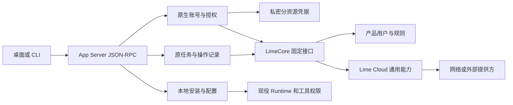
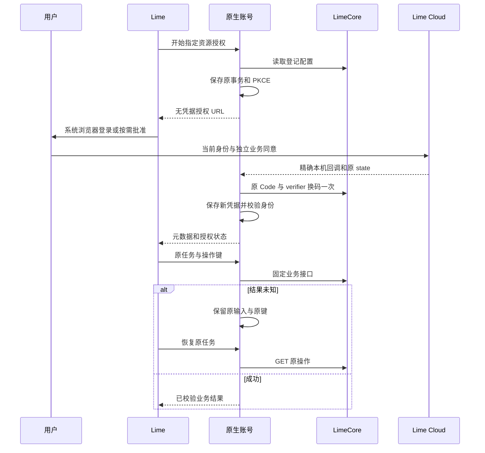

# Lime Cloud 通用能力接入

状态：进行中。2026-11-12 用户允许按新合同重构 Lime 和 LimeCore，并明确当前没有外部用户，不保留旧实现兼容层。

## 目标与事实归属

Lime 保持完整应用，拥有工作区、会话、任务、工具权限、本地安装与运行。LimeCore 拥有产品用户关系、精选和产品规则。Cloud 提供可供多个应用复用的联网、外部连接及技能、MCP、插件市场。

Cloud 的需求、API、授权来源和服务状态唯一见[通用能力与生态市场设计](../../../../limecloud/cloud/docs/52-通用能力与生态市场设计.md)。Core 的固定 HTTP 合同见[客户端接入](../../../../limecloud/limecore/docs/api/lime-client-integration.md)。本计划不复制这些服务的领域事实。

## 本轮写集

- 原生账号：`lime-rs/crates/app-server/src/account/`、`runtime/account.rs`、`processor/account.rs` 和账号 JSON-RPC 测试。
- 客户端合同：账号与 Cloud protocol、生成 Schema/TypeScript、共享 client、gateway 和对应 fixture。
- 账号界面和调用方：现役账号设置、侧栏账号投影、登录启动、专家目录、技能目录及旧 OEM 消费者。
- 共享市场：替换旧租户远端插件 HTTP 合同，复用当前安装、配置、校验和会话加载 owner。
- Core：只补原生端所需的固定认证或资源接口，同步 fragments、SDK、类型和客户端文档。
- 文档：本计划、现役架构和命令边界，保留已有云桌面、聊天和其他并行修改。

上述重叠文件已获得用户明确接管授权。按实际调用链清理旧文件和测试，不删除用户数据，不提交、推送、建分支或部署。

## 实施顺序与退出条件

1. 替换旧租户 Session 和 Token 导入合同。Rust 生成 state、nonce、PKCE，绑定配置中精确登记的本机回调；系统浏览器仅取得授权 URL。回调、换码、令牌校验与私密保存均留在同一 App Server owner。
2. 分别保存默认产品、市场、网络和连接资源凭据。校验 issuer、Client、应用、环境、本人和精确 Audience；资源间不覆盖，换号与注销阻止迟到结果。刷新与授权码已派发后未知不自动重试。
3. 接入 Core 固定路由。写入前持久保存任务、原输入、原键、语言及恢复路径；进程重启、账号切换、超时和语言变化不触发新派发。
4. 清理旧 OEM 登录、租户 bootstrap、旧商业接口、失效远端目录和其专属配置。原生帐号和新目录接到现役界面，不保留伪租户、伪 Session、任意上游透传或生产 mock。
5. 将共享市场资源接到现役技能、MCP、插件安装与加载链，区分获取、下载、安装、启用、会话加载和撤销。网络与连接接到同一任务与工具边界。
6. 完成定向 Rust、协议生成、合同、前端和真实宿主验证，分别记录 public Client、Cloud/Core 联合、提供方替身及真实提供方边界。

## 架构与恢复

架构确认：责任 root，2026-11-12。保留同一个 App Server、Runtime、安装和工具 owner，不复制 Cloud 连接、Grant、产品用户或提供方凭据表。此确认是设计确认，实际完成度以测试和宿主证据为准。

## 验证与当前边界

已有 Cloud 与 Core 连接联合证据见 Cloud `.dev/verification/connections-core-joint-20261112/`。该阶段为 confidential Client 和模拟 Google，不能代替本轮原生 public Client、Production 安装、实际第二产品或真实 Google 验收。完整目标继续进行中，不以文档或局部测试计算整体完成率。

## 2026-11-12 客户端迁移进展

- 原生账号已接入 public Client PKCE、精确回环回调、签名/nonce/在线身份核验、分资源凭据、staged恢复和代际隔离。授权进行中或结果未知时，GUI与原生Owner均拒绝覆盖原事务；刷新和原Code不盲目重发。未登录时可主动取消本次登录，明确清除本机事务后重新开始。
- 首次产品目录、市场、网络或连接调用前，原生Owner查询Core本人产品关系。仅明确未登记时以跨重启固定键登记，再继续原请求；登录回调不登记。并发/未知/停用/换号分别处理，停用不会重新启用。
- 官方技能与专家消费Core产品发布目录，固定releaseId、revision和contentHash。技能逐文件摘要核验后进入现役安装；专家真实instructions进入现役会话。它们与Cloud共享市场分别管理，不作为独立共享技能市场完成证据。
- 共享插件消费Core `/market`，验证规范清单、归档和完整文件集合，复用现役PluginStore和共享配置。公共JSON-RPC验证实际HTTP下载、安装、启停、冷读取、账号隔离、卸载、篡改拒绝及跨重启原获取恢复。新增会话测试经真实Runtime向明确HTTP模型替身提交技能正文并完成canonical turn，停用后新会话不加载；不代表实际模型工具执行或完整GUI市场旅程。
- 旧OEM登录、租户Session、Token导入、官网抓取/静态技能包回退、技能bootstrap、旧插件分享、旧远端目录、生产全局配置与专属测试脚本已删除。官网 `lime://open` 安装链接和独立Provider `lime://connect` 保留，旧OAuth/支付Deep Link拒绝。

## 本轮验证

| 验证面 | 已取得证据及边界 |
| --- | --- |
| 原生账号 | `.lime/qc/shared-cloud-20261112/native-account.log`：9项账号定向测试通过，覆盖PKCE、签名、nonce、凭据隔离、私密文件、产品登记、unknown及重复授权；不代替真实Cloud public Client联合 |
| 公共协议 | `.lime/qc/shared-cloud-20261112/public-jsonrpc.log`：账号4项、共享插件5项通过，含实际stdio子进程、HTTP归档和现役Runtime会话加载/停用验证 |
| 界面及清理 | `.lime/qc/shared-cloud-20261112/frontend.log`：9文件100项通过，涵盖五语言账号、分资源状态、unknown原事务查询/主动取消、Provider、官网链接、侧栏和退役守卫 |
| 语言资源 | `.lime/qc/shared-cloud-20261112/i18n.log`：namespace装配、类型和配置18项通过 |
| 正式合同 | `.lime/qc/shared-cloud-20261112/contracts.log`：`npm run test:contracts`通过，生成协议无漂移 |
| 类型 | `.lime/qc/shared-cloud-20261112/typecheck.log`：最终工作树renderer与Node类型检查通过 |
| GUI基线 | 真实Electron证据 `.lime/qc/project-gates/standalone-shell-01-20261112073630-4996/shell-01-electron-smoke/summary.json`；原生账号读取、初始化、重载、三个视口和设置页通过，不等同云账号/市场GUI完整旅程 |

失败与修正：旧菜单测试误期待已删除的“个人资料”入口，按现役“设置”修正；旧设置mock仍导出CloudProviderSettings，改为现役ProviderSettings；旧Deep Link测试导入已删除认证桥，按官网和Provider路径重写。i18n loader旧断言仍要求已无消费者的 `persistedEntrySummary/loadMore`，按现役MessageListHistoryChrome的 `showEarlier/loadingMore` 校正断言后18项通过；没有补造旧聊天文案或修改聊天实现。原生首次测试命令误用不存在的crate名，按实际 `app-server` 重跑通过。新增会话测试首轮将模型目录与执行后端接到不同夹具数据库，正确触发路由拒绝；改为共用同一真实数据库后通过，没有放宽生产模型选择。这些失败不计入通过数，也不改变正式业务规则。

验证汇总与源码摘要见 `.lime/qc/shared-cloud-20261112/summary.json`。本轮列明的7类本地门禁7/7通过（100%），不将其换算成整体产品完成率。`.gitignore`仅为本执行计划增加精确例外，使方案、进度及验收边界能够随源码评审。

## 继续开放的验收

- 原生public Client与真实Cloud/Core、Electron和CLI的同一条联合旅程；当前原生签名HTTP替身与两仓confidential联合分别记录。
- 独立共享技能、MCP和插件依赖安装。非空 `plugin.dependencies` 当前明确拒绝 `plugin_dependencies_require_installation`。
- 联网工具的正式宿主与真实Cloud/Core联合、首次资源授权自动接续；外部连接任务、原申请自动接续、Production安装、真实Google和受保护文件。
- Core产品运营前端、共享精选消费、停用后受限恢复，以及实际第二产品消费同发布与同服务。

不将文档、静态守卫、提供方替身或GUI基础初始化折算成整体产品完成率。没有提交、推送、建分支或部署。

## 2026-11-12 联网工具接入

本轮写集为 `account/tools.rs` 及 `account/tools/`、`account/request.rs` 的派发取消检查、Runtime与Agent的窄网关注册接口、`tool-runtime`现有WebSearch/WebFetch定义及网关批准判断、定向测试和本计划/架构。聊天、TUI、云桌面、沙箱及其他并行修改只读；共享文件只合并列明的注册与权限补丁，不保留格式化导致的无关差异。

WebSearch和WebFetch在现役Runtime初始化时注入原生账号网关，使用Core固定 `/web/searches|pages|operations`；失败不切换本地提供方。复用原工具定义、工具生命周期和批准。Live模式才允许实时请求，其他模式零实时派发；原参数和操作键绑定session、turn、call与账号代际，派发前私密原子持久化。摘要提示和域名过滤留在Lime，不发送给Cloud；来源、时间和截断元数据保留。

同一调用冷恢复只GET原操作。有界查询结束仍未完成时，返回原键和状态；后续回合可携带 `operation_key` 及原参数继续查询，不再次POST。原键缺失、404、异文、不同会话或换号均不形成新派发权。本地通用执行器收到账号操作键时明确拒绝，避免把恢复误当新请求。取消检查覆盖工具入口、产品资格读取后及实际派发前，已派发日志保留原事实。

本阶段没有可复制的上游产品登录或Cloud实现：Codex的托管搜索和账号服务属于仓库明确排除的产品边界。复用Lime现役Gateway注册、工具权限、网页摘要和Runtime主链，账号HTTP继续消费LimeCore；未增加第二Runtime、浏览器凭据桥或任意HTTP代理。

最终原生账号定向17项通过，覆盖资源令牌、来源过滤、网页提示留本地、同调用冷恢复、后续回合原键恢复、异文/会话/账号隔离、unknown与404零重发、损坏恢复响应保留原键、取消及产品停用。来源展示10项、现有配置页4项及正式协议检查通过；配置页首轮两项触及5秒超时，命令行30秒上限复测四项通过，未修改实现或测试。新增 `tests/cloud_web_jsonrpc.rs` 三项通过，验证现役Runtime发出的工具调用、两个Core固定接口、模型后续请求和同一canonical会话记录。首轮三项均在最后清理时误用不存在的 `thread/close` 失败，改用正式 `METHOD_THREAD_ARCHIVE` 常量后完整重跑通过；生产代码未改动。Web工具定向21项通过；Electron冒烟仍在执行，结果另行记录。

提供方及Core均为明确HTTP替身，不替代真实Cloud/Core public Client或完整GUI/CLI旅程。Cloud真实公开HTTPS专项读取RFC 9110通过，实际请求一次，独立记录为提供方证据；不等于真实搜索或三仓任务链路。23张相关Mermaid、40个链接、6个JSON示例和需求/故事/用例/验收交叉引用检查通过，本轮三张时序及流程图已渲染并目视，无裁切。本阶段证据为 `.lime/qc/shared-cloud-web-20261112/`，早期V8缓存缺失、下载中止、配置超时、测试清理失败及两轮中断的界面构建单独保留，均不计为通过。第二轮界面构建在暂停后因本轮诊断信号退出，属于Agent造成的中断，不作为产品编译错误。

## 2026-11-12 原操作关联

已在 `account/tools/intent.rs`、`journal.rs` 和工具结果处理接入原操作关联。同一账号代际、会话、工具及原参数下，模型使用新调用编号时复用尚未完成的原记录。私密索引只保存原操作引用，各调用绑定仍指向唯一原输入；不扫描全部历史，不增加云端任务或HTTP字段。仅校验通过的 `completed|failed` 结果释放待完成索引；404、损坏响应、取消、无权和不可用保留原引用。原调用及后续显式原键仍永久指向原操作，不能因新查询已获准而改写。

新增 `pending_tests.rs`、记录模块测试及第四项Runtime集成，覆盖新调用编号、跨回合与重启、JSON字段顺序、原操作404和非法结果、并发认领、会话与账号隔离、明确终态后允许新实时查询，以及旧调用迟到结果不能释放新操作。源码格式与静态检查通过；本轮账号回归和Runtime集成正在等待共享Cargo构建锁，尚不记为测试通过。证据目录为 `.lime/qc/shared-cloud-web-recovery-20261112/`。聊天、TUI、云桌面和沙箱并行修改继续避让。

## 下一阶段：首次资源授权后继续原任务

前置修正已实现于 `account/oauth/callback.rs`：新登录与恢复共用跨进程监听锁，状态读取会恢复原 pending 回调，不改变原登记地址、state、nonce、PKCE 或到期时间。原端口被占用明确返回 `account_callback_unavailable`；正在换码或结果未知的事务不重建监听。注销或账号代际变化后旧监听自动释放。复用 `store.rs` 的私密文件检查和同一文件锁实现，未新增协议或 Core/Cloud 接口。

新增12项专项测试及2项真实stdio进程测试，覆盖原进程监听中断、多个读取者和跨进程互斥、原端口占用、拒绝、过期、注销、符号链接和unknown零换码重发。源码格式及静态差异检查通过，执行结果等待同一账号回归。证据保存于 `.lime/qc/shared-cloud-authorization-20261112/`。本修正仅补原生OAuth恢复前置能力，尚未完成宿主授权入口与原任务自动接续。

Cloud同步UC-GEN-01、GEN-AT-15/18及11第17.18节的原生恢复时序。最终文档检查覆盖24张相关Mermaid、41个链接、6个JSON示例及原FR/US/UC/AT追踪，全部通过；新增时序图已渲染并目视，无裁切或文字遮挡。文档证据为Cloud `.dev/verification/shared-cloud-authorization-20261112/docs/`。该结果不代替仍在等待构建锁的运行验证。

复用 App Server 现有按 canonical thread 路由的反向请求及原生账号Owner。工具缺少对应资源凭据时保留原调用，宿主提供授权入口，原生Owner核验真实回调和当前身份后继续同一调用；宿主打开浏览器的回执不能当作授权成功。URL与授权元数据可交给宿主，Code、verifier、Token及提供方凭据留在原生Owner。

实施前继续核对账号协议、生成类型、Desktop/CLI/TUI的实际请求处理与同线程生命周期。并发请求复用同一资源的原授权；pending及unknown不能覆盖或自动重发换码。进程恢复须区分仍由原进程持有的回调监听与需要恢复的原监听，不能仅靠磁盘中的pending状态假定监听仍存在。拒绝、取消、过期、换号和宿主不可用保留明确状态及恢复入口，不要求用户复制编号或回复“已授权”。

退出条件：在同一原任务中取得首次授权后的联网结果；分别覆盖拒绝/取消零业务派发、账号代际隔离、并发授权、重启、宿主断开和unknown零重发。原调用、显式 `operation_key` 及模型新调用编号的关联由前述本地记录模块负责，验证状态单独记录；授权接续复用该原记录。Desktop与CLI按各自真实transport验证，HTTP替身与真实Cloud/Core public Client联合分别记录。外部连接沿同一任务接续原则实现独立申请与文件范围批准，不把联网授权扩展为外部账号访问权。
