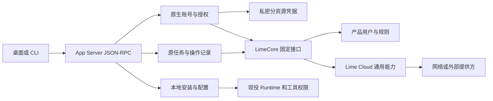
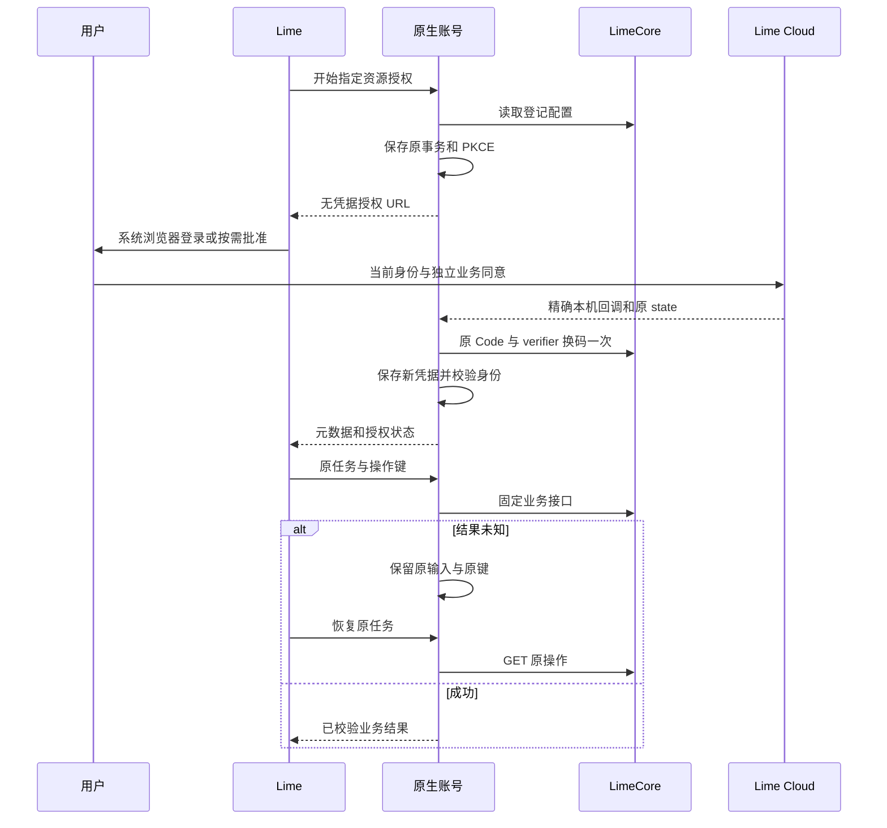

# Lime Cloud 通用能力接入

状态：进行中。2026-11-12 用户允许按新合同重构 Lime 和 LimeCore，并明确当前没有外部用户，不保留旧实现兼容层。

## 目标与事实归属

Lime 保持完整应用，拥有工作区、会话、任务、工具权限、本地安装与运行。LimeCore 拥有产品用户关系、精选和产品规则。Cloud 提供可供多个应用复用的联网、外部连接及技能、MCP、插件市场。

Cloud 的需求、API、授权来源和服务状态唯一见[通用能力与生态市场设计](../../../../limecloud/cloud/docs/52-通用能力与生态市场设计.md)。Core 的固定 HTTP 合同见[客户端接入](../../../../limecloud/limecore/docs/api/lime-client-integration.md)。本计划不复制这些服务的领域事实。

## 本轮写集

- 原生账号：`lime-rs/crates/app-server/src/account/`、`runtime/account.rs`、`processor/account.rs` 和账号 JSON-RPC 测试。
- 客户端合同：账号与 Cloud protocol、生成 Schema/TypeScript、共享 client、gateway 和对应 fixture。
- 账号界面和调用方：现役账号设置、侧栏账号投影、登录启动、专家目录、技能目录及旧 OEM 消费者。
- 共享市场：替换旧租户远端插件 HTTP 合同，复用当前安装、配置、校验和会话加载 owner。
- Core：只补原生端所需的固定认证或资源接口，同步 fragments、SDK、类型和客户端文档。
- 文档：本计划、现役架构和命令边界，保留已有云桌面、聊天和其他并行修改。

上述重叠文件已获得用户明确接管授权。按实际调用链清理旧文件和测试，不删除用户数据，不提交、推送、建分支或部署。

### 2026-11-13 原生联网计费写集

Cloud计费及Core固定消费合同已分别通过后端定向验收；本轮接入Lime原生WebSearch/WebFetch。写集限于账号Owner的 `web_billing.rs`、联网工具准备与执行、私密操作日志和受限恢复校验，以及对应账号/stdio夹具与本计划。沿用既有工具与JSON-RPC，不修改GUI、TUI、Provider、云桌面、共享协议或运行时Owner。

新请求读取Core固定报价，只接受显式的 `price_version/max_credits`，不代填预算；缺预算返回结构化报价且零业务派发。已派发操作跳过新报价，沿原输入、价格及原键GET恢复。Cloud正式合同中五种明确的409费用拒绝保存在原生操作日志，后续相同调用返回原拒绝，不轮询不存在的操作；普通冲突及传输异常继续保留unknown。用量回执必须匹配原价格及预算；正文状态与已经结算/释放的费用分别处理。账号代际、本地工具批准、当前产品资格和平台原授权继续生效。

原生账号定向验收103项通过，零失败、零跳过，包含6项新增异步计费用例及1项费用回执校验。覆盖显式预算、缺预算零派发、过期价格及不足预算、五种精确费用拒绝的冷恢复和普通冲突的未知结果；上游为固定Core HTTP夹具。后续仅补跑新增加的有价WebFetch、受限费用摘要2项，以及受影响的联网4项、授权4项和账号协议7项，合计17项全部通过，没有重跑原已通过且产品输入未变的103项。

证据为 `.lime/qc/web-billing-20261113/r3/result.json`，复用 `r2` 编译制品，源码摘要在构建及执行期间均无漂移。`r1` 缺测试类型导入、`r2` 缺隔离动态库路径的失败记录保留；补导入及子进程动态库搜索路径后执行同一已编译制品，没有重编译或将启动失败计为通过。Codex产品计费不属于可复刻范围，本段消费Lime自有Cloud/Core合同，不复制上游账号或费用控制面。

新制品及17项补验记录见 `.lime/qc/web-billing-20261113/artifact-r4/result.json`。实际Cloud/Core/MySQL与原生stdio的有价联合任务通过：同一会话先收到缺预算报价，再拒绝不足预算，接受7额度后仅POST及执行1次；改价为新版本9额度后停止并重启原生进程，原键仍恢复原7额度回执，新请求拒绝旧价格。受限摘要保留原费用且没有正文；正式撤销Client后同一摘要返回401。Core只登记1个产品用户，Cloud账本只产生1次grant、1次reserve和1次settle，最终可用93、预留0、消费7。

联合证据为Cloud `.dev/verification/web-billing-native-20261113/r1/result.json`。搜索、模型、浏览器导航和初始发放资金来源为明确测试夹具，非真实付费服务或支付验收。原生3个回合、8次模型请求，冷恢复不重报价格、不重发提供方或扣费。构建时源码无漂移；联合运行前及期间仅有另一进程的TUI改动，本轮账号、联网、Core和Cloud输入均无变化，仅接受冻结制品和本轮路径，不验收后续TUI或整个工作区。隔离MySQL已停止并清理，提交日志每秒刷盘不作为断电持久性证明；生产配置未改。完整商业链、公共CLI/MCP预算、文件计费、真实提供方、GUI及发行门禁继续开放。

### 2026-11-13 原生文件计费写集

本轮接入Core固定文件报价和费用合同。写集限于账号 `billing.rs`、固定路由、连接工具与回执校验、受限恢复、连接参数解析、对应账号/stdio夹具及本计划。原 `web_billing.rs` 移为共同费用Owner `billing.rs`，联网与文件复用预算、正式拒绝及回执规则，报价分别保留 `kind` 和 `action` 语义。GUI、TUI、Provider及云桌面保持另一进程维护。

有价新读取先报价并要求显式 `price_version/max_credits`，缺预算不提交文件申请。预算作为原工具输入持久保存，批准后仍提交原版本及原预算；已创建申请的恢复不重新报价。五种精确409费用拒绝写入原操作记录，冷恢复不查询不存在的文件操作、不重发；普通409及传输故障保留unknown。成功、正文过期及当前撤权不改写原费用；受限摘要按原预算校验。当前仅完成代码；用户要求结束本轮并优先发布Cloud/Core后，已取消本进程的最终原生构建，取消及终态记录见 `.lime/qc/file-billing-20261113/r2/`。原生测试和三仓账本联合继续待验，不计已验收。

## 实施顺序与退出条件

1. 替换旧租户 Session 和 Token 导入合同。Rust 生成 state、nonce、PKCE，绑定配置中精确登记的本机回调；系统浏览器仅取得授权 URL。回调、换码、令牌校验与私密保存均留在同一 App Server owner。
2. 分别保存默认产品、市场、网络和连接资源凭据。校验 issuer、Client、应用、环境、本人和精确 Audience；资源间不覆盖，换号与注销阻止迟到结果。刷新与授权码已派发后未知不自动重试。
3. 接入 Core 固定路由。写入前持久保存任务、原输入、原键、语言及恢复路径；进程重启、账号切换、超时和语言变化不触发新派发。
4. 清理旧 OEM 登录、租户 bootstrap、旧商业接口、失效远端目录和其专属配置。原生帐号和新目录接到现役界面，不保留伪租户、伪 Session、任意上游透传或生产 mock。
5. 将共享市场资源接到现役技能、MCP、插件安装与加载链，区分获取、下载、安装、启用、会话加载和撤销。网络与连接接到同一任务与工具边界。
6. 完成定向 Rust、协议生成、合同、前端和真实宿主验证，分别记录 public Client、Cloud/Core 联合、提供方替身及真实提供方边界。

## 架构与恢复

架构确认：责任 root，2026-11-12。保留同一个 App Server、Runtime、安装和工具 owner，不复制 Cloud 连接、Grant、产品用户或提供方凭据表。此确认是设计确认，实际完成度以测试和宿主证据为准。

## 验证与当前边界

已有 Cloud 与 Core 连接联合证据见 Cloud `.dev/verification/connections-core-joint-20261112/`。该阶段为 confidential Client 和模拟 Google，不能代替本轮原生 public Client、Production 安装、实际第二产品或真实 Google 验收。完整目标继续进行中，不以文档或局部测试计算整体完成率。

## 2026-11-12 客户端迁移进展

- 原生账号已接入 public Client PKCE、精确回环回调、签名/nonce/在线身份核验、分资源凭据、staged恢复和代际隔离。授权进行中或结果未知时，GUI与原生Owner均拒绝覆盖原事务；刷新和原Code不盲目重发。未登录时可主动取消本次登录，明确清除本机事务后重新开始。
- 首次产品目录、市场、网络或连接调用前，原生Owner查询Core本人产品关系。仅明确未登记时以跨重启固定键登记，再继续原请求；登录回调不登记。并发/未知/停用/换号分别处理，停用不会重新启用。
- 官方技能与专家消费Core产品发布目录，固定releaseId、revision和contentHash。技能逐文件摘要核验后进入现役安装；专家真实instructions进入现役会话。它们与Cloud共享市场分别管理，不作为独立共享技能市场完成证据。
- 共享插件消费Core `/market`，验证规范清单、归档和完整文件集合，复用现役PluginStore和共享配置。公共JSON-RPC验证实际HTTP下载、安装、启停、冷读取、账号隔离、卸载、篡改拒绝及跨重启原获取恢复。新增会话测试经真实Runtime向明确HTTP模型替身提交技能正文并完成canonical turn，停用后新会话不加载；不代表实际模型工具执行或完整GUI市场旅程。
- 旧OEM登录、租户Session、Token导入、官网抓取/静态技能包回退、技能bootstrap、旧插件分享、旧远端目录、生产全局配置与专属测试脚本已删除。官网 `lime://open` 安装链接和独立Provider `lime://connect` 保留，旧OAuth/支付Deep Link拒绝。

## 本轮验证

| 验证面 | 已取得证据及边界 |
| --- | --- |
| 原生账号 | `.lime/qc/shared-cloud-20261112/native-account.log`：9项账号定向测试通过，覆盖PKCE、签名、nonce、凭据隔离、私密文件、产品登记、unknown及重复授权；不代替真实Cloud public Client联合 |
| 公共协议 | `.lime/qc/shared-cloud-20261112/public-jsonrpc.log`：账号4项、共享插件5项通过，含实际stdio子进程、HTTP归档和现役Runtime会话加载/停用验证 |
| 界面及清理 | `.lime/qc/shared-cloud-20261112/frontend.log`：9文件100项通过，涵盖五语言账号、分资源状态、unknown原事务查询/主动取消、Provider、官网链接、侧栏和退役守卫 |
| 语言资源 | `.lime/qc/shared-cloud-20261112/i18n.log`：namespace装配、类型和配置18项通过 |
| 正式合同 | `.lime/qc/shared-cloud-20261112/contracts.log`：`npm run test:contracts`通过，生成协议无漂移 |
| 类型 | `.lime/qc/shared-cloud-20261112/typecheck.log`：最终工作树renderer与Node类型检查通过 |
| GUI基线 | 真实Electron证据 `.lime/qc/project-gates/standalone-shell-01-20261112073630-4996/shell-01-electron-smoke/summary.json`；原生账号读取、初始化、重载、三个视口和设置页通过，不等同云账号/市场GUI完整旅程 |

失败与修正：旧菜单测试误期待已删除的“个人资料”入口，按现役“设置”修正；旧设置mock仍导出CloudProviderSettings，改为现役ProviderSettings；旧Deep Link测试导入已删除认证桥，按官网和Provider路径重写。i18n loader旧断言仍要求已无消费者的 `persistedEntrySummary/loadMore`，按现役MessageListHistoryChrome的 `showEarlier/loadingMore` 校正断言后18项通过；没有补造旧聊天文案或修改聊天实现。原生首次测试命令误用不存在的crate名，按实际 `app-server` 重跑通过。新增会话测试首轮将模型目录与执行后端接到不同夹具数据库，正确触发路由拒绝；改为共用同一真实数据库后通过，没有放宽生产模型选择。这些失败不计入通过数，也不改变正式业务规则。

验证汇总与源码摘要见 `.lime/qc/shared-cloud-20261112/summary.json`。本轮列明的7类本地门禁7/7通过（100%），不将其换算成整体产品完成率。`.gitignore`仅为本执行计划增加精确例外，使方案、进度及验收边界能够随源码评审。

## 继续开放的验收

- 真实Cloud/Core市场public Client与完整Electron、CLI/TUI消费旅程；已有真实联网联合与本机签名市场夹具分别记录。
- 完整独立技能/MCP市场界面、独立资源撤回核对、明确失败后的安装尝试释放；原生独立安装与插件精确依赖已实现并通过实际回合验证。
- 真实网络提供方、外部连接完整GUI、Production安装、真实Google及受保护文件；已实现首次联网授权和连接原任务接续，验证等级见下文。
- 实际第二产品消费同一发布与同一服务、跨应用隔离及撤权。Core产品用户/精选运营、Lime插件精选和停用受限恢复已有实现及专项证据。

不将文档、静态守卫、提供方替身或GUI基础初始化折算成整体产品完成率。没有提交、推送、建分支或部署。

## 2026-11-12 联网工具接入

本轮写集为 `account/tools.rs` 及 `account/tools/`、`account/request.rs` 的派发取消检查、Runtime与Agent的窄网关注册接口、`tool-runtime`现有WebSearch/WebFetch定义及网关批准判断、定向测试和本计划/架构。聊天、TUI、云桌面、沙箱及其他并行修改只读；共享文件只合并列明的注册与权限补丁，不保留格式化导致的无关差异。

WebSearch和WebFetch在现役Runtime初始化时注入原生账号网关，使用Core固定 `/web/searches|pages|operations`；失败不切换本地提供方。复用原工具定义、工具生命周期和批准。Live模式才允许实时请求，其他模式零实时派发；原参数和操作键绑定session、turn、call与账号代际，派发前私密原子持久化。摘要提示和域名过滤留在Lime，不发送给Cloud；来源、时间和截断元数据保留。

同一调用冷恢复只GET原操作。有界查询结束仍未完成时，返回原键和状态；后续回合可携带 `operation_key` 及原参数继续查询，不再次POST。原键缺失、404、异文、不同会话或换号均不形成新派发权。本地通用执行器收到账号操作键时明确拒绝，避免把恢复误当新请求。取消检查覆盖工具入口、产品资格读取后及实际派发前，已派发日志保留原事实。

本阶段没有可复制的上游产品登录或Cloud实现：Codex的托管搜索和账号服务属于仓库明确排除的产品边界。复用Lime现役Gateway注册、工具权限、网页摘要和Runtime主链，账号HTTP继续消费LimeCore；未增加第二Runtime、浏览器凭据桥或任意HTTP代理。

最终原生账号定向17项通过，覆盖资源令牌、来源过滤、网页提示留本地、同调用冷恢复、后续回合原键恢复、异文/会话/账号隔离、unknown与404零重发、损坏恢复响应保留原键、取消及产品停用。来源展示10项、现有配置页4项及正式协议检查通过；配置页首轮两项触及5秒超时，命令行30秒上限复测四项通过，未修改实现或测试。新增 `tests/cloud_web_jsonrpc.rs` 三项通过，验证现役Runtime发出的工具调用、两个Core固定接口、模型后续请求和同一canonical会话记录。首轮三项均在最后清理时误用不存在的 `thread/close` 失败，改用正式 `METHOD_THREAD_ARCHIVE` 常量后完整重跑通过；生产代码未改动。Web工具定向21项通过；Electron冒烟仍在执行，结果另行记录。

提供方及Core均为明确HTTP替身，不替代真实Cloud/Core public Client或完整GUI/CLI旅程。Cloud真实公开HTTPS专项读取RFC 9110通过，实际请求一次，独立记录为提供方证据；不等于真实搜索或三仓任务链路。23张相关Mermaid、40个链接、6个JSON示例和需求/故事/用例/验收交叉引用检查通过，本轮三张时序及流程图已渲染并目视，无裁切。本阶段证据为 `.lime/qc/shared-cloud-web-20261112/`，早期V8缓存缺失、下载中止、配置超时、测试清理失败及两轮中断的界面构建单独保留，均不计为通过。第二轮界面构建在暂停后因本轮诊断信号退出，属于Agent造成的中断，不作为产品编译错误。

## 2026-11-12 原操作关联

已在 `account/tools/intent.rs`、`journal.rs` 和工具结果处理接入原操作关联。同一账号代际、会话、工具及原参数下，模型使用新调用编号时复用尚未完成的原记录。私密索引只保存原操作引用，各调用绑定仍指向唯一原输入；不扫描全部历史，不增加云端任务或HTTP字段。仅校验通过的 `completed|failed` 结果释放待完成索引；404、损坏响应、取消、无权和不可用保留原引用。原调用及后续显式原键仍永久指向原操作，不能因新查询已获准而改写。

新增 `pending_tests.rs`、记录模块测试及第四项Runtime集成，覆盖新调用编号、跨回合与重启、JSON字段顺序、原操作404和非法结果、并发认领、会话与账号隔离、明确终态后允许新实时查询，以及旧调用迟到结果不能释放新操作。源码格式与静态检查通过；本轮账号回归和Runtime集成正在等待共享Cargo构建锁，尚不记为测试通过。证据目录为 `.lime/qc/shared-cloud-web-recovery-20261112/`。聊天、TUI、云桌面和沙箱并行修改继续避让。

## 下一阶段：首次资源授权后继续原任务

前置修正已实现于 `account/oauth/callback.rs`：新登录与恢复共用跨进程监听锁，状态读取会恢复原 pending 回调，不改变原登记地址、state、nonce、PKCE 或到期时间。原端口被占用明确返回 `account_callback_unavailable`；正在换码或结果未知的事务不重建监听。注销或账号代际变化后旧监听自动释放。复用 `store.rs` 的私密文件检查和同一文件锁实现，未新增协议或 Core/Cloud 接口。

新增12项专项测试及2项真实stdio进程测试，覆盖原进程监听中断、多个读取者和跨进程互斥、原端口占用、拒绝、过期、注销、符号链接和unknown零换码重发。源码格式及静态差异检查通过，执行结果等待同一账号回归。证据保存于 `.lime/qc/shared-cloud-authorization-20261112/`。本修正仅补原生OAuth恢复前置能力，尚未完成宿主授权入口与原任务自动接续。

Cloud同步UC-GEN-01、GEN-AT-15/18及11第17.18节的原生恢复时序。最终文档检查覆盖24张相关Mermaid、41个链接、6个JSON示例及原FR/US/UC/AT追踪，全部通过；新增时序图已渲染并目视，无裁切或文字遮挡。文档证据为Cloud `.dev/verification/shared-cloud-authorization-20261112/docs/`。该结果不代替仍在等待构建锁的运行验证。

复用 App Server 现有按 canonical thread 路由的反向请求及原生账号Owner。工具缺少对应资源凭据时保留原调用，宿主提供授权入口，原生Owner核验真实回调和当前身份后继续同一调用；宿主打开浏览器的回执不能当作授权成功。URL与授权元数据可交给宿主，Code、verifier、Token及提供方凭据留在原生Owner。

实施前继续核对账号协议、生成类型、Desktop/CLI/TUI的实际请求处理与同线程生命周期。并发请求复用同一资源的原授权；pending及unknown不能覆盖或自动重发换码。进程恢复须区分仍由原进程持有的回调监听与需要恢复的原监听，不能仅靠磁盘中的pending状态假定监听仍存在。拒绝、取消、过期、换号和宿主不可用保留明确状态及恢复入口，不要求用户复制编号或回复“已授权”。

退出条件：在同一原任务中取得首次授权后的联网结果；分别覆盖拒绝/取消零业务派发、账号代际隔离、并发授权、重启、宿主断开和unknown零重发。原调用、显式 `operation_key` 及模型新调用编号的关联由前述本地记录模块负责，验证状态单独记录；授权接续复用该原记录。Desktop与CLI按各自真实transport验证，HTTP替身与真实Cloud/Core public Client联合分别记录。外部连接沿同一任务接续原则实现独立申请与文件范围批准，不把联网授权扩展为外部账号访问权。

## 2026-11-12 宿主授权接续实现

本阶段写集：`account/continuation.rs`、原 URL 构造、`account/tools` 接续和测试；共用的 `host_request.rs`、时间读取及初始化接线；`account/authorize` 协议、Schema 和生成类型；Electron 请求处理、CLI 非交互响应及 TUI 本机浏览器处理。TUI 复用工作区已有 chrono 版本核验原期限。聊天、云桌面、沙箱和其他并行改动继续避让。

| 原生反向请求 | 参数 | 宿主响应 |
| --- | --- | --- |
| `account/authorize` | `threadId`、原 `authorization` 元数据和无凭据 `authUrl` | `action: opened | cancelled | unavailable` |

`opened` 不表示授权成功。默认账号已登录且网络资源尚未授权时，原生保存工具意图后复用或创建指定资源的 PKCE 事务，再请求当前会话唯一宿主打开原 URL。并发工具和进程通过独立 OS 文件锁共享同一原授权；监听恢复仍由前一阶段的原事务锁负责。只有原生回调核验完成、当前账号代际匹配且原任务未取消时，才使用原工具及原键继续 Core 固定请求。宿主断开、取消、拒绝、过期和结果未知均不触发业务重发。

桌面和本机 TUI 打开系统浏览器，远程 App Server 和非交互 `exec` 明确返回不可用；反向请求不随会话订阅重放。默认账号未登录仍走现役登录入口，本阶段没有新增原生 Core Origin 配置，也没有完成无账号首次任务。外部连接仍须单独的文件申请和本人批准。

已补定向测试，覆盖仅打开浏览器时零派发、真实签名回调后继续搜索、宿主取消/不可用/非法响应/断连、换号、拒绝、候选结果未知、原事务恢复及并发共享。协议 Schema 与 TypeScript 已生成，Schema 一致性、Electron 类型检查及桌面宿主11项测试通过。真实 App Server stdio 子进程测试覆盖同一 canonical turn 首次授权续接以及取消、不可用、拒绝时零搜索；其身份与模型上游为明确 HTTP 夹具，实际运行结果见下列补充。新阶段证据为 `.lime/qc/shared-cloud-task-authorization-20261112/`。旧阶段未完成的运行命令已因源码阶段变化主动中断，保留日志，不将中断记作产品失败，也不把旧通过结果套用到当前源码。

架构确认：root，2026-11-12。共用原 App Server、Runtime、账号和工具 Owner；Core/Cloud 无新 HTTP 字段、任务表或凭据副本。此项为设计与实现确认，Desktop/CLI/TUI 的真实 transport 和真实 Cloud/Core public Client 联合验收继续开放。

补充运行证据：`stdio-runtime-result.json` 记录真实 App Server 子进程四个场景通过，二进制摘要为 `986e6070a26b2f8c9b8e0a055dbf0d19c21ad2a9391e1cf8a99e5cf7c05908c1`，覆盖并发过期凭据修正后的生产源码。成功场景保持同一 thread/turn，搜索1次、模型请求2次；宿主取消、不可用和用户拒绝分别为0次搜索。打开浏览器但未收到回调时仍为0次搜索。身份、模型HTTP及浏览器宿主为明确夹具。更早的并发修正前结果保存在 `pre-concurrency-stdio-runtime-result.json`，不累加为新场景。首次验证遗漏动态库，改用现役 `snapshotTerminalGateBinaries` 后通过，首轮失败保留。

最终源码修正并发过期凭据等待：同资源旧凭据没有刷新令牌时，后来的工具继续等待原授权，不提前退出。账号定向48项、共用宿主路由5项及公共JSON-RPC 12项全部通过。后者含账号6项、原网络工具4项和新增授权接续2项，新增2项覆盖四种宿主结果。测试期间54个记录文件无漂移。TUI账号2项通过；原CLI library筛选实际匹配0项，不计作CLI测试通过，独立binary目标反向请求专项3项通过，4个记录文件无漂移。日志及源码摘要分别见 `native-results.json` 和 `cli-bin-authorization-result.json`。

`npm run verify:gui-smoke` 通过，真实Electron完成App Server初始化、重载、三个视口和设置页检查。证据为 `.lime/qc/project-gates/standalone-shell-01-20261112121508-31262/shell-01-electron-smoke/summary.json`；此项是Desktop基础链路，不代表浏览器授权成功的完整GUI任务。全部运行验证结束后，仅统一 `pending_tests.rs` 的格式并移除新增stdio测试的未使用导入，记录在 `post-verification-tidy.json`；生产源码未改变。

`cli-runtime-result.json` 另证明真实 `lime exec` 和冷启动 `lime thread show`：非交互授权返回不可用，0次搜索、1次默认登录换码、2次模型请求，同一canonical回合完整保留；未启动Electron。它使用同一App Server制品及签名身份/模型HTTP夹具，不代替本机TUI授权成功或真实Cloud/Core联合。CLI首轮验证将参数和值合并，手写App Server解析器拒绝启动；改为独立参数后通过，未修改产品源码。

失败记录：账号首轮调用遗漏仓库V8解析、默认制品地址404，尚未进入测试；使用 `resolveRustyV8CargoEnv` 修正。后续账号首轮47/48通过，并发产品登记合法返回 `outcome_unknown`，测试只允许 `account_store_busy`；补齐合法状态并增加仅登记一次的断言后48/48通过，业务实现未放宽。完整 `test:contracts` 的协议、客户端、命令与治理检查通过，最后 `docs:boundary` 被并行任务已入索引的 `internal/exec-plans/readme-brand-refresh-20261112.md` 阻挡；本任务未修改其文件或索引状态。

## 后续实施顺序

### 未登录首次任务实施

验证合同：`budget:normal`，风险P1。Current主链为现役WebSearch/WebFetch → App Server账号Owner → 当前会话宿主 → Core固定接口 → 同一canonical Thread/Turn/Item。输入为明确Live工具调用；预期输出为原工具的网络结果，授权不额外启动回合或模型请求。默认及网络授权分别完成，每一步仅打开浏览器时零业务；取消、拒绝、换号、宿主丢失及unknown停止派发。必跑账号/共享宿主定向、真实stdio公共回归、客户端合同和Electron基础冒烟；文档另验图、链接与FR/US/UC/AT追踪。签名身份和模型HTTP明确使用夹具，不计真实Cloud/Core public Client、完整GUI登录、真实提供方或发行制品验收；不调用付费模型，不进入release evidence。失败回写原测试及本节证据，不放宽原授权或未知恢复合同。

本阶段在原账号与工具Owner中实现，不新增Runtime、云任务表或HTTP代理。匿名原调用先私密保存
输入、会话、工具及原键，账号状态预留唯一默认登录编号；并发调用在网络I/O前绑定该编号。
只有原编号、父代际、原服务和真实默认回调匹配时，才接纳此次产生的新账号代际。另行登录、
注销或换号拒绝接管旧匿名输入。默认登录后仍独立完成Web资源授权，沿同一宿主和原操作派发。

新增 `account/tools/login.rs`、私密登录记录和7项专项用例，覆盖两步授权、取消/拒绝/unknown、
原事务及已保存换码候选的冷恢复、并发及独立登录/异文/服务切换拒绝。共享宿主打开与等待沿 `continuation.rs`，
账号语言与市场语言读取复用同一用户配置。架构确认：root，2026-11-12，仍为同一App Server、
原生账号、Runtime和canonical Thread/Turn/Item主链。

原生账号相关58项测试通过，包含7项新增首次登录用例及已保存换码候选恢复。共用宿主5项、
公共JSON-RPC20项和桌面授权处理12项通过。公共回归覆盖账号7、授权接续4、联网4及共享插件5；
授权4项合计11种场景，成功只搜索1次、模型请求2次，保持原canonical回合。身份和模型为明确
HTTP夹具，浏览器宿主为受控交接，不等于真实Cloud/Core public Client或完整GUI授权旅程。
证据为 `.lime/qc/shared-cloud-first-login-20261112/`，不沿用前一配置阶段结果。

首次运行被并行云桌面的三个缺失休眠方法阻挡，未修改该写集。新增测试的错误读取方法先后
引发两次编译失败；改正后56/57通过，进一步发现已知unknown先检查宿主导致错误返回。
已在原生Owner改为先核验原授权及已保存候选，再判断是否需要宿主，增加候选恢复测试后58项
全部通过。原日志与各轮结果独立保留，没有跳过编译或放宽授权合同。

原生 Core 配置已进入实现与验证：用户 YAML 的 `cloud.base_url` 替代 renderer 构建变量；
账号读取投影有效 `serviceUrl` 及配置 `serviceError`，登录 RPC 删除地址入参。精确 origin 校验
由 `core/config/cloud.rs` 同时服务用户配置与账号 HTTP；已有账号和待完成默认授权继续绑定
原服务。Runtime 与本地市场的配置路径改变时同步更新原生账号及工具，不保留旧路径。
未配置与无效配置分别处理；注销不被错误配置阻断。产品实现、协议、五语言文案、测试及
三仓文档一起更新，最终验证结果记录在本节后。

本阶段验证结束：配置3项、原生账号51项、Schema fixture 1项及前端4文件77项通过；五语言均
覆盖无效配置及注销后的账号清理。公共JSON-RPC 18项通过，其中账号7、网络授权2、联网4、
共享插件5，包含真实stdio进程、配置写入/冷读取、原请求地址覆盖拒绝和原canonical任务。
renderer/Node类型检查与真实Electron基础冒烟通过，后者验证初始化、重载、3视口及设置页，
不替代完整云账号授权GUI。三仓文档25图、44链接、6个JSON示例及需求交叉引用检查通过。
最终公共与GUI期间记录的1111个文件无漂移。证据见 `.lime/qc/shared-cloud-config-20261112/summary.json`。

保留的失败：验证脚本首轮误用不存在的 `plugin_market_jsonrpc` 目标，未执行公共测试；已改为
实际 `remote_plugins_jsonrpc`。随后公共账号测试发现正式配置API遗漏 `cloud` 允许键，4项失败；
补齐 `processor/config.rs` 后18项公共回归通过。完整 `test:contracts` 的协议、客户端、命令和
治理检查通过，末尾仍被并行任务的 `readme-brand-refresh-20261112.md` 索引规则阻挡；本任务
不修改其文件或索引。较早的配置2项、前端72项及失败结果分别保留，不与最终通过数累加。

当前唯一 `current` 为原生用户配置与共享账号Owner；旧前端环境入口和登录地址入参已经删除，
没有新增兼容层。Core只同步客户端合同与计划，Cloud只同步整体设计与进度，没有本阶段的服务端
业务、数据库或部署变更。无账号首次任务、CLI正式登录以及真实三仓联合继续开放。

1. 已完成原生 Core 服务配置及上述定向验证；完整合同门禁的独立文档索引问题另行保留。
2. 未登录首次任务和终端账号命令已实现并取得定向及真实进程夹具证据；继续完成宿主完整授权旅程。默认账号与业务资源分别授权，保留同一回合，拒绝、注销、换号或unknown时不派发业务。
3. 使用真实 Cloud/Core public Client、本地原生进程和正式工具完成同一任务，再接外部文件申请及批准后的原任务续接。真实服务、浏览器宿主和外部提供方分别取证，保持原操作恢复。
4. 完成独立共享技能、MCP及含精确依赖的插件安装，随后接入 Core 产品运营界面、共享精选和停用后的受限恢复；最后以实际第二应用验证平台复用。

## 2026-11-12 CLI 正式账号命令

验证合同：budget:normal，风险P1。当前主链为本机 lime login / login status / logout → 共享stdio App Server → 原生账号Owner → Core固定身份合同。复用现有PKCE、精确回环和私密凭据；不在CLI实现HTTP换码、Token导入或地址覆盖。待完成及unknown先回读原编号，Ctrl+C只停止等待，显式注销才清除本机状态。远程宿主明确拒绝，不能静默改用本机。输入为显式登录或状态命令，结果为本机账号元数据和退出码；不创建Thread、不发模型请求、不登记产品关系。

写集：cli/src/account_cmd.rs及定向测试，main.rs与dispatch.rs命令接线，既有CLI语言资源及webbrowser工作区依赖；共享账号生产实现保持本阶段原样。必跑CLI binary账号/分派/语言定向，真实lime与App Server的签名HTTP夹具门禁，覆盖成功、拒绝、unknown、等待中断/冷恢复、显式注销及秘密零输出。既有Desktop回归仍按未登录首次联网阶段单独留证，不能代替终端证据。不涉及GUI、Runtime投影或新公共方法，不使用付费模型、不进入release evidence。原账号服务、凭据和原操作Owner保持唯一，架构确认为root，2026-11-12。

本阶段完成：CLI账号3项、命令分派4项、既有语言解析1项及正式binary构建通过；
真实macOS arm64的lime与App Server通过8个场景，覆盖远程拒绝、五语言状态、成功、拒绝、
unknown、中断后冷恢复、等待中注销及并发接续。成功和恢复均只换码一次，拒绝及等待中注销
为零换码；全部账号命令零产品登记和零模型调用，stdout/stderr无秘密。最终构建与Gate制品摘要
一致，9个记录文件无漂移，初次六场景不与最终八场景累加。

API、需求、用例、验收、时序和流程已同步三仓；文档28张相关图、47个链接、6个JSON示例及
FR12/US10/UC11/AT18追踪通过，两张CLI新图已渲染并目视，无裁切。脚本语法、脚本治理、
CLI边界及差异格式检查通过。首次边界检查误用了不存在的文件路径；改用仓库正式npm入口后
通过，没有产品修正。证据为 `.lime/qc/shared-cloud-cli-account-20261112/summary.json`。

本轮唯一current为原生账号Owner及stdio客户端；没有Token导入、CLI直连Core或兼容登录。
旧前端地址和Token路径已在前阶段删除。独立浏览器实际登录、Windows/发行制品、真实Cloud/Core
public Client、外部连接批准后的原任务接续、完整市场安装及实际第二应用继续开放。
Core/Cloud本阶段只同步文档，无HTTP、数据库或部署变更；未提交、推送或创建分支。

## 2026-11-12 三仓公开客户端联合验证

验证合同：budget:normal，风险P1。写集限于Lime的cloud_web_joint_jsonrpc.rs、Cloud的lime_native_public_joint_test.go、Core的native_joint_test.go及三仓进度。本轮复用现役Core/Cloud HTTP Owner；联合验证发现原生OAuth标准表示不兼容，写集增加account/cloud.rs及tests.rs，修正Bearer类型大小写和单Client的字符串/数组受众表示，保留issuer、nonce、签名、azp和原换码约束。不增加公共协议、工具或运行时Owner；验证使用修正后冻结的App Server制品。Cloud真实public Client、S256、签名、在线身份和业务授权经过Core固定接口，Lime以真实stdio保留同一Thread/Turn。Cloud与Core使用独立隔离MySQL库；模型、搜索提供方和浏览器界面为明确替身。

退出条件：两个分资源授权、零Client Secret、首次能力使用前一次Core产品登记、一次Cloud网络派发、模型请求两次、原回合与工具编号保持、公开投影无凭据。缺依赖必须跳过或失败，不能记作通过；生产安装、实际提供方及Desktop/CLI/TUI完整旅程另验。架构边界未变，架构确认为root，2026-11-12。

前阶段桌面验证收尾：原目录构建两次受输入漂移拦截；冻结构建直接诊断为SIGABRT及明确V8堆内存耗尽，依赖的Desktop与Runtime检查未执行。前阶段58项账号、5项宿主、20项公共JSON-RPC及12项桌面授权处理结果仍有效，记录的32个账号相关文件无漂移；不以旧GUI通过替代当前阶段。CLI加强参数拒绝测试三项通过，最终8项定向及8个真实进程场景摘要已更新，9个记录文件无漂移。

三仓最终r4联合通过：Cloud真实public Client、Code+S256、签名及当前业务授权，经Core固定HTTP和独立产品MySQL进入原生App Server stdio。默认和网络资源各授权/换码一次，零Client Secret；默认登录不登记产品关系，网络调用前登记一次。Cloud原操作、搜索入口和提供方派发各一次，模型请求两次；同一canonical Thread/Turn和原工具编号保持，结果进入历史与正式回读，公开投影不含凭据字段。三仓968个记录文件无漂移，自建隔离MySQL已停止，Core以race运行，Cloud使用既有Bootstrap模式。

App Server冻结制品SHA-256为 `41fafdf64e8c9ff9f95d059c3eaf3a5c0c88ad4371357008371d9aeb5339a5e1`，联合测试制品为 `eb15572ff4f2ef9fccc2a6f58027641f94e33168549d6343383778a73bcf6b72`。证据为Cloud `.dev/verification/native-public-client-20261112/r4-result.json`、`r4/core.jsonl`、`r4/native.log` 及本仓 `.lime/qc/shared-cloud-native-public-20261112/`。r1缺动态库、r2/r3旧制品失败独立保留，不累加为通过。默认单仓测试缺联合依赖会skip/ignore，不算通过。

两项生产修正只落在原生账号Owner：按协议忽略Bearer类型ASCII大小写，ID Token接受精确Client字符串或单元素数组并检查声明的azp。多受众、重复受众、空数组、错误Client/azp和其他方案仍拒绝，签名/issuer/期限/nonce及原Code唯一性不变。没有新增兼容层、公共协议、Core/Cloud生产逻辑、迁移或部署。API及验收状态已同步三仓文档，避免把已实现接入继续写成未实施。

浏览器界面沿实际已登录测试Session执行真实Core→Cloud→原生回调；模型和搜索提供方为明确替身。该结果不代替完整Desktop/CLI/TUI授权旅程、真实外部搜索、连接批准后的原任务接续、三类市场完整安装加载、产品运营、Production安装或实际第二应用。整体目标保持进行中。

最终原生账号回归60项通过，包含Bearer方案8种输入和ID Token受众/azp的10种真实签名场景；拒绝后再次核验仍只换码一次。26个账号及联合测试记录文件在本轮回归中无漂移。较早59项属于仅Bearer修正阶段，不与最终60项累加。三仓文档检查覆盖28图、65链接、6个JSON示例和FR12/US10/UC11/AT18，零错误；Rust格式、Go格式及相关差异检查通过。证据汇总见 `.lime/qc/shared-cloud-native-public-20261112/summary.json`。

## 外部文件批准与原任务接续

验证合同：budget:normal，风险P1。输入为用户提供的Google文档链接；现役Runtime工具网关在同一canonical Thread/Turn调用原生账号Owner，经Core的六个固定连接接口使用Cloud正式申请及文件合同。默认登录、独立连接资源授权、逐应用文件批准分别成立。Lime增加 `ReadConnectedFile` 工具及本机 `connection/authorize` 反向请求，宿主只打开原申请的可信确认地址，原生回读决定后继续原工具；打开浏览器不表示批准。连接、Grant及提供方凭据继续归Cloud，产品关系归Core，不新建云端任务、任意代理或运行时。

本阶段写集为原生 `account/tools` 的连接执行及私密分步记录、资源授权共用接续，连接反向请求的协议/Schema/生成类型与宿主接线，工具展示文案和五语言资源，以及对应测试、三仓合同/图示/进度。桌面聊天、云桌面、沙箱和其他终端功能的并行写集继续避让。源码参考核对Codex的MCP资源handler；它消费MCP服务，不提供LimeCore/Cloud申请合同，因此该产品适配保留Lime自有Owner，不复制Codex账号或云服务。

退出条件：默认和连接资源凭据在线核验后，私密保存原申请输入及独立键；本人批准指定文件后，同一原调用读取一次并投影真实来源/时间。恢复只GET原申请或原读取；同键异文、损坏记录、404、过期、换号、停用、拒绝、取消、宿主丢失和unknown不能重发。Production缺少用户已选择且已核验的安装时明确拒绝，不自行采用Sandbox或要求用户填写内部编号。

必跑输入/来源与状态验证、私密记录/并发/冷恢复、授权取消及unknown零派发等定向测试，真实stdio原任务和宿主处理回归，正式协议/生成类型与五语言展示检查及适用Electron基础门禁。模型、身份和提供方夹具与真实Cloud/Core/Google分别取证；完整GUI批准旅程、Production安装及实际第二应用不得由夹具代替。不调用付费模型或生产外部服务，不进入release evidence。架构确认：root，2026-11-12；实现和运行证据另行记录，不以本合同记作功能完成。

2026-11-13验证进度：工具输入和网关2项、桌面授权及五语言展示54项、Electron/renderer/Node类型检查已通过。Schema和TypeScript已重新生成，并补齐连接反向请求的入站解码；CLI测试使用正式解码入口。申请意图在绑定前统一等价Google文档链接与默认正文上限，unknown后的新调用继续原申请；已派发读取的错误返回独立读取键与准确恢复路径。三仓文档检查覆盖30图、67链接、6个JSON示例及FR12/US10/UC11/AT18，零错误；17.21两图和最新Lime架构图均已渲染并目视，无裁切。

运行验证尚未完成。首轮账号测试缺少两个测试导入，已修正；随后stdio构建期间共享target目录消失，以缺少输出目录失败，当轮记录源码无漂移。原日志、失败和未执行的桌面结果保留。本轮仅停止自身确认归属的验证进程，使用仓库内独立target、关闭验证制品调试符号与增量编译并限制为两个构建任务；没有删除历史证据或其他会话文件。V8依赖已在独立缓存中按官方SHA-256校验；下载辅助脚本首次临时文件名冲突的失败保留，修正后完整校验通过。当前账号、宿主、CLI/TUI、Schema和公共回归由 `.lime/qc/shared-cloud-connection-task-20261112/verify-native-r3.mjs` 顺序执行，结果写入 `r3/`；通过后再冻结stdio制品并执行适用Desktop门禁。完整合同末尾的并行README索引问题继续单列，不修改其文件或Git索引。

2026-11-13独立推进Core恢复合同：四个 `/api/v1/client/recovery/*` 固定GET已实现有限原操作摘要，已登记的停用用户仍须当前精确资源和Cloud原授权；正文及能力字段不返回，不提供重发权。Core标准Go/合同、SDK10项及隔离MySQL/race通过，文档32图/73链接/6个JSON示例通过。本仓原生消费尚未接线，待当前原生验证结束后实施，避免改变受测源码。

Cloud前阶段 `.dev/verification/native-public-client-20261112/` 等证据目录在本轮复核时已不存在。历史通过记录保留，但不能作为当前可复核的原始证据；本仓仍存在的制品与日志独立保留，不尝试恢复或清理其他会话目录。

2026-11-13真实stdio首轮成功路径通过，负向场景等待连接资源授权超时。拆分四个独立场景并保留失败夹具后，canonical工具结果明确为 `account_store_busy`：默认OAuth回调发布与原任务读取争用短状态锁，非业务拒绝。写集增加 `account/store.rs` 的短事务锁和两项并发回归；短事务使用OS独占锁等待原Owner释放，原长任务/回调租约仍保持try-lock，锁内无await或网络。测试文件只增加场景拆分及失败证据保留，不放宽超时或成功断言。r3/r4失败及冻结制品分别保留，修正后的账号与stdio结果另行记录。

## 2026-11-13 外部文件验证阶段结果

独立target的r3基线六组均通过：账号69项、宿主路由5项、CLI授权4项、TUI授权13项、Schema1项及公共回归20项，28个记录文件无漂移。短状态锁修正后的同一冻结App Server与测试制品串行验证4项通过、零跳过，覆盖成功、取消、拒绝及宿主不可用；成功保持原Thread/Turn，默认与连接资源各授权一次，申请与文件读取各一次，负向不读取文件。r5首次四进程并行冷启动均在initialize前超时，原失败保留；串行复验未修改超时或断言，不与首次结果累加。

完整 `npm run test:contracts` 已通过，包含末尾文档边界检查；此前并行README索引阻挡仅作为历史失败记录，未修改其文件或索引。修正后的全账号回归与冻结桌面门禁仍在运行，不提前记作通过。证据为 `.lime/qc/shared-cloud-connection-task-20261112/r3/native-final-result.json`、`r5/stdio-serial.json`、`r5/stdio-serial.log` 与 `r5/contracts-result.json`。stdio记录的28文件摘要未包含本轮新增锁修正的store.rs，完整account目录摘要由独立账号回归提供，不能扩大摘要范围。

身份、模型、外部提供方及浏览器Host为明确夹具；本阶段不计真实Google、Production安装或完整宿主业务验收。桌面使用仓库内冻结验证副本，仅构建和验证，不在副本开发或回写产品源码。

冻结桌面11阶段均通过：版本、renderer、客户端构建、宿主类型、宿主构建、两类资源准备、真实Electron冒烟、Code Mode Gate B、会话恢复及运行中回合恢复。冻结11068文件无漂移，本任务28个原记录文件加store.rs共29项与原仓源码一致；原仓其他变化为本执行计划及另一个云桌面计划、TUI测试/门禁，不计本任务摘要通过。证据为 `r5/desktop/final-result.json`、`results.json` 和分阶段日志。Code Mode Host使用原仓已有构建依赖，本轮未重新编译该二进制；App Server为本轮冻结且通过stdio的同一制品。桌面基础门禁不代表完整文件批准GUI旅程，首次原目录renderer输入漂移失败及r5并行stdio初始化失败均保留。

最终全账号回归71项通过，零失败、零跳过，完整account目录前后摘要无漂移，包括store.rs和两项短锁并发测试。证据为 `r5/account-result.json` 与 `account.log`。至此旧阶段账号、完整协议、真实stdio四场景及基础桌面11阶段均有最终结果；真实Google、Production安装和完整外部文件GUI业务继续开放。

## 下一阶段：停用用户核对原操作

旧阶段账号、stdio及桌面验证结束后已开始实施。写集限定 `account/recovery.rs`、`account/request.rs` 的固定路由及原记录校验、`account/tools.rs` 的网络恢复、`account/tools/connections.rs` 的连接恢复、模块登记和对应测试；Core与Cloud沿已交付的四个固定GET，不扩展公共JSON-RPC参数、不增加后台任务或本地状态表。现役账号、原操作及工具意图仍各持唯一事实。

直接摘要查询只接受当前账号已保存的原操作，要求摘要路径与原完整结果路径精确对应；按原资源取得当前有效凭据，不登记或恢复产品用户。摘要严格校验类型、状态、必要用量/时间和 `recoveryOnly=true`，拒绝正文、批准地址、Grant、下载能力、未知字段及跨操作类型数据。摘要读取不修改原操作终结状态或工具待核对索引，404、依赖故障和非法摘要均无重派发权。

产品停用后，已有网络/外部文件工具只核对原摘要；没有原操作的新调用明确拒绝。连接优先核对已派发的原读取，否则只核对原申请，不进入批准或新读取。工具输出必须明确为受限核对，不能把摘要的 `completed/approved` 投影为成功正文；产品恢复后仍只GET原完整结果，在合法终态前不释放新调用。正常读取期间收到产品停用拒绝也执行同一规则。

必验真实HTTP与私密存储的停用、恢复、注销/换号、资源撤权、404、非法摘要、只读零登记及零业务POST；原意图和两步连接键保持。新增类型不要求提供方授权地址或文件正文，秘密不进入公共投影。按源码变化重跑定向账号、公共协议与适用宿主，既有夹具不能代替真实Cloud/Core身份、Google或生产验收。

实现已接入上述现役Owner，新增12项原生测试，包含7种原动作映射、非法字段及能力拒绝、完整读取期间停用、冷恢复和产品恢复后的原GET。网络使用本机独立标记区分完整结果与摘要，不根据远端同名字段绕过正文校验；连接优先已保存读取，否则核对原申请，摘要不进入批准/读取流程。源码格式通过，完整账号及公共回归由 `.lime/qc/shared-cloud-native-recovery-20261113/verify-native.mjs` 顺序执行；结果取得前不记作功能完成。架构确认：root，2026-11-13；现役Owner、运行时及平台关系归属不变，没有上游Codex产品登录或Cloud代码可复制。

原生受限恢复基线已取得：全账号83项、公共JSON-RPC20项（账号7、联网4、授权接续4、共享插件5）及最新冻结App Server真实stdio4场景全部通过，零失败、零跳过；完整account目录和原任务文件在各轮验证期间无漂移。证据为 `.lime/qc/shared-cloud-native-recovery-20261113/native-result.json`、`stdio/stdio-result.json` 及日志。UC-GEN-10与GEN-AT-02/03/15/18已补原记录、严格摘要及受限工具检查。当前原仓renderer/host输入已不同于旧桌面快照，旧11阶段结果仅属前阶段；新桌面须重新冻结构建，不套用旧资源。身份、模型、提供方和浏览器Host仍为明确夹具，真实Cloud/Core受限恢复、完整GUI和真实Google继续开放。

## 2026-11-13 连接明确终态与后续请求

只读复核发现，Cloud已验证的denied/expired/consumer_unavailable及文件result_expired没有释放本机待核对索引，导致新的用户请求仍关联旧终态。写集限 `account/tools/connections.rs`、`connections/tests.rs` 和新增 `terminal_tests.rs`；不修改公共协议、Core/Cloud HTTP、存储模型或其他并行代码。先以真实HTTP测试复现，再修正校验通过的终态；本地期限、取消、401/403、404及非法结果均不得释放。旧调用和显式原键继续查询原操作，迟到旧终态不能释放新的待核对操作。实现复用现役finish和工具结果投影，不增加状态表或重复错误出口；本地等待期限不再报告Cloud明确失败。架构确认：root，2026-11-13；事实归属与运行时边界不变。

新增4项HTTP/持久化回归中，修改前3项失败、1项通过，复现明确终态关联及本地期限误报；首个错误筛选未匹配到测试，不计通过，修正后的筛选附带6项既有终端测试也分别保留。修正后全账号87项、公共JSON-RPC20项全部通过，零失败、零跳过，52个记录文件无漂移。证据为 `.lime/qc/shared-cloud-native-recovery-20261113/terminal-before-r2/` 和 `terminal-after/native-result.json`；新增测试覆盖三个申请终态、正文过期、旧调用冷恢复、迟到终态、新未知操作、本地期限及非法终态。最新stdio和当前源码桌面仍在执行，不引用旧制品代替。

52、UC-GEN-10、GEN-AT-07/08/15及17.21流程已同步，7份文档、36图、81链接、6个JSON和323处需求引用检查通过；两张相关图已渲染目视，无裁切。首次文档校验期间本Agent修改了52的一句说明，触发输入漂移拒绝，失败原样保留，冻结说明后r2通过。294项客户端合同、docs边界、定向Rust格式与相关差异检查通过，证据为Cloud `.dev/verification/connection-terminal-20261113/r2/`。整体目标仍进行中。

最终最新App Server的真实stdio4场景通过，零失败、零跳过，52个记录文件无漂移；同一制品用于冻结桌面，SHA-256为 `33bab36a3db30d05c9820c2231ba0d33111b5116751a6ec482daca6e69b8cc70`。桌面11阶段全部通过（本阶段本地门禁完成率100%），包含真实Electron、Code Mode、会话与运行中回合恢复；11078个冻结文件无漂移，52个本任务源码与原生受测输入一致。期间原仓6项云桌面/宿主并行变化另列，未覆盖或纳入通过范围；首次快照复制期间本Agent更新执行计划触发漂移拦截，失败快照保留，重新冻结的r2通过。Code Mode Host复用既有构建依赖，未在本轮重新编译。

最终证据为 `.lime/qc/shared-cloud-native-recovery-20261113/terminal-after/stdio/stdio-result.json`、`desktop-r2/final-result.json` 和各阶段日志。该结果覆盖本轮原生恢复、终态及基础宿主回归，不等于真实Cloud/Core受限恢复、完整文件批准GUI、Google、Production安装或实际第二应用；这些与精选消费、独立Skill/MCP及插件依赖继续开放。未提交、推送、创建分支或部署。

## 后续：精选消费与精确版本

只读定位确认 `runtime/plugins/remote.rs` 当前仅消费完整目录，`plugin_remote/wire.rs::Item` 将目录当前发布版本与清单关联，`remote/projection.rs` 的公开引用仅携带条目编号；Core精选返回运营者选择的精确版本元数据。因此接入需把条目、版本及摘要从列表/详情传到获取和安装，不能仅按条目置顶后在安装时重新选择当前发布版本。完整目录及已安装入口继续成立，市场权限与推荐分别核验；不可见、撤回、换号、旧响应、修订变化和不兼容状态不能变成安装成功。Codex的已有 `featured_plugin_ids` 可参考列表组织，但不能据其名称推断支持Core精确版本合同。

该阶段尚未改生产代码；待本轮账号和公共回归结束后确认协议、原生选择/安装及界面窄写集，复用现役插件Owner，不让renderer直连Core或重复校验工件。独立Skill/MCP及插件依赖按同一真实引用继续接入，完整任务与实际第二应用仍开放。

进一步只读确认：Cloud `domains/ecosystem/catalog.go::availableReleaseTx`允许当前可见条目下仍approved的较早发布，获取另核对当前条目修订。因此不能把精选发布写进 `publishedReleaseId`，也不能借当前版本的兼容结果代表所选版本。`remote/attempt.rs`已冻结安装尝试中的精确工件和原键，接入必须保留这条恢复链；选择另一个版本不能静默替换未知尝试。`runtime/plugins/remote.rs::read`当前会用已安装详情替换目录详情，后续应分别保留所选版本与实际安装/加载状态，防止显示旧安装却获取新发布。上述均为下一阶段设计约束，不记作已实现或已验收。

## 2026-11-13 精选版本消费实施

状态：本阶段实施与本地验证已完成，整体业务验收仍进行中。写集为插件协议与生成物、`plugin_remote/selection.rs`、原生市场投影、安装尝试与来源元数据、市场页面与五语言、CLI 插件参数及对应测试。避让云桌面、账号其他逻辑与并行热区；原生account/request.rs仅补市场条目读取的hostId、hostVersion、capability查询白名单和定向拒绝测试，共享注册文件仅合并新增类型。

设计决定：`PluginReleaseReference` 固定发布编号、清单和归档摘要；精选使用有序 `featuredPlugins` 条目（复用现役带市场位置的 `PluginSearchResult` 结构），替换无版本语义且没有实际消费者的 `featuredPluginIds`。当前目录 Item 保留当前发布不变量，另以 Selection 保存所选发布，不篡改 `publishedReleaseId`。详情保留所选发布的文案与版本，仅匹配同一发布摘要后附加本地能力；`localRelease/localVersion` 单独投影已安装状态。新的共享安装要求精确引用，原未完成尝试保持原发布和键，明确切换版本时拒绝覆盖。

Codex 公开插件列表与市场位置结构已核对；Core 的精确版本精选、自有 HTTP 和分资源授权属于 Lime 保留边界，不复制上游产品服务。架构归属与调用方向保持当前计划。退出条件为旧版精选贯通列表、详情、安装与冷恢复，撤回、摘要变更、宿主不兼容、账号切换和旧响应拒绝，并完成协议生成、公共 JSON-RPC、前端、合同与宿主验证。未跑过的服务和宿主路径单独列出。

原生四组已通过：公共JSON-RPC 9项、插件Owner 62项、Schema生成及CLI插件4项，零失败、零跳过；所有Rust记录文件在r4期间无漂移。Schema和TypeScript已按正式入口重新生成，更新后的renderer/Node类型、共享client构建及完整合同检查通过。早期类型检查使用旧生成物而失败，之前合同通过只覆盖旧生成物；最终以更新后的结果为准。原生r1模块可见性编译错误、r2市场条目宿主查询被本机路由拒绝、r3两个恢复夹具失败均保留。前两项分别修正模块可见性和精确GET宿主查询白名单，不允许其他查询或POST；r3只修正测试原操作可见时机和带宿主参数的URL计数，没有放宽生产恢复、摘要或兼容校验。

格式检查另发现plugin_remote.rs的模块声明顺序，已按rustfmt排序；排序后公共JSON-RPC 9项复验通过。架构确认为root，2026-11-13；架构事实源已同步精确发布、所选与已安装版本及工件一致性规则。CLI本阶段只同步协议字段与既有本地插件命令，不声称已提供远程精选安装命令。

首次桌面r1在插件门禁发现内置插件卡片缺少版本显示；有版本即展示后，r2的12个阶段全部通过，原失败保留。列表标签按实际范围统一为“全部／精选／已安装”，同步五语言后，最终7文件96项前端检查全部通过，28个受测源码无漂移。市场GET路由正负测试2项通过，拒绝额外查询与POST，不与前序轮次累加。

最终桌面r3的12个阶段全部通过，本阶段本地门禁完成率为100%，包括真实Electron冒烟、既有本地插件包安装、使用、停用、冷恢复、卸载、Code Mode、会话恢复及运行中回合恢复。11093个冻结文件无漂移，75个任务源码与原仓一致，结果中的currentDrift为空；同一App Server制品摘要为 `6bcf4f6756f828d5ebb172f2029412baecfc605c3f03e9f4b8ce827da9f6ad37`。Code Mode Host复用已有构建依赖，未在本轮重新编译。最终列表与安装确认截图已目视核对，标签、版本和布局无裁切。

最终证据位于 `.lime/qc/shared-cloud-featured-20261113/summary.json`、`desktop-r3/final-result.json` 与各阶段日志。三仓文档7份、38图、84链接、6个JSON全部通过，当前摘要一致；两张新增图已渲染目视。`current`为现役插件Owner及精确发布合同；`featuredPluginIds/featured_plugin_ids`属于已删除旧字段，生产源码和生成物无消费者或兼容别名。未接管其他会话的云桌面、TUI、README及无关改动，未提交、推送、创建分支或部署。

验收边界：原生市场/Core HTTP、身份与模型使用明确夹具，真实Electron插件门禁覆盖既有本地包生命周期。完整远程市场与外部连接GUI旅程、真实Cloud/Core精选联合、真实提供方、Google、Production安装、独立Skill/MCP安装、插件依赖和实际第二应用继续开放，整体不记为100%。下一阶段沿现役Owner推进这些业务路径，不新增运行时或旧接口兼容层。

## 2026-11-13 共享市场归档合同与独立资源接入

主目标保持完整实现52的跨应用共享能力。下一步接通独立Skill/MCP及插件精确依赖；只读核对发现先决缺口：Cloud的 `domains/ecosystem/archive.go::VerifyArchive` 只接受ZIP，Lime共享插件的生产解包与HTTP夹具却使用tar.gz，前阶段原生夹具通过不能证明真实Cloud工件可安装。优先以正式ZIP夹具复现，再修正共享下载后的校验与解包。进一步追踪确认，旧tar.gz解包器只有共享市场这一生产消费者；修正后属于dead，连同专用测试清理。本地目录安装继续归原Owner，不把历史解包测试推断为仍有本地tar.gz安装入口。

本轮窄写集为 `plugin_remote/archive.rs`、共享发布的归档限制、`plugin_catalog/remote/package.rs` 及对应市场测试工件，不覆盖云桌面、TUI、README或其他并行改动。全部共享类型的目标是复用一次ZIP读取、原归档摘要、完整文件集合及逐文件摘要校验，禁止格式回退。后续独立Skill/MCP仍按类型安装和加载，不生成伪插件清单，也不让Cloud运行本地第三方代码。状态：归档错配修正及本地验证已完成，独立资源安装与完整目标继续实施。

上游源码核对：Codex revision `1885417cd45a8da5bfdeb7864a5380a7481d48f2` 的 `codex-rs/ext/skills/src/tools/installations.rs` 是上游云与执行器目录查询，`skills/src/assets/samples/skill-installer/scripts/install-skill-from-github.py` 是GitHub目录安装；它们没有Cloud精确发布、获取或归档合同，不属于可直接复制的本产品服务实现。继续复用Lime现役授权、安装、技能及MCP Owner。架构确认：root，2026-11-13；领域归属与App Server主链不变。

ZIP夹具修改前9项公共协议中6项失败，原失败为 `.lime/qc/shared-market-archive-20261113/before/`，记录源码无漂移。夹具使用固定ZIP时间，保证相同输入的工件字节稳定；未放宽原版本、原键或恢复断言。Cloud真实 `CanonicalManifest/VerifyArchive` 生成的426字节ZIP已原样纳入测试，归档SHA-256为 `94727ccd0504f46ab961efc5a9e64ca1fb28465384534ea95cab8371f34efc4e`。重新执行生产Go编码与校验后，归档、条目JSON及回执均与Rust夹具逐字节相同，Go输入源码无漂移；生产端证据为Cloud `.dev/verification/shared-market-archive-20261113/export-result.json`。

`current`归档Owner为 `plugin_remote/archive`，由现役远程插件安装直接消费。它在写入现役cache之前校验原压缩大小、归档摘要、ZIP中央与本地头、重复/重叠条目、完整文件集合、逐文件大小/摘要/CRC及限制；额外文件、链接、目录记录、加密和其他格式均拒绝。`dead`旧tar解包器、专用测试和78个旧语料文件已删除；只保留一个合法tar.gz作为拒绝格式回退的负向工件。移除App Server的tar依赖并由Cargo重算锁文件，其余workspace消费者及其他会话的依赖改动保留，没有compat路径。

最终 `final/result.json`：公共JSON-RPC10项、插件Owner及相关回归65项、既有CLI插件4项全部通过，零失败、零跳过；正式Schema生成通过，每组Rust记录无漂移。新增11项ZIP单元回归，包括读库按名称去重后隐藏的重复条目，以及只改变中央CRC或本地文件名、重新计算归档摘要仍须拒绝的场景。完整 `npm run test:contracts` 通过，包含294项客户端合同检查；相关Rust格式和差异检查通过。最终轮不与早期70项范围累加。

本轮通过原生回归的同一App Server制品，其冻结桌面9阶段全部通过，本阶段本地门禁完成率100%，覆盖renderer/客户端/Host构建、真实Electron冒烟及既有本地插件的安装、使用、停用、冷恢复和卸载。制品SHA-256为 `9d75528fa63ff5c14a05a36a1ae83bfd504eaaf3f038d899c74303224169814b`；11021个冻结文件及82个任务文件无漂移。最终证据为本仓 `.lime/qc/shared-market-archive-20261113/summary.json`、`desktop/final-result.json` 和各日志。Cloud与Core本阶段只同步ZIP合同、进度及验证资料，没有服务HTTP、表或部署变更。三仓7份文档、38图、84链接、6个JSON校验通过。

收尾全Rust摘要复核发现，其他会话随后修改 `core/src/database/mod.rs`、`core/src/database/schema.rs`、`services/src/api_key_provider_service.rs` 和 `services/src/provider_credentials.rs`。这些文件的桌面冻结摘要与最终原生受测摘要相同，当前值已不同；本轮归档任务文件及Cloud/Core合同摘要仍一致。首次汇总因当前全Rust漂移而拒绝，记录为 `summary-attempt-r1.json`。本轮结论只覆盖已验证的冻结输入和仍一致的任务文件，不能代表当前全工作区或这些并行Provider/数据库变更已经通过；不覆盖或还原其修改。

验收范围仍有限：Go生产编码/校验与原生公共安装测试之间使用同一真实工件；Core HTTP、身份与模型是明确夹具，Electron门禁验证既有本地包生命周期。尚未证明真实Cloud/Core市场授权和联合安装、完整远程市场或连接GUI、Google、Production安装或第二独立应用。独立共享Skill/MCP及插件依赖继续实现，下一步先补三类发布的类型校验和类型保留的安装接线，复用上述ZIP路径，避免把独立资源伪装为插件。未提交、推送、创建分支或部署。

## 2026-11-13 共享市场三类发布校验

整体目标继续实施，本阶段是独立资源安装的前置合同。写集为 `plugin_remote/wire`、`selection`、插件列表/详情/精选和安装的类型限制、对应归档及公共协议测试。共享Cargo文件只合并 `caseless` 和 `unicode-normalization` 依赖；账号、Provider、云桌面、TUI及UI由其他会话继续维护，本阶段不接管。架构确认：root，2026-11-13；事实源已补充类型保留与校验不等于运行的边界。

通用发布校验已分别接受Skill、HTTP/stdio MCP和Plugin。Skill要求真实 `SKILL.md` 入口；HTTP MCP允许零文件ZIP，stdio只引用包内程序；认证、工具、动作和精确Skill/MCP依赖有界并去重。路径校验覆盖NFC、完整Unicode大小写折叠、Windows保留文件名及文件/目录冲突。当前条目与所选发布必须同类型，插件入口额外限定Plugin，不将独立资源投影或安装成插件。语言登记仍归Cloud，客户端只保留映射及规范编码规则。

Cloud真实生产编码和归档校验生成4份同名资源工件：Skill、零文件HTTP MCP、stdio MCP及带精确依赖的Plugin。Go重复生成与Rust纳入的JSON/ZIP字节完全一致，证据为Cloud `.dev/verification/shared-market-types-20261113/export-result.json`，输入文件摘要为 `19294544e60e36972176989cc16acca14de8c21758e27cfc25be76989aea2b0e`。这证明类型和工件合同，不代表独立资源安装或执行已接通。

原生r1发现旧HTTP夹具将空翻译表纳入摘要，与Cloud规范省略规则不符，10项中8项失败，而生产Go工件通过；只修正夹具为正式规范编码，不放松校验。r2公共12项通过，单元测试因本轮辅助函数与局部变量同名而编译失败，已修正。r3公共12项及插件相关78项通过，零失败、零跳过；期间并行Provider修改已记录，不能据此声明同一冻结输入。源码快照前两次因捕获期间无关源码变化而拒绝，记录保留；`frozen-r3`捕获11033文件且无漂移，后续原生与桌面均使用此快照，仅用于验证，没有在副本开发或回写。

状态：本阶段实施与冻结输入验收已完成，本阶段本地门禁完成率100%，整体目标继续实施。`frozen-native/result.json` 公共12项、插件相关78项全部通过，零失败、零跳过，期间全部Rust记录无漂移；完整客户端合同通过，包含294项检查。App Server制品摘要为 `fc19961383a9ab50ea5b67b1f3393025af9f633fe1a8d6463bf5ef5247751e27`，83个任务输入与受测值、原目录当前值一致。

桌面首轮在证据脚本错误引用旧 `desktop/source` 路径时停止，6项构建已通过；同时查出脚本用上一阶段的生成类型摘要覆盖本轮已受测基线。修正证据脚本使用同一冻结源码及本轮生成类型，产品源码未变。`desktop-r2/final-result.json` 明确继承首轮6项成功构建，再执行资源准备、真实Electron冒烟和既有本地插件生命周期3项，共9阶段全部通过。11033个冻结文件无漂移，摘要与原生和制品一致；Code Mode Host为既有构建依赖。原失败记录保留，不宣称9项全部重跑。

最终汇总为 `.lime/qc/shared-market-types-20261113/summary.json`。它严格核对原生、制品、桌面、83个任务文件、Go工件及文档输入，同时保留当前原目录的Provider、云桌面和进度文档变化，不宣称当前全工作区已通过。三仓7份文档、38图、84链接、6个JSON通过；没有增加协议方法、服务端HTTP、表、配置或部署。`current`为现役共享校验/ZIP Owner及插件Owner，未新增compat或第二运行时，本阶段没有待保留的旧实现。

独立Skill/MCP安装、插件依赖和真实跨仓消费保持开放。下一步复用现役下载、Skills与MCP Owner，按资源类型和账号隔离保存来源与原尝试，跨类型同名资源不能覆盖插件缓存；不生成伪插件清单，不新增执行运行时。HTTP、身份和模型仍为明确夹具，现有桌面门禁不能替代完整远程市场GUI、真实Cloud/Core授权、真实提供方、Production或第二应用。未提交、推送、创建分支或部署。

## 2026-11-13 插件精确依赖安装

整体目标继续实施。本阶段写集为 `plugin_remote/package`、`selection/dependencies`、`archive/directory`、`resource`，现役 `plugin_catalog` 的依赖暂存、来源和运行接线，现役 MCP 配置查找、Skills 单文件解析，以及账号请求的代际绑定。测试位于 `remote_plugins_jsonrpc/dependencies`、`runtime` 和对应 Owner。未改公开JSON-RPC、前端入口、Cloud/Core业务API、数据库、配置或部署；Provider、云桌面、TUI与其他并行修改继续由原会话维护。架构确认：root，2026-11-13；架构事实源已同步，继续使用现役Skills和MCP Owner，没有第二执行运行时。

安装尝试在首个写请求前保存主包及全部精确依赖，恢复只查询原发布、原修订和原操作键。共用准备器逐资源获取、申请票据、下载及完整校验，全部依赖通过后才随主包原子提交。依赖置于包外 `.dependencies/{releaseId}`，不是插件；Skill只加载声明入口，stdio MCP只运行包内程序。已装文件每次加载核对集合和摘要，损坏隔离所属插件。启停、卸载、MCP认证和reconcile均消费同一来源。下载间换号时请求绑定最初账号代际，旧任务不会使用新账号派发。

退出条件：精确依赖安装、错误摘要在获取前拒绝、依赖失败保留旧安装、冷启动原操作恢复且零重复POST、实际回合消费Skill和stdio MCP、禁用后拒绝调用，以及底层、客户端合同和本轮制品桌面回归。独立Skill/MCP选装不在本阶段完成范围，下一阶段沿这些共享Owner接入真实消费入口，不生成伪插件。

证据目录为 `.lime/qc/shared-market-dependencies-20261113/`。r1为OAuth配置类型导出编译错误；r2恢复夹具缺少已成功操作的GET回执；r3实际MCP调用发现默认配置未启用，已显式启用。r3的并行源码漂移记录保留。r4公共16项通过，插件85项中1项因macOS临时路径canonicalize断言失败；只修正测试期望路径。最终结果另记，失败不计为通过。

最终r5原生公共16项、插件相关85项、Skills6项、账号代际1项及MCP4项共112项通过，零失败、零跳过，各组Rust输入无漂移。完整客户端合同通过，含294项检查。本轮App Server制品摘要 `842b9ef3ce539b3161b7a37b85a2fc83e60c58086900a427b1463165dfdaa9ad`，对应桌面9阶段全部通过，覆盖真实Electron冒烟及既有本地插件安装、使用、停用、冷恢复和卸载。11043个冻结文件及99个任务输入无漂移，收尾原仓摘要相同；Code Mode Host为复用的既有构建依赖。本阶段本地门禁完成率100%，整体目标继续实施。证据为Lime `.lime/qc/shared-market-dependencies-20261113/summary.json` 和 `desktop/final-result.json`。

三仓7份合同文档、39张Mermaid图、84个链接及6个JSON通过；新增依赖安装时序图已实际渲染目视，无裁切。`current`为现役插件事务、通用准备与校验、Skills解析及MCP运行Owner；依赖按真实类型存放和加载，无伪插件、compat或平行runtime。桌面仍只证明既有本地包生命周期，不替代完整远程市场GUI；独立资源、真实跨仓授权、HTTP提供方认证、Windows和第二应用未验收。未提交、推送、创建分支或部署。

## 独立共享Skill与MCP接入计划

状态：原生及CLI阶段本地门禁完成，完整界面和真实跨仓市场验收继续实施。共用网络与归档模块已迁为 `market`，精确发布引用已迁为 `MarketReleaseReference`，消费者及正式Schema/1120个TypeScript类型同步，不保留旧别名。独立安装按可信账号、环境、资源类型和条目隔离，使用现役Skills解析和MCP配置/认证/执行Owner；不生成插件清单，不依附插件启用状态。

窄写集：共享 `market` 模块及引用迁移、独立资源Store及AppDataSource窄接口、正式 `market/*` JSON-RPC与生成物、processor/runtime/现役技能与MCP接线、共享客户端、CLI市场入口和公共协议/运行测试。共享协议注册与AppDataSource测试替身只合并新合同；Provider、云桌面、TUI和现有UI修改避让。CLI账号入口只扩展 `--resource default|market` 与原授权接续，不修改原生认证实现。公开Codex源码前阶段已核对，没有本产品精确发布/获取合同可直接复制；继续使用现役技能解析与MCP配置、认证、执行Owner。架构图和文档随实际实现更新。

退出条件：两种独立资源可发现、读取精确版本、安装、列出、启停、卸载和冷恢复；同名不同类型与不同账号不覆盖；失败保留旧安装，原结果未知时零重发；实际回合可用且停用退出。CLI须为真实消费者，正式协议、Schema、客户端和用法同步。完整GUI与live认证仍单独验收，不能以Store单元测试替代。

验证合同：budget:normal，风险P1。责任root确认 `architecture.md` 中独立资源图及AppDataSource窄接口与真实依赖方向一致；旧 `plugin_remote` Owner与引用类型已删除，无compat、伪插件或平行运行时。六个 `market/*` 接口已接入正式ingress、processor、runtime及共享client；CLI为真实消费者。

原生r4公共22项、插件过滤52项、市场过滤54项、CLI市场1项、CLI账号5项、Skills6项、账号代际1项及MCP4项通过，零失败/跳过，Rust输入无漂移。插件与市场过滤存在重叠，不累计为总数。共享客户端146项通过，新增7项覆盖六方法的精确输入、响应与失败零重发；完整既有合同294检查已通过。公共测试证明独立Skill正文进入实际模型请求、stdio MCP返回真实工具结果、停用退出新任务。身份、Core市场及模型仍为明确HTTP夹具。

保留的失败：r1公共19/22，测试按名称误选同名内置Skill，改为按实际路径区分；r2公共22通过，lib夹具缺新增trait和Store字段导致编译失败；r3公共/插件/市场通过，CLI新增测试误用未导出的根类型。均修正测试接线，未放宽生产合同。r4为固定输入结果。本轮制品与CLI/桌面最终结果另记，不能套用前阶段binary。证据位于 `.lime/qc/shared-market-resources-20261113/`。

CLI通过 `lime login` 与 `lime login --resource market` 分别授权，状态退出码只认对应资源，默认登录不代替市场许可。安装支持精确三字段和外部 `--attempt-id`；unknown保留原发布、修订及键，新的点击不能覆盖。当前明确失败后的尝试释放、独立资源撤回核对仍有缺口；完整市场GUI、真实跨仓市场授权、HTTP OAuth/Bearer提供方、Windows和实际第二应用继续开放。

最终r5原生八组全部通过，范围与r4相同，2883个Rust输入无漂移。收尾修正了市场授权中断及unknown时仍指向默认登录命令的问题，五种语言均指向原市场资源；最终真实CLI共10场景全部通过，含市场授权中断后续接、市场unknown查询不重换码、默认账号仍有效，以及三种独立工件的实际安装、冷读取、启停和卸载。市场获取仅3次、票据3次，stdio获取未知后零重复POST；首次市场使用时登记一次产品关系，后续调用继续核验，登录自身不登记。新增市场场景拆到同目录helper，避免账号门禁脚本继续膨胀。

最新CLI摘要为 `eb9d4d4dc3c844a99b69d6830a143e6436d33cf41bca069bae4fac2ea6174d8f`；App Server摘要为 `7223961813f8ed63a9d4878211473b6f7bebc3bea45600429323ff4ea242cd2f`。桌面9阶段通过，包括真实Electron冒烟及既有本地插件的完整生命周期；11073个冻结文件、302个任务输入无漂移。CLI提示修正后重建的App Server字节未变，因此沿用该桌面结果；前后仅3个CLI源文件变化，桌面门禁没有消费它们，不能将旧快照描述为最新完整工作区。最终302个任务及全部2883个Rust输入与原生受测输入一致。Code Mode Host仍为复用的既有构建依赖。

最终完整合同294检查通过；共享客户端146项及格式收尾后的新增市场7项通过，不累加重复轮次。三仓8份文档、41图、84链接、6个JSON通过，安装流程及架构已渲染目视。最终证据为 `.lime/qc/shared-market-resources-20261113/summary.json`、`native-r5/result.json`、`artifact-r2-result.json`、`cli-r2/summary.json` 和 `desktop/final-result.json`。本阶段本地门禁完成率100%，整体目标保持进行中；尚未验收项见上文，没有提交、推送、建分支或部署。

## 市场安装恢复与远端核验

状态：原生恢复与 CLI 已实现；桌面按用户确认的 Codex 复刻任务接入。负责人 root，2026-11-13，budget:normal，P1。

Current 主链：CLI/共享客户端 → 正式 `market/*` JSON-RPC → RuntimeCore → MarketDataSource → 本机 MarketStore；远端只经原生账号、Core 固定市场接口访问 Cloud。账号 Owner 仅提供原操作是否已派发的窄查询，不向市场暴露私密输入或凭据。

本轮写集：独立市场的协议及生成物、processor/runtime/Store、共享客户端和 CLI、对应公共行为测试及三仓合同文档。Provider、云桌面、聊天、TUI保持只读；已有共享文件仅合并本轮协议登记。桌面页面结构归现役 Codex 复刻任务，不自行扩展分类导航。

预期行为：列出账号隔离的待完成安装及原精确选择；CLI默认安装优先恢复该选择；取消前逐个核验已派发原操作的正式回执，404、拒绝、非法回执及不可用均保留原尝试和键。取消只移除本地待完成记录，不撤销获取或卸载旧包。独立资源核验逐项返回获取有效、已撤销、无法核验，不自动启停，不把获取有效当作资源仍上架或运行已批准。

验证合同：公共JSON-RPC覆盖冷恢复、发布变化、未知零重发、取消竞争、损坏/链接隔离、远端撤销与故障区分及账号隔离；共享客户端验证新方法与原始响应；CLI crate与真实CLI进程覆盖自动续接。运行正式Schema/TypeScript生成、`test:contracts`及风险匹配的Rust测试。证据计划路径 `.lime/qc/shared-market-recovery-20261113/`，GUI/实际Cloud市场/真实提供方未执行不得记为通过。

架构影响：扩展现役市场协议，不新增Owner或运行时。责任 root 已核对边界，架构事实源随最终实现同步；未完成前不进入release evidence。

### 2026-11-13 阶段结果与桌面交接

九个正式 `market/*` 接口、共享客户端与 CLI 已接通，新增待完成查询、取消和逐项获取核验。原生六组门禁通过：协议登记、Schema 生成、公共 JSON-RPC 28 项、市场过滤 54 项、CLI 市场 1 项及账号窄查询 1 项；过滤结果不累计为独立总数。真实 CLI 10 场景通过，未知只查原键，取消核对合法原回执，冷恢复使用原选择；获取撤销不自动停用或卸载。共享客户端 149 项通过。原生最后两组期间仅其他会话的云归档服务源码变化，本任务 272 个原生输入最终无漂移。

本轮冻结 App Server 摘要为 `3da7808e25673bd6da72b04e1f145f00382cf291660541d086e864f57fc73532`，CLI 摘要为 `13cbdb1288a43da94f58b5af814c8b22f12118680776ce4d1fd554896c4a5e63`。基础桌面前九阶段通过，包含真实 Electron、preload/IPC 及既有插件完整生命周期；Code Mode Host 为已有构建依赖。自建分类页的独立 r2 业务验证曾通过，但该界面方案已按用户决定清理，不能作为当前桌面交付。r1 文案断言失败和 r3 业务/视觉通过后宿主退出挂起的记录保留，后者只终止本轮确认归属的夹具进程，不记整轮通过。

用户确认另一个进程负责按 Codex 设计界面。本进程不恢复其已删除的三类市场导航和精选 Tab，清理 `MarketCatalogPage`、`useMarketCatalog`、专用组件测试、无消费者的 renderer 包装及五语言的 63 项专用文案，保留另一进程修改的公开/个人标签、页面参数与插件结构。`current` 为原生市场 Store、正式协议、共享客户端、CLI、现役 Skills/MCP 运行 Owner；自定义市场分类页为已删除，不留 compat 或第二套导航。

桌面接入交给现役复刻任务：通过正式接口读取精确发布、当前安装及原尝试，恢复不换版本或键；安装/卸载确认、账号切换、迟到响应及故障状态需在对应现役入口验收。插件、技能和 MCP 设置的结构与展示以 Codex 证据为准，界面状态不能代替 Cloud 获取或 Core 产品资格。旧分类页的截图、14 项组件测试及明暗/窄窗口观察只保留为历史诊断，不计当前产品完成度。

最终证据入口为 `.lime/qc/shared-market-recovery-20261113/summary.json`、`native-r3/result.json`、`native-task-final-check.json`、`cli/summary.json` 及清理后协议/类型日志。三仓需求、API、架构、用例和恢复流程已同步；文档复核覆盖 8 份文档、41 张图、84 个本地链接和 6 个 JSON 示例，零错误。真实 Cloud/Core 市场联合、HTTP OAuth/Bearer 提供方、Windows 及实际第二应用仍须独立验收；本轮结果不关闭 GEN-P1–P5。没有提交、推送、建分支或部署。

清理后 `npm run typecheck`、完整 `npm run test:contracts` 及三仓相关差异检查均通过。以本轮原生恢复、CLI 和合同文档为分母，本地验收完成率为 100%；当前 Codex 桌面接入及上述真实集成项不在该百分比内，整体目标继续实施。

## 原生市场跨仓联合验收

状态：真实Cloud/Core/原生市场限定验收通过；完整Codex界面、真实提供方、Windows和实际第二产品继续实施。负责人root，2026-11-13。

本轮写集为 `tests/cloud_market_joint_jsonrpc.rs`、共享测试传输的可配置等待预算、原生 `runtime/plugins/remote/featured.rs` 的空目录合同、对应公共回归和本计划。桌面、TUI、Provider、云桌面及其并行修改未接管；Codex界面由另一个进程维护，不恢复自建市场分类页。

正式stdio App Server通过Cloud Public Client与Core固定接口消费真实发布。首个应用完成独立Skill正文进入模型请求、实际stdio MCP调用、精确依赖插件安装及技能/工具运行、冷读取和启停。获取提交后丢失响应，重启及新点击编号仍保留原选择和键，零重复POST。第二Application使用独立Client、Core绑定、产品关系和本机目录消费同一Skill，私有获取及原回执跨应用均拒绝。

联合发现并修正两处真实合同缺口：Core/Cloud详情未接收宿主查询，由所属仓库同步接口、OpenAPI和SDK；Lime将合法的零修订空精选判为损坏，现仅允许零修订空列表，非空内容仍须正修订。公共协议29项全部通过。原生市场、账号、安装及运行Owner保持current；没有新增compat或第二运行时，旧自定义分类页保持已删除，联合恢复控制仅为test-only。

r1为测试传输十秒等待；r2为详情宿主参数拒绝；r3在Skill/MCP实际运行后发现空精选错误；r4在Go race插桩与并行负载下超过测试传输等待。失败均保留，不计通过。生产上游期限、TLS与授权校验未放宽；测试传输默认仍为十秒，联合普通调用预算六十秒，三资源插件安装预算一百八十秒。

最终r5使用无race插桩的正常Cloud/Core进程，两个原生旅程全部通过；领域与Core的63/24项真实MySQL race回归独立记录，不累加为原生测试数。联合输入无漂移，隔离数据库已停止。r5 App Server摘要为 `7ac598460f14109770e7657c854bffb9c7908851a380d3671774d0dcbe8d8cc3`；测试程序摘要为 `b5c96be23fd5805618fe6ebf910de393981024a8d0c0084b38a86a5481a8b09b`。共享构建输出在r4后由并行进程更新，故r5按轮次重新冻结，不套用r4制品结论，也不宣称并行界面或整个工作区已通过。

制品位于 `.lime/qc/shared-market-joint-20261113/artifact-r5/`，构建记录为同目录上层的 `build-r4*.jsonl` 和日志。联合结果、Cloud/Core/native日志、准确数量及全部失败统一见[Cloud实施进度](../../../../limecloud/cloud/docs/18-实施计划与进度.md#2026-11-13-原生市场跨仓联合验收)及Cloud `.dev/verification/shared-market-joint-20261113/r5/result.json`。对象存储、浏览器导航和模型仍为夹具，实际MCP进程仅Unix；两个Application复用参考Core/Lime适配，不能替代实际第二产品。

本轮限定接口与原生联合验收完成率100%；完整GUI、真实R2、HTTP OAuth/Bearer提供方、Windows、Production及实际第二产品不计入该比例，GEN-P1–P5整体保持进行中。未提交、推送、创建分支或部署。

## HTTP MCP 认证与会话运行

状态：原生HTTPS旅程与五组定向回归限定验收通过，完整协议门禁受并行界面迁移的旧路径引用阻断；整体目标继续实施。负责人 root，2026-11-13，budget:normal，P1。

本轮认领共享测试传输的子进程环境注入、独立 `market_http_mcp_jsonrpc` 公共测试，以及 MCP 凭据根从 AppDataSource 到现役会话运行实例的窄接线、授权变化后的连接失效。涉及现役 `McpAppDataSource`、其本机实现、`runtime_backend/mcp_bridges`、`AgentRuntimeState` 的 MCP 创建及其测试、`McpThreadRuntime`、MCP Manager 和 RuntimeCore 的 OAuth 方法。已检查这些补丁点的并行状态；桌面、TUI、Provider、云桌面及现役页面不在写集。架构确认：root，2026-11-13；没有增加第二运行时或云端接口。

Current：Cloud 发布、Core 产品政策、本机市场安装、现役 MCP 配置与认证、会话 MCP 执行分别由原 Owner 持有。公开 Codex 来源为 `1885417cd45a8da5bfdeb7864a5380a7481d48f2` 的 `rmcp-client/src/rmcp_client.rs`，核对 Streamable HTTP 的 Bearer/OAuth 选择与持久凭据读取；Lime 继续复用已接入的 RMCP 与本机凭据 Owner，不复制上游产品认证服务。

验证合同：冻结本轮实际编译的 App Server 与测试制品，经正式 stdio、市场安装及会话工具调用验证 Bearer/OAuth。覆盖缺凭据拒绝、PKCE 和精确 Scope、实际 HTTPS 工具结果、冷启动、退出 OAuth 后旧线程拒绝、停用后拒绝及单次获取。HTTPS 提供方、身份、目录、浏览器导航和模型为明确夹具，TLS 验证与原生执行保留；仅对子进程注入受限 CONNECT 代理，拒绝其他目标，不改系统 DNS、hosts 或信任，不放宽市场公网 HTTPS 校验。测试不能替代真实外部提供方、完整界面、Windows 或 Production。

既有 `runtime_state.rs` 超过1000行，本轮例外仅限现役MCP创建方法的凭据入参及代际比较，不增加新Owner。退出条件是本轮凭据来源、授权变化和会话回归通过；后续MCP业务直接进入既有 `runtime_state/mcp_runtime.rs`，不继续扩展中心文件。

并行交接：完整 `test:contracts` 在 `scripts/mcp/lib/contract-guards.mjs:581` 因仍读取 `settings-v2/integrations/plugins/useMcpSettings.ts` 停止，当前文件位于 `settings-v2/integrations/mcp/useMcpSettings.ts`。该页面和相关守卫由Codex界面任务同步，本轮不恢复旧路径或夹写其界面接线。Schema/TypeScript生成阶段已独立通过，不能把它计作完整协议门禁通过。

### 原生 HTTPS 旅程结果

最终r5的两条正式stdio旅程全部通过，5次实际工具调用，OAuth只换码一次，两种资源分别获取一次、下载一次。缺凭据时拒绝，原失败线程在OAuth完成通知后直接可用；冷启动复用原凭据；退出后管理连接停止、旧线程拒绝，资源停用后同样拒绝。全部Rust输入无漂移。来源、普通配置、包及日志没有发现Token泄漏；凭据仍仅属于本机MCP Owner。

五组定向回归分别通过：MCP Owner 185项、会话MCP 9项、App Server MCP 57项、市场公共JSON-RPC 29项及MCP公共JSON-RPC 4项，均零失败、零跳过，不累计为互不重叠的总测试数。`owner-r1` 保留前三组成功结果；统一集成入口把指定目标与 `--tests` 叠加，扩大了编译范围，因此只中断本轮进程组，未计公共目标通过。`owner-r2` 明确继承前三组日志，并复用现役配置与凭据隔离机制精确执行两个公共目标；共享入口与其他进程均未修改。中断原因、进程范围及日志已归档。

r1至r4保留下载、测试接线、真实OAuth缺口与执行器选错目标的失败；r4没有执行到产品测试，不能计为通过。按Cargo目标名选择并独立冻结后，r5使用正确测试程序和本轮App Server，不套用共享target或上轮摘要。

最终汇总为 `.lime/qc/market-http-mcp-20261113/summary.json`，核对原生2/2旅程、五组5/5定向回归、制品摘要、全部2848个Rust输入无漂移、凭据泄漏扫描为空和原生进程已退出。三仓8份文档、41张Mermaid图、84个本地链接与6个JSON示例检查通过，收尾正文摘要一致；未新增图形，不重复计入视觉验收。本轮原生验收完成率100%，分母仅为上述旅程与定向回归，不包含被阻断的完整协议门禁、Codex界面及整体业务验收。

制品与结果位于 `.lime/qc/market-http-mcp-20261113/r5/`；详细数量、摘要和边界见[Cloud实施进度](../../../../limecloud/cloud/docs/18-实施计划与进度.md#2026-11-13-市场-http-mcp-认证与会话运行)。本轮只证明macOS原生、真实TLS校验与受控HTTPS提供方，不代替实际外部提供方、Codex GUI、Windows或Production。下一步本进程可继续共享能力与提供方验收；页面、TUI及其迁移守卫由原Codex复刻进程维护。没有提交、推送、创建分支或部署，整体目标继续实施。

## MCP 终端授权完成与退出

状态：CLI MCP 授权、退出及原生 HTTPS 旅程限定验收通过；完整协议门禁受并行界面旧路径引用阻断，整体目标继续实施。负责人 root，2026-11-13，budget:normal，P1。

本轮认领 `crates/cli/src/mcp_cmd.rs`、新增的CLI MCP授权进程测试及其夹具，以及上一阶段本人维护的 `app-server/tests/market_http_mcp_jsonrpc.rs` 受控HTTPS测试；后者抽取原授权回调助手，新增独立CLI登录与退出旅程，原Bearer/OAuth两条路径保留。复用 `exec/locale` 和现役App Server client，不改共享客户端、协议、运行时、桌面、TUI、Provider、云桌面或迁移守卫。三仓只在当前计划和既有接入文档同步实际行为。`mcp_cmd.rs` 当前没有并行改动；`dispatch/tests.rs` 已有其他改动，仅只读。

中断文案复核补充 `exec/locale` 的一个授权等待标签；该文件此前的账号及市场标签属于本任务已有改动，未夹写并行消费者。真实SIGINT复现了原先错误的“回合已中断”提示；改为五语言“已停止等待授权”，不改变其他回合文案或承诺撤销提供方授权。

既有 `exec/locale.rs` 已超过1000行，本轮例外仅为现役标签枚举及一条五语言资料，不加入业务流程或第二资源装配。退出条件为终端登录、退出及中断的五语言进程回归通过，且其他回合文案保持原义；后续模块拆分另按实际消费者认领，不在本轮扩大共享文件写集。

已确认根因：CLI的单次请求助手在收到登录URL后立即关闭App Server，尚未等到OAuth完成；退出命令只查手工配置列表，误拒绝市场和插件提供的MCP。目标为保留同一会话，按当前服务名、无线程上下文和精确登录编号等待正式完成通知，确认成功才退出0；失败、失联或中断不得报告成功。浏览器失败保留原URL，`--no-browser` 只打印URL并继续等待。退出直接交给现役MCP Owner解析资源及清除凭据，不复制配置目录或传输校验。

Verification Contract：用户从 `lime mcp login NAME` 完成原浏览器授权，现役本机凭据持久化；CLI退出成功后另一个会话能调用同一MCP，`lime mcp logout NAME` 后不可继续使用旧授权。先用真实CLI进程和明确App Server协议夹具验证完成前响应、无关通知、失败、失联、缺少关联编号及市场退出；再用原生App Server和受信HTTPS夹具验证市场安装后的登录、冷启动及退出，不以协议夹具代替真实OAuth。配置、凭据、子进程和所有环境注入均隔离，记录实际制品与输入摘要；Windows及真实外部提供方另验。

上游核对：Codex revision `1885417cd45a8da5bfdeb7864a5380a7481d48f2` 的 `codex-rs/cli/src/mcp_cmd.rs::run_login` 在 `perform_oauth_login_retry_without_scopes` 完成后才报告成功，支持 `no_browser`。其独立CLI直接持有Manager、配置与凭据的接线不能复制到Lime，否则产生第二认证Owner；Lime保留同名 `run_login`，通过现役App Server的完成通知适配。未引入上游产品服务。架构确认：root，2026-11-13，主链及Owner归属保持原合同。

### 验证结果与并行边界

修改前的冻结CLI复现两项缺陷：失败完成通知已到仍退出0；市场MCP退出在手工列表检查阶段被拒绝，未请求现役Owner。首次中断检查另复现“回合已中断”的错误提示，均保留原记录。修正后r2的真实CLI进程8项及既有参数3项全部通过，零失败、零跳过；覆盖通知先到、精确登录关联、提供方错误正文不回显、缺编号、失联、Owner拒绝，以及五语言登录、退出和真实SIGINT。中断返回1，仅停止等待，不承诺撤销提供方授权。

最终native-r2通过新增的真实CLI与原生App Server HTTPS旅程1/1，原有Bearer/OAuth两条测试未在本轮重跑，不累计为本轮通过数。市场安装后通过 `lime mcp login --no-browser` 完成真实PKCE回调、凭据写入和工具调用，新进程冷启动复用凭据；`lime mcp logout` 后另一新进程拒绝调用。提供方收到2次认证工具调用，授权码换码1次、Client Secret为0，资源获取及下载各1次。本轮不证明退出命令能终止其他独立进程中已建立的远端连接。

native-r2的App Server摘要为 `2b9c814d0277d29b7d1ed242b039bd6827178c20278d66b0c01295f5ed4a9cf7`，CLI摘要为 `26d0a4221bda9df80b516613296afd2ba903b9c89ce029461f4c61e6bd91f32b`，测试程序摘要为 `86c1b9314d82246530711c93545a4fec0efff85d379df8b17d315bad61fa0bd1`。运行期间2849个Rust输入无漂移，测试凭据未出现在凭据Owner目录之外，原生进程已退出。收尾全工作区摘要首次拒绝5个随后发生的并行TUI源码变化，失败及受测/当前摘要保存在 `finalization-r1.json`。这些文件归另一进程；CLI编译依赖TUI，故最终汇总只认可冻结制品及本轮MCP路径，不认可后续TUI或当前整个工作区。

三仓8份正文、41张Mermaid图、84个本地链接及6个JSON示例检查通过，受检正文摘要一致；未新增图形，不增加视觉验收结论。完整协议门禁此前在并行迁移删除的 `plugins/useMcpSettings.ts` 引用处失败，本轮没有新增协议方法或Schema，未重复运行该已知阻塞门禁。当前路径为 `mcp/useMcpSettings.ts`，页面及共享迁移守卫仍由Codex界面任务维护，不恢复分类页、分类导航或精选Tab。

最终证据为 `.lime/qc/cli-mcp-oauth-20261113/summary.json`，CLI日志见 `r2/`，原生制品和事件见 `native-r2/`，文档证据见Cloud `.dev/verification/cli-mcp-oauth-20261113/docs-final/docs-result.json`。本轮受控原生范围完成率100%，分母仅为8项进程、3项参数及1条HTTPS旅程；实际外部提供方、完整Codex GUI、Windows、Production和实际第二产品继续开放。Cloud/Core只同步合同与进度，不增加HTTP、表、配置或安装事实；未提交、推送、创建分支或部署。下一步本进程维护共享能力和提供方接入，桌面、TUI及界面迁移守卫归另一进程。

## 外部文档三仓原生联合

状态：真实Cloud/Core与原生stdio限定验收通过，整体GEN-P1–P5继续实施。负责人 root，2026-11-13，P1。

认领三个新增的显式联合测试：Cloud `internal/bootstrap/lime_native_connection_joint_test.go`、Core `services/website-svc/internal/cloudclient/native_connection_joint_test.go`、Lime `app-server/tests/cloud_connection_joint_jsonrpc.rs`，以及本计划和两仓既有进度文档。Cloud身份/官方服务/独立沙箱批准/Console文件决定和Core真实产品数据库均沿现役Owner；Lime使用同一stdio App Server及连接工具。优先补实际联合证据，只有真实缺口才认领对应生产补丁。桌面、TUI、Provider、云桌面、运营后台、公共协议和迁移守卫只读，不覆盖并行修改。

Verification Contract：未登录用户从文档URL开始，默认登录与connections资源分别通过真实Public Client/S256及当前Cloud身份核验，授权回调不登记产品用户。首次业务使用登记一次Core产品关系；Cloud严格要求独立连接Scope批准及本人选定文件授权，再返回原Thread/Turn/工具调用。读回原结果和冷恢复不得重复派发；本人撤销后不得返回新正文。正式HTTP/数据库/审计/凭据与原生工具真实运行，Google、模型及浏览器导航为明确夹具，不替代真实Google项目、完整GUI、Windows或第二实际产品。两库独立、本地MySQL仅Unix socket，使用冻结制品与摘要，记录失败且不放宽授权或生产期限。退出条件为上述旅程真实通过并同步证据边界；整体GEN-P1–P5继续进行。

r1真实联合在文件申请返回400：Lime固定请求未来30分钟，但独立沙箱批准在设置时生效，原授权剩余期限已不足30分钟。Cloud按合同拒绝，尚未创建文件申请；不通过延长夹具批准或放松Cloud校验掩盖缺口。追加认领现役 `account/cloud.rs`、`oauth.rs`、`store.rs`、`credentials.rs`、`tools/connections.rs`及对应账号/连接测试和签名夹具。使用Cloud已经签名的 `lime_test_approval_expires_at`，只在ID Token完整验证后私密保存上限；新任务期限不得超过原批准，原任务跨重启仍保留原输入。刷新保留原授权上限，不推导延权；缺少或非法上限时沙箱连接失败关闭。无Core/Cloud新API或公开协议，不触及另一进程界面。

账号r2首轮90项通过、2项失败：新增短期批准夹具的确认期限晚于原申请上限，客户端正确拒绝，按真实Cloud的期限约束修正夹具；既有并发工具测试另在8次独立原生运行中复现1次失败。根因是两个首次产品登记同时得到404，后到调用观察到已派发但尚未完成的原登记后提前退出。追加认领已确认干净的 `account/product.rs`，仅在首次404后以独立本机租约串行核对与登记，取得租约后重新GET本人产品关系；不锁住账号存储执行网络请求，不重发已提交原操作，不复制Core产品关系。定向回归加入受控登记延迟、冷Owner并发、取消等待及原unknown零重发检查，相关夹具及测试归本轮维护。

冻结artifact-r3无输入漂移，95项账号、7项账号公共接口和4项连接公共接口均通过，既有并发授权另复测8次全部通过。三仓r2–r4仍失败：真实沙箱ID Token包含正确来源、应用和环境，但到期时间以JSON浮点/指数数值表示，直接反序列化为i64失败，零产品登记、零文件申请。测试夹具原先只签发整数表示，未覆盖该差异。当前改为在验签后的原始JSON数值上按十进制精确归一化，只接受数学意义上的整数秒，不使用浮点取整；字符串、非整数、溢出、过期及错误绑定继续拒绝。短期签名回归改用浮点表示，并补指数、极端指数和细小非整数拒绝用例。原生联合新增正式授权完成核对，失败只输出布尔合同检查，不泄漏私密值。Cloud/Core新增的令牌表示观察与调用计数仅为测试取证，不是生产授权旁路；后续轮次不得以本机回归替代三仓通过。

artifact-r4在最终解析器更新后已失效，仅终止核对归属的本轮Cargo进程树，取消原因和PID保存在 `artifact-r4/cancelled.json`，没有停止其他构建。artifact-r5编译期间共享target临时目录消失，构建退出101，未运行测试。后续使用本轮独占target，关闭调试符号和增量编译以限制产物体积，保留dev/test断言；从Cargo实际产物记录生产程序路径，不再假设共享target。源码、Cargo清单及锁文件一起核对，失败轮次保留，不以旧制品补验新解析器。完整 `test:contracts` 已通过，日志为 `.lime/qc/shared-connection-joint-20261113/contracts-final.log`；此前的旧MCP路径阻塞记录保持为历史失败。

### 最终原生与三仓结果

artifact-r6编译成功后，因另一进程新增独立 `cloud_alibaba_authorization_jsonrpc.rs` 触发全Rust输入漂移守卫而拒绝，没有记为通过或扩大写集。artifact-r7基于当前源码重新构建并冻结，2899个Rust及Cargo输入无漂移，五份程序摘要与r6相同。独占target、dev/test断言和实际stdio生产程序路径均已记录。最终App Server摘要为 `b2a8984fc95f336a489f4e54c9a77e8d112efa7547407fccf9b08497d145ead3`，联合测试摘要为 `585d383df112aa6aedc944b82eaa0ff0b1ce9f6528b5dc3dad38e5608d73aba2`。

冻结回归通过账号96项、账号公共7项及连接公共4项，均零失败、零跳过，既有并发授权场景另连续通过8次。短期浮点表示的签名批准、精确指数与非整数拒绝、刷新不延权、原期限冷恢复及首次登记并发均纳入本轮；不同层和重复运行不累计为独立总数。

真实三仓r5的原生旅程1/1通过：Public Client/S256分别完成默认和连接授权，Console经SSO/CSRF完成连接、选择和逐文件批准，正文回到原Thread/Turn；新原生进程显式携带原键只GET原结果，本人撤销后不再返回正文。Core产品登记、文件申请及正文读取各1次，原结果恢复2次；原生换码2次、Secret为0，文件批准和撤销各1次，提供方正文读取1次、Google替身换码2次。回调零提前登记。三仓输入无漂移，原生进程和隔离MySQL均已停止。

Cloud连接领域84项顶层race通过；Core相关9项通过，旧跨仓专用测试因缺少独立夹具跳过1项，不计通过。两组真实MySQL回归独立执行，源码核对后引用，避免重复运行；前两轮验证脚本定位Go工作区及测试库命名错误保留。最终证据入口为 `.lime/qc/shared-connection-joint-20261113/summary.json`，原生为 `artifact-r7/` 和 `regression-r7/`，Cloud/Core/native日志为Cloud `.dev/verification/shared-connection-joint-20261113/r5/`。

架构确认：root，2026-11-13。本轮未增加Owner或公开HTTP协议，Core仍拥有产品关系、Cloud拥有通用连接和授权、Lime拥有本地运行及原任务记录。Google、模型和浏览器导航为替身；完整Codex GUI、真实Google、Windows、Production及实际第二产品未验收，整体目标继续实施。桌面、TUI、Provider、云桌面、运营后台和迁移守卫继续由另一进程维护；本轮不恢复市场分类页或精选Tab。未提交、推送、创建分支或部署。

三仓最终文档核对覆盖8份正文、41张Mermaid图、85个本地链接和6个JSON示例，零错误、零漂移；未新增图形，不计新的视觉验收。结果为Cloud `.dev/verification/shared-connection-joint-20261113/docs-final/docs-result.json`。Rust/Go格式、Go vet及三仓相关差异检查通过。下一步本进程继续共享能力与真实提供方接入，Codex界面及其迁移守卫仍由原进程负责；本轮结果不关闭整体目标。

最终全工作区摘要首次检查因验收结束后的4项并行改动拒绝：云桌面休眠的Worker、两份测试及TUI插件选择器，原记录为 `finalization-r1.json`。文件修改时间均晚于三仓旅程完成；本轮账号、连接、首次登记和联合测试写集无变化。最终汇总接受冻结制品和当时无漂移的运行证据，明确 `currentWorkingTreeVerified=false`，不认可后续云桌面/TUI源码或整个工作区；未改动、回滚或重编译对方写集。

## 市场下载回执的当前分发校验

2026-11-13，本轮写集在Cloud共享市场后端。原操作查询不再直接返回失去分发资格的下载票据，与下载命令共用获取状态、当前可见范围、版本、精确依赖和原宿主兼容校验；正常恢复保持原地址与原期限，历史获取/撤销回执仍按原Grant回读。已交付地址保留原最长30秒期限，不宣称即时撤销存储地址或清除离线文件。

只读核对Lime现役 `local_data_source/market/attempts.rs`：原回执查询被拒绝时保留原版本、尝试及键，不从404推导未执行或更换原键。本轮没有修改Lime运行代码、Schema、GUI、CLI/TUI或安装Owner，没有重新编译或新增Lime通过结论。Cloud正式HTTP和独立MySQL/race结果见Cloud `.dev/verification/market-download-recovery-20261113/`及[实施进度](../../../../limecloud/cloud/docs/18-实施计划与进度.md#2026-11-13-市场下载原结果恢复)。界面、TUI、Provider和云桌面仍由另一进程按Codex方案维护，整体继续实施。

## 真实公开网页读取与冷恢复

状态：冻结原生制品的限定联合验收通过，总工作区输入检查拒绝并行云桌面变化；整体继续实施。负责人 root，2026-11-13，budget:normal，P1。本轮认领既有 `app-server/tests/cloud_web_joint_jsonrpc.rs`、Cloud `internal/bootstrap/lime_native_public_joint_test.go`、Core `services/website-svc/internal/cloudclient/native_joint_test.go` 及三仓既有执行计划。只扩充显式联合场景，不新增生产API、运行Owner、Provider替身或配置。GUI、TUI、模型Provider、云桌面、运营后台及其守卫继续由另一进程维护；不恢复市场分类页或精选Tab。

Verification Contract：用户从公开a13n文档URL开始，沿 `thread/start -> turn/start -> WebFetch -> account -> Core -> Cloud integration` 完成首次默认及网络授权，真实HTTPS出口执行DNS、TLS、正文提取，结果进入原Thread/Turn及模型history。Core首次业务登记一次，授权回调零登记。关闭原生进程后，以同一目录、线程及显式原操作键恢复，返回相同操作、正文及获取时间；Core/Cloud各观察一次POST及一次原操作GET，真实Page提供方仅执行一次。模型决策和浏览器导航为明确夹具，Cloud/Core身份、SQL、审计、stdio与公网正文实际运行。网页变化或网络失败按真实失败记录，禁止用固定正文或重发补齐。

证据层为定向原生集成、runtime transcript、三仓真实联合和实时公开网页；无GUI、CLI/TUI交互或发布结论。使用原仓源码、独占Cargo target、隔离本机凭据和两库MySQL Unix socket；冻结实际制品及输入摘要。必跑精确Rust联合目标、Go联合测试与相关vet/格式；未改变公共协议及Agent loop，不重复无关全量GUI或协议门禁。架构影响为非重大：现役Owner和数据流不变，测试包装只计数不替换生产HTTPS传输。架构确认：root，2026-11-13。退出条件为两种原生网络场景通过、原键零重复读取和证据回写；Google、R2、付费搜索、Windows及实际第二产品继续独立验收。

首轮r1的既有搜索旅程因测试传输 `wait_for_completion` 内部写死10秒失败，真实网页尚未执行；Cloud/Core源码无漂移，失败和已停止测试库证据保留。追加认领 `tests/support/json_lines_transport.rs`，完成等待复用该测试辅助对象已经配置的 `read_timeout`，默认仍为10秒，本轮60秒；生产网络期限、轮询和授权校验不变。新增本次公开网页旅程的首次回合与包含进程启动的恢复耗时，分别记录授权、提供方及测试插桩影响，不作为性能基线。

r2既有搜索通过，真实a13n正文已进入模型，但测试把 `thread/read` 误当作完整长输出，标题断言失败。现役 `runtime/output_refs.rs` 在工具结果超过8000字符时保留1200字符预览及独立完整输出，标题位于正文之后可能不在预览中。测试改为核验正式回读中的原结果前缀、原工具和回合，再从重启后的真实模型历史同时核对首次及恢复的完整JSON结果；不改变输出存储、公开投影或上限。公网敏感标记诊断只有计数，没有输出正文或凭据；确认不是脱敏导致失败，不放松脱敏规则。失败轮次保持不通过。

artifact-r3编译成功，但并行新增独立云桌面集成测试、修改云桌面单元测试和TUI测试，触发全输入漂移拒绝，没有执行联合旅程。原始失败保持；基于当前输入重新构建的artifact-r4覆盖2907份Rust/Cargo输入、零漂移，两份制品摘要与artifact-r3一致。另保留一次构建尚未完成时过早调用runner的前置拒绝，未创建测试库或运行旅程。只有明确完成的构建才能进入联合验收，未接管或回滚其他进程测试。

最终r3搜索及真实a13n网页两条联合旅程通过，Cloud/Core均启用race，原生按冻结artifact-r4运行。网页提供方实际请求1次、7585字符，Lime本机过滤后7508字符；同一原回合收到完整结果，8235字符工具输出的公开回读核对预览。新进程沿原键恢复，只GET原操作，模型历史同时保留首次及恢复两份完整结果；Core首次产品登记一次，Cloud/Core各一次网页POST及一次恢复GET，零重复公网读取、零Client Secret。首次回合36661毫秒及含进程启动的恢复4809毫秒均带授权/插桩边界，不作为性能基线。

App Server摘要为 `56d1d5897c5608cc933a9c6ee6c0f10e7b2e1be47b0d6c4a1934e113d311dddb`，测试程序摘要为 `5c7412fc808aa576726c3d1ec5abd2d4671a289cf99dcfc6febb21535c09edaa`。运行期间云桌面检查源码及两份独立测试发生并行变化，总输入检查仍返回失败；原始结果不改写。冻结二进制在这些变化前构建完成，运行不重新编译Rust，本轮账号/联网/输出和联合测试以及Cloud/Core输入保持一致。最终只认可冻结制品和本轮路径，`currentWorkingTreeVerified=false`，不为云桌面、TUI或整个工作区增加通过结论。

证据为Cloud `.dev/verification/real-web-read-20261113/summary.json`及 `r3/`，原生制品位于本仓 `.lime/qc/real-web-read-20261113/artifact-r4/`。四项网络race回归另通过，Go vet及受影响格式通过；测试辅助与联合接线保持test-only，生产Owner保持current。模型决定和浏览器导航是明确夹具，真实公网正文及三仓身份/数据库/stdio实际运行。本轮限定专项完成率100%；完整Codex界面、Google、R2、付费搜索、外部MCP、Windows、Production和实际第二产品继续独立验收。未提交、推送、创建分支或部署。
